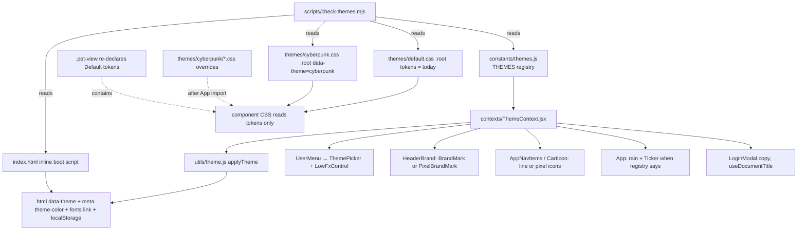

# Plan: Theme system + user menu v2 + Cyberpunk theme (FOODBYTES // Night Kitchen)

Plan folder: `.claude/contract/2026-11-14-cyberpunk-reskin/`
Execution status: see `tasks.md` in this folder.

> **Revision 2 (2026-11-15).** Revision 1 replaced the app's look with the cyberpunk reskin. A first `/fb-apply` ran Phases 1–3 of revision 1, then the developer asked for a rollback (all reskin files reverted; backup of that work in the session scratchpad, not in the repo). Revision 2 turns the reskin into **one selectable theme beside the current look**, adds a **theme picker** in a redesigned **user menu**, and makes the mockups live in the repo. Everything below supersedes revision 1.

---

## Part 1 — Alignment

### Task reference
Developer brief (2026-11-14, verbatim):

> Cyberpunk pixel restaurant makeover of the whole client UI. Approved mockup: C:\Users\jossd\Downloads\cyberpunk-makeover-mockup.html (merged, includes pixel icon set + teal recipe-card panels). Mockup plan: .claude/contract/2026-11-14-cyberpunk-makeover/mockup-plan.md. Functions/UX unchanged; restyle only. Frontend only, no backend/DB. MINOR bump.

Developer, 2026-11-15 (verbatim):

> I want to update the plan and the mock up, I want to mock up a new user menu and this menu to contain a temeh option, for now we only concern with default and cyberpunk, but the claude.md needs to know we have many themes now

Developer answers on the user-menu mockup, 2026-11-15: theme remembered **per device**; picker style **A (preview tiles)**; **yes** to a brand per theme (Default = *My Pantry Plan* + plate logo, Cyberpunk = *FOODBYTES · Night Kitchen* + pixel bowl); **keep icons on Default** (favicon, home-screen icons, manifest unchanged); "Looks good fold into plan". Also: the full mockup moves into the project and CLAUDE.md must require it to stay in step with the live app.

Earlier developer constraints still apply: "the functions can all behave the same, the UX is fine"; "make sure everything works 100%, like no white text on white background, or popups don't work in mobile". No Jira key.

### Design sources (in the repo)
- `foodbytes-app/mockup/app-mockup.html` — full interactive prototype, Cyberpunk theme, including user menu v2. Reference for every Cyberpunk selector, the `ICO` pixel-icon grids + `pxi()`, the `LOGO` rects, ticker copy.
- `foodbytes-app/mockup/user-menu-themes.html` — the user menu in **both** themes, web and mobile; picker style A is the chosen one. Reference for menu structure, the theme tiles and their preview art, and the semantic-token split.
- `.claude/contract/2026-11-14-cyberpunk-makeover/mockup-plan.md` §1–§3 — Cyberpunk palette, fonts and safety checklist (contrast, mobile overlays, touch targets, reduced motion).

### Restated goal
Introduce a theme system to the client. **Default** is the app exactly as it looks today. **Cyberpunk** is the night-kitchen look from the approved mockup (city backdrop with rain and scanlines, neon FOODBYTES sign, ticker, teal menu-board recipe cards, LED order board, terminal recipe view and dialogs, paper-receipt shopping list, pixel icons, Low FX switch). The user picks a theme in a redesigned user menu; the choice is remembered on the device. No behaviour, route, API call or data shape changes outside the user menu. Every text/background pair passes WCAG AA in every theme, every overlay works on mobile, and adding a third theme later is one token file, one optional override folder and one registry entry.

### In scope
- **Theme architecture.** `src/styles/themes/default.css` holds today's colour tokens on `:root` (values unchanged). `src/styles/themes/cyberpunk.css` reassigns those tokens under `:root[data-theme="cyberpunk"]` and adds the cyberpunk palette, fonts and glow. Cyberpunk-only component treatments live in `src/styles/themes/cyberpunk/<area>.css`, every selector prefixed `:root[data-theme="cyberpunk"]`.
- **Default-preserving literal sweep.** Every hard-coded colour in in-scope component CSS becomes a token whose Default value is that exact literal, so Default renders identically while Cyberpunk can remap it.
- **Theme state.** A `THEMES` registry, `ThemeContext` (`themeId`, `theme`, `setTheme`, `lowFx`, `toggleLowFx`), `applyTheme` (sets `data-theme` on `<html>`, updates `<meta name="theme-color">`, loads the theme's web fonts on demand, writes localStorage), and an inline boot script in `index.html` so the right theme paints first.
- **User menu v2** (from `user-menu-themes.html`, style A): grouped *Planning* (default servings, meal times) and *Appearance* (theme tiles; Low FX switch only for themes with effects), then Sign out and the version line. Desktop: anchored dropdown. Mobile (<768px): bottom sheet over a scrim, portalled to `body`, close button, Esc, body scroll lock, capped at `calc(100dvh - 24px)` with internal scroll.
- **Brand per theme.** Default keeps the plate-P `BrandMark` and "My Pantry Plan"; Cyberpunk shows the pixel bowl and the neon FOODBYTES sign with "NIGHT KITCHEN · SECTOR 9". The header aria-label, the login modal heading and the tab title use the active theme's brand name.
- **Cyberpunk shell:** skyline, scanlines, rain, ticker, neon sign, console footer nav, terminal toasts, `DOOR://SIGN IN` login, pixel nav icons and pixel `CartIcon` — all only under Cyberpunk.
- **Cyberpunk screen treatments** per the mockup: recipes (teal cards, numbering, in-plan pink panels), meal plan (desktop + mobile), recipe view + full-screen ingredients + cook mode, shopping receipt, shared dialogs; landing and admin get tokens only.
- **Low FX** switch (per device), applied as `body.lowfx`, effective only under themes with effects.
- **`npm run check:themes`**: contrast pairs per theme, plus registry ↔ CSS file ↔ `index.html` boot list consistency.
- **Docs and mockups:** CLAUDE.md *Themes* and *Mockups* sections finalised to match what shipped; mockups re-checked against the implementation.
- MINOR version bump and CHANGELOG line.

### Explicitly out of scope
- Favicon, PWA icons, `manifest.webmanifest`, `apple-mobile-web-app-*` meta and the `index.html` `<title>` default: they stay on the Default brand (developer decision). Only `theme-color` follows the theme at runtime.
- Persisting the theme on the account (decided: per device). No backend, database or migration.
- Pip's room art and every file under `components/pet/` except the containment block. The room keeps its palette in every theme.
- The landing animation's copy and brand (first-run guests always see Default).
- Any behaviour or flow change outside the user menu. Labels that do a job stay as they are.
- Unifying the app's z-index values (revision 1 had a z-scale; dropped to avoid stacking regressions — themes don't change stacking).
- Drawing Default screens in `app-mockup.html` (known gap, documented in `foodbytes-app/mockup/README.md`).
- `vite-plugin-pwa`, service worker, self-hosted fonts.
- Historical files: `Legacy/`, root `mockups/`, `logo-options.html`, `mockup-copy-week.html`.

### Constraints flagged on the brief
- **Default must look exactly as it does today.** Every swept literal keeps its exact value under Default; no Default token value changes.
- No white-on-white in any theme: text on a neon fill is `--void`; glow never counts toward contrast; the receipt is the only light Cyberpunk surface and sets its own ink; placeholder, disabled and autofill states get explicit colours.
- Popups work on mobile: the user menu is a portalled bottom sheet on mobile; Cyberpunk overrides never shrink tap targets or move overlays.
- Touch targets ≥44×44px, a visible `:focus-visible` ring in every theme, `prefers-reduced-motion` honoured.
- Frontend only. MINOR bump.

### Assumptions made
- **Default is the fallback.** No stored value, an unknown stored id or blocked storage all resolve to `default`.
- **Theme id lives in `localStorage` key `fb.display.theme`**; Low FX in `fb.display.lowFx`. Both are per-device display preferences.
- **ThemeContext, not a hook.** The theme is read by App (rain, ticker), Header (brand), AppNavItems and CartIcon (icon set), LoginModal (copy), UserMenu and `useDocumentTitle` — that is cross-cutting state, which the conventions put in a Context.
- **Cyberpunk fonts load on demand.** Default keeps today's Inter `<link>`. `applyTheme` injects the theme's Google Fonts stylesheet once, when that theme is first applied, so Default users don't download ~120 KB of pixel fonts.
- **Theme-switch is instant, no reload.** Swapping the attribute and the context value restyles everything.
- **Override specificity.** Cyberpunk overrides use the `:root[data-theme="cyberpunk"]` prefix (0,2,0 before the component selector) and the override bundle is imported **after** `App` in `main.jsx`, so they win against component rules on both specificity and order.
- **Tile previews are artwork.** Their fixed colours live in `src/styles/themes/previews.css` (one block per theme), which is inside the literal-colour exemption.
- **The skyline is a data-URI SVG** on `.app::before` in `cyberpunk/shell.css`, colours URL-encoded as `%23rrggbb`.
- **Recipe card numbering is a CSS counter** in `cyberpunk/recipes.css`; no JSX change.
- **No browser test runner.** Visual checks (both themes, four widths, Low FX, reduced motion) are a manual checklist in the final phase.

### Cross-code alignment audit (FE ↔ BE ↔ DB)
Skipped. No persistence, API or DTO is touched. The only stored state is two localStorage display preferences.

---

## Part 2 — Technical design

### Approach
**Semantic tokens, themes assign values.** Components already read `--brand-primary`, `--bg-primary`, `--text-primary` and friends (about 150 + 90 uses). Those names become the semantic layer. `themes/default.css` declares them on `:root` with today's values; `themes/cyberpunk.css` reassigns them under `:root[data-theme="cyberpunk"]`. The ~950 hard-coded colours across ~50 component files are moved onto tokens **without changing their Default value** — an existing token when the value and role already match, otherwise a new role-named token added to `default.css` with the exact literal, and given a Cyberpunk value in `cyberpunk.css`. After the sweep, Default looks identical and Cyberpunk inherits a coherent dark palette everywhere.

**Look that tokens can't express goes in an override folder.** Fonts per element, HUD corner brackets, glow, borders, the CSS counter, the receipt zigzag and similar are written once in `themes/cyberpunk/<area>.css`, scoped to `:root[data-theme="cyberpunk"]`. Component CSS stays theme-agnostic. A new theme repeats the pattern: a token file, an optional override folder, a registry entry, a preview block.

**Theme-specific markup is driven by the registry.** Each `THEMES` entry carries `brand` (name, sign subtitle, login copy), `iconSet` (`'line'` | `'pixel'`), `effects` (rain, scanlines, glow → Low FX applies), `ticker`, `themeColor` and `fontsHref`. Components ask the context for the active entry and branch on these fields, never on a theme id string.

**User menu v2 is extracted from Header.** `UserMenu` owns the dropdown/sheet, `ThemePicker` the radiogroup of tiles, `LowFxControl` the switch. Header shrinks to brand, nav, week pill and the avatar button.

**Roads not taken.** One CSS file per theme per component (multiplies files with every theme). CSS-in-JS or a framework (skill: plain CSS only). Storing the theme on the user (developer chose per device). Swapping stylesheets at runtime (attribute scoping is simpler and instant). Revision 1's global replacement (developer wants Default kept).

### Skills to invoke during execution
- `react-frontend`: owns every change under `client/src/` — plain per-component CSS, ≥44px targets, `:focus-visible`, `@media (hover: hover)`, file order, the 400-line budget, constants in `src/constants/`, cross-cutting state in a Context, portals for overlays, the manifest rules.
- Rules: no `.claude/rules/` file applies (no recipe, ingredient, macro or migration data). kcal still renders as `calories / default_servings`; no rendering logic changes.

### Diagram


### Data shapes
#### New files
- `client/src/styles/themes/default.css` — `:root { color-scheme: light; … }`: every colour token now in `global.css` (brand, neutral, semantic, macro FR-104 set, `--pip-focus-*`, `--aisle-*`) moved verbatim, plus tokens added by the sweep (exact literal values). Also `--focus-ring-color` (today's per-file focus colours are swept to tokens too).
- `client/src/styles/themes/cyberpunk.css` — `:root[data-theme="cyberpunk"] { color-scheme: dark; … }`:
  - Palette: `--void:#05070b; --deep:#020305; --panel:#0b1119; --raised:#141d2b; --ink:#eaf6ff; --muted:#9db2c7; --pink:#ff2a6d; --cyan:#05d9e8; --yellow:#f9f002; --lime:#39ff88; --orange:#ff9f1c; --red:#ff4d5e; --line:#4a7d99; --line-soft:#22384a; --paper:#f4f1e8; --paper-ink:#16141c; --paper-muted:#4f4a5a; --paper-struck:#5f5a6b; --paper-line:#cfc8b6; --black:#000`.
  - Card stops: `--card-teal-top:#0a222a; --card-teal-bottom:#06171d; --card-plan-top:#22101a; --card-plan-bottom:#14080f`.
  - Fonts: `--f-display:'Pixelify Sans',system-ui,sans-serif; --f-label:'Silkscreen',monospace; --f-num:'VT323',monospace; --f-body:'Space Grotesk',system-ui,sans-serif`.
  - Glow: `--glow-pink`, `--glow-cyan`, `--glow-yellow`, `--box-pink`, `--box-cyan` copied from the mockup `:root`.
  - Remap of every Default token: `--brand-primary:var(--pink); --brand-primary-dark:#c41f55; --brand-primary-light:var(--cyan); --text-primary:var(--ink); --text-secondary:var(--muted); --bg-primary:var(--panel); --bg-secondary:var(--void); --border-color:var(--line-soft); --success:var(--lime); --warning:var(--yellow); --error:var(--red); --cheat-badge:var(--orange); --focus-ring-color:var(--yellow)`; macro bases cyan/yellow/lime/red with low-alpha `-tint`/`-pill-bg` and `-pill-text` = base; `--aisle-*` retuned to pass 3:1 on `--paper`; every sweep-added token given a Cyberpunk value.
  - `:root[data-theme="cyberpunk"] body.lowfx { --glow-*: none; --box-*: none; --f-display: var(--f-body) }`.
- `client/src/styles/themes/cyberpunk/index.css` — `@import` of `shell.css`, `recipes.css`, `mealplan.css`, `recipe-view.css`, `shopping.css`, `dialogs.css` (each created by its phase; index created in Phase 1 importing only the files that exist, extended by each phase).
- `client/src/styles/themes/previews.css` — `.theme-preview--default {…}` and `.theme-preview--cyberpunk {…}` tile art from `user-menu-themes.html` (`.pv-default`, `.pv-cyber`).
- `client/src/constants/themes.js`:
  ```js
  export const THEME_STORAGE_KEY = 'fb.display.theme'
  export const LOW_FX_STORAGE_KEY = 'fb.display.lowFx'
  export const LOW_FX_BODY_CLASS = 'lowfx'
  export const DEFAULT_THEME_ID = 'default'
  export const THEMES = [
    { id: 'default', label: 'Default', themeColor: '#4a3f80', fontsHref: null,
      iconSet: 'line', effects: false, ticker: false,
      brand: { name: 'My Pantry Plan', sub: null, loginTitle: 'Welcome to My Pantry Plan', loginSub: 'Sign in to unlock all features' } },
    { id: 'cyberpunk', label: 'Cyberpunk', themeColor: '#05070b',
      fontsHref: 'https://fonts.googleapis.com/css2?family=Pixelify+Sans:wght@400..700&family=Silkscreen:wght@400;700&family=Space+Grotesk:wght@400..700&family=VT323&display=swap',
      iconSet: 'pixel', effects: true, ticker: true,
      brand: { name: 'FOODBYTES', sub: 'NIGHT KITCHEN · SECTOR 9', loginTitle: 'FOODBYTES', loginSub: 'Night Kitchen · Sector 9. Sign in to plan your week and build your supply run.' } },
  ]
  export const themeById = (id) => THEMES.find((t) => t.id === id) ?? THEMES[0]
  ```
- `client/src/utils/theme.js` — `readThemeId(): string` (storage in try/catch, unknown → `DEFAULT_THEME_ID`); `applyTheme(id): void` (sets `document.documentElement.dataset.theme`, sets the `meta[name="theme-color"]` content, appends `<link rel="stylesheet" data-theme-fonts="<id>">` once if `fontsHref`, writes storage in try/catch).
- `client/src/utils/lowFx.js` — `readLowFx(): boolean`, `applyLowFx(on): void` (toggles `LOW_FX_BODY_CLASS` on `body`, writes storage in try/catch).
- `client/src/contexts/ThemeContext.jsx` — `ThemeProvider` + `useTheme() → { themeId, theme, setTheme(id), lowFx, toggleLowFx() }`. Initial state from `readThemeId()` / `readLowFx()`; setters call `applyTheme` / `applyLowFx`. No cleanup (preferences persist).
- `client/src/components/layout/UserMenu.jsx` + `UserMenu.css` — props `{ user, onSignOut, onClose, anchorRef }`. Uses `useMediaQuery('(max-width: 767px)')`: desktop → absolutely positioned panel (`role="dialog"`, `aria-label="Account"`), closes on outside click and Esc; mobile → `createPortal` to `document.body` with scrim (click closes), grab bar, `[X]`/`✕` close button, Esc, `useBodyScrollLock(true)`, focus moves into the sheet and returns to the avatar on close. Sections in order: who (avatar, name, email, close button on mobile) · *Planning* (`DefaultPortionsControl`, `MealTimesControl`) · *Appearance* (`ThemePicker`, `LowFxControl` when `theme.effects`, "Saved on this device") · Sign out · `VersionInfo`.
- `client/src/components/layout/ThemePicker.jsx` + `ThemePicker.css` — `role="radiogroup" aria-label="Theme"`; one `button role="radio"` tile per `THEMES` entry with `aria-checked`, roving `tabIndex`, ←/→/↑/↓ move and select, preview `<span className={\`theme-preview theme-preview--${id}\`} aria-hidden="true">` plus label and tick.
- `client/src/components/layout/LowFxControl.jsx` — row with label "Low FX" / "No glow, rain or flicker" and `button role="switch" aria-checked` calling `toggleLowFx`.
- `client/src/components/layout/HeaderBrand.jsx` — the brand button: `MARKS = { default: BrandMark, cyberpunk: PixelBrandMark }`; wordmark from `theme.brand` (Default: `My Pantry <span>Plan</span>` as today; Cyberpunk: `.brand-sign` with `FOOD<span className="brand-flicker">B</span>YTES` and `.brand-sub`); `aria-label={\`${theme.brand.name}, go to Recipes\`}`.
- `client/src/components/common/PixelBrandMark.jsx` — props as `BrandMark`; 16×16 pixel bowl from the mockup `LOGO` in a module-level `LOGO_PIXELS` array.
- `client/src/constants/pixelIcons.js` + `client/src/components/common/PixelIcon.jsx` + `PixelIcon.css` — as revision 1: `menu`, `cal`, `cart` grids verbatim, run-lengths precomputed at module load, `#` = `currentColor`, accents as `var(--token)`.
- `client/src/components/layout/Ticker.jsx` + `Ticker.css` — `TICKER_ITEMS` verbatim from the mockup, rendered twice in `.ticker-track`, `aria-hidden="true"`.
- `client/scripts/check-themes.mjs` + script `"check:themes": "node scripts/check-themes.mjs"` — per theme, resolve `--name: #hex` (and `var(--x)` one level) from that theme's file layered over Default; check `PAIRS[themeId]`; then assert every `THEMES` id has a `src/styles/themes/<id>.css` (except `default` which is the base), a `.theme-preview--<id>` block in `previews.css`, and appears in the `index.html` boot list, and that no extra ids exist. Prints `Themes OK: <n> themes, <m> contrast pairs` or each `FAIL …` / `MISSING …` and exits 1.

#### Modified contracts
- `index.html`: adds, before the module script, an inline boot script — `(function(){var ids=['default','cyberpunk'];try{var t=localStorage.getItem('fb.display.theme');if(ids.indexOf(t)>0){document.documentElement.dataset.theme=t;document.querySelector('meta[name="theme-color"]').content=t==='cyberpunk'?'#05070b':'#4a3f80'}}catch(e){}})()` — kept minimal; `check:themes` guards the id list. Nothing else in `index.html` changes.
- `main.jsx`: imports `themes/default.css` then `global.css` first; wraps the tree in `ThemeProvider` (outermost); imports `themes/cyberpunk/index.css` **after** `import App`; calls `applyTheme(readThemeId())` and `applyLowFx(readLowFx())` before render.
- `global.css`: loses its colour tokens (moved to `default.css`); its remaining literals become tokens; keeps spacing, radius, shadows, `--footer-clearance`, `--pip-sheet-*`.
- `Header.jsx`: brand → `<HeaderBrand />`; dropdown → `<UserMenu />`; the avatar button keeps `aria-expanded` and becomes `aria-haspopup="dialog"`.
- `AppNavItems.jsx`, `ExtrasIcons.CartIcon`: branch on `theme.iconSet`.
- `App.jsx`: `{theme.effects && <div className="city-rain" aria-hidden="true" />}` first in `.app`; `{!pipMode && <><Header />{theme.ticker && <Ticker />}</>}`.
- `LoginModal.jsx`: heading and subtitle from `theme.brand.loginTitle` / `loginSub`.
- `constants/appRoutes.js` → `routeTitle(pathname, appName = APP_NAME)`; `useDocumentTitle` passes `theme.brand.name` and re-runs when the theme changes.
- `PetView.css`: prepended `.pet-view { …Default token values… }` containment block.
- No API, DTO or other Context changes.

### Runtime quality notes
- **Resource cleanup:** the user menu's outside-click and Esc listeners are added on open and removed on close; the scroll lock releases on unmount. Theme/Low FX have no listeners.
- **Concurrency / ordering:** none. Boot script → `applyTheme` in `main.jsx` → React render, all synchronous. Two tabs can hold different themes until reload; acceptable for a display preference.
- **Allocation / cost:** Default users download nothing new (Cyberpunk fonts load only when picked). The backdrop is one data-URI SVG and two pseudo-elements; rain is one animated element. `PixelIcon` precomputes runs. Glow uses one blur radius; Low FX removes it.
- **Error paths:** storage access wrapped in try/catch → Default / Low FX off. A font load failure falls back to the system stacks in the font tokens. An unknown stored id falls back to Default.

### Risks and judgement calls
- **Default drift during the sweep.** The biggest risk: a swept literal that changes value under Default. Mitigation: the sweep rule demands exact values; each phase greps its files; the final phase compares Default against production on every route at 390 and 1280px.
- **Token sprawl.** Exact-value tokens for ~950 literals could add 100+ tokens. Reuse an existing token whenever value **and** role match; name new ones by role (`--surface-tint-brand`), not by colour; group them by area with comments in `default.css`.
- **Override specificity.** A component rule with 3+ classes can still beat an override. The implementer raises the override's selector to match rather than adding `!important`.
- **Pip containment leaks.** Room overlays portalled to `body` sit outside `.pet-view`. Phase 1 greps `createPortal` under `components/pet/` (currently zero hits) and adds any portal root to the containment selector.
- **RecipeViewModal.jsx is ~393 lines** and the recipe-view files had uncommitted developer work on 2026-11-15. Phase 6 touches only the CSS listed; it builds on whatever is in the working tree and never reverts it.
- **Two `THEMES` id lists** (registry and `index.html` boot script). `check:themes` fails if they disagree.
- **Mockup gap.** `app-mockup.html` draws Cyberpunk only; Default's reference is the live app.

### Plan slug
Unchanged (`2026-11-14-cyberpunk-reskin`) so the history of revision 1 and its rollback stays with the work.
