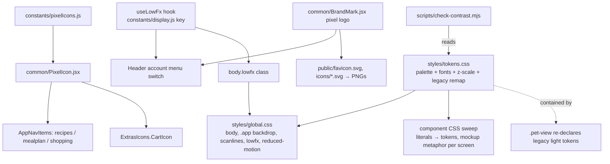

# Plan: Cyberpunk pixel restaurant reskin (FOODBYTES // Night Kitchen)

Plan folder: `.claude/contract/2026-11-14-cyberpunk-reskin/`
Execution status: see `tasks.md` in this folder.

---

## Part 1 — Alignment

### Task reference
Developer brief (2026-11-14, verbatim):

> Cyberpunk pixel restaurant makeover of the whole client UI. Approved mockup: C:\Users\jossd\Downloads\cyberpunk-makeover-mockup.html (merged, includes pixel icon set + teal recipe-card panels). Mockup plan: .claude/contract/2026-11-14-cyberpunk-makeover/mockup-plan.md. Functions/UX unchanged; restyle only. Frontend only, no backend/DB. MINOR bump.

Earlier in the same session the developer said: "the functions can all behave the same, the UX is fine", "You can change everything, logo colors the works", and "make sure everything works 100%, like no white text on white background, or popups don't work in mobile". They approved the mockup ("I love it"), asked for pixel nav icons, and asked for the teal recipe-card panels to be merged in. No Jira key, so there is no ticket to move.

The design source of truth is the mockup file and the mockup plan. The token values, fonts, safety checklist and screen metaphors in `mockup-plan.md` §1–§3 apply here unchanged.

### Restated goal
Reskin the whole FoodBytes client as the site of a pixel-art night-kitchen restaurant in a cyberpunk city, matching the approved mockup. That covers a dark city backdrop with rain and scanlines, a neon FOODBYTES sign, a yellow ticker, a teal menu-board look for recipe cards, an LED order board for the meal plan, a terminal look for the recipe view and dialogs, a paper receipt for shopping, and pixel icons. No behaviour, flow, route, API call or data shape changes. Every text and background pair must pass WCAG AA, every overlay must work on mobile, and a Low FX switch turns the effects off.

### In scope
- One global token sheet. It sets the mockup palette, the four fonts, glow, the z-index scale and the focus ring, and maps the existing legacy tokens (`--brand-primary`, `--bg-primary`, `--text-primary` and so on) onto the new palette.
- Moving every hard-coded colour in the in-scope component CSS files onto tokens, with each screen restyled to its mockup metaphor: recipes, meal plan (desktop and mobile), recipe view with the full-screen ingredients view and cook mode, shopping, every dialog, sheet and popup, toasts, header, footer nav, sign-in, the landing animation, and admin forms (tokens only).
- The app shell backdrop: a pixel skyline, rain and scanlines, all non-interactive and all off under Low FX and under reduced motion.
- The brand: a pixel FOODBYTES logo, the neon wordmark with the "NIGHT KITCHEN · SECTOR 9" subtitle, favicon, PWA icons, manifest name and theme colour, `<meta name="theme-color">`, and the page title.
- A pixel icon component, used for the Recipes, Meal Plan and Shopping nav icons and for the extras `CartIcon`.
- A ticker strip under the header, decorative and hidden from screen readers.
- A Low FX switch in the account menu, remembered per device, applied as `body.lowfx`.
- A contrast regression check, `npm run check:contrast`, covering the token pairs.
- A MINOR version bump and a CHANGELOG line.

### Explicitly out of scope
- Pip's room art and every file under `components/pet/` (decision 4: shell only). The room keeps its current look through token containment.
- Any behaviour, copy-meaning or flow change. Labels that do a job stay as they are; flavour copy is limited to subtitles, the ticker and the sign.
- Backend, database and migrations.
- Installing `vite-plugin-pwa` or a service worker. Neither is installed today; the skill's PWA bootstrap is separate work.
- Self-hosting fonts (see Assumptions).
- The residual items left open by the meal-plan redesign contract, including the ⓘ-inside-checkbox issue in `ShoppingListItem`.
- Historical files: `Legacy/`, `mockups/`, `logo-options.html`, `mockup-copy-week.html`.

### Pattern Reference
- Visual: `C:\Users\jossd\Downloads\cyberpunk-makeover-mockup.html`. Its `<style>` block is the reference for every selector's look; its `ICO` grids and `pxi()` helper are the reference for the pixel icons; its `LOGO` `px()` rects are the reference for the logo.
- Design system and safety rules: `.claude/contract/2026-11-14-cyberpunk-makeover/mockup-plan.md` §2–§3.
- Code conventions: `.claude/skills/react-frontend/SKILL.md` and `references/engineering-standards.md`.
- Existing patterns to follow: `components/common/BrandMark.jsx` (logo component shape), `components/common/ExtrasIcons.jsx` (icon exports), `scripts/check-version.mjs` (node check script shape), `constants/` (storage keys).

### Constraints flagged on the brief
- The UX and every function stay the same; this is a restyle only.
- No white-on-white: text on a neon fill is always `--void`, glow never counts toward contrast, the receipt is the only light surface and sets its own ink, and placeholder, disabled and autofill states get explicit colours.
- Popups must work on mobile: overlays render at the app root (portals), mobile dialogs are bottom sheets capped at `calc(100dvh - 24px)` with internal scroll, and there is one z-index scale (popover 40, nav 50, sheet 80, toast 90).
- Touch targets stay at least 44×44px, the `:focus-visible` ring is visible on every surface, and `prefers-reduced-motion` is honoured.
- Frontend only. MINOR bump.

### Assumptions made
- **Name: FOODBYTES // Night Kitchen** (decision 1). It's what the approved mockup shows. The manifest uses `name: "FOODBYTES"` and `short_name: "FOODBYTES"`, which follows the skill's manifest rule.
- **Plain labels with flavour headings** (decision 2). Matches the mockup. Nav and button labels are unchanged; only subtitles and decoration are in-world.
- **Pixel chrome with a smooth body font** (decision 3). Matches the mockup: Pixelify Sans, Silkscreen and VT323 for chrome, Space Grotesk for body.
- **Pip: shell only** (decision 4). The Pip nav item keeps its live `PipHerb` mini rather than the mockup's sprout, because that item is a live mood indicator (MPP-31/32).
- **Fonts load from Google Fonts**, replacing today's Inter `<link>`. The app already loads Inter this way and has no service worker, so self-hosting brings no offline gain yet. Self-hosting belongs with the PWA bootstrap.
- **Token remap rather than a rename sweep.** About 150 existing `var(--brand-primary)` and 90 `var(--border-color)` uses flip automatically when the legacy names are pointed at the new palette. Only literal colours need editing.
- **Pip containment:** `.pet-view` re-declares the legacy tokens at their current light values, so the room is visually unchanged. Room overlays portalled to `body` are covered by the same block on their own root class (see Risks).
- **Recipe card numbering uses a CSS counter**, so `RecipeCard.jsx` needs no prop or markup change for "01, 02…".
- **The skyline is a CSS `background-image` data-URI SVG** on `.app::before`. The rain is one decorative `
` rendered in `App.jsx`.
- **The Low FX switch lives in the Header account menu**, matching the mockup, with its state in a `useLowFx` hook (localStorage key `fb.display.lowFx` in `constants/display.js`). It's a per-device preference with no other consumer, so it doesn't need a Context.
- **PNG icons are rendered from the new SVG with headless Chrome**, the method already used to screenshot the mockup, so no image dependency is needed.
- **The contrast check covers token pairs, not live DOM.** There's no browser test runner. Per-screen DOM contrast is a manual check, using the mockup's audit approach.

### Cross-code alignment audit (FE ↔ BE ↔ DB)
Skipped. No persistence, API or DTO is touched. The only stored state is a localStorage display preference.

---

## Part 2 — Technical design

### Approach
**Tokens first, then a sweep per area.** A new `src/styles/tokens.css`, imported before `global.css`, declares the mockup palette (`--void`, `--panel`, `--raised`, `--ink`, `--muted`, `--pink`, `--cyan`, `--yellow`, `--lime`, `--orange`, `--red`, `--line`, `--line-soft`, `--deep`, plus receipt paper and ink), the font stacks, the glow tokens, the z-index scale and the focus ring. It also redefines every legacy token in terms of those values, and retunes the FR-104 macro tokens so the pill text reads on a dark surface. Because most components already use `var(--brand-primary)` and the neutral tokens, that one file flips most of the app to the night palette. The remaining work is the roughly 1,000 literal `#hex`, `rgba()` and `white` values across about 50 component CSS files. Each in-scope file is swept to tokens and given its mockup treatment, one phase per screen area, so every phase ends with a coherent, buildable screen.

**The shell holds the atmosphere; components stay functional.** The skyline (`.app::before`), scanlines (`.app::after`) and rain (`.city-rain`) all have `pointer-events: none`, sit behind content in the z-index scale, and are hidden under `body.lowfx` and `prefers-reduced-motion`. The neon sign, ticker and pixel icons are presentational components: `BrandMark` is rewritten as a pixel logo, `Ticker` is new and `aria-hidden`, and `PixelIcon` is new. The icon grids and colour maps live in `constants/pixelIcons.js`, so icons are data and the component is a small renderer. `AppNavItems` swaps its line icons for `PixelIcon` and `ExtrasIcons.CartIcon` delegates to it. No component gains state except the Header, which reads `useLowFx`.

**Roads not taken.** A full rename to new token names everywhere would touch every CSS file twice for no visual gain. CSS Modules or a CSS framework are against the skill, which says plain CSS only. A runtime theme Context isn't needed: there is one theme, and Low FX is a body class. Restyling Pip's room was declined by decision 4.

**Pip containment.** `PetView.css` gains a `.pet-view { --brand-primary:#4a3f80; --bg-primary:#fff; … }` block restoring today's values, so the room's roughly 20 legacy-token uses render as they do now. The global `body` background change is masked by the room's own opaque background. If any room sheet is portalled to `body`, its root class joins the same selector list.

### Skills to invoke during execution
- `react-frontend`: owns every change under `client/src/`, including plain per-component CSS, ≥44px targets, `:focus-visible`, `@media (hover: hover)`, file order, the 400-line budget, constants in `src/constants/`, the hook-holds-logic rule, and the manifest rules.
- Rules: no `.claude/rules/` file applies, because no recipe, ingredient, macro or migration data is touched. The UI must still render kcal as `calories / default_servings`, and no rendering logic changes.

### Diagram

### Data shapes
#### New files
- `client/src/styles/tokens.css`: `:root` with these values.
  - Palette: `--void:#05070b; --deep:#020305; --panel:#0b1119; --raised:#141d2b; --ink:#eaf6ff; --muted:#9db2c7; --pink:#ff2a6d; --cyan:#05d9e8; --yellow:#f9f002; --lime:#39ff88; --orange:#ff9f1c; --red:#ff4d5e; --line:#4a7d99; --line-soft:#22384a; --paper:#f4f1e8; --paper-ink:#16141c`.
  - Recipe card panels: `--card-teal-top:#0a222a; --card-teal-bottom:#06171d; --card-plan-top:#22101a; --card-plan-bottom:#14080f`.
  - Fonts: `--f-display:'Pixelify Sans',…; --f-label:'Silkscreen',…; --f-num:'VT323',…; --f-body:'Space Grotesk',…`.
  - Glow: `--glow-pink`, `--glow-cyan` and `--glow-yellow` (text-shadow), plus `--box-pink` and `--box-cyan` (box-shadow), copied from the mockup's `:root`.
  - Z-index: `--z-popover:40; --z-nav:50; --z-sheet:80; --z-toast:90`.
  - Focus: `--focus-ring:2px solid var(--yellow)`.
  - Legacy remap: `--brand-primary:var(--pink); --brand-primary-dark:#c41f55; --brand-primary-light:var(--cyan); --text-primary:var(--ink); --text-secondary:var(--muted); --bg-primary:var(--panel); --bg-secondary:var(--void); --border-color:var(--line-soft); --primary-color:var(--pink); --success:var(--lime); --warning:var(--yellow); --error:var(--red); --cheat-badge:var(--orange)`.
  - Macro retune: base colours `--macro-under-target:var(--cyan)`, `--macro-near-target:var(--yellow)`, `--macro-on-target:var(--lime)` and `--macro-over-target:var(--red)`. `-tint` and `-pill-bg` become low-alpha versions of those colours, and every `-pill-text` becomes the base colour (it reads on `--raised`).
  - `body.lowfx` overrides set every glow token to `none` and `--f-display` to `var(--f-body)`.
- `client/src/constants/display.js`: `export const LOW_FX_STORAGE_KEY = 'fb.display.lowFx'` and `export const LOW_FX_BODY_CLASS = 'lowfx'`.
- `client/src/utils/lowFx.js`: `readLowFx(): boolean` reads localStorage inside try/catch, defaulting to `false`. `applyLowFx(on: boolean): void` sets or removes `LOW_FX_BODY_CLASS` on `document.body` and writes storage inside try/catch. `main.jsx` calls `applyLowFx(readLowFx())` once before render, so the class is present on every screen from the first paint.
- `client/src/hooks/useLowFx.js`: `useLowFx() → { lowFx: boolean, toggleLowFx: () => void }`. Its initial state is `document.body.classList.contains(LOW_FX_BODY_CLASS)`, and the toggle calls `applyLowFx(next)`. There is deliberately no cleanup that removes the class, because the switch unmounts when the account menu closes and the preference must persist. *(Revised while writing tasks.md, 2026-11-14.)*
- `client/src/constants/pixelIcons.js`: `export const PIXEL_ICONS = { menu: { rows: string[], accents: { a: string, b: string } }, cal: {…}, cart: {…} }`. Rows are copied verbatim from the mockup's `ICO` grids. `#` means `currentColor`; each letter maps to a CSS `var(--token)` string.
- `client/src/components/common/PixelIcon.jsx`: `PixelIcon({ name, size = 20, className })`. It renders `<svg className={\`pixel-icon ${className ?? ''}\`} viewBox="-0.5 -0.5 W+1 H+1" width={size} height={size} shapeRendering="crispEdges" aria-hidden="true" focusable="false">` with run-length `<rect>`s, the same algorithm as the mockup's `pxi()`. Accent rects use `style={{ fill: accent }}`.
- `client/src/components/common/PixelIcon.css`: `.pixel-icon { display:inline-block; flex:none }` and the active-state drop-shadow, with `body.lowfx` removing it.
- `client/src/components/layout/Ticker.jsx` and `Ticker.css`: a static `TICKER_ITEMS` array at module top, rendered twice in a `.ticker-track` for a seamless loop, inside `
`. The animation is off under `body.lowfx` and reduced motion.
- `client/scripts/check-contrast.mjs`: parses the hex values out of `src/styles/tokens.css`, then checks a declared `PAIRS` array (`[fgToken, bgToken, minRatio]`) with WCAG relative-luminance math. It prints `Contrast OK: <n> pairs` and exits 0, or prints each failure and exits 1. The pairs are those in mockup-plan §2: ink, muted, pink, cyan, yellow, lime and red on panel and on raised, with 4.5 for text and 3 for UI. It also checks `--void` on each neon fill, `--paper-ink` on `--paper`, and ink, muted and pink on both teal card stops.
- `package.json` script: `"check:contrast": "node scripts/check-contrast.mjs"`.

#### Modified contracts
- `BrandMark({ size = 40, title, className })`: the props are unchanged and the body becomes the 16×16 pixel logo from the mockup's `LOGO`.
- `manifest.webmanifest`: `name` and `short_name` become `"FOODBYTES"`, and `background_color` and `theme_color` become `#05070b`.
- `index.html`: the title becomes `FOODBYTES · Night Kitchen`, `theme-color` becomes `#05070b`, `apple-mobile-web-app-status-bar-style` becomes `black-translucent`, `apple-mobile-web-app-title` becomes `FOODBYTES`, and the Google Fonts link loads `Pixelify Sans:wght@400..700`, `Silkscreen:wght@400;700`, `VT323` and `Space Grotesk:wght@400..700` with `display=swap`.
- No API, Context or DTO changes.

### Runtime quality notes
These dimensions are mapped onto the browser runtime.
- **Resource cleanup:** nothing to clean up. `useLowFx` has no effect and no listener; the body class is a persistent preference, set at boot by `applyLowFx`. The ticker and rain are CSS animations with no timers or listeners.
- **Concurrency / ordering:** none. localStorage is per device and the toggle is synchronous. Nothing touches shared meal-plan or shopping state.
- **Allocation / cost behaviour:**
  - Four web fonts add roughly 120 KB, loaded with `display=swap` so text paints immediately.
  - The backdrop uses one data-URI SVG and two pseudo-elements. Rain is a `background-position` animation on one element, which is GPU-cheap; there are no per-drop DOM nodes.
  - `PixelIcon` builds a few dozen `<rect>`s per icon and is rendered about four times per screen, which is trivial.
  - Glow uses a single blur radius and is never stacked (mockup-plan §3). Low FX removes it for slow phones.
- **Error paths:** localStorage access is wrapped in try/catch and falls back to `false`. A failure to load Google Fonts falls back to the system stacks declared in the token font lists, and pixel headings degrade to sans-serif with no broken layout.

### Risks and judgement calls
- **Contrast regressions from the remap.** Light-theme literals that weren't tokenised will sit on dark backgrounds after phase 1. The worst case is dark text on `--void`. Phase 1 leaves known stragglers. Each later phase sweeps its files, and a grep in the final phase confirms no literal light colours remain in in-scope files. Treat the build between phases as "coherent but not finished visually".
- **Pip containment leaks.** Room sheets portalled to `document.body` are outside `.pet-view`. Phase 1 greps `createPortal` under `components/pet/` and adds each portal root class to the containment selector. Check this manually on `/pet`.
- **Header.jsx growth.** Adding the Low FX switch and the ticker mount must keep it under 400 lines. The ticker mounts in `App.jsx` rather than in the Header to limit that growth.
- **RecipeViewModal.jsx is at 393 lines.** This plan touches only its CSS. If the implementer finds a markup need there, it must go in a child component.
- **Google Fonts versus offline.** Accepted for now (see Assumptions) and called out for the future PWA bootstrap.
- **The landing animation and admin forms get a token sweep only**, not a bespoke metaphor. This judgement call keeps the scope bounded, since both are rarely seen.
- **Visual verification is manual.** There's no browser test runner. The final phase lists the screens and widths to check (320, 390, 768 and 1280px), plus Low FX and reduced motion.
- **Plan slug.** `2026-11-14-cyberpunk-makeover/` already exists, holding only `mockup-plan.md`. This plan uses a fresh slug instead of writing into it.
