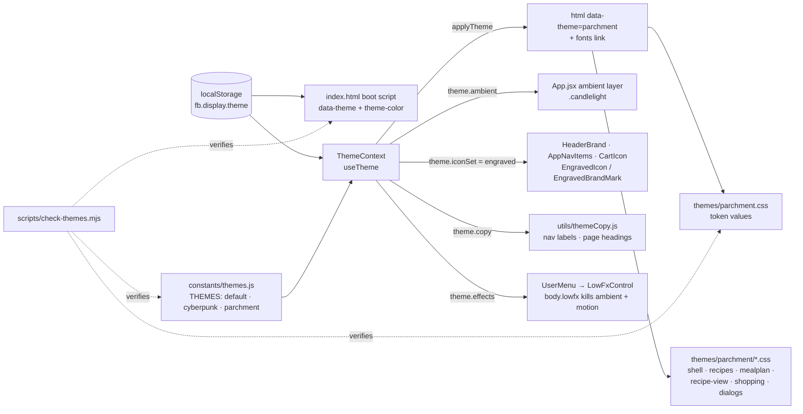

# Plan: Parchment theme ("The Kitchen Grimoire")

Plan folder: `.claude/contract/2026-11-15-parchment-theme/`
Execution status: see `tasks.md` in this folder.

---

## Part 1 — Alignment

### Task reference
Developer brief (2026-11-15, verbatim):

> Parchment theme ("The Kitchen Grimoire") — a third user-selectable theme alongside Default and Cyberpunk. Approved design: foodbytes-app/mockup/parchment-theme.html (approved 2026-11-15; open questions in its notes panel default to the mockup's choices: label "Parchment", themed copy as drawn, sepia emoji, Cinzel Decorative brand). Licence-free: generic parchment/quill/wax/leather motifs only, open-licence Google Fonts, no franchise names/marks/fan fonts. Must build on the theme system from contract .claude/contract/2026-11-14-cyberpunk-reskin/ — check the latest code on branch Themes (uncommitted: themes.js, ThemeContext, styles/themes/, check-themes.mjs, lowFx.js) to see what has actually landed and plan against that.

Earlier in the same session the developer asked for "a harry potter theme (but licence free so just the style) think parchment paper and quills". They then approved the mockup ("design approved") and confirmed "this is a theme to choose", meaning a selectable theme, not a replacement look.

State of the code at planning time: the Cyberpunk contract is `Status: COMPLETE` (v1.31.0) and committed on `Themes` as `22927f9 Cyberpunk there`. The working tree is clean. Everything the brief calls "uncommitted" has landed, so this plan builds on the committed theme system.

No Jira key, so there is no ticket to transition.

### Restated goal
Add **Parchment** as a third theme in the user-menu theme picker, next to Default and Cyberpunk. When chosen, the app looks like an old handwritten kitchen book, as drawn in `foodbytes-app/mockup/parchment-theme.html`:
- **Surfaces:** aged parchment with iron-gall ink.
- **Header and footer:** a leather binding with gold tooling and a red ribbon bookmark on the active tab.
- **Account menu:** a wax-seal avatar.
- **Recipes:** pinned parchment recipe cards with sepia-toned emoji.
- **Meal plan:** a ruled ledger.
- **Recipe view:** an open-book recipe view with a drop cap.
- **Shopping:** a shopping list drawn as a scroll on wooden rods.
- **Effects:** gentle candlelight effects that Low FX turns off.

The brand becomes "The Kitchen Grimoire" with an engraved quill mark. The nav labels and page headings use the themed copy from the mockup.

Default and Cyberpunk must not change at all. The new theme must pass `check:themes` (WCAG AA) and work from 320px to 1280px. It uses only generic period motifs and open-licence fonts.

### In scope
- **Registry entry** for `parchment` in `constants/themes.js`: label "Parchment", brand "The Kitchen Grimoire", fonts, `iconSet: 'engraved'`, `effects: true`, `ticker: false`.
- **Two new optional registry fields:**
  - `ambient`: the background-effect layer class. Cyberpunk becomes `'city-rain'`, Parchment `'candlelight'`, Default `null`. This replaces the `theme.effects && city-rain` coupling in `App.jsx`.
  - `copy`: themed nav labels and page headings. Themes without it render today's strings.
- **Token file** `styles/themes/parchment.css`: a Parchment value for every Default token except the `--pip-*` tokens, plus the theme-only palette (leather, gold, wax, rule, noise texture) and font tokens.
- **Override bundle** `styles/themes/parchment/`. Every selector is prefixed `:root[data-theme="parchment"]`.
  - `shell`: page texture, leather header and footer, ribbon nav, wax-seal avatar, user menu, toasts, login, candlelight vignette and dust motes.
  - `recipes`: pinned slips, etched sepia emoji roundel, wax-seal cheat badge, small-caps variant tabs, ink-dot macro chips.
  - `mealplan`: the ruled ledger timetable, mobile day tabs as parchment slips, handwritten "today" and "eaten".
  - `recipe-view`: the leather book frame and two leaves, dotted-leader ingredients, drop cap and Roman-numeral steps, ink strike-through on ticked steps, cook mode.
  - `shopping`: the scroll with rods, aisle headings with ink dots and a flourish rule, hand-drawn ✗ ticks, wax-seal stamp.
  - `dialogs`: parchment confirm dialogs and modals.
- **Engraved icon set:** an `EngravedIcon` component with paths from the mockup (book, ledger, basket, quill), and an `EngravedBrandMark` (the quill crest). `HeaderBrand`, `AppNavItems` and `CartIcon` choose them by `iconSet`.
- **Themed copy helper** `utils/themeCopy.js`, used by:
  - `AppNavItems` for the nav labels (Receipts / Ledger / Provisions).
  - Page headings on Recipes, Meal Plan desktop and mobile, and Shopping. Recipes gets a heading and subtitle only when the theme provides copy.
- **Theme-picker tile** `.theme-preview--parchment` in `previews.css`.
- **`index.html` boot script:** add `parchment` and its `theme-color`.
- **`check-themes.mjs`:**
  - Add a `PAIRS.parchment` contrast list.
  - Make the boot-script fallback-colour regex work with three themes.
- **Docs and mockups:**
  - `CLAUDE.md` Themes section lists Parchment and the two new registry fields.
  - `mockup/README.md` lists `parchment-theme.html` as the Parchment reference.
  - `user-menu-themes.html` and `app-mockup.html` picker tiles gain Parchment.
- **Version bump** (MINOR) and a CHANGELOG line.

### Explicitly out of scope
- **Renaming meal slots** (Breakfast, Luncheon, Supper, Morsels) and **renaming aisles** (Garden & Orchard…). The mockup draws them, but see Assumptions.
- **Themed document-tab titles.** `routeTitle` keeps "Meal Plan · The Kitchen Grimoire".
- **Any change to the Default or Cyberpunk look**, including retuning the known Default contrast exception.
- **Pip's room.** It keeps its own palette in every theme. Only the leather footer around it changes.
- **Static brand assets:** favicon, PWA icons, manifest, `index.html` title and the login dialog's plate-P mark all stay Default.
- **Backend, API, DB or data changes.**
- **Hand-drawn engraved artwork for dishes.** Emoji get a sepia filter instead.
- **The PWA bootstrap** (not installed today) and any other skill-listed debt not touched by this work.

### Pattern Reference
None supplied beyond the mockup and the Cyberpunk contract, so I chose these references:
- **Look:** `foodbytes-app/mockup/parchment-theme.html`. It is authoritative for every colour, font, texture, effect and the copy strings.
- **Token file:** `client/src/styles/themes/cyberpunk.css`. Copy its section order: palette, fonts, remap, sweep-added, header, footer, macro, recipes, meal plan, recipe view, shopping, aisles, dialogs, admin, landing, then the `body.lowfx` block.
- **Override bundle:** `client/src/styles/themes/cyberpunk/*.css`. Each file's selectors are the map of which component classes to restyle per area. Copy the shape: `index.css` imports, `:where()` for base element defaults in `shell.css`, and specificity rather than `!important`.
- **Icon branch:** `components/common/PixelIcon.jsx`, `PixelBrandMark.jsx`, and their `iconSet` consumers (`HeaderBrand.jsx`, `AppNavItems.jsx`, `ExtrasIcons.jsx`).
- **Rules:** `CLAUDE.md` → *Themes*, the "Adding a theme" checklist, and `react-frontend` SKILL.md.

### Constraints flagged on the brief
- **Licence-free.** Use generic motifs only. No franchise names, places, houses, crests, characters, spells, lightning bolts, owls or wands, and no fan lookalike fonts ("Harry P", "Lumos"). The label is never the franchise name.
- **Fonts are all Google Fonts:** Cinzel Decorative, IM Fell English, IM Fell English SC and EB Garamond (all SIL OFL), and Homemade Apple (Apache 2.0).
- **Open questions default to the mockup's choices:** label "Parchment", themed copy as drawn, sepia emoji, Cinzel Decorative brand.
- **It must be a selectable theme.** Default stays the fallback.
- **Build on the landed theme system** and its binding rules in `CLAUDE.md`:
  - Colours only in `styles/themes/`.
  - Default must not drift.
  - Override selectors are prefixed `:root[data-theme="parchment"]`.
  - Markup branches on registry fields, never on the theme id.
  - Choice is per device.
  - Pip keeps its palette.
  - No `mask` on elements that contain fixed popups.
  - `check:themes` passes.
  - Usable from 320px to 1280px, with popups usable on mobile.

### Assumptions made
- **Meal-slot and aisle names stay plain.**
  - The mockup's "Luncheon / Supper / Morsels" and "Garden & Orchard / Butcher & Fishmonger" are not applied.
  - Meal labels live in three constant maps (`mealTypes.js`, `mealPlanUi.js`, `recipesUi.js`) plus admin forms.
  - Aisle names come from the `aisles` DB table and match real shop signage.
  - Theming them touches about 10 files across meal-plan logic and risks confusing shoppers.
  - "Themed copy as drawn" is applied to nav labels and page headings, the copy that sets the scene. This is the biggest red-line candidate.
- **Document-tab titles stay plain.** Only the brand-name half follows the theme, as it already does.
- **`ambient` is a new registry field** rather than reusing `effects` to render `.city-rain`. Parchment needs a different layer, and the rule "branch on registry fields, never on a theme id" forbids `themeId === 'cyberpunk'`. `effects` keeps one meaning: show the Low FX switch.
- **`iconSet: 'engraved'` is a new set** rather than reusing Default's `line` icons. The mockup draws distinct thin-stroke engraved glyphs and a quill crest. Only the nav icons, the brand mark and `CartIcon` branch on `iconSet` today, so the new set is four glyphs plus one mark.
- **The page heading and subtitle on Recipes render only when `theme.copy.pages.recipes` exists.** Default and Cyberpunk DOM stay byte-identical, since today there is no Recipes heading.
- **Meal Plan and Shopping headings swap their text through the helper** and keep their existing `<h2>` / `<h1>` elements. The subtitle `<span className="page-sub">` renders only when the theme provides one.
- **Parchment declares every Default token except `--pip-*`.** Any token left undeclared would fall back to Default purple on parchment. A node one-liner in the tasks verifies the full set.
- **Low FX in Parchment turns off:**
  - the candlelight vignette and motes
  - the book-open page turn
  - the ink-blot settle
  
  Fonts stay, unlike Cyberpunk's display-font fallback, because the Parchment fonts don't animate or glow. Reduced motion turns these off too.
- **The version bump is MINOR.** Not a bug, no Jira key, so it follows `CLAUDE.md` "anything else MINOR".

### Cross-code alignment audit (FE ↔ BE ↔ DB)
Skipped: pure client styling and registry work. No persistence, API or DB is touched, and the theme choice lives in `localStorage` `fb.display.theme` as it already does.

---

## Part 2 — Technical design

### Approach
Parchment is the third theme through the existing pipeline in `CLAUDE.md` → "Adding a theme":

1. Registry entry.
2. Token file.
3. Override bundle imported from `main.jsx`.
4. Preview tile.
5. Boot-script id.
6. Mockup sync.
7. `check:themes` passes.

Because Cyberpunk's sweep already moved about 950 literals onto about 240 tokens, most of the Parchment look comes from reassigning tokens in `parchment.css`. Parchment is a light theme, so many Default role tokens keep similar lightness and only change hue: purple tints become sepia, gold or wax red.

The look that tokens can't express goes in `styles/themes/parchment/*.css`, one file per area, mirroring Cyberpunk's split:
- noise-texture backgrounds
- leather gradients and dashed stitching
- ribbon clip-paths
- wax-seal radial gradients
- ruled ledger lines
- the book's two leaves with gutter shadows
- the scroll rods
- drop caps
- handwriting pseudo-content ("today", "✓ eaten")

The executor uses each `cyberpunk/<area>.css` as the selector map and paints the Parchment version from the mockup's CSS. The token names already match the app's.

**Three small runtime changes**, each a registry-field branch so no component ever tests a theme id:
1. **`ambient`:** `App.jsx` renders `<div className={theme.ambient} aria-hidden="true" />` when the field is set. Cyberpunk's value `'city-rain'` keeps its markup and CSS byte-identical. Parchment's `'candlelight'` is a fixed layer whose `::before` is the flickering vignette and whose `::after` is the dust motes, done with multiple box-shadows and one transform animation. No extra DOM nodes, cheap to paint.
2. **`iconSet: 'engraved'`:** a small `EngravedIcon` (name → path map in `constants/engravedIcons.js`, the same shape as `pixelIcons.js`) and an `EngravedBrandMark` SVG. `HeaderBrand.MARKS`, `AppNavItems` and `CartIcon` move from `=== 'pixel'` ternaries to small `iconSet`-keyed lookups, so a fourth theme is one map entry.
3. **`copy`:** `utils/themeCopy.js` exports `navLabel(theme, key, fallback)` and `pageCopy(theme, key)`. They are pure and smoke-tested with node. `AppNavItems` uses `navLabel` for the label span. The three page components use `pageCopy`. Themes without `copy` get today's strings, so Default and Cyberpunk render identically.

**Roads not taken:**
- **A separate `parchment` CSS skin replacing component CSS.** Rejected: it breaks the "component CSS stays theme-agnostic" rule and doubles maintenance.
- **Theming meal and aisle names through `copy`.** Deferred: see Assumptions; it reaches into meal-plan logic and DB-sourced labels.
- **Real engraved dish illustrations.** Deferred: sepia-filtered emoji (`filter: sepia() saturate()` on the card and meal thumbnails) is what the design approved.
- **Reusing `effects` to pick the ambient layer.** Rejected: it would force an id check or a CSS hack that styles `.city-rain` as candlelight.

**Checks:**
- `check:themes` gains `PAIRS.parchment`:
  - ink and faded ink on page and parchment (4.5)
  - `on-brand` on `brand-primary`, and `brand-primary` on page (4.5)
  - leather-ink and gold on leather (4.5)
  - focus ink on page (3.0)
  - every `aisle-*` on page (3.0)
- The boot-script fallback regex currently assumes a single ternary (`t==='cyberpunk'?'#…':'#default'`). With three themes the script becomes a lookup object, `var c={cyberpunk:'#05070b',parchment:'#3b2415'}`, and the check reads both the per-theme colours and the fallback from that object and the trailing `||'#4a3f80'`.

### Skills to invoke during execution
- `react-frontend` — owns everything under `client/src/`:
  - component file order and size budget
  - registry-field branching via a hook or context
  - 44px touch targets
  - `:focus-visible`
  - `@media (hover: hover)`
  - mobile-first CSS
  - no new dependencies (fonts load at runtime via `fontsHref`, as Cyberpunk's do)

Rules: no `.claude/rules/` file applies, since no recipe, ingredient, macro or migration data is touched. `CLAUDE.md` → *Themes* and *Mockups* are binding.

### Diagram


### Data shapes

#### Registry entry (`client/src/constants/themes.js`)
```js
{ id: 'parchment', label: 'Parchment', themeColor: '#3b2415',
  fontsHref: 'https://fonts.googleapis.com/css2?family=Cinzel+Decorative:wght@400;700&family=EB+Garamond:ital,wght@0,400..700;1,400..600&family=Homemade+Apple&family=IM+Fell+English:ital@0;1&family=IM+Fell+English+SC&display=swap',
  iconSet: 'engraved', effects: true, ticker: false, ambient: 'candlelight',
  brand: { name: 'The Kitchen Grimoire',
    wordmark: { before: 'The Kitchen Grimoire', accent: '', after: '', accentClass: null },
    sub: 'Receipts, provisions & the weekly almanac',
    loginTitle: 'The Kitchen Grimoire',
    loginSub: 'Sign your name to open the book and plan your week.' },
  copy: {
    nav: { recipes: 'Receipts', mealplan: 'Ledger', shopping: 'Provisions' },
    pages: {
      recipes: { title: 'The Receipt Book', sub: 'Tried & true dishes, set down in good ink' },
      mealplan: { title: 'The Week’s Ledger', sub: null },
      shopping: { title: 'Provisions', sub: null },
    },
  } }
```
- Existing entries gain `ambient`: Default `ambient: null`, Cyberpunk `ambient: 'city-rain'`.
- Neither existing entry gets `copy`.
- The header's `brand-sub` only shows where the header CSS has room. The Parchment `shell.css` hides it below 768px, matching the mockup's mobile header.

#### Themed copy helper (`client/src/utils/themeCopy.js`)
```js
/** Themed nav label, or the caller's plain label when the theme has none. */
export const navLabel = (theme, key, fallback) => theme?.copy?.nav?.[key] ?? fallback
/** { title, sub } for a page, or null when the theme keeps the plain heading. */
export const pageCopy = (theme, key) => theme?.copy?.pages?.[key] ?? null
```

#### Engraved icons
- `client/src/constants/engravedIcons.js` exports `ENGRAVED_ICONS = { book, ledger, basket, quill }`. Each is an array of SVG `d` path strings on a 24×24 viewBox, taken from the mockup's `ICO`.
- `client/src/components/common/EngravedIcon.jsx` has props `{ name, size = 24, className }`. It renders a stroked SVG (`stroke="currentColor"`, `strokeWidth={1.5}`, round caps and joins) with `aria-hidden="true"` and `focusable="false"`.
- `client/src/components/common/EngravedBrandMark.jsx` has props `{ size, className }`. It renders the mockup's `BRAND_MARK` (gold rings plus quill), with colours from `currentColor` and `var(--gold)`, never literals. The mark sits in the gold header, so it uses `color: var(--gold)` from `shell.css`.
- `AppNavItems` gets `NAV_ENGRAVED = { recipes: 'book', mealplan: 'ledger', shopping: 'basket' }`.

#### New Parchment CSS
- `styles/themes/parchment.css` uses `:root[data-theme="parchment"] { color-scheme: light; … }`.
  - **Theme-only palette:** `--page:#f7eed6`, `--parchment:#ead9b1`, `--ink:#2b1d10`, `--ink-faded:#5e4a32`, `--ink-light:#6b5236`, `--wax:#7a1f14`, `--wax-deep:#5a150d`, `--wax-bright:#9c3a2a`, `--leather:#3b2415`, `--leather-dark:#22140a`, `--leather-ink:#e9d6ac`, `--gold:#d8b25a`, `--gold-dim:#a88a45`, `--focus-ink:#1f3a5f`, `--rule:rgba(110,80,40,.25)`.
  - **Texture:** `--paper-noise` is the SVG `feTurbulence` data URI from the mockup, and `--paper-stains` the radial gradients.
  - **Fonts:** `--f-brand:'Cinzel Decorative',Georgia,serif`, `--f-display:'IM Fell English',Georgia,serif`, `--f-label:'IM Fell English SC',Georgia,serif`, `--f-body:'EB Garamond',Georgia,serif`, `--f-hand:'Homemade Apple',cursive`, `--f-num:var(--f-body)`.
  - Then a remap of every Default token except `--pip-*`, followed by `:root[data-theme="parchment"] body.lowfx { }`. That block is only needed if a token-level effect exists. Today none does, so the block holds a comment saying Low FX is handled in `parchment/shell.css`.
- `styles/themes/parchment/index.css` imports `shell.css`, `recipes.css`, `mealplan.css`, `recipe-view.css`, `shopping.css` and `dialogs.css`.
- `previews.css` gets `.theme-preview--parchment`: a leather bar with a gold underline and a red ribbon notch, and parchment cards with a tan outline (the mockup's `.pv-parch`).

#### Boot script (`client/index.html`)
```html
<script>(function(){var ids=['default','cyberpunk','parchment'];var c={cyberpunk:'#05070b',parchment:'#3b2415'};try{var t=localStorage.getItem('fb.display.theme');if(ids.indexOf(t)>0){document.documentElement.dataset.theme=t;document.querySelector('meta[name="theme-color"]').content=c[t]||'#4a3f80'}}catch(e){}})()</script>
```

#### `check-themes.mjs` changes
- `PAIRS.parchment`:
  - `...on(['text-primary','text-secondary','brand-primary'], ['bg-primary','bg-secondary'], 4.5)`
  - `['on-brand','brand-primary',4.5]`
  - `...on(['leather-ink','gold'], ['leather'], 4.5)`
  - `['focus-ink','page',3.0]`
  - `...AISLES.map(a => [\`aisle-${a}\`, 'page', 3.0])`
- Boot colours are read from `var c={…}` via `/var c=\{([^}]*)\}/` and parsed as `id:'#hex'` pairs. The fallback is read from `/c\[t\]\|\|'(#[0-9a-fA-F]+)'/`.

### Runtime quality notes
These map onto the browser runtime; this is frontend-only work.
- **Resource cleanup:**
  - No new effects, listeners or timers in React.
  - The ambient layer is pure CSS animation.
  - `applyTheme` already de-dupes the fonts `<link>` by `data-theme-fonts`.
- **Concurrency / ordering:**
  - The first paint must not flash. The boot script sets `data-theme` before React, so parchment tokens apply on first paint.
  - Fonts load async: the Georgia/serif fallbacks keep the layout readable until IM Fell and EB Garamond arrive (`display=swap`).
- **Allocation / cost:**
  - Five font families, about 150–250 KB of woff2, are lazy-loaded only when Parchment is chosen.
  - The noise texture is one inline SVG data URI in a token. Data-URI SVG backgrounds rasterise once per element size, but on large scrolling surfaces they can cost paint time. To keep scrolling smooth on mobile, the texture goes on `.app` / page backgrounds and card surfaces only, never on per-row elements.
  - The candlelight layer uses `opacity` and `transform` animations only, so it stays compositor-friendly.
- **Error paths:**
  - If the fonts fail to load (offline), the serif fallbacks render.
  - If `localStorage` is blocked, it falls back to Default as today (`readThemeId` try/catch).
  - An unknown stored id falls back to Default via `themeById`.

### Risks and judgement calls
- **The meal and aisle copy is left plain** although the mockup draws it renamed. Red-line it if you want it. It would be its own phase: a `copy.meals` / `copy.aisles` map threaded through `mealTypes.js`, `mealPlanUi.js`, `recipesUi.js` and `ShoppingListAisle`.
- **Contrast on texture.** `check:themes` measures flat token colours. The noise and stain overlays darken the page by a few percent, which lowers real contrast slightly. The ink pairs have wide margins (ink about 14:1, faded ink about 6–7:1, wax about 8–9:1), but the gold and leather-ink on leather pairs should be checked by eye on a phone.
- **Readability of the period fonts.** IM Fell is rough at small sizes. The plan keeps it to headings, labels and tabs, with EB Garamond for body text and numbers. Handwriting (Homemade Apple) is limited to a few decorative words ("today", "✓ eaten", "saved on this device"), all `aria-hidden` duplicates or pseudo-content, never the only carrier of meaning.
- **The `ambient` field changes how Cyberpunk's rain is rendered** (`theme.effects && <div className="city-rain">` becomes `theme.ambient && <div className={theme.ambient}>`). The output DOM is identical, but it is a touch on a shipped theme, and the manual check covers it.
- **The `iconSet` refactor** in `HeaderBrand`, `AppNavItems` and `ExtrasIcons` swaps ternaries for maps. The behaviour for `line` and `pixel` is unchanged.
- **Workload.** The override CSS is the bulk: Cyberpunk's bundle is about 3,300 lines. Parchment should be smaller, because light-on-light needs fewer surface overrides than neon-on-black, but expect about 1,500–2,000 lines.
- **Book layout on the recipe view.** The two-leaf spread applies from 1024px up. Below that it is one leaf, as in the mockup. `RecipeViewModal` already switches layouts at its breakpoints, and the Parchment overrides follow those, not new ones.
- **Licence:** all fonts are OFL or Apache. No franchise words appear in code, copy, CSS class names or comments, and a grep task verifies this.
- **No manual DB or deploy steps.** The release goes out with the normal push to Railway.
