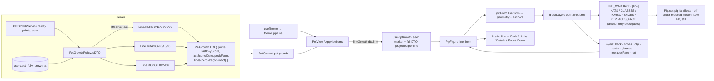

# Plan: Themed Pip lines (dragon for Parchment, robot for Cyberpunk)

Plan folder: `.claude/contract/2026-11-15-themed-pip-lines/`
Execution status: see `tasks.md` in this folder.

---

## Part 1 — Alignment

### Task reference
`/brainstorming` spec, moved into this folder as `spec.md` (2026-11-15). No Jira key: the slug is date-based and no ticket was transitioned. Every requirement, decision and success criterion in `spec.md` is in force. Its "Decisions (answered open questions)" section is already developer-confirmed and is not re-litigated here.

Developer decisions taken during the mockup review (2026-11-15, confirmed; they extend `spec.md`):
- **Robot redesigned** as a screen-face robot: a CRT-monitor head showing a glowing pixel face, on a worn gunmetal body. It borrows the genre's feel only, with no franchise lookalike.
- **Per-creature wardrobe:** "the things you put on each creature should be unique to them". Every wardrobe item keeps its id, slot and unlock, but each line draws and names it its own way. Several dragon and robot items are animated. The developer's examples are in: round specs are a **Battle scar** on the dragon and a **Smiley.exe** emoji face on the robot.
- **Mockup approved** (`foodbytes-app/mockup/pip-themed-lines.html`, all four sections, including section 3 "Wardrobe per creature"), and the plan is to be updated to match.

### Restated goal
Pip becomes one creature with three skins. The server computes growth for **every** line (herb 0/15/36/60/90, dragon 0/15/36, robot 0/15/36) from one points history and returns them all in one payload. The client draws the line named by the active theme's new `pipLine` registry field: basil on Default (unchanged art), a dragon on Parchment (Hatchling → Wyrmling → Drake), and a humanoid robot on Cyberpunk (Bot-kid → Teen Unit → Android). Switching theme only swaps the art and the copy, with no refetch. At the same time **every line stops de-evolving**: the form comes from the **peak** points total, so a creature never shrinks, while the level bar still shows current points and can drain. The renderer, wardrobe layering, head bar, since-last-visit sequence and `mini`/crop variants become line-aware, so all 20 wardrobe items fit all 11 forms. **Each creature wears its own version of every item.** Ids, slots and unlocks stay shared, but each line has its own drawings and names, and some items are animated (a spinning fan, a swaying cape). The animations stop under reduced motion and Low FX. Two new wardrobe layers make this possible: a robot screen face that replaces the face while worn, and a dragon cape drawn behind the body. A form 4+ added later costs one threshold on the server, plus one geometry entry, the art and a name on the client. The dragon and robot art are drawn and approved in a mockup before any component code is written.

### In scope
- Server line registry in `PetGrowthPolicy` (herb / dragon / robot thresholds). Form comes from the effective peak. Growth is computed per line, and herb no longer de-evolves.
- `PetGrowthDTO` reshaped to carry `lines: { herb, dragon, robot }` of a new `PetLineGrowthDTO`. `points`, `lastDayScore`, `lastScoredDate` and the herb `peakForm` (wardrobe unlocks) stay top-level.
- Server tests: each line's form, bar and never-de-evolve rule, the below-form-start bar, and herb's switch from strict de-evolve to form-from-peak. Existing tests that build `PetGrowthDTO` are updated.
- Mockup `foodbytes-app/mockup/pip-themed-lines.html`: 3 dragon + 3 robot forms (plus the 5 herb forms for reference), each bare and in a full outfit, reviewed before code. README row.
- `pipLine` on every `THEMES` entry (`default → herb`, `cyberpunk → robot`, `parchment → dragon`), validated by `check-themes.mjs`.
- Client line registry: `constants/pipLines.js` (ids + per-line copy: form names, fully-grown label and line, slip line, evolve emoji), `pip/lineForms.js` (geometry per line), `pip/lineArt.jsx` (art per line).
- Dragon geometry and art (`dragon/dragonForms.js`, `dragonParts.jsx`, `dragonFaces.jsx`, `dragonArt.jsx`) and robot equivalents, all ported from the approved mockup.
- Shared renderer moved to `components/pet/pip/` and made line-aware: `PipFigure`, `Pip`, `PipOutfit`, `wardrobeLayers`, `wardrobeArt` (unchanged drawing), `headBar`, `pipSpace`.
- Growth utils and `usePipGrowth` made line-aware. The DEVOLVE change, the DRAINING/SHRINKING phases and `devolvedLine` are removed. The seen marker stores the full payload.
- Consumers updated: `PetView`, `PipHeader` label, `PetRoom` → `RoomPip`, `PipHeadBar`, `WardrobeView`, `WardrobeItemGrid`, `WardrobeLineup` (active line's forms), `AppNavItems` footer tab.
- **Per-creature wardrobe:** `herb/herbWardrobe.js` (today's drawings, unchanged), `dragon/dragonWardrobe.js` and `robot/robotWardrobe.js` (20 items each, ported from the approved mockup), behind a per-line dispatcher in `pip/wardrobeArt.js`, with shared descriptor helpers in `pip/wardrobeShapes.js`.
- **Two new wardrobe layers:** `REPLACES_FACE` glasses (Smiley.exe and Heart eyes replace the robot's face while worn, and the face returns asleep) and torso `back` shapes (the Knight's cape, drawn behind the body). Both are carried by `dressLayers` and drawn by `PipFigure`.
- **Animated wardrobe parts:** `g` shape descriptors with a `pip-fx pip-fx--<effect>` class, rendered by `PipOutfit`. Seventeen effects live in `Pip.css` and stop under reduced motion, Low FX (`body.lowfx`) and on still figures.
- **Item names per creature:** `WARDROBE_ITEM_LABELS[line][id]` and `wardrobeItemLabel(line, id)`, used by the Dress Pip cards, the lock text and the "New outfit" announcement.
- `wardrobe.check.mjs` covers every line's 20 items × 11 forms, plus per-form fit invariants, the two new layers (only glasses replace the face, only torso items draw behind, the face returns asleep), names per line, and a head-bar check on every non-final form. `pipGrowth.check.mjs` covers the line-aware utils and checks that client and server form counts agree.
- MINOR version bump + CHANGELOG line.

### Explicitly out of scope
- Themed rooms (lair, workshop, decor, wall/floor, stations). The room keeps its Default palette in every theme.
- Dragon/robot forms 4+ (the reserved ladder names are recorded in `constants/pipLines.js` comments only, not shipped).
- Scoring, sprinkles, shop, wardrobe unlock rules, herb thresholds.
- Per-creature progress, or choosing a creature apart from the theme.
- Greenhouse / next-herb collection.
- Renaming the `pip-herb*` CSS class names used by `Footer.css`, `Header.css` and `WardrobeView.css` (see Risks).
- Any schema change. `users.pet_fully_grown_at` stays as it is.
- Server wardrobe changes. Ids, slots and unlock rules (`WardrobeCatalogue`) are untouched. Only client art and names vary per line.
- Rewording the unlock hints that name herb forms ("Grow to Sprig / Bushling / Basilisk"). Unlocks stay tied to herb progress per `spec.md`, so the hints stay as they are (see Risks).
- Animating any herb item. Basil's wardrobe is unchanged.

### Pattern Reference
Verbatim from the brief:
- `foodbytes-api/.../PetGrowthPolicy.java`: `FORM_THRESHOLDS`, `formFor`, fully-grown check, `toDTO`. Generalise per line, with the form from `replay.peak()`.
- `client/src/components/pet/herb/herbForms.js`: the geometry and anchors shape that new lines copy.
- `PipHerbFigure.jsx`, `herbParts.jsx`, `herbFaces.jsx`, `wardrobeLayers.js`, `wardrobeArt.js`, `headBar.js`: the renderer to make line-aware.
- `client/src/constants/pipGrowth.js`: names, phases, labels.
- `client/src/constants/themes.js`: `pipLine` follows `iconSet` / `ambient`.
- `client/src/components/pet/herb/wardrobe.check.mjs`: the fit check to extend.
- Visual reference: `.claude/contract/MPP-15-epic-breakdown/mockups/pip-herb-wardrobe.html`. The new mockup copies its layout, form constants and wardrobe drawing functions.

### Constraints flagged on the brief
- Theme is per device (`fb.display.theme`): the same points can show basil on one device and a dragon on another.
- No franchise names, marks, characters or lookalikes (no Harry Potter, Witcher or D&D).
- Branch on registry fields via `useTheme()` (`theme.pipLine`), never on a theme id string.
- Pip's art keeps its own palette in every theme (the `components/pet/` exception). Creature colours live in its forms/art files, not theme tokens.
- An outfit worn on form 1 must still fit after every evolution, in every line.
- Every form has a head with two eyes at an `eyes` anchor.
- Reduced motion honoured. Low FX follows existing rules (Pip has no theme effects, so nothing new).
- `mvn test` green. `npm run check:themes` and `npm run check:version` pass.
- Form N+1 later = one threshold appended on the server + one geometry entry, the art and a name on the client + the wardrobe check passing. No structural change.

### Assumptions made
- **Effective peak honours `users.pet_fully_grown_at`.** When that marker is set, the policy treats peak as `max(replay.peak, 90)` for every line. A backdated correction that lowers the replayed peak therefore never shrinks a creature that once reached Basilisk. The marker is kept and still written once at 90. *Rationale: it is the existing "permanent" guarantee, and every line's thresholds sit below 90.*
- **Bar below the form's start** (spec decision "bar sits at empty, count shows real points, e.g. `12 / 15`"): `PetLineGrowthDTO.barCurrent` is clamped at 0 and the line DTO carries `formStart` (the threshold of the current form). When `points < formStart` the client shows pct 0, and the label is `Wyrmling · 12 / 15` (name · points / formStart, no arrow). Otherwise it is the usual `Wyrmling · 6 / 21 → Drake`. The "+3" pop count follows the same rule. *Rationale: the only reading where the bar is empty and the count is `12 / 15`.*
- **`peakForm` per line is included as the spec asks, and always equals `form`.** Form now comes from peak. *Rationale: the spec lists it, and it keeps the shape stable if a line's rule ever diverges.*
- **Top-level `form`, `barCurrent`, `barSize`, `fullyGrown` are removed from `PetGrowthDTO`.** They move into `lines.<id>`. Top-level `peakForm` stays (it means the herb peak) because `WardrobeService` / `WardrobeCatalogue` unlocks read it and the spec keeps unlocks tied to herb. *Rationale: one source of truth per line. Keeping herb mirrors would invite drift.*
- **Line ids are lowercase strings `herb` / `dragon` / `robot`**, the same on the server (a `PetGrowthPolicy.Line` enum `key()`) and the client (`PIP_LINE`). The JSON map is ordered herb, dragon, robot.
- **Unknown or missing `pipLine` / line entry falls back to `herb`**, and an unknown form falls back to form 1. This matches today's `herbForm` "a bad payload never blanks Pip".
- **A form drop seen client-side** (a marker from before this release, or a backdated correction under the old rules) plays no shrink. `growthChange` reports `MOVE` (bar settles) and Pip is redrawn at the new form. **DRAINING is removed as well as SHRINKING**, because both existed only for the DEVOLVE sequence. "The bar can drain" is satisfied by the MOVE bar animation.
- **Seen marker = the full `PetGrowthDTO`.** `usePipGrowth` projects both the marker and the live payload onto the active line. A theme switch therefore compares like with like and plays nothing. Legacy markers (no `lines`) read as a first visit.
- **Shared renderer moves to `components/pet/pip/`**, and the herb, dragon and robot folders hold only their geometry and art. CSS class names (`pip-herb`, `pip-herb-figure`, `pip-anim`, …) are kept so `Footer.css`, `Header.css` and `WardrobeView.css` need no edits.
- **Each line supplies an art adapter** `{ ink, Back, Limbs, Details, Face, Crown }`. The shared `PipFigure` draws, in this order: shadow → Back → Limbs → shoes → body fill + shine → Details → torso clip → outline → extras → Face → glasses → hat → Crown. Herb's adapter wraps today's `HerbBack`, `HerbFace`, `HerbGrowth` and the seed zigzag, so the herb's draw order stays exactly what it is today. Dragon horns and robot antenna are their `Crown`, which pokes through hats the same way basil growth does.
- **Mood props** (`HerbProps`: sparkles, zzz, thought bubble) are shared by all lines and take an `ink` prop.
- **Wardrobe art stays plain data (shape descriptors), not JSX.** Animated parts are `{ tag: 'g', className: 'pip-fx pip-fx--<effect>', style?, children }`. That keeps `wardrobe.check.mjs` running every item in node, and `PipOutfit` just recurses. *Rationale: the current check relies on this, and JSX art would make wardrobe drawing untestable.*
- **Each line's wardrobe has the shape `{ HATS, GLASSES, TORSO, SHOES, REPLACES_FACE }`**, keyed by the live item ids, so `pip/wardrobeArt.js` dispatches without branching on the line. The herb's drawings move unchanged into `herb/herbWardrobe.js`. The earlier idea of a shared `WARDROBE_INK` is dropped: each line uses its own ink, and the herb keeps `HERB_INK`.
- **Low FX now also stops Pip's wardrobe animations and glow.** Only the dragon and robot items animate, and their themes (Parchment, Cyberpunk) are themes with `effects`, so this follows the existing Low FX rule. Herb items have no animation.
- **Item names follow the active theme** (`WARDROBE_ITEM_LABELS[line]`). Unlock hints stay shared, and the "New outfit" announcement uses the name on the creature currently shown.
- **The shades drop plays once per render** (not looped). Every other effect loops.
- **Wilted per line:** herb droops leaves as today, the dragon droops wings and tail, and the robot droops its antenna and dims its eye glow. All get the existing desaturate filter.
- **Copy voice:** dragon slip line "Oof, I singed a few scales 🔥 A good day and they'll grow back!", robot "Battery dipped a little 🔋 A good day and I'll recharge!". Fully-grown labels: `Fully grown 🐉` / `Fully upgraded ⚙️`. Evolve emoji 🌱 / 🐉 / ⚙️. *Developer can red-line the wording.*
- **The mockup gets a developer approval gate inside `tasks.md`** (Phase 1 ends with a manual review task). Dragon/robot geometry in code is ported verbatim from the approved mockup, as `herbForms.js` was.
- **The `herb` prop object passed from `PetView` into the room keeps its name** and gains a `line` field, to avoid renaming a prop across five room components.

### Cross-code alignment audit (FE ↔ BE ↔ DB)
- **DB:** no table or column changes. `users.pet_fully_grown_at` is read and written exactly as today (`PetGrowthService.growth`, `UserRepository.markPetFullyGrown`). No migration, so no Railway apply. Live-DB queries skipped: nothing persisted changes shape.
- **BE ↔ FE contract:** `PetDTO.growth` (`PetGrowthDTO`, Lombok `@Data`) serialises via Jackson. Field names in Data shapes below map 1:1 to the JS keys read in `utils/pipGrowth.js`. `Map<String, PetLineGrowthDTO>` serialises as a JSON object keyed `herb`/`dragon`/`robot`. `LinkedHashMap` keeps the order.
- **Consumers of removed fields (verified by grep):** server: `PetGrowthServiceTest` (`getForm`, `isFullyGrown`, `getBarSize`), `PetServiceTest:52` and `WardrobeServiceTest:68` (8-arg constructor). Client: `utils/pipGrowth.js`, `hooks/usePipGrowth.js`, `PetView.jsx:104-122`, `AppNavItems.jsx:59`, `utils/pipGrowth.check.mjs`, `services/petService.js:17` JSDoc. All are covered by tasks.
- **`peakForm` (herb) consumers:** `WardrobeService.progress` → `WardrobePolicy` `FORM` rule. `WardrobeCatalogue` uses `FORM_SPRIG/BUSHLING/BASILISK`. These constants stay.
- **Registry ↔ server agreement:** client form counts per line must equal the server threshold-list lengths. This is pinned by `pipGrowth.check.mjs`, which reads `PetGrowthPolicy.java`.

---

## Part 2 — Technical design

### Approach
**Server: a line enum inside the policy.** `PetGrowthPolicy` gains a nested `enum Line { HERB("herb", 0,15,36,60,90), DRAGON("dragon", 0,15,36), ROBOT("robot", 0,15,36) }`, each with `key()` and `thresholds()`. `formFor(Line, int points)` generalises today's loop. `toDTO(Replay, boolean fullyGrown)` computes `effectivePeak` once (honouring the fully-grown marker), then builds one `PetLineGrowthDTO` per line through `lineGrowth(Line, points, effectivePeak)`. That function sets form = `formFor(line, peak)`, last form = fully grown (no bar), and otherwise `barCurrent = max(0, points − start)`, `barSize = next − start`, `formStart = start`. `PetGrowthService` is unchanged apart from javadoc: it still replays logs and still writes `pet_fully_grown_at` once. The herb `FORM_*` constants and `FORM_THRESHOLDS` stay as aliases of `Line.HERB` for `WardrobeCatalogue`. Rejected: a separate `PipLineRegistry` class. The spec names `PetGrowthPolicy` as the owner, and a class holding three lists adds a file with no behaviour.

**Client: one registry, three art packs, one renderer.** Line *identity and copy* live in `constants/pipLines.js`. *Geometry* lives in per-line `*Forms.js` files, collected by `pip/lineForms.js` (pure JS, so the `node` check scripts can import it). *Art* lives in per-line `*Art.jsx` adapters, collected by `pip/lineArt.jsx`. The shared renderer (`PipFigure`) never branches on a line or a form. It asks `pipForm(line, form)` for geometry and `lineArt(line)` for the drawable parts. Wardrobe drawing (`wardrobeArt.js`) is untouched because it already reads only anchors. `wardrobeLayers`, `headBar` and the crop helpers just take `(line, form)` instead of `form`. Adding form 4 to the dragon = append to `DRAGON_FORMS` + draw its parts + name it in `PIP_LINE_COPY.dragon.formNames` + append `60` (or whatever) on the server. `pipGrowth.check.mjs` fails until both sides agree. Rejected: separate `PipDragonFigure`/`PipRobotFigure` components. That would triplicate the layering order the wardrobe check pins, and an outfit could fit one figure but not another.

**Wardrobe: same items, a wardrobe per creature.** `pip/wardrobeArt.js` becomes a dispatcher over `LINE_WARDROBE[line]`, where each line supplies `{ HATS, GLASSES, TORSO, SHOES, REPLACES_FACE }` of anchor-only drawing functions that return shape descriptors. `dressLayers(outfit, line, form)` keeps today's layer order and gains two layers. `back` holds torso shapes drawn right after the line's Back, which is the cape. `replacesFace` is true while a screen-face glasses item is worn and awake, and `PipFigure` then skips the line's Face. Animated parts are descriptor groups carrying a `pip-fx--<effect>` class. `PipOutfit` renders them recursively, and the keyframes live in `Pip.css` behind reduced motion, Low FX and `.is-still`. Names come from `WARDROBE_ITEM_LABELS[line]`. Rejected: JSX wardrobe components per line. They would make the node wardrobe check impossible and invite per-form branches. Also rejected: a fourth "item variant" field on the server. Art is purely presentational, so the server stays unaware of it.

**Growth view: project, don't refetch.** `lineGrowth(dto, line)` merges the top-level `points / lastDayScore / lastScoredDate` with `dto.lines[line]` into the flat shape the existing utils already understand (`form`, `barCurrent`, `barSize`, `fullyGrown`, `formStart`, `peakForm`). `usePipGrowth` takes the raw DTO plus `line`, and projects both the stored marker and the live payload, so the change detection, schedule and bubbles work per line. A theme switch re-renders through `useTheme()` and nothing is fetched. The seen marker stores the raw DTO, so the comparison after a switch is dragon-vs-dragon and nothing plays. DEVOLVE, DRAINING and SHRINKING are deleted. A form drop is a MOVE.

**Mockup first.** Phase 1 builds `mockup/pip-themed-lines.html` from the herb wardrobe mockup's form constants and drawing functions, adds DRAGON/ROBOT form tables drawn in the same 200-unit space (feet at y 186, upright, two eyes), and renders every form bare and in the full outfit. The developer approves it before Phase 3 (art code) starts. The geometry tables in code are copied from it verbatim.

### Skills to invoke during execution
- `java-backend` — owns `PetGrowthPolicy`, the new `PetLineGrowthDTO`, `PetGrowthDTO` reshape and the JUnit tests (layering: policy stays pure/static, service unchanged, DTO in `dto/`).
- `react-frontend` — owns every `client/src` change: constants taxonomy, file order, ≤400-line budget, no new dependency, no test runner (verification = `node` check scripts + `npm run build` + manual check).

Rules: no `.claude/rules/` file applies (no recipe, ingredient, macro, variant or migration work).

### Diagram


### Data shapes

#### Server: `PetGrowthPolicy.Line` (nested enum)
```java
public enum Line {
    HERB("herb", List.of(0, 15, 36, 60, 90)),
    DRAGON("dragon", List.of(0, 15, 36)),
    ROBOT("robot", List.of(0, 15, 36));
    private final String key; private final List<Integer> thresholds;
    public String key(); public List<Integer> thresholds(); public int lastForm(); // thresholds.size()
}
```
`FORM_THRESHOLDS = Line.HERB.thresholds()` is kept, as are the `FORM_*` herb constants.

New / changed static methods:
- `int formFor(Line line, int points)`. The old `formFor(int)` is removed, and tests move to the 2-arg form.
- `int effectivePeak(Replay replay, boolean fullyGrown)` → `fullyGrown ? max(peak, FORM_THRESHOLDS.get(FORM_BASILISK-1)) : peak`
- `PetLineGrowthDTO lineGrowth(Line line, int points, int peak)`
- `PetGrowthDTO toDTO(Replay replay, boolean fullyGrown)` (same signature, new body)
- `boolean reachedBasilisk(Replay)` unchanged.

#### Server: new `dto/PetLineGrowthDTO`
```java
@Data @NoArgsConstructor @AllArgsConstructor
public class PetLineGrowthDTO {
    private int form;            // 1..line.lastForm(), from the effective peak — never drops
    private int peakForm;        // == form (form is peak-based); kept per spec
    private int formStart;       // threshold(form): points where this form begins
    private Integer barCurrent;  // max(0, points - formStart); null at the line's last form
    private Integer barSize;     // threshold(form+1) - formStart; null at the line's last form
    private boolean fullyGrown;  // form == line.lastForm()
}
```

#### Server: `PetGrowthDTO` (reshaped)
```java
@Data @NoArgsConstructor @AllArgsConstructor
public class PetGrowthDTO {
    private int points;                          // floored running total
    private int lastDayScore;                    // 3 / -3 / 0
    private LocalDate lastScoredDate;            // null if none
    private int peakForm;                        // HERB line form (drives wardrobe FORM unlocks)
    private Map<String, PetLineGrowthDTO> lines; // LinkedHashMap: herb, dragon, robot
}
```
JSON example (points 12, peak 18, not fully grown):
```json
{ "points": 12, "lastDayScore": -3, "lastScoredDate": "2026-11-14", "peakForm": 2,
  "lines": {
    "herb":   { "form": 2, "peakForm": 2, "formStart": 15, "barCurrent": 0, "barSize": 21, "fullyGrown": false },
    "dragon": { "form": 2, "peakForm": 2, "formStart": 15, "barCurrent": 0, "barSize": 21, "fullyGrown": false },
    "robot":  { "form": 2, "peakForm": 2, "formStart": 15, "barCurrent": 0, "barSize": 21, "fullyGrown": false } } }
```
At peak ≥ 36 the dragon and robot are `{ form: 3, formStart: 36, barCurrent: null, barSize: null, fullyGrown: true }`.

#### Client: `constants/pipLines.js` (new)
```js
export const PIP_LINE = { HERB: 'herb', DRAGON: 'dragon', ROBOT: 'robot' }
export const PIP_DEFAULT_LINE = PIP_LINE.HERB
// Reserved names for later forms (not shipped): dragon Dragon → Elder Dragon → Ancient Wyrm → Great Wyrm;
// robot Synth → Cyborg Prime → Mech → Titan Frame.
export const PIP_LINE_COPY = {
  herb:   { formNames: { 1: 'Basil seed', 2: 'Seedling', 3: 'Sprig', 4: 'Bushling', 5: 'Basilisk' },
            fullyGrownLabel: 'Fully grown 🌸', fullyGrownLine: "I'm fully grown! 🌸 Thank you for looking after me.",
            slipLine: "Ouch, I lost a few leaves 🍂 A good day and I'll grow them back!", evolveEmoji: '🌱' },
  dragon: { formNames: { 1: 'Hatchling', 2: 'Wyrmling', 3: 'Drake' },
            fullyGrownLabel: 'Fully grown 🐉', fullyGrownLine: "I'm a full-grown drake! 🐉 Thank you for raising me.",
            slipLine: "Oof, I singed a few scales 🔥 A good day and they'll grow back!", evolveEmoji: '🐉' },
  robot:  { formNames: { 1: 'Bot-kid', 2: 'Teen Unit', 3: 'Android' },
            fullyGrownLabel: 'Fully upgraded ⚙️', fullyGrownLine: "Upgrade complete! ⚙️ Thank you for building me.",
            slipLine: "Battery dipped a little 🔋 A good day and I'll recharge!", evolveEmoji: '⚙️' }
}
export const lineCopy = (line) => PIP_LINE_COPY[line] ?? PIP_LINE_COPY[PIP_DEFAULT_LINE]
export const formName = (line, form) => lineCopy(line).formNames[form] ?? lineCopy(line).formNames[1]
```
Removed from `constants/pipGrowth.js`: `PIP_FORM_NAMES`, `PIP_FULLY_GROWN_LABEL`, `PIP_SLIP_LINE`, `PIP_FULLY_GROWN_LINE`, `PIP_GROWTH_PHASES.DRAINING/SHRINKING`, `PIP_GROWTH_PHASE_MS.draining/shrinking`. `PIP_FORMS` stays (herb art internals only).

#### Client: `THEMES` entries
`default` → `pipLine: 'herb'`, `cyberpunk` → `pipLine: 'robot'`, `parchment` → `pipLine: 'dragon'`. `check-themes.mjs` fails when an entry's `pipLine` is not a key of `PIP_LINE_COPY`.

#### Client: geometry
- `pip/pipSpace.js`: `PIP_FOOT_X = 100`, `PIP_FOOT_Y = 186`, `PIP_FULL_VIEWBOX = '0 -40 200 240'`. `HERB_FOOT_*` / `HERB_FULL_VIEWBOX` are deleted and imports repointed.
- `dragon/dragonForms.js` → `DRAGON_INK`, `DRAGON_FORMS` (3 entries). `robot/robotForms.js` → `ROBOT_INK`, `ROBOT_FORMS` (3 entries). Each entry has the herb keys: `name, scale, fill: [top, bottom], body, hat {y,w}, eyes {y,gap,s}, neck, waist, side, feet [[root,tip],[root,tip]], growTop, crownTop, growthRise, miniViewBox`. `body` is one closed path covering head + torso (the torso-clothes clip).
- `pip/lineForms.js`:
```js
export const LINE_FORMS = { herb: HERB_FORMS, dragon: DRAGON_FORMS, robot: ROBOT_FORMS }
export const lineForms = (line) => LINE_FORMS[line] ?? LINE_FORMS[PIP_DEFAULT_LINE]
export const lineFormCount = (line) => lineForms(line).length
export const pipForm = (line, form) => lineForms(line)[form - 1] ?? lineForms(line)[0]
export const PIP_FORM_ANCHORS = /* { [line]: { [form]: { hat, eyes:{y,gap}, neck, waist, feetTips } } } */
```
`herbForm` and the herb-only `PIP_FORM_ANCHORS` are removed from `herbForms.js`.

#### Client: art adapters (`pip/lineArt.jsx`)
```js
// Each: { ink, Back({form,droop}), Limbs({f,ink}), Details({form,f}), Face({form,mood}), Crown({form,droop,base}) }
export const LINE_ART = { herb: HERB_ART, dragon: DRAGON_ART, robot: ROBOT_ART }
export const lineArt = (line) => LINE_ART[line] ?? LINE_ART[PIP_DEFAULT_LINE]
```

#### Client: per-creature wardrobe
```js
// every <line>Wardrobe.js (herb / dragon / robot), keyed by the live item ids
export const DRAGON_WARDROBE = {
  HATS,          // id → (x, y, w) → { top, shapes, straight? }   top includes any animated part at rest
  GLASSES,       // id → (L, R, y, s) → shapes
  TORSO,         // id → (f) → { clip, extra, back? }             back = drawn behind the body
  SHOES,         // id → (root, tip) → shapes
  REPLACES_FACE  // glasses ids that replace the face while worn: [] (herb, dragon), ['round-specs', 'heart-glasses'] (robot)
}
// pip/wardrobeShapes.js
fxGroup(effect, children, style?) → { tag: 'g', className: `pip-fx pip-fx--${effect}`, style?, children }
// effects: spin scan smoke sway flicker blink pulse drop flap glow charge chase hover wobble sparkle rise cape
// constants/pipWardrobe.js
WARDROBE_ITEMS[id] = { slot, unlockHint }              // label removed
WARDROBE_ITEM_LABELS[line][id] = 'Battle scar' | …       // 3 lines × 20 names, from the approved mockup
```

#### Client: changed signatures
| Before | After |
|---|---|
| `PipHerbFigure({ form, … })` | `PipFigure({ line, form, mood, wilted, phase, showProps, outfit, still })` |
| `PipHerb({ form, … })` | `Pip({ line, form, mood, wilted, variant, outfit, viewBox, still, className })` |
| `dressLayers(outfit, form, opts)` | `dressLayers(outfit, line, form, opts)` → adds `back: Object[]`, `replacesFace: boolean` |
| `hatArt(id, f)` / `glassesArt(id, f)` → shapes / `torsoArt(id, f)` / `shoeArt(id, f)` | `hatArt(line, id, f)` / `glassesArt(line, id, f)` → `{ shapes, replacesFace } \| null` / `torsoArt(line, id, f)` → `{ clip, extra, back }` / `shoeArt(line, id, f)` |
| `DRAWN_ITEM_IDS` | `drawnItemIds(line)` |
| `WARDROBE_ITEMS[id].label` | `wardrobeItemLabel(line, id)` (labels in `WARDROBE_ITEM_LABELS`) |
| `wardrobeAnnouncement(ids)` | `wardrobeAnnouncement(ids, line)` |
| `OutfitShapes({ shapes })` | `PipOutfit({ shapes })`, which also renders `g` descriptors with `children` |
| `slotCropViewBox(slot, form)` / `hatMiniViewBox(form)` | `slotCropViewBox(slot, line, form)` / `hatMiniViewBox(line, form)` |
| `headBarTop(form, outfit)` / `headBarY(form, outfit)` | `headBarTop(line, form, outfit)` / `headBarY(line, form, outfit)` |
| — | `lineGrowth(dto, line)` → `{ points, lastDayScore, lastScoredDate, form, peakForm, formStart, barCurrent, barSize, fullyGrown } \| null` |
| `levelBarLabel(growth)` | `levelBarLabel(growth, line)` (growth = projected) |
| `barPct(growth)` | unchanged shape; returns 0 when `points < formStart` |
| `growthGain(seen, growth, steps)` | unchanged signature; count text via `barCount(growth)` |
| `evolvedLine(name, form)` | `evolvedLine(name, line, form)` |
| `growthBubble({ change, phase, petName, seen, growth })` | adds `line` |
| `usePipGrowth({ userId, growth, petName, hold })` | `usePipGrowth({ userId, growth /* raw DTO */, line, petName, hold })`, which also returns `lastForm` |
| `GROWTH_CHANGES = { EVOLVE, DEVOLVE, SLIP, MOVE }` | `{ EVOLVE, SLIP, MOVE }` |

### Runtime quality notes
- **Resource cleanup:** Backend: pure static policy, no new resources. Frontend (browser runtime): `usePipGrowth` keeps its existing per-step `setTimeout` with cleanup. Adding `line` to the start-effect deps adds no timers. A theme switch mid-run lets the run finish on the line it started with (the run carries its own projected `seen`/`growth`).
- **Concurrency / ordering:** The server is read-only apart from the existing one-shot `markPetFullyGrown` inside `@Transactional`. Two devices on different themes read the same payload. Their seen markers are per browser and per user, so they never interfere.
- **Allocation / cost behaviour:** Three tiny DTOs per pet read. The projection is O(1). The `PipFigure` render cost is roughly unchanged; a dressed robot adds a few dozen nodes (pixel cells, LED dots). No new dependency. The bundle grows by the two art packs and the two wardrobes (tens of KB of path data), loaded with the pet code. Wardrobe animations are CSS-only, use transform and opacity, never re-render React, and stop under Low FX and reduced motion. `drop-shadow` glow filters are the costliest part and are removed by Low FX.
- **Error paths:** Unknown line id → herb. Missing `lines` entry → `lineGrowth` returns null → `usePipGrowth` returns its `NO_GROWTH` defaults (seed form, no bar), never a crash. A corrupt or legacy seen marker → first visit (no replay). Server: no new exceptions. An empty replay yields form 1 on every line with `barCurrent 0`.

### Risks and judgement calls
- **Contract change across two Railway services.** The old client against the new API reads `growth.form` as undefined and shows a seed with a "Fully grown" bar until the web service redeploys. The new client against the old API sees no `lines` and shows the seed with no bar. Deploy both in the same push (normal for this repo). Keeping deprecated top-level herb fields was rejected to avoid two sources of truth. Red-line this if you want a mirror for one release.
- **Herb behaviour change is user-visible.** A user who de-evolved under MPP-31 jumps back to their peak form on first load. With an old marker the client shows it as a MOVE (no shrink, no evolve fanfare), and with a legacy marker it reads as a first visit. This is intended by the spec, but worth knowing.
- **`effectivePeak` floors at 90 when `pet_fully_grown_at` is set.** This is the assumption that keeps Basilisk permanent. Without it, a backdated fix could drop the herb below Basilisk now that the form follows peak.
- **Big file move (`herb/` → `pip/` for shared pieces)** with `git mv` to keep history. Class names stay `pip-herb*` (slightly misleading on a dragon, but zero CSS churn in layout files). Renaming them is a follow-up if wanted.
- **Below-start label without an arrow** (`Wyrmling · 12 / 15`) is my reading of the spec's `12 / 15` example. `spokenLevelLabel` handles it ("Wyrmling, 12 of 15").
- **Fit invariants are geometric, not pixel-perfect.** `wardrobe.check.mjs` asserts anchor ordering and widths per form (hat above eyes above neck above waist above feet, eyes inside the hat brim and the body side, feet on the floor line), plus finite, anchor-only drawing. True visual fit is confirmed in the mockup review and the manual check in each theme.
- **Art quality is the long pole.** Dragon and robot SVG must read clearly at the `mini` footer size (~32px) and stay franchise-free. The Phase 1 approval gate is where the developer can reject designs before any code depends on them.
- **No manual DB or Railway step.** No migration.
- **The per-creature wardrobe roughly doubles the art work.** It means 40 new item drawings to port, converted from SVG strings to descriptors. The approved mockup is the exact source, and `wardrobe.check.mjs` catches anchor misuse, NaN and slot-layer leaks, but the visual pass in Task 30 is still the real gate.
- **Unlock hints name herb forms** ("Grow to Sprig", "Grow to Bushling", "Grow to Basilisk"), which reads oddly on the dragon or robot. They are left as they are because unlocks follow herb progress (spec decision). Rewording them (for example "Reach 36 points") is a cheap follow-up if you want it.
- **CSS `transform` on an SVG `g` replaces any `transform` attribute on that same element.** Animated groups must never carry a positioning transform. Position the children or wrap the group instead. The mockup already follows this, and the port must keep it.
- **Head-bar clearance uses each hat's resting `top`.** Rising smoke and floating hearts can briefly pass the bar during their animation. This is accepted as cosmetic.
