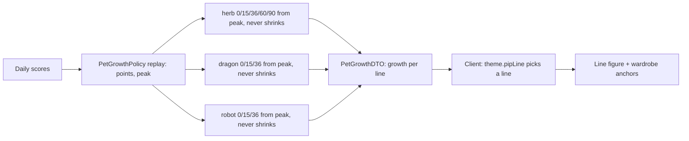

# Spec: Themed Pip lines (dragon for Parchment, robot for Cyberpunk)

## Goal
Pip looks like a different creature depending on the active theme. Default keeps today's 5-form basil herb line. Parchment ("The Kitchen Grimoire") shows a dragon that starts small and grows. Cyberpunk shows a humanoid robot that starts child-sized and grows into an upgraded adult android. Changing theme is **purely a reskin**: same Pip, same name, same points, same outfit and unlocks, only the creature art changes. These are three **skins of one Pip**: each person still has one points total, and each line has its own evolution thresholds on that total. The dragon and robot launch with 3 forms each. The design must make it cheap to add stronger forms (4, 5, …) later, because the developer intends to keep extending each line once its last form is reached. Every form must keep the existing 7-slot wardrobe working (hat, glasses, scarf, jacket, belt, pants, shoes), so every dragon and robot form is upright with a forward-facing head and eyes.

## In scope
- A **line registry** on the server: `PetGrowthPolicy` holds one threshold list per line:
  - `herb`: `0 / 15 / 36 / 60 / 90` (unchanged)
  - `dragon`: `0 / 15 / 36`
  - `robot`: `0 / 15 / 36`
- `PetGrowthDTO` (or a nested structure on it) returns the growth result for **every** line: form, bar value, bar max, fully-grown flag, and peak form, so the client can draw whichever line the active theme names without a refetch on theme switch.
- De-evolve rules:
  - **No line de-evolves any more, herb included.** This replaces the herb line's strict de-evolve (MPP-31). Basilisk at 90 is still the herb line's last form.
  - All lines: **never de-evolve.** Their form is picked from the **peak** points total, so once a form is reached it stays, even after slip days lower the current points. When a stronger form is added later, it is reached when the peak passes its new threshold. The level bar still shows current points towards the next form (it can drain), but the creature never shrinks.
- A `pipLine` field on every `THEMES` registry entry (`default` → `herb`, `parchment` → `dragon`, `cyberpunk` → `robot`). The client picks the line through `useTheme()`, never by a theme id string.
- Dragon art, 3 forms. Generic fantasy dragon with no franchise marks:
  1. **Hatchling**: tiny, stubby, bits of eggshell
  2. **Wyrmling**: wing buds, small horns
  3. **Drake**: full wings, horns, tail
- Robot art, 3 forms. Humanoid:
  1. **Bot-kid**: big head, small body
  2. **Teen Unit**: taller, leaner
  3. **Android**: adult proportions, visible upgrade plating
- A per-form geometry file for each new line, following `herbForms.js`: scale, body, `hat`, `eyes`, `neck`, `waist`, `side`, `feet`, `growTop`, `crownTop`, `growthRise`, `miniViewBox`. Plus form names and the per-line constants that `pipGrowth.js` has today for herb (form names, fully-grown label and line, slip line), written in each line's voice.
- The figure renderer, head bar, since-last-visit sequence (fill / evolve / drain / shrink; shrink no longer fires for any line, since forms only move up) and `mini` variant all work for the active line.
- `wardrobe.check.mjs` extended so every wardrobe item in all 7 slots is checked for fit on all 11 forms (5 herb + 3 dragon + 3 robot). An outfit worn on form 1 of any line must still fit after every evolution of that line.
- Mockup first: the 3 dragon and 3 robot forms are drawn in `foodbytes-app/mockup/`, each shown bare and in a full outfit, and reviewed by the developer before any component code. The mockup is updated again if the build diverges.
- Version bump (MINOR) and a CHANGELOG line, per the versioning rules.

## Explicitly out of scope
- **Themed rooms** (dragon lair, robot workshop, re-skinning room art, decor, wall/floor styles, stations). This is the next spec. Until then the room keeps its own Default palette in every theme, as today.
- Forms 4 and beyond for the dragon and robot. The design must allow them; none are drawn now.
- Changes to scoring (+3 / −3 per day), sprinkles, the shop, wardrobe unlocks, or the herb line's thresholds.
- Separate progress per creature, or choosing a creature independently of the theme.
- The deferred greenhouse / next-herb collection.
- Any Harry Potter, Witcher or D&D names, characters or lookalike designs.

## Pattern reference
- `foodbytes-api/.../PetGrowthPolicy.java`: `FORM_THRESHOLDS`, `formFor`, the fully-grown check, and the `PetGrowthDTO` build. Generalise to one threshold list per line, with the form taken from `replay.peak()` instead of `points`.
- `client/src/components/pet/herb/herbForms.js`: geometry + anchors per form (`HERB_FORMS`, `PIP_FORM_ANCHORS`). New lines copy this shape.
- `client/src/components/pet/herb/PipHerbFigure.jsx`, `herbParts.jsx`, `herbFaces.jsx`, `wardrobeLayers.js`, `wardrobeArt.js`, `headBar.js`: the renderer and wardrobe layering that must become line-aware.
- `client/src/constants/pipGrowth.js`: form names, phases, labels. Today these are herb-only.
- `client/src/constants/themes.js`: registry fields (`iconSet`, `ambient`, …). `pipLine` follows the same pattern.
- `client/src/components/pet/herb/wardrobe.check.mjs`: the wardrobe fit check to extend.
- Visual reference for how the herb line was approved: `.claude/contract/MPP-15-epic-breakdown/mockups/pip-herb-wardrobe.html`.

## Constraints
- Theme choice is per device (`fb.display.theme`). The same person can see basil on one device and a dragon on another. Both come from the same points.
- "Themes borrow a genre's feel, never its property" (CLAUDE.md): no franchise names, marks, characters or lookalikes.
- Theme-specific markup branches on registry fields via `useTheme()`, never on theme id strings.
- Pip's art keeps its own palette in every theme (the `components/pet/` colour exception). The creature's colours live with its art, not in theme tokens.
- Developer's hard requirement carried over from the herb line: an outfit worn on form 1 must still fit after every evolution, in every line.
- Every form must have a head with two eyes at an `eyes` anchor, so glasses work on all three lines.
- Reduced motion is honoured, and Low FX follows the existing rules.
- `mvn test` stays green. `npm run check:themes` and `npm run check:version` pass.
- Adding a form N+1 to a line later must need only: one threshold appended on the server, one geometry entry + art + name on the client, and the wardrobe check passing. No structural change.

## Approach (chosen)
**Server line registry.** The server owns every line's thresholds and returns growth for all lines in one payload. The client renders the line named by the active theme's `pipLine`. This keeps the threshold maths in one place, so a theme switch is instant with no refetch, and a future stronger form is a one-line server change plus art.

## Approaches considered (rejected)
- Client-side mapping from `points`: duplicates threshold logic in two places and needs a second since-last-visit code path.
- Client sends `?line=<id>` and the server computes only that line: forces a refetch on every theme switch for no gain.

## Diagram

## Success criteria
- On Default, Pip looks exactly as today. The only behaviour change is that basil no longer de-evolves.
- On Parchment, the same account shows the dragon form that matches its points (peak 0–14 Hatchling, 15–35 Wyrmling, 36+ Drake). On Cyberpunk it shows the matching robot form.
- Switching theme on one device redraws the matching creature immediately, with no reload or refetch.
- Dropping below 15 or 36 points never de-evolves the dragon/robot. Their form only moves up, based on peak points. The same holds for basil: it no longer de-evolves.
- Every wardrobe item fits on all 11 forms. `wardrobe.check.mjs` passes for every line.
- The head bar, evolve sequence and `mini` variant work on all three lines.
- Server tests cover each line's form, bar and de-evolve rules, including the "never de-evolve, form from peak" rule for dragon/robot and herb's change from strict de-evolve to form-from-peak.
- The mockup in `foodbytes-app/mockup/` shows the 3 dragon and 3 robot forms bare and outfitted, and matches what ships.

## Decisions (answered open questions)
- **Bar below the form's start:** the bar sits at empty and the count shows the real points (e.g. `12 / 15`). It fills again as points climb back.
- **Wardrobe unlocks:** stay tied to herb progress (`peakForm`), so they are identical in every theme. Switching theme never changes what is owned.
- **Fully grown:** the label and line show once the last currently defined form is reached. When a stronger form is added, the label moves to that form.
- **Shrink copy:** `devolvedLine` and the shrink phase are no longer reachable for any line and are removed.
- **Form names are user-visible** (Pip header, level-bar label, evolve bubble, wardrobe lineup, screen-reader label), so each line needs its own names, and the wardrobe lineup shows the active line's forms.
- **Stage names (decided):** every stage, including future ones, gets its own name. Ladders:
  - Dragon: **Hatchling → Wyrmling → Drake** now; reserved for later forms: Dragon → Elder Dragon → Ancient Wyrm → Great Wyrm.
  - Robot: **Bot-kid → Teen Unit → Android** now; reserved for later forms: Synth → Cyborg Prime → Mech → Titan Frame.
  - Only the first 3 of each ship in this spec. The reserved names are recorded here so later forms follow the ladder.

## Open questions
None.
