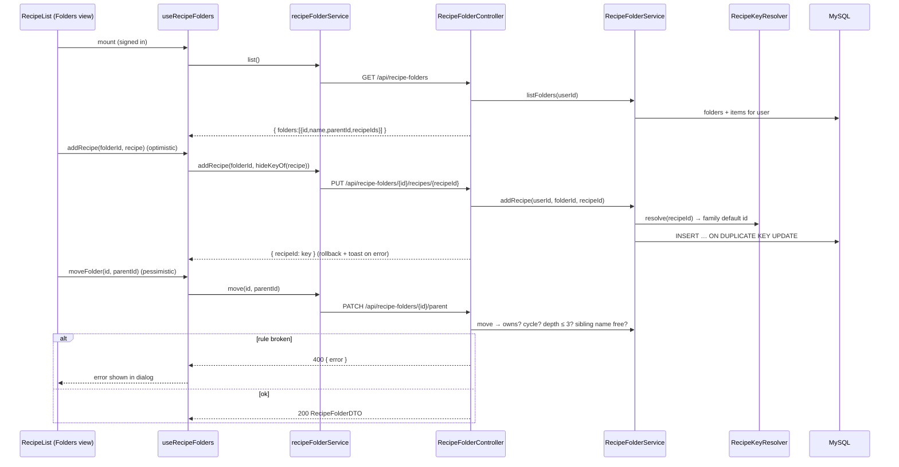

# Plan: Custom recipe folders (all themes)

Plan folder: `.claude/contract/2026-11-16-custom-recipe-folders/`
Execution status: see `tasks.md` in this folder.

---

## Part 1 — Alignment

### Task reference

Developer brief (2026-11-16, `/fb-plan` args, verbatim):

> Custom recipe folders (nested, personal, up to 3 levels, recipe in many folders, Menu/Folders view toggle) per the approved Cyberpunk mockup in foodbytes-app/mockup/app-mockup.html and the "Proposal in review: custom recipe folders" section of foodbytes-app/mockup/README.md. Plan must cover ALL themes: Default, Cyberpunk and Parchment (including Parchment mockup in parchment-theme.html and Default styling), plus backend + DB migration.

Decisions confirmed in chat on 2026-11-16 while the mockup was built:
- A recipe can sit in several folders, so there must be a way to switch between folder view and the normal view → **☰ Menu / 📁 Folders** toggle (confirmed, and drawn in the mockup).
- Up to **3 levels** deep (confirmed).
- Deleting a folder **never deletes recipes**; its subfolders move up one level (confirmed).
- Folders are **personal**, not shared with a meal-plan partner (confirmed).
- Folder names are **unique among siblings** (confirmed).
- The week strip is **hidden inside folders**; it shows only in Menu view (confirmed).
- After the toggle was added the developer said "looks good" — the Cyberpunk mockup is approved.

No Jira ticket; slug is date-based.

### Restated goal

Let each signed-in user organise recipes into their own nested folders (max 3 deep). A recipe family can be filed in any number of folders. The Recipes page gains a **Menu / Folders** switch, remembered per device: **Menu** is today's page unchanged; **Folders** is a folder browser (a tree beside the grid on desktop, a Folders ▾ sheet on mobile) with breadcrumbs, subfolder tiles, the folder's recipes filtered by the existing meal tabs and search, and at the top level a list of recipes not yet in any folder. Users create, rename, move and delete folders, file recipes from a card's ⋯ menu, from an "Add recipes" picker inside a folder, or by dragging a card onto a folder on desktop. This ships in all three themes (Default, Cyberpunk, Parchment), backed by two new tables and a new `/api/recipe-folders` API.

### In scope

- **DB:** migration creating `recipe_folders` and `recipe_folder_items`.
- **Backend:** entities, repositories, `RecipeFolderService` (ownership, depth, sibling-name, cycle and cap rules), `RecipeFolderController` at `/api/recipe-folders`, DTOs, and service tests.
- **Shared family key:** extract the family-default-id normalisation from `HiddenRecipeService` into a reusable `RecipeKeyResolver`, so folders and hidden recipes key recipes the same way.
- **Frontend data:** `recipeFolderService.js`, `useRecipeFolders` hook (load, optimistic membership toggles, create / rename / move / delete), pure tree helpers in `utils/recipeFolderTree.js`, and constants.
- **Frontend UI:** the view toggle (`useRecipeView`, localStorage `fb.recipes.view`), the sidebar tree, the mobile folder bar and sheet, the folder header (breadcrumbs + actions + subfolder tiles), the Folders top level (folder tiles + "Not in a folder yet"), folder chips on cards in Folders view, the card ⋯ menu entries "Add to folder…" / "Remove from <folder>", and the dialogs (new/rename, move, delete, add-to-folder, add-recipes). Desktop drag-and-drop of a card onto a folder.
- **Themes:** new folder tokens in `default.css` with Default values; reassignments in `cyberpunk.css` and `parchment.css`; theme-only looks in `cyberpunk/recipes.css` and `parchment/recipes.css`; a folder glyph in each icon set (line / pixel / engraved); contrast pairs in `check-themes.mjs`.
- **Mockups:** add the folder feature to `parchment-theme.html` (before Parchment code), align `app-mockup.html` with the one design change this plan makes (delete is confirmed, not undoable), and update `mockup/README.md`.
- Version bump (MINOR) + CHANGELOG.

### Explicitly out of scope

- Sharing folders with a meal-plan partner (`meal_plan_owner_id`) or any other user.
- Reordering folders by hand (they sort A→Z) or reordering recipes inside a folder.
- Folder icons/colours chosen by the user; emoji in folder names gets no special handling.
- Admin tooling for folders; system or pre-made folders.
- Touch drag-and-drop on mobile (mobile files recipes through ⋯ and the Add recipes picker).
- Offline queueing of folder edits (the app has no background-sync queue).
- Themed renames of "Folders" in Parchment (e.g. "Satchels"); see Assumptions.
- Adding Default screens to the mockups (known gap in `mockup/README.md`).

### Pattern Reference

None supplied beyond the mockup. Chosen references:
- **Per-person recipe membership (closest precedent):** hidden recipes, end to end. `migrations/2026-11-14-user-hidden-recipes.sql`, `model/UserHiddenRecipe.java`, `repository/UserHiddenRecipeRepository.java` (idempotent `insertIfAbsent`), `service/HiddenRecipeService.java` (family-default key), `controller/HiddenRecipeController.java`, `client/src/services/hiddenRecipeService.js`, `client/src/hooks/useHiddenRecipes.js` (feature state in a hook, not a Context; ordered request queue; `loadFailed` keeps failures from looking like "nothing").
- **400 with a message:** `PetDecorController` / `MealPlanController` (`ResponseEntity.badRequest().body(Map.of("error", msg))`).
- **Service tests:** `HiddenRecipeServiceTest` (Mockito + AssertJ).
- **Dialog shell:** `components/mealplan/MealPlanSheet.jsx` (bottom sheet on mobile, centred card on desktop, Escape / backdrop / pull to dismiss).
- **Themed icon renderers:** `components/layout/AppNavItems.jsx` (`iconSet` → `PixelIcon` / `EngravedIcon` / line SVG).
- **UI design source:** `foodbytes-app/mockup/app-mockup.html` (Cyberpunk, approved) and the folder section of `mockup/README.md`.

### Constraints flagged on the brief

- All three themes, including the Parchment mockup and Default styling.
- Theme rules in `CLAUDE.md` are binding: colours only in `styles/themes/`; Default must not drift; every selector in `styles/themes/<id>/` is prefixed `:root[data-theme="<id>"]`; theme-specific markup branches on registry fields (`iconSet`), never on a theme id; works at 320–1280px; `npm run check:themes` green with no new exceptions.
- Mockups must match the live app: a UI ticket updates the mockups in the same ticket.
- Hibernate `ddl-auto: validate`: the migration must exist in the DB before the backend that maps it starts.
- Personal, max 3 levels, multi-folder membership, sibling-unique names, delete keeps recipes and lifts subfolders, week strip only in Menu view (all confirmed).

### Assumptions made

- **Folders file recipe *families*, keyed by the family's default (Moderate) recipe id**, the same key hidden recipes use (`hideKeyOf` on the client, `normalise` on the server). Filing any variant files the family. *Rationale:* a card shows the family; filing "the Light one" separately would make a card appear in a folder on one variant and not another.
- **Extract `RecipeKeyResolver`** (a `@Component` holding the current `HiddenRecipeService.normalise` logic) and have both services use it. *Rationale:* folders need the same key; depending on `HiddenRecipeService` from `RecipeFolderService` would couple two unrelated features. `HiddenRecipeServiceTest` is adjusted to build the resolver from its existing mocks.
- **Hidden recipes stay hidden in Folders view and don't count** in folder counts; they still keep their folder rows. *Rationale:* matches the mockup's `fCount` and the "hidden only hides from lists" rule.
- **Delete is confirmed in a dialog and is not undoable** (the mockup had Undo). *Rationale:* undoing would mean re-creating a subtree and its memberships server-side; the confirm dialog already says nothing is deleted but the folder. "Remove from folder" keeps its Undo (a cheap re-add). The Cyberpunk mockup is updated to match.
- **API shape:** one `GET /api/recipe-folders` returns the user's whole tree with each folder's recipe keys (`recipeIds`). *Rationale:* data is tiny (capped folders × small lists), and every view needs counts and chips at once; per-folder fetches would add latency and loading states for nothing.
- **Endpoints:** `POST /api/recipe-folders`, `PATCH /{id}/name`, `PATCH /{id}/parent`, `DELETE /{id}`, `PUT /{id}/recipes/{recipeId}`, `DELETE /{id}/recipes/{recipeId}`. Separate rename and move endpoints avoid the "is `parentId: null` a move to top level or an omitted field?" ambiguity of one PATCH.
- **Unknown or not-owned folder → 404** (never reveal another user's folder exists); rule breaks → **400 `{ "error": "<message>" }`**; signed out → 403 like `HiddenRecipeController`.
- **Caps:** name 1–40 characters after trimming; at most **100 folders per user**. *Rationale:* bounds the single GET and stops runaway creation; 100 is far above any realistic use.
- **Sibling names are unique case-insensitively, enforced in the service.** A DB unique key can't do it for top-level folders, because `parent_id` is NULL and MySQL treats NULLs as distinct.
- **Folders sort A→Z** (case-insensitive) everywhere; no manual order column.
- **Labels stay plain "Folders" / "Menu" in every theme.** *Rationale:* Parchment shipped with only the nav and page headings themed (`mockup/README.md`, Parchment sync note).
- **Default styling uses new `--folder-*` tokens whose Default values point at existing Default tokens** (e.g. `var(--...)`), not new colours. *Rationale:* "Default must not drift" — new UI in Default should look like existing Default chips/cards. Verified live, since Default has no mockup.
- **Drag-and-drop only on hover-capable fine pointers** (`(hover: hover) and (pointer: fine)` via the existing `useMediaQuery`), HTML5 drag events, no new dependency.
- **Folder edits are not optimistic except membership.** Create / rename / move / delete wait for the server (they can fail validation); add / remove membership is optimistic with rollback, like hide/unhide.
- **Migration is applied to the local `foodbytes-db` and then to Railway by the developer.** It does not go in the MPP-15 go-live ledger, following the 2026-11-14 hidden-recipes migration (applied straight to Railway; `user_hidden_recipes` exists live). Written idempotently (`CREATE TABLE IF NOT EXISTS`) in any case.
- **Ticket type → MINOR bump** (new feature, no Jira key → "anything else MINOR").

### Cross-code alignment audit (FE ↔ BE ↔ DB)

Read-only queries against the live Railway MySQL on 2026-11-16:
- `information_schema.columns` for the FK targets: `users.id` → `bigint NOT NULL PRI`; `recipes.id` → `bigint NOT NULL PRI`. New FK columns are therefore `BIGINT NOT NULL` (`parent_id BIGINT NULL`).
- `recipe_folders`, `recipe_folder_items` → **no rows in `information_schema.columns`**: the names are free.
- `user_hidden_recipes` exists live (`id bigint PRI`, `user_id bigint MUL`, `recipe_id bigint MUL`, `created_at timestamp NULL`): the 2026-11-14 migration was applied directly to Railway. That is the precedent for this migration's apply path.
- Row counts: `recipes` 237, `recipe_families` 73, `recipe_family_members WHERE is_default=1` 73 (one default per family), `users` 13. New empty tables; nothing is backfilled, so the migration is lossless.
- Unapplied migrations: the MPP-15 ledger (`.claude/contract/MPP-15-epic-breakdown/railway-migrations.md`) lists 12 MPP-15 migrations still marked "—" for Railway, and MPP-42's is not applied locally either. They are independent of this feature (pet tables); this plan's backend does not map them. It only needs its own migration applied. Flagged in Risks.
- Name chain (introduced by this plan, one spelling throughout): `recipe_folders.parent_id` ↔ `RecipeFolder.parentId` ↔ `RecipeFolderDTO.parentId` ↔ JSON `parentId` ↔ `folder.parentId`; `recipe_folder_items.recipe_id` ↔ `RecipeFolderItem.recipeId` ↔ `RecipeFolderDTO.recipeIds[]` ↔ JSON `recipeIds` ↔ `folder.recipeIds`; the recipe key on both sides is the family default id (`RecipeKeyResolver.resolve` ↔ `hideKeyOf`).
- Recipe-data rules (`linked-recipe-extras`, `recipe-variants`, `homemade-first`) were read: this feature writes no recipe, ingredient or macro data, so none of their reject conditions can trip. The variant rule's "one default per family" (verified: 73/73) is what makes the family key stable.

---

## Part 2 — Technical design

### Approach

**Storage.** Two tables. `recipe_folders` is an adjacency list (`id`, `user_id`, `parent_id` self-FK, `name`). `recipe_folder_items` is the many-to-many from a folder to a recipe family key. An adjacency list beats a closure table or materialised path here: trees are at most 3 deep and ≤100 nodes per user, the whole tree is loaded at once, and every rule (depth, cycles, descendants) is computed in memory from that one list. Moves are a single `parent_id` update. The roads not taken: a closure table would need rewriting on every move for no read benefit; a JSON blob on `users` would lose FK cascades and make concurrent edits clobber each other.

**Backend.** Follows the hidden-recipes layering. `RecipeFolderController` is thin: it resolves the caller from `@AuthenticationPrincipal UserPrincipal` (the caller's own id, never `meal_plan_owner_id`), calls `RecipeFolderService`, maps `IllegalArgumentException` → 400 `{error}` and empty `Optional` → 404. `RecipeFolderService` (all writes `@Transactional`) loads the user's folders once per operation and enforces: ownership, trimmed name 1–40, case-insensitive sibling uniqueness, the 100-folder cap, `depth(parent) + 1 ≤ 3` on create, and on move `newParent ∉ {self} ∪ descendants(self)` and `depth(newParent) + height(self) ≤ 3`. On delete it re-points the folder's children to its parent (rejecting the delete if that would create a sibling-name clash, with a message naming the clash), then deletes the folder. Its items cascade away. Membership uses `RecipeKeyResolver.resolve(recipeId)` (extracted from `HiddenRecipeService.normalise`) and an idempotent `INSERT … ON DUPLICATE KEY UPDATE`, like hidden recipes. The tree rules live in a small pure `RecipeFolderTree` helper so they are unit-testable without mocks.

**Frontend data.** `recipeFolderService.js` wraps the endpoints. `useRecipeFolders({ isAuthenticated })` follows `useHiddenRecipes`: it holds `folders` (flat list) as feature state (no new Context, because only the Recipes page uses it), exposes `loadFailed` / `retry`, runs membership writes optimistically through an ordered queue with rollback and an Undo toast for "Remove from folder", and runs structural writes pessimistically, returning the server's `error` message for inline display in the dialog. Pure tree maths (`childrenOf`, `pathOf`, `depthOf`, `heightOf`, `descendantIdsOf`, `canMoveTo`, `folderCount`, `folderIdsFor`, `isUnfiled`) lives in `utils/recipeFolderTree.js`, mirroring the backend rules so the UI greys out impossible moves before the server has to refuse them. `useRecipeView` stores `menu|folders` under `fb.recipes.view` with try/catch (default `menu`).

**UI composition.** `RecipeList` stays the page owner but delegates folder concerns to keep it under 400 lines. `useRecipeFolderScope` computes the scope filter (folder members, unfiled at the Folders top level, or everything in Menu view), plus the tab counts. A `components/recipes/folders/` group holds the pieces: `FolderIcon`, `RecipeViewToggle`, `FolderTree`, `FolderSidebar`, `FolderBar`, `FolderHeader`, `FolderRoot`, `FolderChips`, `FolderActionsMenu`, `FolderDialogs`. The dialogs all render inside the existing `MealPlanSheet` shell. In Menu view nothing changes except the ⋯ menu's "Add to folder…". Theme differences come from tokens plus the theme override files. The only markup branch is `FolderIcon` choosing its glyph from `theme.iconSet`, exactly like `AppNavItems`. Delivery is mockup-first: the Parchment mockup is drawn and reviewed before any Parchment CSS, and the Cyberpunk mockup is aligned to the "delete is not undoable" change.

### Skills to invoke during execution

- `java-backend` — owns the migration mechanics, entities, repositories, `RecipeFolderService`, `RecipeKeyResolver` extraction, controller, DTOs and Mockito tests; thin-controller and `@AuthenticationPrincipal` rules.
- `react-frontend` — owns the service module, hooks, components, CSS, the four async states, 44px touch targets, `(hover: hover)` gating, the 400-line budget, constants, and no new dependencies.

Rules files: `.claude/rules/recipe-variants.md` (family / default-is-Moderate; the folder key depends on it). `linked-recipe-extras.md` and `homemade-first-and-ingredient-dedup.md` were checked and don't apply (no recipe data is written).

### Diagram



### Data shapes

#### DDL — `foodbytes-app/database/migrations/2026-11-16-recipe-folders.sql`

```sql
CREATE TABLE IF NOT EXISTS recipe_folders (
  id         BIGINT      NOT NULL AUTO_INCREMENT,
  user_id    BIGINT      NOT NULL,
  parent_id  BIGINT      NULL,
  name       VARCHAR(40) NOT NULL,
  created_at TIMESTAMP   NULL DEFAULT CURRENT_TIMESTAMP,
  PRIMARY KEY (id),
  KEY idx_recipe_folders_user (user_id),
  KEY idx_recipe_folders_parent (parent_id),
  CONSTRAINT fk_recipe_folders_user   FOREIGN KEY (user_id)   REFERENCES users (id)          ON DELETE CASCADE,
  CONSTRAINT fk_recipe_folders_parent FOREIGN KEY (parent_id) REFERENCES recipe_folders (id) ON DELETE CASCADE
) ENGINE=InnoDB DEFAULT CHARSET=utf8mb4;

CREATE TABLE IF NOT EXISTS recipe_folder_items (
  id         BIGINT    NOT NULL AUTO_INCREMENT,
  folder_id  BIGINT    NOT NULL,
  recipe_id  BIGINT    NOT NULL,
  created_at TIMESTAMP NULL DEFAULT CURRENT_TIMESTAMP,
  PRIMARY KEY (id),
  UNIQUE KEY uk_recipe_folder_item (folder_id, recipe_id),
  KEY idx_recipe_folder_items_recipe (recipe_id),
  CONSTRAINT fk_recipe_folder_items_folder FOREIGN KEY (folder_id) REFERENCES recipe_folders (id) ON DELETE CASCADE,
  CONSTRAINT fk_recipe_folder_items_recipe FOREIGN KEY (recipe_id) REFERENCES recipes (id)        ON DELETE CASCADE
) ENGINE=InnoDB DEFAULT CHARSET=utf8mb4;
```

`fk_recipe_folders_parent` cascades only for user deletion (the user FK cascades the whole tree); the service always re-parents children before deleting a single folder.

#### Entities (`com.foodbytes.model`)

- `RecipeFolder` → `@Table(name="recipe_folders")`: `Long id` (IDENTITY), `Long userId` (`user_id`, not null), `Long parentId` (`parent_id`, nullable), `String name` (`name`, length 40, not null), `LocalDateTime createdAt` (`insertable=false, updatable=false`). Plain id columns, no associations, PK-based `equals`/`hashCode` like `UserHiddenRecipe`.
- `RecipeFolderItem` → `@Table(name="recipe_folder_items", uniqueConstraints=@UniqueConstraint(name="uk_recipe_folder_item", columnNames={"folder_id","recipe_id"}))`: `Long id`, `Long folderId`, `Long recipeId`, `LocalDateTime createdAt`.

#### Repositories

- `RecipeFolderRepository extends JpaRepository<RecipeFolder, Long>`: `List<RecipeFolder> findByUserId(Long userId)`; `Optional<RecipeFolder> findByIdAndUserId(Long id, Long userId)`; `long countByUserId(Long userId)`.
- `RecipeFolderItemRepository extends JpaRepository<RecipeFolderItem, Long>`: `List<RecipeFolderItem> findByFolderIdIn(Collection<Long> folderIds)`; native `@Modifying insertIfAbsent(folderId, recipeId)` = `INSERT INTO recipe_folder_items (folder_id, recipe_id) VALUES (:folderId, :recipeId) ON DUPLICATE KEY UPDATE folder_id = folder_id`; `@Modifying long deleteByFolderIdAndRecipeId(Long folderId, Long recipeId)`.

#### Services

- `RecipeKeyResolver` (`@Component`): `Optional<Long> resolve(Long recipeId)`, which is the body of today's `HiddenRecipeService.normalise`. `HiddenRecipeService.normalise` becomes a one-line delegate (kept for its callers).
- `RecipeFolderTree` (pure, `com.foodbytes.service`, package-private-friendly final class): `static final int MAX_DEPTH = 3`, `MAX_FOLDERS = 100`, `NAME_MAX = 40`; `int depthOf(Long id, Map<Long,RecipeFolder> byId)` (top level = 1), `int heightOf(Long id, List<RecipeFolder> all)` (leaf = 1), `Set<Long> descendantIds(Long id, List<RecipeFolder> all)`, `boolean siblingNameTaken(Long parentId, String name, Long exceptId, List<RecipeFolder> all)` (case-insensitive, trimmed), `String cleanName(String raw)` (trims; throws `IllegalArgumentException("Give the folder a name.")` / `("Folder names can be up to 40 characters.")`).
- `RecipeFolderService`:
  - `List<RecipeFolderDTO> listFolders(Long userId)` (`readOnly`), sorted by `name` case-insensitively.
  - `RecipeFolderDTO create(Long userId, String name, Long parentId)`: 400 messages `"You can have up to 100 folders."`, `"Folders go up to 3 levels deep."`, `"There's already a folder called “<name>” here."`; unknown parent → `NoSuchElementException` → 404.
  - `Optional<RecipeFolderDTO> rename(Long userId, Long folderId, String name)`.
  - `Optional<RecipeFolderDTO> move(Long userId, Long folderId, Long newParentId)`: 400 `"A folder can't go inside itself."`, the depth message, or the sibling message.
  - `boolean delete(Long userId, Long folderId)`: re-parents children; 400 `"Can't delete: “<child>” would clash with a folder of the same name in <parent or 'the top level'>."`.
  - `Optional<Long> addRecipe(Long userId, Long folderId, Long recipeId)` → resolved key; empty when the folder or recipe is unknown.
  - `boolean removeRecipe(Long userId, Long folderId, Long recipeId)`.

#### DTOs (`com.foodbytes.dto`)

- `RecipeFolderDTO { Long id; String name; Long parentId; List<Long> recipeIds; }`
- `RecipeFoldersDTO { List<RecipeFolderDTO> folders; }`
- `RecipeFolderCreateRequest { @NotBlank @Size(max=40) String name; Long parentId; }`
- `RecipeFolderNameRequest { @NotBlank @Size(max=40) String name; }`
- `RecipeFolderParentRequest { Long parentId; }` (null = top level)
- `RecipeFolderItemDTO { Long recipeId; }`

#### HTTP contract (`/api/recipe-folders`, authenticated; 403 `{error}` when signed out)

| Verb + path | Body | 2xx | Errors |
|---|---|---|---|
| `GET /api/recipe-folders` | none | 200 `RecipeFoldersDTO` | none |
| `POST /api/recipe-folders` | `RecipeFolderCreateRequest` | 201 `RecipeFolderDTO` | 400 `{error}`, 404 parent |
| `PATCH /api/recipe-folders/{id}/name` | `RecipeFolderNameRequest` | 200 `RecipeFolderDTO` | 400, 404 |
| `PATCH /api/recipe-folders/{id}/parent` | `RecipeFolderParentRequest` | 200 `RecipeFolderDTO` | 400, 404 |
| `DELETE /api/recipe-folders/{id}` | none | 204 | 400 (name clash), 404 |
| `PUT /api/recipe-folders/{id}/recipes/{recipeId}` | none | 200 `RecipeFolderItemDTO` | 404 |
| `DELETE /api/recipe-folders/{id}/recipes/{recipeId}` | none | 204 | 404 |

#### Frontend modules (`foodbytes-app/client/src`)

- `constants/recipeFolders.js`: `FOLDER_MAX_DEPTH = 3`, `FOLDER_NAME_MAX = 40`, `RECIPE_VIEW_STORAGE_KEY = 'fb.recipes.view'`, `RECIPE_VIEWS = { MENU: 'menu', FOLDERS: 'folders' }`, `FOLDER_DRAG_TYPE = 'application/x-fb-recipe'`.
- `services/recipeFolderService.js`: `list() → folders[]`, `create(name, parentId)`, `rename(id, name)`, `move(id, parentId)`, `remove(id)`, `addRecipe(id, recipeId) → key`, `removeRecipe(id, recipeId)`.
- `utils/recipeFolderTree.js`: `childrenOf(folders, parentId)`, `folderById(folders, id)`, `pathOf(folders, id)`, `depthOf(folders, id)`, `heightOf(folders, id)`, `descendantIdsOf(folders, id)`, `canCreateIn(folders, parentId)`, `canMoveTo(folders, id, targetParentId)`, `folderIdsFor(folders, key)`, `isUnfiled(folders, key)`, `visibleCount(folder, isHiddenKey)`.
- `hooks/useRecipeFolders.js` → `{ folders, loading, loadFailed, retry, canEdit, create, rename, move, removeFolder, addRecipe, removeRecipe, undo, toast, dismissToast }`; structural calls resolve `{ ok: true, folder }` or `{ ok: false, error }`.
- `hooks/useRecipeView.js` → `{ view, setView }`.
- `hooks/useRecipeFolderScope.js` → `{ inScope(recipe), counts, unfiledCount }` from `{ view, folderId, folders, recipesByMeal, isHidden }`.
- Components under `components/recipes/folders/`: `FolderIcon.jsx`, `RecipeViewToggle.jsx`, `FolderTree.jsx` (`mode: 'nav' | 'pick'`), `FolderSidebar.jsx`, `FolderBar.jsx`, `FolderHeader.jsx`, `FolderRoot.jsx`, `FolderChips.jsx`, `FolderActionsMenu.jsx`, `FolderDialogs.jsx` (switches on `dialog.type`: `sheet | new | rename | move | delete | addTo | addRecipes`), plus `RecipeFolders.css`.
- Icons: `PIXEL_ICONS.folder` in `constants/pixelIcons.js`; `ENGRAVED_ICONS.folder` in `constants/engravedIcons.js`; line SVG inline in `FolderIcon`.

#### Theme tokens (`styles/themes/default.css`, Recipes area; reassigned in `cyberpunk.css` / `parchment.css`)

`--folder-icon`, `--folder-row-text`, `--folder-row-active-bg`, `--folder-row-active-border`, `--folder-row-active-text`, `--folder-count-text`, `--folder-tile-bg`, `--folder-tile-border`, `--folder-tile-accent`, `--folder-tile-text`, `--folder-tile-sub`, `--folder-drop-border`, `--folder-chip-bg`, `--folder-chip-text`, `--folder-crumb-text`, `--view-toggle-bg`, `--view-toggle-text`, `--view-toggle-on-bg`, `--view-toggle-on-text`, `--folder-check-on-bg`, `--folder-check-on-text`. Default values reference existing Default tokens only.

### Runtime quality notes

- **Resource cleanup:** Backend: Spring-managed transactions only, no streams. Frontend: `useRecipeFolders` load guards against setting state after unmount by ignoring a stale response (load sequence ref); drag listeners are React props (no global listeners); `FolderActionsMenu` removes its document listeners in effect cleanup, like `RecipeCardMenu`; `useRecipeView` has no subscriptions.
- **Concurrency / ordering:** Membership writes go through one promise queue so Undo never beats its PUT (copied from `useHiddenRecipes`); the DB unique key plus `ON DUPLICATE KEY UPDATE` makes concurrent double-adds converge. Two devices editing the tree: last write wins per row; a move validated against a stale tree is re-validated server-side inside the `@Transactional` method (it reloads the user's folders), so a cycle or depth breach is impossible even if the client was stale. After any structural 400 the hook reloads the list, so the UI resyncs. Personal data only, so `meal_plan_owner_id` sharing isn't involved.
- **Allocation / cost behaviour:** `GET` is two queries (folders by user, items by folder ids), no N+1, bounded by the 100-folder cap. Writes load ≤100 rows. On the client, scope filtering is O(recipes × folders-of-recipe) using a `Map<key, Set<folderId>>` built once per `folders` change; no memoisation added without profiling, per the skill. Bundle: roughly 10 small files, no dependency.
- **Error paths:** Initial load failure → `loadFailed`, a "Couldn't load your folders" notice with Retry, and the Folders toggle still shows but folder actions are disabled, never an empty tree pretending to be "no folders". Membership failure → rollback + toast with the server's `error` or a fallback. Structural failure → the dialog stays open showing the server's `error`; validation 400s carry user-facing messages. Unknown/foreign ids → 404, which the UI reports as "That folder no longer exists" and reloads. Nothing is swallowed into a success shape.

### Risks and judgement calls

- **Apply order (developer-owned):** `2026-11-16-recipe-folders.sql` must be applied to the local `foodbytes-db` before local testing, and to **Railway before the backend redeploys**, or Hibernate `validate` stops startup. I followed the hidden-recipes precedent (direct to Railway) rather than adding it to the MPP-15 go-live ledger. If AI_Master is meant to reach Railway only through the go-live file, say so and I'll switch the apply task to the ledger + `build-golive.mjs`. Note that 12 MPP-15 migrations are still unapplied on Railway per that ledger; deploying AI_Master's backend needs them regardless of this ticket.
- **Delete without Undo** diverges from the approved mockup (judgement call above); the mockups are updated to match. Say if you'd rather keep Undo (it adds a server "restore" endpoint).
- **`RecipeKeyResolver` extraction** touches the shipped hidden-recipes code and its test. It's a pure move, but it's outside the feature's own files.
- **Default look has no mockup:** Default styling is derived from existing Default tokens and checked live at 320 / 768 / 1280px. The first time you see Default folders will be in the running app.
- **Parchment mockup is drawn in this ticket** and reviewed (a tasks.md checkpoint) before Parchment CSS is written; the Parchment look (leather-edged tiles, ink breadcrumbs, engraved folder glyph) is a proposal until then.
- **Family keying** means you can't file just the Light variant of a dish; I think that's right, but it's a product choice.
- **100-folder cap and 40-character names** are my numbers.
- **`RecipeList.jsx`** (206 lines) gains the toggle and layout; scope logic is pushed into `useRecipeFolderScope` and folder UI into its own components to stay well under 400. It will be measured.
