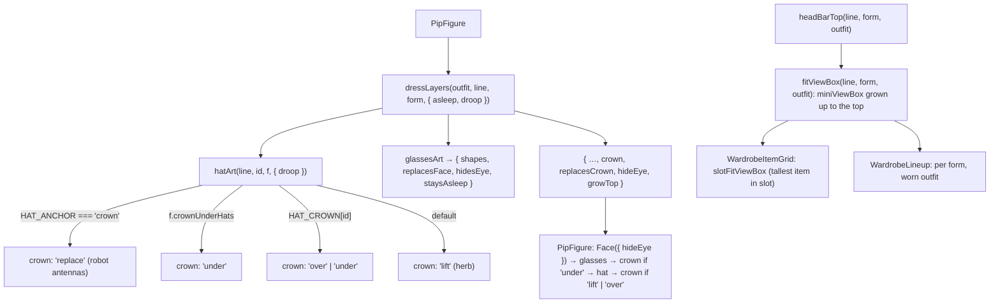

# Plan: Dragon Pip fixes — horns under hats, two new hats, Battle scar, whole-Pip cards

Plan folder: `.claude/contract/2026-11-16-dragon-pip-fixes/`
Execution status: see `tasks.md` in this folder.

---

## Part 1 — Alignment

### Task reference
No Jira ticket. Requests from the developer in this session (2026-11-16), verbatim:

1. > similar to the contract 2026-11-16-robot-pip-antennas the dragon has the same issue. flating horns, [screenshot: Dress Pip, Wyrmling] and he doesn't always fit on the screen in the wardrobe. I also want to look at the glasses for the dragon, as the Scar, is overlaid on his eye when the eye shgold be miossing so there wasn't enough care put into the dragon
2. > fist I want to be able to select A, B or C depending per hat, for example the chef hat I want b but the Bard's cap A. ALso I hate the birst next. The "Horn cosy" and the "Birsds nest I want gone. Go look up cartoons and vidope games for ideas. and come back with a better mock up, also add to claude.md that new clothes and itesm shold come from Seartching video games and cartoons
3. > I need to be able to pick the Jester hat and the "Wizard's hat" to replace the hat, but I can't chose them replacing the " Bird's nest"
4. > why can't we make him smaller to fit? … sorry, Option B for all

Mockup: `foodbytes-app/mockup/pip-dragon-fixes.html` — **approved 2026-11-16** (the `APPROVED` const in its script):
- **Hats** (`design`): `beanie` → **Wizard's hat** (`HATS.wizard`), `straw-hat` → **Jester's cap** (`HATS.jester`).
- **Horns per hat** (`horns`): A = horns over the hat for `beanie` (Wizard's hat), `cap` (Bard's cap), `straw-hat` (Jester's cap); B = horns tucked under for `chef-hat` (Singed toque) and `top-hat` (Crown). Option C (hat between the horns) is unused.
- **Battle scar** (`scar`): **A · Scarred shut** — the left eye (viewer's left) is gone in every mood, replaced by a flat healed lid line with the three claw marks across it; shown while asleep too.
- **Cards** (`cards`): **B · Whole Pip, smaller** on every line — each Dress Pip item card shows the whole Pip from the top of the horns / hat / growth to the feet, and nothing spills out of a card.

Already done in this session (not in this contract): the CLAUDE.md rule "New clothes and items come from video games and cartoons" (under Mockups) and the mockup itself.

### Restated goal
Fix the dragon's wardrobe and make every Pip's Dress Pip cards fit. On the dragon, a hat no longer lifts the horns (or the Hatchling's shell cap) to the top of the hat: each hat says whether the horns are drawn over it (as if poking through holes) or tucked behind it, and the Hatchling's shell always tucks under. The dragon's Horn cosy is redrawn as a Wizard's hat and its Bird's nest as a Jester's cap (same item ids, slots and unlocks; new names and art). The Battle scar takes the dragon's left eye away — a scarred-shut lid with claw marks — in every mood, including asleep. Separately, on all three Pips, the Dress Pip item cards and the evolution lineup show the whole Pip, horns-or-hat to feet, scaled to fit, and clip to their card so nothing can spill into the row above.

### In scope
- Per-hat crown placement for a wardrobe: a `HAT_CROWN` map (`over` / `under`) the dragon uses; lines without one keep today's lift (herb basil growth pokes through hats).
- A form-level `crownUnderHats` flag (dragon Hatchling) so the shell cap always tucks under a hat.
- `dressLayers` exposing the crown placement; `PipFigure` drawing the crown before or after the hat accordingly; `headBar` unaffected in shape (reads `dressLayers().growTop`).
- Dragon `beanie` → Wizard's hat, `straw-hat` → Jester's cap (art ported from the mockup; names in `WARDROBE_ITEM_LABELS`).
- Battle scar: glasses that hide one eye (`hidesEye`) and stay while asleep (`staysAsleep`), the dragon and shared faces able to drop the left eye, the new scar art.
- Card fit, every line: `fitViewBox` for item cards (per slot, tall enough for the tallest item in the slot) and the evolution lineup (per form with the outfit); `overflow: hidden` on both.
- `wardrobe.check.mjs`: crown-placement invariants, scar invariants, card-fit invariants, new dragon names.
- Mockup sync: `pip-themed-lines.html` (dragon hats, scar, horn placement), `pip-room-chrome.html` (dragon hat names), `mockup/README.md` (dragon fixes live).
- Version bump (MINOR) + CHANGELOG line.

### Explicitly out of scope
- Option C (hat between the horns) and the four unpicked hat designs (Raider helm, Pirate's tricorn, Candle hat, Knight's plume).
- Herb and robot hats, crowns and faces (only the shared card fit touches them).
- The footer tab's hat crop (`hatMiniViewBox`) and the full-size Dress Pip stage — neither was reported as broken.
- Server: `WardrobeCatalogue` ids, unlock rules, `WardrobeDTO` (names are client-only).
- Room decor / room packs; `pip-title-belts.html` (a frozen review copy).
- Changing any other dragon item.

### Pattern Reference
None supplied beyond the robot contract. Chosen:
- `.claude/contract/2026-11-16-robot-pip-antennas/` — the closest precedent: a per-wardrobe flag (`HAT_ANCHOR`) read by `wardrobeArt.hatArt`, surfaced by `dressLayers` (`replacesCrown`) and honoured by `PipFigure`; `HAT_CROWN` and `hidesEye` follow the same path.
- `ROBOT_WARDROBE.REPLACES_FACE` → `glassesArt().replacesFace` → `PipFigure` skipping `art.Face` — precedent for "a glasses item changes the face"; `HIDES_EYE` is the per-eye version.
- `headBar.headBarTop` — already computes the top of Pip with any hat and growth; card fit reuses it.
- Geometry source: `foodbytes-app/mockup/pip-dragon-fixes.html` → `HATS.wizard`, `HATS.jester`, `SCAR_OPTIONS[0]`, `hatLayers` (A/B), `dragonFace({ noL })`, `fitCrop(…, 'whole')`.

### Constraints flagged on the brief
- Horn placement is chosen **per hat**, not per line (developer, 2026-11-16).
- Horn cosy and Bird's nest are removed as designs; the item ids stay (`beanie`, `straw-hat`) so owned items and saved outfits keep working.
- New clothes come from video games and cartoons, borrowing the feel, never the property (CLAUDE.md, added this session; Themes rule on franchise marks).
- CLAUDE.md Themes: Pip art keeps its own palette in every theme — colours are literals in the wardrobe files, never theme tokens.
- CLAUDE.md Mockups: UI changes update the mockup in the same ticket.
- `wardrobe.check.mjs` forbids per-form branching in wardrobe files (`form ===`, `.name`, `PIP_FORMS`).
- Low FX / reduced motion / `is-still` stop every wardrobe animation (the new hats reuse existing `sparkle` and `sway` effects).

### Assumptions made
- **Depends on the robot antenna contract (v1.38.0, Status COMPLETE, uncommitted in the working tree).** This plan edits the same files on top of it (`wardrobeArt.js`, `wardrobeLayers.js`, `PipFigure.jsx`, `wardrobe.check.mjs`); it must not be applied on a tree without those changes.
- **Crown placement is a per-wardrobe map** `HAT_CROWN = { [hatId]: 'over' | 'under' }`; an id missing from the map (or a wardrobe without one) keeps today's `lift`. Only the dragon declares it. Herb keeps lift (basil growing through a hat is the herb's look); robot antennas keep `replacesCrown`.
- **The Hatchling's shell cap tucks under every hat** via a data flag `crownUnderHats: true` on the dragon's form 1 in `dragonForms.js` (the mockup does this for both A and B). A form flag, not a branch on the form, so the check's no-per-form-branch rule holds.
- **`over` and `under` both leave the crown at `f.growTop`** (no lift), so `dressLayers().growTop === f.growTop` and the head bar keeps clearing the horns through the existing `growTop − growthRise` term.
- **"Left eye" = viewer's left (`L = 100 − gap`)**, where today's claw marks sit.
- **Scar mechanism:** the dragon wardrobe declares `HIDES_EYE: { 'round-specs': 'L' }` and `STAYS_ASLEEP: ['round-specs']`; `glassesArt` returns `hidesEye` / `staysAsleep`; `dressLayers` keeps those glasses while asleep and exposes `hideEye`; `PipFigure` passes `hideEye` to `art.Face`. `DragonFace` and `SharedFace` drop that eye; herb/robot faces ignore the prop.
- **Card fit = the form's `miniViewBox` grown upward to the highest point of the Pip** (`headBarTop` − 4, scaled), kept square and centred on x = 100. `miniViewBox` is already hand-fitted to each form's wings, tail and feet, so the sides stay covered; only the top needs extending for hats and growth.
- **Item cards in one slot share one viewBox** — the fit for the tallest item in that slot — so a row of cards lines up at one scale (`slotFitViewBox(slot, line, form, itemIds)`). The lineup fits per form with the worn outfit.
- **`slotCropViewBox` is removed** (its only callers are `WardrobeItemGrid` and the check); `hatMiniViewBox` (footer tab) is untouched.
- **Version bump MINOR** (no Jira key, not a bug-only change: new items' art and names).

### Cross-code alignment audit (FE ↔ BE ↔ DB)
Skipped — no persistence touched. Item ids (`beanie`, `straw-hat`, `round-specs`) and slots are unchanged; names and art are client-only (`constants/pipWardrobe.js` names them, the server only stores ids).

---

## Part 2 — Technical design

### Approach
**Horns under hats.** Today `dressLayers` lifts the crown's base to `hat.top + 4` for every non-antenna hat, which is right for the herb (basil grows through) and wrong for horns (they float). A wardrobe can now declare `HAT_CROWN`, a per-hat placement: `over` draws the crown at its own base *after* the hat (the hat looks pierced), `under` draws it at its own base *before* the hat (only what's taller than the hat shows). `hatArt` returns `crown: 'lift' | 'over' | 'under' | 'replace'` (`replace` = the robot's antennas, folding the existing `replacesCrown`), with `under` forced when the form carries `crownUnderHats` (the Hatchling's shell). `dressLayers` exposes `crown` and keeps `replacesCrown` as a derived boolean so the robot path and its check stay intact. `PipFigure` gets one extra branch: when `dress.crown === 'under'` it draws `art.Crown` before the hat instead of after it.

**New hats and the scar** are ported from the mockup's string SVG into the dragon wardrobe's shape descriptors, the same way the robot antennas were. The scar needs the face to lose an eye: the dragon wardrobe declares which glasses hide an eye (`HIDES_EYE`) and which survive sleep (`STAYS_ASLEEP`); `glassesArt` reports both, `dressLayers` exposes `hideEye` and stops hiding those glasses when asleep, and `PipFigure` passes `hideEye` into the line's `Face`. `DragonFace` → `SlitFace` and `SharedFace` gain a `hideEye` prop that skips the left eye's shapes (brows, mouth and blush stay, so the mood still reads).

**Card fit.** A new `pip/cardFit.js` exports `fitViewBox(line, form, outfit)`: take the form's `miniViewBox` square, compute the Pip's highest point in scaled space from `headBarTop(line, form, outfit)` minus a margin, and if that's above the square, grow the square upward (keeping it square and centred on x = 100, bottom fixed). `slotFitViewBox(slot, line, form, itemIds)` takes the fit for the tallest item in the slot. `WardrobeItemGrid` uses it instead of `slotCropViewBox`; `WardrobeLineup` passes `fitViewBox(line, form, outfit)` instead of falling back to `miniViewBox`. CSS adds `overflow: hidden` to the card and lineup SVGs as a guard.

Roads not taken: *one rule for every dragon hat* (rejected by the developer — placement is per hat); *Option C, shrink hats between the horns* (unpicked; needs a per-form hat size); *drop the robot's `HAT_ANCHOR` into the new map* (the antennas redraw from the crown's base with droop — a different draw signature, so `replace` stays its own path); *hide the scar's eye by painting skin over it* (the mockup's option B did this; it fights the gradient fill and leaves an outline ghost — dropping the eye's shapes is cleaner); *per-item card viewBoxes* (rows would jump scale between cards); *a fixed full-figure viewBox* (`PIP_FULL_VIEWBOX` leaves the small forms tiny).

### Skills to invoke during execution
- `react-frontend` — owns every edit under `client/src/` (wardrobe modules, faces, `PipFigure`, `WardrobeItemGrid`, `WardrobeLineup`, `WardrobeView.css`, constants) and the house rules: constants in `src/constants/`, no `console.log`, file-size budget, no frontend test runner (verification = `npm run check:*`, `npm run build`, manual checks).

No `.claude/rules/` file applies (no recipe, ingredient, macro or migration work).

### Diagram


### Data shapes

#### `pip/wardrobeArt.js`
```js
export const CROWN_LIFT = 'lift'       // crown base lifted to hat.top + 4 (herb growth pokes through)
export const CROWN_OVER = 'over'       // crown at f.growTop, drawn after the hat
export const CROWN_UNDER = 'under'     // crown at f.growTop, drawn before the hat
export const CROWN_REPLACE = 'replace' // a crown-anchored hat (robot antenna) replaces the crown
/** { top, shapes, straight?, crown } or null. */
export function hatArt(line, id, f, { droop = false } = {})
/** { shapes, replacesFace, hidesEye: 'L' | null, staysAsleep: boolean } or null. */
export function glassesArt(line, id, f)
```
`replacesCrown` is removed from `hatArt`'s return (now `crown === CROWN_REPLACE`).

#### Wardrobe shape (dragon)
```js
export const DRAGON_WARDROBE = {
  HATS, GLASSES, TORSO, SHOES,
  REPLACES_FACE: [],
  HAT_CROWN: { beanie: 'over', cap: 'over', 'chef-hat': 'under', 'straw-hat': 'over', 'top-hat': 'under' },
  HIDES_EYE: { 'round-specs': 'L' },
  STAYS_ASLEEP: ['round-specs']
}
```

#### `dragon/dragonForms.js`
Form 1 (Hatchling) gains `crownUnderHats: true`; forms 2–3 omit it.

#### `pip/wardrobeLayers.js`
```js
dressLayers(outfit, line, form, { asleep, droop })
// → { …existing, crown: 'lift'|'over'|'under'|'replace'|null, replacesCrown: boolean, hideEye: 'L'|null,
//     growTop: crown === 'lift' ? min(f.growTop, hat.top + 4) : f.growTop }
// glasses are dropped asleep unless staysAsleep; hideEye is null when the glasses are dropped.
// removed: slotCropViewBox, slotCrop
```

#### `pip/cardFit.js` (new)
```js
export const FIT_MARGIN = 4
export function fitViewBox(line, form, outfit)             // 'x y s s': the form's miniViewBox, grown upward (square, bottom and x-centre fixed) until its top ≤ scaled(headBarTop − FIT_MARGIN)
export function slotFitViewBox(slot, line, form, itemIds)  // fitViewBox for the item in `slot` with the smallest headBarTop (no item → bare form)
```
A new module, not `wardrobeLayers.js`: it imports `headBarTop` from `headBar.js`, which already imports `dressLayers` from `wardrobeLayers.js` — putting it there would make an import cycle.

#### Faces
`DragonFace({ form, mood, hideEye })`, `SharedFace({ ey, gap, s, mood, ink, hideEye })`; `hideEye === 'L'` skips the left eye's shapes. `HerbFace` / `RobotFace` ignore the prop.

#### New dragon item art
`HATS.beanie` = Wizard's hat (purple bent cone `#4b3a8c`, gold band `#d9a62e`, two stars `#ffd34d`, sparkling tip star `#fff3b0` in `fxGroup('sparkle')`, brim ellipse `#5a479e`; `top = y − 1.05w`; tilts). `HATS['straw-hat']` = Jester's cap (red `#b8323a` and gold `#e3b23c` points, green crown `#2f6b4a`, two gold bells in `fxGroup('sway')`, stitched gold band; `top = y − 0.62w`; tilts). `GLASSES['round-specs']` = lid line (`DI`, `3.4s`) + three claw marks (`#b9485c` / `#f2a3b0`), as `SCAR_OPTIONS[0]`.

#### `constants/pipWardrobe.js`
Dragon labels: `beanie: "Wizard's hat"`, `'straw-hat': "Jester's cap"`.

#### `WardrobeView.css`
`.pip-wardrobe-item .pip-herb, .pip-wardrobe-form .pip-herb { overflow: hidden; }`

### Runtime quality notes
Frontend-only; mapped to the browser runtime.
- **Resource cleanup:** trivial — no effects, listeners or timers; animations are CSS.
- **Concurrency / ordering:** trivial — pure functions of `(outfit, line, form, mood)`; the outfit save flow is untouched.
- **Allocation / cost behaviour:** `slotFitViewBox` calls `headBarTop` (→ `dressLayers` + `hatArt`) once per item in the slot per grid render — at most 5 hat items, each a handful of descriptors; negligible. The lineup adds one `fitViewBox` per form (≤ 5). New hats are ≈ 10 descriptors each, like the ones they replace.
- **Error paths:** unknown hat id → `hatArt` null → no hat, crown drawn as without a hat; unknown `HAT_CROWN` id → `lift`; unknown line → herb wardrobe (as today); `fitViewBox` with no outfit → the `miniViewBox` grown to the bare form's top. Nothing caught or swallowed.

### Risks and judgement calls
- **Built on the uncommitted robot contract.** Apply this only on top of the v1.38.0 working tree; Task 1 verifies the robot exports exist before editing.
- **`replacesCrown` changes shape** (from `hatArt`'s return into a `crown` enum). `dressLayers` keeps the `replacesCrown` boolean so `PipFigure` and the robot checks keep working; only `hatArt`'s callers (`dressLayers`, `headBar`, the check) see the change.
- **Horns over a tilted hat** (Wizard's hat, Bard's cap, Jester's cap) are drawn upright over a hat rotated −7°, as approved in the mockup. Accepted as the "holes cut" look.
- **The scar now persists asleep** — a deliberate exception to "glasses hidden asleep" (AC 3 of MPP-32), scoped to items in `STAYS_ASLEEP`. The check's asleep assertion branches on it.
- **Whole-Pip cards make clothes smaller** (≈ 60% on the Drake's torso, much smaller for glasses and shoes) — the developer chose this over head-to-waist. Hat cards share the tallest hat's viewBox, so short hats sit lower in a taller frame.
- **`miniViewBox` was tuned for the footer tab**, so it also defines the card's sides. If a form's wings or tail exceed it today they still clip at the sides (no reported case; the mockup's B renders the Drake's wings whole).
- **Mockup sync touches big files** (`pip-themed-lines.html` ≈ 1,280 lines, `pip-room-chrome.html` ≈ 2,890). Only the dragon `hat.beanie`, `hat.sunhat`, `glasses.round` entries, the dragon crown step, and the dragon hat-name list change.
