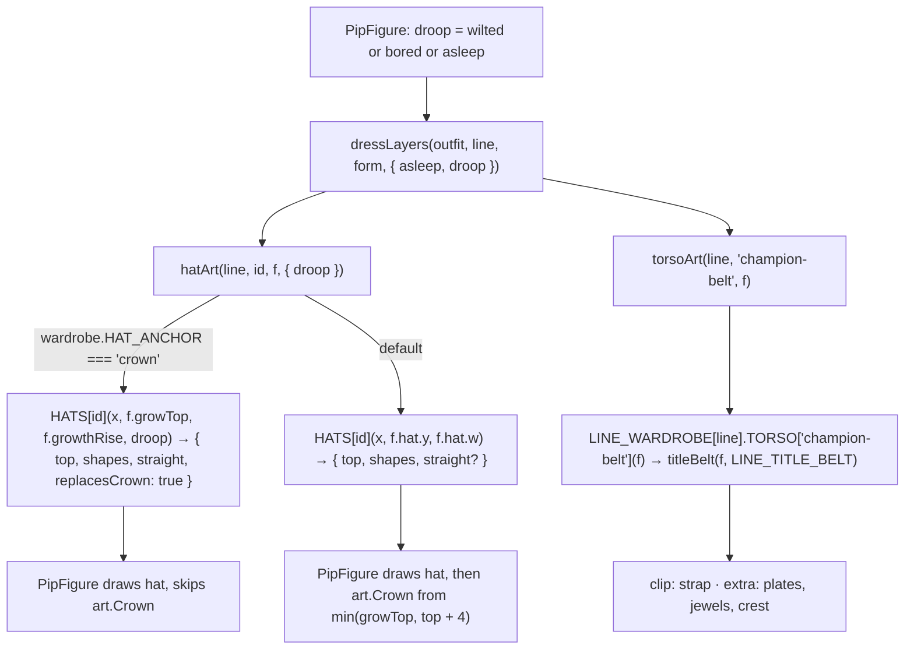

# Plan: Robot Pip antennas + title belts on every Pip

Plan folder: `.claude/contract/2026-11-16-robot-pip-antennas/`
Execution status: see `tasks.md` in this folder.

---

## Part 1 — Alignment

### Task reference
No Jira ticket. Two requests from the developer in this session (2026-11-16), verbatim:

1. > I don't like pips hats ( in cyberpunk ), I think they shold be different antenna, and if we want to have like a chef hat we repalce the red bulb, with a check hat "charm". Mock up the current hats for this, don't fully lean into the charms either, differnt antenna styles ( look at cartoons and video games for insptation )
2. > also all of the belts should look like this [reference image: a gold wrestling championship title belt — black leather strap, large scalloped engraved gold centre plate with red jewels and a crest, engraved side plates] mock that up too for all pips and fold into this contract

Mockups:
- `foodbytes-app/mockup/pip-robot-antennas.html` — **approved 2026-11-16**. Picks: **beanie → Prop-top (A)**, **cap → Radar bar (B)**, **chef-hat → Toque charm (A)**, **straw-hat → Boing spring (A)**, **top-hat → Neon bolt (A)** (the `ANTENNAS[...]` entries with those keys). "Should the robot's Hat slot be labelled *Antenna* in Dress Pip?" → **Yes**.
- `foodbytes-app/mockup/pip-title-belts.html` — **approved 2026-11-16 at this plan's gate as "Champion only"**: only the `champion-belt` item becomes a title belt on every Pip; `leather-belt` keeps today's look and names. Source: section 0 and the last `<script>` in that file → `TITLE_STYLE[line].champ` + `titleBelt(line, 'champ', f)`.

### Restated goal
Two wardrobe art changes, no server work. **(1) Robot antennas:** on the robot Pip (Cyberpunk), the five Hat-slot items stop being hats; each replaces the default antenna (socket, stalk, red bulb) with its own — a spinning propeller, a sweeping radar bar, a tiny chef's-toque charm where the bulb was, a boinging spring, a flickering neon lightning bolt. They grow with the form, wilt like today's antenna when Pip is bored/asleep/wilted, and stop animating under Low FX and reduced motion. The robot's item names change to match and its Hat tab reads "Antenna". **(2) Title belts:** on all three Pips (herb, dragon, robot), the Champion belt item is redrawn as a wrestling-style gold title belt — black leather strap with gilt edges, a big scalloped centre plate with jewels, a per-creature crest and a blank nameplate, and engraved side plates. The Leather belt item is unchanged. Belt names are unchanged. Ids, slots, unlocks and the server are unchanged.

### In scope
- **Antennas:** the five approved antennas (ported from the mockup, including their drooped state); robot hat items replace the line's crown instead of sitting on the hat anchor (`wardrobeArt`, `wardrobeLayers`, `PipFigure`); four new effects in `Pip.css` (`prop`, `radar`, `dangle`, `boing`); robot item names Prop-top, Radar bar, Toque charm, Boing spring, Neon bolt; per-line slot label → robot `HAT` tab reads "Antenna".
- **Title belts:** one shared `titleBelt` drawer in `pip/wardrobeShapes.js`; each line's `champion-belt` drawn through it with that line's style (metal, jewels, crest); robot jewels chase (existing `chase` effect), every plate carries a glint (existing `sparkle`). Names unchanged (Champion belt / Hoard belt / Marquee belt).
- `wardrobe.check.mjs`: hat invariants branch on crown anchoring; droop invariants; a belt invariant that the champion belt on every line draws a strap (`clip`) and a plate (`extra`) through the shared drawer.
- Mockup sync: `pip-themed-lines.html` (robot hats → antennas, champion belts → title belts, new robot hat names), `pip-room-chrome.html` (robot hat names, robot Hat tab label), `mockup/README.md` (both new mockups marked live).
- Version bump (MINOR) + CHANGELOG line.

### Explicitly out of scope
- The unpicked antenna options (Feelers, Rabbit ears, Whisk tip, Mini dish, Neon halo).
- The Leather belt on every Pip (look and names): decided 2026-11-16 ("Champion only"); the mockup's contender belt is not built.
- Herb and dragon hats and slot labels; every other wardrobe slot.
- Server: `WardrobeCatalogue` ids, unlock rules, `WardrobeDTO` (names are client-only).
- Changing Dress Pip card crops / footer hat crop (antennas fit the existing crops; belts sit on the torso crop as today).
- Redrawing the default robot antenna (`RobotCrown`).
- Room decor / room packs.
- Any lettering on belts, or any real-world/franchise belt mark (CLAUDE.md: borrow a genre's feel, never its property).

### Pattern Reference
None supplied. Chosen:
- `robot/robotWardrobe.js` + `pip/wardrobeShapes.js` — shape-descriptor items (`path`/`rect`/`circle`/`ellipse`/`group`/`fxGroup`) and shared helpers (`overalls(f, color, rivet, ink)` is the precedent for a cross-line drawer parameterised by palette — `titleBelt` follows it).
- `ROBOT_WARDROBE.REPLACES_FACE` → `dressLayers().replacesFace` → `PipFigure` skipping `art.Face` — precedent for "a worn item replaces part of the creature"; crown replacement mirrors it.
- `utils/pipWardrobe.js` → `wardrobeItemLabel(line, id)` over `WARDROBE_ITEM_LABELS` — precedent for the per-line slot label.
- Geometry sources: `mockup/pip-robot-antennas.html` → `ANTENNAS` (picked keys); `mockup/pip-title-belts.html` → `TITLE_STYLE` / `titleBelt`.

### Constraints flagged on the brief
- Don't fully lean into charms: only the chef hat is a charm.
- Belts "for all Pips": every line; confirmed 2026-11-16 that only the Champion belt item changes.
- CLAUDE.md Themes: Pip art keeps its own palette in every theme — antenna/belt colours are literals in the wardrobe files (as today), never theme tokens. No franchise marks.
- CLAUDE.md Mockups: UI tickets update the mockup in the same ticket.
- Low FX / reduced motion / `is-still` stop every wardrobe animation.
- `wardrobe.check.mjs` forbids per-form branching in wardrobe files (`form ===`, `.name`, `PIP_FORMS`) — `wardrobeShapes.js` is in that list.

### Assumptions made
- **Confirmed 2026-11-16: only `champion-belt` becomes a title belt**, on all three lines; `leather-belt` and every belt name stay as they are.
- **Per-line belt style** (metal, dark, light, jewel colours, crest) lives in each line's wardrobe file; the geometry is one shared `titleBelt(f, style)` in `wardrobeShapes.js` — one drawing, three skins, matching how `overalls` is shared.
- **Robot hat crown-anchoring is a per-wardrobe flag (`HAT_ANCHOR: 'crown'`)**, not per item — every robot hat is an antenna.
- **Antenna draw signature `(x, base, rise, droop)`** with `base = f.growTop`, `rise = f.growthRise`, widths scaled by `k = rise / 22` — antennas grow from the head top, not the brim.
- **Droop reaches the wardrobe via `dressLayers(…, { droop })`**, computed in `PipFigure` exactly as the crown's droop (`wilted || bored || asleep`); ignored for non-crown lines and non-hat slots. Needed because Toque charm and Boing spring have bespoke drooped shapes.
- **Generic antenna wilt** = plain group `transform="rotate(34 100 base+2)"`; drooped antennas emit no `fxGroup` (keeps "an animated group never carries a positioning transform"). Desaturation comes from `PipFigure`'s existing `is-wilted` filter only.
- **Antennas live in new `robot/robotAntennas.js`**, imported by `robotWardrobe.js` as `HATS`.
- **Slot label override** `WARDROBE_SLOT_LABELS` + `wardrobeSlotLabel(line, key)`; `WardrobeSlotTabs` gets a `line` prop.
- **Head bar needs no code change** (`headBarTop` already takes the min over crown top, `growTop − growthRise` and `hat.top`; upright antenna is the tallest state).
- **Version bump MINOR** (no Jira key, not a bug fix).

### Cross-code alignment audit (FE ↔ BE ↔ DB)
Skipped — no persistence touched. Item ids (`leather-belt`, `champion-belt`, the five hats) and slots (`HAT`, `BELT`) are unchanged; names and art are client-only (`constants/pipWardrobe.js`: "this file only names them").

---

## Part 2 — Technical design

### Approach
**Antennas.** Today every line's hat is drawn from the hat anchor `(x, f.hat.y, f.hat.w)` and `dressLayers` lifts the crown base to `hat.top + 4` so growth pokes through. The robot gets a second mode: its wardrobe declares `HAT_ANCHOR: 'crown'`, and `hatArt` then calls the item with `(PIP_FOOT_X, f.growTop, f.growthRise, droop)`, returning `{ top, shapes, straight: true, replacesCrown: true }`. `dressLayers` threads `droop` through, exposes `replacesCrown`, and leaves `growTop` at `f.growTop`. `PipFigure` draws the hat at its usual layer and skips `art.Crown` when `dress.replacesCrown` — the same move as skipping `art.Face` for `replacesFace`. Herb and dragon take the unchanged path. The five antennas are ported from the mockup's string SVG into descriptors in `robot/robotAntennas.js`; four new `pip-fx--*` effects join `Pip.css`, so the Low FX / reduced-motion / `is-still` stops cover them automatically.

**Title belts.** A single `titleBelt(f, style)` in `pip/wardrobeShapes.js` returns `{ clip, extra }`: the strap (band + gilt edge arcs + dashed stitching) goes in `clip` (inside the body outline, like every belt), the plates, jewels, crest, nameplate, shine and glint go in `extra` (outside the clip, like today's buckles). It reads only `f.waist` and `f.side` (torso anchors), so the check's anchor isolation holds. `style` carries `ink`, `strap`, the metal and jewel colours, an optional `leds` flag (robot: jewels wrapped in `fxGroup('chase')`), and a `crest(x, y, r, ink)` function returning descriptors. Each line's `champion-belt` becomes a one-liner over its own `*_TITLE_BELT` style; `leather-belt` drawers are untouched. The herb's local `belt()` helper loses its `big` branch (it now only draws the leather belt).

**Slot label** is the same per-line lookup pattern as item names; only `WardrobeSlotTabs` renders slot labels.

Roads not taken: *antennas from the hat anchor* (the brim is inside the robot's monitor; antennas would float or need per-form offsets); *swap the line's `Crown` component by outfit* (moves wardrobe knowledge into `lineArt` and out of `dressLayers`, which the check and head bar read); *per-item `REPLACES_CROWN`* (unneeded while every robot hat is an antenna); *three separate belt drawings per line* (triplicates ~50 lines of geometry and lets the three skins drift — the mockup proves one geometry fits all 11 forms).

### Skills to invoke during execution
- `react-frontend` — owns every edit under `client/src/` (`PipFigure`, `WardrobeSlotTabs`, wardrobe modules, constants, utils, `Pip.css`) and the house rules: constants in `src/constants/`, no `console.log`, file-size budget, no frontend test runner (verification = `npm run check:*`, `npm run build`, manual checks).

No `.claude/rules/` file applies (no recipe, ingredient, macro or migration work).

### Diagram


### Data shapes

#### `robot/robotAntennas.js` (new)
```js
// id → (x, base, rise, droop) → { top: number, shapes: Descriptor[] }
export const ROBOT_ANTENNAS = { beanie /* Prop-top */, cap /* Radar bar */, 'chef-hat' /* Toque charm */, 'straw-hat' /* Boing spring */, 'top-hat' /* Neon bolt */ }
```

#### `ROBOT_WARDROBE` (modified)
```js
export const ROBOT_WARDROBE = { HATS: ROBOT_ANTENNAS, HAT_ANCHOR: 'crown', GLASSES, TORSO, SHOES, REPLACES_FACE: ['round-specs', 'heart-glasses'] }
```

#### `pip/wardrobeArt.js`
```js
export const HAT_ANCHOR_CROWN = 'crown'
/** { top, shapes, straight?, replacesCrown } or null. */
export function hatArt(line, id, f, { droop = false } = {})
```

#### `pip/wardrobeLayers.js`
```js
dressLayers(outfit, line, form, { asleep = false, droop = false } = {})
// → { …existing, replacesCrown: boolean }; growTop = replacesCrown ? f.growTop : (hat ? min(f.growTop, hat.top + 4) : f.growTop)
```

#### `pip/wardrobeShapes.js` — title belt
```js
/**
 * style: { ink, strap, metal, dark, light, jewel, jewel2, leds?, crest: (x, y, r, ink) => Descriptor[] }
 * → { clip: Descriptor[], extra: Descriptor[] }   (reads f.waist, f.side only)
 */
export function titleBelt(f, style)
```
Geometry (from the mockup's champ tier): plate `W = clamp(side × 1.2, 26, 48)`, `H = W × .66`; side plates at `100 ± side × .74`, size `max(8, side × .32) × 11`; 5 plate jewels at `(±.38W, ±.2H)` and `(0, −.43H)`; crest radius `.2H` at `y − .06H`; nameplate `.4W × max(2.4, .1H)` at `y + .22H`.

#### Per-line belt styles (new constants, one per wardrobe file)
| Line | Constant (ink, strap) | metal / dark / light | jewel / jewel2 | crest |
|---|---|---|---|---|
| herb | `HERB_TITLE_BELT` (`HERB_INK`, `#1d1712`) | `#e3b23c` / `#a8781a` / `#fff0b0` | `#d4384a` / `#d4384a` | basil leaf `#6cbf4a` |
| dragon | `DRAGON_TITLE_BELT` (`DRAGON_INK`, `#241a14`) | `#d9a53a` / `#93661a` / `#ffe6a0` | `#d43a4a` / `#2f9a6a` | shield `#7a2730` + ruby `#ff8a96` |
| robot | `ROBOT_TITLE_BELT` (`ROBOT_INK`, `#11161d`) | `#e8c34a` / `#a8841c` / `#fff4c0` | `RB.accent` / `RB.glow`, `leds: true` | pixel star on `RB.dark` disc |

#### `constants/pipWardrobe.js`
```js
export const WARDROBE_SLOT_LABELS = { [PIP_LINE.ROBOT]: { [WARDROBE_SLOT.HAT]: 'Antenna' } }
// WARDROBE_ITEM_LABELS changes:
//   robot: beanie 'Prop-top', cap 'Radar bar', 'chef-hat' 'Toque charm', 'straw-hat' 'Boing spring', 'top-hat' 'Neon bolt'
```

#### `utils/pipWardrobe.js`
```js
export const wardrobeSlotLabel = (line, key) => WARDROBE_SLOT_LABELS[line]?.[key] ?? WARDROBE_SLOTS.find(s => s.key === key)?.label ?? null
```

#### `WardrobeSlotTabs` props
`{ wardrobe, line, selected, onSelect }` — `line` new, from `WardrobeView` (`herb.line`).

#### `Pip.css`
`.pip-fx--prop` (keyframes `pip-fx-prop`: scaleX 1 → −1 → 1, .32s linear), `.pip-fx--radar` (same keyframes, 2.6s ease-in-out), `.pip-fx--dangle` (±7°, origin 50% 100%, 2.4s), `.pip-fx--boing` (scaleY 1 / .78 / 1.1, origin 50% 100%, 1.3s).

### Runtime quality notes
Frontend-only; mapped to the browser runtime.
- **Resource cleanup:** trivial — no effects, listeners or timers; animations are CSS.
- **Concurrency / ordering:** trivial — pure functions of `(outfit, line, form, droop)`; the outfit save flow is untouched.
- **Allocation / cost behaviour:** `dressLayers` already runs per `PipFigure` render. An antenna is 5–12 descriptors (≈ the hat it replaces); a title belt is ≈ 30 descriptors (vs ≈ 25 for today's Marquee/Hoard belts) — negligible. Bundle ≈ +5 kB. New animations only run while worn and stop under Low FX.
- **Error paths:** unknown hat id → `hatArt` null → no hat, default crown drawn; unknown line → herb wardrobe (as today); `wardrobeSlotLabel` falls back to the shared label. Nothing caught or swallowed.

### Risks and judgement calls
- **Check rewrite is the riskiest part.** Four hat assertions in `wardrobe.check.mjs` encode hat-anchor semantics (own anchor = `hat.y`, top-hat tilts, growth pokes through). They branch on `HAT_ANCHOR` rather than being deleted, so herb and dragon keep full coverage.
- **Droop now changes drawn shapes on the robot.** The existing "wilt never touches the outfit" assertion passes an option `dressLayers` ignores, so it stays true; a new assertion pins that `droop` changes only `hat.shapes`, and only on crown lines.
- **Bored/asleep (not wilted) antennas dim and stop but don't desaturate** — the mockup desaturated them. Matches today's live crown behaviour; accepted as more consistent.
- **The belt mockup was regenerated as Champion-only at the approval gate** (2026-11-16), so `pip-title-belts.html` already matches what ships. Its contender-belt code path is unused (the override loop only touches `champ`).
- **Belt plates are wide** (up to 48 units) on small forms (Basil seed, Bot-kid): the plate overlaps the lower chest, as on a real title belt. The mockup shows it on all 11 forms; the check pins finiteness and anchor isolation, not overlap.
- **Shared `titleBelt` means one geometry for three creatures** — a future per-creature tweak would need a style field, not a fork.
- **Mockup sync touches big files** (`pip-themed-lines.html` ≈ 1,190 lines, `pip-room-chrome.html` ≈ 2,890). Only the robot `hat` block, the three `belt.champ` entries and the robot hat-name lists change. `pip-title-belts.html` stays as the review artefact (marked live in the README), as `pip-robot-antennas.html` does.
- **Names are client-only**, so a queued "New outfit" toast shows the new name — harmless.
