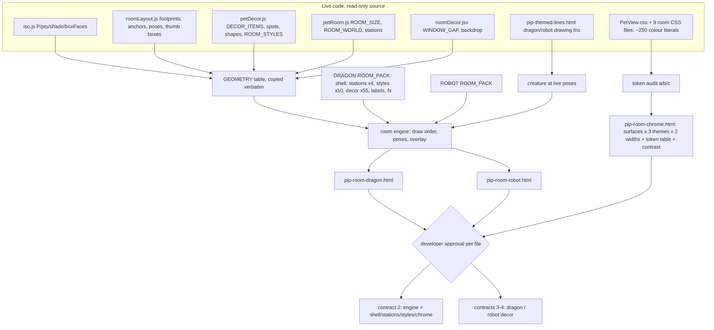

# Plan: Themed Pip rooms: mockups (contract 1 of 4)

Plan folder: `.claude/contract/2026-11-16-themed-pip-rooms-mockups/`
Execution status: see `tasks.md` in this folder.

---

## Part 1 — Alignment

### Task reference
The input is the `/brainstorming` spec, moved into this folder as `spec.md` (it was written on 2026-11-16 as `.claude/contract/specs/2026-11-16-themed-pip-rooms-spec.md`). It has no Jira key, so the slug is date-based and no ticket is moved. Every decision in `spec.md` stands. The developer confirmed them during brainstorming on 2026-11-16:
- **Rooms per creature.** Each creature gets a full room. The 5 stations become in-world equivalents and keep their jobs.
- **Shared ids, own drawings.** The 55 decor items and 10 styles have 1:1 counterparts: same id, spot, price and ownership, but drawn and named per creature.
- **Light ambience.** CSS-only, and it stops under Low FX, reduced motion and in thumbnails.
- **Room UI chrome follows the app theme** through role tokens; the room art keeps its own palette.
- **Architecture:** a room pack per creature, keyed by `theme.pipLine`, with fixed geometry and a per-item herb fallback (approach A).
- **This contract delivers 3 mockups and nothing else** (developer, 2026-11-16: "the first plans outcome should be a mock up"): the dragon lair, the robot workshop, and the room UI chrome. Contracts 2–4 (engine, shell and stations, then dragon decor, then robot decor) are planned separately against the approved mockups.

### Restated goal
Draw the themed Pip rooms as three self-contained HTML mockups in `foodbytes-app/mockup/`, for the developer to approve before any app code exists.
- **`pip-room-dragon.html` and `pip-room-robot.html`** each rebuild the live isometric room from the app's real geometry, so the art provably fits the existing tap targets and Pip's poses. Each draws its creature's whole room:
  - the shell
  - all 5 stations at levels 1–4
  - all 10 wall/floor styles
  - all 55 decor items, each with its own name
  - day and night
  - the restyled room effects
  - light ambience

  Each has controls to flip through everything, toggles for Low FX, reduced motion and a hit-box overlay, and thumbnails at the shop and picker crop sizes.
- **`pip-room-chrome.html`** shows every room UI surface (Shop, decor picker, Fridge, Trophy cabinet, Dress Pip, edit bar, head bar, check-in actions) in Default, Parchment and Cyberpunk, at phone and desktop widths. It includes the proposed role-token table that contract 2 will implement.

The art data in the two room files is laid out in the room-pack shape contract 2 will use, so the port is verbatim. Nothing under `foodbytes-app/client/` or `foodbytes-api/` changes.

### In scope
- **`foodbytes-app/mockup/pip-room-dragon.html`:**
  - a geometry table copied from the live code
  - the dragon room-pack data: shell, stations ×4 levels, 10 styles, 55 decor, names, effects, ambience
  - the creature placed at the live Pip home, bed and cooker poses
  - the herb room for reference
  - controls: day/night, style chips, a level picker per station, a picker for each of the 12 spots, effect states, a creature-form picker
  - toggles: Low FX, reduced motion, hit-box overlay
  - a thumbnail strip, a names table, and a fit table
- **`foodbytes-app/mockup/pip-room-robot.html`:** the same for the workshop.
- **`foodbytes-app/mockup/pip-room-chrome.html`:**
  - every room UI surface in Default, Parchment and Cyberpunk at 375 px and 1280 px
  - the role-token table: name, Default (today's literal), Parchment, Cyberpunk, and contrast ratio
  - the proposed new `check-themes.mjs` pairs
- **Docs and gates:**
  - `foodbytes-app/mockup/README.md`: three rows, plus a "Proposal in review" note
  - one developer approval gate per file, with the date recorded in the file
  - the MINOR version bump and a CHANGELOG line

### Explicitly out of scope
- **No app code.** Nothing under `foodbytes-app/client/src/`, `foodbytes-app/client/scripts/` or `foodbytes-app/foodbytes-api/` changes; that is contracts 2–4.
- **No server, DB or migration change.**
- **No geometry changes.** Footprints, anchors, spot shapes, window gap, camera and Pip poses stay as they are.
- **No separate Default room mockup.** The herb room drawn inside the two room files is for comparison only.
- **No bespoke chrome looks.** Parchment-scroll sheets and CRT panels are out of scope; chrome is tokens only, and any need for them goes to the follow-up list.
- **No rich ambience.** No room-wide particles, timed lighting or JS-driven animation.
- **No changes to Pip's art or wardrobe.** The creature is copied from `pip-themed-lines.html`, unchanged.
- **No edits to the historical mockups.** `.claude/contract/MPP-15-epic-breakdown/mockups/*` and the root `mockups/` are read for reference at most.

### Pattern Reference
From `spec.md`:
- **Mockup shape:** `foodbytes-app/mockup/pip-themed-lines.html`. It provides:
  - the self-contained HTML/CSS/JS shape, no build step
  - the section headers
  - the `<!-- approved YYYY-MM-DD -->` gate
  - the Low FX and reduced-motion toggles
  - the `pip-fx` animation rules
  - the dragon and robot drawing functions, which are copied to place the creature in each room
- **Room geometry and live room art** (today's room is the reference and the herb comparison):
  - `client/src/components/pet/room/iso.js`: `P()`, `pts`, `shade`, `boxFaces`
  - `room/roomLayout.js`: the `*_FOOTPRINT`s, `STATION_ANCHORS`, `RUG`, `PIP_HOME`, poses, `STATION_SHIFT`, `DECOR_LEGACY_SHIFT`, `WINDOW_SHIFT`, `stationThumbBox`, `decorThumbBox`
  - `room/roomDecor.jsx`: `WINDOW_GAP`, `roomBackdrop`, sky, skirting, patterns
  - `room/furniture.jsx`: `stationArt`
  - `room/decorArt*.jsx`
  - `room/roomEffects.jsx`
  - `constants/petRoom.js`: `ROOM_SIZE`, `ROOM_WORLD`, `ROOM_STATIONS`, `ROOM_INK`
  - `constants/petDecor.js`: `DECOR_ITEMS`, `ROOM_SPOTS`, `DECOR_SPOT_SHAPES`, `DECOR_SPOT_LABELS`, `ROOM_STYLES`
  - `constants/petShop.js`: station labels and icons
- **Room UI chrome reference:**
  - `client/src/components/pet/PetView.css`: the Default token pin on `.pet-view`
  - `room/ShopView.css`, `DecorPicker.css`, `FridgeView.css`, `TrophyCabinetView.css`, `WardrobeView.css`, `PetRoom.css`, `PipHeadBar.css`, `CheckInActions.css`, `ShopEarnTab.css`
  - `client/src/styles/themes/default.css`, `cyberpunk.css`, `parchment.css`
  - `client/scripts/check-themes.mjs`
  - the theme look in `foodbytes-app/mockup/app-mockup.html` (Cyberpunk) and `parchment-theme.html` (Parchment)
- **Planned pack shape:** the `lineArt` / `LINE_WARDROBE` / `WARDROBE_ITEM_LABELS` registries in `client/src/components/pet/pip/` and `constants/pipWardrobe.js`.

### Constraints flagged on the brief
- Mockup first: this contract is the approval gate, and no app code is written in it.
- **Fixed geometry.**
  - Every station level, decor item, style and effect fits the live footprints, anchors, spot shapes and window gap.
  - The room files draw the hit boxes as a toggleable overlay to prove it.
- **Same ids.** 5 stations × 4 levels, 55 decor ids in their 12 spots, and 10 style ids.
- **Stations keep their jobs.** The planned-meals gauge, the trophy cabinet, the Dress Pip wardrobe, and the bed and cooker poses must all still read.
  - **Dragon:** straw nest (→ nest on gold), cold-cellar ice chest, forge hearth + cauldron, hoard chest (→ treasure alcove), armour rack.
  - **Robot:** charging pod, cryo unit, fab oven, display case / holo plinth, gear locker.
- **No franchise names, marks, characters or lookalikes.**
- **Palettes.**
  - Room art keeps its own palette.
  - The chrome uses role tokens; a token's Default value equals today's literal.
  - New pairs must pass WCAG AA with no new `KNOWN_EXCEPTIONS`.
- **Light ambience.**
  - CSS only, using transform and opacity.
  - Stopped by Low FX, reduced motion and thumbnails; glow is removed under Low FX.
  - No positioning `transform` on an animated group.
- Readable at 320–1280 px; thumbnails readable at their crop sizes.
- Each contract carries a version bump and a CHANGELOG line.

### Assumptions made
- **Slug `2026-11-16-themed-pip-rooms-mockups`, and `spec.md` lives here.** Contracts 2–4 cite this folder's `spec.md` (or its archive path once this contract is archived). *Rationale: the plan folder must stand alone, and the spec is one shared upstream for all four contracts.*
- **Mockups rebuild the room from the live geometry, not from `pip-room-mockup-v5.html`.** The v5 mockup predates MPP-39 (`ROOM_SIZE` 260 × 300 × 150) and MPP-40 (spots). Each room file carries an inline `GEOMETRY` table copied verbatim from `roomLayout.js` / `petRoom.js` / `petDecor.js` / `roomDecor.jsx`, with a comment naming each source line. *Rationale: the fit gate is only meaningful against the real numbers.*
- **The herb comparison room is a simplified redraw, not a port of all 2,500 lines of live art.** It shows the herb shell, stations at one chosen level, and the default style. A link to `/pet` on Default is the full reference. *Rationale: the herb room already exists live, and the mockup's job is the new creatures.*
- **Room data is written in the planned pack shape** (see Data shapes): `{ ink, styles, backdrop, stations, decor, effects, ambience, labels }`, keyed by the live ids, with each drawing an anchor-driven function returning an SVG string. *Rationale: contract 2 converts these to JSX parts as contract `2026-11-15-themed-pip-lines` did, with no re-design.*
- **Each room file stays one file, split into clear sections.** If a file passes ~4,000 lines, the decor drawings move to `pip-room-dragon-decor.js` / `pip-room-robot-decor.js` beside it, loaded by `<script src>`. *Rationale: opening with no build step still works, and a reviewer can find things.*
- **The creature in the room comes from `pip-themed-lines.html`.** Its form functions and forms tables are copied, and the room uses form 3 by default, with a form picker. *Rationale: one source for creature art; the room must show that small and grown creatures both fit the bed and cooker poses.*
- **Names are proposed in the mockups and red-lined at review.** That covers 55 decor + 5 station + 10 style names per creature, generic fantasy and generic sci-fi, with no franchise terms. Each room file shows a names table: id → herb label → this creature's label. *Rationale: the spec defers names to the mockup review.*
- **Animated decor is marked in the names table** with an "fx" column. The workshop's night-window rain is included and flagged as the spec's open question. *Rationale: the spec leaves both to the review.*
- **The chrome mockup's token table is built by auditing the ~250 colour literals** in `PetView.css` and the nine room CSS files. Each literal is classified as one of:
  - **(a)** an existing global token (map to it, e.g. `--brand-primary`)
  - **(b)** a new pet role token, named `--pet-<area>-<role>` (e.g. `--pet-sheet-bg`, `--pet-pill-bg`, `--pet-gauge-low`)
  - **(c)** room art, which stays literal (anything drawn inside the room SVG)

  The table lists the file and line of every literal it covers. *Rationale: contract 2 needs an exact, checkable mapping, and "Default must not drift" needs the literal recorded.*
- **Chrome mockup scope is UI surfaces only.** The room art behind sheets is a flat placeholder band per theme, and the chrome file says so in its header. *Rationale: the room art lives in the other two files; repeating it here adds nothing to the chrome review.*
- **MINOR version bump** (Task M.1, no Jira key, not a bug), although no deployable code changes. *Rationale: `CLAUDE.md` mandates one bump per contract and `/fb-apply` QA gates on `check:version`. Red-line this if you'd rather skip the bump for mockup-only work.*
- **The approval gate is three manual tasks, one per file.** Each file gets its own loop of review → changes → approve. The contract can only reach `COMPLETE` after all three are approved, or after the developer explicitly closes it with a file still pending. *Rationale: three independent reviews; one late file should not block noting the others.*

### Cross-code alignment audit (FE ↔ BE ↔ DB)
Skipped: no persistence or API touched. This contract writes standalone HTML mockups only. The ids the mockups must honour come from client constants (`ROOM_STATIONS`, `DECOR_ITEMS`, `ROOM_STYLES`), which mirror the server catalogue unchanged.

---

## Part 2 — Technical design

### Approach
Three standalone mockup files in `foodbytes-app/mockup/`, built the way `pip-themed-lines.html` was: plain HTML + CSS + inline JS, open straight in a browser, no build step and no dependency.

**Both room files share one engine section.**
- An inline `GEOMETRY` table and an iso helper block (`P`, `pts`, `shade`, `boxFaces`, `ellipsePoints`), copied verbatim from `iso.js`.
- A small renderer composes the room in the live draw order: backdrop → wall decor → window → stations by `ROOM_DRAW_ORDER` → floor decor → creature → effects → overlay.
- The creature is placed at the live `pipPose` / bed / cooker poses.

Because the geometry is the live geometry, the hit-box overlay is the real fit test. The overlay draws every station footprint at the selected level, every `DECOR_SPOT_SHAPES` outline and the window gap. A fit table lists each station level and decor item against its box, filled in by the author's eye.

**The room file is laid out in the room-pack shape contract 2 will use.**
- Each creature's data object is `ROOM_PACK = { ink, styles, backdrop, stations, decor, effects, ambience, labels }`.
- Drawings are anchor-driven functions returning SVG strings, so contract 2 converts them to JSX components and shape descriptors one-to-one.
- Ambience and animated decor use `pip-fx`-style classes on wrapper groups:
  - stopped by `.lowfx` on `<body>`, `@media (prefers-reduced-motion: reduce)` and `.is-still` (every thumbnail)
  - `filter: drop-shadow` glows removed under `.lowfx`

Rejected alternatives:
- **One combined room mockup with a creature switch.** It would be easier to compare, but at roughly 2 × 70 drawings plus the engine it becomes a single file too large to review or approve per creature.
- **Porting the full live herb room for comparison.** It doubles the file for no review value, since the live app is the reference.

**The chrome file is a token workbench.**
- It renders every room UI surface as static HTML with the live class names copied from the room CSS: Shop with its 4 tabs, decor picker, Fridge, Trophy cabinet, Dress Pip, edit bar, head bar, check-in actions, pills and chips.
- It includes those CSS rules rewritten to read `var(--pet-*)` tokens.
- Three `:root[data-theme]` blocks set the Default, Parchment and Cyberpunk token values.
- A switcher sets theme and width (375 / 1280), plus an "all side by side" view.
- A token table lists name, area, Default value (today's literal, with its source `file:line`), Parchment, Cyberpunk, and contrast ratios.
- A small inline script computes the ratios with the same WCAG formula `check-themes.mjs` uses, so failing pairs show red in the mockup before contract 2 exists.

Rejected alternative: **drawing the chrome as screenshots or static images.** Tokens could not be toggled or contrast-checked.

**Review gates.**
- Each file ends at a developer task: review it, red-line names and art, approve it, and have the date stamped in the file's `<body>` comment.
- The README gets three rows and a "Proposal in review" section, matching the existing folder-proposal entry.

### Skills to invoke during execution
- `react-frontend`: the mockups mirror client UI conventions:
  - ≥44 px touch targets on mockup controls
  - mobile-first layout at 320–1280 px
  - the theme token rules from `CLAUDE.md`, with colours for the app chrome only in tokens
  - accessible controls (labels, `aria-pressed` on toggles)

  It also owns reading the live room code that the geometry and labels are copied from.

Rules: no `.claude/rules/` file applies (no recipe, ingredient, macro, variant or migration work).

### Diagram


### Data shapes

#### Room file: geometry table (copied verbatim from live code)
```js
const GEOMETRY = {
  ROOM_SIZE,            // petRoom.js  { u: 260, v: 300, h: 150 }
  ROOM_WORLD,           // petRoom.js  { x: -84, y: 10, width: 564, height: 394 }
  WINDOW_GAP,           // roomDecor.jsx { v0: 158, v1: 238, h0: 56 }
  RUG,                  // roomLayout.js
  FOOTPRINT: { bed, fridge, cooker, cabinet, wardrobe }, // roomLayout.js *_FOOTPRINT, 4 levels each
  STATION_ANCHORS, STATION_SHIFT, ROOM_DRAW_ORDER, PIP_HOME, PIP_SCALE, PIP_COOKER_SPOT, PIP_BED_SCALE, PIP_BED_DROP,
  DECOR_SPOTS, DECOR_SPOT_SHAPES, DECOR_LEGACY_SHIFT, WINDOW_SHIFT, // petDecor.js / roomLayout.js
  THUMB: { station: stationThumbBox, decor: decorThumbBox }  // crop boxes used by shop + picker
}
const IDS = {
  stations: ['bed', 'fridge', 'cooker', 'cabinet', 'wardrobe'],          // ROOM_STATIONS
  decor: { /* 55 ids → spot, verbatim from DECOR_ITEMS */ },
  styles: ['wall-white','wall-lavender','wall-mint','wall-peach','wall-sky','wall-sprig',
           'floor-lilac','floor-oak','floor-terracotta','floor-checker']  // ROOM_STYLES
}
```

#### Room file: one creature's pack (the shape contract 2 ports)
```js
const DRAGON_ROOM = {
  ink: '#…',                                   // outline colour for this room's art
  styles: {                                    // same 10 ids
    'wall-white': { left, right, skirting, pattern? },   // e.g. stone tints; pattern = 'moss' | 'tapestry' | …
    'floor-lilac': { base, pattern? }, …       // e.g. flagstone; pattern = 'flags' | 'slate' | 'runes' | …
  },
  backdrop: { windowFrame(night), glass(night), sky(night), sill(), skirting(style), wallPattern(style), floorPattern(style) },
  stations: { bed: [L1, L2, L3, L4], fridge: […], cooker: […], cabinet: […], wardrobe: […] }, // each Ln() → SVG string inside FOOTPRINT[station][n-1]
  decor: { 'basil-print': () => svg, … },      // all 55 ids, world coords inside the spot shape
  effects: { gauge(level, pct), steam(level), zzz(level), servedPlate(level), nightDim() },
  ambience: [{ target: 'cooker' | 'window' | '<decor id>' | 'shell', effect: 'flicker' | 'embers' | 'glint' | 'sway' | 'blink' | 'fan' | 'buzz' | 'rain' | 'scan' }],
  labels: {
    stations: { bed: 'Straw nest', … },        // 5
    decor: { 'basil-print': '…', … },          // 55
    styles: { 'wall-white': '…', … }           // 10
  }
}
// ROBOT_ROOM has the identical shape. Animated parts carry class="room-fx room-fx--<effect>".
```

#### Room file: review sections (in page order)
1. Header: what this is, the approval comment slot, toggles (Day/Night, Low FX, Reduced motion, Hit boxes), a creature form picker (1–3), and a "Herb reference" toggle.
2. The room: the composed iso room at full width, with the camera fixed at `ROOM_WORLD_VIEWBOX`.
3. Style chips: the 10 styles, each with its creature name.
4. Stations: per station, a level picker (L1–L4) driving the room, plus a row of all 4 levels as thumbnails cropped by `stationThumbBox`.
5. Decor: 12 spot pickers (with Empty, except the rug), driving the room, plus a grid of all 55 thumbnails cropped by `decorThumbBox`, each labelled with its name.
6. Effects: fridge gauge at 0 / 50 / 100 %, steam, zzz, served plate, night dim.
7. Names table: id | spot | herb label | creature label | fx.
8. Fit table: station level / decor id | box | fits (✓ or note).

#### Chrome file: token table row and contrast pair
```js
// one row per role token
{ token: '--pet-sheet-bg', area: 'Shop / sheets', defaultValue: '#ffffff', source: 'room/ShopView.css:12',
  parchment: '#…', cyberpunk: '#…', kind: 'new' | 'existing:--bg-primary' }
// one entry per text/background pair for check-themes.mjs (contract 2 adds them to PAIRS.<id>)
{ fg: '--pet-pill-text', bg: '--pet-pill-bg', min: 4.5 }
// literals left as room art (kind c) are listed separately with file:line so contract 2 can confirm they stay literal
```

#### Chrome file: surfaces drawn (each in Default / Parchment / Cyberpunk × 375 / 1280)
- Shop sheet: the Upgrades tab (`ShopStationCard` with levels and price), the Decor tab (`ShopItemCard`), the Walls & floors tab (`RoomStyleChips`) and the Earn tab (`ShopEarnTab`).
- Decor picker (`DecorPicker`): owned, empty, and "Buy more for this spot".
- Fridge view (`FridgeView`): gauge bands low / medium / plenty, and the notes.
- Trophy cabinet (`TrophyCabinetView`).
- Dress Pip (`WardrobeView`, `WardrobeSlotTabs`, `WardrobeItemGrid`, `WardrobeLineup`).
- Edit room bar and button (`EditRoomBar`, `EditRoomButton`), shop and wardrobe pills (`ShopButton`, `WardrobeButton`), the recentre button, and the free-mode badge.
- Head bar (`PipHeadBar`, `PipHeadBarStatus`) and check-in actions (`CheckInActions`).
- The pet header strip and the mood chips (`PetView.css`).

### Runtime quality notes
These are mapped to a static mockup in the browser. No app runtime is touched.
- **Resource cleanup:** none needed. Controls re-render the room by replacing `innerHTML` of one container, so there are no timers, listeners on detached nodes, or intervals. The ambience is CSS-only.
- **Concurrency / ordering:** none. It is a single page with synchronous re-render on input.
- **Allocation / cost behaviour:**
  - A full re-render of the room SVG on each control change is a few hundred nodes, which is fine.
  - The thumbnail grids (55 decor + 20 station + 10 style) render once at load, with `.is-still`, so they run no animations.
  - Glow filters are the costliest part and are removed under Low FX, which is also the evidence the Low FX rule works.
- **Error paths:**
  - A missing drawing for an id renders a visible red dashed box labelled with the id. It never renders blank, so gaps show up at review.
  - Any JS error shows in the DevTools console, and the "Expected: console empty" checks catch it.

### Risks and judgement calls
- **Art volume is the long pole.** About 70 drawings per creature: 5 stations × 4 levels, 55 decor, the shell, 10 styles and effects. That is roughly 3× the wardrobe work. The tasks split each room into shell+styles, stations, then decor in three spot groups, so a review can start before all the decor is done.
- **Fidelity to live geometry.** If the copied `GEOMETRY` drifts from the code before contract 2, the fit proof is void. Each value carries a `// source: file:line` comment, and contract 2's first task re-diffs them.
- **Names are copy the developer must red-line.** That is 70 names per creature. The names table makes it one review pass.
- **The token audit could misclassify a literal.** For example, a gauge colour that is really room art. Every literal is listed with `file:line` and its kind, so contract 2 checks the same list. Gauge band colours (`FRIDGE_GAUGE_COLOURS` in `constants/petRoom.js`) are proposed as room art (kind c), because the gauge is drawn on the fridge.
- **The version bump without a deployable change.** This follows the one-bump-per-contract rule. If you'd rather not bump for mockup-only work, red-line Task M.1 and QA will skip the version gate for this contract.
- **Spec location.** `spec.md` moved into this folder. When this contract is archived, contracts 2–4 must cite `.claude/contract/archive/2026-11-16-themed-pip-rooms-mockups/spec.md`.
- **No automated checks exist for mockups.** Verification is the console-clean check, the hit-box overlay and the developer's eye. The mockup's own contrast calculator is advisory until contract 2 wires the pairs into `check-themes.mjs`.
- **Robot window rain** is included as light ambience pending review (spec open question).
