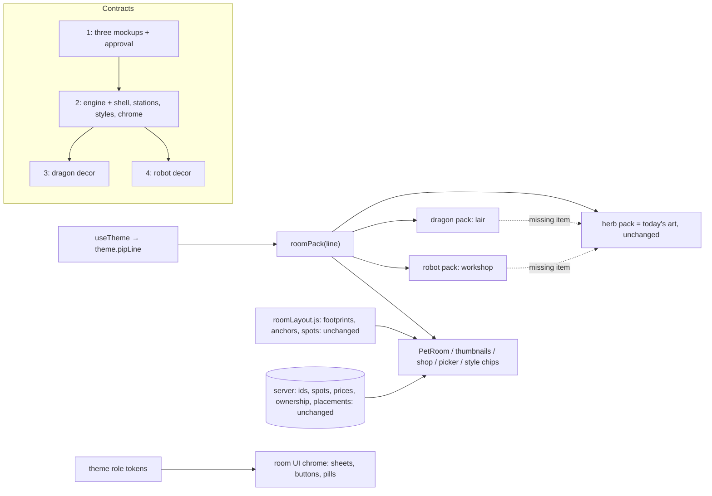

# Spec: Themed Pip rooms (dragon lair, robot workshop)

## Goal
Pip's room changes with the creature. Since `2026-11-15-themed-pip-lines` (v1.33.0), Pip is basil on Default, a dragon on Parchment and a robot on Cyberpunk, but the room still uses the Default purple art and UI in every theme. This work gives the dragon a cave **lair** and the robot a night **workshop**. Each creature draws every station, decor item and wall/floor style its own way and gives it its own name. Ids, spots, prices, ownership and placements stay shared, so buying something once shows it in every theme. Both rooms get light CSS-only ambience, and the room's UI (sheets, buttons, pills) follows the app theme while the room art keeps its own palette.

The **first contract delivers only three mockups**, for developer approval. Later contracts port the approved art into the app.

## In scope
- **Contract 1 — mockups only** (no app code), in `foodbytes-app/mockup/`:
  - `pip-room-dragon.html` — the lair:
    - the full iso room, built from the live `ROOM_SIZE`, station footprints / `STATION_ANCHORS`, decor spot shapes and window gap, copied from `client/src/components/pet/room/roomLayout.js` and `constants/petRoom.js` / `petDecor.js`, with the dragon Pip (from `pip-themed-lines.html`) standing in it
    - every station (bed, fridge, cooker, cabinet, wardrobe) at levels 1–4
    - all 10 wall/floor styles as switchable chips
    - all 55 decor items, with a per-spot picker and a name for each item
    - day and night
    - the restyled room effects: fridge gauge at 0 / 50 / 100 %, pot steam, sleep zzz, served plate
    - the ambience, with a Low FX toggle and a reduced-motion toggle
    - station, decor and style thumbnails at the shop / picker crop sizes
    - the Default herb room shown alongside for reference
  - `pip-room-robot.html` — the workshop, with the same contents as the lair.
  - `pip-room-chrome.html`:
    - every room UI surface in Default, Parchment and Cyberpunk at 375 px and 1280 px: the Shop (Upgrades, Decor, Walls & floors, Earn), the decor picker, the Fridge, the Trophy cabinet, Dress Pip, the edit bar, the head bar, check-in actions and pills
    - the proposed role-token table (token name, Default value = today's literal, Parchment value, Cyberpunk value)
  - Rows for all three files in `foodbytes-app/mockup/README.md`.
  - A developer approval gate per file, with the approval date recorded in the file (`<!-- approved YYYY-MM-DD -->`), as in `pip-themed-lines.html`.
- **Contract 2 — room engine, shell, stations, styles, chrome** (planned later against the approved mockups):
  - a room-pack registry keyed by `theme.pipLine`
  - the herb pack wraps today's art unchanged
  - the lair and workshop shell, the 5 stations × 4 levels, the 10 styles, the effects and the ambience
  - per-creature station and style names
  - the chrome token split
  - decor falls back to the herb drawings until contracts 3 and 4
- **Contract 3 — dragon decor:** the 55 lair decor items and their names.
- **Contract 4 — robot decor:** the 55 workshop decor items and their names.

## Explicitly out of scope
- Any server, DB or migration change. Station ids and levels, decor ids, spots, prices, ownership, placements and `PET_FREE_MODE` behaviour are unchanged.
- Separate catalogues or ownership per creature, and line-only decor items.
- Changing room geometry: `roomLayout.js`, hit boxes, Pip's walk / cook / bed poses, camera bounds and zoom.
- Bespoke theme looks for the room UI (parchment-scroll sheets, CRT panels). The chrome follows tokens only; any need the mockup reveals is recorded as a follow-up.
- Rich ambience: room-wide particles, timed lighting, JS-driven animation.
- Changes to Pip's art or wardrobe (shipped in v1.33.0), and rewording the herb-named wardrobe unlock hints.
- Default room art. It must stay pixel-identical.
- A separate Default-theme room mockup file. The live app is the reference for Default, and the herb room drawn alongside in the lair and workshop mockups is for comparison only.

## Pattern reference
- **Per-creature art registry:** `client/src/components/pet/pip/lineArt.jsx`, `pip/lineForms.js` and `pip/wardrobeArt.js` (`LINE_WARDROBE`, herb fallback), plus `constants/pipWardrobe.js` → `WARDROBE_ITEM_LABELS[line][id]`. Room packs and room labels copy this shape.
- **Line source:** `constants/themes.js` → `pipLine`, read via `useTheme()`. Never branch on a theme id.
- **Today's room art (becomes the herb pack):**
  - `components/pet/room/furniture.jsx` (`FURNITURE`, `stationArt(station, level)`)
  - `decorArt.jsx` (`decorArt(id)`, cached), plus `decorArtWalls`, `decorArtWindow`, `decorArtFloor*` and `decorArtRugs`
  - `roomDecor.jsx` (`roomBackdrop(night, wall, floor)`, window, sky, skirting, patterns)
  - `roomEffects.jsx`
  - `constants/petDecor.js` (`DECOR_ITEMS`, `ROOM_STYLES`)
  - `constants/petRoom.js` (`ROOM_STATIONS`, `ROOM_INK`)
- **Geometry the new art must fit:** `room/roomLayout.js`, `room/iso.js`, `constants/petRoom.js` (`ROOM_SIZE`), `constants/petDecor.js` (`DECOR_SPOT_SHAPES`, `ROOM_SPOTS`).
- **Animated parts:** `pip/Pip.css` `pip-fx` effects (CSS only, transform/opacity, off under `body.lowfx`, reduced motion and still figures; no positioning `transform` on an animated group).
- **Mockup layout:** `foodbytes-app/mockup/pip-themed-lines.html` (section structure, approval comment, Low FX toggle) and the room mockups referenced in `foodbytes-app/mockup/README.md`.
- **Themed UI tokens:** `client/src/styles/themes/default.css`, `cyberpunk.css`, `parchment.css`; `client/scripts/check-themes.mjs` (`PAIRS.<id>`).

## Constraints
- **Mockup first.** No room art or chrome code is written before the matching mockup is approved (project rule: UI work starts in `foodbytes-app/mockup/` and is reviewed before components).
- **Fixed geometry.** Every station, decor item, style and effect fits the existing footprints, anchors, spot shapes and window gap. Each mockup draws the hit boxes as a debug overlay toggle to prove it.
- **Same ids everywhere:** the 5 stations × 4 levels, 55 decor ids in their 12 spots, and 10 style ids (`wall-*` / `floor-*`).
- **Stations keep their jobs.** The fridge is the planned-meals gauge, the cabinet the trophy cabinet, the wardrobe opens Dress Pip, and the bed and cooker keep Pip's sleep and cook poses. Each creature reimagines the object in-world, but the job must read at a glance:
  - Dragon: straw nest (→ nest on gold), cold-cellar ice chest, forge hearth + cauldron, hoard chest (→ treasure alcove), armour rack.
  - Robot: charging pod, cryo unit, fab oven, display case / holo plinth, gear locker.
- **Names per creature.** Every station, decor item and style has a name on each creature. No franchise names, marks, characters or lookalikes (no Harry Potter, Witcher, D&D, Blade Runner or similar).
- **Palettes.**
  - The room art and Pip keep their own palette in every theme. Colours live in the room/pip art, not in theme tokens.
  - The room UI chrome follows the app theme via role tokens.
  - A new token's Default value is exactly today's literal, so Default must not drift.
  - `npm run check:themes` passes with the new pairs and no new `KNOWN_EXCEPTIONS`.
- **Ambience is light.**
  - CSS-only loops on SVG groups.
  - Stopped by `body.lowfx`, `prefers-reduced-motion`, and in every thumbnail (shop cards, picker, style chips, station thumbs).
  - Glow filters are removed under Low FX.
  - Lair: torch/candle flicker, rising hearth embers, a hoard glint, a banner sway. Workshop: screen flicker, blinking LEDs, a slow fan, neon buzz, rain on the night window.
  - The mockup marks which decor items animate.
- **Readability.** The room reads at 320–1280 px, and the thumbnails read at their crop sizes.
- **Versioning.** Each contract carries the standard version bump and CHANGELOG line per `CLAUDE.md`.

## Approach (chosen)
**Room pack per creature, keyed by `theme.pipLine`**, mirroring the Pip-lines registries.
- `ROOM_PACKS = { herb, dragon, robot }`, with `roomPack(line)` falling back to herb.
- Each pack supplies `stationArt`, decor builders, `styles`, backdrop parts (window frame, day/night glass and sky, sill, skirting, wall/floor patterns), `effects`, `labels` and `ink`.
- The herb pack wraps today's files without changing a drawing.
- Missing entries fall back per item to herb art. That fallback lets contract 2 ship the lair and workshop shells before their decor exists.
- The room follows the creature, so one registry field (`pipLine`) drives Pip, the wardrobe and the room.
- Contract 1 produces the approved mockups that contracts 2–4 port from verbatim.

## Approaches considered (rejected)
- **Separate `roomTheme` field on THEMES:** more flexible pairing, but two fields to keep in step and no need for independent pairing.
- **Branching inside each builder:** per-line branches across ~2,500 lines of art, and the 400-line file budget breaks.
- **Palette re-skin only:** cheapest, but a fridge stays a fridge in a dragon lair.
- **Shell + stations only:** decor would look out of place in the lair and workshop.
- **Separate catalogue per creature:** needs a migration and server changes, and decor would be re-bought per theme.
- **One contract for everything:** too large to review in one pass.

## Diagram

## Success criteria
**Contract 1:**
- **Lair and workshop files.** `pip-room-dragon.html` and `pip-room-robot.html` open with an empty DevTools console. Each shows the room with its creature, and has these working controls:
  - day/night
  - all 10 style chips
  - station level 1–4 per station
  - a picker for each of the 12 decor spots, covering all 55 items, each with its creature's name
  - Low FX and reduced-motion toggles that stop every animation
  - a hit-box overlay toggle
- **Fit.** With the overlay on, every station level and decor item sits inside its footprint or spot shape.
- **Chrome file.** `pip-room-chrome.html` shows every listed UI surface in Default, Parchment and Cyberpunk at 375 px and 1280 px, plus a token table whose Default column equals today's literals.
- **README.** `foodbytes-app/mockup/README.md` has a row for each file.
- **Approval.** The developer approves each file, and the approval date is recorded in it.

**Contracts 2–4:**
- **Theme switching.** Switching theme on `/pet` swaps the room art and names with no refetch.
- **Default unchanged.** The Default room's rendered markup is byte-identical to before (SSR compare).
- **Coverage check.** `npm run check:room` asserts that every pack covers its required entries (stations × levels and styles in contract 2; all 55 decor ids in contracts 3 and 4), with names and finite output.
- **Builds and checks.** `npm run check:themes` and `npm run build` pass. `mvn test` is unaffected.
- **Mockup fidelity.** The live rooms match the approved mockups (manual walk in all three themes).

## Open questions
- **Decor names.** Item-by-item names for all 55 decor items, 5 stations and 10 styles per creature are proposed in the mockups and red-lined during the contract-1 review, not here.
- **Effects.** Should the night-window rain in the workshop count as "light" ambience? It is included unless red-lined in the mockup review.
