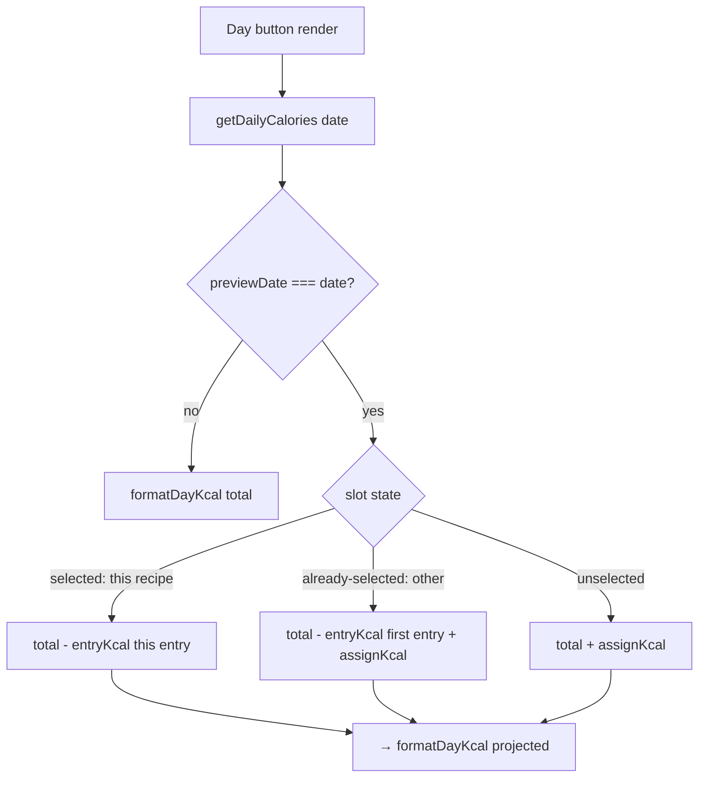

# Plan: Day kcal on recipe-card day buttons (FR-050 back)

Plan folder: `.claude/contract/2026-11-17-day-kcal-buttons/`
Execution status: see `tasks.md` in this folder.

---

## Part 1 — Alignment

### Task reference
Developer, 2026-11-17: *"I use to be able to see the cals for the day when selecting a meal, please mock up all 3"* (screenshot: Cyberpunk Recipes page, breakfast cards, day buttons MON–SUN with no kcal). The mockup was then built and is the brief for this plan:

- `foodbytes-app/mockup/day-kcal-buttons.html`: the same breakfast card in Default, Cyberpunk and Parchment, desktop and 320px (`#mobile`). Each day button shows that day's planned kcal above the day name. Hovering a day previews the day total with this recipe in the slot (swap if another recipe holds it; on a ✓ day, the total without it). The face grows 40 → 48px, the hit area 44 → 52px. Numbers have no comma; an empty day shows a faint "—"; the "→" before a preview number is hidden at ≤480px.
- The feature existed before as FR-050 (`git show 9a556ab:foodbytes-app/client/src/components/recipes/DayAssignmentButtons.jsx`, `<span className="day-cal">{getDailyCalories(day.date)}</span>`) and was removed by the Meal Plan / Recipes redesign (`910dd60`).

No Jira ticket.

### Restated goal
Put the day's planned kcal back on each of the seven day buttons on a recipe card, styled for each of the three themes as the mockup shows, and add a hover/keyboard-focus preview of what that day's total becomes if you click (add, swap or remove). The buttons keep their three states and their click behaviour.

### In scope
- `DayAssignmentButtons` renders a two-line face: day kcal (from `getDailyCalories`) above the day name, "—" when the day is empty.
- A preview on mouse hover and keyboard focus: the number becomes "→ projected total", computed by a new pure helper.
- Accessible name/title of each day button includes the projected day total.
- `RecipeCard` passes the selected variant's per-serving kcal to `DayAssignmentButtons`.
- Base CSS (`DayAssignmentButtons.css`) for the two-line layout, sizes and Default colours via existing tokens.
- Cyberpunk and Parchment overrides in `styles/themes/cyberpunk/recipes.css` and `styles/themes/parchment/recipes.css`.
- A `node` check script for the helper, wired as `npm run check:daykcal`.
- Mockup sync: `day-kcal-buttons.html` and `mockup/README.md` say "live from v<new>" and drop the press-and-hold claim (see Assumptions); `app-mockup.html` and `parchment-theme.html` day buttons show the kcal line.
- Version bump (MINOR) + CHANGELOG.

### Explicitly out of scope
- Picking mode (the single "Add to Mon 17" button): unchanged.
- Press-and-hold preview on touch.
- Fixing the optimistic total using the base recipe's kcal when a variant is selected (see Risks); it corrects itself on the refetch.
- Any backend or DB change; `MealPlanDayDTO.totalCalories` is used as is.
- A daily kcal target or traffic-light on the day buttons.

### Pattern Reference
- The mockup `foodbytes-app/mockup/day-kcal-buttons.html` (authoritative for look and behaviour).
- `client/src/components/recipes/DayAssignmentButtons.jsx` + `.css` (the component being changed).
- Day-total source: `MealPlanContext.getDailyCalories(planDate)` (still exported, `contexts/MealPlanContext.jsx:486`).
- Per-serving entry kcal: the same formula the optimistic update uses, `recipe.calories / recipe.defaultServings` (`MealPlanContext.jsx:164-182`).
- Pure helper + check script pattern: `utils/macroStatus.js` + `utils/macroStatus.check.mjs` (`npm run check:macros`).
- `react-frontend/SKILL.md` touch rules (44px, `@media (hover: hover)`, `:focus-visible`).

### Constraints flagged on the brief
- All three themes; colours only in `styles/themes/` (component CSS reads tokens).
- Default must not drift beyond the deliberate change (two lines, 48px face).
- Every theme selector prefixed `:root[data-theme="<id>"]`.
- Works at 320px: seven buttons with a 4-digit number.
- `npm run check:themes` stays green (one known WARN, `Themes OK: 3 themes, 189 contrast pairs`).
- Mockup updated in the same ticket.

### Assumptions made
- **Preview on hover and keyboard focus only, not press-and-hold.** A long-press on a tap target fights the tap (which assigns) and iOS's callout; on touch the number already updates instantly after the tap through the optimistic update. The mockup text is corrected to match.
- **Day total = `day.totalCalories`** (sum of per-serving kcal of every entry that day, per person, all meals including snacks), as FR-050 did. Servings on the card don't change it.
- **Preview math** mirrors `assignRecipe`'s optimistic delta: selected → total − that entry; otherwise → total − first entry in the slot (swap) + selected variant's per-serving kcal; floored at 0 and rounded.
- **Selected variant kcal** comes from `RecipeCard.currentVariantCalories` via a new prop `assignKcal`, the same number the variant segment shows.
- **Format:** `String(Math.round(n))`, no thousands separator; 0 → "—" (`DAY_KCAL_EMPTY`).
- **No new tokens.** Default uses `--text-secondary` / `--brand-primary`; Cyberpunk `--cyan` / `--yellow`; Parchment `--ink-light` / `--wax`; selected faces inherit the face's on-colour. All are already-checked text tokens on the same backgrounds as today's day names.
- **Helper lives in `utils/dayKcal.js`** with `utils/dayKcal.check.mjs` and a `check:daykcal` script, following the `macroStatus` pattern.
- **Version: no ticket, a feature → MINOR.** CHANGELOG uses the slug.

### Cross-code alignment audit (FE ↔ BE ↔ DB)
Skipped — no persistence touched. Read-only confirmation of the existing contract: `MealPlanDayDTO.totalCalories` (`Integer`, "Sum of per-serving calories for this day", `MealPlanService.java:580-583`) → JSON `totalCalories` → `getDailyCalories` → already rendered by `DayHeader.jsx:17` and `MobileDaySummary.jsx:11`.

---

## Part 2 — Technical design

### Approach
`DayAssignmentButtons` already has everything except the number: `useMealPlan()` exposes `getDailyCalories` and `weekPlan`. The face becomes `<span class="day-btn-face"><span class="day-kcal">…</span><span class="day-name">Mon</span></span>`. A local `previewDate` state is set on `onPointerEnter` (only when `pointerType === 'mouse'`, so touch never sticks in preview) and `onFocus`, cleared on `onPointerLeave` / `onBlur` and after a click. The previewed button gets the `preview` class and its kcal span shows `→ <projected>`. Each button's `title`/`aria-label` gains "· day → N kcal" so screen readers and native tooltips get the projection without hover.

The projection is a pure function in `utils/dayKcal.js` (`projectDayKcal`, `formatDayKcal`, `entryKcalPerServing`), unit-checked by a `node` script, because it carries the only real invariant (swap vs add vs remove) and the project has no frontend test runner. The alternative, computing it inline in the component, would leave it unverifiable and push the 249-line file further.

Styling: base CSS sets the column layout, 48px face, 52px button, the kcal span (small, tabular numerals, `color: var(--text-secondary)`), the `.empty` fade, the preview colour `var(--brand-primary)` inside `@media (hover: hover)` plus `:focus-visible`, and hides `.arrow` at ≤480px. Cyberpunk and Parchment add their font and colour overrides in their `recipes.css`, next to the existing day-button blocks. The road not taken: a separate tooltip/popover with the projection; rejected because the mockup puts the number in the button and a popover on seven small buttons is noisy on mobile.

`RecipeCard` passes `assignKcal={currentVariantCalories}`; nothing else in the card changes.

### Skills to invoke during execution
- `react-frontend` — component, prop, CSS and touch/a11y conventions; file-size budget; no-test-runner honesty.
Rules: none of `.claude/rules/` apply (no recipe data changes); read `CLAUDE.md` → *Themes* and *Mockups* before the CSS and mockup tasks.

### Diagram


### Data shapes
#### New module `client/src/utils/dayKcal.js`
```js
export const DAY_KCAL_EMPTY = '—'
/** Per-serving kcal of a meal-plan entry, as the backend counts it. */
export function entryKcalPerServing(entry) // → number: (entry?.recipe?.calories || 0) / (entry?.recipe?.defaultServings || 1)
/** Day total after clicking: remove when assignId is in the slot, else swap the first entry for assignKcal. */
export function projectDayKcal({ dayTotal, slotEntries, assignId, assignKcal }) // → integer >= 0
/** "1835" or "—" for 0 / missing. */
export function formatDayKcal(kcal) // → string
```
#### Changed props
- `DayAssignmentButtons({ recipe, servings, currentMealType, selectedRecipeId, assignKcal, pickDate, onAssigned })` — `assignKcal: number` (per-serving kcal of the selected variant).
#### Markup / CSS classes
- `.day-btn-face` (now column) → `.day-kcal` (+ `.empty`) containing optional `.arrow` (`→`) and the number, then `.day-name`. `.day-btn.preview` on the previewed button. The selected ✓ moves from `.day-btn-face::before` to `.day-name::before`.
#### Script
- `client/package.json` → `"check:daykcal": "node src/utils/dayKcal.check.mjs"`.

### Runtime quality notes
Frontend-only; mapped onto the browser runtime.
- **Resource cleanup:** no timers, listeners or requests added; preview is React state on the component, gone on unmount.
- **Concurrency / ordering:** the number reads `weekPlan`, which the optimistic `assignRecipe` updates before the server answers and `fetchWeekPlan` then replaces; the button just re-renders. A shared plan (`meal_plan_owner_id`) is already reflected in `weekPlan`.
- **Allocation / cost behaviour:** 7 × `weekPlan.days.find` per card per render (7 days), trivial. Hover changes state on one card only, so one card re-renders. No memoisation added.
- **Error paths:** no new async. Missing day / entry / calories fall back to 0 → "—"; `defaultServings` 0 or missing divides by 1.

### Risks and judgement calls
- **Optimistic total uses the base recipe's kcal for a variant.** `performAssignment` passes `recipe` (the card's base) to `assignRecipe`, so tapping Light on a Moderate card shows the Moderate figure until `fetchWeekPlan` lands (well under a second). Visible now that the number is on the button. Left out of scope; a follow-up could pass a variant-shaped `recipeData`. Say if you want it in.
- **Hover-only preview** means touch users never see the "→" preview; they see the result after tapping (tap again to undo). The `aria-label` carries the projection for assistive tech.
- **Default look changes on purpose** (48px two-line buttons on every card in Default). That is the requested feature, not drift.
- **Cards get 8px taller** per card; long Recipes lists scroll a little more.
- **Mockup sync for `app-mockup.html` / `parchment-theme.html`** touches big files; the change is limited to the `dbtns` renderer and its CSS.
