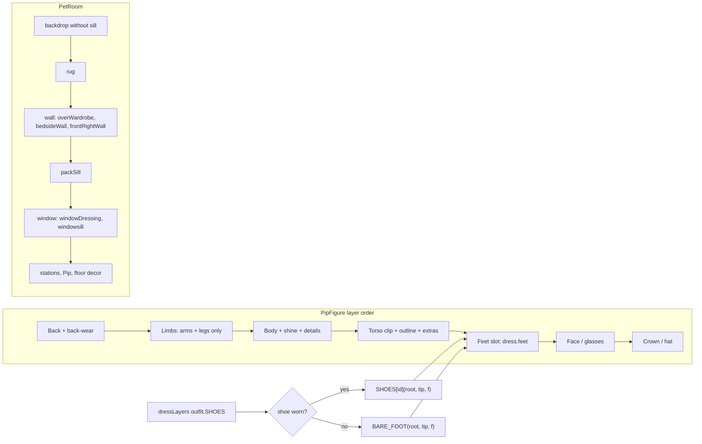

# Plan: Pip ball feet + whole-foot shoes, new dragon shoes, frames behind the sill

Plan folder: `.claude/contract/2026-11-17-pip-ball-feet-shoes/`
Execution status: see `tasks.md` in this folder.

---

## Part 1 — Alignment

### Task reference
No Jira ticket. The brief is the approved mockup `foodbytes-app/mockup/pip-dragon-shoes.html` and the developer's decisions in this session (2026-11-17):
- "pips dragons shoes are lazy done new mock up like this for the shoes" + "the photos don't look correct … see how the pictures are floating over the cill" (robot room Monitor stack over the windowsill).
- "his nails stick out I think you should reduce the feet to little balls and overlay the shoes, like make the no shoes, shoes, so the feet are not part of the svg, I think you should do this for all pips. So you are swapping the whole foot."
- **Approved 2026-11-17:** ball feet + foot swap on every Pip; dragon `sneakers` = **Fluffy fur boots**, dragon `wellies` = **Dragonscale boots**; frames option **C** (raise the frames and draw the sill in front).

The mockup's approved picks are its `DEFAULT_PICKS`; its art (`LEGS`, `BARE`, `FOOTWEAR`, `monitors`, `FRAME_OPTIONS`) is the visual source of truth.

### Restated goal
Every Pip (herb, dragon, robot) stops drawing feet as part of its body art. Each leg ends in a little ball foot, and the foot becomes the shoe slot's job: with no shoes the two ball feet are drawn, and a worn shoe replaces the ball entirely. Feet (bare or shod) move in front of the body in the layer order, so the whole shoe shows and nothing (claws, foot plates) pokes out. The dragon's two shoe items get new art and names (Fluffy fur boots, Dragonscale boots); herb and robot keep their shoe designs, redrawn as whole-foot swaps. Separately, in all three rooms the wall frames item stops floating over the windowsill: the frames move up 12 units and the sill is drawn after the bedside-wall decor.

### In scope
- Legs without feet: `HerbLimbs`, `DragonLimbs` (no foot claws; arm claws stay), `RobotLimbs` (no foot plates).
- A bare ball foot per line (`BARE_FOOT` in each line's wardrobe module).
- Foot slot in the wardrobe pipeline: `footArt` replaces `shoeArt`; `dressLayers` returns `feet` (bare when no shoe) instead of `shoes`.
- `PipFigure` draws the feet after the body outline and torso extras, before the face.
- Shoes redrawn as whole-foot art in a mirrored foot frame: herb Sneakers/Wellies, robot Hover pads/Mag boots, dragon Fluffy fur boots/Dragonscale boots.
- Dragon shoe names in `constants/pipWardrobe.js`.
- `wardrobe.check.mjs` updated for the new contract.
- Frames C in all three packs: `photo-strip` bottom frame from h 64 to h 76; the sill split out of each backdrop and drawn after the wall decor that sits beside the window, before the window dressing and windowsill decor.
- Mockup sync: `pip-themed-lines.html` (the shared Pip engine) gets the ball-feet model; README marks `pip-dragon-shoes.html` live.
- MINOR version bump + CHANGELOG.

### Explicitly out of scope
- The other six dragon shoe designs in the mockup (moccasins, slippers, anklets, sabatons, buckles, embers) — not shipped.
- New wardrobe items, slots, unlocks or prices; backend/DB (item ids `sneakers`/`wellies` stay).
- Any other wall decor position (the Growth chart is covered by the sill-in-front change, not moved).
- Card crops (`cardFit.js`), head bar, room camera.
- Older mockups that draw Pip feet (`pip-dragon-fixes.html`, `pip-robot-*.html`, `pip-title-belts.html`, `pip-room-*.html`) — historical, approved snapshots.

### Pattern Reference
None supplied beyond the mockup. Chosen references:
- `foodbytes-app/mockup/pip-dragon-shoes.html` → `LEGS`, `BARE`, `FOOTWEAR`, `pipFigureSwap`, `footG`, `monitors(76)`, `FRAME_OPTIONS.C` — art and layer order to port.
- `client/src/components/pet/pip/wardrobeShapes.js` shape descriptors (`path`, `ellipse`, `rect`, `circle`, `group`, `fxGroup`) — every line's wardrobe returns these, rendered by `PipOutfit`.
- `client/src/components/pet/room/roomPacks.jsx` → `packBackdrop` / `packEffects` — pattern for a new `packSill`.

### Constraints flagged on the brief
- Pip's art keeps its own palette in every theme (CLAUDE.md → Themes): literal colours in `components/pet/` are allowed.
- Same outfit, same layers on every form; no per-form branches (`wardrobe.check.mjs` regex on wardrobe sources).
- Mockup must match live: implementation follows the approved picks; `pip-themed-lines.html` synced.
- One bump per contract; no ticket → MINOR (new art/behaviour, not a bug fix).

### Assumptions made
- **Bare feet live in each line's wardrobe module as `BARE_FOOT`** — keeps one dispatch (`footArt`) for bare and shod feet; rationale: the foot is now a slot, and wardrobes already own all slot art.
- **Shoe draw signature becomes `(root, tip, f)`** — the ball foot needs the form's limb colour (`f.fill[1]`); shoes ignore `f`.
- **`dressLayers().shoes` is renamed `feet` and is never empty** — makes "no shoes = bare feet" explicit; `itemIds` still lists only a worn shoe.
- **Feet drawn after `dress.extra`, before the face** — in front of the body outline and pant legs, and well below the face so they never cover it.
- **Mirrored foot frame via `group(..., { transform: 'translate(x y) scale(dir 1)' })`** — mirrors the mockup's `footG`; `PipOutfit` already passes attributes straight through.
- **Herb leg ends 2 units above the tip** (`tip[1] - 2`), dragon too, as in the mockup, so the ball sits on the floor line.
- **Sill split: a new `sill` field on each room pack**, and `DECOR_LAYERS.wall` split into `wall` (over wardrobe, bedside wall, front right wall) and a new `window` layer (window dressing, windowsill). PetRoom draws backdrop → rug → wall → sill → window. Curtains and sill ornaments keep drawing over the sill, as today.
- **Frames raised by exactly 12 (64/82/100 → 76/94/112)** per approved option C; the top frame ends at h 126, 2 above the bedside spot's dashed edit outline (h 124), inside its volume (h 132).
- **No Jira ticket** — the slug is date-based; no board transitions.

### Cross-code alignment audit (FE ↔ BE ↔ DB)
Skipped — no persistence touched. Wardrobe item ids (`sneakers`, `wellies`) and spot ids are unchanged, so stored outfits and placements keep working; only art and display names change.

---

## Part 2 — Technical design

### Approach
**Feet become a slot.** Today each line's `Limbs` draws the legs and the feet (dragon claws, robot plates; the herb has stroke legs only), and `dressLayers` adds shoe shapes that `PipFigure` paints between the limbs and the body. The change moves the foot out of `Limbs` into the wardrobe pipeline: `wardrobeArt.footArt(line, id, f)` returns `SHOES[id]` art when a shoe is worn, otherwise the line's `BARE_FOOT` art, for both feet. `dressLayers` exposes it as `feet`. `PipFigure` draws `dress.feet` after the torso extras, so a foot or shoe is always on top of the body and pants, and nothing under it shows through. The alternative — keep the foot in `Limbs` and hide it when a shoe is worn — was rejected: it keeps two owners for the foot and the shoe would still be painted behind the body.

**Foot frame.** All foot art (bare and shod) is authored once in a local frame: origin at the foot tip, +x toward the toe, ground at about +4, and wrapped in a `group` with `translate(tip) scale(dir 1)` where `dir` is −1 for the left foot. A shared helper `footFrame(root, tip, children)` in `wardrobeShapes.js` does this, so every line's `SHOES` and `BARE_FOOT` entries are plain shape lists copied from the mockup's `FOOTWEAR`/`BARE`. Stroke widths are unaffected by the ±1 x-scale. Animated shoe parts (robot hover glow) keep their `fxGroup` classes; `transform-box: fill-box` still resolves inside a mirrored parent.

**Frames behind the sill (C).** Each room pack's backdrop stops drawing the sill; the sill becomes its own `pack.sill()` (herb: a new `RoomSill` in `roomDecor.jsx`; robot/dragon: their existing `sill()` helpers exported). `roomPacks.packSill(pack)` returns it, and `PetRoom` renders it between two decor layers: the new `wall` layer (over-wardrobe, bedside, front-right) and a new `window` layer (window dressing, windowsill). The nearer sill now covers any low wall item beside it, while curtains and sill ornaments still draw over the sill. Each pack's `photo-strip` moves up 12 so it clears the sill rather than hiding behind it. The alternative of only raising the frames (A) was rejected at review because the Growth chart and any future low item would still float.

**Mockup sync.** `pip-themed-lines.html` is the multi-line engine other mockups copy from; its `LINES[*].limbs`, shoe wardrobe entries and `pipFigure` layer order are updated to the ball-feet model (ported from `pip-dragon-shoes.html`), so the next mockup built from it matches live.

### Skills to invoke during execution
- `react-frontend` — owns all client changes: file order, no per-component colours outside the Pip/room exemption, component size budget, `npm run build` as verification, no frontend test runner (the `check:*` node scripts are the house assertion harness).
- Rules: none of `.claude/rules/` apply (no recipe, ingredient or migration work).

### Diagram


### Data shapes
#### `wardrobeShapes.js`
```js
/** Foot-frame art: origin = tip, +x = toward the toe (mirrored for a foot pointing left), ground ≈ +4. */
export const footFrame = (root, tip, children) =>
  group(children, { transform: `translate(${tip[0]} ${tip[1]}) scale(${tip[0] < root[0] ? -1 : 1} 1)` })
```
#### Line wardrobe modules (`herbWardrobe.js`, `dragonWardrobe.js`, `robotWardrobe.js`)
```js
SHOES: { sneakers: (root, tip, f) => Shape[], wellies: (root, tip, f) => Shape[] } // each returns [footFrame(root, tip, [...])]
BARE_FOOT: (root, tip, f) => Shape[]   // the little ball, f.fill[1] (robot: RB.plate + bolt)
```
#### `wardrobeArt.js`
```js
export function footArt(line, id, f) // id = worn shoe id or null → shapes for both feet (shoe if drawable, else bare)
// shoeArt removed; drawnItemIds unchanged (SHOES keys)
```
#### `wardrobeLayers.dressLayers` return
`shoes: Object[]` → `feet: Object[]` (never empty for a form with feet). All other fields unchanged.
#### `constants/pipWardrobe.js` (dragon names)
`sneakers: 'Fluffy fur boots'`, `wellies: 'Dragonscale boots'`.
#### `constants/petDecor.js`
```js
DECOR_LAYERS = {
  rug: [RUG],
  wall: [OVER_WARDROBE, BEDSIDE_WALL, FRONT_RIGHT_WALL],
  window: [WINDOW_DRESSING, WINDOWSILL],
  backFloor: [...], frontFloor: [...]   // unchanged
}
```
#### Room packs
`HERB_ROOM.sill = RoomSill` (`roomDecor.jsx`), `ROBOT_ROOM.sill = robotSill` (`robotShell.jsx`), `DRAGON_ROOM.sill = dragonSill` (`dragonShell.jsx`); `roomPacks.packSill(pack) → ReactNode|null`. Backdrops no longer include the sill.
#### `photo-strip` (all three packs)
Frame bottoms `[64, 82, 100]` → `[76, 94, 112]`.

### Runtime quality notes
Frontend-only; mapped onto the browser runtime.
- **Resource cleanup:** Trivial — no effects, listeners or timers added; art is pure shape data.
- **Concurrency / ordering:** Trivial — no async work. The only ordering that matters is SVG paint order, pinned by the wardrobe check (feet after extras) and the PetRoom layer list.
- **Allocation / cost behaviour:** `footArt` adds two small groups per Pip render (it replaces shoe shapes and the feet removed from `Limbs`, so net shape count is about the same). Backdrop caches are unchanged; the sill is a handful of polygons rendered per room render, which is negligible. Bundle: a few hundred bytes of art.
- **Error paths:** An unknown shoe id falls back to bare feet (`footArt` checks `SHOES[id]`), so a stale stored outfit still draws a Pip with feet instead of none. A pack without `sill` renders nothing (`packSill` returns null).

### Risks and judgement calls
- **Uncommitted sibling work in the same files.** `PipFigure.jsx`, `wardrobeLayers.js`, `wardrobeArt.js`, `wardrobe.check.mjs`, `robotParts.jsx`, `robotWardrobe.js` carry uncommitted changes from the completed robot-screen-faces and day-kcal contracts. Execute on top of the working tree as it is; don't revert anything.
- **Shoes now over the belly.** Tall shoes (wellies, Dragonscale, Mag boots) reach about 11 units above the floor and are drawn over the body's lowest curve. The approved mockup shows this; check it on the herb Basilisk and Drake, where the body is widest.
- **Herb seed bare feet.** The Basil seed's brown `fill[1]` becomes brown ball feet; the mockup shows it, but it's the one form whose foot colour changes noticeably.
- **Split of `DECOR_LAYERS.wall`.** `room.check.mjs` asserts the flattened layers equal `DECOR_SPOTS`; the split keeps that true. Any other code iterating `DECOR_LAYERS.wall` expecting the window spots would miss them — grep shows `RoomDecorLayers.jsx` is the only consumer.
- **Top frame 2 above the edit outline.** Raised frames end at h 126; the bedside spot's dashed outline tops out at h 124. Cosmetic in edit mode only; accepted with option C.
- **Dragon names change.** Owned items keep their ids, so users who own Talon wraps / Iron sabatons see them renamed and redrawn. That's the intent.
