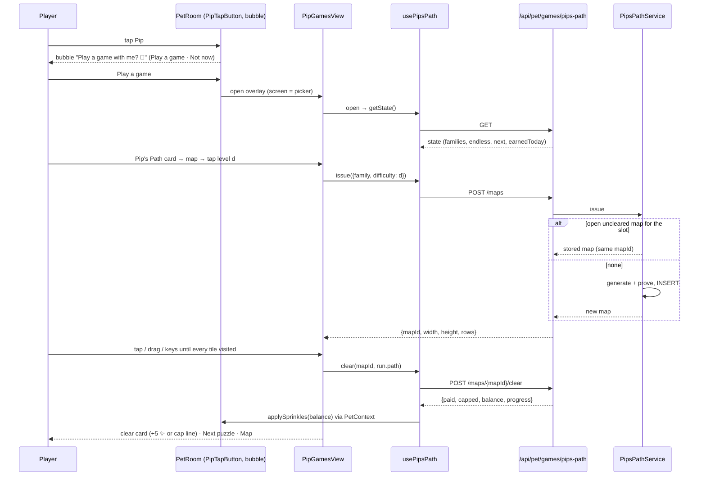

# Plan: Pip's Path client (Play a game, picker, chapter map, Garden Path board)

Plan folder: `.claude/contract/2026-11-17-pips-path-client/`
Execution status: see `tasks.md` in this folder.

---

## Part 1 — Alignment

### Task reference
**Brief (developer, 2026-11-17):** "MPP-49 child: Pip's Path client — Play a game bubble action, game picker, chapter map, Garden Path board (tap/swipe/arrows, undo/restart, three skins) wired to /api/pet/games/pips-path; reuse an open uncleared map per slot; mockup sync. Mockup: `foodbytes-app/mockup/pips-path.html`; backend contract: `.claude/contract/2026-11-17-pips-path-backend/`"

**Upstream inputs that bind this ticket:**
- **Approved mockup:** `foodbytes-app/mockup/pips-path.html` and its contract `.claude/contract/2026-11-17-pips-path-mockup/plan.md`. Decisions taken at mockup review (2026-11-17): entry **option A** (tap Pip, the bubble offers Play a game; no Games pill), **per-skin chapter titles** (Garden Path / Ember Trail / Circuit Run), maps generated server-side per difficulty 1–10, 5 ✨ per clear capped at 50 a Dublin day. The pure blocks `pp-engine` and `pp-skins` are "what the build ticket ports".
- **Backend contract (COMPLETE, committed as `f3555cf Server side` on `feature/MPP-49-pips-path-backend`):** `GET /api/pet/games/pips-path`, `POST /maps` (empty body = next slot, `{family, difficulty}` = replay), `POST /maps/{mapId}/clear` with `{path}`. Its `pr-description.md` moved hands-on play (issue, clear, retry, locked level, the 50/day cap) to this ticket, "before either branch is pushed".
- **Epic MPP-49** (`.claude/contract/MPP-49-epic-breakdown/epic.md`) Definition of Done items this ticket closes: 1 (tap Play a game, choose Pip's Path, play), 5 (progress per person, survives devices), 6 (server-checked clear pays 5, up to 50), 7 (320–1280 px in all three themes, reduced motion honoured), 8 (mockups match the live app).

**Jira:** the child ticket has no key (the epic lists children as TBD; the Atlassian connector is not authenticated this session). No card was moved. See Risks.

### Restated goal
Ship Pip's Path in the app for its first family. In Pip's room the player taps Pip; if no check-in, cook scene or announcement is speaking, Pip's bubble offers "Play a game with me? 🎲" with **Play a game** and **Not now**. Play a game opens a games sheet: a picker with one Pip's Path card, then the chapter map (difficulty 1–10, cleared / current / locked, an endless card once all ten are cleared), then the board. The board draws a server-issued map in the skin of the theme's Pip line, with Pip as the token walking and marking tiles, and supports tap, drag/swipe, arrow keys/WASD, Undo, Restart, a stuck state and a clear celebration. A cleared path is posted to the server, which checks it and pays; the clear card shows the reward or the cap line, and the header balance updates. On the backend, `POST /maps` stops generating a new map when the player already has an open (uncleared) map for the same slot, and hands that one back instead. The mockup and its README are brought in line with what ships.

### In scope
- **Backend: reuse an open uncleared map per slot** in `PipsPathService.issue` (chapter level, refresher, endless), with three derived repository queries and service tests. No schema change.
- **Client API layer:** `services/pipsPathService.js` and the `usePipsPath` hook (state read with `AbortController`, issue, clear, retry, four async states).
- **Pure engine port** of `pp-engine` (minus the solver) to `utils/pipsPath.js`, with a node check `utils/pipsPath.check.mjs` wired as `npm run check:games`.
- **Skins:** copy and behaviour in `constants/pipsPath.js` keyed by Pip line; the SVG art ported to JSX in `components/pet/games/pipsPathArt.jsx`.
- **Entry point:** a tappable Pip in the room (`PipTapButton` over Pip's pose box), the offer line in `pipBubble` (below check-in, above fridge and mood), `GameOfferActions` in the bubble, and `check:bubble` / `check:room` assertions.
- **Games sheet** (`PipGamesView`) over the room via `useRoomOverlay`: picker → map → board, Escape steps back, focus trap, scroll lock.
- **Chapter map** (`PipsPathMap`), **board** (`PipsPathBoard` + `usePipsPathRun` + `usePipsPathInput`), **clear card** (`PipsPathClearCard`).
- **Balance update** after a paid clear: `applySprinkles(balance)` in `PetContext`.
- **Theme tokens:** the 14 `--pp-*` tokens in `default.css`, `cyberpunk.css`, `parchment.css` with the mockup's values; `PP_PAIRS` in `check-themes.mjs`.
- **Low FX and reduced motion** stop the hop, mark pops, celebrations and pulses.
- **Mockup sync:** `pips-path.html` drops option B, marks the shipped decisions, and shows the client-only states this ticket adds (saving, save failed with Try again); README row updated.
- **Local end-to-end play** on the Docker stack before push (developer).
- MINOR bump, CHANGELOG, `pr-description.md`.

### Explicitly out of scope
- Thin Ice or any other family; refresher **levels** (the map shows a generic "Refresher" card only if the server ever returns a `REFRESHER` next slot, which cannot happen until a second family ships).
- The Chapter 2 preview and the "Show a solution" toggle (mockup review aids). The client ships no solver.
- Remembering an unfinished path across visits. The server hands back the same open map; the path starts again from Pip's start tile.
- Adding the Pip entry point to `app-mockup.html` / `parchment-theme.html`: neither file draws Pip's room bubble today (`grep pet-bubble` → 0 hits), so there is nothing to keep in step there; `pips-path.html` stays the reference.
- A request timeout on `services/api.js` (known debt in the react-frontend skill; not grown or fixed here).
- Pruning `pet_game_maps`, issue rate limiting, Pip XP from games, leaderboards.
- Applying anything to Railway (no migration in this ticket; the backend's go-live row ships at the MPP-15 merge).
- Moving or editing MPP-49 in Jira.

### Pattern Reference
Supplied by the brief: the mockup `foodbytes-app/mockup/pips-path.html` (blocks `pp-engine`, `pp-skins`, `pp-ui`, CSS lines 563–744, tokens lines 95–108 / 194–207 / 293–306) and the backend contract folder. Chosen code references:
- **`components/pet/room/PetRoom.jsx`**: `StationButton` (a real button laid over SVG art, positioned with `hitBoxStyle`), `SpeechBubble` + `bubbleActions`, overlays via `useRoomOverlay` with the `behind` inert pattern.
- **`components/pet/room/ShopView.jsx` / `ShopView.css`**: the `.pip-shop` sheet shell (head with ✕, body, `useBodyScrollLock`) the picker and game screens reuse, exactly as the mockup does.
- **`components/pet/room/CheckInActions.jsx`**: `.pip-checkin-btn` buttons inside the bubble, focus-first after a user action.
- **`hooks/usePetShop.js`**: write-call error handling (`err.response?.data?.error || fallback`), `busy` flag, and calling back into `PetContext` after a write.
- **`contexts/PetContext.jsx` → `applyRoomWrite`**: the shape of a context write that also aborts an in-flight GET.
- **`utils/pipBubble.js` + `pipBubble.check.mjs`**, **`room/room.check.mjs`**: pure helpers pinned by node checks.
- **`components/pet/pip/Pip.jsx`**: the standalone Pip `<svg>` (variants `full` / `mini`, `outfit`, `still`).
- **Backend:** `PipsPathService.issue` and `PipsPathServiceTest` (Mockito + fixed `Clock`).

### Constraints flagged on the brief
- Three skins, chosen by `theme.pipLine` (never a theme id string); every screen in Default, Cyberpunk and Parchment.
- Tap, swipe/drag, arrow keys (and WASD), Undo, Restart.
- Wired to `/api/pet/games/pips-path`; the server is the only source of maps and the only judge of a clear.
- Reuse an open uncleared map per slot.
- Mockup sync in the same ticket (CLAUDE.md → Mockups).
- CLAUDE.md themes rules: colours only in `styles/themes/` except Pip/room art under `components/pet/`; Default must not drift (new tokens only); `npm run check:themes` green with no new exception; 320–1280 px; ≥ 44 px targets (≤ 6 columns keeps tiles ≥ 48 px at 320 px); Low FX + reduced motion.
- Progress per person (MPP-33): everything keys on the signed-in player; nothing reads `meal_plan_owner_id`.
- Rewards never depend on food (MPP-11): trivially true.

### Assumptions made
- **Slug `2026-11-17-pips-path-client`, no ticket key.** Same handling as the mockup and backend contracts. *Rationale:* Step 0.5 forbids creating a ticket just to move it.
- **New branch `feature/MPP-49-pips-path-client` off `feature/MPP-49-pips-path-backend`** (not off `AI_Master`). *Rationale:* the client needs the backend endpoints, the backend branch is not pushed yet, and its PR description says both are tested together before either is pushed.
- **"Reuse an open uncleared map per slot" is a backend rule in `issue`.** The client cannot fetch a map by id, so only the server can hand an open map back. Slot keys: `CHAPTER` → (family, difficulty); `REFRESHER` → (family, chapter); `ENDLESS` → any open endless map. Latest open map (highest id) wins. A replay request `{family, difficulty}` is a `CHAPTER` slot, so it reuses too. *Rationale:* stops a reroll on every back-and-forth, keeps `pet_game_maps` from growing with abandoned maps, and lets a player return to the same board.
- **Reuse returns the stored layout; the path restarts.** No `reused` flag in `PipsPathMapDTO`. *Rationale:* the client needs nothing different; the run lives in memory only.
- **Tap Pip is a real button over Pip's pose box**, in the room's world layer like `StationButton`, present at every position except during the cook scene (`serving`). Asleep Pip can be tapped too. *Rationale:* the developer's own entry (option A); blocking play at bedtime positions would hide the game for much of the evening. Red-line if a sleeping Pip should not offer games.
- **Offer rules:** tapping Pip offers only when nothing above fridge/mood is speaking (no cook line, announcement, growth line or check-in). Otherwise the tap does nothing. Priority becomes cook > announcement > growth > check-in > **offer** > fridge > mood. **Not now** returns to the previous line. *Rationale:* the mockup's notes panel rule 2.
- **`pipBubble` adds `offerLine`** and returns `{ text, actions: null, offer: true }` in that branch only, so every existing `check:bubble` assertion stays byte-identical. *Rationale:* `actions` today means check-in props; the offer is a different control set.
- **One overlay, three screens.** `PipGamesView` is a single `useRoomOverlay` sheet whose inner screen is `picker | map | board`. ✕ / Escape on the picker closes it (focus returns to Pip); ← / Escape on the map goes to the picker; ← / Escape on the board goes to the map. *Rationale:* mirrors the mockup's navigation with one focus trap and one inert room.
- **API state is feature-local** (`usePipsPath`, called inside `PipGamesView`), fetched when the sheet opens and re-fetched after each clear. Only the sprinkle balance goes into `PetContext` (`applySprinkles`). *Rationale:* react-frontend skill: feature state never goes in a global context; the balance is already cross-cutting.
- **Map node taps send `{family, difficulty}`; "Next puzzle", "Random puzzle" and the refresher card send `{}`.** *Rationale:* a node is a chosen level (unlock checked by the server: 403 shows an error line), next is the sequencer's job.
- **Chapter map statuses** come from `families[0].highestCleared` (h): d ≤ h cleared, d = h + 1 current, else locked; once `endless` is true all ten are cleared and the endless card shows. A `REFRESHER` next slot shows a "Refresher" card (same component, different copy).
- **Clear flow:** the moment the run is cleared the board freezes (only Undo / Restart act, as in the mockup) and posts the path once. The clear card shows "Saving…", then the reward line. Undo after a clear un-freezes the board; a second clear of the same map posts again and the server answers `alreadyCleared, paid 0`, shown as "Already counted". A failed post shows the server's message and **Try again**; nothing is shown as paid until the server says so. *Rationale:* server is the judge; retries are harmless (`alreadyCleared`).
- **Reward copy** (from the mockup's `rewardText`): `+5 ✨`; `+n ✨ · today's game sprinkles are full (50/50)`; `Today's game sprinkles are full (50/50)`; `Already counted`. Amount and cap come from the response (`paid`, `capped`, `dailyCap`), never hard-coded.
- **The Pip token uses the player's real form and outfit** (`herb` from `PetView`: `line`, `displayForm`, `outfit`), moods content / happy / bored. *Rationale:* the mockup plan said the build ticket swaps in the real form.
- **Skin art is JSX, not SVG strings.** `pipsPathArt.jsx` exports `SKIN_ART[line] = { Board, Tile, Mark, Start }` components drawn with the mockup's literal colours (Pip art exception, CLAUDE.md themes rule: `components/pet/`). The board art is an absolutely positioned `<svg>` behind the grid instead of the mockup's data-URL background. *Rationale:* react-frontend forbids unreviewed `dangerouslySetInnerHTML`; the room art is JSX too.
- **Tokens copied verbatim** from the mockup frames into the three theme files (14 tokens: the 13 planned plus `--pp-node-cleared-text`). *Rationale:* reviewed values; new tokens cannot drift Default.
- **New constants file `constants/pipsPath.js`** for the family id, level count, column cap, modes, key map, skin copy, offer copy, timings and reward copy builders. **New folder `components/pet/games/`.** *Rationale:* thirteen chapters will follow; a folder keeps `room/` from absorbing them.
- **Version bump: MINOR** (a Story under the epic).

### Cross-code alignment audit (FE ↔ BE ↔ DB)
Schema unchanged; audit ran against the local `foodbytes-db` (the pet tables are not on Railway until the MPP-15 merge). No user rows read.
- **`SHOW COLUMNS FROM pet_game_maps` (local):**
  ```
  id bigint NO PRI auto_increment | user_id bigint NO MUL | family varchar(32) NO | difficulty int NO
  mode varchar(16) NO | chapter int YES | seed bigint NO | width int NO | height int NO
  layout varchar(1024) NO | issued_at timestamp NO CURRENT_TIMESTAMP | cleared_at timestamp YES
  ```
  Every column the reuse queries filter on (`user_id`, `family`, `difficulty`, `mode`, `chapter`, `cleared_at`) exists, so no migration.
- **Indexes:** `PRIMARY (id)`, `idx_pet_game_maps_user (user_id, issued_at)`. The reuse lookups filter by `user_id` first; with reuse, a player holds at most one open map per slot (~12), so no new index.
- **Rows:** `SELECT mode, COUNT(*), SUM(cleared_at IS NULL) … GROUP BY mode` → `CHAPTER 1 0` (one cleared test map). Nothing to backfill.
- **Unapplied migrations:** none outstanding for this ticket; the backend contract applied MPP-42 and `2026-11-17-mpp49-pips-path-games.sql` locally.
- **Name chain (JSON ↔ client):** `PipsPathStateDTO` → `{ families: [{ id, chapter, highestCleared, refresherThrough }], currentChapter, endless, next: { family, difficulty|null, mode, chapter }, earnedToday, dailyCap, perClear }`; `PipsPathMapDTO` → `{ mapId, family, difficulty, mode, chapter, width, height, rows }`; `PipsPathClearDTO` → `{ alreadyCleared, paid, capped, earnedToday, dailyCap, balance, progress }`; request `{ path: number[] }` (cell index `y * width + x`, start included) = the engine's `run.path`. `mode` strings `CHAPTER | REFRESHER | ENDLESS` match `GameMode`. The client uses these names verbatim.
- **Balance:** `PipsPathClearDTO.balance` ↔ `PetContext` `pet.sprinkles` (the same number `/api/pet` returns).

---

## Part 2 — Technical design

### Approach
**Backend: a lookup before the generator.** `PipsPathService.issue` already resolves a `Slot` (sequencer or replay). It now calls a private `openMap(userId, slot)` that switches on `slot.mode()` and asks one of three derived queries for the newest uncleared map of that slot. If one exists, `issue` returns it through a shared `toDto(PetGameMap)` (rows rebuilt with `GridMap.fromLayout(...).rows()`) and never generates. Otherwise it generates and saves as today. `issue` stays non-transactional so generation still holds no connection. Two devices issuing the same slot at the same moment can both miss and both generate; the result is two open maps, and the next issue reuses the newer one, which is harmless, so no lock is added. **Road not taken:** a client-side map-id cache (localStorage per slot) — the client has no `GET /maps/{id}`, the cache would go stale across devices, and the server is already the source of truth.

**Client: pure core, thin hooks, small components.** `utils/pipsPath.js` is a near line-for-line port of the mockup's `pp-engine` (`parseRows`, `neighbours`, `newRun`, `head`, `canStep`, `step`, `backtrackTo`, `undo`, `restart`, `isCleared`, `isStuck`, `bubbleKeyFor`) taking the server's `{ width, height, rows }`. The solver is not ported: the server proves maps, and "Show a solution" was a review aid. `usePipsPath` owns the network (state read with an `AbortController`; `issue` and `clear` writes that are never aborted, with an unmount guard). `usePipsPathRun(grid)` owns the run, Pip's facing and the frozen-after-clear rule; `usePipsPathInput` owns pointer capture, drag sampling (coalesced points, half-tile steps) and keys, exactly as the mockup's `wireBoard`. Components only render: `PipGamesView` (sheet + screen state), `GamePicker`, `PipsPathMap`, `PipsPathBoard`, `PipsPathClearCard`, `GameOfferActions`, `PipTapButton`. **Roads not taken:** a canvas board (loses focus and screen-reader labels); one `role="grid"` with roving tabindex (more code than a grid of buttons); rendering the mockup's SVG strings with `dangerouslySetInnerHTML` (forbidden without review, and the room art is JSX).

**Entry point and bubble.** `PetView` owns a tiny `offering` boolean via `useGameOffer` and passes `offerLine` into `pipBubble`. The offer only starts when `canOffer` (no cook line, announcement, growth line or check-in). `PetRoom` receives a `games` prop (`{ offering, canOffer, offer, dismissOffer, herb }`), renders `PipTapButton` over Pip's pose box (`pipHitBox(pose)` in `roomLayout.js`, pinned by `check:room`), and, when the bubble is offering and no check-in actions exist, renders `GameOfferActions` as the bubble's actions. **Play a game** dismisses the offer and opens the games overlay, whose `triggerRef` is the Pip button, so focus returns to Pip on close. The games sheet joins `anyOpen`, so the room behind goes inert like every other overlay.

**Board rendering and motion.** The board is the mockup's three layers: a CSS grid of tile `<button>`s (skin `Tile`, `Start`, `Mark` art, rocks plain `--pp-rock`), an SVG trail overlay (`polyline` through tile centres, style per skin trail), and an absolutely positioned Pip token moved by a `transform` transition so a hop never re-renders tiles. Tile centres are measured from the DOM in a layout effect and on `ResizeObserver`, with the observer disconnected in cleanup. Celebrations and stuck effects are CSS classes (`is-cleared pp-fx--bloom`, …) plus a short-lived bits layer whose timer is cleared on unmount. `body.lowfx` and `prefers-reduced-motion` jump everything to the final frame, and `prefersReducedMotion()` skips the bits timer in JS. Board chrome reads `--pp-*` tokens; skin art keeps its own palette.

### Skills to invoke during execution
- `react-frontend` — owns every client task: services → hook → component layering, four async states, `AbortController` on reads and never on writes, error bodies surfaced, ≥ 44 px targets, `@media (hover: hover)`, `:focus-visible`, `touch-action`, file order, the 400-line budget (`PetRoom.jsx` grows from 326; measure it), constants in `src/constants/`, no `console.log`, no `dangerouslySetInnerHTML`.
- `java-backend` — owns the reuse change: derived queries in the repository, logic in the service, controller untouched, Mockito service tests run with `mvn test -Dtest=PipsPathServiceTest`.

`.claude/rules/*` cover recipes, ingredients and variants and do not apply. The executor must follow CLAUDE.md → Themes (token files, `check:themes`, `check:room`) and CLAUDE.md → Mockups.

### Diagram


### Data shapes

#### Backend: repository additions (`PetGameMapRepository`)
```java
Optional<PetGameMap> findFirstByUserIdAndFamilyAndDifficultyAndModeAndClearedAtIsNullOrderByIdDesc(
        Long userId, String family, int difficulty, GameMode mode);           // CHAPTER slot
Optional<PetGameMap> findFirstByUserIdAndFamilyAndModeAndChapterAndClearedAtIsNullOrderByIdDesc(
        Long userId, String family, GameMode mode, Integer chapter);          // REFRESHER slot
Optional<PetGameMap> findFirstByUserIdAndModeAndClearedAtIsNullOrderByIdDesc(
        Long userId, GameMode mode);                                          // ENDLESS slot
```

#### Backend: service (`PipsPathService`)
```java
private Optional<PetGameMap> openMap(Long userId, Slot slot);   // switch on slot.mode() → one query above
private static PipsPathMapDTO toDto(PetGameMap row);            // rows = GridMap.fromLayout(layout, width, height).rows()
// issue(...): resolve slot → openMap(...).map(PipsPathService::toDto) → else generate, save, toDto(saved)
```
No DTO, entity, endpoint or status-code change.

#### Client: service (`services/pipsPathService.js`)
```js
export const PIPS_PATH_ENDPOINT = '/pet/games/pips-path'   // in constants/pipsPath.js
pipsPathService.getState({ signal })        → PipsPathStateDTO
pipsPathService.issueMap(slot = {})         → PipsPathMapDTO     // slot = {} | { family, difficulty }
pipsPathService.clearMap(mapId, path)       → PipsPathClearDTO   // body { path }
```

#### Client: constants (`constants/pipsPath.js`)
```js
PIPS_PATH_FAMILY = 'garden-path'; PIPS_PATH_LEVELS = 10; PIPS_PATH_MAX_COLS = 6
GAME_MODE = { CHAPTER: 'CHAPTER', REFRESHER: 'REFRESHER', ENDLESS: 'ENDLESS' }
GAMES_SCREEN = { PICKER: 'picker', MAP: 'map', BOARD: 'board' }
KEY_TO_DELTA = { ArrowUp:[0,-1], w:[0,-1], ArrowDown:[0,1], s:[0,1], ArrowLeft:[-1,0], a:[-1,0], ArrowRight:[1,0], d:[1,0] }
UNDO_KEYS = ['Backspace', 'z']; RESTART_KEY = 'r'
GAME_OFFER_LINE = 'Play a game with me? 🎲'; GAME_OFFER_PLAY = 'Play a game'; GAME_OFFER_NOT_NOW = 'Not now'
GAMES_TITLE = 'Games'; PIPS_PATH_NAME = "Pip's Path"; MORE_GAMES_TITLE / MORE_GAMES_SUB
PIPS_PATH_SKINS = { herb: { title: 'Garden Path', goal, trail: 'path', celebrate: 'bloom', stuckFx: 'droop', lines: { intro, half, stuck, cleared } },
                    dragon: { title: 'Ember Trail', …, trail: 'ember', celebrate: 'flare', stuckFx: 'dim' },
                    robot:  { title: 'Circuit Run', …, trail: 'trace', celebrate: 'sweep', stuckFx: 'flicker' } }   // copy verbatim from pp-skins
pipsPathSkin(line) → PIPS_PATH_SKINS[line] ?? PIPS_PATH_SKINS.herb
rewardLine({ alreadyCleared, paid, capped, dailyCap }) → string            // copy in Assumptions
TOKEN_SCALE = 1.5; PIP_BOX_RATIO = 200/240; PIP_FOOT_RATIO = 226/240; TOKEN_FOOT_DROP = 0.28
DRAG_STEP_RATIO = 0.5; FX_BIT_COUNT = 12; FX_STAGGER_STEPS = 4; FX_STAGGER_MS = 120; CELEBRATION_MS = 3200
```

#### Client: engine (`utils/pipsPath.js`, pure)
```js
parseRows({ width, height, rows }) → { W, H, open: boolean[], start, total }   // throws Error('invalid map: …') on bad shape, >6 cols, ≠1 S
neighbours(grid, i); newRun(grid) → { path: [start] }; head(run)
canStep(grid, run, j); step(grid, run, j); backtrackTo(run, j); undo(run); restart(grid)
isCleared(grid, run); isStuck(grid, run)
bubbleKeyFor(grid, run) → 'intro' | 'half' | 'stuck' | 'cleared'
stepByKey(grid, run, key) → run                                         // KEY_TO_DELTA from the head, unchanged if off-board / blocked
mapNodeStatus(d, highestCleared) → 'cleared' | 'current' | 'locked'
```

#### Client: hooks
```js
usePipsPath({ open }) → { state, loading, error, reload,
                          map, issuing, issueError, issue(slot),
                          clearResult, clearing, clearError, clear(path), resetClear() }
usePipsPathRun(grid) → { run, facing, cleared, stuck, apply(nextRun), tryTile(i, allowBack), onKey(key) → boolean, undoStep(), restartRun() }
usePipsPathInput({ boardRef, tryTile, onKey }) → { onPointerDown, onKeyDown, onClick }   // listeners added on pointerdown, removed on up/cancel
useGameOffer({ canOffer }) → { offering, offer(), dismissOffer() }
```

#### Client: context
`PetContext` adds `applySprinkles(balance: number)` — aborts an in-flight `/pet` GET and sets `pet.sprinkles`, like `applyRoomWrite`.

#### Client: bubble and room
```js
pipBubble({ …existing, offerLine = null })   // after checkIn, before fridge: return { text: offerLine, actions: null, offer: true }
pipHitBox(pose) → { x, y, width, height }     // roomLayout.js, world units; Pip's 200×240 full box at pose anchor/scale
PetRoom props += games = { offering, canOffer, offer, dismissOffer, herb } | null
```

#### Client: components (`components/pet/games/`)
`PipTapButton` (`.pip-tap-btn`), `GameOfferActions`, `PipGamesView`, `GamePicker`, `PipsPathMap`, `PipsPathBoard`, `PipsPathClearCard`, `pipsPathArt.jsx` (`SKIN_ART[line] = { Board, Tile, Mark, Start }`), `PipsPath.css` (classes ported from the mockup: `.pp-game-card`, `.pp-mini-board`, `.pp-map-*`, `.pp-hud*`, `.pp-board*`, `.pp-tile*`, `.pp-trail*`, `.pp-pip-token`, `.pp-fx-*`, `.pp-mark*`, `.pp-clear-card`, `.pp-reward`, keyframes).

#### Theme tokens (each of `default.css`, `cyberpunk.css`, `parchment.css`)
`--pp-board-bg`, `--pp-tile-bg`, `--pp-tile-border`, `--pp-tile-visited-bg`, `--pp-trail`, `--pp-trail-glow`, `--pp-rock`, `--pp-start-ring`, `--pp-node-cleared-bg`, `--pp-node-cleared-text`, `--pp-node-current-ring`, `--pp-node-locked-bg`, `--pp-node-text`, `--pp-hud-text`, values verbatim from `pips-path.html` lines 95–108 (Default), 194–207 (Parchment), 293–306 (Cyberpunk).
`check-themes.mjs`: `PP_PAIRS = [['pp-hud-text','pp-board-bg',4.5], ['pp-node-text','pp-node-locked-bg',4.5], ['pp-node-text','pp-board-bg',4.5], ['pp-node-cleared-text','pp-node-cleared-bg',4.5], ['pp-board-bg','pp-node-current-ring',4.5]]`, spread into all three `PAIRS` lists.

#### npm script
`"check:games": "node src/utils/pipsPath.check.mjs"`

### Runtime quality notes
Client dimensions are mapped onto the browser runtime (single thread, effect cleanup, re-render cost).
- **Resource cleanup:** the state GET owns an `AbortController` aborted on sheet close/unmount; aborts are swallowed. Writes (`issue`, `clear`) are never aborted; a mounted ref drops their results after unmount. Pointer listeners are added on `pointerdown` with pointer capture and removed on `pointerup` / `pointercancel` and on unmount. The `ResizeObserver` and the celebration timer are cleared in effect cleanup. Backend: no new resources.
- **Concurrency / ordering:** a clear is posted once per cleared run (a ref guards double posts from a fast drag). Two devices: the server's wallet lock and `alreadyCleared` already make clears safe; reuse means both devices get the same open map for a slot, and the second clear returns `alreadyCleared` ("Already counted"). Two simultaneous issues may each generate (two open maps), harmless. `applySprinkles` aborts an in-flight `/pet` GET so an older balance cannot land after the clear. Rapid taps: each input applies a pure op to the latest run (functional state update), so skipped tiles are impossible.
- **Allocation / cost behaviour:** a board is at most 42 cells; tile classes update per step, the token moves by `transform` only, and art components are static. State is re-read once after each clear (one small GET). Backend reuse adds one indexed-by-user lookup per issue and removes most generations. No new dependency; the games folder adds roughly 15–20 KB of JSX/CSS to the bundle.
- **Error paths:** state read failure → error line + Try again in the sheet (never an empty map). Issue failure → the server message (403 locked, 503 generation failed, network) on the map with the map still usable. A map that fails `parseRows` → an inline "This puzzle didn't load" box with Back to the map, not a throw. Clear failure → server message + Try again on the clear card, nothing shown as paid. 401 → the existing interceptor. Backend: unchanged statuses; reuse cannot fail differently from a plain read.

### Risks and judgement calls
- **No Jira ticket.** Once the child Story exists, rename the folder to `MPP-<n>-pips-path-client`, update both `Plan folder:` lines, and move the card.
- **Backend change in a "client" ticket.** The reuse rule is small and lives where the data is; the alternative (a separate backend ticket) would block this one. Flagged so the PR description lists it.
- **Reuse means an abandoned hard map comes back.** That is the point of the brief (no reroll), but a player stuck on a difficulty-9 map cannot reroll it. If a reroll is wanted later, a `fresh: true` request field is the escape hatch; not built.
- **Tapping a sleeping Pip offers a game.** Chosen to keep the game reachable all evening; easy to restrict to rug/cooker if the developer prefers.
- **`PetRoom.jsx` grows past 326 lines** (games prop, Pip button, games overlay). The plan extracts `PipTapButton` and `GameOfferActions` to keep it under ~360; measured in the task.
- **`pipBubble` return shape gains an `offer` key only in its new branch.** Keeps every existing assertion unchanged, at the cost of a key that is present only when true; `PetView` reads `said.offer === true`.
- **Pip hit box over the whole Pip art** (200×240 units at pose scale) may overlap the cooker/bed station buttons. `PipTapButton` is rendered after the station buttons so Pip wins where they overlap; the check pins that the box contains Pip's foot point.
- **Skin art literals in `pipsPathArt.jsx`** rely on the `components/pet/` art exception; board chrome uses `--pp-*` only. Reviewers should not flag the art literals.
- **Mockup sync is limited to `pips-path.html` + README** because the two full-app mockups have no Pip bubble to update.
- **Developer-owned steps:** rebuild the Docker stack, sign in at http://localhost:3000, and play through the manual checklist (offer, picker, map, all three themes at 320 and 1280 px, tap / drag / keys, stuck, clear and balance, retry after a network drop, locked nodes that cannot be tapped, the 50/day cap, reuse on reopen). No Railway step.
