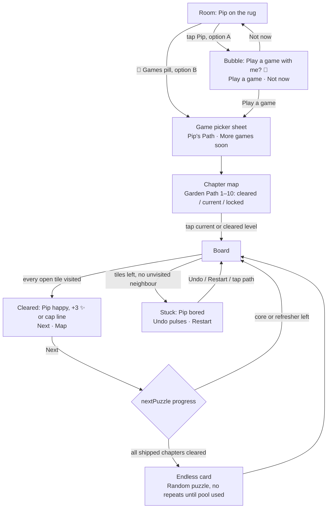

# Plan: Pip's Path mockup (Play a game, picker, chapter map, Garden Path levels)

Plan folder: `.claude/contract/2026-11-17-pips-path-mockup/`
Execution status: see `tasks.md` in this folder.

---

## Part 1 — Alignment

### Task reference
**Brief:** "MPP-49 child: Pip's Path foundation + Chapter 1 Garden Path (Hamiltonian paths, 10 levels). Epic text: `.claude/contract/MPP-49-epic-breakdown/epic.md`." The developer's words were "let's start with the Hamiltonian Paths /fb-plan".

**Epic:** MPP-49, "Play with Pip: Pip's Path grid puzzle game". The full text is in `.claude/contract/MPP-49-epic-breakdown/epic.md`. The parts that bind this contract:
- **Entry point.** Pip's speech bubble (the MPP-21 `SpeechBubble` with `bubbleActions`) gets a **Play a game** action. A game picker opens, built as a list.
- **Chapter cadence.** Chapter n = 10 new puzzles plus one refresher from each earlier family. Endless random mode follows the last shipped chapter, with no repeats until the pool is used up.
- **Chapter 1, Garden Path.** Draw one continuous path that visits every tile exactly once. No crossing and no backtracking.
- **Levels are data, checked by a solver.**
- **Progress is per person.**
- **Rewards: small sprinkles, capped daily.**
- **UX.** Tap or swipe, arrow keys, Undo and Restart, 320–1280 px, reduced motion respected. Board chrome follows the theme, and the Pip token follows the player's Pip line.

**Decisions confirmed by the developer on 2026-11-17:**
- **This contract builds the mockup only** ("Mockup first"). A second `/fb-plan` builds the foundation and Garden Path in the app, against the approved mockup. This matches the epic roadmap (row 1 = mockup) and the mockup-before-UI-code rule.
- **Jira: create a child Story under MPP-49.** The Atlassian MCP returned "needs you to sign in again" when the Story was created, so it does not exist yet. The folder uses a date slug until then: see Risks.
- **The game is called "Pip's Path".**
- **Rewards: small sprinkles with a daily cap.**
- **Priority: Medium.**
- **Plan review, 2026-11-17:** "make sure that each skins game has the right look and pip in involced somehow". So each theme gets a full game **skin** that fits its Pip line, not just recoloured tiles, and Pip takes an active part in the puzzle, not only as a token. See Assumptions → Skins and Pip's role.

**Decisions after mockup review (developer, 2026-11-17). These bind the build ticket and every later chapter:**
- **Maps are generated server-side, per difficulty.** Each family has difficulty levels **1–10**. Every time a level is played, the backend generates a fresh random map for that family and difficulty, proves it solvable with its own solver before sending it, and returns it to the client. The client holds no level data. The developer's words: "Any maps like this should be generated server side going forward, and be of the difficulty level 1 - 10".
  - **Proof before serving.** The generator keeps a map only if the solver finds at least one solution within a fixed node budget, and it retries otherwise. Generating the map by walking a random solution path first, then placing blocked tiles off that path, gives the proof for free. The solver still re-checks the map.
  - **Difficulty bands.** Each difficulty fixes a board size (never more than 6 columns), a range of blocked tiles and a band of solution counts. They are calibrated against the 10 hand-made mockup levels (3×3 with 8 solutions up to 6×7 with 4, and 1 solution at 6, 8 and 9). The mockup levels become reference fixtures for the generator's tests, not shipped data.
  - **Server checks the clear.** The client submits its path for the map it was issued (by map id). The server replays it with the same move rules and pays only for a valid full path. One map pays at most once.
  - **Effect on the cadence.** Chapter n = difficulty 1–10 of family n, played in order, plus one refresher per earlier family. A refresher is a generated map of the earlier family at a high difficulty. Endless mode = a random family and difficulty, freshly generated, so "no repeats" holds by construction. Progress records the highest cleared difficulty per family, not puzzle ids.
  - **Replaces** `check:puzzles` (client level gate) with backend tests: for every family × difficulty, generate N seeded maps, assert each is solvable, inside its size and solution bands, and generated within the time budget. The ported engine (`parseLevel`, `step`, `isCleared` …) still runs in the client for play. The generator and the solver are Java in `foodbytes-api`.
- **Rewards: 5 sprinkles per cleared level, capped at 50 a day** (Europe/Dublin day, as `SprinklePolicy` uses). This replaces the 3 / 1 / 0, cap 10 proposal. Every play is a new map, so there is no replay rate. At most 350 a week sits beside about 300 a week from meal habits. The developer chose this knowingly, and it supersedes the "never out-earn the habits" rationale under Assumptions → Proposed rewards. The mockup's `REWARD` and `rewardFor` and the smoke now follow it.

**Story acceptance criteria (drafted for the child Story):**
1. `foodbytes-app/mockup/pips-path.html` opens straight in a browser. It shows Pip's bubble with a **Play a game** action, the game picker, the Pip's Path chapter map and a playable Garden Path board.
2. A theme switch draws every screen in Default, Cyberpunk and Parchment, with the Pip token drawn from that theme's Pip line (herb, robot, dragon).
3. All 10 Garden Path levels are playable (tap, drag or swipe, arrow keys), with Undo, Restart and a clear celebration. A node smoke script proves every level is solvable and the data shape matches this plan.
4. The mockup shows the planned sequencer, the sprinkle reward line with its daily cap, and a notes panel with the open decisions.
   - The sequencer view includes a chapter map with locked, current and cleared states, a preview of a refresher slot and endless mode.
5. Every screen works from 320 to 1280 px. Low FX and reduced motion stop the celebration animations.
6. `foodbytes-app/mockup/README.md` lists the new file. Nothing under `client/src/` or `foodbytes-api/` changes.

### Restated goal
Build one self-contained, playable HTML mockup, `foodbytes-app/mockup/pips-path.html`, so the developer can approve how the Pip games feature looks, flows and plays before any app code exists. It covers:
- tapping Pip and getting the offer ("Play a game with me?")
- the game picker
- the Pip's Path chapter map
- the Garden Path board with all 10 real levels
- clearing a puzzle and getting stuck
- a preview of how refreshers and endless mode will appear in later chapters
- the proposed sprinkle reward with its daily cap

Every screen is shown in all three themes at phone and desktop widths. Each theme has its own **skin**, the same puzzle dressed for its Pip:
- **Default (herb Pip):** plants a garden.
- **Parchment (dragon Pip):** lights an ember trail across a lair floor.
- **Cyberpunk (robot Pip):** powers a circuit board.

In every skin Pip walks the path himself, leaves his own mark on each tile, talks the player through it, and celebrates or gets stuck with them. The levels, the move rules, the sequencer and the reward rule are pure JS in their own script blocks, in the exact shape the build ticket will port. A node smoke script checks them, including solving every level. Nothing in the app changes.

### In scope
- **`foodbytes-app/mockup/pips-path.html`**, with these screens:
  - **Room:** Pip tappable in the room.
  - **Offer:** the offer in the bubble, with Play a game and Not now.
  - **Picker:** the game picker sheet.
  - **Map:** the chapter map.
  - **Board:** the puzzle board.
  - **Cleared:** the clear celebration with the sprinkle line and Next.
  - **Stuck:** the stuck state.
  - **Endless:** the endless-mode card.
  - **Chapter 2 preview:** where the refresher slot appears.
- The **10 Garden Path levels** (Data shapes → Levels), each solver-verified while planning.
- **Three game skins** (`SKINS` in Data shapes), one per Pip line. Each has its own:
  - chapter title
  - board surface, tile, rock and visited-tile mark
  - trail style
  - clear celebration
  - Pip's lines

  The skin follows the theme the way the room does (`theme.pipLine`). The level ids and rules are identical across skins.
- **Pip's role in the game:** he walks the path with a hop and faces the way he moves, and marks each tile he visits. He comments in a bubble over the board at the start, at halfway, when stuck and on clear. He is happy on clear, bored when stuck, and stands on his current level on the chapter map. On the picker card he shows the game's art.
- Pure **engine**, **sequencer** and **reward** functions in their own script blocks.
- A **theme switch** (Default, Parchment, Cyberpunk) using the live global tokens copied from `pip-room-chrome.html`, plus proposed `--pp-*` role tokens for the board and map. The **Pip token** is drawn by the live-art `pip()` function copied from `pip-themed-lines.html`: herb, dragon or robot, following the theme.
- **Controls:**
  - Move by tapping a neighbouring tile, dragging along the path (which covers swiping), or the arrow keys and WASD.
  - Tapping a tile already on the path backtracks to it.
  - Undo and Restart.
- **Review aids:** a state switcher (screen, level, progress preset, theme, width, Low FX, reduced motion), deep links, a "Show a solution" review toggle, and a notes panel listing rules and open decisions.
- **`.claude/contract/2026-11-17-pips-path-mockup/mockup-smoke.mjs`**: a node smoke that loads the pure script blocks in a `vm` context and asserts the level data, the engine rules, the sequencer and the reward cap.
- A **README row** in `foodbytes-app/mockup/README.md`.
- **Release bookkeeping:** a MINOR version bump and a CHANGELOG line.
- **`pr-description.md`**.

### Explicitly out of scope
- Any app code under `foodbytes-app/client/src/`, any backend code, any migration or any API. That is the next MPP-49 child ticket ("Foundation + Chapter 1 Garden Path"), planned against this mockup once it is approved.
- Levels for Thin Ice or any later chapter. The Chapter 2 preview uses labelled placeholder tiles to show where its 10 levels and the Garden Path refresher would sit. No refresher level is designed here.
- Hints for players. "Show a solution" is a review-only toggle in the mockup's control panel, not a game feature.
- The `npm run check:puzzles` script in `client/`. It belongs to the build ticket. This contract's smoke is its prototype, and the build ticket ports it.
- Editing `app-mockup.html` or `parchment-theme.html`. The feature gets its own mockup file, like the Pip room mockups. The Pip screens in those two files gain the entry point when the build ticket ships.
- Moving or editing the epic MPP-49 in Jira.

### Pattern Reference
None was supplied beyond the epic. The references chosen:
- **`.claude/contract/2026-11-16-themed-pip-rooms-mockups/`** is the precedent for a mockup-only contract. It uses named `<script id>` blocks, a node `vm` smoke that loads only the pure blocks, a README row and a MINOR bump.
- **`foodbytes-app/mockup/pip-room-chrome.html`**:
  - lines 12–~260 hold the three `.frame[data-theme]` token blocks (live global tokens per theme)
  - lines ~352–395 hold the `.pet-bubble` CSS
  - the `.pip-checkin-btn` / `.pip-room-action` pills are the room's button look
  - the `.pip-shop` sheet with its head and tabs is the sheet pattern the game picker mirrors
- **`foodbytes-app/mockup/pip-themed-lines.html`** lines 208–1160: the Pip drawing code. `pip(line, fi, mood, outfit, opts)` at line 1132 returns the SVG string, and `THEMES` at line 1202 maps theme → `pipLine`.
- **Live code** in `client/src/components/pet/room/PetRoom.jsx`:
  - `SpeechBubble` (lines 280–297): a text line plus an `actions` slot
  - `StationButton` (lines 299+): a real `<button>` laid over SVG art, which is how a tappable Pip will work
  - the `pip-room-actions` strip (line 182)
- **`client/src/utils/pipBubble.js`**: the bubble priority order (cook > announcement > growth > check-in > fridge > mood).
- **`foodbytes-api/.../service/SprinklePolicy.java`**: today's amounts (MEAL_EATEN 10, ON_TIME_BONUS 5, FULL_WEEK 20, HOMEMADE_BONUS 5, SHOPPING_LIST_GENERATED 10, SHOPPING_LIST_COMPLETED 15; about 300 a week). They anchor the reward proposal.

### Constraints flagged on the brief
- **Themes:**
  - Every screen in Default, Cyberpunk and Parchment.
  - Colours live in theme token blocks. In this mockup that means the `.frame[data-theme]` blocks plus a proposed `--pp-*` table.
  - Borrow a genre's feel, never its property: no "Pokémon", "Sootopolis", "Flow Free" or lookalike art.
  - Each puzzle family's inspiration is named only in the notes panel (CLAUDE.md → Themes, Mockups).
- **Pip's art keeps its own palette in every theme.** The token is drawn by the live-art function. Board and map chrome follow the theme.
- **Touch:** 320–1280 px, interactive elements ≥ 44 × 44 px, hover wrapped in `@media (hover: hover)`, `:focus-visible` outlines (react-frontend skill).
- **Low FX and reduced motion** stop the celebration and trail animations.
- **Rewards reward consistency, never food variety** (MPP-11 rule). Games pay a small, capped amount.
- **Per-person progress** (MPP-33).
- **No app code changes** (developer, 2026-11-17: "Mockup first").

### Assumptions made
- **Entry: tap Pip, then a bubble offer.** A transparent `<button>` sits over Pip, the same way `StationButton` sits over the stations. Tapping it makes the bubble say "Play a game with me? 🎲" with **Play a game** and **Not now** actions. *Rationale:* it is the developer's own words ("click on pip and for an option to 'play game' to show") and reuses the MPP-21 `bubbleActions` slot.
  - The mockup also shows **option B**, a 🎲 **Games** pill in the room action strip, as an alternative for the developer to pick. *Rationale:* a tap target on a moving Pip is less discoverable. This is an open choice, so the developer should see both.
- **Bubble priority (shown in the notes panel for the build ticket):**
  - The offer is a user-initiated line. It replaces the fridge or mood line.
  - It never replaces an open check-in question or a cook line. Tapping Pip then does nothing new, and the check-in keeps its buttons.
  - **Not now** returns to the line Pip had before.
  - *Rationale:* `pipBubble` already ranks check-in above fridge and mood. A game must not hide a habit question.
- **Picker is a sheet like the Shop** (`.pip-shop`-style head with ✕, title "Games"). It has one card, **Pip's Path** ("Chapter 1 · Garden Path · 3 / 10"), and a greyed "More games soon" card. *Rationale:* it reuses the room's existing sheet pattern and is a list, as the epic requires.
- **Garden Path rules:**
  - Pip starts on the marked tile, so the start is fixed and the end is free.
  - Moves are orthogonal.
  - The puzzle is cleared when every open tile is visited.
  - Rocks (`#`) are blocked.
  - Tapping a tile already on the path backtracks to it, as in one-line puzzle games. Undo removes one step. Restart returns to the start.
  - "Stuck" means tiles remain and Pip has no unvisited neighbour. Pip then says "Hmm, I'm stuck! Undo or start again?" and Undo gets a pulse.
  - *Rationale:* these are the standard rules for this family, and they match the epic's "no crossing, no backtracking". Backtracking on the path is an edit, not a move.
- **Level sizes go 3×3 up to 6 wide × 7 tall, never more than 6 columns.** *Rationale:* at 320 px a board with a 16 px gutter has 288 px, and 288 ÷ 6 = 48 px tiles, which clears the 44 px touch minimum. A 7-wide board gives about 41 px and would fail it. The planner swapped a 7×7 level 10 for a 6×7 one for this reason.
- **Difficulty is measured by solution count.** Levels get bigger while solution counts drop. Recorded counts: 8, 12, 4, 9, 7, 1, 6, 1, 1, 4. *Rationale:* fewer solutions means fewer forgiving paths. The developer plays them in the mockup to judge the feel.
- **Proposed rewards:**
  - 3 ✨ on the first clear of a core or refresher puzzle
  - 1 ✨ per endless-mode clear
  - 0 for replays
  - a **daily cap of 10 ✨** (Europe/Dublin day, as `SprinklePolicy` uses)
  - *Rationale:* 10 equals one logged meal (`MEAL_EATEN = 10`). At most 70 a week is under a quarter of the ~300 a week the meal habits pay, so games never out-earn the habits.
  - The numbers are shown as a proposal for the developer to red-line at mockup review. The build ticket fixes them in `SprinklePolicy` with a new `SprinkleSource`.
- **The sequencer is modelled now, as pure functions:** chapter queue = 10 core + one refresher per earlier family; endless = shuffled pool with no repeats until it is used up. *Rationale:* it is the epic's core rule, cheap to prove in the smoke, and the build ticket ports it verbatim. The Chapter 2 preview uses placeholder ids (`thin-ice-01…10`, `garden-r1`) marked "not designed".
- **Skins, one per Pip line, chosen by the theme** (developer, plan review 2026-11-17: "each skins game has the right look"). The skins share level ids, rules and progress, and differ only in dress:

  | | Default → herb Pip | Parchment → dragon Pip | Cyberpunk → robot Pip |
  |---|---|---|---|
  | Chapter title | **Garden Path** | **Ember Trail** | **Circuit Run** |
  | Goal line | "Plant every patch!" | "Light every flagstone!" | "Power every node!" |
  | Board | raised garden bed: wood frame, soil tiles | lair floor: flagstones in a stone border, faint parchment map lines | circuit board: dark PCB with gold traces between tiles |
  | Open tile | soil with a seed dot | cold flagstone | unlit node pad |
  | Visited mark | a sprout pops up | a small ember flickers | the node lights cyan |
  | Trail between tiles | dashed garden path | glowing ember line | lit trace with a soft glow |
  | Blocked tile (`#`) | plain black | plain black | plain black |
  | Start tile | a watering can | a nest | a charging dock |
  | Clear celebration | every sprout blooms into a flower, petals fall | every ember flares into a brazier, sparks rise | the board runs a power sweep, LEDs chase |
  | Stuck | sprouts droop | embers dim | nodes flicker |

  *Rationale:* each Pip line already has its own room (garden kitchen, lair, workshop). The game should feel like part of that world. Every look is generic, with no franchise art. The family stays "Garden Path" in data and in the notes panel, and only the shown title follows the skin, like the themes' `copy` field.
- **Pip's role in the game** (developer, plan review 2026-11-17: "pip in involced somehow"):
  - **Pip is the walker.** The token is the live `pip(line, fi, mood)` art standing on the head tile. He hops tile to tile (180 ms, a `translate` transition) and mirrors to face left or right as he moves.
  - **Pip makes the marks.** Each tile he leaves gets his line's visited mark.
  - **Pip talks.** A small bubble on the board's HUD shows his line from the skin at four points: start, halfway, stuck and cleared.
  - **Pip reacts.** Mood is `content` while playing, `happy` with a jump on clear, and `bored` when stuck.
  - **Map and picker.** On the chapter map Pip stands on the current level node. On the picker card he stands on a 3×3 mini board in his skin.
  - **Form.** The board token uses form index `1` for every line (each line has at least 3 forms). The build ticket swaps in the player's real form from growth.

  *Rationale:* the developer asked for Pip to be involved. Making Pip the one who walks, marks and talks turns the puzzle into helping Pip, which also fits why Pip asks you to play.
- **Pip token, map and board sizes:** the board is a CSS grid of `<button>`s, at most 48 px per tile on phones and 64 px on desktop. *Rationale:* buttons give focus, keyboard and screen-reader support without ARIA grid machinery.
- **Progress in the mockup is in-memory** (presets plus play). No localStorage. *Rationale:* a mockup that remembers state makes review states hard to reproduce. Deep links cover sharing.
- **Version bump: MINOR.** *Rationale:* a Story bumps MINOR (CLAUDE.md → Versioning), and the precedent mockup contract bumped too.

### Cross-code alignment audit (FE ↔ BE ↔ DB)
Skipped: no persistence is touched. This contract changes only a mockup HTML file, a smoke script, a README, the version manifests and the CHANGELOG. The proposed progress shape in Data shapes is illustrative for the build ticket, which will run this audit when it adds the table.

---

## Part 2 — Technical design

### Approach
One self-contained HTML file with no build step, structured like the themed-room mockups. Named `<script id>` blocks split pure logic from DOM wiring, so a node smoke can load the pure parts in a `vm` context. Five pure blocks:
- `pp-pip`: the Pip drawing code, copied verbatim
- `pp-levels`: the 10 levels
- `pp-engine`: the move rules and the solver
- `pp-sequencer`: chapters, queue, endless mode and the reward rule
- `pp-skins`: the three game skins (art strings, titles and Pip's lines)

One DOM block, `pp-ui`, renders the screens and wires input. The pure blocks never touch `document`, `window` or `localStorage`. This split is the point of the design: the build ticket ports `pp-levels`, `pp-engine` and `pp-sequencer` almost line for line into `client/src/` modules and turns the smoke into `npm run check:puzzles`. Logic the developer approved by playing is the logic that ships.

**Theming.** The three `.frame[data-theme]` token blocks from `pip-room-chrome.html` (the live global tokens and the live `--pet-*` role tokens) are copied in. The bubble and pill CSS is copied with its live class names (`.pet-bubble`, `.pip-checkin-btn`, `.pip-room-action`, `.pip-shop*`), so the offer and the picker look exactly like the room today. New surfaces read a small set of proposed `--pp-*` role tokens defined in each frame block. The notes panel prints the token table with each theme's value, which the build ticket ports into `styles/themes/*.css`. Pip is drawn with `pip(line, 1, mood)`, the live art from `pip-themed-lines.html`, where `line` follows the theme as `THEMES` in that file maps it (default → herb, parchment → dragon, cyberpunk → robot). The room itself is a simple backdrop band ("Room art: see pip-room-*.html"), as `pip-room-chrome.html` does. This mockup is about the game, not the room.

**Skins and Pip.** The **skin** is chosen from the theme's Pip line (`THEME_LINE[theme]` → `SKINS[line]`), the same key the room packs use. So the build ticket keys it on `theme.pipLine` and never on a theme id string, as CLAUDE.md requires.
- **Chrome versus art:** the board's chrome colours (HUD text, map nodes, focus ring, tile border) come from the `--pp-*` tokens. The skin's art comes from `SKINS[line]` SVG strings with their own palette, like Pip's room art.
- **Rendering:** `renderBoard(grid, run, skin, line, mood)` draws in three layers. Tile buttons hold the surface and mark art, an SVG overlay above them holds the trail, and an absolutely positioned Pip layer sits on the head tile.
- **Animation:** Pip moves by a CSS `transform` transition on that layer, so a hop costs no re-render of the tiles.
- **Celebrations:** the clear and stuck effects are CSS classes on the board (`is-cleared`, `is-stuck`) that animate the marks. All of it sits under `.lowfx` and `prefers-reduced-motion`, which jump straight to the final frame.
- **Roads not taken:** one shared neutral board with coloured tiles is what the developer turned down at plan review. A skin per theme id would break the registry rule.

**Input.** Each board tile is a `<button>` carrying `data-i` (cell index). Pointer events on the board give tap and drag:
- `pointerdown` on a tile tries a step, or a backtrack to that tile if it is already on the path.
- `pointermove` with the pointer down tries a step into whatever tile is under the pointer (`document.elementFromPoint`).
- `touch-action: none` on the board, so a drag never scrolls the page.

Swipe is drag. Keyboard: arrow keys and WASD step from Pip's tile, `Backspace` / `Z` undo, `R` restart. Roads not taken:
- Hammer-style gesture detection: drag already covers swipe with less code.
- A canvas board: it loses free focus handling and screen-reader labels.
- One focusable `role="grid"`: this needs roving-tabindex code the build ticket would have to port. With buttons, the browser does it.

**Review controls.** A control panel outside the frames sets:
- the screen (`room`, `offer`, `picker`, `map`, `board`, `cleared`, `stuck`, `endless`, `ch2`)
- the level (1–10)
- the progress preset (`new`, `three`, `all`, `ch2`)
- the theme (Default, Parchment, Cyberpunk)
- the width (375 px or 1280 px, shown side by side on wide screens)
- Low FX, reduced motion, show solution
- entry option A or B

The panel mirrors itself into the URL hash. All toggles are `<button aria-pressed>`, at least 44 px. The panel is not part of the design, and the notes panel says so.

### Skills to invoke during execution
- `react-frontend`: owns the conventions the mockup mirrors so the port is clean:
  - live class names
  - ≥44 px targets
  - `@media (hover: hover)` wrapping
  - `:focus-visible`
  - `touch-action: manipulation` on buttons
  - semantic HTML and ARIA labels
  - constants named in `UPPER_SNAKE_CASE`
  - pure helpers kept separate from rendering
  - no `console.log`

`.claude/rules/*` are recipe and ingredient rules and do not apply.

### Diagram


### Data shapes

#### Levels (`<script id="pp-levels">`)
Row legend: `S` is Pip's start, `.` is an open tile, `#` is a rock. Rows are equal length, and there is exactly one `S`. `solutions` is the full count from the pruned solver, recorded while planning (the smoke re-counts and must match). Every level was verified on 2026-11-17.
```js
const GARDEN_PATH_LEVELS = [
  { id: 'garden-01', family: 'garden-path', kind: 'core', solutions: 8,  rows: ['S..', '...', '...'] },
  { id: 'garden-02', family: 'garden-path', kind: 'core', solutions: 12, rows: ['....', '..S.', '....'] },
  { id: 'garden-03', family: 'garden-path', kind: 'core', solutions: 4,  rows: ['.#..', '....', '..S.', '....'] },
  { id: 'garden-04', family: 'garden-path', kind: 'core', solutions: 9,  rows: ['.....', '.....', '.....', 'S..#.'] },
  { id: 'garden-05', family: 'garden-path', kind: 'core', solutions: 7,  rows: ['.....', '.#...', '....S', '.....', '.#...'] },
  { id: 'garden-06', family: 'garden-path', kind: 'core', solutions: 1,  rows: ['..#..', '#....', '..#..', '....S', '.....'] },
  { id: 'garden-07', family: 'garden-path', kind: 'core', solutions: 6,  rows: ['.#....', '......', '......', '......', '.S#...'] },
  { id: 'garden-08', family: 'garden-path', kind: 'core', solutions: 1,  rows: ['......', '......', '......', '#....#', '......', '..S..#'] },
  { id: 'garden-09', family: 'garden-path', kind: 'core', solutions: 1,  rows: ['....#.', '..#.#.', '......', '.S....', '......', '...#..'] },
  { id: 'garden-10', family: 'garden-path', kind: 'core', solutions: 4,  rows: ['......', '......', '......', '..#..#', '....#.', '.S....', '...#..'] },
];
const LEVEL_MAX_COLS = 6; // 288 px ÷ 6 = 48 px tiles at 320 px
```
Sizes: 3×3, 4×3, 4×4, 5×4, 5×5, 5×5, 6×5, 6×6, 6×6, 6×7. Open tiles: 9, 12, 15, 19, 23, 22, 28, 33, 32, 38.

#### Engine (`<script id="pp-engine">`, pure)
```js
parseLevel(level) → { id, W, H, open: boolean[], start: number, total: number }   // index = y * W + x
neighbours(grid, i) → number[]                    // orthogonal, open only
newRun(grid) → { path: [grid.start] }             // run = immutable; every op returns a new run
canStep(grid, run, j) → boolean                   // j open, not on path, adjacent to the path's head
step(grid, run, j) → run                          // unchanged run if !canStep
backtrackTo(run, j) → run                         // j on path → path cut to end at j; else unchanged
undo(run) → run                                   // drops the head; never below [start]
restart(grid) → run                               // === newRun(grid)
isCleared(grid, run) → boolean                    // path.length === grid.total
isStuck(grid, run) → boolean                      // !isCleared && no canStep neighbour of the head
keyToDelta = { ArrowUp|w: [0,-1], ArrowDown|s: [0,1], ArrowLeft|a: [-1,0], ArrowRight|d: [1,0] }
countSolutions(level, limit = 1e6) → { count, first: number[] }  // pruned DFS: connectivity + ≤1 dead end
```

#### Sequencer and rewards (`<script id="pp-sequencer">`, pure)
```js
const FAMILIES = [
  { id: 'garden-path', chapter: 1, name: 'Garden Path', shipped: true },
  { id: 'thin-ice',    chapter: 2, name: 'Thin Ice',    shipped: false }, // preview only
];
chapterQueue(chapter, pools) → string[]
  // pools[familyId] = { core: id[10], refreshers: id[] }; chapter n →
  // core ids of family n, then refreshers[n-2] of each earlier family k (k = 1 … n-1)
  // chapter 1 → 10 ids; chapter 2 → 11; chapter 3 → 12
nextPuzzle(progress, pools, rng) → { id, mode: 'chapter' | 'endless', resetSeen: boolean } | null
  // Amended at apply review: nextPuzzle is pure; the caller applies resetSeen. null when there is nothing to play.
  // first id in the current shipped chapter's queue not in progress.cleared;
  // when every shipped chapter is cleared → endless: draw from (all shipped ids − progress.endlessSeen);
  // when that is empty, draw from all again and return resetSeen: true (the caller clears endlessSeen; no repeats until the pool is used up)
const REWARD = { FIRST_CLEAR: 3, ENDLESS_CLEAR: 1, REPLAY: 0, DAILY_CAP: 10 };
rewardFor(progress, { id, mode }, todayKey) → { amount, capped: boolean }
  // base = mode==='endless' ? ENDLESS_CLEAR : cleared.includes(id) ? REPLAY : FIRST_CLEAR
  // amount = min(base, DAILY_CAP − earnedOn(todayKey)); capped = amount < base
```
Progress shape (in memory in the mockup; the build ticket persists it per person):
```js
{ cleared: string[], endlessSeen: string[], earned: { [dayKey: 'YYYY-MM-DD']: number } }
```
Presets: `new` = `{cleared: []}`; `three` = `garden-01…03` cleared; `all` = all 10 cleared (endless); `ch2` = all 10 cleared, with `thin-ice` flipped to shipped for the preview.

#### Theme tokens (proposed `--pp-*`, set in each `.frame[data-theme]` block)
`--pp-board-bg`, `--pp-tile-bg`, `--pp-tile-border`, `--pp-tile-visited-bg`, `--pp-trail`, `--pp-trail-glow` (Cyberpunk only; `none` elsewhere), `--pp-rock`, `--pp-start-ring`, `--pp-node-cleared-bg`, `--pp-node-current-ring`, `--pp-node-locked-bg`, `--pp-node-text`, `--pp-hud-text`. The notes panel prints the table with each theme's value. Text/background pairs (`--pp-node-text` on each node background, `--pp-hud-text` on `--pp-board-bg`) must reach WCAG AA (4.5:1), which the smoke computes.

#### Skins (`<script id="pp-skins">`, pure)
```js
const THEME_LINE = { default: 'herb', parchment: 'dragon', cyberpunk: 'robot' }; // mirrors THEMES[].pipLine
const SKIN_ART_KEYS = ['board', 'tile', 'mark', 'start']; // amended 2026-11-17: blocked tiles are plain black, no art
const SKIN_LINE_KEYS = ['intro', 'half', 'stuck', 'cleared'];
const SKINS = {
  herb: {
    title: 'Garden Path', goal: 'Plant every patch!', trail: 'path',   // trail: 'path' | 'ember' | 'trace'
    art: { board: svg, tile: svg, mark: svg, start: svg },   // each a 0 0 48 48 SVG string
    lines: { intro: "Help me plant every patch! 🌱", half: 'Halfway there, keep going!',
             stuck: "Hmm, I'm stuck! Undo or start again?", cleared: 'The whole garden is growing! 🌸' },
    celebrate: 'bloom', stuckFx: 'droop' },
  dragon: {
    title: 'Ember Trail', goal: 'Light every flagstone!', trail: 'ember',
    art: { … same keys … },
    lines: { intro: 'Light every flagstone with me! 🔥', half: 'Half the lair is glowing!',
             stuck: "My embers are fading… Undo or start again?", cleared: 'The whole lair is ablaze! 🐉' },
    celebrate: 'flare', stuckFx: 'dim' },
  robot: {
    title: 'Circuit Run', goal: 'Power every node!', trail: 'trace',
    art: { … same keys … },
    lines: { intro: 'Power every node! ⚡', half: '50% charged. Keep routing!',
             stuck: 'ERROR: dead end. Undo or reboot?', cleared: 'Circuit complete! All systems go! 🤖' },
    celebrate: 'sweep', stuckFx: 'flicker' },
};
lineFor(themeId) → THEME_LINE[themeId] ?? 'herb'
pipLineFor(run, grid, skin) → 'intro' | 'half' | 'stuck' | 'cleared'   // which SKINS[line].lines key to show
  // cleared if isCleared; stuck if isStuck; half once path.length ≥ ceil(total / 2); else intro
```
The SVG strings may use literal colours. They are art, like Pip's room art, and are mirrored as constants when ported. The smoke asserts:
- every skin has every `SKIN_ART_KEYS` and `SKIN_LINE_KEYS` entry
- no art string contains `NaN` or `undefined`
- the three titles are distinct

#### Deep links
`#theme=default|parchment|cyberpunk`, `#s=room|offer|picker|map|board|cleared|stuck|endless|ch2`, `#lv=1…10`, `#p=new|three|all|ch2`, `#w=375|1280|both`, `#entry=a|b`, `#lowfx`, `#rm`, `#sol`. They combine with `&`, e.g. `pips-path.html#theme=cyberpunk&s=board&lv=8&w=375`.

### Runtime quality notes
These are mapped onto the browser runtime, since the work is a static page with no backend.
- **Resource cleanup:**
  - The board's `pointermove` listener is attached on `pointerdown` and removed on `pointerup` / `pointercancel`. The board uses `setPointerCapture`.
  - Celebration timers are kept in one array and cleared on every re-render.
  - No intervals outlive a screen.
- **Concurrency / ordering:** single-threaded. Each input applies a pure op to the current run and re-renders. A drag that crosses two tiles in one frame tries each in order, and only adjacent ones apply, so skipping is impossible.
- **Allocation / cost behaviour:**
  - Re-rendering a 42-cell board on each step is trivial.
  - `countSolutions` runs only in the smoke and behind the "Show a solution" toggle (cached per level). The planner timed all 10 at 5 ms total, at most 530 search nodes.
  - The copied Pip drawing block is about 950 lines of string builders. Each render draws at most 2 Pips per frame.
- **Error paths:**
  - A malformed level fails the smoke, and in the page it renders a red "invalid level: <id>" box instead of throwing.
  - An unknown deep-link value falls back to the default for that key.
  - There is no network and no storage, so nothing else can fail at runtime.

### Risks and judgement calls
- **The Jira child Story is not created yet.** The Atlassian MCP needs re-authentication (`/mcp`).
  - Until then the slug is `2026-11-17-pips-path-mockup` and no ticket moves.
  - Once signed in: create the Story under MPP-49, rename this folder to `MPP-<n>-pips-path-mockup`, update the `Plan folder:` line here and in `tasks.md`, and move the Story to Planned.
  - If the folder is not renamed, `/fb-apply` resolves the date slug and skips Jira, which is safe but leaves the card stale.
- **Entry option A (tap Pip) vs B (Games pill).** Decided 2026-11-17: **option A**. Tapping Pip makes the bubble offer Play a game. The build ticket ships no Games pill.
- **The reward numbers (3 / 1 / 0, cap 10) are a proposal** for review. They are deliberately small next to `MEAL_EATEN = 10`.
- **Level difficulty is judged by solution count plus play.** The early levels (8 and 12 solutions) are intentionally easy. If the developer finds the ramp off, layouts are swapped in `pp-levels` and the smoke re-counts. A swap is cheap and stays inside this contract.
- **The 6-column cap is a design rule** that the build ticket and every later walker chapter inherit. The smoke enforces it.
- **The copied Pip drawing block (~950 lines) makes the file large**, about 1 900–2 300 lines in all. The precedent mockups are 150–180 KB, so this is in range. Copying verbatim, rather than linking `pip-themed-lines.html`, keeps the file self-contained.
- **The chapter title changes per skin** (Garden Path / Ember Trail / Circuit Run) while the family id stays `garden-path`. Players on a shared plan with different themes therefore see different titles for the same puzzles. That is intended, as theme copy already does it for the nav. Decided 2026-11-17: **per-skin titles**.
- **Board art literals** sit in `pp-skins` SVG strings, not tokens, the same exception Pip's room art has. The board **chrome** (tile backgrounds, trail, HUD, map nodes) uses `--pp-*` tokens only.
- **No manual DB or Railway step.** Nothing persists.
