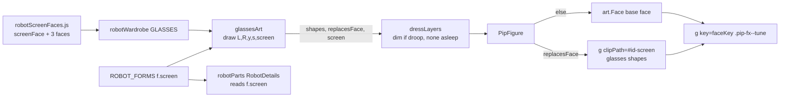

# Plan: Robot Pip screen faces

Plan folder: `.claude/contract/2026-11-17-robot-pip-screen-faces/`
Execution status: see `tasks.md` in this folder.

---

## Part 1 — Alignment

### Task reference
No Jira ticket. The brief is this session (2026-11-16 → 2026-11-17):

- Developer, 2026-11-16: *"The emoji on the face is not right … the emoji should be on the screen, so as if his pixel screen is displaying it. it looks like a sticker, and if the emoji is one, it should swap from his base face to showing this emoji. This should be true for all of pip (robots) faces."* (Saved as memory `robot-pip-screen-faces`.)
- Developer: *"mock up the fixes for the issues"* → `foodbytes-app/mockup/pip-robot-screen-faces.html` (Now + two options per item, a swap demo, picks lineup).
- **Picks confirmed 2026-11-17:** Smiley.exe → **B · Glowing outline**; Heart eyes → **B · All cyan**; Shades.gif → **B · LCD invert**.
- `/fb-plan` invoked with no further arguments. No ticket key → date slug, no Jira transitions.

### Restated goal
On the robot (Cyberpunk) line, all three glasses-slot items stop being shapes stuck over the monitor and become pixel images the CRT screen displays. Each one is drawn on the screen's pixel grid, clipped to the glass, under the scanlines, in the approved option-B look. While it's worn it replaces the base pixel face, and the base face comes back when Pip sleeps. Smiley.exe becomes a cyan outline smiley that blinks. Heart eyes becomes all-cyan pulsing pixel hearts with a smile. Shades.gif becomes an inverted, lit-cyan screen whose dark-pixel shades scroll down from the top edge, then a glint flashes. The screen changes channel (a CRT collapse-and-open flicker) whenever the face swaps. The mockups are brought in step with what ships.

### In scope
- Move the screen rect of each robot form into `robotForms.js` as a `screen` anchor; `robotParts.jsx` reads it from the form.
- A robot screen-face renderer (pixel bitmaps + palette → shape descriptors, fitted to `screen`) and the three option-B faces.
- `round-specs`, `heart-glasses` and `sunglasses` on the robot are redrawn with it; `sunglasses` joins `REPLACES_FACE`.
- The glasses pipeline passes the form's `screen` to glasses drawers, and `dressLayers` reports the screen to clip to. Screen faces are dimmed while drooped (bored / wilted).
- `PipFigure` clips screen faces to the glass and plays a CRT channel change when the robot's face changes.
- New Pip.css effects: pixel pulse, looped scroll-in, glint, tune (channel change); all stop under Low FX, reduced motion and still figures.
- `wardrobe.check.mjs`: the screen is the robot face items' own anchor, and they must stay inside the screen and replace the face on every form.
- Mockup sync: `pip-themed-lines.html` (the source of robot wardrobe art) draws the new faces; `pip-robot-screen-faces.html` records the approved picks; `mockup/README.md` updated.
- Version bump (MINOR) + CHANGELOG.

### Explicitly out of scope
- Herb and dragon glasses (they keep their own face handling; `REPLACES_FACE` stays empty for both).
- The robot's base face per mood (`RobotFace`), item names (`WARDROBE_ITEM_LABELS`), unlocks, slots, prices.
- Mood-specific emoji variants (e.g. a grinning smiley when happy). The item face is the same in every awake mood.
- Backend, DB, Default/Parchment theme CSS.

### Pattern Reference
None supplied. Chosen references:
- `foodbytes-app/mockup/pip-robot-screen-faces.html` (option B of each item: bitmaps, palettes, `screenFace()`, effects) is the visual source of truth.
- `components/pet/robot/robotAntennas.js` + the 2026-11-16 robot-antennas contract: precedent for a robot-only wardrobe layer with its own anchor (`HAT_ANCHOR: 'crown'`) and a matching update to the anchor checks.
- `components/pet/pip/wardrobeShapes.js` descriptor helpers (`rect`, `group`, `fxGroup`) and `PipOutfit` for rendering.

### Constraints flagged on the brief
- Emoji faces are pixels **on** the screen and **swap out** the base face, for every robot face item, now and later (memory `robot-pip-screen-faces`).
- CLAUDE.md: Pip's art keeps its own palette in every theme (colour literals in `components/pet/` are allowed); animations stop under Low FX and reduced motion; the mockup must match what ships.
- `wardrobe.check.mjs` rule: no per-form branches in wardrobe drawing; each slot reads only its own anchors.

### Assumptions made
- **Screen as a form anchor:** `ROBOT_SCREEN` moves from `robotParts.jsx` into each `ROBOT_FORMS` entry as `screen: { x, y, w, h, r }`. The wardrobe (plain JS, run by node checks) can't import from a `.jsx` file, and the screen is form geometry like `eyes`.
- **Glasses drawer signature becomes `(L, R, y, s, screen)`:** `glassesArt` passes `f.screen ?? null`. Herb and dragon ignore the fifth argument, so their art is untouched.
- **The clip lives in PipFigure, not in the item shapes:** `dressLayers` returns `screen` (non-null only for a face-replacing item on a form with a screen) and PipFigure defines a per-instance `<clipPath>` from its existing `useId`. Putting `clipPath` ids inside wardrobe descriptors would duplicate ids across Pips on one page.
- **Channel change also plays on mount.** The face group is keyed by the shown face (`'base'` or the glasses id), so the CSS animation runs whenever it remounts. That includes the first render, which reads as the screen powering on. Still figures (Dress Pip cards, lineup), Low FX and reduced motion get no animation. This keeps PipFigure free of "previous value" refs.
- **Bored dims the item face to 55%**, as in the mockup. `dressLayers` already receives `droop`, so it wraps screen-face shapes in an `opacity: 0.55` group then.
- **Heart pulse uses a new stepped `pixel-pulse`** (2 steps), matching the mockup, rather than the smooth `pulse`. The smooth one is still used by other items.
- **Version bump is MINOR.** No ticket, not a bug fix → MINOR per CLAUDE.md.

### Cross-code alignment audit (FE ↔ BE ↔ DB)
Skipped: no persistence touched. Wardrobe item ids and the equipped outfit API are unchanged; this is pure client art.

---

## Part 2 — Technical design

### Approach
The robot gets a small renderer, `robot/robotScreenFaces.js`, ported from the mockup's `screenFace()`. A face is a list of same-sized bitmap layers (rows of characters, `.` = off), a palette, an optional lit background and a glow colour; a layer can carry an fx effect. `screenFace(screen, face)` picks the pixel size `p = min((w-8)/cols, (h-8)/rows)` so the bitmap fits the form's screen, centres it, and returns shape descriptors. Those are an optional lit background rect, a glow group with one `rect` per lit cell (an animated layer becomes an `fxGroup`), then the scanlines and glass sheen drawn over the face. The three approved faces (`SMILEY_OUTLINE`, `HEARTS_CYAN`, `SHADES_LCD`) live in the same file as data. `robotWardrobe.js` maps `round-specs` / `heart-glasses` / `sunglasses` to `(L, R, y, s, screen) => screenFace(screen, FACE)` and lists all three in `REPLACES_FACE`.

The anchor plumbing is the only shared change. `glassesArt` passes `f.screen ?? null` as a fifth argument and reports `screen` for face-replacing items. `dressLayers` forwards it, and drops it when asleep, since asleep shows no glasses. It also wraps the shapes in a dimming group when `droop`. `PipFigure` defines `<clipPath id={id + '-screen'}>` from that rect (inset 2, matching the glass) and draws the glasses inside it. For lines whose form has a `screen` (only the robot), it wraps face + glasses in a `<g key={faceKey} className="pip-fx pip-fx--tune">`, so a face change remounts the group and plays the channel change. Clipping in PipFigure was chosen over a `clipPath` descriptor inside the item, because descriptor ids would collide between the many Pips on the Dress Pip screen. The road not taken there is a `mask` or `foreignObject`, which costs more and clips no better.

The rejected alternative is to keep drawing faces from the eye anchors (`L, R, y, s`). The eye points don't describe the screen's edges, so faces couldn't be fitted to or clipped to the glass, and the shades couldn't scroll in from its top edge. The anchor check is updated to match: for a face-replacing glasses item on a form with a screen, `screen` is its own anchor and `eyes` counts as "elsewhere". Every other glasses item keeps `eyes` as its own anchor and must ignore `screen`.

Finally, the mockups are synced. `pip-themed-lines.html` (named in `robotWardrobe.js` as the source of the robot art) gets the same renderer and faces. `pip-robot-screen-faces.html` records B/B/B as approved.

### Skills to invoke during execution
- `react-frontend`: owns every client edit (PipFigure, wardrobe modules, Pip.css, check script), file order, no new dependencies, no console logs, and honest verification (no test runner, so `check:*` + build + manual check).

Rules: none of `.claude/rules/` applies (no recipe, ingredient, macro or migration data).

### Diagram


### Data shapes
#### Form anchor (`robot/robotForms.js`, each `ROBOT_FORMS` entry)
```js
screen: { x: 67, y: 91, w: 66, h: 42, r: 9 }   // Bot-kid
screen: { x: 74, y: 72, w: 52, h: 38, r: 8 }   // Teen Unit
screen: { x: 79, y: 55, w: 42, h: 35, r: 7 }   // Android
```
#### Screen face (`robot/robotScreenFaces.js`)
```js
/** @typedef {{ rows: string[], effect?: 'blink'|'pixel-pulse'|'scroll-in'|'glint' }} ScreenLayer */
/** @typedef {{ layers: ScreenLayer[], palette: Record<string,string>, glow: string, bg?: string }} ScreenFace */
export const SMILEY_OUTLINE  // layers: edgeOf(SMILEY_DISC,'C'), SMILEY_MOUTH, SMILEY_EYES(blink); palette C/E/M = RB.glow
export const HEARTS_CYAN     // layers: HEARTS_L(pixel-pulse), HEARTS_R(pixel-pulse), HEARTS_MOUTH; H/M = RB.glow, W '#d9fbff'
export const SHADES_LCD      // bg '#37e6ff'; layers: SHADES_MOUTH, SHADES_FRAME(scroll-in), SHADES_GLINT(glint); G/g/M = RB.dark, W '#e9fdff'
export function screenFace(screen, face) // → shape descriptors, every cell inside the screen rect
```
#### Wardrobe pipeline
- `glassesArt(line, id, f)` → `{ shapes, replacesFace, hidesEye, staysAsleep, screen: replacesFace ? (f.screen ?? null) : null }`
- `dressLayers(...)` → adds `screen: {x,y,w,h,r}|null` (null when asleep or no face-replacing item); `glasses` shapes wrapped in `group(shapes, { opacity: 0.55 })` when `droop && screen`.
- `ROBOT_WARDROBE.REPLACES_FACE = ['round-specs', 'heart-glasses', 'sunglasses']`

#### CSS (`pip/Pip.css`)
`.pip-fx--pixel-pulse`, `.pip-fx--scroll-in`, `.pip-fx--glint`, `.pip-fx--tune` + keyframes (values from the mockup); `.pip-fx--glint` rests visible (`opacity: 1`) when animations are off.

### Runtime quality notes
Frontend-only; mapped onto the browser runtime.
- **Resource cleanup:** no timers, listeners or effects added; animations are CSS. Trivial.
- **Concurrency / ordering:** none. Rendering stays a pure function of `outfit`, `form` and `mood`. The `key` remount is React-managed.
- **Allocation / cost behaviour:** a face is at most ~120 `rect`s (smiley edge ~40, hearts ~60, LCD shades ~70 + scanlines ~13). The Dress Pip glasses row draws up to 3 cards × 3 items, so a few hundred small rects. That's fine for SVG. Drop-shadow filters already exist on the current faces, and Low FX removes them. No memoisation, per the skill.
- **Error paths:** a form without `screen` (herb, dragon, or a future robot form missing it) gets `screen = null`. `screenFace(null, …)` returns `[]` and PipFigure draws no clip, so nothing throws. The check script asserts every robot form has a screen, so the empty path can't ship silently.

### Risks and judgement calls
- **Mount animation:** every robot Pip plays a ~0.45 s screen flicker on first render, for example when the Pip room opens. If that's unwanted, the alternative is a `useRef`-based "changed since last render" flag in PipFigure. Please red-line this if it should only play on an actual swap.
- **`screen` added to the glasses drawer signature** is a shared-pipeline change. It's additive, and herb and dragon ignore it, but `wardrobe.check.mjs` anchor rules change shape (screen-face items are judged on `screen`, not `eyes`).
- **Bitmaps vs. the mockup:** the faces are copied exactly from `pip-robot-screen-faces.html`. Any tweak during apply must be made in the mockup too.
- **Shades scroll-in loops** every 3.4 s, as in the mockup (the old `drop` played once). The loop is the approved look.
- **No visual test runner:** the art is verified by `check:wardrobe` (bounds, anchors, replace-face), `npm run build`, and a manual check on `/pet` in Cyberpunk.
