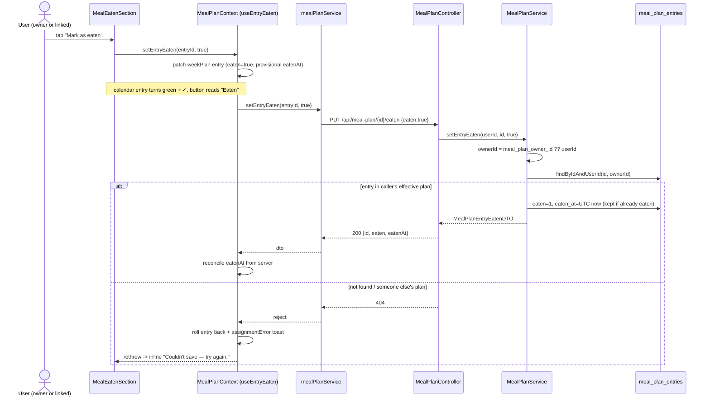

# Plan: Mark a planned meal as eaten (shared across linked meal plans)

Plan folder: `.claude/contract/MPP-12-mark-meal-as-eaten/`
Execution status: see `tasks.md` in this folder.

---

## Part 1 — Alignment

### Task reference

Jira **MPP-12** (Story, Medium), child of epic **MPP-11** (Pet — virtual companion that rewards meal planning and logging). **Blocks MPP-14** (Pet page, Phase 1). Summary: "Mark a planned meal as eaten (shared across linked meal plans)".

Approved design asset: `C:\Users\jossd\Downloads\pet-mockup.html`, second phone ("Recipe opened from Meal Plan"), approved 2026-10-12: tick at the end of the recipe, no "ticked by". Mockup classes: `.eaten-section`, `.eaten-slot`, `.eaten-btn` (+ `.on`), `.tick`, `.eaten-meta`; calendar `.meal-plan-entry.eaten` + `.entry-eaten` ✓ badge. Once ticked, a second tap on the button does nothing; Undo is a link in the meta line.

Acceptance criteria (verbatim from the ticket):

1. When a recipe is opened from a Meal Plan entry (`MealPlanEntry` → `RecipeViewModal`), the end of the recipe (after Instructions) shows a section headed with the entry's day and meal (e.g. "Tuesday · Lunch") and a "Mark as eaten" button.
2. The section does not appear when the recipe is opened from anywhere else (e.g. the Recipes tab).
3. Tapping the button marks the entry as eaten: the button turns green and reads "Eaten", with "Eaten at HH:MM · Undo" beneath it. Undo clears the eaten state. The modal stays open.
4. The Meal Plan entry shows as eaten (green tint and a ✓ badge) once the modal is closed, without a reload. The update is optimistic and goes through `MealPlanContext`.
5. The eaten state is saved server-side and survives a reload, a different browser and a different device.
6. Shared plans: when either linked user (`meal_plan_owner_id`) marks an entry as eaten, both see it as eaten. There is one eaten state per entry, and it does not record or show who ticked it.
7. Undoing the eaten mark on a shared entry clears it for both users.
8. Existing entries default to not eaten after the migration, and the backend starts cleanly under Hibernate `validate`.
9. A user cannot mark an entry they don't have access to (neither their own nor their owner's). The API returns 403/404.

Ticket scope: in — `eaten` + `eaten_at` on `meal_plan_entries` (hand-applied migration), set/clear endpoint honouring `meal_plan_owner_id`, eaten section at the end of `RecipeViewModal` when opened from the meal plan, ✓ badge + green tint on eaten entries. Out — per-person eaten state / `eaten_by`, ticking from the Pet page, eaten-only weekly macro summary, Pet behaviour (incl. the pet reaction under the button), guest-mode meals. Risks named on the ticket: migration before deploy; shared writes must hit the owner's row; replacing a slot's recipe clears the eaten state.

### Restated goal

Give every planned meal a single, server-persisted "eaten" flag with the time it was ticked. The user ticks it from the bottom of the recipe modal, but only when the modal was opened from a meal-plan entry; the calendar entry turns green with a ✓ straight away (optimistically, via `MealPlanContext`). Because the flag lives on the `meal_plan_entries` row, and linked users already read and write the owner's rows, both partners see the same state on any device. Undo clears it for both. An entry outside the caller's effective plan answers 404.

### In scope

- Migration adding `eaten TINYINT(1) NOT NULL DEFAULT 0` and `eaten_at TIMESTAMP NULL` to `meal_plan_entries`, applied to Railway by the developer before the backend deploys.
- `MealPlanEntry` entity fields `eaten` / `eatenAt`; `MealPlanEntryDTO` exposes `eaten` / `eatenAt` on every week-plan entry.
- `PUT /api/meal-plan/{id}/eaten` with body `{ "eaten": true|false }`, resolving the effective owner (`meal_plan_owner_id`), returning 404 for an entry outside that plan, 403 for an unauthenticated caller, 400 for a missing `eaten`.
- `MealPlanService.setEntryEaten` + unit tests (own entry, linked user writes the owner's row, foreign entry → not found, idempotent re-tick keeps the first `eatenAt`, undo clears `eatenAt`).
- Frontend: `mealPlanService.setEntryEaten`, an optimistic `setEntryEaten` on `MealPlanContext` (logic in a new hook so the over-budget context barely grows), a new `MealEatenSection` component rendered at the end of `RecipeViewModal` only when a `mealPlanEntry` prop is passed, ✓ badge + green tint on `MealPlanEntry`.
- Splitting the Instructions list out of `RecipeViewModal` into `RecipeStepsSection` so the modal ends up under the 400-line budget (it's 405 today and this change grows it).
- Version bump (Story → MINOR) + CHANGELOG line.

### Explicitly out of scope

- `eaten_by` or a per-person eaten state, and any "ticked by" UI.
- The mockup's "Ticking this marks it eaten for you and Karen." hint line: it names a partner, and the ticket's ACs don't ask for it.
- The mockup's sticky-bar variant (`.rv-sticky-bar`).
- The pet reaction under the button, the Pet page, and any "due"/missed-meal logic (MPP-14 and later).
- Changing the weekly/daily macro summary to count eaten meals only.
- Guest-mode (localStorage) meals. Guests have no meal-plan entries server-side, and the section won't render for them.
- Carrying the eaten state through copy-week, templates, or a recipe or variant replacement. New entries start not eaten.
- The PWA bootstrap and the known `services/api.js` debt (no timeout, `console.log`). Not touched by this change.

### Pattern Reference

None supplied beyond the files the ticket names (`MealPlanEntry`, `RecipeViewModal`, `MealPlanContext`, `meal_plan_owner_id`). References I chose:

- Endpoint + owner resolution: `MealPlanController.removeEntry` / `MealPlanService.removeEntry`, which use `getEffectiveMealPlanOwnerId` + `findByIdAndUserId` → 404 when not in the effective plan. This is the exact AC 9 behaviour.
- Request DTO validation + error mapping: `MealPlanExtrasController` (`@Valid` request body, `Map.of("error", …)` bodies).
- Migration header style: `foodbytes-app/database/migrations/2026-10-10-mpp10-extra-choices-schema.sql`.
- Service tests: `MealPlanServiceTest` (Mockito, `@InjectMocks`, `linkedUser_writes…AgainstOwner` style).
- Optimistic update + rollback + toast: `MealPlanContext.swapDayMeals` (snapshot → `setWeekPlan` → service call → rollback + `setAssignmentError` on failure).
- Visuals: the approved mockup's `.eaten-*` rules and `--success` green (`#28a745`, `rgba(40,167,69,.10)` tint).

### Constraints flagged on the brief

- Hibernate `ddl-auto: validate`: the migration must be on Railway **before** the backend that maps `eaten` / `eaten_at` deploys (AC 8).
- Shared-plan writes go to the owner's row, never a copy (AC 6, Dependencies & Risks).
- One eaten state per entry; no record of who ticked it (AC 6).
- The update is optimistic and goes through `MealPlanContext` (AC 4).
- The modal stays open after tick and Undo (AC 3).
- The section appears only when opened from the meal plan (AC 1–2).
- If a recipe in a slot is replaced, the eaten state is cleared (ticket risks).

### Assumptions made

- **Endpoint `PUT /api/meal-plan/{id}/eaten` with an explicit `{ eaten: boolean }` body, not a POST toggle.** An explicit target state is idempotent, so two linked devices ticking at once both converge on "eaten" instead of cancelling each other out (a toggle would). It sits under the existing `/api/meal-plan` controller (singular path; that's the real mapping, not `/api/meal-plans` as CLAUDE.md says).
- **Response: 200 with a small `MealPlanEntryEatenDTO { id, eaten, eatenAt }`, not the full `MealPlanEntryDTO`.** `convertToDTO` runs a recipe-summary lookup and macro recomputation the tick doesn't need. The client only needs the server's `eatenAt` to reconcile the optimistic value.
- **Not found and not yours both return 404** (as `removeEntry` does), and unauthenticated returns 403 (as every `MealPlanController` endpoint does). AC 9 allows either. 404 doesn't reveal that another user's entry id exists.
- **Re-ticking an already-eaten entry keeps the original `eatenAt`.** When the second partner ticks after the first, it shouldn't move the time. Undo sets `eaten = false, eaten_at = NULL`.
- **`eaten_at` is stored as UTC wall time** (`LocalDateTime.now(ZoneOffset.UTC)`, matching the JDBC URL's `serverTimezone=UTC`) and exposed as an `Instant` in DTOs, so Jackson writes `…Z` and the browser renders HH:MM in the viewer's local time. The entity stays `LocalDateTime`, like `createdAt`/`updatedAt`, to avoid any Hibernate 6 `Instant` ↔ `TIMESTAMP_UTC` validate-type mismatch.
- **`eaten` maps as `Boolean` with `@Column(nullable = false)` onto `TINYINT(1) NOT NULL DEFAULT 0`.** Same pairing as `recipes.macros_audited`, which already passes `validate` in production.
- **Replacement clears the eaten state for free.** `assignRecipe` deletes the old entry and inserts a new one (default not eaten). That covers a different recipe and a same-family variant swap alike. `swapDays` keeps entry ids, so the eaten state moves with the meal to its new day. `copyWeek` / apply-template create fresh entries, which start not eaten. No code change for any of these. Tests pin the replacement case.
- **Frontend opt-in via a new `mealPlanEntry` prop on `RecipeViewModal`** (default `null`). Only `MealPlanEntry` passes it, so the Recipes tab (`RecipeCard`, `RecipeList`) is untouched and shows no section (AC 2).
- **The section shows only on the root recipe**, not after navigating into a linked sub-recipe (`canGoBack === false`). The tick belongs to the planned dish, and a pita sub-recipe page isn't that dish. It stays visible across in-modal variant switches, because the entry is unchanged.
- **The section reads the entry live from `MealPlanContext`**, not from the snapshot prop. It looks the entry up by id in `weekPlan` (via a new `getEntryById`). That way the optimistic flip, the server reconcile and a rollback all show inside the open modal.
- **Heading uses the full weekday + meal label**: "Tuesday · Lunch", from `entry.planDate` + `entry.mealType`. The weekday comes from a new `formatLongWeekday` in `utils/dateUtils.js`. The meal label comes from a new `MEAL_TYPE_LABELS` in `src/constants/mealTypes.js`. That's the first step toward the 31-literal meal-type debt, kept scoped to this need.
- **While a save is in flight, the button and the Undo link are disabled** (the optimistic state already shows). This avoids out-of-order rollbacks without a request-sequence scheme.
- **Errors**: the context rolls back and sets `assignmentError` (the existing toast). The section also shows an inline "Couldn't save — try again." line, because the toast may sit behind the full-screen modal.
- **No hint text in the meta line before ticking.** The mockup's partner-name hint is out of scope (see above). The meta line keeps its `min-height`, so the layout doesn't jump.

### Cross-code alignment audit (FE ↔ BE ↔ DB)

- **`SHOW COLUMNS FROM meal_plan_entries` (live, 2026-10-12):** `id bigint PK auto_increment`, `user_id bigint NOT NULL MUL`, `plan_date date NOT NULL`, `meal_id bigint NOT NULL MUL`, `recipe_id bigint NOT NULL MUL`, `servings decimal(4,2) NOT NULL DEFAULT 1.00`, `created_at timestamp NULL DEFAULT CURRENT_TIMESTAMP`, `updated_at timestamp NULL DEFAULT CURRENT_TIMESTAMP ON UPDATE CURRENT_TIMESTAMP`. There's no `eaten` or `eaten_at` yet, so the ticket's premise is confirmed.
- **Row counts:** `SELECT COUNT(*) …` → 800 entries, 7 distinct owners, plan dates 2025-12-05 → 2026-10-15. Two nullable/defaulted columns are purely additive, so every existing row lands as `eaten = 0, eaten_at = NULL` (AC 8) with no backfill.
- **Unapplied migrations:** the latest migration on disk is `2026-10-10-mpp10-*`. Its tables (`meal_plan_entry_extra_choices`, `meal_plan_template_entry_extra_choices`, `user_extra_defaults`) all exist in `SHOW TABLES`, so nothing is outstanding. The MPP-12 migration will be the only pending one.
- **Name chain:** DB `eaten` / `eaten_at` ↔ entity `@Column(name = "eaten")` `Boolean eaten` / `@Column(name = "eaten_at")` `LocalDateTime eatenAt` ↔ DTO `Boolean eaten` / `Instant eatenAt` ↔ JSON `eaten` / `eatenAt` ↔ frontend `entry.eaten` / `entry.eatenAt`. They're consistent.
- **Endpoint path:** the controller maps `/api/meal-plan` (singular). `mealPlanService.js` already calls `/meal-plan…` against `baseURL: '/api'`. The new call is `api.put(`/meal-plan/${entryId}/eaten`, { eaten })`, which matches.
- **Owner resolution:** `MealPlanService.getEffectiveMealPlanOwnerId` + `MealPlanEntryRepository.findByIdAndUserId(id, ownerId)` already exist and are used by `removeEntry`. No new repository method is needed.
- **Recipe-data rules** (`linked-recipe-extras`, `recipe-variants`, `homemade-first`): not applicable. No recipe, ingredient or macro data changes.

---

## Part 2 — Technical design

### Approach

**Backend.** The eaten state is two columns on the existing `meal_plan_entries` row. Shared plans then need no new mechanism: a linked user already resolves to the owner's id through `getEffectiveMealPlanOwnerId`, and the new `MealPlanService.setEntryEaten(userId, entryId, eaten)` loads the row with `findByIdAndUserId(entryId, effectiveOwnerId)`. That's the same lookup `removeEntry` uses, so a foreign id is simply "not found". Setting `true` on a not-yet-eaten row stamps `eatenAt = LocalDateTime.now(ZoneOffset.UTC)`. Setting `true` on an eaten row is a no-op that keeps the first timestamp, and `false` clears both. The method is `@Transactional` and relies on dirty checking, with no explicit `save`. It returns a `MealPlanEntryEatenDTO`, or `Optional.empty()` when not found. `MealPlanController` adds a thin `PUT /{id}/eaten` that maps empty → 404. `convertToDTO` copies `eaten` / `eatenAt` onto `MealPlanEntryDTO`, so `GET /api/meal-plan` carries the state on every entry (AC 5–7) with no extra query, because the columns sit on rows already fetched.

**Why not a separate `meal_plan_entry_eaten` table** (like MPP-10's choices table)? There's exactly one state per entry and no history, so a 1:1 side table only adds a join and a cascade to maintain. **Why not a POST toggle?** Two partners tapping at once would cancel out, while an explicit target state converges. **Why not a `PATCH /api/meal-plan/{id}`** with a partial entry? There's no general entry-update endpoint today, and inventing one would invite unrelated fields (servings, recipe) into a tick.

**Frontend.** `mealPlanService.setEntryEaten(entryId, eaten)` wraps the PUT. The optimistic logic lives in a new `hooks/useEntryEaten.js`, which `MealPlanProvider` calls with `setWeekPlan` and `setAssignmentError`. That keeps the 559-line context (already over budget) growing by ~6 lines rather than ~50. The hook returns `setEntryEaten(entryId, eaten)`. It patches the matching entry inside `weekPlan.days[].mealsByType[]` (`eaten`, plus a provisional client `eatenAt`), calls the service, reconciles with the server's `eatenAt` on success, and on failure restores the entry's previous `eaten` / `eatenAt` (a per-entry rollback, not a whole-plan snapshot, so it can't clobber a concurrent change elsewhere). It then raises the toast and re-throws. A small `getEntryById(entryId)` selector is exposed alongside it.

`MealPlanEntry` passes `mealPlanEntry={entry}` to `RecipeViewModal` and renders the green tint + ✓ badge from `entry.eaten`. `RecipeViewModal` renders `<MealEatenSection entryId={mealPlanEntry.id} />` after Instructions when the prop is set and `!canGoBack`. `MealEatenSection` reads the live entry via `getEntryById`, shows "Tuesday · Lunch", the Mark-as-eaten / Eaten button, and the "Eaten at HH:MM · Undo" meta line, and owns only its local `saving` / `error` state. To make room under the 400-line budget, the Instructions `<section>` (≈40 lines) moves verbatim into `RecipeStepsSection.jsx`, with props `steps`, `isHomemade`, `onLinkedStepClick`.

Data flow end to end: tap → context patches `weekPlan` (calendar entry and modal both flip at once) → `PUT /api/meal-plan/{id}/eaten` → service resolves the owner and updates the row → 200 `{id, eaten, eatenAt}` → the context writes the server `eatenAt`. The partner's next `GET /api/meal-plan` (any reload or week navigation) returns the same row's state.

### Skills to invoke during execution

- `java-backend`: owns the migration mechanics (date-prefixed file, manual Railway apply before deploy), the `MealPlanEntry` entity fields, the DTOs, `MealPlanService.setEntryEaten` + `MealPlanServiceTest`, and the thin `MealPlanController` endpoint.
- `react-frontend`: owns `mealPlanService.setEntryEaten`, the `useEntryEaten` hook + `MealPlanContext` wiring, `MealEatenSection`, the `RecipeStepsSection` split, the `MealPlanEntry` badge/tint, CSS (44px targets, `@media (hover: hover)`, `:focus-visible`), and the 400-line measurement.
- Rule files: none apply (no recipe, ingredient or macro data). The executor should still glance at `.claude/rules/README.md` in case a meal-plan rule has since been added.
- Developer override at the skill gate: `requirements` was offered and un-ticked. The Jira ticket already carries full ACs.

### Diagram



### Data shapes

#### Migration — `foodbytes-app/database/migrations/2026-10-12-mpp12-meal-plan-entry-eaten.sql`

```sql
ALTER TABLE meal_plan_entries
  ADD COLUMN eaten    TINYINT(1) NOT NULL DEFAULT 0 AFTER servings,
  ADD COLUMN eaten_at TIMESTAMP  NULL     DEFAULT NULL AFTER eaten;
```

No index. Every read of these columns rides an existing `user_id` + date-range lookup.

#### Entity — `MealPlanEntry` (added fields)

```java
@Column(name = "eaten", nullable = false)
private Boolean eaten = false;

@Column(name = "eaten_at")
private LocalDateTime eatenAt;   // UTC wall time; null when not eaten
```

#### Request DTO — `dto/MealPlanEntryEatenRequest.java` (new)

```java
@Data @NoArgsConstructor @AllArgsConstructor
public class MealPlanEntryEatenRequest {
    @NotNull(message = "eaten is required")
    private Boolean eaten;
}
```

#### Response DTO — `dto/MealPlanEntryEatenDTO.java` (new)

```java
public record MealPlanEntryEatenDTO(Long id, boolean eaten, Instant eatenAt) {}
```

#### `MealPlanEntryDTO` (added fields)

```java
private Boolean eaten;     // MPP-12: one shared state per entry
private Instant eatenAt;   // MPP-12: null when not eaten; serialised as ISO-8601 UTC ("…Z")
```

#### Service signature

```java
@Transactional
public Optional<MealPlanEntryEatenDTO> setEntryEaten(Long userId, Long entryId, boolean eaten)
```

#### HTTP contract

```
PUT /api/meal-plan/{id}/eaten
Body: { "eaten": true }            // or false to undo
200 → { "id": 812, "eaten": true, "eatenAt": "2026-10-12T12:12:04Z" }
200 → { "id": 812, "eaten": false, "eatenAt": null }
400 → { "error": "eaten is required" }    (missing/null eaten, via @Valid + a controller-local
                                          @ExceptionHandler(MethodArgumentNotValidException) copied from
                                          UserController; there is no @ControllerAdvice in this codebase)
403 → { "error": "Authentication required to modify meal plan" }
404 → (empty body) entry not in the caller's effective plan
```

`GET /api/meal-plan?startDate=…` → each `days[].mealsByType.*[]` entry gains `"eaten": false, "eatenAt": null`.

#### Frontend modules

- `src/services/mealPlanService.js` → `async setEntryEaten(entryId, eaten)` → `PUT /meal-plan/${entryId}/eaten`, returns `response.data`.
- `src/hooks/useEntryEaten.js` (new) → `useEntryEaten({ weekPlan, setWeekPlan, setAssignmentError })` returns `{ setEntryEaten(entryId, eaten): Promise<void>, getEntryById(entryId): entry | null }`.
- `src/constants/mealTypes.js` (new) → `export const MEAL_TYPE_LABELS = { breakfast: 'Breakfast', lunch: 'Lunch', dinner: 'Dinner', snacks: 'Snacks', extras: 'Extras' }`.
- `src/utils/dateUtils.js` → `export const formatLongWeekday = (isoDate) => …` ("2026-10-13" → "Tuesday"). It mirrors `getShortDayName`: `parseISODate` (local date, not UTC midnight) + `toLocaleDateString('en-US', { weekday: 'long' })`.
- `src/components/recipes/MealEatenSection.jsx` + `.css` (new) → props `{ entryId }`.
- `src/components/recipes/RecipeStepsSection.jsx` (new) → props `{ steps, isHomemade, onLinkedStepClick }`. The existing `.steps-section` CSS stays in `RecipeViewModal.css`.
- `RecipeViewModal` → new prop `mealPlanEntry = null`.
- `MealPlanContext` value → adds `setEntryEaten`, `getEntryById`.

### Runtime quality notes

Frontend dimensions are mapped onto the browser runtime (single-threaded event loop, effect cleanup, re-render cost).

- **Resource cleanup:** Backend — one `@Transactional` method, dirty-checked update, no streams. Frontend — `MealEatenSection` registers no listeners or timers. The write is a PUT, and writes are never auto-aborted (skill rule), so no `AbortController`. The existing 3-second `setTimeout` toast-clear pattern in the context is reused as-is.
- **Concurrency / ordering:** Linked partners writing the same row get last-write-wins on an idempotent target state. Two "true" writes converge, and the first `eatenAt` is kept. A partner's "undo" racing a "tick" ends in whichever commits last. That's acceptable for a shared single state, and the other device sees it on its next fetch (there's no push, which is consistent with the rest of the meal plan). Within one device, the button and Undo are disabled while a save is in flight, so rollbacks can't land out of order. Rollback is per entry (restore that entry's previous `eaten`/`eatenAt` via a functional `setWeekPlan`), so it can't undo a concurrent swap or assign elsewhere in the week. A `fetchWeekPlan` racing an in-flight tick may briefly show the old state until the PUT reconciles. This matches the existing assign/swap behaviour.
- **Allocation / cost behaviour:** No new queries on the week read (the columns ride the existing `JOIN FETCH` rows). The PUT costs one `users` lookup + one indexed PK lookup + one UPDATE, with no macro recomputation (hence the slim response DTO). Frontend — an optimistic patch maps over 7 days × ≤5 meal arrays, which is trivial. `getEntryById` does the same linear scan on each `MealEatenSection` render, which is negligible and not memoised (skill rule: no memo without profiling).
- **Error paths:** 404 / 403 / 400 / network → `mealPlanService` rejects → `useEntryEaten` rolls the entry back, sets `assignmentError` ("Couldn't update eaten status. Please try again.", auto-clears after 3s), and re-throws → `MealEatenSection` catches, shows the inline error line, and re-enables the button. Nothing is swallowed into a success shape. Backend — a missing `eaten` → `@Valid` 400, shaped as `{error}` by a new controller-local `@ExceptionHandler` on `MealPlanController` (same as `UserController.handleValidation`; without it Spring returns its default `{timestamp,status,error,path}` body). An unknown or foreign id → `Optional.empty()` → 404. A user row missing → `getEffectiveMealPlanOwnerId` falls back to the caller's id, which then finds nothing → 404.

### Risks and judgement calls

- **Manual migration ordering (developer-owned):** `2026-10-12-mpp12-meal-plan-entry-eaten.sql` must be applied to Railway **before** the backend redeploys, or `validate` fails startup on the missing `eaten` column. The tasks put the apply step before the entity edit.
- **UTC handling of `eaten_at`:** correctness relies on writing `LocalDateTime.now(ZoneOffset.UTC)` and reading it back with `toInstant(ZoneOffset.UTC)`. Using bare `LocalDateTime.now()` would be wrong on a non-UTC JVM. The service test pins that `eatenAt` is within a few seconds of `Instant.now()`.
- **Splitting `RecipeViewModal`:** moving the Instructions list into `RecipeStepsSection` is a refactor the ticket didn't ask for. It's forced by the 400-line blocking rule (the file is already 405). It's a verbatim move, but the linked-step click and the homemade/store-bought `altInstruction` swap must still behave identically. There's a manual check for it.
- **Section hidden on linked sub-recipes** (`!canGoBack`): my reading of "end of the recipe". Red-line it if you want the tick visible on every page of the stack.
- **The toast may render behind the modal.** That's why the section has its own inline error. I didn't check the z-indexes during planning.
- **Endpoint shape** (`PUT …/{id}/eaten`, explicit boolean, 404 for not-yours): a judgement call against a POST toggle. It matters for MPP-14 later, since the Pet will read `eaten` from the week plan.
- **No live push to the partner.** "Both see it" means on their next load or week navigation, the same as every other meal-plan change today. Red-line it if AC 6 meant real-time.
- **Controller-local validation handler on `MealPlanController`:** it changes the 400 body shape for the existing `POST /api/meal-plan` validation errors too (from Spring's default to `{error}`). The frontend's error reading only benefits, but it is a side effect beyond the ticket.
- **`MealPlanContext` stays over budget (559 → ~566).** The new logic is in `useEntryEaten`, but the context isn't being split in this ticket. It's recorded as unchanged known debt, not grown materially.
