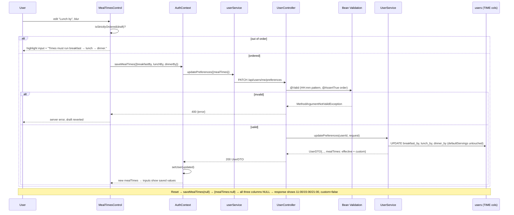

# Plan: User-configurable meal times (breakfast/lunch/dinner "by" times) in the account menu

Plan folder: `.claude/contract/MPP-13-user-meal-times/`
Execution status: see `tasks.md` in this folder.

---

## Part 1 — Alignment

### Task reference

Jira **MPP-13** (Story, Medium, parent epic MPP-11 "Pet — virtual companion that rewards meal planning and logging"; blocks MPP-14 "Pet page (Phase 1, mood only)").

**Problem statement (verbatim):** The Pet (MPP-11) decides a meal is overdue once its meal time has passed. People eat at different times, so fixed times would make the pet nag someone who just eats lunch late. Users need to set their own times.

**User story:** As a signed-in FoodBytes user, I want to set the time by which I usually eat breakfast, lunch and dinner, so that the pet only counts a meal as unlogged after my own meal time.

**Acceptance criteria (verbatim):**
1. The account menu shows a "Meal times" section directly under Default portions, styled like the MPP-3 control, with one time input each for "Breakfast by", "Lunch by" and "Dinner by".
2. Until a user saves their own times, the defaults are 11:00, 15:00 and 21:00, and the inputs show them.
3. Changing a time saves it to the user's account on the server. It persists across reload, browser and device.
4. Times must run strictly breakfast < lunch < dinner. An invalid change is not saved, the input is highlighted, and an inline error reads "Times must run breakfast → lunch → dinner." A failed save shows the server's error and never looks saved.
5. "Reset to defaults" clears the saved times, and the inputs return to 11:00, 15:00 and 21:00.
6. Guests do not see the section.
7. The backend rejects invalid times (bad format or wrong order) with a 400, using the same rules as the frontend.

**Scope (verbatim):** In — three nullable time columns on `users` (null means use the default), as a migration applied to Railway by hand; extending the existing user preferences endpoint and `AuthContext` (the MPP-3 pattern); a `MealTimesControl` component in the account menu. Out — times for Snacks and Extras; using the times anywhere other than the pet; resolving which user's times apply on a shared plan.

**Dependencies & risks (verbatim):** Schema change applied to Railway before the backend deploys (Hibernate `validate`). Keep the bounds and defaults in one shared constant, as MPP-3 did with `constants/servings.js`, so frontend and backend can't drift. The account dropdown has had width problems before (see `DefaultPortionsControl.css`) — time inputs must not widen the panel.

**Design asset:** approved mockup `C:\Users\jossd\Downloads\pet-mockup.html` (account menu → "Meal times" section, lines 239–247; styles lines 118–130).

### Restated goal

Signed-in users get a "Meal times" section in the account menu, beneath Default portions, with three time inputs (Breakfast by / Lunch by / Dinner by). The values are stored on the user's row in three new nullable `TIME` columns, where null means "use the default" (11:00 / 15:00 / 21:00). The existing `PATCH /api/users/me/preferences` endpoint learns a `mealTimes` field and validates it (HH:mm format and strict breakfast < lunch < dinner order) with a 400. The frontend applies the same order rule before saving, so a bad edit is caught inline and never sent. Reset to defaults sends `mealTimes: null`, which clears all three columns. The user payload (`/auth/me`, login, and the PATCH response) always carries the *effective* times, with the defaults already applied, plus a `custom` flag. That gives the pet in MPP-14 one ready-to-use value.

### In scope

- Migration adding `users.breakfast_by`, `users.lunch_by`, `users.dinner_by` (`TIME NULL DEFAULT NULL`), applied to Railway by the developer.
- `User` entity: three `LocalTime` fields.
- `MealTimesPolicy` (backend): the defaults, the HH:mm pattern, the order rule and the error messages, held in one place.
- `MealTimesDTO` (response) on `UserDTO`, carrying the effective times and `custom`.
- `MealTimesRequest` (nested request) plus presence-tracking on `UserPreferencesUpdateRequest`, so a PATCH that leaves out a field leaves that field untouched.
- `UserService.updatePreferences(userId, request)` replaces `updateDefaultServings`. `UserService.getUserDTO(userId)` is added.
- `AuthController GET /me` builds the DTO through `UserService`, so it includes meal times.
- Backend tests: request validation/deserialisation, service update and reset, controller 400 shape.
- Frontend: `constants/mealTimes.js`, `utils/mealTimesUtils.js` with a `.check.mjs` smoke script, `userService.updatePreferences(patch)`, `AuthContext.mealTimes` / `saveMealTimes`, `MealTimesControl.jsx` + `.css`, and mounting it in `Header.jsx` under `DefaultPortionsControl`.
- Version bump (Story → MINOR) and CHANGELOG line.

### Explicitly out of scope

- Snacks / Extras times.
- Any consumer of the times (pet mood, overdue logic, notifications). That is MPP-14.
- Shared-plan resolution (`meal_plan_owner_id`): each user edits only their own row. MPP-14 decides whose times the pet reads.
- The mockup's hint line "Pip counts a meal as unlogged once its time has passed." It names a pet that doesn't exist yet. MPP-14 can add it.
- Removing the now-unused `UserPrincipal.defaultServings` field (see Risks).
- Guest-mode local storage of times (guests don't see the section, AC 6).
- Applying the MPP-12 migration. It is a separate contract, but it shares the deploy window (see Risks).

### Pattern Reference

The brief names the MPP-3 pattern. Concretely:
- `foodbytes-app/foodbytes-api/src/main/java/com/foodbytes/controller/UserController.java`: `PATCH /api/users/me/preferences` and its local `@ExceptionHandler(MethodArgumentNotValidException)` → `{error}` 400.
- `foodbytes-app/foodbytes-api/src/main/java/com/foodbytes/dto/UserPreferencesUpdateRequest.java`: null-tolerant bean validation.
- `foodbytes-app/database/migrations/2026-08-09_user_default_servings_preference.sql`: migration header style.
- `foodbytes-app/client/src/components/layout/DefaultPortionsControl.jsx` / `.css`: save-on-blur, revert on failure, server-message error, and the `width: 0` panel-width fix.
- `foodbytes-app/client/src/contexts/AuthContext.jsx` → `saveDefaultServings`; `client/src/services/userService.js`.
- `foodbytes-app/client/src/utils/servingsUtils.check.mjs`: node smoke script for a pure helper.
- **Visual contract (2026-10-12):** `C:\Users\jossd\Downloads\mpp13-meal-times-mockup.html`. It covers the proposed `MealTimesControl.css` classes, every state (never set, custom, out of order, saving, save failed, guest), and a live panel-width check.
- `foodbytes-app/foodbytes-api/src/test/java/com/foodbytes/dto/MealPlanCreateRequestTest.java` (validator + ObjectMapper DTO test) and `controller/AuthControllerLoginTest.java` (`@WebMvcTest`, `addFilters = false`).

### Constraints flagged on the brief

- Hibernate `ddl-auto: validate`: the migration must be on Railway before the backend deploys.
- Null columns mean "use the default". Reset clears to null and must not write the default values.
- Same rules on both sides: format + strict order, and the error string "Times must run breakfast → lunch → dinner."
- The time inputs must not widen `.user-dropdown` (absolute, `min-width: 220px`, shrink-to-fit).
- Guests never see the section.
- A failed save shows the server's error and never looks saved.

### Assumptions made

- **Defaults live only on the backend (`MealTimesPolicy`). The frontend never holds a copy.** Java and JS can't share a literal file. MPP-3 handled that by mirroring values with a "keep in sync" comment. A stronger fix is for the server to always return effective times, so the frontend has nothing to drift from. The format and order rules have to exist on both sides (AC 7). Each copy names the other in a comment.
- **Effective times + `custom` flag in the response, not raw nullable values.** This satisfies AC 2 ("the inputs show them") without frontend defaults. It also gives MPP-14 a ready-to-use value. `custom` drives the Reset button's enabled state.
- **Wire format is `"HH:mm"` strings (24-hour, zero-padded), not `LocalTime` JSON.** `<input type="time">` produces exactly that. A `String` + `@Pattern` lets a bad format return the controller's `{error}` 400. A `LocalTime` field would fail in Jackson first, and Spring's default error body has no `error` key.
- **True PATCH semantics via setter-tracked presence flags on `UserPreferencesUpdateRequest`.** Today the endpoint writes `defaultServings` unconditionally, so `{mealTimes: …}` alone would wipe a saved portion preference. Presence flags keep "absent = untouched, explicit null = clear" for both fields, and the old frontend payload `{defaultServings}` still works unchanged.
- **All three times are sent together.** `mealTimes` is either null (reset) or an object with all three set. Order is checked across the full set, and the three columns are always written together, so a row can't hold a mix of set and null values.
- **Strict order, no wrap past midnight.** "Breakfast by 23:30, dinner by 01:00" is rejected, consistent with AC 4's strict `<`.
- **Save on blur, not on every change.** On desktop, a `type="time"` input fires `change` after each segment edit, which would flood the endpoint. MPP-3 saves on blur. Mobile pickers blur when they close.
- **`/auth/me` reads through `UserService.getUserDTO(id)` (one PK lookup) instead of growing `UserPrincipal`.** This removes the hand-built `UserDTO` duplicated in `AuthController`. It costs one indexed query per app boot.
- **New backend class `service/MealTimesPolicy`.** There is no constants package, and service-level constants already live in `service/` (e.g. `MacroCalculationService`). Annotation `regexp` values need compile-time constants, which a `static final String` provides.
- **Default times render subdued (grey italic, `meal-times-input--default`) while `custom` is false**, mirroring MPP-3's `default-portions-input--unset`. They read as "not chosen yet". Shown in the MPP-13 mockup for review.
- **The mockup's hint text is omitted.** It references the pet, which is MPP-14's scope.
- **Version bump:** Story → MINOR, computed at apply time.

### Cross-code alignment audit (FE ↔ BE ↔ DB)

- **`users` columns (live Railway, `SHOW COLUMNS FROM users`):** `id bigint NO PRI`, `email varchar(255) NO UNI`, `name varchar(255) NO`, `google_id varchar(255) YES UNI`, `password_hash varchar(255) YES`, `avatar_url varchar(500) YES`, `is_admin tinyint(1) YES 0`, `default_servings decimal(4,2) YES NULL`, `created_at timestamp YES CURRENT_TIMESTAMP`, `last_login timestamp YES`, `meal_plan_owner_id bigint YES MUL`. There is no `breakfast_by` / `lunch_by` / `dinner_by` column yet, so no name collision.
- **Row counts:** `users_total = 13`, `with_default_servings = 1`. Adding three nullable columns with `DEFAULT NULL` is purely additive. Every existing user reads as "defaults", which is the AC 2 behaviour. No backfill is needed.
- **Unapplied migrations:** the uncommitted MPP-12 migration `2026-10-12-mpp12-meal-plan-entry-eaten.sql` is **not on Railway** (`information_schema` count of `meal_plan_entries.eaten/eaten_at` = 0). If MPP-12 and MPP-13 ship in the same push, both migrations must be applied before the backend redeploys. The MPP-13 migration does not depend on MPP-12.
- **Name chain:** DB `breakfast_by` / `lunch_by` / `dinner_by` (TIME) ↔ JPA `@Column(name = "breakfast_by") LocalTime breakfastBy` (and the same for lunch and dinner). Hibernate 6 maps `LocalTime` ↔ `TIME`, which passes validate. ↔ `MealTimesDTO.breakfastBy/lunchBy/dinnerBy` (String HH:mm) + `custom` ↔ JSON `user.mealTimes.{breakfastBy,lunchBy,dinnerBy,custom}` ↔ `AuthContext.mealTimes` ↔ `MealTimesControl` keys from `MEAL_TIME_KEYS`. Request: JSON `{mealTimes: {breakfastBy, lunchBy, dinnerBy} | null}` ↔ `MealTimesRequest`.
- **Existing `UserDTO` construction sites:** `UserService.convertToDTO` (main), `AuthController.getCurrentUser` (hand-built, to be replaced), and `AuthControllerLoginTest:54` (`new UserDTO(...6 args)`), which must gain a 7th arg.
- **Recipe/nutrition rule queries:** not applicable. No recipe, ingredient or macro data is touched.

---

## Part 2 — Technical design

### Approach

**Backend.** The migration adds three nullable `TIME` columns. `User` maps them as `LocalTime`. A new final class `service/MealTimesPolicy` owns the defaults (`11:00`, `15:00`, `21:00`), the `HH_MM_REGEX` compile-time constant, the two error messages, `isStrictlyOrdered(LocalTime, LocalTime, LocalTime)`, and `effective(User) → MealTimesDTO`. The `effective` method applies the defaults per column and sets `custom = any column non-null`. `UserService.convertToDTO` adds `MealTimesPolicy.effective(user)` to `UserDTO`. Every user payload (`/auth/me`, `/auth/login`, the PATCH response) goes through that method. `AuthController.getCurrentUser` stops hand-building the DTO and calls a new `UserService.getUserDTO(id)`.

`UserPreferencesUpdateRequest` gains `@Valid MealTimesRequest mealTimes`. It also gains hand-written setters for both fields that record presence in `@JsonIgnore` booleans. Jackson only calls a setter for a key that is present in the body, so `{}` touches nothing, `{mealTimes:null}` resets, and `{defaultServings:null}` clears portions as before. `MealTimesRequest` has three `@NotNull @Pattern(regexp = MealTimesPolicy.HH_MM_REGEX)` strings and an `@AssertTrue isStrictlyOrdered()` method. That method returns true when any value is null or badly formatted, leaving those errors to the field constraints. The controller's existing `MethodArgumentNotValidException` handler already returns the first field error as `{error}` with a 400, and nested and method-level constraints surface as `FieldError`s. So AC 7 needs no controller change beyond calling `userService.updatePreferences(id, request)`. `updatePreferences` replaces `updateDefaultServings`. It applies only the present fields, parses times with `LocalTime.parse`, and saves once.

**Frontend.** `userService.updatePreferences(patch)` becomes a generic partial PATCH. `AuthContext.saveDefaultServings` passes `{ defaultServings }`. The new `saveMealTimes(mealTimes | null)` passes `{ mealTimes }` and replaces `user` with the response. Context exposes `mealTimes: user?.mealTimes ?? null`. `MealTimesControl` keeps a draft `{breakfastBy, lunchBy, dinnerBy}` seeded from context. Its `useEffect` re-seeds the draft only when `mealTimes` changes and nothing is pending.

On blur of a changed input, the control does three things. If the value is empty, it reverts. If `isStrictlyOrdered(draft)` (pure helper in `utils/mealTimesUtils.js`) fails, it marks that input `--invalid`, shows the `MEAL_TIMES_ORDER_ERROR` message, and sends nothing. Otherwise it saves all three. On save failure it reverts the draft to the context values and shows `err.response.data.error` ("Could not save. Try again." when there is no body). "Reset to defaults" calls `saveMealTimes(null)`; it is disabled while saving or when `!mealTimes.custom`. While `!custom`, the inputs carry `meal-times-input--default` (grey italic). Any edit removes that class. The CSS class names and states follow the approved mockup `mpp13-meal-times-mockup.html`. CSS reuses the MPP-3 tokens. The input uses `flex: 1 1 0; width: 0; min-width: 0; max-width: 8rem`, so it adds nothing to the panel's max-content width. `Header` mounts it straight after `<DefaultPortionsControl />`, inside the authenticated branch only, which satisfies AC 6.

**Roads not taken.** *A separate `PUT /api/users/me/meal-times` endpoint* would avoid the presence-flag change, but the brief says to extend the existing endpoint. *Sending the whole preference object from the client on every save* (PUT-like semantics on PATCH) would make the two account-menu controls race and overwrite each other's in-flight values. *`LocalTime` in the request DTO* loses the `{error}` 400 shape on bad formats. *Mirroring defaults in a JS constant* (the literal MPP-3 approach) creates the drift risk the brief warns about. *Extending `UserPrincipal`* would add a fourth positional field per preference, and `AuthController` would still duplicate DTO construction.

### Skills to invoke during execution

- `java-backend` — owns the entity/migration contract, `MealTimesPolicy` placement, request/response DTOs, `UserService` transactions, the thin `UserController`/`AuthController`, and backend tests.
- `react-frontend` — owns `constants/mealTimes.js`, `utils/mealTimesUtils.js` + check script, `userService`, the `AuthContext` extension, `MealTimesControl` (four async states, ≥44px targets, `:focus-visible`, no hover-only state, no panel widening), and the line-count check.

Developer confirmed both skills; no override.
Rules to Read: none apply. No recipe, ingredient, macro or variant data is touched.

### Diagram



### Data shapes

#### DDL — `foodbytes-app/database/migrations/2026-10-12-mpp13-user-meal-times.sql`

```sql
ALTER TABLE users
  ADD COLUMN breakfast_by TIME NULL DEFAULT NULL AFTER default_servings,
  ADD COLUMN lunch_by     TIME NULL DEFAULT NULL AFTER breakfast_by,
  ADD COLUMN dinner_by    TIME NULL DEFAULT NULL AFTER lunch_by;
```

#### Entity — `User`

```java
@Column(name = "breakfast_by") private LocalTime breakfastBy;   // MPP-13: null = MealTimesPolicy default
@Column(name = "lunch_by")     private LocalTime lunchBy;
@Column(name = "dinner_by")    private LocalTime dinnerBy;
```
No field initialisers (null is the "never set" value, as with `defaultServings`).

#### Policy — `service/MealTimesPolicy` (final, private ctor)

```java
public static final LocalTime DEFAULT_BREAKFAST_BY = LocalTime.of(11, 0);
public static final LocalTime DEFAULT_LUNCH_BY     = LocalTime.of(15, 0);
public static final LocalTime DEFAULT_DINNER_BY    = LocalTime.of(21, 0);
public static final String HH_MM_REGEX   = "^([01]\\d|2[0-3]):[0-5]\\d$";
public static final String FORMAT_ERROR  = "Meal times must be HH:mm";
public static final String ORDER_ERROR   = "Times must run breakfast → lunch → dinner.";
public static boolean isStrictlyOrdered(LocalTime b, LocalTime l, LocalTime d); // b<l && l<d
public static MealTimesDTO effective(User user);  // per-column default, custom = any non-null
```

#### Response DTO — `dto/MealTimesDTO` (`@Data @NoArgsConstructor @AllArgsConstructor`)

| Field | Type | Notes |
|---|---|---|
| `breakfastBy` | `String` | `"HH:mm"`, effective (default applied) |
| `lunchBy` | `String` | same |
| `dinnerBy` | `String` | same |
| `custom` | `boolean` | true when the user has saved times; JSON key `custom` |

#### `UserDTO` — adds a 7th field

`private MealTimesDTO mealTimes;   // MPP-13: always effective; null only in hand-built test fixtures`

#### Request — `dto/MealTimesRequest` (`@Data @NoArgsConstructor @AllArgsConstructor`)

```java
@NotNull(message = MealTimesPolicy.FORMAT_ERROR) @Pattern(regexp = MealTimesPolicy.HH_MM_REGEX, message = MealTimesPolicy.FORMAT_ERROR) private String breakfastBy;
@NotNull(...) @Pattern(...) private String lunchBy;
@NotNull(...) @Pattern(...) private String dinnerBy;
@JsonIgnore @AssertTrue(message = MealTimesPolicy.ORDER_ERROR)
public boolean isStrictlyOrdered() { /* true if any null/unmatched; else MealTimesPolicy.isStrictlyOrdered(parse x3) */ }
```

#### Request — `UserPreferencesUpdateRequest` (modified)

```java
@DecimalMin/@DecimalMax/@Digits ... private BigDecimal defaultServings;   // unchanged constraints
@Valid private MealTimesRequest mealTimes;                                // null = reset to defaults
@JsonIgnore private boolean defaultServingsPresent;
@JsonIgnore private boolean mealTimesPresent;
public void setDefaultServings(BigDecimal v) { defaultServings = v; defaultServingsPresent = true; }
public void setMealTimes(MealTimesRequest v) { mealTimes = v; mealTimesPresent = true; }
```
`@AllArgsConstructor` is removed (no callers; it would expose the presence flags positionally). `@Data` and `@NoArgsConstructor` stay.

#### HTTP contract — `PATCH /api/users/me/preferences` (auth required, unchanged path)

| Body | Effect |
|---|---|
| `{"defaultServings": 1.5}` | sets portions; meal times untouched |
| `{"defaultServings": null}` | clears portions; meal times untouched |
| `{"mealTimes": {"breakfastBy":"09:30","lunchBy":"13:00","dinnerBy":"19:30"}}` | sets times; portions untouched |
| `{"mealTimes": null}` | clears all three time columns |
| `{"mealTimes": {"breakfastBy":"9:30",...}}` | 400 `{"error":"Meal times must be HH:mm"}` |
| `{"mealTimes": {"breakfastBy":"13:00","lunchBy":"12:00",...}}` | 400 `{"error":"Times must run breakfast → lunch → dinner."}` |

200 response: `UserDTO`, e.g. `{"id":7,…,"defaultServings":null,"mealTimes":{"breakfastBy":"11:00","lunchBy":"15:00","dinnerBy":"21:00","custom":false}}`.

#### Service — `UserService`

- `@Transactional public UserDTO updatePreferences(Long userId, UserPreferencesUpdateRequest request)` replaces `updateDefaultServings`.
- `@Transactional(readOnly = true) public UserDTO getUserDTO(Long userId)`. Throws `IllegalArgumentException("User not found: " + id)` like the existing lookup.

#### Frontend modules

- `client/src/constants/mealTimes.js`: `MEAL_TIME_KEYS = ['breakfastBy','lunchBy','dinnerBy']`, `MEAL_TIME_LABELS = { breakfastBy: 'Breakfast by', lunchBy: 'Lunch by', dinnerBy: 'Dinner by' }`, `MEAL_TIMES_ORDER_ERROR = 'Times must run breakfast → lunch → dinner.'`.
- `client/src/utils/mealTimesUtils.js`: `isStrictlyOrdered(times)` (true iff every key matches `/^([01]\d|2[0-3]):[0-5]\d$/` and b < l < d by zero-padded string compare), and `pickMealTimes(times)`, which returns `{breakfastBy, lunchBy, dinnerBy}` without `custom`.
- `client/src/utils/mealTimesUtils.check.mjs`: node assert script.
- `userService.updatePreferences(patch)` → `api.patch('/users/me/preferences', patch)`.
- `AuthContext` value adds `mealTimes` and `saveMealTimes`.
- `components/layout/MealTimesControl.jsx` + `MealTimesControl.css` (class prefix `meal-times-`).

### Runtime quality notes

- **Resource cleanup:** Backend: the Spring-managed transaction per service method; no streams. Frontend (browser runtime): writes are never auto-aborted (skill rule), and there are no timers or listeners. The re-seed `useEffect` has no subscription to clean up. If the menu closes mid-save, the component unmounts. React 18 ignores setState after unmount, and `AuthContext.setUser` still lands, so the saved value is not lost.
- **Concurrency / ordering:** Presence flags make the two account-menu controls independent. A portions save and a times save in flight together each touch only their own columns, so neither overwrites the other. Two devices editing at once: last write wins per PATCH, which is acceptable for a personal preference. `meal_plan_owner_id` is not consulted; each user writes only their own row (shared-plan resolution is out of scope). Within the control, `saving` disables the inputs and Reset, so overlapping time saves can't happen.
- **Allocation / cost behaviour:** Each save is one PK `findById` plus one `save`. `/auth/me` gains one PK lookup per app boot. `MealTimesControl` only re-renders when the menu is open. No N+1, no bundle impact (no new dependency).
- **Error paths:** A bad format or order returns 400 `{error}` via the existing `UserController` handler. A missing user throws `IllegalArgumentException`, which surfaces as a 500, unchanged from MPP-3 (the JWT filter already guarantees the row exists). Unauthenticated requests get 401 `{error}`. Frontend: the inline order error comes from the pure helper before any request. On a failed save the draft reverts to context values, the server's `error` (or a fallback string) is shown with `role="alert"`, and nothing is swallowed into success. Empty-input blur reverts silently, because a time input only goes empty when deliberately cleared.

### Risks and judgement calls

- **Migration ordering (manual).** `2026-10-12-mpp13-user-meal-times.sql` must be applied to Railway before the backend deploys. The uncommitted MPP-12 migration is also not on Railway yet. If both tickets ship in one push, apply both first. The MPP-13 file is safe to apply while the current backend runs, because validate ignores unmapped columns.
- **Presence-flag setters change `UserPreferencesUpdateRequest`'s deserialisation contract.** This is the subtlest change. A test pins that `{"mealTimes":…}` does not set `defaultServingsPresent`. Without it, a times save would silently clear a saved portion preference (1 live user has one).
- **`updateDefaultServings` is removed, and its three tests move to `updatePreferences`.** This keeps one write path instead of two. Push back if you'd rather keep the old method as a thin delegate.
- **`/auth/me` now reads the DB through `UserService`.** It adds one query and leaves `UserPrincipal.defaultServings` unused. Removing that field is out of scope, so it's flagged here as small debt.
- **The backend owns the defaults, and the frontend never shows a time the server didn't send.** If MPP-14's pet needs times for guests, it will need a frontend fallback then. This contract deliberately doesn't add one now.
- **Strict order, no past-midnight wrap.** A night-shift user with "dinner by 01:00" can't express it. This matches AC 4 literally.
- **Save on blur.** A user who edits a time and closes the menu without blurring the field (e.g. Escape) may not trigger a save. MPP-3 has the same behaviour.
- **Mockup hint line dropped.** It names the pet, so it's left for MPP-14.
- **Panel width.** The mockup's `width: 120px` input would push the 220px panel wider (label ~85px + 120 + gaps + 32px padding ≈ 245px). The plan uses MPP-3's `width: 0` + flex technique with `max-width: 8rem` instead. Verify in-browser at 375px.
