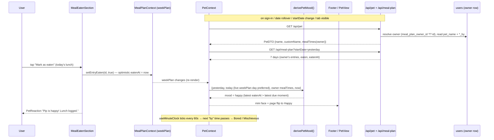

# Plan: Pet page (Phase 1, mood only): Mochi replaces the Search tab

Plan folder: `.claude/contract/MPP-14-pet-page-mood/`
Execution status: see `tasks.md` in this folder.

---

## Part 1 — Alignment

### Task reference

Jira **MPP-14** (Story, Medium, parent epic MPP-11 "Pet — virtual companion that rewards meal planning and logging"). Blocked by MPP-12 (eaten flag) and MPP-13 (user meal times), both `Ready for Test` and still **uncommitted in the working tree** at planning time (2026-10-12).

Acceptance criteria (verbatim):

1. The footer becomes Recipes · Meal Plan · Pet · Shopping. The Search tab, the `/search` route and `SearchView` (with its CSS) are removed, and no recipe search remains in the app.
2. The Pet tab icon is a live mini version of the pet's face that shows its current mood. The tab label is the pet's name (default "Pip").
3. Guests tapping the Pet tab see "Sign in to meet your pet!", the same pattern as Meal Plan and Shopping.
4. The Pet page shows: the pet in its room, a speech bubble, the name, a mood chip, and a "Today's meals" card (Breakfast, Lunch, Dinner: Logged / Not logged / By HH:MM) with a "Log meals in Meal Plan" button. The tiles are not tappable.
5. The pet is the approved Mochi design: a kawaii lavender blob as a flat SVG, with four animated moods (Content, Happy, Bored, Mischievous). Animation stops when reduced motion is on.
6. Mood rules. A meal is due when it is Breakfast, Lunch or Dinner, it is planned, it is not ticked eaten, and its meal time (MPP-13) has passed. Count over today and yesterday. Content: nothing due and nothing logged yet. Happy: at least one logged and none due. Bored: 1 due. Mischievous: 2 or more due (crumbs, takeaway box, guilty side-eye, sweat drop). Snacks and Extras never count.
7. Logging any one meal returns the pet to Happy immediately. The eaten section in the recipe modal (MPP-12) shows a small pet reaction under the button ("Pip is happy! Lunch logged.").
8. Shared plans: one pet per shared meal plan, belonging to the plan owner. Both users see the same pet, name and mood. Mood uses the plan owner's meal times. Either user can rename the pet.
9. The pet never gets sick or dies, and its body shape never changes. Copy frames mischief as boredom, never health or food guilt.

Scope (ticket): in — footer change + Search removal; Pet page, Mochi SVG with four moods, mini face icon; mood derived client-side from meal plan entries and eaten flags (no mood tables); persisted pet name stored once per plan owner; pet reaction in the MPP-12 eaten section. Out — treats, happiness meter, coins, cosmetics; any variety reward; choosing body/colour; ticking meals from the Pet page.

Dependencies & risks (ticket): pet name = one nullable column on the owner's `users` row, migration applied to Railway by hand. Removing Search was accepted 2026-10-12. Make sure yesterday's entries are loaded even at the start of a week view.

Design asset: approved mockup `C:\Users\jossd\Downloads\pet-mockup.html` (first phone + mood sheet), approved 2026-10-12.

Developer confirmations this session (2026-10-12): skills `react-frontend` + `java-backend` confirmed.

### Restated goal

Replace the footer's Search tab with a Pet tab whose icon is a live mini Mochi face and whose label is the pet's name, and delete recipe search entirely. Tapping the tab (signed in) opens a new `/pet` page: Mochi in a room, a speech bubble, the name (renameable), a mood chip and a non-interactive "Today's meals" card linking to Meal Plan. The mood — Content, Happy, Bored, Mischievous — is computed in the browser from the plan's yesterday + today Breakfast/Lunch/Dinner entries, their MPP-12 eaten flags and the **plan owner's** MPP-13 meal times, and flips to Happy the moment any counted meal is ticked. The backend gains one thing: a nullable `users.pet_name` on the plan owner's row, exposed with the owner's effective meal times through a small `/api/pet` endpoint that either linked user can read and rename through. The MPP-12 eaten section gains a tiny "Pip is happy! Lunch logged." reaction.

### In scope

- Footer: Recipes · Meal Plan · Pet · Shopping; Pet icon = live mini Mochi face in the current mood; label = pet name; guest tap shows "Sign in to meet your pet!".
- Delete `SearchView.jsx`, `SearchView.css`, the `/search` route and import; refresh the two docs that name `/search` (`CLAUDE.md`, `react-frontend` SKILL.md).
- Migration `users.pet_name VARCHAR(12) NULL`, `User.petName`, `PetPolicy` (default "Pip", length rule), `PetDTO`, `PetNameRequest`, `PetService` (owner-resolved read + rename), `PetController` (`GET /api/pet`, `PUT /api/pet/name`) with tests.
- Frontend: `petService`, `constants/pet.js`, pure `utils/petMood.js` + node check script, `hooks/useMinuteClock.js`, `PetContext` (pet DTO + recent-days fetch + derived mood), `MochiPet` SVG component (full + mini) with four animated moods and reduced-motion stop, `PetView` page (room, bubble, name editor, chip, meals card), `PetReaction` in `MealEatenSection`.
- `/pet` route in `App.jsx`; `PetProvider` in `main.jsx`.
- Version bump (Story → MINOR) + CHANGELOG.

### Explicitly out of scope

- The mockup's **Hungry** mood (mealtime window, chevron eyes, knife and fork). The ticket names exactly four moods; Hungry is left for a later phase.
- The mockup's heart pop on the Pet page, the body/colour pickers, treats, coins, happiness meter, cosmetics (later MPP-11 phases).
- The MPP-13 account-menu hint line ("Pip counts a meal as unlogged once its time has passed") — not in MPP-14's ACs.
- Ticking meals from the Pet page; making the meal tiles tappable.
- Any replacement for recipe search.
- Consolidating the five existing private copies of "resolve meal-plan owner" across services (flagged as debt, not fixed).
- Committing or otherwise landing MPP-12 / MPP-13 — this contract builds on their uncommitted working-tree state.

### Pattern Reference

None supplied by the brief beyond the mockup. Chosen references:
- **Backend:** MPP-13's `MealTimesPolicy` (final policy class owning defaults + messages; server sends effective values + a `custom` flag) → `PetPolicy`; `UserController` (thin, 401 on null principal, local `@ExceptionHandler` returning `{error}`) → `PetController`; `MealPlanService.getEffectiveMealPlanOwnerId` → owner resolution in `PetService`; `UserServiceTest` / `UserControllerPreferencesTest` → test shape.
- **Frontend:** `Footer.jsx` guest-message pattern; `useEntryEaten` (logic in a hook outside the over-budget `MealPlanContext`); `MealTimesControl` (inline save, server error body, revert on failure); `utils/mealTimesUtils.js` + `.check.mjs` (pure helper + node assert script); the mockup's SVG geometry, CSS tokens and keyframes, ported to JSX.

### Constraints flagged on the brief

- Pet name lives on the **plan owner's** `users` row; one nullable column; migration applied to Railway manually.
- No new tables for mood — mood is derived on the client.
- Shared plans: same pet, name and mood for both users; mood uses the **owner's** meal times; either user can rename.
- Yesterday's entries must be loaded even when the selected week starts today (or is a different week entirely).
- Snacks and Extras never count.
- Reduced motion stops all animation. Copy never mentions health, sickness, death or food guilt; body shape never changes.
- Mochi + Lavender fixed; default name "Pip".

### Assumptions made

- **Counting is per meal slot (date × meal type), not per entry.** A slot is *logged* when any entry in it is eaten, *due* when it has ≥1 entry, none eaten, and its "by" time has passed. Rationale: a lunch with a main and a side should not count as two missed meals and push straight to Mischievous; the tiles are per slot too.
- **"Logged" for Content vs Happy is counted over today only; "due" is counted over today + yesterday.** Rationale: AC 6's "count over today and yesterday" is about missed meals; counting yesterday's logs would make the pet Happy at 07:00 with nothing logged today, contradicting the mockup's Content state ("Nothing due yet. Just vibing.", all tiles upcoming).
- **AC 7 "back to Happy immediately" is implemented as a derived forgiveness rule, not a timer:** the mood is Happy whenever the latest `eatenAt` among counted slots in the window is later than the latest due moment among the currently-due slots. Bored/Mischievous return only when another meal time passes. Rationale: derived from data both users share, so it survives reloads and shows the same mood on both devices (AC 8); a client-only "happy for N minutes" flag would diverge between partners.
- **Mood precedence:** forgiven → Happy; else due ≥ 2 → Mischievous; due = 1 → Bored; logged today → Happy; else Content.
- **Unplanned slots** render "Not planned" (muted) on the tile instead of "By HH:MM". Rationale: "By 11:00" at 16:00 for a meal that was never planned reads as a nag; this is a fourth tile text beyond AC 4's three — red-line if you want "By HH:MM" kept.
- **Pet name rules:** trimmed, max 12 characters (the mockup's `maxlength="12"`, which also fits the 80px footer label), blank → reset to the default "Pip". `VARCHAR(12)` column. Default lives only in `PetPolicy` on the backend; the server returns the effective name + `customName` flag (MPP-13 pattern).
- **Endpoints:** `GET /api/pet` → `PetDTO`; `PUT /api/pet/name` with `{ "name": string|null }` → `PetDTO`. Authenticated (falls under `anyRequest().authenticated()`; no `SecurityConfig` change). A separate controller rather than extending `UserDTO`, because the pet belongs to the plan owner, not to the caller.
- **Guests:** footer label "Pet" and a Content mini face; no fetch. Rationale: guests have no pet, and copying "Pip" into a frontend constant re-creates the default-drift MPP-13 deliberately avoided.
- **Rename UI:** an edit (pencil) button next to the name on the Pet page opens an inline input; Enter or blur saves, Escape cancels, a failed save reverts and shows the server's error. The ticket says either user can rename but gives no UI; the mockup only had a name field in its control panel.
- **New `PetContext`** (not an extension of an existing context): footer, Pet page and the eaten section all need the same name + mood; `MealPlanContext` is already 564 lines (over the 400 budget) and `AuthContext` is the caller's own profile, not the owner's pet.
- **Data source for mood:** `PetContext` fetches its own 7-day plan starting yesterday (`GET /api/meal-plan?startDate=<yesterday>`), and for each of yesterday/today prefers the day from `MealPlanContext.weekPlan` when that week contains it. The live week carries MPP-12's optimistic ticks, so the flip is instant; the own fetch guarantees yesterday exists even when the selected week starts today or is elsewhere.
- **Refetch triggers for the recent days:** sign-in, local date rollover, `MealPlanContext.startDate` change, and the tab becoming visible again (picks up a partner's ticks). No polling.
- **Clock:** a 60-second ticking `useMinuteClock` (plus re-read on visibility) drives due transitions; the browser's local timezone is the truth for "today" and for "by" times.
- **Reaction in the eaten section** shows whenever the entry is eaten and its meal type is Breakfast/Lunch/Dinner, regardless of date. Rationale: simplest reading of AC 7; snacks get none because they never move the mood.
- **Mini face animates** like the mockup's (`mochi-mood-<mood>` class on the mini SVG), stopped by reduced motion.
- **Route paths stay as string literals** (`'/pet'`, `'/mealplan'`) to match the existing `App.jsx`/`Footer.jsx` style; introducing a routes constant map is out of scope.
- **Version bump:** Story → MINOR. MPP-13 is currently `1.4.0` in the working tree, so this lands as the next MINOR computed at apply time.

### Cross-code alignment audit (FE ↔ BE ↔ DB)

- **Live Railway `users` (`SHOW COLUMNS`, MySQL 9.7.2, db `railway`):** `id bigint PK`, `email varchar(255)`, `name varchar(255)`, `google_id`, `password_hash`, `avatar_url varchar(500)`, `is_admin tinyint(1)`, `default_servings decimal(4,2) NULL`, `created_at timestamp`, `last_login timestamp`, `meal_plan_owner_id bigint NULL MUL`. **No `breakfast_by`/`lunch_by`/`dinner_by`** — the MPP-13 migration is not applied to live. No `pet_name` (expected).
- **Live Railway `meal_plan_entries`:** `id, user_id, plan_date date, meal_id bigint, recipe_id, servings decimal(4,2), created_at, updated_at`. **No `eaten`/`eaten_at`** — the MPP-12 migration is not applied to live either.
- **Outstanding migrations:** `2026-10-12-mpp12-meal-plan-entry-eaten.sql` and `2026-10-12-mpp13-user-meal-times.sql` are written but unapplied on Railway. Hibernate `validate` means the backend that ships MPP-12/13/14 together will not start until **all three** are applied. The plan's manual DBA task covers all three, in order.
- **Local `foodbytes-db` (Docker):** `users` has `breakfast_by time`, `lunch_by time`, `dinner_by time`; `meal_plan_entries` has `eaten tinyint(1) NOT NULL`, `eaten_at timestamp NULL`. Local is ahead of live; local is where `/fb-apply` verifies.
- **Row counts:** 13 users, 2 with `meal_plan_owner_id` set, 2 distinct owners. Adding a nullable column with no default is lossless and needs no backfill (NULL = "Pip").
- **`meals` (live):** 1 Breakfast, 2 Lunch, 3 Dinner, 4 Snacks, 5 Extras. `MealPlanEntryDTO.mealType` is the lowercase name (`"breakfast"`…`"extras"`), matching `constants/mealTypes.js` keys and the planned `PET_COUNTED_MEAL_TYPES = ['breakfast','lunch','dinner']`.
- **Name chain:** `users.pet_name` ↔ `User.petName` (`@Column(name = "pet_name", length = 12)`) ↔ `PetDTO.name` + `customName` ↔ JSON `name`/`customName` ↔ `PetContext.petName`. Owner meal times: `users.breakfast_by…` ↔ `User.breakfastBy…` ↔ `MealTimesPolicy.effective(owner)` ↔ `PetDTO.mealTimes.{breakfastBy,lunchBy,dinnerBy,custom}` ↔ `PET_MEAL_TIME_KEY` map in `constants/pet.js`.
- **Week payload:** `MealPlanDayDTO.date` (`LocalDate`, serialised `"YYYY-MM-DD"` — already compared as a string by `MealPlanCalendar` `day.date`), `mealsByType: Map<String, List<MealPlanEntryDTO>>`; entries carry `eaten: Boolean` and `eatenAt: Instant` (ISO-8601 UTC). These are exactly the fields `petMood.js` reads.
- **Security:** `/api/pet/**` matches `anyRequest().authenticated()` in `SecurityConfig` (line 59); no change needed.

---

## Part 2 — Technical design

### Approach

**Backend: one column, one owner-resolved endpoint.** The migration adds `users.pet_name VARCHAR(12) NULL` (no `AFTER` clause, so it does not depend on the MPP-13 columns' position). `User` maps it as `petName` with no initialiser — NULL means "default", the same convention as `defaultServings` and the meal times. A final `service/PetPolicy` owns `DEFAULT_NAME = "Pip"`, `MAX_NAME_LENGTH = 12`, the length error message, `normalise(String)` (trim, blank → null) and `toDTO(User owner)`, which builds `PetDTO(effectiveName, customName, MealTimesPolicy.effective(owner))`. `PetService` resolves the plan owner (`user.mealPlanOwnerId ?? user.id`, the same expression `MealPlanService` uses), then `getPet` returns `PetPolicy.toDTO(owner)` and `renamePet` writes `PetPolicy.normalise(name)` to the **owner's** row and returns the new DTO. Because both linked users resolve to the same row, AC 8 (one pet, same name, owner's meal times, either can rename) falls out of the data model. `PetController` stays thin: `GET /api/pet`, `PUT /api/pet/name` with `@Valid PetNameRequest`, 401 on a null principal, and its own `MethodArgumentNotValidException` handler returning `{error}` (there is no `@ControllerAdvice`; `UserController` does the same).

**Frontend: mood is a pure function, state lives in one new context.** `utils/petMood.js` exports `derivePetMood({ yesterday, today, mealTimes, now })`, which takes two `MealPlanDayDTO`s (or null), the owner's effective meal times and a `Date`, and returns `{ mood, dueCount, todaySlots, lastLoggedType }`. It builds the six counted slots (yesterday/today × breakfast/lunch/dinner), classifies each as `logged | due | upcoming | unplanned` against `planDate + byTime` in local time, applies the forgiveness rule (latest counted `eatenAt` later than the latest due moment → Happy) and then the precedence. A node assert script pins every AC 6 / AC 7 case. `PetContext` owns three inputs — the `PetDTO` (`petService.getPet`), its own recent-days week (`mealPlanService.getWeekPlan(yesterday, { signal })`), and `useMinuteClock()` — and reads `weekPlan`/`startDate` from `MealPlanContext`. For each of yesterday and today it prefers the matching day in the live `weekPlan` (which holds MPP-12's optimistic tick) and falls back to its own fetch, then calls `derivePetMood` on every render (six slots — trivially cheap, no memoisation). It exposes `{ pet, petName, mood, moodInfo, loading, error, retry, renamePet }`.

**UI.** `MochiPet` renders the approved SVG in JSX (no `dangerouslySetInnerHTML`): one fixed lavender body path and highlight, a per-mood face, and — in the `full` variant only — per-mood props (sparkles, thought bubble, takeaway box + crumbs). A `useId()` gradient id keeps multiple instances on one screen (footer + page + modal) from colliding. The mood faces and props live in a sibling `mochiParts.jsx` to keep both files well under 200 lines. `MochiPet.css` ports the mockup keyframes (`bob`, `bounce`, `droop`, `shuffle`, `twinkle`) and stops them under `prefers-reduced-motion: reduce`. The body path never changes between moods (AC 9). `PetView` composes the room, a bubble (`aria-live="polite"`), `PetNameEditor`, the mood chip and `PetMealsCard` (three non-interactive tiles + a "Log meals in Meal Plan" button that navigates to `/mealplan`), with explicit loading / error-with-retry / guest states. `Footer` swaps the Search button for a Pet button that renders `<MochiPet variant="mini">` and the name (ellipsised), with the guest message branch. `MealEatenSection` renders `PetReaction` under its meta line when the entry is eaten and counted.

**Roads not taken.** *Extending `UserDTO` with a `pet` field* would piggyback on `/auth/me`, but the pet belongs to the owner, so every login/`me` call would need an owner lookup and the caller's own `mealTimes` would sit beside the owner's — two sets of times on one payload is a bug waiting to happen. *Persisting mood server-side* contradicts "no new tables for mood". *Widening `MealPlanContext`'s fetch to include yesterday* would change the calendar's 7-day contract and grow a file already 164 lines over budget. *A client "happy for N minutes after a log" timer* would desync two linked devices and vanish on reload. *Rendering the mockup's SVG strings via `innerHTML`* is banned by the skill and loses React's escaping of the user-entered name.

### Skills to invoke during execution

- `java-backend` — owns the migration contract, `User.petName`, `PetPolicy` placement in `service/`, `PetDTO`/`PetNameRequest`, `PetService` transactions and owner resolution, the thin `PetController`, and `PetServiceTest`/`PetControllerTest`.
- `react-frontend` — owns `petService`, `constants/pet.js`, `utils/petMood.js` + check script, `useMinuteClock`, `PetContext`, `MochiPet`/`mochiParts`, `PetView`/`PetMealsCard`/`PetNameEditor`/`PetReaction`, the `Footer` swap, Search deletion, four async states, ≥44px targets, reduced motion, and the line-count checks.

Developer confirmed both skills; no override.
Rules to Read: none apply — no recipe, ingredient, macro, variant or linked-extra data is touched.

### Diagram



### Data shapes

#### DDL — `foodbytes-app/database/migrations/2026-10-12-mpp14-user-pet-name.sql`

```sql
ALTER TABLE users
  ADD COLUMN pet_name VARCHAR(12) NULL DEFAULT NULL;
```

Nullable, no backfill (13 rows, NULL = "Pip"). Safe to apply while the current backend runs (`validate` ignores unmapped columns).

#### Entity — `User` (add after `dinnerBy`)

```java
/**
 * MPP-14: the pet's name, stored on the meal-plan OWNER's row only (a linked
 * user's own column stays NULL and is never read). NULL means "use the
 * default" (PetPolicy.DEFAULT_NAME) — no initialiser, same reason as
 * defaultServings.
 */
@Column(name = "pet_name", length = 12)
private String petName;
```

#### Policy — `service/PetPolicy` (final, private ctor)

```java
public static final String DEFAULT_NAME = "Pip";
public static final int MAX_NAME_LENGTH = 12;
public static final String NAME_LENGTH_ERROR = "Pet name must be 12 characters or fewer";
public static String normalise(String name);   // null/blank → null; else trimmed
public static PetDTO toDTO(User owner);        // name = petName ?? DEFAULT_NAME, customName = petName != null, mealTimes = MealTimesPolicy.effective(owner)
```

#### Response DTO — `dto/PetDTO` (`@Data @NoArgsConstructor @AllArgsConstructor`)

| Field | Type | Notes |
|---|---|---|
| `name` | `String` | effective, never null (`"Pip"` by default) |
| `customName` | `boolean` | true when the owner's `pet_name` is non-null |
| `mealTimes` | `MealTimesDTO` | the **owner's** effective times (MPP-13 shape) |

#### Request DTO — `dto/PetNameRequest` (`@Data @NoArgsConstructor @AllArgsConstructor`)

```java
private String name;   // null or blank = reset to "Pip"

@JsonIgnore
@AssertTrue(message = PetPolicy.NAME_LENGTH_ERROR)
public boolean isWithinLengthLimit() {
    String normalised = PetPolicy.normalise(name);
    return normalised == null || normalised.length() <= PetPolicy.MAX_NAME_LENGTH;
}
```

#### Service — `service/PetService` (`@Service @RequiredArgsConstructor`, depends on `UserRepository`)

- `@Transactional(readOnly = true) public PetDTO getPet(Long userId)`
- `@Transactional public PetDTO renamePet(Long userId, String name)` — writes `PetPolicy.normalise(name)` to the owner row, `save`, returns `PetPolicy.toDTO(saved)`.
- `private User resolveOwner(Long userId)` — `findById(userId)`; if `mealPlanOwnerId != null`, `findById(ownerId)`; either missing → `IllegalArgumentException("User not found: " + id)`.

#### HTTP contract (auth required)

| Request | 200 response | Errors |
|---|---|---|
| `GET /api/pet` | `{"name":"Pip","customName":false,"mealTimes":{"breakfastBy":"11:00","lunchBy":"15:00","dinnerBy":"21:00","custom":false}}` | 401 `{"error":"Not authenticated"}` |
| `PUT /api/pet/name` `{"name":"Mochi"}` | `{"name":"Mochi","customName":true,"mealTimes":{…}}` | 400 `{"error":"Pet name must be 12 characters or fewer"}`; 401 |
| `PUT /api/pet/name` `{"name":"  "}` or `{"name":null}` | `{"name":"Pip","customName":false,…}` | — |

#### Frontend modules

- `client/src/services/petService.js` — `getPet({ signal } = {})` → `api.get('/pet', { signal })`; `renamePet(name)` → `api.put('/pet/name', { name })`. Both return `response.data`.
- `client/src/services/mealPlanService.js` — `getWeekPlan(startDate, { signal } = {})` gains the optional config (existing callers unchanged).
- `client/src/constants/pet.js`:
  ```js
  export const PET_MOODS = { CONTENT: 'content', HAPPY: 'happy', BORED: 'bored', MISCHIEVOUS: 'mischievous' }
  export const PET_MOOD_LABELS = { content: 'Content', happy: 'Happy', bored: 'Bored', mischievous: 'Mischievous' }
  export const PET_COUNTED_MEAL_TYPES = ['breakfast', 'lunch', 'dinner']
  export const PET_MEAL_TIME_KEY = { breakfast: 'breakfastBy', lunch: 'lunchBy', dinner: 'dinnerBy' }
  export const PET_SLOT_STATUS = { LOGGED: 'logged', DUE: 'due', UPCOMING: 'upcoming', UNPLANNED: 'unplanned' }
  export const PET_NAME_MAX_LENGTH = 12          // mirrors PetPolicy.MAX_NAME_LENGTH
  export const PET_GUEST_TAB_LABEL = 'Pet'
  export const PET_GUEST_MESSAGE = 'Sign in to meet your pet!'
  export const PET_CLOCK_TICK_MS = 60_000
  ```
- `client/src/utils/petMood.js`:
  - `derivePetMood({ yesterday, today, mealTimes, now })` → `{ mood, dueCount, todaySlots: [{ mealType, status, byTime }], lastLoggedType, dueMealType }` (`lastLoggedType` = meal type of the latest counted `eatenAt`, or null; `dueMealType` = meal type of the earliest due slot, or null). With `mealTimes == null` or `today == null` returns `{ mood: 'content', dueCount: 0, todaySlots: [], lastLoggedType: null, dueMealType: null }`. *(`dueMealType` added 2026-10-12 while writing tasks.md — the Bored bubble needs it.)*
  - `petBubble({ mood, lastLoggedType, dueMealType })` → string: Content "Nothing due yet. Just vibing."; Happy "`<Meal>` logged! Nap time." (or "All caught up! Nap time." when `lastLoggedType` is null); Bored "Did `<meal>` happen? I'm getting bored..." (`dueMealType`'s lower-cased label); Mischievous "I didn't touch the takeaway. Log a meal and it never happened."
  - `petChipLabel({ mood, dueCount })` → `"Content"`, `"Happy"`, `"Bored · 1 unlogged"`, `"Mischievous · N unlogged"`.
- `client/src/utils/petMood.check.mjs` — node assert script.
- `client/src/hooks/useMinuteClock.js` — `useMinuteClock(tickMs = PET_CLOCK_TICK_MS)` → `Date`; `setInterval` + `visibilitychange` listener, both removed on cleanup.
- `client/src/contexts/PetContext.jsx` — `PetProvider`, `usePet()`; value `{ pet, petName, mood, moodInfo, loading, error, retry, renamePet }` (`petName` null for guests / before load).
- `client/src/components/pet/MochiPet.jsx` — `MochiPet({ mood, variant = 'full', className = '' })`; `variant` ∈ `'full' | 'mini'`; root `<svg class="mochi-pet mochi-pet--<variant> mochi-mood-<mood>" role="img" aria-label="Mochi, <Label>">` (mini is `aria-hidden="true"`). *(Class renamed from the mockup's `m-<mood>` on 2026-10-12 to avoid a global-CSS collision.)*
- `client/src/components/pet/mochiParts.jsx` — `MochiFace({ mood })`, `MochiProps({ mood })`; colour constants `MOCHI_OUTLINE '#3b2f5c'`, `MOCHI_FILL '#cdbdf3'`, `MOCHI_SHADE '#a993df'`.
- `client/src/components/pet/MochiPet.css` — `.mochi-pet`, `.mochi-anim` (transform-box fill-box, origin 50% 100%), `.mochi-mood-content .mochi-anim` … keyframes, `.mochi-sparkle`, reduced-motion block.
- `client/src/components/pet/PetView.jsx` + `PetView.css` — classes `pet-view`, `pet-room`, `pet-room-window`, `pet-room-shelf`, `pet-room-jar`, `pet-bubble`, `pet-stage`, `pet-meta`, `pet-chip pet-chip--<mood>`, `pet-view-state`.
- `client/src/components/pet/PetMealsCard.jsx` — `PetMealsCard({ slots })`; classes `pet-meals-card`, `pet-meals`, `pet-meal pet-meal--<status>`, `pet-meals-link`.
- `client/src/components/pet/PetNameEditor.jsx` — `PetNameEditor({ name, onRename })`; classes `pet-name`, `pet-name-edit-btn`, `pet-name-input`, `pet-name-error`.
- `client/src/components/pet/PetReaction.jsx` + `PetReaction.css` — `PetReaction({ mealType })`; class `pet-react`.

### Runtime quality notes

Frontend dimensions are mapped onto the browser runtime (single-threaded event loop, effect cleanup, re-render cost).

- **Resource cleanup:** Backend — one Spring-managed transaction per service call, no streams. Frontend — `PetContext`'s two reads (`getPet`, recent week) each own an `AbortController` aborted in effect cleanup; `AbortError`/`CanceledError` is swallowed, never shown. `useMinuteClock` clears its interval and removes its `visibilitychange` listener on unmount. The rename `PUT` is never auto-aborted (skill rule); if `PetView` unmounts mid-save, the context still applies the response.
- **Concurrency / ordering:** Two linked users renaming at once → last write wins on the owner row; acceptable for a cosmetic name. A stale recent-week response landing after a newer one is prevented by aborting the previous request when a trigger fires again. The mood flip relies on `MealPlanContext`'s existing optimistic update and per-entry rollback (MPP-12): if the tick fails, the rollback re-renders and the mood reverts on its own. A partner's tick shows on the other device on the next refetch trigger (tab visible / date change / week change) — no live push, by design.
- **Allocation / cost behaviour:** `GET /api/pet` = up to two PK lookups. The recent-week fetch reuses the existing week endpoint (same cost as one calendar load) and runs only on its triggers, not per tick. `derivePetMood` walks ≤6 slots per render. The mini `MochiPet` in the footer re-renders once a minute (clock) and on `weekPlan` change — a small SVG, no memoisation needed. No new dependency; no bundle-size concern beyond ~5 small components.
- **Error paths:** Backend — name too long → 400 `{error}` via `PetController`'s handler before the service runs; missing user/owner → `IllegalArgumentException` → 500 (same as `UserService`; the JWT filter guarantees the caller exists, and `meal_plan_owner_id` has an FK index). Frontend — pet or recent-week load failure → `error` set; `PetView` shows "Couldn't load your pet." with a Retry button (`retry()`), and the footer falls back to the guest label + Content face rather than blanking. Rename failure → input reverts to the saved name, inline `role="alert"` shows `err.response?.data?.error` or "Couldn't rename — try again.". Nothing is swallowed into a success shape: on load failure `pet` stays null and `error` is set, so the page never renders a fake "Pip".

### Risks and judgement calls

- **Manual migrations — three, in order, before the backend deploys.** Live Railway has neither MPP-12's `eaten`/`eaten_at` nor MPP-13's meal-time columns, and this ticket adds `pet_name`. Shipping the three tickets together means applying `2026-10-12-mpp12-meal-plan-entry-eaten.sql`, `2026-10-12-mpp13-user-meal-times.sql`, then `2026-10-12-mpp14-user-pet-name.sql` to Railway first, or Hibernate `validate` stops startup. Per the migrations memory, the executor copies the files to Downloads; the developer runs them.
- **The forgiveness rule (AC 7) is the main judgement call.** It makes "log any one meal → Happy" literal even with two meals outstanding; the pet only turns Bored/Mischievous again when the next meal time passes. If you'd rather "Happy only when nothing is due", red-line it — it is one branch in `derivePetMood`.
- **Logged-today vs due-over-two-days window split** (see Assumptions). Also a single branch to change.
- **Per-slot rather than per-entry counting.** Changes how fast the pet reaches Mischievous on multi-recipe meals.
- **"Not planned" tile text** goes beyond AC 4's three states.
- **New context.** `PetContext` is a fifth context; the skill prefers extending one, but none fits (see Assumptions). It reads `MealPlanContext`, so `PetProvider` must sit inside `MealPlanProvider` in `main.jsx`.
- **Owner resolution is a fifth private copy** of `mealPlanOwnerId ?? id` (`MealPlanService`, `MealPlanTemplateService`, `PersistedShoppingListService`, `ExtraChoiceService` already each have one). Consolidating is out of scope; flagged as debt.
- **Client clock and timezone.** "Today", "yesterday" and "by" moments use the device's local time. A device with a wrong clock shows a wrong mood; the two partners in different timezones could see different moods. Accepted for Phase 1.
- **Recipe search is gone.** Accepted on the ticket 2026-10-12; this is the deletion, not a bug.
- **Building on uncommitted MPP-12/13.** `MealEatenSection`, `useEntryEaten`, `MealTimesPolicy`, `MealTimesDTO` exist only in the working tree. If either is reworked or reverted before `/fb-apply`, this plan's references break.
- **12-character limit** is shorter than many names; chosen to fit the footer label and match the mockup. `@AssertTrue` counts UTF-16 units, so an emoji uses 2 of the 12.
- **Hungry mood dropped** despite being in the mockup — the ticket's four-mood AC wins.
