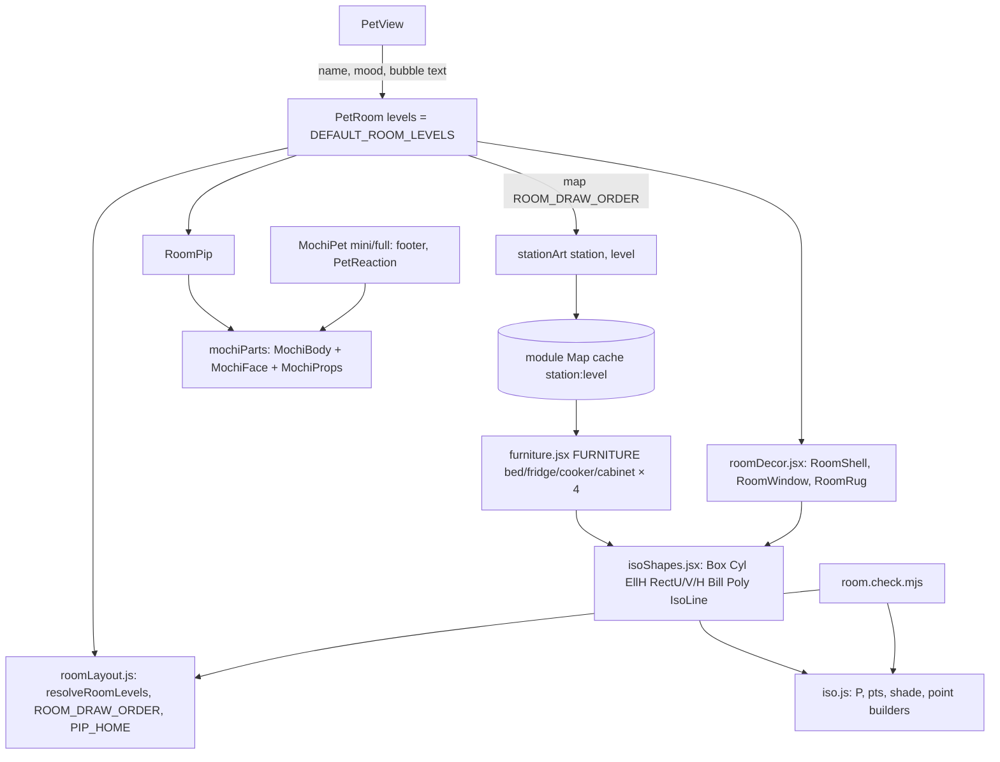

# Plan: Room scaffold — 3D corner room engine and furniture catalogue on the Pet page

Plan folder: `.claude/contract/MPP-16-pip-room-scaffold/`
Execution status: see `tasks.md` in this folder.

---

## Part 1 — Alignment

### Task reference
Jira **MPP-16** (Task, High, parent epic MPP-15). Blocks MPP-17, MPP-19, MPP-21, MPP-23, MPP-25, MPP-31.

Acceptance criteria (verbatim):
1. `/pet` renders an SVG room in place of the CSS room: an angled corner with left wall, right wall and diamond floor, using the mockup's projection in a `0 0 360 330` viewBox.
2. A reusable module (e.g. `components/pet/room/iso.js`) exposes `P(u,v,h)`, `box`, `cyl`, `ellH`, `rectU`/`rectV`/`rectH` and billboard placement, ported from the v5 mockup.
3. A furniture catalogue defines bed, fridge, cooker and trophy cabinet at levels 1–4, using the mockup's art. The room renders level 1 for every station via a `levels` prop that defaults to all 1s.
4. Objects are drawn back-to-front: the fridge (nearer) overlaps the cooker, never the reverse (regression from mockup v3).
5. The window, rug and Pip (on the rug, current mood face via the existing `MochiFace`) appear. Speech bubble top-right, inside the room.
6. At 320 px width there is no horizontal scroll and the room scales with the card. Footer tab and `PetReaction` are unchanged.

Scope (ticket): in — iso engine module, furniture catalogue (4 stations × 4 levels), `PetRoom` component, removing the `.pet-room*` CSS, Pip placed on the rug. Out — Pip moving, animations, fridge tap, cabinet tap, empty decor spots, any backend change.

Ticket notes: frontend only, no migration; Task → MINOR bump; art source is mockup v5 (visual tweaks go to the polish ticket MPP-29); risk "SVG polygon count on low-end phones — render once and memoise per level set"; Skill: react-frontend.

Upstream inputs (read, not moved): `.claude/contract/specs/2026-10-13-pip-room-spec.md` (Phase A spec shared by MPP-16…19) and `.claude/contract/MPP-15-epic-breakdown/mockups/pip-room-mockup-v5.html` (geometry + art source: `P`, `box`, `cyl`, `ellH`, `rectU/V/H`, `bill`, `FRIDGE`, `STOVE`, `CABINET`, `BED`, `isoWindow`, `roomSvg`).

### Restated goal
Replace the flat CSS backdrop behind Pip on `/pet` with a static SVG room: an angled two-wall corner with a diamond floor, projected exactly as the v5 mockup does. The drawing math becomes a small reusable isometric module, and the four upgradeable stations (bed, fridge, cooker, trophy cabinet) become a data catalogue with all four levels' art from the mockup — so later tickets only ever pass a level number. The room renders every station at level 1, draws back-to-front (fridge over cooker), shows the window and rug, and stands Pip on the rug wearing his current mood face, with his speech bubble moved to the room's top-right. Nothing moves, nothing is tappable, nothing new is fetched.

### In scope
- Pure isometric geometry module `components/pet/room/iso.js` (projection `P`, point builders, `shade`) plus JSX primitives (`Box`, `Cyl`, `EllH`, `RectU`/`RectV`/`RectH`, `Bill`, `Poly`, `IsoLine`).
- Furniture catalogue: bed, fridge, cooker, cabinet × levels 1–4 ported from mockup v5, plus the per-level anchor points later tickets need (fridge top, cooker pot, plate spot, bed top).
- Room shell + decor: left wall, right wall, floor, corner line, skirting, day window, rug.
- `PetRoom` component with a `levels` prop defaulting to all 1s, a fixed back-to-front draw order, Pip on the rug, speech bubble top-right.
- `MochiBody` extracted from `MochiPet` so the room reuses Pip's body geometry (footer/`PetReaction` render identically).
- Remove `.pet-room`, `.pet-room-window`, `.pet-room-shelf`, `.pet-room-jar*` and the now-unused `.pet-stage` CSS; reposition `.pet-bubble`.
- A `node` self-check (`room.check.mjs`, `npm run check:room`) pinning the projection, level normalisation and draw order.
- Version bump (Task → MINOR) + CHANGELOG.

### Explicitly out of scope
- Pip walking / position by time of day / sleep face / night dimming (MPP-17).
- Cook-and-serve, steam, plate (MPP-18); fridge tap, gauge, fridge view, "tap the fridge" hint (MPP-19).
- Cabinet tap / contents (MPP-23); empty decor spots (MPP-27); levels coming from data (MPP-26).
- Any backend, API, DB or migration change.
- Changes to `MochiPet` `mini` rendering, `PetReaction`, the footer tab, `PetMealsCard`, mood logic.
- The legacy 2D `SPRITES` / `place()` / `slotRect()` code in the mockup — v5's room does not use it.

### Pattern Reference
None supplied beyond the ticket's mockup + spec. Chosen:
- `components/pet/MochiPet.jsx`, `mochiParts.jsx` — SVG component style, `useId` gradient ids, `MOCHI_OUTLINE` colour constant.
- `utils/petMood.js` + `petMood.check.mjs` + `check:pet` script — pure module with a `node:assert` self-check, run via an npm script.
- `constants/pet.js` — `UPPER_SNAKE_CASE` constant maps.
- `react-frontend` SKILL.md — file order, ≤400 lines per file, no `useMemo`/`memo` without profiling, plain per-component CSS, 44px/a11y rules.

### Constraints flagged on the brief
- Frontend only; no new dependency; no migration.
- Projection fixed: `P(u,v,h) = [180 − u·cos + v·cos, 180 + (u+v)·sin − h]`, slope 70/180, viewBox `0 0 360 330`.
- Fridge must overlap cooker, never the reverse.
- No horizontal scroll at 320 px; room scales with the card.
- Footer tab and `PetReaction` unchanged.
- Render cost on low-end phones: render once per level set.
- Guests still see no room (existing `PetView` gate untouched).

### Assumptions made
- **Spec stays in `specs/`, not moved into this folder.** It is the shared Phase A spec for MPP-16…19; moving it would break the later tickets' references. Cited above instead.
- **Geometry split into `iso.js` (pure, no JSX) + `isoShapes.jsx` (JSX).** Vite only parses JSX in `.jsx`, and a pure module is what lets `node` self-check the projection. AC 2's `box`/`cyl`/`ellH`/`rectU/V/H`/billboard are exposed as components `Box`/`Cyl`/`EllH`/`RectU/V/H`/`Bill` (React naming); `P` keeps its name in `iso.js`.
- **"Render once, memoise per level set" is met with a module-level element cache, not `useMemo`/`React.memo`.** The skill forbids memo hooks without profiling; caching each `(station, level)` element at module scope gives the same effect, since React skips a subtree whose element is the same reference.
- **Station key is `cooker`, not the mockup's `stove`** — matches the ticket and spec wording.
- **Catalogue entries carry anchors now** (`fridgeTop`, `pot`, `plate`, `bedTop`) as plain data in `roomLayout.js`. They aren't rendered here, but MPP-17/18/19 need them, and they come from the same mockup tables (`FRIDGE_TOP`, `PLATE_AT`, `STOVE[].pot`, `BED[].top`).
- **Bed entries keep the mockup's `{ back, front }` split**, rendered back-to-back now, so MPP-17 can slot a sleeping Pip between them without touching the catalogue.
- **Pip keeps his mood props and idle mood animation in the room** (`MochiProps` sparkles / thought bubble / takeaway box, `.mochi-anim` bob). AC 5 names only the face, but dropping the props would quietly remove MPP-14's per-mood visuals from `/pet`. The idle bob is existing behaviour, not the "Pip moving" that is out of scope.
- **Window is day-only.** The night variant belongs to MPP-17.
- **Room `aria-label` uses the pet's name and mood label**, e.g. "Mochi's room — Mochi is content", built from `pet.name` and `PET_MOOD_LABELS`.
- **New CSS uses the `pip-room` prefix**, so the ticket's "remove `.pet-room*`" stays literally true and greppable.
- **Check script lives next to its module** (`room/room.check.mjs`, `npm run check:room`), mirroring `petMood.check.mjs` beside `petMood.js`.
- **Unknown or out-of-range levels fall back to 1** (`resolveRoomLevels`), so a bad value from a future shop ticket can't crash the page.

### Cross-code alignment audit (FE ↔ BE ↔ DB)
Skipped — no persistence touched. The room reads only `pet.name` and `mood`, which `PetContext` already exposes; no DTO, column or endpoint changes.

---

## Part 2 — Technical design

### Approach
The mockup builds SVG by string concatenation. The port keeps its math byte-for-byte but splits it in two layers. `room/iso.js` is pure JavaScript: the constants `ISO_C`/`ISO_S`, `P(u,v,h)`, `pts()` (point-array → `points` string, 1-dp like the mockup), `shade(hex, pct)`, and point builders (`boxFaces`, `rectVPoints`, `rectUPoints`, `rectHPoints`, `ellipsePoints`, `cylinderSidePoints`). `room/isoShapes.jsx` turns those into small JSX components with the mockup's stroke (`MOCHI_OUTLINE`, 1.6 width): `Poly`, `IsoLine`, `Box` (two sides then top, with the mockup's −6/−20/+14 shading), `RectU/V/H`, `EllH`, `Cyl`, and `Bill` (a `<g translate>` at `P(u,v,h)` for billboards like trophies and knobs). Keeping the math pure lets `room.check.mjs` pin it under `node` — the only test harness this client has.

The furniture is data. `room/furniture.jsx` exports `FURNITURE = { bed, fridge, cooker, cabinet }`, each a 4-element array of zero-arg functions returning JSX, ported from `BED`, `FRIDGE`, `STOVE` and `CABINET` (and `trophy`/`ribbon` as `Trophy`/`Ribbon` billboards). Bed returns `{ back, front }`; the others return a single element. `stationArt(station, level)` wraps the catalogue with a module-level `Map` cache keyed `station:level`, so each level's polygons are built once per page load and React sees the same element reference on every re-render (`PetContext` re-renders every minute via `useMinuteClock`). `room/roomLayout.js` holds the pure layout data: `ROOM_DRAW_ORDER = ['cooker', 'fridge', 'cabinet', 'bed']`, `PIP_HOME = [100, 85]`, `PIP_SCALE = 0.46`, the per-level anchors, and `resolveRoomLevels(levels)`. The draw order is data and `PetRoom` maps over it, so AC 4 is enforced by one array the check pins rather than by JSX ordering someone might shuffle.

`room/roomDecor.jsx` draws the static shell exactly as `roomSvg()` does: left wall, right wall, floor, the vertical corner line, skirting polyline, the day window (`isoWindow(false)`), and the rug (`ellH` + dashed inner ring). `room/RoomPip.jsx` places Pip at `P(...PIP_HOME)` using the mockup's `translate(x − 100s, y − 188s) scale(s)` transform and renders the shared body: `MochiBody` is extracted from `MochiPet` into `mochiParts.jsx`, so `MochiPet` (footer, `PetReaction`) and the room draw from one geometry and the mini render is unchanged. `room/PetRoom.jsx` composes it all in a `0 0 360 330` `<svg role="img">` sized `width: 100%; height: auto`, so it scales with the card and can't scroll at 320 px. Order: shell → window → rug → stations in `ROOM_DRAW_ORDER` → Pip last. The speech bubble stays an HTML `<p class="pet-bubble" aria-live="polite">` overlaid top-right.

Alternatives rejected: **keeping string-built SVG with `dangerouslySetInnerHTML`** is the fastest port, but the skill bans it without review and it would stop us reusing `MochiFace`. **One `iso.jsx` module holding math and JSX together** matches AC 2's wording more literally, but nothing could then check the projection under `node`. **`useMemo` on the furniture layer** is what the ticket's risk note suggests, but the skill forbids memo hooks without profiling, and the module cache gives the same render-once result with no hook. **Sorting stations by computed depth (`u+v`)** looks principled, but at level 4 the cooker's footprint (u 48–142) overlaps the fridge's (u 124–188), so a depth sort could flip them; a fixed order taken from the mockup is what was visually approved.

### Skills to invoke during execution
- `react-frontend` — owns every file in this change: component/file structure, ≤400-line budget (measure each new file), no memo hooks, plain per-component CSS, a11y on the SVG, no new dependency.

Rules read: none apply — no recipes, ingredients, macros, meal-plan data or migrations are touched.

### Diagram


### Data shapes

#### `src/constants/petRoom.js` (new)
```js
export const ROOM_STATIONS = { BED: 'bed', FRIDGE: 'fridge', COOKER: 'cooker', CABINET: 'cabinet' }
export const ROOM_MIN_LEVEL = 1
export const ROOM_MAX_LEVEL = 4
export const DEFAULT_ROOM_LEVELS = { bed: 1, fridge: 1, cooker: 1, cabinet: 1 }
export const ROOM_VIEWBOX = '0 0 360 330'
```

#### `src/components/pet/room/iso.js` (new, pure)
```js
export const ISO_C, ISO_S               // 180/hypot(180,70), 70/hypot(180,70)
export function P(u, v, h = 0)          // → [x, y]
export function pts(points)             // [[x,y],…] → "x,y x,y" (toFixed(1))
export function shade(hex, pct)         // '#rrggbb', ±pct → 'rgb(r,g,b)'
export function boxFaces(u, v, du, dv, h0, h1) // → { front: pts[], side: pts[], top: pts[] }
export function rectVPoints(vp, u0, u1, h0, h1)
export function rectUPoints(up, v0, v1, h0, h1)
export function rectHPoints(h, u0, u1, v0, v1)
export function ellipsePoints(cu, cv, h, ru, rv, steps = 24)
export function cylinderSidePoints(cu, cv, r, h0, h1)
```
`boxFaces.front` = plane `u = u+du` (mockup's first face, shade −6), `side` = plane `v = v+dv` (shade −20), `top` = height `h1` (shade +14).

#### `src/components/pet/room/isoShapes.jsx` (new)
`Poly({ points, fill, ...rest })`, `IsoLine({ points, width = 1.6, color = MOCHI_OUTLINE })`, `Box({ u, v, du, dv, h0, h1, color })`, `RectV({ vp, u0, u1, h0, h1, fill, ...rest })`, `RectU({ up, v0, v1, h0, h1, fill, ...rest })`, `RectH({ h, u0, u1, v0, v1, fill, ...rest })`, `EllH({ cu, cv, h, ru, rv, fill, ...rest })`, `Cyl({ cu, cv, r, h0, h1, color })`, `Bill({ u, v, h, children })`. `...rest` carries the mockup's per-shape overrides (`stroke`, `strokeWidth`, `strokeDasharray`).

#### `src/components/pet/room/roomLayout.js` (new, pure)
```js
export const ROOM_DRAW_ORDER = ['cooker', 'fridge', 'cabinet', 'bed']     // back → front
export const PIP_HOME = [100, 85]                                         // rug centre (u, v)
export const PIP_SCALE = 0.46
export const RUG = { cu: 100, cv: 85, ru: 58, rv: 44 }
export const STATION_ANCHORS = {
  fridgeTop: [[166, 14, 34], [166, 17, 58], [163, 19, 112], [156, 20, 120]],
  cookerPot: [[118, 15, 46], [80, 19, 70], [92, 20, 80], [90, 20, 82]],
  cookerPlate: [[100, 22, 26], [106, 19, 55], [118, 20, 62], [112, 20, 63]],
  bedTop: [[48, 148, 5], [50, 148, 30], [40, 148, 30], [40, 148, 30]]
}
export function resolveRoomLevels(levels) // → { bed, fridge, cooker, cabinet } each an int in 1..4, default 1
```

#### `src/components/pet/room/furniture.jsx` (new)
```js
export const FURNITURE = {
  fridge:  [() => <>…</>, …×4],
  cooker:  [() => <>…</>, …×4],
  cabinet: [() => <>…</>, …×4],
  bed:     [() => ({ back: <>…</>, front: <>…</> | null }), …×4]
}
export function stationArt(station, level) // cached; bed → { back, front }, others → element
```

#### `src/components/pet/mochiParts.jsx` (modified)
`export function MochiBody({ fill })` — the two feet ellipses, body path and highlight now inline in `MochiPet` (`BODY_STROKE` moves with them).
`export function MochiGradient({ id })` — the `<linearGradient>` now inline in `MochiPet`, shared so `RoomPip` doesn't duplicate it. *(Added 2026-10-13 while writing tasks.md.)*

#### `src/components/pet/room/PetRoom.jsx` (new)
```jsx
<PetRoom name={string} mood={PET_MOODS value} bubble={string} levels={DEFAULT_ROOM_LEVELS} />
```
Renders `<div class="pip-room"><svg class="pip-room-svg" viewBox={ROOM_VIEWBOX} role="img" aria-label="{name}'s room — {name} is {mood label}">…</svg><p class="pet-bubble" aria-live="polite">{bubble}</p></div>`.

#### `src/components/pet/room/RoomPip.jsx` (new)
`<RoomPip mood={…} />` → `<g transform=…><g class="mochi-pet mochi-mood-{mood}"><defs gradient/><shadow/><g class="mochi-anim"><MochiBody/><MochiFace/></g><MochiProps/></g></g>`.

#### CSS
- `room/PetRoom.css` (new): `.pip-room { position: relative; border-radius: 20px; overflow: hidden; box-shadow: var(--shadow-md); background: #ece5fb }`, `.pip-room-svg { display: block; width: 100%; height: auto }`.
- `PetView.css`: delete `.pet-room`, `.pet-room-window(::after)`, `.pet-room-shelf`, `.pet-room-jar(--small)`, `.pet-stage`, `.pet-stage .mochi-pet`; `.pet-bubble` moves to `top: 10px; right: 10px; left: auto; max-width: min(190px, 55%); font-size: 0.8rem`, tail `::after` moves to `left: 20px` so it still points down-left towards Pip on the rug. *(Corrected 2026-10-13 after approval, while writing tasks.md: the approved draft said `right: 32px`, which would point away from Pip.)*

#### `package.json`
`"check:room": "node src/components/pet/room/room.check.mjs"`.

### Runtime quality notes
Frontend-only, mapped onto the browser runtime.
- **Resource cleanup:** No effects, timers, listeners or requests are added. Trivial — no concerns.
- **Concurrency / ordering:** Single-threaded render; no shared mutable state except the module `Map` cache, which is written once per key and never invalidated (catalogue art is constant). Trivial.
- **Allocation / cost behaviour:** Level-1 room ≈ 60 polygons + Pip. Built once per `(station, level)` into the module cache; the minute-clock re-render of `PetContext` reuses the same element references, so React skips the furniture subtrees. Shell/decor are static elements hoisted to module constants for the same reason. No bundle growth beyond ~15 KB of source; no new dependency.
- **Error paths:** No async surface — the four async states stay owned by `PetView`'s existing loading/error/guest branches. Bad `levels` input (missing key, 0, 7, `'2'`, `NaN`) normalises to a valid int via `resolveRoomLevels` rather than indexing `undefined` and throwing during render.

### Risks and judgement calls
- **Memoisation via module cache instead of `useMemo`.** Satisfies the ticket's risk note without breaking the skill's memo-hook ban. If profiling later shows jank, `React.memo` on `PetRoom` is the next lever.
- **`iso.js` + `isoShapes.jsx` split** reads AC 2's "a reusable module" as two files. Red-line if you want one `.jsx` module and no `node` check of the projection.
- **Keeping `MochiProps` and the idle bob in the room** goes beyond AC 5's "mood face". At 0.46 scale the bored thought bubble and the mischievous takeaway box sit close to the rug's edge; if they clash with the furniture, the polish ticket (MPP-29) can drop them.
- **Fixed draw order rather than a depth sort** — see Approach. Safe for the four fixed stations; MPP-27 decor will need to slot items into this array, not sort.
- **Bubble overlaps the right wall/window at 320 px.** Same as the approved mockup; capped at 55 % width.
- **`MochiPet` `full` variant becomes unused** once `PetView` switches to `PetRoom`. Left in place: deleting it is not in this ticket's scope, and MPP-31 (glow-up) may reuse it. `npm run build` will not flag it.
- **Uncommitted MPP-33 work is in the working tree** on `feature/MPP-15-pip-room` (including `package.json`, `pom.xml` and `CHANGELOG.md`). The M.1 bump must read the current version at apply time and stack on top of MPP-33's line, not replace it.
- **No manual DB step.** The developer's only manual step is a visual check of `/pet` at 320 px and desktop.
