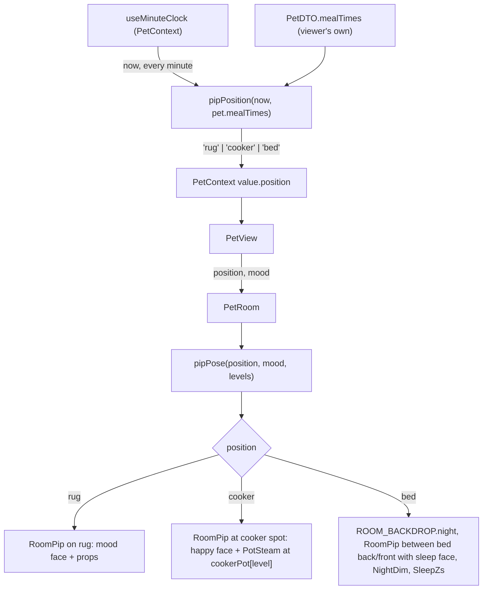

# Plan: Pip's daily routine — rug, cooker at meal times, asleep in bed at night

Plan folder: `.claude/contract/MPP-17-pip-daily-routine/`
Execution status: see `tasks.md` in this folder.

---

## Part 1 — Alignment

### Task reference
Jira **MPP-17** (Story, High, parent epic MPP-15; blocked by MPP-16 and MPP-33, blocks MPP-18). Breakdown: `.claude/contract/MPP-15-epic-breakdown/tasks.md` → T2. Design asset: `.claude/contract/MPP-15-epic-breakdown/mockups/pip-room-mockup-v5.html` → "Time of day" switch.

Acceptance criteria (verbatim):
1. A pure helper `pipPosition(now, mealTimes)` returns `rug | cooker | bed`, with a `.check.mjs` next to `petMood.check.mjs`.
2. **Cooker:** 30 min before to 30 min after each breakfast/lunch/dinner time. **Bed:** dinner time + 3 h until breakfast time − 1 h. **Rug:** otherwise.
3. With times 08:00/13:00/19:00: 12:45 → cooker, 15:00 → rug, 23:00 → bed, 06:30 → bed, 07:15 → rug (all in the check file).
4. Asleep: new `sleep` face added to `MochiFace`, the room dims, the window shows a moon and "z z" floats above Pip.
5. At the cooker Pip shows the happy face and the pot steams. Position updates on the minute via `useMinuteClock`.
6. `prefers-reduced-motion` disables the steam and z animations.

Scope (ticket): in — position helper + checks, sleep face, night scene, cooker idle scene. Out — the walk/cook sequence on a logged meal (MPP-18), mood logic changes.
Dependencies & risks (ticket): default windows ±30 min and dinner + 3 h are named constants in `constants/pet.js`; meal times are the **viewer's own** (per-person Pip, MPP-33), not the meal-plan owner's; skill react-frontend.

### Restated goal
Pip stops standing on the rug all day. A pure, node-checkable helper turns the viewer's own meal times and the current minute into one of three spots. Around each meal time Pip stands at the cooker, wearing a happy face, while the pot steams. From three hours after dinner until an hour before breakfast he lies asleep in his bed with a new sleep face, the room dims, the window turns to a night sky with a moon, and "z z" floats above him. The rest of the time he stays on the rug wearing his MPP-14 mood. The room re-reads the position every minute from the clock `PetContext` already runs, and every new animation stops under reduced motion. Mood rules, the bubble text and the mood chip don't change.

### In scope
- `utils/pipPosition.js` (`pipPosition(now, mealTimes)`) plus `utils/pipPosition.check.mjs` and a `check:pip` npm script.
- Named routine constants (`PIP_POSITIONS`, cooker window, bed offsets, the `sleep` face key, per-position a11y labels) in `constants/pet.js`.
- A `sleep` case in `MochiFace`.
- Night scene: a night window (dark glass, moon, star), a full-room dim overlay and floating "z z" above the bed.
- Cooker idle scene: Pip at the cooker spot with a happy face and animated steam over the pot at the cooker's current level.
- Sleeping Pip drawn between the bed's back and front layers (the split MPP-16 left for this ticket), at the bed level's anchor.
- `PetContext` exposes `position`, `PetView` passes it to `PetRoom`, and the room's `aria-label` names the position.
- A pure `pipPose(position, mood, levels)` in `roomLayout.js`, pinned in `room.check.mjs`.
- Reduced-motion rules for the steam and z animations.
- Version bump (Story → MINOR) and a CHANGELOG line.

### Explicitly out of scope
- The walk → cook → serve sequence on a logged meal and the served plate (MPP-18).
- Any change to `derivePetMood`, the speech-bubble copy, the mood chip or `PetMealsCard`.
- Any backend, DTO or schema change. `PetDTO.mealTimes` already carries the caller's own times (MPP-33).
- Walking or transition animations between spots: the position changes instantly on the minute tick.
- Fridge gauge, decor slots or upgrade controls from the mockup (MPP-19, MPP-26, MPP-27).

### Pattern Reference
Supplied: mockup v5 `roomSvg()` / `isoWindow(night)` / `FACES.sleep` / `.steam` CSS, and `utils/petMood.check.mjs` as the check-file pattern. Chosen in addition:
- `components/pet/room/roomLayout.js` + `room.check.mjs` for pure room data and its check (MPP-16).
- `components/pet/room/RoomPip.jsx` and `PetRoom.jsx`'s bed split for placement.
- `hooks/useMinuteClock.js` as consumed in `contexts/PetContext.jsx`.
- `components/pet/MochiPet.css` for the reduced-motion block style.

### Constraints flagged on the brief
- The helper must be pure and exported as `pipPosition(now, mealTimes)` → `'rug' | 'cooker' | 'bed'`.
- The window lengths are named constants in `constants/pet.js`, never literals.
- Meal times are the viewer's own `PetDTO.mealTimes`.
- Position follows `useMinuteClock`.
- `prefers-reduced-motion` stops the steam and z animations.
- Mood logic is untouched.
- There is no frontend test runner. Checks are `node` `.check.mjs` files and `npm run build`.

### Assumptions made
- **Window boundaries:** the cooker window is inclusive at both ends (07:30 and 08:30 are cooker for an 08:00 breakfast). The bed window includes its start and excludes its end (22:00 is bed, 07:00 is rug). *Rationale:* "30 min before to 30 min after" reads inclusive, and AC 3's 07:15 → rug only fixes the bed end as excluded.
- **Precedence: cooker beats bed beats rug.** *Rationale:* a late dinner window must still show cooking. With strictly ordered meal times the two windows only meet in odd setups.
- **Times wrap around midnight.** Cooker distance is measured on a 24-hour circle, so a 23:45 dinner keeps Pip at the cooker until 00:15. The bed window runs from dinner + 3 h to the *next* breakfast − 1 h. If that span is zero or negative (for example dinner 23:00 with breakfast 02:30), Pip never sleeps. *Rationale:* a naive modulo would put Pip in bed nearly all day in that pathological case.
- **Missing or malformed meal times → `rug`.** *Rationale:* this mirrors `derivePetMood`'s NOT_READY guard. A bad DTO must not throw inside `PetProvider`, which has no error boundary.
- **Position is computed in `PetContext`** from the `now` it already holds and exposed as `position`. *Rationale:* this reuses the single minute clock instead of starting a second interval in the view, and it is derived, not new state.
- **Faces:** on the rug, Pip shows his mood face, props and animation, exactly as in MPP-16. At the cooker he shows the happy face with the happy bounce and **no mood props**. In bed he shows the `sleep` face with no props and no idle animation. *Rationale:* AC 5 asks for the happy face. A takeaway box or thought bubble beside the cooker would read as noise, and the mockup draws stove and bed Pip without props.
- **The bubble and chip keep showing the mood**, even while Pip is asleep. *Rationale:* the ticket rules out mood changes, and the bubble is the logging nudge. The mockup's "Zzz…" / "Cooking time!" bubbles are demo copy, not ACs. See Risks.
- **Geometry comes from the mockup:** cooker spot `[96, 64]` (`PIP_STOVE`), sleeping Pip at `STATION_ANCHORS.bedTop[level − 1]`, 4 px lower, at scale 0.36, steam at `STATION_ANCHORS.cookerPot[level − 1]`, z's at bed top + 30 height, dim `rgba(30,20,80,.38)`. These constants live in `roomLayout.js`, beside the other room geometry. The routine timings stay in `constants/pet.js`, as the ticket asks.
- **The z animation is new.** The mockup's z's are static, but AC 6 implies they animate. They get a gentle float, and the steam reuses the mockup keyframes.
- **The new check runs as `npm run check:pip`**, a sibling of `check:pet` and `check:room`.
- **Draw order:** the night overlay comes after all stations, so it dims sleeping Pip too, as in the mockup. The z's draw above the overlay. Awake Pip always draws last.

### Cross-code alignment audit (FE ↔ BE ↔ DB)
Skipped — no persistence touched. The only data input is the existing `PetDTO.mealTimes`. Confirmed in code that it is already the caller's own: `PetDTO.java:17` `private MealTimesDTO mealTimes;   // the caller's effective meal times (MPP-13 shape)`. It is consumed as `pet?.mealTimes` in `PetContext.jsx:113`, with keys `breakfastBy` / `lunchBy` / `dinnerBy` per `constants/pet.js` → `PET_MEAL_TIME_KEY`. No DB query was needed.

---

## Part 2 — Technical design

### Approach
The ticket splits into one pure decision and some purely presentational scenery. The decision is `pipPosition(now, mealTimes)` in `utils/pipPosition.js`, a sibling of `petMood.js`. It converts each `"HH:mm"` to minutes of the day and checks the cooker windows first, using circular distance so windows that cross midnight work. It then checks the bed window, by mapping `now` onto a 24-hour span that starts at dinner and testing `[dinner + 3 h, next breakfast − 1 h)`. Otherwise it returns `rug`. It has no JSX and imports only `constants/pet.js`, so `pipPosition.check.mjs` can pin AC 3's five cases plus the boundary and malformed-input cases under plain `node`.

`PetContext` already re-renders every minute through `useMinuteClock`. It now also computes `position = pipPosition(now, pet?.mealTimes ?? null)` and exposes it, and `PetView` passes it into `PetRoom`. Inside the room, a second pure function, `pipPose(position, mood, levels)` in `roomLayout.js`, turns the position into what to draw: the face key, whether mood props show, the floor anchor `[u, v, h]`, the scale and the vertical nudge. `RoomPip` becomes a dumb renderer of a pose instead of hard-coding `PIP_HOME`. Keeping this mapping pure means `room.check.mjs` can pin "bed → sleep face at the bed anchor for that level" without rendering anything.

The scenery hangs off `PetRoom`'s existing structure. `ROOM_BACKDROP` becomes `{ day, night }`, two module-level constants built once from one builder whose only difference is the window: dark glass, moon and star at night. Each therefore still never re-diffs. A new `roomEffects.jsx` holds three small SVG pieces: `PotSteam` (drawn right after the cooker art, before the fridge, as in the mockup), `NightDim` (a full-viewBox rect after all stations) and `SleepZs` (above the dim). `Station` already returns the bed as `back` and `front`, so a sleeping Pip slots between them. The animations live in `PetRoom.css` with a `prefers-reduced-motion` block, matching `MochiPet.css`.

Roads not taken:
- **A `usePipPosition` hook in `PetView` with its own `useMinuteClock`.** It would run a second interval for the same minute and could disagree with the mood for up to a tick.
- **A CSS class toggle on the whole room for night**, such as a filter or `opacity`. The window art itself has to change, and a CSS filter would also tint the HTML speech bubble.
- **Folding `sleep` into `PET_MOODS`.** That would leak into `PET_MOOD_LABELS`, the chip and `derivePetMood`, which the ticket forbids touching. `sleep` is a face, not a mood.

### Skills to invoke during execution
- `react-frontend` — owns every file in this change: component structure, file order, constants in `src/constants/`, reduced-motion and a11y, no `console.log`, the 400-line budget, and the no-test-runner verification rules.

Rules files: none apply. This change touches no recipes, ingredients, macros, meal-plan data or migrations.

### Diagram


### Data shapes

#### `constants/pet.js` (additions)
```js
export const PIP_POSITIONS = { RUG: 'rug', COOKER: 'cooker', BED: 'bed' }

// MPP-17 AC 2: retune here.
export const PIP_COOKER_WINDOW_MIN = 30          // ± around each meal time
export const PIP_BED_AFTER_DINNER_MIN = 180      // asleep from dinner + 3 h
export const PIP_WAKE_BEFORE_BREAKFAST_MIN = 60  // awake from breakfast − 1 h

// A face, not a mood: never in PET_MOODS / PET_MOOD_LABELS.
export const PET_SLEEP_FACE = 'sleep'

export const PIP_POSITION_LABELS = { cooker: 'at the cooker', bed: 'asleep in bed' }
```

#### `utils/pipPosition.js`
```js
/** @returns {'rug'|'cooker'|'bed'} */
export function pipPosition(now /* Date */, mealTimes /* PetDTO.mealTimes | null */)
```
Internals (private): `toMinutes(hhmm) → number | null` (accepts `"HH:mm"` and `"HH:mm:ss"`, returns null on anything non-string or out of range), `MINUTES_PER_DAY = 1440`, circular distance for the cooker windows, and a dinner-anchored span for bed.

#### `components/pet/room/roomLayout.js` (additions)
```js
export const PIP_COOKER_SPOT = [96, 64]    // mockup PIP_STOVE, floor coords
export const PIP_BED_SCALE = 0.36
export const PIP_BED_DROP = 4              // px lower than the bed-top point
export const SLEEP_Z_LIFT = 30             // z's float this far above bedTop h
export const NIGHT_DIM_FILL = 'rgba(30,20,80,.38)'

/**
 * @returns {{ face: string, showProps: boolean, anchor: [number, number, number], scale: number, dropPx: number }}
 */
export function pipPose(position, mood, levels)
// rug    → { face: mood,           showProps: true,  anchor: [...PIP_HOME, 0],               scale: PIP_SCALE,     dropPx: 0 }
// cooker → { face: PET_MOODS.HAPPY, showProps: false, anchor: [...PIP_COOKER_SPOT, 0],        scale: PIP_SCALE,     dropPx: 0 }
// bed    → { face: PET_SLEEP_FACE,  showProps: false, anchor: STATION_ANCHORS.bedTop[bed − 1], scale: PIP_BED_SCALE, dropPx: PIP_BED_DROP }
// unknown position → the rug pose. `levels` is passed through resolveRoomLevels first.
```

#### Component props
- `PetRoom({ name, mood, bubble, position = PIP_POSITIONS.RUG, levels = DEFAULT_ROOM_LEVELS })`
- `RoomPip({ pose })` replaces `RoomPip({ mood })`. The CSS class becomes `mochi-mood-${pose.face}`, so the happy pose bounces and the sleep pose has no animation rule.
- `MochiFace({ mood })` gains a `PET_SLEEP_FACE` case: two closed-eye arcs (`M64 120 Q75 130 86 120`, `M114 120 Q125 130 136 120`, stroke 4.5), a small open mouth (`ellipse 100,146 rx5 ry4` in `MOUTH`) and `Blush opacity 0.55`.
- `roomEffects.jsx` exports `PotSteam({ level })`, `NightDim()` and `SleepZs({ level })`.
- `roomDecor.jsx`: `ROOM_BACKDROP` becomes `{ day: <…/>, night: <…/> }`.
- `PetContext` value gains `position: 'rug' | 'cooker' | 'bed'`.

#### CSS (`PetRoom.css`)
- `.pip-steam` uses `pip-steam 1.2s ease-in-out infinite` (mockup keyframes).
- `.pip-zzz` uses `pip-zzz 2.4s ease-in-out infinite`, a float up with an opacity pulse.
- Both have `transform-box: fill-box`, and both get `animation: none !important` under `@media (prefers-reduced-motion: reduce)`.

#### npm
`"check:pip": "node src/utils/pipPosition.check.mjs"` in `client/package.json`.

### Runtime quality notes
(Mapped onto the browser runtime: single-threaded render, effect cleanup and re-render cost.)
- **Resource cleanup:** no new timers, listeners or requests. The only clock is the existing `useMinuteClock` in `PetContext`, which already clears its interval and visibility listener.
- **Concurrency / ordering:** none. `position` is derived synchronously from `now` and `pet` in the same render as the mood, so the two can't disagree. A pet refetch that changes the meal times re-derives on the next render.
- **Allocation / cost behaviour:** `pipPosition` does a few integer operations per minute. `pipPose` allocates one small object per render. Both backdrops are module constants, so React doesn't re-diff the walls. Re-renders stay at once a minute, as today. No memoisation is added, per the skill.
- **Error paths:** null or malformed `mealTimes` returns `rug` with no throw, which the check file covers. An unknown `position` falls back to the rug pose in `pipPose`. `PetView`'s existing loading and error states are unchanged: the room only renders once `pet` exists.

### Risks and judgement calls
- **Bubble while asleep:** Pip can be asleep while the bubble says "Did dinner happen? I'm getting bored…". That is deliberate, because mood and bubble are out of scope, but it may look odd at 23:00. If you would rather have a "Zzz…" bubble at night, say so now. It is a small change, but it touches bubble copy that the ticket fences off.
- **Mood props hidden off the rug:** at the cooker Pip loses the mischievous takeaway box and the bored thought bubble. The mood is still visible on the chip and bubble.
- **`position` lives in the global `PetContext`.** It is pet-feature state in the pet's own context, not a new global store, and it reuses the single clock.
- **`RoomPip` prop change (`mood` → `pose`):** its only caller is `PetRoom`, but MPP-18's walk sequence will build on this pose shape. Check it fits that plan.
- **Midnight and degenerate windows** are my reading, not the ticket's. The check file pins them so a red-line is a one-line change.
- **Uncommitted predecessors:** MPP-16 and MPP-33 are in `Ready for Test` and still uncommitted on `feature/MPP-15-pip-room`. This contract edits the same files (`PetRoom.jsx`, `RoomPip.jsx`, `roomDecor.jsx`, `PetContext.jsx`). Consider committing them first so this diff reviews cleanly.
- **No manual DB step.** It is a frontend-only change, so you only need to check it visually on `/pet` (Task in the final phase).
