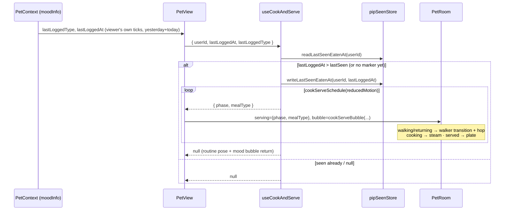

# Plan: Pip cooks and serves after a meal is logged as eaten

Plan folder: `.claude/contract/MPP-18-pip-cook-and-serve/`
Execution status: see `tasks.md` in this folder.

---

## Part 1 — Alignment

### Task reference
Jira **MPP-18** (Story, High, parent epic MPP-15; blocked by MPP-17 and MPP-33, both Ready for Test; blocks MPP-28). Breakdown entry: `.claude/contract/MPP-15-epic-breakdown/tasks.md` → T3. Phase A spec: `.claude/contract/specs/2026-10-13-pip-room-spec.md` (left in `specs/` because it covers MPP-16 to MPP-19, not only this ticket).

Acceptance criteria, verbatim:

1. On `/pet`, each breakfast/lunch/dinner entry **the viewer** marked eaten since this browser last saw the room plays the sequence once:
   - Pip hops rug → cooker (~1.3 s).
   - He cooks with the pot steaming (~2 s).
   - A plate appears on the counter with "<Meal> is served! 🍽️".
   - He hops back.
2. Several new eaten meals play one sequence that names the latest one, not a queue of animations.
3. "Last seen" is per-viewer `localStorage` wrapped in try/catch. If storage is unavailable, at most one replay happens per page load.
4. Reloading after the sequence does not replay it.
5. Under `prefers-reduced-motion` the sequence shows the served state without movement.
6. A linked partner ticking a meal never triggers your Pip's sequence.

Scope: in — the sequence on `/pet`, the "seen" marker, the plate art. Out — an inline animation inside `MealEatenSection` (MPP-29), fridge decrement visuals. Dependencies: eaten ticks are the viewer's own (MPP-33); play only on `/pet`; animation uses CSS transitions on a wrapper `<g>` as in the mockup. Skill: react-frontend. Design asset: `.claude/contract/MPP-15-epic-breakdown/mockups/pip-room-mockup-v5.html` → "Log a meal as eaten" (`logMeal()`, `walk()`, `PLATE_AT`).

### Restated goal
When you open `/pet` after ticking a breakfast, lunch or dinner as eaten, Pip plays a short scene once: he hops from the rug to the cooker, cooks with the pot steaming, puts a plate on the counter while the bubble says "Lunch is served! 🍽️", then hops back and the room returns to its normal routine. Only the newest unseen meal is played, never a queue. The browser remembers per user which meal it last played, so a reload does not replay it. Reduced-motion users see the served state with no movement. Because MPP-33 already makes every `eaten` flag in the meal-plan payload the viewer's own, a partner's tick can never start it. This is frontend only: no endpoint, schema or backend change.

### In scope
- Expose the latest eaten breakfast/lunch/dinner time (`lastLoggedAt`) next to the existing `lastLoggedType` on `moodInfo`, from data `PetContext` already loads (yesterday + today).
- A pure helper module for the sequence: whether to play, the phase schedule (full and reduced-motion), and the bubble text per phase, with a `.check.mjs` and an npm `check:` script.
- A per-user "last seen eaten at" marker in `localStorage`, wrapped in try/catch, with an in-memory fallback so at most one replay happens per page load.
- A `useCookAndServe` hook that runs the timed phases and clears its timers on unmount.
- Room rendering: Pip in a walker `<g>` with a CSS transform transition and a hop while walking, steam while cooking, a served plate on the cooker counter, day scene while the sequence plays, and an aria-label naming the meal.
- `PetView` wiring: the bubble shows the sequence text while it plays.
- Version bump (Story → MINOR) and CHANGELOG line.

### Explicitly out of scope
- Any animation in `MealEatenSection` / next to `PetReaction` (MPP-29).
- Fridge stock or gauge changes (MPP-19).
- Backend, schema or API changes; a server-side "seen" marker.
- Retuning MPP-17's routine positions or timings.
- Changing what counts as eaten, or the mood rules in `petMood.js` (only one extra field is returned).

### Pattern Reference
Supplied by the brief: mockup v5 `logMeal()` / `walk()` (CSS `transition: transform 1.25s` on `#pipg`, `.hop` animation, `PLATE_AT` plate art) and "CSS transitions on a wrapper `<g>`". References chosen to fill the gaps:
- `components/pet/room/roomEffects.jsx` (`PotSteam`, `SleepZs`) is the model for the new `ServedPlate`, drawn with `Bill` at a `STATION_ANCHORS` point. `STATION_ANCHORS.cookerPlate` already exists, copied from the mockup's `PLATE_AT` by MPP-16.
- `utils/pipPosition.js` + `pipPosition.check.mjs` + `check:pip` is the model for the new pure helper and its check.
- `hooks/useMinuteClock.js` is the model for a timer hook with cleanup.
- `contexts/HomemadeSelectionsContext.jsx:43` shows the try/catch `localStorage` style.

### Constraints flagged on the brief
- The viewer's own ticks only (MPP-33). Partner ticks must never trigger the sequence.
- `localStorage` access always inside try/catch. When storage is unavailable, at most one replay per page load.
- `prefers-reduced-motion`: served state, no movement.
- Only `/pet` plays it.
- Phase timing: about 1.3 s walk, about 2 s cooking, a visible served beat, then the walk back.
- From the epic DoD: every animation respects reduced motion, and the room works at phone width with no horizontal scroll.

### Assumptions made
- **Unseen means newer than a stored timestamp, not a set of entry ids.** The marker stores the `eatenAt` (epoch ms) of the last meal played. A meal is unseen when its `eatenAt` is later than the marker. AC 2 only ever plays the latest meal, so one number is enough, and it stays small and never needs pruning.
- **The look-back window is yesterday + today**, the days `PetContext` already holds. A tick from three days ago that was never seen does not play. No extra fetch, and an old meal being "served" now would read oddly anyway.
- **First visit (no marker yet) plays the latest eaten meal in that window.** This matches "since this browser last saw the room" literally, and the window keeps it to at most a day-old meal.
- **Entries without `eatenAt` are ignored.** `buildSlots` already maps a missing `eatenAt` to 0, so `lastLoggedAt` is `null` in that case and nothing plays.
- **The marker is written when the sequence starts, not when it ends.** AC 4 says reloading after the sequence must not replay it. Writing at the start also covers leaving or reloading mid-sequence, at the cost of one interrupted scene never being finished.
- **The storage key is per user:** `foodbytes.pip.lastSeenEatenAt.<user.id>`, using the `id` that `AuthContext` already carries (from `UserDTO.id`). Two people signing in on one browser keep separate markers, which also supports AC 6.
- **The in-memory fallback is a module-level `Map`**, kept for every write whether or not storage works. A route change within the SPA keeps it, and a reload clears it, which gives exactly "at most one replay per page load".
- **The sequence always starts on the rug**, as in the mockup, which forces morning first. If Pip is asleep or already at the cooker for his routine, he appears on the rug, plays the scene, then goes back to his routine pose. The night backdrop, dimming and z's are hidden while it plays.
- **Phase durations come from the mockup:** walking 1300 ms, cooking 2200 ms, served 1600 ms, returning 1300 ms. Reduced motion: served for 2500 ms, then done. All are constants in `constants/pet.js` so they can be retuned in one place.
- **Bubble copy comes from the mockup:** walking "Yay, lunch time! Let me cook 🍳", cooking "Cooking your lunch…", served "Lunch is served! 🍽️", returning "Yum! 💜". After that the mood bubble returns. The fridge-low line is left out, since it belongs to MPP-19.
- **A meal ticked while a sequence is playing is not queued.** It is picked up when the sequence ends and plays then as its own scene. This only happens if a tick arrives through the visibility refetch mid-scene. AC 2 is about several meals unseen *at once*, and those still collapse to one.
- **The sequence state lives in a hook used by `PetView`, not in `PetContext`.** The skill says feature-specific state never goes into a global Context. `PetContext` only gains the one derived field on `moodInfo`.

### Cross-code alignment audit (FE ↔ BE ↔ DB)
Skipped against the live DB: no persistence is touched. Contract checks done in code instead:
- `MealPlanEntryDTO.java:32-33`: `private Boolean eaten; // MPP-33: the CALLER's own tick (a linked partner's never shows)` and `private Instant eatenAt; // ... ISO-8601 UTC`. The frontend reads `entry.eaten` / `entry.eatenAt` in `petMood.js` `buildSlots`. Names match, and AC 6 is met by the payload itself.
- `UserDTO.java:12`: `private Long id;`. `AuthContext` stores the `/api/auth/me` body as `user`, so `user.id` is available for the storage key.
- `useEntryEaten.js:22`: the optimistic tick sets a provisional client-clock `eatenAt` until the PUT returns the server value. That only happens on the meal-plan screen, before `/pet` is opened (see Risks).

---

## Part 2 — Technical design

### Approach
The trigger is derived data, not an event. `derivePetMood` already finds the latest logged slot across yesterday and today (`latestLog`) to name `lastLoggedType`. It will also return that slot's `eatenAt` as `lastLoggedAt`, which is `null` when there is none or when the timestamp is missing. `PetView` passes `user.id`, `lastLoggedAt` and `lastLoggedType` to a new `useCookAndServe` hook. The hook compares `lastLoggedAt` with the stored marker. If it is newer, the hook writes the marker immediately and runs a fixed schedule of phases (`walking → cooking → served → returning`, or just `served` under reduced motion) with chained `setTimeout`s, returning `{ phase, mealType }` or `null`. Several unseen meals collapse to one scene automatically, because only the latest timestamp is compared (AC 2). Deriving from data rather than subscribing to the tick action means a tick made on another device, picked up by the existing visibility refetch, also plays. It also means `/pet` never needs to know where the tick happened.

**Rendering.** `PetRoom` gets an optional `serving` prop. While it is set, the room renders the day scene, and Pip is drawn inside a persistent walker `<g className="pip-walker">`. The walker's inline `style.transform` is `translate(dx px, dy px)` from the walking phase through the served phase, and `none` otherwise (returning, or no scene). CSS `transition: transform 1.25s ease-in-out` turns that change into the hop across the floor, as the mockup's `#pipg` does. While walking or returning, the walker also gets `is-walking`, which adds the `pip-hop` bounce to an inner `<g>`. The offset is `P(PIP_COOKER_SPOT) − P(PIP_HOME)`, computed once as `COOK_WALK_OFFSET` in `roomLayout.js` so `room.check.mjs` can pin it. During the scene RoomPip gets a `cookPose()`: the rug anchor, the happy face and no mood props. Steam shows during `cooking`, reusing `PotSteam`. A new `ServedPlate` effect (plate, food, two garnish dots from the mockup) is drawn at `STATION_ANCHORS.cookerPlate[cookerLevel - 1]` during `served`, right after the cooker art and before the fridge, so the existing back-to-front draw order still holds. The walker `<g>` is rendered in the same place every time Pip is awake. It is never mounted only for the scene, because a node created with its transform already set would not transition.

**Storage.** A small `pipSeenStore.js` module wraps `localStorage` get/set in try/catch and mirrors every write into a module-level `Map`. Reads prefer storage and fall back to the Map. In Node (no `localStorage`) the fallback path runs, so the check script can exercise it.

**Roads not taken.**
- *Firing from `useEntryEaten` or a context event*: this would only catch ticks made in this tab, would need cross-screen plumbing, and would break the "derived, reload-safe" model `petMood.js` already uses.
- *A set of seen entry ids*: more state for no gain, since only the latest meal ever plays.
- *SMIL or the Web Animations API*: the brief names CSS transitions on a wrapper `<g>`, and CSS keeps reduced-motion handling to one media query.
- *Putting `phase` in `PetContext`*: it would rerender every `usePet` consumer (the footer tab, `MealEatenSection`) four times per scene for state only `/pet` uses.

### Skills to invoke during execution
- `react-frontend` — owns every change. It covers the hook-holds-logic / component-renders split, constants in `src/constants/`, try/catch storage, effect cleanup, no `console.log`, the 400-line component budget, reduced-motion CSS, and no frontend test runner (verification is `node` check scripts + `npm run build` + a manual check).

No `.claude/rules/` file applies: the rules cover recipes, ingredients, variants and migrations, and this ticket touches none of them.

### Diagram


### Data shapes

#### `constants/pet.js` additions
```js
// MPP-18: Pip cooks and serves a newly eaten meal on /pet.
export const COOK_PHASES = {
  WALKING: 'walking',
  COOKING: 'cooking',
  SERVED: 'served',
  RETURNING: 'returning'
}

// Mockup v5 logMeal(): walk 1.3 s, cook 2.2 s, plate 1.6 s, walk back.
export const COOK_PHASE_MS = {
  walking: 1300,
  cooking: 2200,
  served: 1600,
  returning: 1300
}

// AC 5: no movement — just the served plate, a little longer.
export const COOK_REDUCED_MOTION_SERVED_MS = 2500

// Per user, so two people on one browser keep their own marker (AC 6).
export const PIP_SEEN_EATEN_STORAGE_KEY = 'foodbytes.pip.lastSeenEatenAt'
```

#### `utils/petMood.js` → `derivePetMood` return shape (one added field)
```js
{ mood, dueCount, todaySlots, lastLoggedType, lastLoggedAt, dueMealType }
// lastLoggedAt: number (epoch ms) | null — eatenAt of latestLog; null when no
// logged slot, or when its eatenAt was missing (buildSlots maps missing → 0).
// NOT_READY gains lastLoggedAt: null.
```

#### `utils/cookServe.js` (new, pure)
```js
/** True when lastLoggedAt is a number and is later than lastSeenAt (null lastSeenAt = never seen). */
export function shouldServe(lastLoggedAt, lastSeenAt): boolean

/** [{ phase, ms }] in play order. reducedMotion → [{ phase: 'served', ms: COOK_REDUCED_MOTION_SERVED_MS }]. */
export function cookServeSchedule(reducedMotion): Array<{ phase: string, ms: number }>

/** Bubble copy per phase; meal label from MEAL_TYPE_LABELS. Unknown phase → null. */
export function cookServeBubble({ phase, mealType }): string | null
//  walking   → `Yay, ${label.toLowerCase()} time! Let me cook 🍳`
//  cooking   → `Cooking your ${label.toLowerCase()}…`
//  served    → `${label} is served! 🍽️`
//  returning → 'Yum! 💜'
```

#### `utils/pipSeenStore.js` (new)
```js
const memory = new Map() // userId → epoch ms; survives route changes, not reloads (AC 3)

/** epoch ms | null. localStorage first (try/catch), memory fallback. Non-numeric stored values → null. */
export function readLastSeenEatenAt(userId): number | null

/** Writes to memory always, and to localStorage inside try/catch. */
export function writeLastSeenEatenAt(userId, eatenAtMs): void

// key = `${PIP_SEEN_EATEN_STORAGE_KEY}.${userId}`
```

#### `hooks/useCookAndServe.js` (new)
```js
/**
 * @param {{ userId: number|null, lastLoggedAt: number|null, lastLoggedType: string|null }} input
 * @returns {{ phase: string, mealType: string } | null}
 */
export function useCookAndServe({ userId, lastLoggedAt, lastLoggedType })
// internal state: run = { mealType, steps: [{phase, ms}], index } | null
// effect A (deps userId, lastLoggedAt, lastLoggedType, run): if !run && userId != null &&
//   shouldServe(lastLoggedAt, readLastSeenEatenAt(userId)) → write marker, setRun({ ..., index: 0 })
// effect B (deps run): setTimeout(run.steps[index].ms) → next index, or null after the last;
//   cleanup clearTimeout. reducedMotion read once per run via
//   window.matchMedia?.('(prefers-reduced-motion: reduce)').matches
```

#### `components/pet/room/roomLayout.js` additions
```js
/** Screen px from Pip's rug spot to his cooker spot — the walker's translate (MPP-18). */
export const COOK_WALK_OFFSET // [dx, dy] = P(...PIP_COOKER_SPOT) − P(...PIP_HOME)

/** The pose during the scene: rug anchor (the walker moves him), happy face, no props. */
export function cookPose()
// → { face: PET_MOODS.HAPPY, showProps: false, anchor: [...PIP_HOME, 0], scale: PIP_SCALE, dropPx: 0 }
```

#### `components/pet/room/roomEffects.jsx` addition
```jsx
/** MPP-18: the served plate on the cooker counter (mockup v5 PLATE_AT art). */
export function ServedPlate({ level }) // Bill at STATION_ANCHORS.cookerPlate[level - 1]
```

#### `PetRoom` props
```js
PetRoom({ name, mood, bubble, position, levels, serving = null })
// serving: { phase, mealType } | null
// aria-label while serving: `${name}'s room — ${name} is cooking your ${label.toLowerCase()}`
```

#### CSS (`PetRoom.css`)
```css
.pip-walker { transition: transform 1.25s ease-in-out; }
.pip-walker.is-walking .pip-hop { animation: pip-hop 0.32s ease-in-out infinite alternate; }
@keyframes pip-hop { to { transform: translateY(-6px); } }
/* reduced motion: .pip-walker { transition: none } and .pip-hop { animation: none } */
```

#### `package.json`
`"check:cook": "node src/utils/cookServe.check.mjs"` (checks `cookServe.js` and `pipSeenStore.js`).

### Runtime quality notes
Frontend-only, so these are mapped onto the browser runtime (single-threaded event loop, effect cleanup, re-render cost).
- **Resource cleanup:** each phase's `setTimeout` is cleared in effect B's cleanup, so unmounting `/pet` mid-scene leaves no timers running and no `setState` after unmount. No event listeners are added. `matchMedia` is read once and not subscribed to.
- **Concurrency / ordering:** effect A only starts a run when `run` is null, so a rerender mid-scene (the minute clock tick, a refetch) cannot restart it. The marker is written before the first phase, so a fast remount (StrictMode double-invoke in dev, or a route bounce) sees it as seen. Two tabs on `/pet` at once could both play the same meal, because the read-then-write is not atomic across tabs. That is accepted as harmless.
- **Allocation / cost behaviour:** four state changes per scene, and they rerender `PetView` and `PetRoom` only, since `PetContext` is untouched. `lastLoggedAt` reuses the `latestLog` that `derivePetMood` already computes. No new requests, and the bundle grows by a few hundred bytes.
- **Error paths:** storage errors (private mode, quota, disabled) are caught and fall back to memory. Nothing is logged, because this is an expected state, not a fault. A non-numeric stored value reads as `null`, which plays once and then overwrites it. Missing `eatenAt` → `null` → no scene. Load and refetch errors keep `PetView`'s existing error and loading states, and the hook only runs once `pet` is loaded, because it lives below those early returns. To satisfy the rules of hooks it is called at the top of `PetView` and gated on `pet` being loaded via `userId`/`lastLoggedAt`, both of which are null-safe.

### Risks and judgement calls
- **Optimistic `eatenAt` skew.** `useEntryEaten` briefly holds a client-clock `eatenAt` until the PUT returns the server time. If `/pet` saw the provisional value first, a later server value could replay the scene once. In practice ticks happen on the meal-plan screen and the PUT finishes before navigating, so this is accepted rather than engineered around.
- **Jump to the rug.** When Pip is asleep or at the cooker for his routine, the scene starts with him jumping to the rug. This follows the mockup (which forces morning first). The alternative, starting the walk from his current spot, needs a different offset per position. Red-line it if the jump looks wrong on the phone.
- **"First visit plays."** With no marker, the latest meal from yesterday or today plays once. If you'd rather the first visit only record silently, it is a one-line change in `shouldServe`.
- **CSS transform on an SVG `<g>` via `style`.** This works in current Chrome, Safari and Firefox (it is what the mockup does), but `px` in a CSS transform on SVG maps to user units. That is correct here only because the viewBox units are what `P()` returns. Verify it on an actual phone during the manual check in `tasks.md`.
- **A scene can be interrupted** by navigating away or reloading mid-scene. The marker is already written, so it will not replay. This matches AC 4's reading of "reloading after".
- **Version bump** is MINOR (Story).
