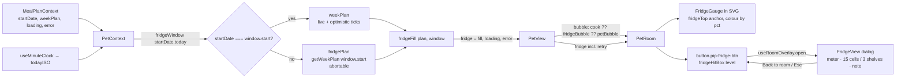

# Plan: Pip's fridge — tap to see how much of this week's planned food is left

Plan folder: `.claude/contract/MPP-19-pip-fridge/`
Execution status: see `tasks.md` in this folder.

---

## Part 1 — Alignment

### Task reference
Jira **MPP-19** (Story, parent epic MPP-15, blocked by MPP-16 and MPP-33, both Ready for Test). Upstream: spec `.claude/contract/specs/2026-10-13-pip-room-spec.md` (Fridge view section), breakdown `.claude/contract/MPP-15-epic-breakdown/tasks.md` T4, mockup `.claude/contract/MPP-15-epic-breakdown/mockups/pip-room-mockup-v5.html` (`stockGauge`, `fridgeHtml`, `.overlay.fridge`, `.hint`).

Acceptance criteria (verbatim):

1. Pure helper `fridgeFill(weekPlan, today)` returns `{ planned, remaining, pct, filledSlots }`, with a `.check.mjs`.
   - `planned` = breakfast/lunch/dinner entries in the fridge window, from the shared plan.
   - `remaining` = those **the viewer** has not yet marked eaten.
   - `filledSlots = round(15 × remaining / planned)`, at least 1 while `remaining > 0`, and 0 when nothing is planned.
2. 21 planned and 6 eaten → "71% full · 15 of 21 planned meals left", with 11 of 15 slots filled.
3. Tapping the fridge (a real button, keyboard-reachable) opens a full-screen fridge view inside the room card with 15 slots on 3 shelves and "Back to room". Focus returns to the fridge on close.
4. A gauge on top of the fridge shows the same %: green above 50 %, amber above 20 %, red at 20 % or below. At 20 % or below Pip's idle bubble says "The fridge is getting empty 👀".
5. The note text covers fully stocked / plenty left / running low / empty. Nothing planned shows an empty fridge with "Plan your week to stock the fridge".

Scope from the ticket. **In:** fill helper + checks, gauge, fridge view, low-stock bubble. **Out:** linking to real shopping-list items, refill on "shopping done" (refill is implicit from the plan), fridge upgrades (MPP-26).

Dependencies & risks from the ticket: per person (planned from the shared plan, eaten from the viewer's own ticks, MPP-33). The default fridge window is the meal-plan week containing today, using the meal-plan page's start day, kept in one helper so it is easy to change. The plan is read through `PetContext`/`MealPlanContext` with no new fetch. Skill: react-frontend.

### Restated goal
Pip's fridge on `/pet` becomes a live, tappable gauge of how much of this week's planned food is left. A pure helper works out the fridge window: the 7 days containing today, lined up with the meal-plan page's start day. A second pure helper counts the window's breakfast/lunch/dinner entries and how many of them the viewer has not ticked eaten. From that come a %, a 0–15 slot count, a gauge colour band and the note copy. The room draws a small coloured gauge on the fridge (level-aware). An HTML button over the fridge opens a full-card fridge view: a meter line, 15 food cells on 3 shelves, the note, and "Back to room". Focus returns to the fridge when it closes. At 20 % or below, Pip's idle bubble warns that the fridge is getting empty. Everything is derived on render from data the app already holds. There are no backend or schema changes.

### In scope
- `utils/fridgeFill.js` with `fridgeWindow`, `fridgeFill`, `fridgeBand`, `fridgeNote`, `fridgeBubble`, pinned by `utils/fridgeFill.check.mjs` and an `npm run check:fridge` script.
- Fridge constants in `constants/petRoom.js`: slot count, shelves, food emoji, thresholds, gauge colours, copy.
- `PetContext` exposes `fridge = { fill, loading, error }`, reading the calendar's live `weekPlan` when it is the fridge week.
- A level-aware `FridgeGauge` drawn on the fridge in the room SVG.
- A level-aware fridge hit box (`fridgeHitBox(level)` in `roomLayout.js`, pinned in `room.check.mjs`) and a real `<button>` over the fridge.
- `FridgeView` overlay inside the room card. It is a dialog with a labelled "Back to room" close button, Escape to close, focus moving in on open and back to the fridge on close, all four async states, and its own scroll.
- `useRoomOverlay` hook holding the open/close + focus-return logic.
- The low-stock idle bubble ("The fridge is getting empty 👀").
- The "Tap the fridge 🧊" hint, bottom-left in the room (spec line 34).
- Version bump (Story → MINOR) + CHANGELOG.

### Explicitly out of scope
- Shopping-list linkage of any kind, and refilling the fridge when the shopping is done.
- Fridge upgrades or level changes (MPP-26). The gauge and hit box only *read* the level.
- The cabinet tap and its hint wording (MPP-23). The hint says only "fridge".
- Bubble-priority arbitration beyond cook → fridge-low → mood (full priority list is MPP-28).
- Any backend, DTO or migration change.
- Changing how `derivePetMood` or `pipPosition` work.

### Pattern Reference
None supplied beyond "Skill: react-frontend" and the mockup. Chosen references:
- Pure helper + `.check.mjs` + `check:*` npm script: `utils/cookServe.js` / `utils/cookServe.check.mjs` (MPP-18), `utils/pipPosition.js`.
- Level-aware SVG effect anchored by `STATION_ANCHORS`: `room/roomEffects.jsx` → `PotSteam`, `ServedPlate`.
- Context-derived values on every render plus an abortable fetch: `contexts/PetContext.jsx`.
- Bubble composition: `PetView.jsx` (`cookServeBubble(serving) ?? petBubble(moodInfo)`).
- Fridge view layout and copy: mockup v5 `fridgeHtml()` / `.overlay.fridge` / `.fshelf` / `.food`.

### Constraints flagged on the brief
- Per-person: `remaining` uses the viewer's own `entry.eaten` (the MealPlanDayDTO already carries the viewer's ticks since MPP-33). Two partners can see different fridge levels.
- Exactly 15 slots, 3 shelves of 5; `filledSlots` ≥ 1 while anything remains.
- Gauge bands: green > 50 %, amber > 20 %, red ≤ 20 %.
- The fridge opener is a real button, keyboard-reachable, and focus returns to it on close.
- "No new fetch": read the plan via `PetContext`/`MealPlanContext`. See Assumptions: the one case this cannot cover.
- Mobile-first: no horizontal scroll at 320 px, the fridge view scrolls inside the card, touch targets ≥ 44 px, reduced motion respected (no new animation is added).

### Assumptions made
- **Fridge window = 7 days aligned to the meal-plan `startDate`'s weekday, containing today.** `start = startDate + 7·floor((today − startDate) / 7)` and `end = start + 6`. This is the ticket's default, kept in one helper (`fridgeWindow`). The calendar's `startDate` is a user-chosen date persisted in localStorage, not a fixed weekday, so "same start day" means its weekday.
- **Data source: the calendar's live `weekPlan` when `startDate === window.start`, otherwise one abortable fetch of the window in `PetContext`.** The ticket says "no new fetch", but that is only possible while the calendar shows the current week. If the user has moved the calendar to next week, neither `weekPlan` nor `PetContext`'s yesterday-anchored `recentPlan` covers the window's earlier days, and the counts would be wrong. The extra request fires only in that case. Aligned windows are always equal or disjoint, so the two sources never disagree about a day. **Red-line this if you would rather the fridge follow whatever week the calendar shows.**
- **`fridgeFill(weekPlan, range)`, not `fridgeFill(weekPlan, today)`.** "today" becomes the `{ start, end }` window that `fridgeWindow(startDate, today)` derives, so the window rule lives in exactly one helper (the ticket's "kept as one helper so it's easy to change").
- **Counts are entries, not slots.** The AC says "entries". Two dinners on one day count as 2, unlike `derivePetMood`, which counts slots.
- **`pct = round(100 × remaining / planned)`, 0 when nothing is planned.** 15/21 → 71 and 4/21 → 19, both matching the ACs.
- **Bands:** `none` (nothing planned), `empty` (planned > 0, remaining 0), `low` (pct ≤ 20), `plenty` (20 < pct, remaining < planned), `full` (remaining === planned). Gauge colour: `full`/`plenty` above 50 → green, above 20 → amber, else red. Colour is chosen by pct, the note by band.
- **Note copy** adapts the mockup with the shopping wording removed, since shopping is out of scope. full: "Fully stocked for the week ✨". plenty: "Plenty left for the week". low: "Running low, shopping day soon?". empty: "Empty! Time for a shop 🛒". none: "Plan your week to stock the fridge". Footnote: "Always 15 slots. How full it is = planned meals you haven't eaten yet ÷ meals planned this week. It restocks when you plan your week."
- **Low-stock bubble** shows when `planned > 0 && pct ≤ 20`, which covers both low and empty. It does not show with nothing planned, because the fridge view already prompts planning. It does not show while Pip is asleep (mockup: never at night) or while he is cooking. It is placed after the cook bubble and before the mood bubble. This follows the breakdown's MPP-28 order (cook > … > fridge-low > greeting), so a Bored/Mischievous mood line is hidden while the fridge is low.
- **Gauge with nothing planned:** an empty red track, which is consistent with 0 %. It is hidden while the fridge data is loading or has failed, and the opener button still works.
- **The hit area is an HTML `<button>` absolutely positioned over the fridge**, not an SVG `<g role="button">`. The room SVG is `role="img"`, whose children are presentational, so an interactive node inside it is invalid ARIA. The box comes from the fridge's level-aware footprint projected through `P()`, as percentages of the 360×330 viewBox, with `min-width/min-height: 44px`.
- **Overlay state is local to `PetRoom`**, via a new generic `useRoomOverlay` hook, since it is feature state and does not belong in a global Context. The name is generic so the MPP-23 cabinet can reuse it.
- **The hint says "Tap the fridge 🧊" only.** The cabinet is not tappable until MPP-23.
- **Frontend only. The final verification has no `mvn test`.** No backend file changes, matching MPP-18's contract.
- **Version bump:** Story → MINOR.

### Cross-code alignment audit (FE ↔ BE ↔ DB)
Skipped: no persistence touched. The fridge reads fields the client already consumes, unchanged: `MealPlanDayDTO.date`, `mealsByType[breakfast|lunch|dinner]` and `MealPlanEntryDTO.eaten`. `derivePetMood` (`utils/petMood.js:94-97`) reads the same fields, and they come from `GET /api/meal-plan?startDate=` (`mealPlanService.getWeekPlan`, `MealPlanController.getWeekPlan`, 7 days from `startDate`). No new endpoint, column or JSON key.

---

## Part 2 — Technical design

### Approach
All fridge logic is pure and lives in `utils/fridgeFill.js`, next to `cookServe.js` and `pipPosition.js` and pinned the same way by a `node` check script. `fridgeWindow(anchorISO, todayISO)` returns `{ start, end }`. `fridgeFill(plan, range)` walks `plan.days` inside the range and counts B/L/D entries (`PET_COUNTED_MEAL_TYPES`) and un-eaten ones, returning `{ planned, remaining, pct, filledSlots }`. `fridgeBand`, `fridgeGaugeColour`, `fridgeNote` and `fridgeBubble` turn that into presentation decisions, so components hold no thresholds. Constants (15 slots, 3 shelves, the 15 food emoji, 20/50 thresholds, colours, copy) go in `constants/petRoom.js` with the other room constants.

`PetContext` already derives mood and position on every render from the minute clock, so it also derives `fridge`. It computes `window` from `MealPlanContext.startDate` and today. When `startDate === window.start`, the calendar's `weekPlan` *is* the fridge week, so the fridge reads it, including MPP-12's optimistic eaten tick, and loading/error mirror `MealPlanContext.loading`/`error`. Otherwise a third abortable effect fetches `getWeekPlan(window.start)` into `fridgePlan`, with the same `isCancelled` handling and `reloadKey`/visibility refetch as the existing two. This fetch error is kept **out of** the page-level `error`, so a fridge failure never blanks Pip. Two alternatives were rejected. Re-anchoring the existing `recentPlan` fetch would lose yesterday (and the mood) on the window's first day. Merging days from `weekPlan` and `recentPlan` silently drops the window's earlier days, which is the swallowed-error anti-pattern. Following the calendar's selected week is also possible, but it is wrong when the user is planning ahead.

The room gets three additions, all level-aware through `resolveRoomLevels`. (1) `FridgeGauge` in `roomEffects.jsx` is drawn right after the fridge art inside `Station`, anchored at `STATION_ANCHORS.fridgeTop` plus a lift, like the mockup's `stockGauge`. (2) An HTML `<button className="pip-fridge-btn">` sits over the fridge, positioned by `fridgeHitBox(level)`, which projects that level's footprint (`FRIDGE_FOOTPRINT`) through `P()` and adds the gauge's height. Its `aria-label` carries the %. (3) The `FridgeView` overlay and the hint. `PetRoom` owns open/close via `useRoomOverlay()`, which returns `{ isOpen, open, close, triggerRef, panelRef }`. Opening focuses the panel's close button. Escape or "Back to room" closes and returns focus to `triggerRef`. While open, the room SVG, bubble and hint are `aria-hidden`/`inert` so focus cannot wander behind the dialog. `FridgeView` renders the four async states: loading (spinner), error ("Couldn't load the fridge." + Try again → `retry`), nothing planned (empty shelves + the plan prompt), and the stocked view.

`PetView` passes `fridge` (which carries its own `retry`) into `PetRoom` and composes the bubble as `(serving && cookServeBubble(serving)) ?? fridgeBubble(fridge.fill, position) ?? petBubble(moodInfo)`. `fridgeBubble` returns `null` when Pip is asleep, when nothing is planned or when above 20 %. PetRoom stays under ~130 lines because the overlay markup lives in `FridgeView.jsx` and the logic in the hook.

### Skills to invoke during execution
- `react-frontend`: owns every change. Context-derived state, `services/` for HTTP (reusing `mealPlanService.getWeekPlan`), the four async states, `AbortController` cleanup, ≥ 44 px touch targets, `:focus-visible`, `@media (hover: hover)`, the line budget and the no-test-runner verification rules.

Rules: none of `.claude/rules/*` apply (no recipe, ingredient, macro, variant or migration data touched).

### Diagram


### Data shapes

#### `utils/fridgeFill.js` (new, pure)
```js
/** @returns {{ start: string, end: string }} ISO dates; 7 days aligned to anchor's weekday, containing today */
export function fridgeWindow(anchorISO, todayISO)

/**
 * @param {{ days?: Array<{ date: string, mealsByType?: Object<string, Array<{ eaten?: boolean }>> }> } | null} plan
 * @param {{ start: string, end: string }} range   (named range, not window, to avoid shadowing the global)
 * @returns {{ planned: number, remaining: number, pct: number, filledSlots: number }}
 */
export function fridgeFill(plan, range)

/** @returns {'none'|'empty'|'low'|'plenty'|'full'} */
export function fridgeBand({ planned, remaining, pct })

/** @returns {string} hex colour, by pct: > 50 green, > 20 amber, else red */
export function fridgeGaugeColour(pct)

/** @returns {string} the note for the band */
export function fridgeNote(fill)

/** @returns {string} e.g. "71% full · 15 of 21 planned meals left"; FRIDGE_EMPTY_METER when nothing is planned */
export function fridgeMeterText(fill)

/** @returns {string|null} FRIDGE_LOW_BUBBLE when planned > 0, pct ≤ 20 and position !== BED; else null. null fill → null */
export function fridgeBubble(fill, position)
```

#### `constants/petRoom.js` (additions)
```js
export const FRIDGE_SLOT_COUNT = 15
export const FRIDGE_SHELF_COUNT = 3
export const FRIDGE_FOOD = ['🥚', '🥛', '🧀', '🍗', '🐟', '🥩', '🥦', '🥕', '🍅', '🫑', '🥬', '🧅', '🍋', '🫐', '🍠']
export const FRIDGE_LOW_PCT = 20
export const FRIDGE_PLENTY_PCT = 50
export const FRIDGE_BANDS = { NONE: 'none', EMPTY: 'empty', LOW: 'low', PLENTY: 'plenty', FULL: 'full' }
export const FRIDGE_GAUGE_COLOURS = { high: '#5cb85c', mid: '#f0ad4e', low: '#e5534b' }
export const FRIDGE_NOTES = {
  none: 'Plan your week to stock the fridge',
  empty: 'Empty! Time for a shop 🛒',
  low: 'Running low, shopping day soon?',
  plenty: 'Plenty left for the week',
  full: 'Fully stocked for the week ✨'
}
export const FRIDGE_LOW_BUBBLE = 'The fridge is getting empty 👀'
export const FRIDGE_FOOTNOTE = "Always 15 slots. How full it is = planned meals you haven't eaten yet ÷ meals planned this week. It restocks when you plan your week."
export const FRIDGE_HINT = 'Tap the fridge 🧊'
export const FRIDGE_LOAD_ERROR = "Couldn't load the fridge."
export const FRIDGE_EMPTY_METER = 'No meals planned this week'
export const ROOM_VIEWBOX_SIZE = { width: 360, height: 330 }
```

#### `components/pet/room/roomLayout.js` (additions)
```js
// Per level: [u, v, du, dv, h] — the outer box of FURNITURE.fridge[level-1].
export const FRIDGE_FOOTPRINT = [[145, -1, 42, 30, 34], [146, 0, 40, 34, 58], [140, 0, 46, 38, 112], [124, 0, 64, 40, 120]]
export const FRIDGE_GAUGE_LIFT = 8      // gauge centre sits this far above fridgeTop (mockup stockGauge h + 8)
export const FRIDGE_GAUGE_HALF_HEIGHT = 7
/** @returns {{ x: number, y: number, width: number, height: number }} viewBox px bounding the fridge + gauge */
export function fridgeHitBox(level)
```

#### `PetContext` value (addition)
```js
fridge: {
  fill: { planned, remaining, pct, filledSlots } | null, // null while loading or on error
  loading: boolean,
  error: string | null,
  retry: () => void       // fetchWeekPlan when the source is weekPlan, else PetContext retry
}
```

#### New components / hook
- `components/pet/room/FridgeView.jsx`: props `{ name, fridge, titleId, panelRef, onClose }` (title "🧊 {name}'s fridge"; Try again calls `fridge.retry`), returns a `<div role="dialog" aria-modal="true" aria-labelledby={titleId} className="pip-fridge-view">`.
- `components/pet/room/roomEffects.jsx` → `export function FridgeGauge({ level, pct })`.
- `hooks/useRoomOverlay.js`: `useRoomOverlay() → { isOpen, open, close, triggerRef, panelRef }`.
- `PetRoom` props add `fridge = null` (the context's `fridge` object; Try again calls `fridge.retry`).

#### npm script
`"check:fridge": "node src/utils/fridgeFill.check.mjs"` in `client/package.json`.

### Runtime quality notes
Frontend-only. These are mapped onto the browser runtime: single-threaded event loop, effect cleanup, re-render cost.

- **Resource cleanup:** the new `fridgePlan` effect owns an `AbortController`, aborted in cleanup and on dependency change. `ERR_CANCELED` is swallowed via the existing `isCancelled`. `useRoomOverlay` adds a `keydown` listener only while open and removes it in cleanup.
- **Concurrency / ordering:** a stale `fridgePlan` response cannot land after a window change because each effect run aborts the previous one. Optimistic ticks flow in only via `weekPlan` (same object `MealPlanContext` mutates). Aligned windows are equal or disjoint, so the two sources never disagree about a day. A tick on another device shows after the visibility refetch (existing `retry` path); there is no polling. Shared plan + per-person ticks: each viewer's `eaten` flag is their own (MPP-33), so partners see different fills by design.
- **Allocation / cost behaviour:** `fridgeFill` is O(7 × 3 × entries) per render, which is trivial even on the minute-clock re-render. At most one extra 7-day GET, only when the calendar is off the current week. Gauge SVG is a few nodes; `stationArt` caching is untouched (the gauge is drawn beside the cached art, not inside it). No memoisation is added (skill rule: no `useMemo` without profiling).
- **Error paths:** a fridge fetch failure sets `fridge.error` and leaves the page `error` alone. The gauge hides, the bubble falls back to mood, and the fridge view shows "Couldn't load the fridge." with Try again → `fridge.retry`. When the source is `fridgePlan` that is `PetContext.retry` (it also re-runs the pet/recent fetches, as today's retry does). When the source is `weekPlan`, `MealPlanContext.error` is surfaced as `FRIDGE_LOAD_ERROR` and `fridge.retry` is `fetchWeekPlan`. Nothing returns a success-shaped `{ planned: 0 }` on failure, because `fill` is `null`, distinct from "nothing planned".

### Risks and judgement calls
- **The conditional extra fetch deviates from the ticket's "no new fetch"** in exactly one case (calendar off the current fridge week). The alternative is to make the fridge follow the calendar's displayed week, which needs no fetch but shows next week's fridge while you are planning ahead. Pick one at the gate.
- **The fridge-low bubble outranks the Bored/Mischievous mood bubble.** It follows the breakdown's MPP-28 priority, but it hides "Did lunch happen?" while the fridge is low. The alternative is mood first, fridge-low only when Content/Happy.
- **Entries vs slots:** a day with two planned dinners counts 2 in the fridge but 1 slot in the mood. This matches the AC wording, but the two Pip numbers can differ.
- **Hit-box geometry is hand-copied from the art** (`FRIDGE_FOOTPRINT`) rather than read from `FURNITURE`. `room.check.mjs` pins that the hit box lies inside the viewBox and contains the gauge anchor, but a future fridge art change (MPP-26) must update the footprint too. A comment on both says so.
- **`inert` on the room behind the dialog:** React 18 does not know the `inert` prop, so set it as `inert=""` via the attribute spread (`{...(isOpen ? { inert: '' } : {})}`), plus `aria-hidden`. Browsers without `inert` still get the focus-in/Esc/close behaviour.
- **The hint's position (bottom-left) can sit near the bed at higher levels.** Check visually at 320 px.
- **No manual DB or deploy step.** Frontend only; the Railway web service redeploys on push.
