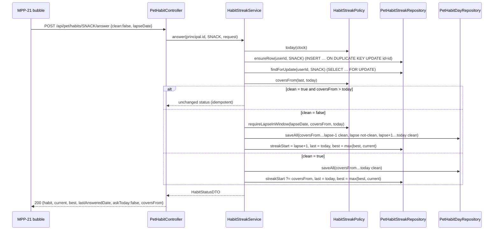

# Plan: Habit streaks backend — snack-free and alcohol-free check-ins

Plan folder: `.claude/contract/MPP-20-habit-streaks-backend/`
Execution status: see `tasks.md` in this folder.

---

## Part 1 — Alignment

### Task reference

Jira **MPP-20** (Task, Medium, parent epic MPP-15 "Pip's room", Phase E). Blocks MPP-21 (check-in bubble UI), MPP-22 (plan streak + milestone ladder) and MPP-31 (glow-up). Breakdown source: `.claude/contract/MPP-15-epic-breakdown/tasks.md` → T5. Behaviour reference: `.claude/contract/MPP-15-epic-breakdown/mockups/pip-room-mockup-v5.html` → `answer()` / `sinceText()`.

Acceptance criteria (verbatim):

1. Migration `database/migrations/<date>-mpp-<n>-pet-habit-streaks.sql` adds a **per-day log** `(user_id, habit, day, clean)`, unique on `(user_id, habit, day)`, with `habit ∈ {SNACK, ALCOHOL}`. It also adds a summary row per `(user_id, habit)` (current streak start, best, last answered date). `ddl-auto: validate` passes.
2. `GET /api/pet/habits` returns for each habit: `current`, `best`, `lastAnsweredDate`, `askToday` (true when not answered today) and `coversFrom` (day after `lastAnsweredDate`).
3. `POST /api/pet/habits/{habit}/answer`:
   - `{ clean: true }` credits every day from `coversFrom` to today, so a skipped day never breaks the streak.
   - `{ clean: false, lapseDate }` (validated `coversFrom ≤ lapseDate ≤ today`) credits clean days before the lapse, restarts the streak from `lapseDate`, and keeps `best`.
4. Answering twice on the same day is idempotent: the second clean answer doesn't double count.
5. Service tests cover clean, skip-then-clean, lapse today, backdated lapse, and repeat answers. `mvn test` is green.

Dependencies & risks from the ticket: habits always belong to the caller, never the meal-plan owner (per-person Pip, MPP-33). "Today" is the server's date in the user's zone, default Europe/Dublin until a per-user zone exists. The migration must reach Railway before the backend deploys. Skill: java-backend.

### Restated goal

Give each person two durable, server-side daily habit streaks — snack-free and alcohol-free — that Pip's check-in bubble (MPP-21) will read and answer. The backend owns every rule: which days a single answer covers, how a skipped day is forgiven, how a backdated lapse restarts the streak while keeping earlier clean days and the best-ever streak, and how a repeat answer stays harmless. It stores one row per person, habit and day (the raw history MPP-31's 30-day score will read) plus one summary row per person and habit, and exposes a read endpoint and an answer endpoint under `/api/pet/habits`.

### In scope

- Migration `foodbytes-app/database/migrations/2026-10-13-mpp20-pet-habit-streaks.sql` creating `pet_habit_days` (per-day log) and `pet_habit_streaks` (summary), applied to the **local** `foodbytes-db` and recorded in the epic's Railway checklist.
- `Habit` enum, `PetHabitDay` and `PetHabitStreak` entities, their two repositories.
- `HabitStreakPolicy` — pure date rules (zone, `coversFrom`, `current`, lapse-window check).
- `HabitStreakService` — `getHabits(userId)` and `answer(userId, habit, request)`.
- `PetHabitController` — `GET /api/pet/habits`, `POST /api/pet/habits/{habit}/answer`.
- `HabitStatusDTO`, `HabitAnswerRequest`.
- A `Clock` bean in Europe/Dublin so "today" is injectable and testable.
- Service tests for the five AC-5 scenarios plus edge cases; controller tests for 401/400 paths.
- A local boot check proving `ddl-auto: validate` accepts the new entities.
- Version bump (Task → MINOR) and CHANGELOG line.

### Explicitly out of scope

- The bubble UI, wording ("since Wednesday"), and any frontend service module (MPP-21).
- Awards, milestones, the ladder, the plan streak (MPP-22).
- The 30-day fitness score (MPP-31) — this ticket only stores the per-day rows it will read.
- A per-user time zone column or setting.
- Correcting an earlier answer (e.g. "I said No this morning, then had a biscuit") — see Risks.
- Applying anything to Railway (local-first epic; the developer applies the batch at merge).
- Touching `PetService`, `PetController` or `MealPlanService`.

### Pattern Reference

None supplied beyond "Skill: java-backend". Chosen references:

- `controller/PetController.java` — `/api/pet` controller shape: `@AuthenticationPrincipal UserPrincipal`, explicit 401 `{error}` body, local `@ExceptionHandler` because there is no `@ControllerAdvice`.
- `model/MealPlanEntryEaten.java` + `repository/MealPlanEntryEatenRepository.java` — per-person row with plain id columns, no associations, PK-based `equals`/`hashCode`, native `INSERT … ON DUPLICATE KEY UPDATE` for idempotent creation.
- `service/PetPolicy.java` / `MealTimesPolicy` — static `final` policy class owning the rules and constants.
- `service/PetServiceTest.java` / `controller/PetControllerTest.java` — Mockito unit test and `@WebMvcTest` + `addFilters = false` shapes.
- `database/migrations/2026-10-13-mpp33-meal-plan-entry-eaten-per-user.sql` — migration header style.

### Constraints flagged on the brief

- **Per person:** keyed by the caller's `UserPrincipal.getId()`; `users.meal_plan_owner_id` is never consulted (MPP-33, memory `pip-per-person`).
- **"Today" = Europe/Dublin** until per-user zones exist.
- **`ddl-auto: validate`:** migration first, then entities.
- **Local-first epic (MPP-15):** migration applied to local `foodbytes-db` only and appended to `.claude/contract/MPP-15-epic-breakdown/railway-migrations.md`; no Railway MCP use.
- **Never shaming** (epic) — no backend wording is produced here, so this only constrains error messages to stay neutral.

### Assumptions made

1. **Table names `pet_habit_days` and `pet_habit_streaks`** — `pet_` prefix groups them with the rest of the epic's per-person Pip data. The column names follow the AC: `user_id, habit, day, clean`.
2. **`habit` is `VARCHAR(16)` with a `CHECK (habit IN ('SNACK','ALCOHOL'))`, mapped with `@Enumerated(STRING)` + `@JdbcTypeCode(SqlTypes.VARCHAR)`** — no enum column exists in the codebase yet; pinning the JDBC type removes any doubt about whether Hibernate 6's validator expects a MySQL `ENUM` for a string enum. MPP-22's award ledger can reuse the same pattern for PLAN/SNACK/ALCOHOL.
3. **First-ever answer: `coversFrom` = today** when `lastAnsweredDate` is null — a brand-new user is only asked about today, and nothing before sign-up is credited.
4. **Lapse semantics follow the mockup:** `lapseDate` is the most recent day the habit happened. Days `coversFrom … lapseDate−1` are logged clean, `lapseDate` is logged not clean, and days `lapseDate+1 … today` are logged clean. `streak_start = lapseDate + 1`. So a lapse today leaves `current = 0`; a lapse yesterday gives `current = 1`. This matches mockup v5 (`st.cur = daysBetween(when, today)`).
5. **`current` is derived, not stored:** `current = streak_start ≤ last_answered_date ? days(streak_start … last_answered_date) inclusive : 0`. Unanswered days are neither credited nor treated as lapses, so `current` reflects the streak through the last answer.
6. **`best` is stored** and raised to `current` after every answer, never lowered.
7. **Repeat clean answer on a day already answered → 200 no-op** returning the unchanged status (AC 4). **A lapse on a day already answered → 400** "lapseDate must be between X and Y", because `coversFrom` is tomorrow and the AC window is then empty.
8. **GET returns a JSON array of two statuses, `SNACK` then `ALCOHOL`, each carrying `habit`** — extensible, and order is stable for the bubble's "snacks first, then alcohol" flow. POST returns the single updated status, which is what the bubble needs for "5 days snack-free!" / "your best is still N".
9. **No summary row is written on GET.** A missing row is reported as `current 0, best 0, lastAnsweredDate null, askToday true, coversFrom today`. The row is created on first answer.
10. **The `{habit}` path segment is the upper-case enum name** (`SNACK` / `ALCOHOL`), bound as a `Habit` `@PathVariable`; anything else is 400 `{error}`.
11. **A `java.time.Clock` bean zoned to Europe/Dublin** in a new `config/ClockConfig.java`. The zone constant lives on `HabitStreakPolicy.ZONE`. Tests construct the service with `Clock.fixed(...)`.
12. **New controller `PetHabitController`** rather than growing `PetController` — keeps each controller to one resource, and the URL still sits under `/api/pet`.
13. **Concurrency via a row lock:** answering first ensures the summary row exists (native `INSERT … ON DUPLICATE KEY UPDATE id = id`), then reads it `SELECT … FOR UPDATE` (`@Lock(PESSIMISTIC_WRITE)`). Two parallel answers for the same person and habit serialise; the second sees the first's `last_answered_date`.
14. **Version bump: Task → MINOR.**

### Cross-code alignment audit (FE ↔ BE ↔ DB)

Run against the **local** `foodbytes-db` (MPP-15 is local-first; Railway is not read for this epic).

- **`users.id`** — `id  bigint  NO  PRI  NULL  auto_increment` → FK targets use `BIGINT`. ✔
- **No existing habit tables** — `SHOW TABLES LIKE '%habit%'` and `SHOW TABLES LIKE 'pet%'` both return nothing. No name collision. ✔
- **Outstanding migrations** — the only MPP-15 migration so far, `2026-10-13-mpp33-meal-plan-entry-eaten-per-user.sql`, is applied locally (`SHOW COLUMNS FROM meal_plan_entry_eaten` returns `id, meal_plan_entry_id, user_id, eaten_at`) and listed in `railway-migrations.md` as order 1. Nothing unapplied blocks startup. ✔
- **Boolean mapping precedent** — existing `Boolean` entity fields map onto `tinyint(1)` columns (`recipes.is_cheat tinyint(1)`, `shopping_list_items.is_checked tinyint(1)`, `MealPlanEntryExtraChoice.homemade` ↔ `is_homemade`). `clean BOOLEAN` (= `tinyint(1)`) follows suit. ✔
- **Enum mapping precedent** — `grep @Enumerated` across `src/main` returns nothing; assumption 2 introduces the first, with the JDBC type pinned. Proved at runtime by the local boot check task.
- **Time zone** — local MySQL `@@global.time_zone = SYSTEM`; JDBC URL pins `serverTimezone=UTC`. `day` / `streak_start` / `last_answered_date` are `DATE` bound from `LocalDate`, which Connector/J sends without zone conversion, so the Dublin date written is the date stored. ✔
- **Names across the chain** — DB `day / clean / streak_start / best / last_answered_date` ↔ entity `day / clean / streakStart / best / lastAnsweredDate` ↔ DTO JSON `current / best / lastAnsweredDate / askToday / coversFrom / habit` (exactly the AC 2 keys plus `habit`). No frontend consumer yet (MPP-21).
- **Users at planning** — local `SELECT COUNT(*) FROM users` = 13. New tables start empty; no backfill needed.

---

## Part 2 — Technical design

### Approach

The work is a self-contained vertical slice beside the existing pet code: migration → entities/repositories → a pure policy class → a transactional service → a thin controller. Rules live in two places by kind: **date arithmetic** (what `coversFrom` is, how `current` is counted, whether a lapse date is in range) is static and side-effect free in `HabitStreakPolicy`, mirroring `PetPolicy` / `MealTimesPolicy`; **state changes** (which day rows to insert, how the summary row moves) live in `HabitStreakService`, which is the one place MPP-21 and later MPP-22/MPP-31 depend on.

The summary row is the source of truth for streak state, and the day log is an append-only history. Every answer writes the log for exactly the range `coversFrom … today` and then sets `last_answered_date = today`. The ranges therefore never overlap, so no day is written twice in normal operation, and the unique key `(user_id, habit, day)` is a backstop rather than a control-flow mechanism. A clean answer sets `streak_start` to `coversFrom` if the person had no running streak (first answer, or the last answer was a lapse today). A lapse answer sets `streak_start = lapseDate + 1`. `current` is computed from `streak_start` and `last_answered_date`, never stored, so it cannot drift from them. `best = max(best, current)` after every answer.

Roads not taken: **deriving everything from the day log** (count back from today until the first `clean = 0`) would drop the summary table but makes every GET scan history, and the AC asks for the summary row explicitly. **Storing `current`** would duplicate `streak_start`. **Upserting day rows with `ON DUPLICATE KEY UPDATE clean = VALUES(clean)`** would let a later answer silently rewrite history; with the row lock it is unnecessary, so plain `saveAll` inserts are used and a duplicate would surface as an error instead of being hidden. **Adding the endpoints to `PetController`** was rejected for single-responsibility. **Folding the policy into the service** was rejected because the date rules are the part most worth testing in isolation.

"Today" comes from an injected `Clock` zoned to `Europe/Dublin` (`HabitStreakPolicy.ZONE`), so tests pin the date with `Clock.fixed` and a later per-user zone only changes how `today` is derived. Identity is always `UserPrincipal.getId()`, and the service never touches `UserRepository`, so the meal-plan owner can't leak in. The migration is applied to the local `foodbytes-db` and listed second in the epic's Railway checklist. A local boot of the backend proves Hibernate's `validate` accepts the new tables, which no unit test can do.

### Skills to invoke during execution

- `java-backend` — owns every Java task (entities, repositories, policy, service, DTOs, controller, Clock config, tests) and the migration mechanics: date-prefixed file, then apply, then entity.
- Rules: no `.claude/rules/` file applies — this ticket touches no recipe, ingredient, macro or variant data.

### Diagram



### Data shapes

#### DDL — `foodbytes-app/database/migrations/2026-10-13-mpp20-pet-habit-streaks.sql`

```sql
CREATE TABLE IF NOT EXISTS pet_habit_days (
  id       BIGINT      NOT NULL AUTO_INCREMENT,
  user_id  BIGINT      NOT NULL,
  habit    VARCHAR(16) NOT NULL,
  day      DATE        NOT NULL,
  clean    BOOLEAN     NOT NULL,
  PRIMARY KEY (id),
  UNIQUE KEY uk_pet_habit_days_user_habit_day (user_id, habit, day),
  CONSTRAINT chk_pet_habit_days_habit CHECK (habit IN ('SNACK','ALCOHOL')),
  CONSTRAINT fk_pet_habit_days_user FOREIGN KEY (user_id)
    REFERENCES users (id) ON DELETE CASCADE
) ENGINE=InnoDB;

CREATE TABLE IF NOT EXISTS pet_habit_streaks (
  id                 BIGINT      NOT NULL AUTO_INCREMENT,
  user_id            BIGINT      NOT NULL,
  habit              VARCHAR(16) NOT NULL,
  streak_start       DATE        NULL,
  best               INT         NOT NULL DEFAULT 0,
  last_answered_date DATE        NULL,
  PRIMARY KEY (id),
  UNIQUE KEY uk_pet_habit_streaks_user_habit (user_id, habit),
  CONSTRAINT chk_pet_habit_streaks_habit CHECK (habit IN ('SNACK','ALCOHOL')),
  CONSTRAINT fk_pet_habit_streaks_user FOREIGN KEY (user_id)
    REFERENCES users (id) ON DELETE CASCADE
) ENGINE=InnoDB;
```

The unique key on `(user_id, habit, day)` leads with `user_id`, so it also serves the FK and MPP-31's "this user's last 30 days" range read. No separate index is needed.

#### Enum — `model/Habit.java`

```java
public enum Habit { SNACK, ALCOHOL }
```

#### Entities

`model/PetHabitDay.java` → `@Table(name = "pet_habit_days")`, unique constraint `uk_pet_habit_days_user_habit_day`:

| Field | Type | Column |
|---|---|---|
| `id` | `Long` | `id` IDENTITY |
| `userId` | `Long` | `user_id` not null |
| `habit` | `Habit` | `habit` not null, `@Enumerated(STRING)`, `@JdbcTypeCode(SqlTypes.VARCHAR)`, length 16 |
| `day` | `LocalDate` | `day` not null |
| `clean` | `Boolean` | `clean` not null |

`model/PetHabitStreak.java` → `@Table(name = "pet_habit_streaks")`, unique constraint `uk_pet_habit_streaks_user_habit`:

| Field | Type | Column |
|---|---|---|
| `id` | `Long` | `id` IDENTITY |
| `userId` | `Long` | `user_id` not null |
| `habit` | `Habit` | as above |
| `streakStart` | `LocalDate` | `streak_start` nullable |
| `best` | `Integer` | `best` not null |
| `lastAnsweredDate` | `LocalDate` | `last_answered_date` nullable |

Both: Lombok `@Data @NoArgsConstructor @AllArgsConstructor`, PK-based `equals`/`hashCode` as `MealPlanEntryEaten`.

#### Repositories

```java
// PetHabitDayRepository extends JpaRepository<PetHabitDay, Long>
List<PetHabitDay> findByUserIdAndHabitOrderByDayAsc(Long userId, Habit habit);   // tests + MPP-31

// PetHabitStreakRepository extends JpaRepository<PetHabitStreak, Long>
List<PetHabitStreak> findByUserId(Long userId);

@Modifying
@Query(value = "INSERT INTO pet_habit_streaks (user_id, habit, best) VALUES (:userId, :habit, 0) " +
               "ON DUPLICATE KEY UPDATE id = id", nativeQuery = true)
void ensureRow(@Param("userId") Long userId, @Param("habit") String habit);

@Lock(LockModeType.PESSIMISTIC_WRITE)
@Query("SELECT s FROM PetHabitStreak s WHERE s.userId = :userId AND s.habit = :habit")
Optional<PetHabitStreak> findForUpdate(@Param("userId") Long userId, @Param("habit") Habit habit);
```

#### Policy — `service/HabitStreakPolicy.java` (final, static)

```java
public static final ZoneId ZONE = ZoneId.of("Europe/Dublin");
static LocalDate today(Clock clock)                                       // LocalDate.now(clock.withZone(ZONE))
static LocalDate coversFrom(LocalDate lastAnswered, LocalDate today)      // null → today, else last + 1
static int current(LocalDate streakStart, LocalDate lastAnswered)         // 0 if either null or start > last; else days inclusive
static void requireLapseInWindow(LocalDate lapse, LocalDate from, LocalDate today)
        // throws IllegalArgumentException("lapseDate must be between <from> and <today>")
static HabitStatusDTO toDTO(Habit habit, PetHabitStreak row, LocalDate today)   // row may be null
```

#### DTOs

```java
// dto/HabitStatusDTO.java — @Data @NoArgsConstructor @AllArgsConstructor
private Habit habit;               // "SNACK" | "ALCOHOL"
private int current;               // clean days in the running streak, through lastAnsweredDate
private int best;                  // best-ever streak, never lowered
private LocalDate lastAnsweredDate;// null until first answer
private boolean askToday;          // lastAnsweredDate == null || lastAnsweredDate < today
private LocalDate coversFrom;      // lastAnsweredDate + 1, or today when never answered

// dto/HabitAnswerRequest.java — @Data @NoArgsConstructor @AllArgsConstructor
@NotNull(message = "clean is required") private Boolean clean;
private LocalDate lapseDate;
@JsonIgnore @AssertTrue(message = "lapseDate is required when clean is false")
public boolean isLapseDateGivenWhenLapsed() { return !Boolean.FALSE.equals(clean) || lapseDate != null; }
```

#### HTTP contract

```
GET  /api/pet/habits
200  [ {"habit":"SNACK","current":4,"best":9,"lastAnsweredDate":"2026-10-12","askToday":true,"coversFrom":"2026-10-13"},
       {"habit":"ALCOHOL","current":0,"best":0,"lastAnsweredDate":null,"askToday":true,"coversFrom":"2026-10-13"} ]
401  {"error":"Not authenticated"}

POST /api/pet/habits/{habit}/answer      habit ∈ SNACK | ALCOHOL
body {"clean":true}  |  {"clean":false,"lapseDate":"2026-10-11"}
200  HabitStatusDTO for that habit (askToday false)
400  {"error":"clean is required"} | {"error":"lapseDate is required when clean is false"}
     | {"error":"lapseDate must be between 2026-10-11 and 2026-10-13"} | {"error":"Unknown habit: <x>"}
401  {"error":"Not authenticated"}
```

#### Config — `config/ClockConfig.java`

```java
@Configuration
public class ClockConfig {
    @Bean
    public Clock clock() { return Clock.system(HabitStreakPolicy.ZONE); }
}
```

### Runtime quality notes

- **Resource cleanup:** All DB work runs inside Spring-managed `@Transactional` methods; no manual connections or streams. The `FOR UPDATE` lock is released at commit or rollback.
- **Concurrency / ordering:** Two answers for the same person and habit (double tap, two devices) serialise on the summary row lock. `ensureRow` makes first-row creation race-free through the unique key. The second request sees `last_answered_date = today`, so a repeated clean answer is a no-op and a repeated lapse gets a 400. Different habits and different users never contend. The meal-plan owner link is not involved.
- **Allocation / cost behaviour:** GET is one indexed query (`findByUserId`, at most 2 rows). An answer inserts one row per day since the last answer: typically 1–3, and bounded by the days since the person's previous answer. `saveAll` with IDENTITY ids issues one insert per row. That is acceptable at this size, and no batching config change is planned. Nothing reads the day log on the hot path.
- **Error paths:** Bean validation failures → `MethodArgumentNotValidException` → local handler → 400 `{error}`. An unknown `{habit}` → `MethodArgumentTypeMismatchException` → local handler → 400 `{error: "Unknown habit: x"}`. An out-of-window `lapseDate` → `IllegalArgumentException` from the policy, caught in the controller → 400 `{error}` (the `MealPlanTemplateController` idiom). No principal → 401. Anything else (a DB failure) propagates as a 500 and rolls back the whole answer, so a half-written range is impossible.

### Risks and judgement calls

- **Enum column mapping (assumption 2)** is the first `@Enumerated` in the codebase. If Hibernate's `validate` still rejects it at the local boot check, the fallback is to keep the `VARCHAR(16)` column and store a plain `String` field, validating against `Habit` in the policy. The local boot check task exists to catch this before MPP-21 builds on it.
- **No same-day correction (assumption 7).** If the user answers "No" in the morning and lapses that evening, today is already answered, so the lapse is rejected until tomorrow's check-in. Tomorrow's question covers only tomorrow, so that evening's lapse can never be recorded. This follows the AC window literally. If you want "re-answer today with a lapse" to flip today's row to not-clean and reset the streak, it is a small change in `answer()`. Red-line it here.
- **Days after a backdated lapse are logged clean (assumption 4).** This matches the mockup but assumes the user reports the most recent lapse. MPP-21's wording ("When did you have it?" with a single date) should make that clear.
- **Long gaps are credited in full.** Someone who returns after 60 days and answers "No" gets 60 clean days, which is what "a skipped day never breaks the streak" means literally. It also feeds MPP-31's score, so a returning user's Pip could jump to full fitness on one tap. Flag for MPP-31's design rather than capping here.
- **The `Clock` bean is application-wide** and zoned to Dublin. Nothing else injects a `Clock` today (`MealPlanService` and `ExtraChoiceService` call `LocalDate.now()`), so it changes no existing behaviour.
- **Manual step owned by the developer:** none on Railway now. The migration goes into `.claude/contract/MPP-15-epic-breakdown/railway-migrations.md` as order 2. It must be applied to Railway before the merged backend deploys at epic merge time.
