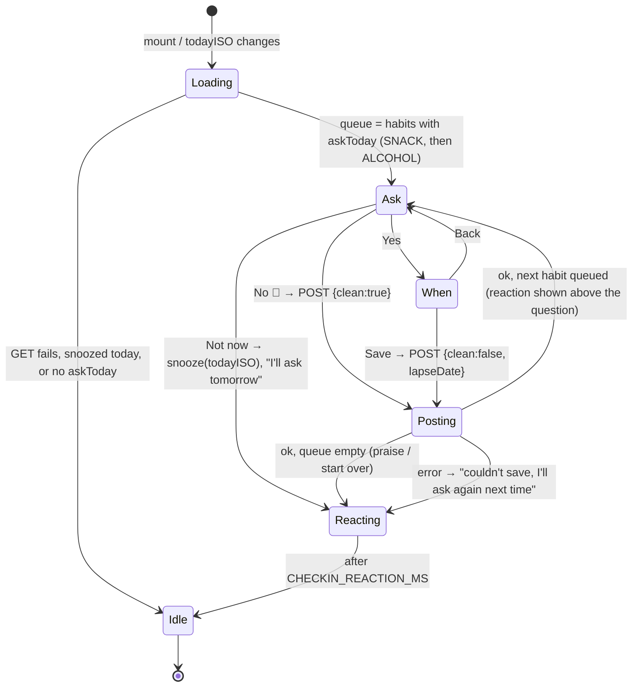

# Plan: Pip's daily check-in in his speech bubble (snacks and alcohol)

Plan folder: `.claude/contract/MPP-21-pip-check-in-bubble/`
Execution status: see `tasks.md` in this folder.

---

## Part 1 — Alignment

### Task reference

Jira **MPP-21** (Story, Medium, parent epic MPP-15 "Pip's room", Phase E). Blocked by MPP-16 (room scaffold) and MPP-20 (habit streaks backend), both `Ready for Test`. Blocks MPP-28 (integration). Breakdown: `.claude/contract/MPP-15-epic-breakdown/tasks.md` → T6. Design: `.claude/contract/MPP-15-epic-breakdown/mockups/pip-room-mockup-v5.html` → Pip's bubble, "Next day ▶" (`sinceText()`, `bubbleHtml()`, `answer()`).

Acceptance criteria (verbatim):

1. When `askToday` is true, Pip's bubble asks "Did you have any snacks today?" with **No 🙌 / Yes / Not now**, then the same for alcohol. Wording uses `coversFrom`: "today", "since yesterday", "since Wednesday".
2. **No** shows praise, e.g. "5 days snack-free! So proud of you 💜".
3. **Yes** asks "That's ok! When did you have it?" with a date input (default today, min `coversFrom`, max today) and **Save**. Pip replies "We can start over 💜 … your best is still N".
4. **Not now** hides the question until the next day: "No worries, I'll ask tomorrow 💜".
5. No check-in card or chips appear outside the room (UI space requirement). The bubble is keyboard-operable and the date input is labelled.

Scope from the ticket: in — bubble question flow, answer calls to MPP-20's API, reactions; out — award announcements and the cabinet (MPP-22, MPP-23).

Dependencies & risks from the ticket: each person answers for themselves (per-person Pip, MPP-33); never shaming — lapses are always "that's ok, we can start over"; if the API fails, the bubble falls back to the default greeting and asks again on the next visit. Skill: react-frontend.

### Restated goal

Turn Pip's speech bubble into the place where he asks, once a day, whether the user had snacks and then alcohol — and where the user answers, without any extra card under the room. The bubble reads the caller's own habit status from MPP-20 (`GET /api/pet/habits`), asks only the habits whose `askToday` is true, phrases the question by how many days the answer covers (`coversFrom`), and posts each answer (`POST /api/pet/habits/{habit}/answer`). "No" earns praise built from the returned streak, "Yes" opens a labelled date picker and replies with a gentle start-over line that quotes the kept best, and "Not now" silences the check-in in this browser until tomorrow. Every reaction is kind, every control is a real keyboard-reachable button, and any API failure quietly returns Pip to his normal greeting so the question comes back on the next visit.

### In scope

- `services/habitService.js` — `getHabits({ signal })` and `answerHabit(habit, body)` over MPP-20's endpoints.
- Pure check-in rules and copy in `utils/habitCheckIn.js` (question wording from `coversFrom`, praise, start-over, snooze reply, which habit to ask next), pinned by `utils/habitCheckIn.check.mjs` and a `check:checkin` npm script.
- A per-user, per-day "Not now" marker in `utils/checkInSnoozeStore.js` (localStorage with an in-memory fallback, like `pipSeenStore.js`).
- `hooks/useHabitCheckIn.js` — fetch, step machine, answers, reactions, snooze, error fallback.
- `components/pet/room/CheckInActions.jsx` (+ `CheckInActions.css`) — the bubble's buttons and the labelled date form.
- `PetRoom.jsx` — bubble becomes a container: a persistent live-region text line plus optional actions.
- `PetView.jsx` — wires the hook and sets bubble priority: cook-and-serve > check-in > fridge-low > mood.
- `PetContext.jsx` — exposes the `todayISO` it already computes, so the check-in re-asks on date rollover without a second clock.
- New constants in `constants/pet.js`.
- Version bump (Story → MINOR) and CHANGELOG line.

### Explicitly out of scope

- Any backend change. MPP-20's API is consumed as built.
- Award / trophy / ribbon announcements and the cabinet (MPP-22, MPP-23). The mockup's "🎉 New ribbon" reaction is not built.
- Folding habits into a single pet payload (MPP-28 integration).
- Correcting an answer already given today (MPP-20 rejects it; see Risks).
- Server-side persistence of "Not now".
- The Axios request timeout and the `console.log` in `services/api.js` (known debt, not touched here).
- Any new route, card, chip, or element under the room (AC 5).

### Pattern Reference

None supplied beyond "Skill: react-frontend". Chosen references:

- `hooks/useCookAndServe.js` — feature hook owned by `PetView`, not a global Context; effect-driven, cleans up its timer.
- `utils/pipSeenStore.js` — per-user localStorage marker with an in-memory fallback and try/catch on every access.
- `utils/fridgeFill.js` + `fridgeFill.check.mjs` — pure bubble/copy helpers pinned by a `node` check script registered in `package.json`.
- `contexts/PetContext.jsx` — `AbortController` per read, `isCancelled` swallow, `err.response?.data?.error` read.
- `components/pet/room/PetRoom.jsx` `FridgeButton` + `PetRoom.css` `.pip-fridge-btn` — 44 px targets, `touch-action`, `:focus-visible`, `@media (hover: hover)`.
- Mockup v5 `.bubble .bb` styles and `answer()` copy.

### Constraints flagged on the brief

- **Per person (MPP-33):** the API is caller-scoped server-side; the snooze marker is keyed by `user.id`, so a partner on the same browser is asked separately.
- **Never shaming:** every lapse and error line is warm; no red, no "streak broken".
- **API failure → default greeting, ask again next visit.**
- **UI space (AC 5):** nothing outside the room's bubble.
- **Keyboard + label (AC 5):** real `<button>`s, a `<label>`-associated date input, focus moved sensibly between steps.
- **Mobile/touch (skill hard floor):** ≥44 px targets, no hover-only state, reduced motion respected (nothing animates here).
- **"Today" is Europe/Dublin on the server (MPP-20).**

### Assumptions made

1. **State lives in a feature hook, `useHabitCheckIn`, called from `PetView` — not in `PetContext`.** The skill forbids feature-specific state in a global Context, and only `/pet` shows the check-in. MPP-28 can lift it later.
2. **`PetContext` exposes `todayISO`.** It already derives it from its minute clock. Passing it in lets the hook refetch at local midnight without starting a second clock.
3. **The habit list is fetched on mount and when `todayISO` changes — not on tab visibility.** A visibility refetch mid-answer would reset the steps. "Asks again on the next visit" is satisfied by remounting `/pet`.
4. **Questions follow the AC wording for both habits:** "Did you have any snacks {since}?" and "Did you have any alcohol {since}?" (the mockup's shorter "Any alcohol" is not used; AC 1 says "the same for alcohol").
5. **`since` text from `coversFrom` vs the browser's local today:** 0 days back → "today"; 1 → "since yesterday"; 2–6 → "since {Weekday}" (e.g. "since Wednesday"); 7 or more → "since {d Mon}" (e.g. "since 3 Oct"), because a weekday name is ambiguous after a week.
6. **"No" praise uses the returned `current`:** "{n} day(s) {snack-free|alcohol-free}! So proud of you 💜". With `current` 0 (it cannot be after a clean answer, but defensively) → "Thanks for telling me 💜".
7. **"Save" reply mirrors the mockup:** "We can start over 💜 {n} day(s) so far, your best is still {best}." — the "n so far" clause only when the returned `current > 0` (a backdated lapse).
8. **The reaction stays visible above the next question**, as in the mockup (`.react` line above the question). After the last answer, the final reaction stays for `CHECKIN_REACTION_MS` (8 s), then the bubble returns to its usual priority.
9. **"Not now" snoozes both remaining questions** (mockup `later` sets `ask = null`), stores `todayISO` for this user, and shows "No worries, I'll ask tomorrow 💜" for `CHECKIN_REACTION_MS`. A snooze for an earlier day is ignored.
10. **"Not now" is shown on the question step only** (as in the mockup), not on the date step; the date step offers **Save** and a **Back** link so a mis-tap on "Yes" is recoverable without answering.
11. **Error handling:** a failed GET shows no check-in (the normal bubble shows, AC/ticket). A failed POST ends the check-in for this mount and shows "Hmm, I couldn't save that. I'll ask again next time 💜" for `CHECKIN_REACTION_MS`, then the normal bubble. The server's `{error}` text is not shown — it is technical ("lapseDate must be between…"), and the date input's `min`/`max` already prevent that case. This is an error state, not a swallowed one: nothing is marked answered locally, so the next visit re-asks.
12. **The date input's `max` is the browser's local today.** The user is in Ireland, matching the server's Europe/Dublin. If they differ, the server's 400 hits the error path in assumption 11.
13. **The cook-and-serve scene outranks the check-in**, as in the mockup (`if (q && !S2.phase)`). The check-in's state is kept and its controls reappear when the scene ends.
14. **Pip asks at night too** (asleep in bed). The mockup does not suppress the question by time, and evening is when a "today" answer is most accurate.
15. **Focus:** when a step changes because of the user's own action, focus moves to the new step's first control (or to the bubble when the check-in ends), so a keyboard user is never dropped onto `<body>`. When the first question appears on load, focus is not stolen.
16. **Bubble markup:** `PetRoom` renders `<div class="pet-bubble">` holding a persistent `<p aria-live="polite">` for the text plus an optional `bubbleActions` node. The live region stays mounted, so screen readers hear each new question and reaction without the buttons being re-read.
17. **Constants in `constants/pet.js`** (`HABITS`, `HABIT_ORDER`, `CHECKIN_SNOOZE_STORAGE_KEY`, `CHECKIN_REACTION_MS`, copy strings). `pet.js` is 85 lines; this keeps all Pip copy in one file, as MPP-17/18 did.
18. **Version bump: Story → MINOR.**

### Cross-code alignment audit (FE ↔ BE ↔ DB)

MPP-15 is local-first, so this was run against the local `foodbytes-db`, not Railway. MPP-21 adds no schema. It reads MPP-20's.

- **MPP-20 tables applied locally** — `SHOW COLUMNS FROM pet_habit_streaks` → `id bigint PRI auto_increment, user_id bigint MUL, habit varchar(16), streak_start date NULL, best int default 0, last_answered_date date NULL`; `SHOW COLUMNS FROM pet_habit_days` → `id, user_id, habit varchar(16), day date, clean tinyint(1)`. Both have 0 rows. The backend boots, and there is no unapplied migration blocking it. ✔
- **Railway** — MPP-20's migration is listed as order 2 in `.claude/contract/MPP-15-epic-breakdown/railway-migrations.md` (applied at epic merge). MPP-21 adds nothing to that list. ✔
- **Endpoint ↔ service** — `PetHabitController` is `@RequestMapping("/api/pet/habits")`, `GET` and `POST /{habit}/answer`. With `api.js` `baseURL: '/api'`, the client paths are `/pet/habits` and `` `/pet/habits/${habit}/answer` ``. ✔
- **DTO ↔ JSON ↔ frontend property** — `HabitStatusDTO { habit, current, best, lastAnsweredDate, askToday, coversFrom }`. `LocalDate` serialises as `"YYYY-MM-DD"` (MPP-20 plan HTTP contract), which compares directly with `formatDateISO`. The frontend reads exactly these six keys. ✔
- **Path value** — `{habit}` binds the `Habit` enum `SNACK | ALCOHOL` (upper-case). `HABITS` constants use the same strings. ✔
- **Request body** — `HabitAnswerRequest { Boolean clean; LocalDate lapseDate }`. The client sends `{ clean: true }` or `{ clean: false, lapseDate: "YYYY-MM-DD" }`. ✔
- **Ordering** — GET returns `[SNACK, ALCOHOL]`. The client still orders by `HABIT_ORDER` rather than trusting array order.

---

## Part 2 — Technical design

### Approach

The check-in is a small state machine that lives in one feature hook, `useHabitCheckIn({ userId, todayISO })`, beside `useCookAndServe` in `PetView`. On mount (and on date rollover) it aborts any earlier read and fetches the caller's two statuses. If this user snoozed today, or neither habit has `askToday`, it stays idle. Otherwise it queues the habits to ask in `HABIT_ORDER`. The hook's state is `{ queue, statuses, step, reaction, busy }`. `step` is `{ kind: 'ask' | 'when', habit }` or `null`. It exposes declarative output — `{ text, actions }` for the bubble, or `null` when it has nothing to say — plus handlers `answerNo`, `answerYes`, `back`, `save(lapseDate)` and `notNow`. Each answer POSTs (never auto-aborted, per the skill), stores the returned status, sets the reaction from the pure copy helpers, and moves to the next queued habit or ends. A single timer clears the final reaction after `CHECKIN_REACTION_MS`, and the effect cleanup clears it.

Every rule that is not React — what the "since" phrase is, the praise and start-over lines, which habits to ask, whether a stored snooze applies today — sits in `utils/habitCheckIn.js` as pure functions. A `node` check script pins them, which is the project's substitute for a frontend test runner. The snooze marker follows `pipSeenStore.js` exactly: a per-user key, try/catch around localStorage, and an in-memory map, so blocked storage still snoozes for the page load.

Rendering stays split by responsibility. `PetRoom` owns the bubble's box and keeps a live-region `<p>` permanently mounted, with an optional `bubbleActions` slot under it. `CheckInActions` renders the three answer buttons, or the labelled date form with Save and Back. `PetView` decides who speaks: the cook-and-serve line first, then the check-in, then the fridge-low line, then the mood greeting. While the cook scene runs, the check-in is hidden but not reset.

Roads not taken: **putting the habits in `PetContext`** would make feature state global and refetch on every visibility change, which the skill forbids and which would reset a half-answered check-in. **A card under the room** is ruled out by AC 5. **Storing "Not now" on the server** would need a backend change and a column MPP-20 did not plan. Today's semantics ("until tomorrow, in this browser") fit a local marker. **One combined POST for both habits** does not exist in MPP-20's API. **Rendering the buttons inside the `aria-live` element** was rejected, because screen readers would re-announce every button label on each change.

### Skills to invoke during execution

- `react-frontend` — owns every task: the service module, hook, pure helpers and check script, components, CSS (44 px, `:focus-visible`, hover in `@media (hover: hover)`), async states, the abort rules, and the component line budget.
- Rules: no `.claude/rules/` file applies — this touches no recipe, ingredient, macro, variant or migration data.

### Diagram



Bubble priority in `PetView`: `cookServeBubble(serving)` → check-in output (only when `serving` is null) → `fridgeBubble(...)` → `petBubble(moodInfo)`.

### Data shapes

#### Service — `src/services/habitService.js`

```js
/** MPP-21: your own snack / alcohol check-in streaks (MPP-20). */
export const habitService = {
  /** @returns {Promise<HabitStatus[]>} */
  async getHabits({ signal } = {}) { const r = await api.get('/pet/habits', { signal }); return r.data },
  /** @param {'SNACK'|'ALCOHOL'} habit  @param {{clean:boolean, lapseDate?:string}} body  @returns {Promise<HabitStatus>} */
  async answerHabit(habit, body) { const r = await api.post(`/pet/habits/${habit}/answer`, body); return r.data }
}
// HabitStatus = { habit: 'SNACK'|'ALCOHOL', current: number, best: number,
//                 lastAnsweredDate: string|null, askToday: boolean, coversFrom: string }  (dates 'YYYY-MM-DD')
```

#### Constants — appended to `src/constants/pet.js`

```js
// MPP-21: the daily check-in in Pip's bubble (MPP-20 habits).
export const HABITS = { SNACK: 'SNACK', ALCOHOL: 'ALCOHOL' }
export const HABIT_ORDER = [HABITS.SNACK, HABITS.ALCOHOL]
export const HABIT_QUESTION_NOUN = { SNACK: 'snacks', ALCOHOL: 'alcohol' }
export const HABIT_FREE_LABEL = { SNACK: 'snack-free', ALCOHOL: 'alcohol-free' }
export const CHECKIN_STEPS = { ASK: 'ask', WHEN: 'when' }
export const CHECKIN_REACTION_MS = 8000
export const CHECKIN_WEEKDAY_SPAN_DAYS = 6 // weekday name up to 6 days back, then 'd Mon'
export const CHECKIN_SNOOZE_STORAGE_KEY = 'foodbytes.pip.checkInSnoozedOn'
export const CHECKIN_WHEN_PROMPT = "That's ok! When did you have it?"
export const CHECKIN_SNOOZE_REPLY = "No worries, I'll ask tomorrow 💜"
export const CHECKIN_SAVE_FAILED = "Hmm, I couldn't save that. I'll ask again next time 💜"
export const CHECKIN_THANKS = 'Thanks for telling me 💜'
```

#### Pure helpers — `src/utils/habitCheckIn.js`

```js
export function daysBetweenISO(fromISO, toISO)               // whole days, UTC-midnight arithmetic on 'YYYY-MM-DD'
export function sinceText(coversFromISO, todayISO)           // 'today' | 'since yesterday' | 'since Wednesday' | 'since 3 Oct'
export function questionText(habit, coversFromISO, todayISO) // 'Did you have any snacks today?'
export function praiseText(status)                           // '5 days snack-free! So proud of you 💜' | CHECKIN_THANKS
export function startOverText(status)                        // 'We can start over 💜 2 days so far, your best is still 9.'
export function habitsToAsk(statuses)                        // HABIT_ORDER filtered to askToday === true
export function isSnoozedToday(snoozedOnISO, todayISO)       // snoozedOnISO === todayISO
```

#### Snooze store — `src/utils/checkInSnoozeStore.js`

```js
export function readSnoozedOn(userId)            // 'YYYY-MM-DD' | null  (localStorage `${CHECKIN_SNOOZE_STORAGE_KEY}.${userId}`, memory fallback)
export function writeSnoozedOn(userId, todayISO) // memory always; localStorage when available
```

#### Hook — `src/hooks/useHabitCheckIn.js`

```js
/**
 * @param {{ userId: number|null, todayISO: string }} input
 * @returns {{
 *   bubble: { text: string, actions: null | {
 *     step: 'ask'|'when', habit: 'SNACK'|'ALCOHOL', coversFrom: string, todayISO: string, busy: boolean,
 *     focusFirst: boolean,   // true once the user has acted, so focus follows them (assumption 15)
 *     onNo(): void, onYes(): void, onNotNow(): void, onBack(): void, onSave(lapseDateISO: string): void } } | null
 * }}
 */
export function useHabitCheckIn({ userId, todayISO })
```

`bubble.text` = the reaction (when present) followed by the question, or the prompt, or the reaction alone. `bubble === null` means the check-in has nothing to say.

#### Components

- `PetRoom` props: `bubble: string` (unchanged meaning — text), **new** `bubbleActions: ReactNode | null = null`.
- `src/components/pet/room/CheckInActions.jsx` — props = the `actions` object above. Ask step: `No 🙌` (primary), `Yes`, `Not now` (link style). When step: `<label htmlFor={id}>Day you had {noun}</label>` (visually hidden text, since the prompt is already in the bubble), `<input type="date" id min={coversFrom} max={todayISO} defaultValue={todayISO} required>`, `Save` (primary, submit) and `Back` (link). All buttons are disabled while `busy`.
- `src/components/pet/room/CheckInActions.css` — `.pip-checkin-actions`, `.pip-checkin-btn`, `.pip-checkin-btn--primary`, `.pip-checkin-btn--link`, `.pip-checkin-date`, `.pip-checkin-sr` (visually hidden label text; the only existing `.sr-only` lives in `LandingPageAnimation.css` and isn't loaded on `/pet`).

#### npm script

`"check:checkin": "node src/utils/habitCheckIn.check.mjs"` in `client/package.json`.

### Runtime quality notes

Mapped onto the browser runtime (single-threaded event loop, effect cleanup, re-render cost).

- **Resource cleanup:** the GET owns an `AbortController`, aborted in effect cleanup on unmount or when `userId` or `todayISO` change; an aborted read (`ERR_CANCELED`) is swallowed. POSTs are never aborted (skill: never auto-abort a write). If `/pet` unmounts mid-POST, a mounted-ref guard drops the result. The reaction timer is cleared in effect cleanup.
- **Concurrency / ordering:** double taps are blocked by `busy`, which disables every button while a POST is in flight. MPP-20 also serialises server-side and makes a repeat clean answer a no-op. Answers on two devices: the second device's stale `askToday` leads to a 200 no-op for "No", or a 400 for a lapse (error path, re-asked next visit). A GET that resolves after an answer started is ignored, because the fetch effect only applies a result while the step machine is still unloaded for that `todayISO`. The meal-plan owner is never involved: the API is caller-scoped, and the snooze key includes `userId`.
- **Allocation / cost behaviour:** one GET per `/pet` mount or date change (2 small rows), and one POST per answer. The helpers are O(1). State changes re-render only `PetView`'s subtree, which already re-renders every minute. There is no memoisation (skill rule). Bundle: about 4 small modules and no dependency.
- **Error paths:** GET error → the hook returns `null` and the normal bubble shows (ticket); nothing is logged. POST error (network, 400, 500) → the error reaction from assumption 11, the queue is cleared for this mount, and nothing is snoozed or marked answered, so the next mount re-asks. 401 goes through the existing interceptor. Blocked storage → the in-memory snooze still covers this page load. No `catch` returns a success-shaped value.

### Risks and judgement calls

- **Same-day correction is impossible (inherited from MPP-20).** If the user taps "No" in the morning and has a biscuit at night, today is already answered. Tomorrow's question covers only tomorrow, so the lapse can't be recorded. The bubble cannot fix this without a backend change. It is flagged in MPP-20's plan too.
- **"Not now" is per browser.** Snoozing on the phone doesn't snooze on the laptop the same day. This is accepted as harmless (one extra question), and the alternative is a backend change.
- **Bubble size at 320 px.** Three 44 px buttons plus the question make the bubble about 2–3 times its current height, and it may cover part of the right wall or the fridge button (the bubble has `z-index: 1`). The bubble widens to `min(230px, 62%)` only while it shows actions (the mockup used 230 px). A manual check at 320 px is in tasks. If it covers the fridge button, the fallback is to let the bubble span the full top width while asking.
- **Reaction duration (8 s) is a guess.** It is easy to tune via `CHECKIN_REACTION_MS`.
- **Asking while Pip sleeps (assumption 14)** may read oddly with the night scene. Red-line it if you'd rather he only asks when awake.
- **Final reaction vs. other bubbles:** for 8 s after the last answer, the fridge-low line and mood greeting are hidden. This is intended.
- **Date/zone mismatch** (browser zone ≠ Europe/Dublin) can produce a 400 on Save near midnight. It is handled by the error path and is not prevented.
- **No manual Railway step.** MPP-21 is frontend-only. MPP-20's migration is already queued in `railway-migrations.md`.
