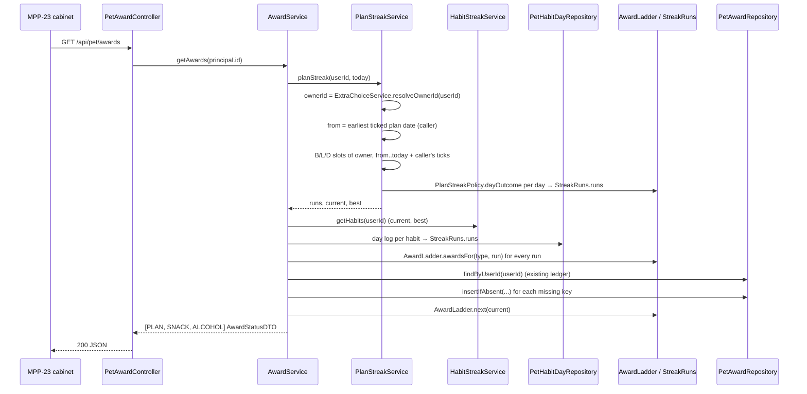

# Plan: Plan streak and the repeating milestone ladder (awards ledger)

Plan folder: `.claude/contract/MPP-22-plan-streak-award-ladder/`
Execution status: see `tasks.md` in this folder.

---

## Part 1 — Alignment

### Task reference

Jira **MPP-22** (Task, Medium, parent epic MPP-15 "Pip's room", Phase D). It is blocked by MPP-20 (habit streaks backend) and MPP-33 (per-person Pip), and both are in Ready for Test. It blocks MPP-23 (trophy cabinet), MPP-24 (firsts) and MPP-31 (glow-up). Breakdown source: `.claude/contract/MPP-15-epic-breakdown/tasks.md` → T7. Design reference: `.claude/contract/MPP-15-epic-breakdown/mockups/pip-room-mockup-v5.html` → tap the cabinet.

Acceptance criteria (verbatim):

1. Ladder constant: 1, 3, 5 and 7 days, then 2 weeks, 3 weeks and 1 month (30). Cycle length is 30: streak day `s` maps to ladder day `((s−1) mod 30)+1`, so day 31 re-earns the 1-day award.
2. Plan streak, **per person**: a day counts when every breakfast/lunch/dinner planned that day on the shared plan is marked eaten **by that person** (MPP-33). Days with nothing planned neither count nor break it.
3. Migration adds an award ledger. Each row is (user, streak type PLAN/SNACK/ALCOHOL, milestone, streak start date, cycle index), unique, so awarding is idempotent.
4. `GET /api/pet/awards` returns, per streak type: `current`, `best`, `counts {milestone: n}` and `next {milestone, inDays}`, for the caller.
5. Tests cover crossing day 30 into day 31, re-earning after a lapse, idempotency, and two linked users with different eaten ticks getting different plan streaks. `mvn test` is green.

Out of scope on the ticket: cabinet UI (MPP-23), firsts (MPP-24), any currency payout for awards. Dependencies & risks on the ticket: the plan-streak definition is still open in the spec and must live in one method so it can be changed; everything is per person; the migration goes to Railway before deploy; Skill: java-backend.

### Restated goal

Build the one rules engine the trophy cabinet will read. It derives a per-person "followed the plan" streak from that person's own eaten ticks on the shared plan. It applies one 30-day repeating milestone ladder to that streak and to the two MPP-20 habit streaks. It records every milestone crossed in a durable, idempotent award ledger, so each award has an "earned ×N" count. All of this is exposed as `GET /api/pet/awards`, one status per streak type for the caller. No UI, no currency.

### In scope

- Migration `foodbytes-app/database/migrations/2026-10-13-mpp22-pet-awards.sql` creating `pet_awards`. It is applied to the **local** `foodbytes-db` and recorded as order 3 in the epic's Railway checklist.
- `StreakType` enum (PLAN, SNACK, ALCOHOL), `PetAward` entity, `PetAwardRepository`.
- `AwardLadder`: the ladder constant, ladder-day mapping, milestones crossed by a run, and the next milestone.
- `StreakRuns`: turns a dated series of day outcomes (counts / breaks / neutral) into runs, plus `current` and `best`.
- `PlanStreakPolicy.dayOutcome(...)`: **the one method** that defines a plan day.
- `PlanStreakService`: loads the shared plan's breakfast/lunch/dinner slots and the caller's own ticks, and returns the plan runs.
- `AwardService.getAwards(userId)`: computes runs for all three streak types, tops up the ledger, and builds the response.
- `PetAwardController` → `GET /api/pet/awards`; `AwardStatusDTO`, `NextMilestoneDTO`.
- Two new read queries: `MealPlanEntryRepository.findMainMealSlots`, and `MealPlanEntryEatenRepository.findEarliestEatenPlanDate`.
- Tests covering every AC-5 scenario, plus a local boot check proving `ddl-auto: validate` accepts `pet_awards`.
- Version bump (Task → MINOR) and a CHANGELOG line.

### Explicitly out of scope

- Cabinet UI, trophy/ribbon art, any frontend service module (MPP-23).
- Firsts (MPP-24), currency payout on award (MPP-25), the 30-day fitness score (MPP-31).
- Changing MPP-20 habit semantics (`HabitStreakService` / `HabitStreakPolicy` are read, not edited).
- Changing how ticks are written (`MealPlanService` tick/untick paths are untouched).
- Revoking awards when a tick is later removed (see Risks).
- Any Railway apply or Railway MCP use (local-first epic).

### Pattern Reference

None supplied beyond "Skill: java-backend". Chosen references, all from the MPP-20 / MPP-33 slices on this branch:

- `controller/PetHabitController.java`: `/api/pet/*` controller with an explicit 401 `{error}` body.
- `service/HabitStreakPolicy.java`: a static `final` rules class, unit-tested without storage.
- `service/HabitStreakService.java` + `HabitStreakServiceTest.java`: a `Clock`-injected service with a Mockito test using `Clock.fixed(…, HabitStreakPolicy.ZONE)`.
- `model/PetHabitStreak.java`: enum column as `@Enumerated(STRING)` + `@JdbcTypeCode(SqlTypes.VARCHAR)`, with PK-based `equals`/`hashCode`.
- `repository/MealPlanEntryEatenRepository.java#insertIfAbsent`: native `INSERT … ON DUPLICATE KEY UPDATE` for idempotent writes.
- `database/migrations/2026-10-13-mpp20-pet-habit-streaks.sql`: migration header style, `CHECK` constraint, FK with `ON DELETE CASCADE`.
- `service/ExtraChoiceService#resolveOwnerId`: the public "effective meal-plan owner" lookup.

### Constraints flagged on the brief

- **Per person:** every streak and award is keyed by `UserPrincipal.getId()`. The meal-plan owner is used **only** to find which entries are planned, never whose ticks count (memory `pip-per-person`).
- **Plan-day definition lives in one method** (`PlanStreakPolicy.dayOutcome`), so it can change.
- **Ladder repeats every 30 days**, and day 31 re-earns the 1-day award.
- **Ledger is unique**, so awarding is idempotent.
- **`ddl-auto: validate`:** migration first, then the entity, then a boot check.
- **Local-first epic:** apply to local `foodbytes-db` only, and append to `railway-migrations.md`.
- **No variety rewards** (memory `pet-no-variety-rewards`). Awards are consistency-only, which this design is by construction.

### Assumptions made

1. **Table `pet_awards`**, with columns `user_id, streak_type, milestone, streak_start, cycle_index, awarded_at` and unique key `uk_pet_awards (user_id, streak_type, milestone, streak_start, cycle_index)`. The `pet_` prefix matches MPP-20. `awarded_at` is an audit column only.
2. **Awards are recorded by a sync-on-read in `GET /api/pet/awards`**, not by hooks on tick or answer. Every sync re-derives all runs from history and inserts only the missing ledger rows, so nothing is lost if the cabinet isn't opened for weeks. The GET therefore writes, idempotently.
3. **Ledger rows are never deleted.** An award, once recorded, stays even if a later untick shortens the plan streak. `counts` come from the ledger, while `current`/`best` come from live data.
4. **Plan day outcome:** a day with ≥1 breakfast/lunch/dinner entry on the owner's plan **counts** when the caller has ticked every one of them, and **breaks** otherwise. A day with none is **neutral**. **Today is neutral while incomplete**, so an un-ticked dinner at noon doesn't break the streak. Future days are never read. Snacks and extras are ignored (`meals.key` ∈ `breakfast`, `lunch`, `dinner`).
5. **Plan streak length counts counted days, not calendar days.** Neutral days are skipped, so `s` and `next.inDays` are in counted days.
6. **The plan history window starts at the caller's earliest ticked plan date.** No counted day can exist before the first tick, and MPP-33 dropped all old shared ticks, so this bounds the scan without changing any result.
7. **Habit `current`/`best` come from `HabitStreakService.getHabits`.** That keeps the cabinet consistent with the check-in bubble. Habit **ledger rows** are derived from the `pet_habit_days` log (`clean` → counts, not clean → breaks), whose runs are the same streaks MPP-20 stores.
8. **`current` for PLAN** is the length of the last run if no breaking day follows it, otherwise 0. **`best`** is the longest run in the window.
9. **`next`:** with ladder day `L` (0 when `current = 0`), it is the smallest milestone `> L`, and `inDays = milestone − L`. At `L = 30` it is `{milestone: 1, inDays: 1}` (the next cycle).
10. **Response:** a JSON array of three statuses in the order PLAN, SNACK, ALCOHOL. Each carries `streakType`. `counts` always lists all seven milestones in ladder order, including zeros, so MPP-23 never has to fill gaps. JSON keys are strings (`"1"`, `"3"`, …), as Jackson writes `Map<Integer,…>`.
11. **Owner resolution reuses `ExtraChoiceService.resolveOwnerId`.** It is public and already reused by `ManageExtrasService`, while `MealPlanService`'s equivalent is private.
12. **`milestone` is `TINYINT UNSIGNED`** with a `CHECK (milestone IN (1,3,5,7,14,21,30))`, mapped to `Integer` with `columnDefinition`-free validation (Hibernate accepts `tinyint` for `Integer`; proven by the boot check). `cycle_index` is `INT`.
13. **New controller `PetAwardController`** under `/api/pet/awards`, one resource per controller as in MPP-20.
14. **Version bump: Task → MINOR.**

### Cross-code alignment audit (FE ↔ BE ↔ DB)

Run against the **local** `foodbytes-db` (MySQL 8.0.46). MPP-15 is local-first, so Railway was not read.

- **Meal types:** `SELECT id, key, name, display_order FROM meals` → `1 breakfast`, `2 lunch`, `3 dinner`, `4 snacks`, `5 extras`. The plan-day keys are `breakfast`, `lunch`, `dinner`. ✔
- **Per-person ticks (MPP-33) applied:** `SHOW COLUMNS FROM meal_plan_entry_eaten` → `id bigint PRI auto_increment`, `meal_plan_entry_id bigint NOT NULL MUL`, `user_id bigint NOT NULL MUL`, `eaten_at timestamp NOT NULL`. Matches `MealPlanEntryEaten`. ✔
- **Habit log (MPP-20) applied:** `SHOW COLUMNS FROM pet_habit_days` → `id bigint`, `user_id bigint`, `habit varchar(16)`, `day date`, `clean tinyint(1)`. Matches `PetHabitDay`. ✔
- **No name collision:** `SHOW TABLES LIKE '%award%'` → empty, and `SHOW TABLES LIKE 'pet%'` → `pet_habit_days`, `pet_habit_streaks`. ✔
- **Outstanding migrations:** MPP-33 and MPP-20 are both applied locally and listed in `railway-migrations.md` as orders 1 and 2. Nothing unapplied blocks startup. ✔ The untracked `2026-10-13-add-picanha-*` / `picanha-parsley-*` recipe migrations are unrelated data files and don't affect validation.
- **Data volumes:** 13 users, 2 linked (`meal_plan_owner_id IS NOT NULL`). `meal_plan_entries` by type: breakfast 280, lunch 256, dinner 264. `meal_plan_entry_eaten` has 1 row, and `pet_habit_days` has 0. The full-history scan is a few hundred rows at most. The new table starts empty, so no backfill is needed.
- **Names across the chain:** DB `streak_type / milestone / streak_start / cycle_index / awarded_at` ↔ entity `streakType / milestone / streakStart / cycleIndex / awardedAt` ↔ JSON `streakType / current / best / counts / next.milestone / next.inDays` (the AC-4 keys plus `streakType`). There is no frontend consumer yet (MPP-23).
- **`users.id`** is `bigint`, so the FK `user_id BIGINT` matches (as in MPP-20). ✔

---

## Part 2 — Technical design

### Approach

The slice has three layers of rules and one orchestrator. **What a day is** lives in one place per streak type. For PLAN that is `PlanStreakPolicy.dayOutcome(planned, eaten, isToday)`, the single method the ticket asks for. For habits, the MPP-20 log already stores `clean`. **What a run is** is generic: `StreakRuns.runs(SortedMap<LocalDate, DayOutcome>)` walks dated outcomes, skips neutral days, ends a run on a break, and reports each run's start date and counted length. It also reports whether the last run is still alive. **What a run earns** is `AwardLadder`. Streak day `s` maps to ladder day `((s−1) mod 30)+1`, a run of length `n` crosses every `s ≤ n` whose ladder day is a milestone, and each crossing is an `AwardKey(streakType, milestone, streakStart, cycleIndex = (s−1)/30)`. All three are static and pure, so the day-30→31 crossing and the lapse/re-earn cases are tested without any storage.

`PlanStreakService` is the only part that touches the meal plan. It resolves the shared plan's owner via `ExtraChoiceService.resolveOwnerId`. It reads the caller's earliest ticked plan date, then the owner's breakfast/lunch/dinner slots from that date to today (a lean projection, no recipe fetch), then **the caller's own** ticks on those slots via the existing `findByUserIdAndMealPlanEntryIdIn`. It groups them by date into `DayOutcome`s and hands them to `StreakRuns`. Two linked users therefore share the slots but not the ticks, so they get different streaks. That is the per-person rule from MPP-33.

`AwardService.getAwards(userId)` is the orchestrator and the single `@Transactional` boundary. For PLAN it takes runs, `current` and `best` from `PlanStreakService`. For SNACK/ALCOHOL it takes runs from `pet_habit_days`, and `current`/`best` from `HabitStreakService.getHabits`. It converts all runs into award keys and loads the caller's existing ledger once. It inserts only the missing keys, with a native `INSERT … ON DUPLICATE KEY UPDATE id = id` as the race backstop. It then builds `counts` from the ledger (existing + inserted) and `next` from `current`. The unique key makes the whole sync idempotent: a second call computes the same keys and inserts nothing.

Roads not taken: **awarding from hooks** in the tick and answer paths would make "earned" instantaneous, but couples two existing services to the cabinet. It would also need un-award logic on untick and still miss history from before this ticket. Sync-on-read is self-healing and keeps the rule in one service, and MPP-25 can still pay out at the point of insertion later. **A stored plan-streak summary row** (as MPP-20 has) would go stale on every tick/untick and on any edit to the shared plan by the partner; deriving from data can't drift. **Computing habit awards from `HabitStreakService` state only** (current/best) can't recover milestones crossed in earlier, already-lapsed runs; the day log can. **Reusing `findByUserIdAndDateRange`** for slots would `JOIN FETCH` recipes for hundreds of entries just to read ids and dates.

### Skills to invoke during execution

- `java-backend` — owns every Java task (enum, entity, repositories, policies, services, DTOs, controller, tests) and the migration mechanics: date-prefixed file, then local apply, then entity, then boot check.
- Rules: no `.claude/rules/` file applies. This ticket touches no recipe, ingredient, macro or variant data.

### Diagram



### Data shapes

#### DDL — `foodbytes-app/database/migrations/2026-10-13-mpp22-pet-awards.sql`

```sql
CREATE TABLE IF NOT EXISTS pet_awards (
  id           BIGINT           NOT NULL AUTO_INCREMENT,
  user_id      BIGINT           NOT NULL,
  streak_type  VARCHAR(16)      NOT NULL,
  milestone    TINYINT UNSIGNED NOT NULL,
  streak_start DATE             NOT NULL,
  cycle_index  INT              NOT NULL,
  awarded_at   TIMESTAMP        NOT NULL DEFAULT CURRENT_TIMESTAMP,
  PRIMARY KEY (id),
  UNIQUE KEY uk_pet_awards (user_id, streak_type, milestone, streak_start, cycle_index),
  CONSTRAINT chk_pet_awards_streak_type CHECK (streak_type IN ('PLAN','SNACK','ALCOHOL')),
  CONSTRAINT chk_pet_awards_milestone   CHECK (milestone IN (1,3,5,7,14,21,30)),
  CONSTRAINT chk_pet_awards_cycle_index CHECK (cycle_index >= 0),
  CONSTRAINT fk_pet_awards_user FOREIGN KEY (user_id)
    REFERENCES users (id) ON DELETE CASCADE
) ENGINE=InnoDB;
```

The unique key leads with `user_id`, so it also serves the FK and the per-user `findByUserId` read. No separate index is needed.

#### Enum — `model/StreakType.java`

```java
public enum StreakType { PLAN, SNACK, ALCOHOL;
    public static StreakType of(Habit habit) { return valueOf(habit.name()); }
}
```

#### Entity — `model/PetAward.java` → `@Table(name = "pet_awards")`, unique constraint `uk_pet_awards`

| Field | Type | Column |
|---|---|---|
| `id` | `Long` | `id` IDENTITY |
| `userId` | `Long` | `user_id` not null |
| `streakType` | `StreakType` | `streak_type` not null, `@Enumerated(STRING)`, `@JdbcTypeCode(SqlTypes.VARCHAR)`, length 16 |
| `milestone` | `Integer` | `milestone` not null |
| `streakStart` | `LocalDate` | `streak_start` not null |
| `cycleIndex` | `Integer` | `cycle_index` not null |
| `awardedAt` | `LocalDateTime` | `awarded_at` not null, `insertable = false, updatable = false` (DB default) |

Lombok `@Data @NoArgsConstructor @AllArgsConstructor`, PK-based `equals`/`hashCode` as `PetHabitStreak`.

#### Repositories

```java
// PetAwardRepository extends JpaRepository<PetAward, Long>
List<PetAward> findByUserId(Long userId);

@Modifying
@Query(value = "INSERT INTO pet_awards (user_id, streak_type, milestone, streak_start, cycle_index) " +
               "VALUES (:userId, :streakType, :milestone, :streakStart, :cycleIndex) " +
               "ON DUPLICATE KEY UPDATE id = id", nativeQuery = true)
void insertIfAbsent(@Param("userId") Long userId, @Param("streakType") String streakType,
                    @Param("milestone") int milestone, @Param("streakStart") LocalDate streakStart,
                    @Param("cycleIndex") int cycleIndex);

// MealPlanEntryRepository — new
interface PlannedMealSlot { Long getId(); LocalDate getPlanDate(); }   // nested in MealPlanEntryRepository

@Query("SELECT mpe.id AS id, mpe.planDate AS planDate FROM MealPlanEntry mpe " +
       "WHERE mpe.user.id = :ownerId AND mpe.meal.key IN :mealKeys " +
       "AND mpe.planDate >= :from AND mpe.planDate <= :to")
List<PlannedMealSlot> findMainMealSlots(@Param("ownerId") Long ownerId,
                                        @Param("mealKeys") Collection<String> mealKeys,
                                        @Param("from") LocalDate from, @Param("to") LocalDate to);

// MealPlanEntryEatenRepository — new
@Query("SELECT MIN(mpe.planDate) FROM MealPlanEntry mpe, MealPlanEntryEaten t " +
       "WHERE t.mealPlanEntryId = mpe.id AND t.userId = :userId")
Optional<LocalDate> findEarliestEatenPlanDate(@Param("userId") Long userId);
```

`findEarliestEatenPlanDate` is deliberately not filtered by owner. A tick can only exist on an entry the caller could see, so the minimum is still a safe lower bound.

#### Rules — `service/StreakRuns.java` (final, static)

```java
public enum DayOutcome { COUNTS, BREAKS, NEUTRAL }

public record Run(LocalDate start, int length) {}           // length = counted days, ≥ 1

public record Summary(List<Run> runs, int current, int best) {}
        // current = last run's length if no BREAKS day follows it, else 0; best = max length, 0 if none

public static Summary summarise(SortedMap<LocalDate, DayOutcome> days)
        // dates absent from the map are neutral; NEUTRAL entries are skipped
```

#### Rules — `service/PlanStreakPolicy.java` (final, static)

```java
public static final List<String> MAIN_MEAL_KEYS = List.of("breakfast", "lunch", "dinner");

/** THE plan-day definition (MPP-22 AC 2). Change the rule here and nowhere else. */
public static DayOutcome dayOutcome(int planned, int eatenByCaller, boolean isToday)
        // planned == 0                      → NEUTRAL
        // eatenByCaller >= planned          → COUNTS
        // isToday (still in progress)       → NEUTRAL
        // otherwise                         → BREAKS
```

#### Rules — `service/AwardLadder.java` (final, static)

```java
public static final List<Integer> MILESTONES = List.of(1, 3, 5, 7, 14, 21, 30);
public static final int CYCLE = 30;

public record AwardKey(StreakType type, int milestone, LocalDate streakStart, int cycleIndex) {}

static int ladderDay(int streakDay)                       // ((s-1) % 30) + 1; 0 for s <= 0
static List<AwardKey> awardsFor(StreakType type, StreakRuns.Run run)
        // for s in 1..run.length: if MILESTONES contains ladderDay(s) → AwardKey(type, ladderDay(s), run.start, (s-1)/30)
static NextMilestoneDTO next(int current)
        // L = ladderDay(current); first m in MILESTONES with m > L → (m, m - L); none (L == 30) → (1, 1)
```

#### Services

```java
// service/PlanStreakService — @Service @RequiredArgsConstructor
// deps: ExtraChoiceService, MealPlanEntryRepository, MealPlanEntryEatenRepository
@Transactional(readOnly = true)
public StreakRuns.Summary planStreak(Long userId, LocalDate today)

// service/AwardService — @Service @RequiredArgsConstructor
// deps: PlanStreakService, HabitStreakService, PetHabitDayRepository, PetAwardRepository, Clock
@Transactional
public List<AwardStatusDTO> getAwards(Long userId)
```

#### DTOs

```java
// dto/AwardStatusDTO.java — @Data @NoArgsConstructor @AllArgsConstructor
private StreakType streakType;            // "PLAN" | "SNACK" | "ALCOHOL"
private int current;
private int best;
private Map<Integer, Integer> counts;     // LinkedHashMap, all 7 milestones in ladder order, zeros included
private NextMilestoneDTO next;

// dto/NextMilestoneDTO.java — @Data @NoArgsConstructor @AllArgsConstructor
private int milestone;                    // 1 | 3 | 5 | 7 | 14 | 21 | 30
private int inDays;                       // ≥ 1
```

#### HTTP contract

```
GET /api/pet/awards
200 [ {"streakType":"PLAN","current":31,"best":31,
       "counts":{"1":2,"3":1,"5":1,"7":1,"14":1,"21":1,"30":1},
       "next":{"milestone":3,"inDays":2}},
      {"streakType":"SNACK", ...}, {"streakType":"ALCOHOL", ...} ]
401 {"error":"Not authenticated"}
```

### Runtime quality notes

- **Resource cleanup:** All DB work runs inside the Spring-managed `@Transactional` `getAwards`. There are no manual connections or streams. `PlanStreakService`'s `readOnly` transaction joins the outer one.
- **Concurrency / ordering:** Two concurrent GETs for the same user compute identical keys. Both may try the same insert, and `ON DUPLICATE KEY UPDATE id = id` makes the loser a no-op instead of a constraint error. A partner ticking the shared plan doesn't change *your* ticks, only which slots are planned. A slot your partner adds to a past day would retroactively break that day for you on the next sync. Ledger rows already recorded stay (assumption 3). Different users never contend.
- **Allocation / cost behaviour:** Each GET does a fixed number of queries: owner lookup, earliest tick, slots (bounded by days since first tick × 3), ticks (one `IN` over those ids), two habit day logs, one habit summary read, and one ledger read. Then it does one insert per *new* award only. There is no N+1. With today's data (≤ 280 entries per meal type across all users) it is trivial. Growth is linear in days of history. If the `IN` list ever grows into the thousands, replace it with a join query; flagged under Risks, not built now.
- **Error paths:** No principal → 401 `{error}`. A user with no ticks and no habit answers gets three zeroed statuses (`next = {1, 1}`), not an error. An unknown user id can't occur behind auth, and `resolveOwnerId` already falls back to the caller's own id. A DB failure propagates as a 500 and rolls back any partial ledger inserts. Nothing is swallowed.

### Risks and judgement calls

- **GET writes (assumption 2).** That is unusual, but it is idempotent and safe to retry. The alternative (hooks) is listed under Approach. If you would rather "earned" happen at tick/answer time, red-line it now: it changes Phase 3's shape.
- **Ledger vs live drift (assumption 3).** If a user ticks a full week, opens the cabinet (7-day award recorded), then unticks a day, `counts` keeps the award while `current` drops. If they re-tick, the run's start date is unchanged, so no duplicate. If instead they untick a *middle* day and the cabinet syncs, the second half becomes a new run with its own start date. Its 1/3/5-day awards would be recorded and survive a later re-tick. That is a small over-count, possible only through deliberate untick/re-tick. Accepted rather than revoking awards.
- **Partner edits to past days of the shared plan** can retroactively break your plan streak (live `current`/`best` drop), because the AC defines a day by what is planned on the shared plan. The ledger keeps already-recorded awards.
- **Today is neutral until complete (assumption 4).** Without it, `current` would read 0 every morning until dinner was ticked. With it, today's day credits as soon as the last planned meal is ticked.
- **Habit runs from the day log vs MPP-20's `best`.** These agree by construction (MPP-20 logs every covered day, and runs end only at a `clean = false` row). A test pins one shared scenario so a future MPP-20 change that breaks the agreement fails loudly.
- **`TINYINT UNSIGNED` ↔ `Integer` (assumption 12).** Hibernate 6's validator accepts `tinyint` for `Integer` on MySQL. If the boot check reports `Schema-validation: wrong column type … [milestone]`, the fallback is to change the column to `INT` in the migration (re-apply locally: drop and recreate, since the table is empty).
- **Reusing `ExtraChoiceService.resolveOwnerId` (assumption 11)** couples the awards to the extras service for one lookup. The alternative is to make `MealPlanService.getEffectiveMealPlanOwnerId` public. Either is fine; the former already has a second caller.
- **Manual step owned by the developer:** none now. The migration is appended to `.claude/contract/MPP-15-epic-breakdown/railway-migrations.md` as order 3 and must be applied to Railway before the merged backend deploys at epic merge time.
