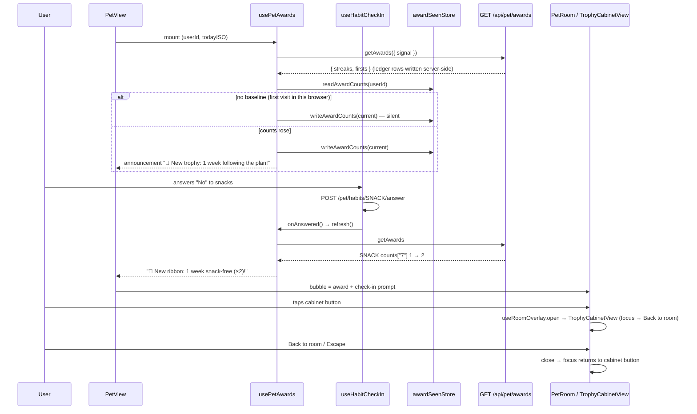

# Plan: Trophy cabinet — tap to see trophies, ribbons and streaks

Plan folder: `.claude/contract/MPP-23-pip-trophy-cabinet/`
Execution status: see `tasks.md` in this folder.

---

## Part 1 — Alignment

### Task reference

Jira **MPP-23** (Story, Medium, parent epic MPP-15 "Pip's room", Phase D). Blocked by MPP-16 (room scaffold), MPP-22 (plan streak + award ledger) and MPP-24 (firsts); all three are in Ready for Test. It blocks MPP-28 (integration) and MPP-32 (wardrobe). Breakdown: `.claude/contract/MPP-15-epic-breakdown/tasks.md` → T8. Design: `.claude/contract/MPP-15-epic-breakdown/mockups/pip-room-mockup-v5.html` → tap the cabinet; "+7 clean days ⏩".

Acceptance criteria (verbatim):

1. The cabinet is a keyboard-reachable button. It opens a full-screen view inside the room card with "Back to room", and focus returns to the cabinet on close.
2. Three shelves:
   * 📅 Followed the plan (trophies), 🍪 No snacks (ribbons), 🍷 No alcohol (ribbons).
   * Each shows "Now N days · best M" and "next: <milestone> in X days".
3. Each of the 7 awards shows a gold **×N** badge when earned and is greyed when N = 0.
4. The note "The ladder starts again after a month…" is shown, and a "Firsts — things to try" shelf lists the firsts as earned / to do.
5. When a new award is earned (from a check-in answer or the plan streak), Pip's bubble announces it: "🎉 New ribbon: 1 week snack-free (×2)!".

Scope on the ticket: in = cabinet view, award rendering, the new-award bubble. Out = cabinet upgrades (MPP-26). Dependencies & risks on the ticket: the cabinet shows the **viewer's own** awards (per-person Pip, MPP-33); the cabinet art in the room stays level 1 until MPP-26; Skill: react-frontend.

### Restated goal

Make the trophy cabinet in Pip's room a real button. Tapping it opens a full-card overlay, the same way the fridge does, that reads the caller's own `GET /api/pet/awards` (built by MPP-22 and reshaped by MPP-24) and draws three shelves: plan (trophies), no snacks and no alcohol (ribbons). Each shelf has a current/best line, a "next" line and the seven ladder awards, which show a gold ×N badge or are greyed out. Under the shelves sit the "ladder starts again" note and a "Firsts — things to try" list. Separately, when a fetch of the awards shows a count that went up since this browser last looked, Pip's speech bubble announces the new award once. That happens on visiting /pet, after a check-in answer, and when the tab becomes visible again. This is frontend only; the endpoint already exists.

### In scope

- `petService.getAwards({ signal })` for `GET /api/pet/awards`.
- Constants for the cabinet: streak types and shelf metadata, ladder labels, firsts labels, copy, bubble timing, storage key (`constants/petAwards.js`).
- Pure rules in `utils/petAwards.js` (shelf order, streak and next lines, award diff, announcement text, firsts list), pinned by `utils/petAwards.check.mjs` and an `npm run check:awards` script.
- A per-user "last seen award counts" store (`utils/awardSeenStore.js`, memory + localStorage, same shape as `pipSeenStore`).
- A `usePetAwards({ userId, todayISO })` hook: an abortable fetch, the four async states, `refresh()`, and a queue of announcements with a timer.
- Shared trophy / ribbon SVG art (`awardArt.jsx`), reused by `furniture.jsx`.
- `cabinetHitBox(level)` in `roomLayout.js` plus checks in `room.check.mjs`.
- A cabinet button over the cabinet art in `PetRoom`, a second `useRoomOverlay`, the room made inert when either overlay is open, and the hint changed to "Tap the fridge 🧊 or cabinet 🏆".
- `TrophyCabinetView` (dialog, head, loading / error / loaded) and `StreakShelf` (one shelf of seven awards), each with its CSS.
- `useHabitCheckIn` gains an `onAnswered` callback and returns `prompt` separately. `PetView` merges the award announcement into the bubble.
- Version bump (Story → MINOR) and a CHANGELOG line.

### Explicitly out of scope

- Cabinet upgrades, level 2–4 art in the room, or any shop (MPP-26). The room still draws cabinet level 1.
- Any backend, DTO or migration change. `GET /api/pet/awards` is used exactly as MPP-24 left it.
- Announcing **firsts** in the bubble. AC 5 names awards "from a check-in answer or the plan streak". The firsts list only shows in the cabinet.
- Currency or wardrobe payouts (MPP-25, MPP-32).
- Syncing "already announced" across devices. The seen-counts baseline is per browser, as the cook-scene marker is (MPP-18).
- Ticking meals from /pet. Ticks still happen on Meal Plan, and the plan-streak award is announced on the next /pet visit.
- The MPP-28 single pet payload: this ticket adds one more request on /pet.

### Pattern Reference

None supplied beyond the mockup. Chosen references:

- **Overlay:** `FridgeView.jsx` + `useRoomOverlay.js` + `FridgeButton` in `PetRoom.jsx` (MPP-19). The cabinet is the "MPP-23's cabinet can reuse it" case that `useRoomOverlay`'s doc comment already names.
- **Hit box:** `fridgeHitBox` in `roomLayout.js`, pinned in `room.check.mjs`.
- **Hook with a timer, a user-scoped store and a kind bubble line:** `useHabitCheckIn.js` + `checkInSnoozeStore.js` (MPP-21), `useCookAndServe.js` + `pipSeenStore.js` (MPP-18).
- **Pure rules + node check script:** `utils/habitCheckIn.js` + `habitCheckIn.check.mjs`.
- **Visual and copy:** mockup v5 `cabinetHtml()`, `award()`, `nextMilestone()`, `trophy()`, `ribbon()` and the `.overlay / .shelf / .award / .times / .streak / .todo / .cnote` CSS.
- Conventions: `.claude/skills/react-frontend/SKILL.md` and `references/engineering-standards.md`.

### Constraints flagged on the brief

- **Per person:** the endpoint already returns the caller's own awards (MPP-22/24 used `userPrincipal.getId()`, never the plan owner). The seen-counts store is keyed by user id so two people on one browser don't steal each other's announcements.
- **Cabinet art stays level 1** (`DEFAULT_ROOM_LEVELS.cabinet`). The hit box still covers levels 1–4 so MPP-26 only changes a number.
- **Keyboard:** a real `<button>` over the art, a focus trap in the dialog, Escape closes it, and focus returns to the cabinet button (AC 1). This is what `useRoomOverlay` already does.
- **Mobile-first and PWA touch rules:** 44 px targets, hover behind `@media (hover: hover)`, `:focus-visible`, no horizontal scroll at 320 px (epic DoD 8). Reduced motion: there is no new animation.
- **Kind tone** (epic, MPP-21): no shaming copy. A 0-day streak reads "Now 0 days · best M".
- **No variety rewards** (memory `pet-no-variety-rewards`): the cabinet only renders what the server sends, which is consistency awards and the four feature firsts.

### Assumptions made

- **Frontend only, using the existing endpoint.** The ticket says "Skill: react-frontend", and `GET /api/pet/awards` already returns `{ streaks, firsts }` (verified in source, see the audit).
- **Cabinet state lives in a feature hook (`usePetAwards`) called by `PetView`, not in `PetContext`.** The skill says feature-specific state never goes into a global Context, and only /pet reads the awards.
- **"New award" = a milestone's ×N count rose since this browser last saw it.** The server persists awards as a side effect of the GET (`AwardService.getAwards` is `@Transactional` and inserts idempotently), so any fetch is the moment of earning. The client compares with a stored baseline. Alternative rejected: a backend "unseen" flag, which needs a migration and is out of the ticket's skill.
- **First load in a browser announces nothing.** With no baseline, the hook saves the current counts quietly. Otherwise a first visit would announce every award ever earned.
- **One announcement per streak type per fetch, for its highest new milestone, queued across types** (plan, then snacks, then alcohol). Each shows for `AWARD_BUBBLE_MS` = 6000 ms. Why: after a week away the plan ladder could cross 1, 3, 5 and 7 in one fetch, and three bubbles in a row for one streak is noise. The mockup also announces only the last hit.
- **The baseline is written when the change is detected, not when the bubble is shown.** A reload never repeats an announcement, which matches MPP-18 AC 4's "mark seen at once". The trade-off is that an announcement queued behind the cook scene is lost if the user leaves within seconds.
- **Bubble priority: cook scene > check-in (award replaces its reaction, keeps its question) > award > fridge-low > mood.** `useHabitCheckIn` returns `prompt` separately so `PetView` can show "🎉 New ribbon: … Did you have any alcohol today?" without hiding the open question.
- **Refetch triggers:** mount / user change, local date rollover (`todayISO`), the tab becoming visible, and `onAnswered` after a successful check-in answer. Not on `lastLoggedAt`, because ticks only happen on Meal Plan (`PetMealsCard` is not interactive), so returning to /pet remounts and fetches.
- **Copy:** labels `1 day, 3 days, 5 days, 1 week, 2 weeks, 3 weeks, 1 month` and the announcement wording are copied from the mockup's `LADDER` and `STREAKS.name`: "following the plan", "snack-free" and "alcohol-free". "(×N)" is added only when N > 1, which gives "🎉 New ribbon: 1 week snack-free (×2)!" (AC 5). The "next" line is `next: <label> in <X> day(s)`.
- **Firsts labels** are copied from the mockup: Make a template / Generate a shopping list / Plan a full week / Cook a homemade extra, with "✓ earned" or "to do".
- **The cabinet title follows the pet's name:** "🏆 {name}'s trophy cabinet", matching "🧊 {name}'s fridge".
- **The hit-box button class becomes generic.** `.pip-fridge-btn` is renamed `.pip-station-btn` and used by both buttons, so the 44 px / hover / focus rules aren't copied.
- **The trophy and ribbon art moves to `awardArt.jsx`.** `furniture.jsx`'s `TrophyAt` / `RibbonAt` wrap it, so the room and the cabinet can't drift apart.
- **Version:** Story → MINOR bump, computed at apply time.

### Cross-code alignment audit (FE ↔ BE ↔ DB)

No schema, entity or DTO changes, so the live/local DB checks (Step 1.6 items 1–3, 5) are skipped. The FE ↔ BE contract was checked against source:

- `PetAwardController` — `@RequestMapping("/api/pet/awards")`, `@GetMapping` → `ResponseEntity.ok(awardService.getCabinet(userPrincipal.getId()))`; `401 {"error":"Not authenticated"}` when there is no principal. The caller's own id, so the per-person rule is met.
- `PetAwardsDTO` — `private List<AwardStatusDTO> streaks; private List<FirstStatusDTO> firsts;`
- `AwardStatusDTO` — `private StreakType streakType; private int current; private int best; private Map<Integer, Integer> counts; private NextMilestoneDTO next;`. `counts` is a `LinkedHashMap` holding all 7 milestones in ladder order, zeros included (MPP-22 plan). Jackson writes the keys as strings (`"1"`, `"3"`, …), so the frontend reads `counts[String(m)]`.
- `NextMilestoneDTO` — `private int milestone; private int inDays;`
- `FirstStatusDTO` — `private FirstKey key; private Instant earnedAt;`. `earnedAt` is ISO-8601 or `null`. All 4 keys always come back, in `FirstKey` order: `MAKE_TEMPLATE, GENERATE_SHOPPING_LIST, PLAN_FULL_WEEK, COOK_HOMEMADE_EXTRA`.
- Naming chain: `streakType` / `current` / `best` / `counts` / `next.milestone` / `next.inDays` / `firsts[].key` / `firsts[].earnedAt` are used verbatim in the new frontend modules. There is no mapping layer to drift.
- Migration state: MPP-22 (`pet_awards`) and MPP-24 (`pet_firsts`) are applied locally (epic local-first, memory `mpp15-epic-local-first`) and queued in `MPP-15-epic-breakdown/railway-migrations.md`. This ticket adds nothing to that list.

---

## Part 2 — Technical design

### Approach

The cabinet copies the fridge's structure. `PetRoom` already lays a transparent `<button>` over the fridge art from a projected hit box and opens `FridgeView` through `useRoomOverlay`, which owns the focus trap, Escape and focus return. The cabinet gets the same three pieces: `cabinetHitBox(level)` in `roomLayout.js`, which projects a hand-copied `CABINET_FOOTPRINT` for levels 1–4; a second `useRoomOverlay()` in `PetRoom`; and `TrophyCabinetView`. The old fridge-only `FridgeButton` becomes a generic `StationButton({ box, label, buttonRef, onOpen })` used by both. The room scene is inert while either overlay is open. `PetRoom` takes a new `cabinet` prop (`{ data, loading, error, retry }`) the same way it takes `fridge`, so it stays presentational.

The data comes from a new feature hook, `usePetAwards({ userId, todayISO })`, called in `PetView` next to `useHabitCheckIn`. It does one abortable `GET /api/pet/awards` per trigger: mount or user, date rollover, tab visible, or `refresh()`. It keeps the last good data through a refetch error, as `PetContext` does for the pet. After each successful load it diffs the counts against `awardSeenStore` through the pure `newAwards()`, writes the new baseline, and queues one announcement per streak type that gained an award. A timer pops the queue every `AWARD_BUBBLE_MS`. The hook returns `{ cabinet, announcement, refresh }`. All wording and diff logic lives in `utils/petAwards.js`, which is pure, so `petAwards.check.mjs` pins it with Node's `assert` the way `habitCheckIn.check.mjs` does. There is no frontend test runner.

To announce an award earned **by a check-in answer**, `useHabitCheckIn` takes an optional `onAnswered` callback, called after a successful POST. `PetView` passes `awards.refresh`. The GET then runs `AwardService.getAwards`, which records the new ledger row and returns the higher count, and the diff turns it into "🎉 New ribbon: 1 week snack-free (×2)!". A plan-streak award shows up the same way on the next /pet fetch after the day's last meal is ticked on Meal Plan. `useHabitCheckIn` also returns `prompt` on its own, so `PetView` can replace the check-in's praise reaction with the award line and keep the open question under it.

Roads not taken. **A backend "unannounced" flag on `pet_awards`** would sync across devices, but it needs a migration, a write endpoint and backend work the ticket doesn't list, and the per-browser baseline matches MPP-18's cook marker. **Holding cabinet state in `PetContext`** would spread a /pet-only concern across every page (PetContext wraps the app), which the skill forbids. **Making the check-in POST return awards** would be a backend contract change. A refetch is one cheap GET. **A separate toast for awards** would break the "Pip's bubble announces it" AC and the room's single voice.

### Skills to invoke during execution

- `react-frontend` — owns every file in this ticket: the component and hook shape, the four async states, AbortController reads, the constants taxonomy, 44 px touch targets, `:focus-visible`, the 400-line budget and "never claim a test passed".

No `.claude/rules/` file applies: no recipes, ingredients, macros, meal-plan data or migrations are touched.

### Diagram



### Data shapes

No schema or backend contract changes. New frontend modules and shapes:

#### HTTP contract consumed (unchanged, MPP-24)

```
GET /api/pet/awards
200 {"streaks":[{"streakType":"PLAN","current":3,"best":7,
                 "counts":{"1":2,"3":1,"5":1,"7":1,"14":0,"21":0,"30":0},
                 "next":{"milestone":5,"inDays":2}}, …SNACK, …ALCOHOL],
     "firsts":[{"key":"MAKE_TEMPLATE","earnedAt":"2026-01-07T21:33:10Z"},
               {"key":"GENERATE_SHOPPING_LIST","earnedAt":null}, …]}
401 {"error":"Not authenticated"}
```

#### Service — `services/petService.js` (added method)

```js
/** MPP-23: the caller's own cabinet (MPP-22 streaks + MPP-24 firsts). @returns {Promise<{ streaks: Object[], firsts: Object[] }>} */
async getAwards({ signal } = {}) { const response = await api.get('/pet/awards', { signal }); return response.data }
```

#### Constants — `constants/petAwards.js` (new)

```js
export const STREAK_TYPES = { PLAN: 'PLAN', SNACK: 'SNACK', ALCOHOL: 'ALCOHOL' }
export const AWARD_STREAK_ORDER = [STREAK_TYPES.PLAN, STREAK_TYPES.SNACK, STREAK_TYPES.ALCOHOL]
export const AWARD_KINDS = { TROPHY: 'trophy', RIBBON: 'ribbon' }
export const AWARD_SHELVES = {
  PLAN:    { icon: '📅', title: 'Followed the plan', kind: 'trophy', name: 'following the plan' },
  SNACK:   { icon: '🍪', title: 'No snacks',         kind: 'ribbon', name: 'snack-free' },
  ALCOHOL: { icon: '🍷', title: 'No alcohol',        kind: 'ribbon', name: 'alcohol-free' }
}
export const AWARD_MILESTONES = [1, 3, 5, 7, 14, 21, 30]           // mirrors AwardLadder.MILESTONES
export const AWARD_MILESTONE_LABELS = { 1: '1 day', 3: '3 days', 5: '5 days', 7: '1 week', 14: '2 weeks', 21: '3 weeks', 30: '1 month' }
export const FIRST_KEYS = ['MAKE_TEMPLATE', 'GENERATE_SHOPPING_LIST', 'PLAN_FULL_WEEK', 'COOK_HOMEMADE_EXTRA']
export const FIRST_LABELS = { MAKE_TEMPLATE: 'Make a template', GENERATE_SHOPPING_LIST: 'Generate a shopping list',
                              PLAN_FULL_WEEK: 'Plan a full week', COOK_HOMEMADE_EXTRA: 'Cook a homemade extra' }
export const FIRST_EARNED_TEXT = '✓ earned'
export const FIRST_TODO_TEXT = 'to do'
export const CABINET_NOTE = "The ladder starts again after a month, so every award can be won again. ×N is how many times you've earned it."
export const CABINET_FIRSTS_TITLE = 'Firsts — things to try'
export const CABINET_LOAD_ERROR = "Couldn't load the trophy cabinet."
export const AWARD_BUBBLE_MS = 6000
export const AWARD_SEEN_STORAGE_KEY = 'foodbytes.pip.awardCountsSeen'   // suffixed with the user id
```

`constants/petRoom.js`: `FRIDGE_HINT` is renamed `ROOM_HINT = 'Tap the fridge 🧊 or cabinet 🏆'` (only `PetRoom.jsx` imports it).

#### Pure rules — `utils/petAwards.js` (new)

```js
/** streaks from the server → AWARD_STREAK_ORDER order; unknown types dropped, missing ones absent. */
export function orderStreaks(streaks)                        // → AwardStatus[]
/** counts[String(m)] as a whole number ≥ 0 (missing / bad → 0). */
export function awardCount(status, milestone)                // → number
/** "Now 1 day · best 9" / "Now 0 days · best 0" */
export function streakLine({ current, best })                // → string
/** "next: 5 days in 2 days" / "next: 1 day in 1 day"; null next → null */
export function nextLine(next)                               // → string|null
/** { PLAN: { 1: 2, 3: 1, … }, SNACK: {…}, ALCOHOL: {…} } — the shape awardSeenStore keeps. */
export function awardCountsOf(streaks)                       // → Object
/** Per streak type in AWARD_STREAK_ORDER: the highest milestone whose count rose vs baseline.
 *  baseline null → []. A type missing from baseline counts as all zeros. */
export function newAwards(baseline, streaks)                 // → Array<{ streakType, milestone, count }>
/** "🎉 New ribbon: 1 week snack-free (×2)!" / "🎉 New trophy: 3 days following the plan!" */
export function announcementText({ streakType, milestone, count })   // → string
/** FIRST_KEYS order: [{ key, label, earned: boolean }]; a missing key is not earned. */
export function firstsList(firsts)                           // → Array<{ key, label, earned }>
```

#### Store — `utils/awardSeenStore.js` (new)

```js
export function readAwardCounts(userId)          // → Object|null  (memory wins; corrupt JSON → null)
export function writeAwardCounts(userId, counts) // memory always, localStorage when available
```

#### Hook — `hooks/usePetAwards.js` (new)

```js
/**
 * @param {{ userId: number|null, todayISO: string }} input
 * @returns {{
 *   cabinet: { data: { streaks, firsts }|null, loading: boolean, error: string|null, retry: () => void },
 *   announcement: string|null,
 *   refresh: () => void
 * }}
 */
export function usePetAwards({ userId, todayISO })
```

#### Hook change — `hooks/useHabitCheckIn.js`

```js
export function useHabitCheckIn({ userId, todayISO, onAnswered })
// onAnswered?: () => void — called once after a successful answerHabit POST (not on failure, not on "Not now")
// return: { text, prompt, actions }   ← `prompt` added (the open question or "When did you have it?", null when none)
```

#### Layout — `components/pet/room/roomLayout.js`

```js
// [u, v, du, dv, h0, h1] outer box of FURNITURE.cabinet[level - 1] — hand-copied from furniture.jsx
export const CABINET_FOOTPRINT = [[0, 26, 24, 78, 0, 48], [0, 30, 22, 72, 30, 88], [0, 30, 26, 66, 0, 112], [0, 26, 30, 74, 0, 134]]
export function cabinetHitBox(level)   // → { x, y, width, height } in viewBox px
```

`fridgeHitBox` and `cabinetHitBox` share a private `boxCorners(u, v, du, dv, h0, h1)` projector. `fridgeHitBox`'s output is unchanged, and `room.check.mjs` already pins it.

#### Components

| File | Props | Role |
|---|---|---|
| `room/awardArt.jsx` (new) | `TrophyArt`, `RibbonArt` — no props; `AwardIcon({ kind })` → 40×40 `<svg aria-hidden>` | The mockup's `trophy()` / `ribbon()` paths, one source for the room and the cabinet |
| `room/TrophyCabinetView.jsx` (new) | `{ name, cabinet, titleId, panelRef, onClose }` | `role="dialog" aria-modal`, head + "Back to room", loading / error + "Try again" / loaded: 3 `StreakShelf`, note, firsts shelf |
| `room/StreakShelf.jsx` (new) | `{ status }` (one AwardStatus) | `<section>` with an `<h4>`, streak + next line, 7 awards: `AwardIcon`, label, `×N` badge, `is-locked` when 0. Each award has an aria-label like "1 week, earned 2 times" / "1 month, not earned yet" |
| `room/TrophyCabinetView.css` (new) | — | Mockup `.overlay` brown gradient, `.shelf`, `.award`, `.times`, `.streak`, `.todo`, `.cnote` as `pip-cabinet-*` classes |
| `room/PetRoom.jsx` (modified) | new prop `cabinet = null` | `StationButton` for fridge + cabinet, second overlay, inert when either is open, `ROOM_HINT` |

### Runtime quality notes

Mapped to the browser runtime: a single-threaded event loop, effect cleanup and re-render cost.

- **Resource cleanup:** each awards GET owns an `AbortController` that the effect cleanup aborts, and a cancellation (`ERR_CANCELED`) is swallowed. The announcement timer (`setTimeout`) is cleared in cleanup. The `visibilitychange` listener is removed on unmount. `useHabitCheckIn`'s POST is never aborted (skill rule). `onAnswered` runs only while mounted, guarded by its existing `mountedRef`.
- **Concurrency / ordering:** a new trigger aborts the GET in flight, so an older response can't overwrite a newer one. The diff-and-write happens in the `.then` of a non-aborted request, and the baseline is written before the announcement is queued, so two quick refreshes can't announce the same award twice: the second diff sees the updated baseline. On a shared plan each partner's awards come from their own principal, and the store is keyed by user id. Two tabs in one browser can both announce if they fetch at the same moment. That is harmless and accepted.
- **Allocation / cost behaviour:** one extra GET per /pet visit, check-in answer, date rollover or tab-visible. Server cost is the MPP-22 plan-streak scan, already accepted. `orderStreaks`, `newAwards` and the rest are O(3 × 7). No memoisation is added (skill: never without profiling). The cabinet renders only while open.
- **Error paths:** a failed GET sets `error` to the server's `error` field or `CABINET_LOAD_ERROR`, keeps the last good `data` when there is one, and announces nothing. Inside the cabinet: data → shelves; no data + error → `role="alert"` message + "Try again" (focus moves to the panel first, as FridgeView does); otherwise a spinner with `aria-busy`. A storage failure falls back to the in-memory baseline (it never throws into render). The awards fetch failing never blanks Pip or the check-in. Nothing is swallowed into a success shape: on failure `data` stays `null`, never an empty cabinet.

### Risks and judgement calls

- **The announcement depends on a client-side baseline.** Clearing site data, or a new browser, shows no announcement for awards earned in between. It never shows a false one: no baseline means silent. A cross-device "seen" flag needs the backend and is a candidate for MPP-28 integration.
- **The baseline is written on detection.** An award queued behind the cook scene is lost if the user leaves /pet within the cook scene + 6 s. The alternative, writing on display, risks repeat announcements on reload, which MPP-18 rejected for the cook scene.
- **The GET writes awards** (`AwardService.getAwards` is `@Transactional` and inserts ledger rows). Polling it more often isn't harmful (inserts are idempotent), but this plan deliberately keeps to event triggers and adds no polling.
- **`CABINET_FOOTPRINT` is hand-copied from `furniture.jsx`,** the same accepted coupling as `FRIDGE_FOOTPRINT`. MPP-26 must keep both in step. Level 2's shelves float at h 30–88 against the wall; the hit box spans that band only.
- **Renaming `.pip-fridge-btn` to `.pip-station-btn` and `FRIDGE_HINT` to `ROOM_HINT`** touches MPP-19 code. Both have one consumer each (Task M.2 greps to confirm), and the fridge behaviour is unchanged.
- **`useHabitCheckIn`'s return gains `prompt`, and its input gains `onAnswered`.** Its only consumer is `PetView`, and both changes are additive.
- **The bubble merge rule** (award replaces the check-in's reaction, never its question) is a UX call. Red-line it if you'd rather the award wait until the check-in ends.
- **Visual check is manual** — there's no frontend test runner. `npm run check:awards` and `npm run check:room` pin the pure rules. The cabinet itself is checked by eye at 320 px and on desktop.
