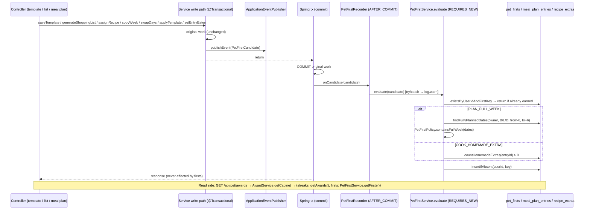

# Plan: "Firsts": one-off achievements for trying FoodBytes features

Plan folder: `.claude/contract/MPP-24-pip-firsts-achievements/`
Execution status: see `tasks.md` in this folder.

---

## Part 1 — Alignment

### Task reference

Jira **MPP-24** (Task, Medium, parent epic MPP-15 "Pip's room", Phase D). Blocked by MPP-22 (award ledger) and MPP-33 (per-person Pip), and both are in Ready for Test. It blocks MPP-23 (trophy cabinet) and MPP-32 (wardrobe). Breakdown source: `.claude/contract/MPP-15-epic-breakdown/tasks.md` → T9. The ticket supersedes T9's "firsts are per meal-plan owner" default: firsts are **per person**.

Acceptance criteria (verbatim):

1. Four firsts are recorded once **per person**, with a timestamp, credited to **the user who did it**:
   - **Make a template:** `POST /api/meal-plan-templates`.
   - **Generate a shopping list:** `POST /api/shopping-list/generate`.
   - **Plan a full week:** a 7-day window with B/L/D all planned, credited to whoever completes it.
   - **Cook a homemade extra:** an entry the person marked eaten (MPP-33) whose recipe has a linked extra chosen as homemade (MPP-10 server-side extra choices).
2. Recording is a side effect in the services, not the controllers, and never fails the original request.
3. `GET /api/pet/awards` (MPP-22) includes `firsts: [{key, earnedAt|null}]` for the caller.
4. Existing users get firsts backfilled where the data already proves them. Templates, a generated list and a full week are credited to the plan owner, because the actor wasn't recorded.

Scope on the ticket. In: firsts table + migration, recording hooks, backfill, API field. Out: any first that rewards trying new recipes or cuisines (MPP-11 rule). Dependencies & risks: per person (MPP-33), and templates, lists and plans stay shared but the first goes to the person who acted. The migration goes to Railway before deploy. Skill: java-backend.

### Restated goal

Record, once per person, the first time they use four planning features: saving a meal-plan template, generating a shopping list, having a full 7-day run of breakfast/lunch/dinner planned, and ticking as eaten a meal that has a homemade extra. Each is a durable row with a timestamp, keyed by the person who did it, even on a shared plan. Recording runs as a side effect of the existing service calls and can never make them fail. A one-off backfill credits what today's data already proves. The trophy cabinet's existing endpoint, `GET /api/pet/awards`, gains a `firsts` list (all four keys, `earnedAt` or `null`) next to the MPP-22 streak statuses. There is no UI in this ticket.

### In scope

- Migration `foodbytes-app/database/migrations/2026-10-13-mpp24-pet-firsts.sql`: create `pet_firsts`, then the backfill. Apply it to the **local** `foodbytes-db` and record it as order 4 in the epic's Railway checklist.
- `FirstKey` enum, `PetFirst` entity, `PetFirstRepository` (idempotent insert, homemade-extra probe).
- `MealPlanEntryRepository.findFullyPlannedDates`, a new read query.
- `PetFirstPolicy`: the 7-consecutive-days rule and the scan window.
- `PetFirstCandidate`, the event the services publish, and `PetFirstRecorder`, the after-commit listener that swallows and logs failures.
- `PetFirstService`: `evaluate(candidate)` (separate transaction) and `getFirsts(userId)`.
- Hooks in `MealPlanTemplateService.saveTemplate`, `PersistedShoppingListService.generateShoppingList`, `MealPlanService.assignRecipe` / `copyWeek` / `swapDays` / `setEntryEaten`, and `MealPlanTemplateService.applyTemplate`.
- `FirstStatusDTO` and `PetAwardsDTO`. `GET /api/pet/awards` returns `{streaks, firsts}`, via the new `AwardService.getCabinet`.
- Tests for the policy, the service, the recorder, every hook's publish, and the reshaped endpoint. Existing service tests get the new publisher mock.
- A local boot check (`ddl-auto: validate` + JPQL parse) and a manual check that a first records end to end.
- Version bump (Task → MINOR) and a CHANGELOG line.

### Explicitly out of scope

- Cabinet UI, the "things to try" list, art and copy (MPP-23).
- Any first about new recipes, cuisines or variety (MPP-11 rule, memory `pet-no-variety-rewards`).
- Currency or wardrobe payouts for a first (MPP-25, MPP-32).
- Revoking a first: deleting a template, unticking a meal or emptying the week never removes one.
- Recording a first when an extra is switched to homemade **after** the meal was ticked. Only the tick triggers it (see Risks).
- Changing MPP-22 streak or ledger semantics. `AwardService.getAwards` is unchanged.
- Any Railway apply or Railway MCP use (local-first epic).

### Pattern Reference

None supplied beyond "Skill: java-backend". Chosen references, all from the MPP-20 / MPP-22 slices on this branch:

- `model/PetAward.java` + `repository/PetAwardRepository.java#insertIfAbsent`: a `pet_*` ledger entity with an enum column (`@Enumerated(STRING)` + `@JdbcTypeCode(SqlTypes.VARCHAR)`) and a native `INSERT … ON DUPLICATE KEY UPDATE id = id`.
- `database/migrations/2026-10-13-mpp22-pet-awards.sql`: header style, `CHECK` constraints, FK `ON DELETE CASCADE`.
- `service/PlanStreakPolicy.java` / `AwardLadder.java`: static `final` rules classes, unit-tested without storage.
- `service/AwardService.java` + `controller/PetAwardController.java` + their tests: the endpoint being extended.
- `service/ExtraChoiceService#resolveOwnerId`: the public effective-owner lookup, reused by MPP-22.
- `dto/MealPlanEntryEatenDTO` / `MealPlanService#toUtcInstant`: UTC wall-clock columns exposed as `Instant`.

### Constraints flagged on the brief

- **Per person:** the first is keyed by the acting `UserPrincipal.getId()`. The meal-plan owner is used only to find which entries are planned (memory `pip-per-person`).
- **Side effect in services, never fails the request** (AC 2).
- **Backfill credits the plan owner** for templates, lists and full weeks (AC 4).
- **`ddl-auto: validate`:** write the migration, apply it locally, then add the entity, then run a boot check.
- **Local-first epic:** apply to the local `foodbytes-db` only, and append to `railway-migrations.md`.
- **No variety rewards.** All four firsts are planning or cooking habits, none is about *which* food.

### Assumptions made

1. **Template endpoint path.** The ticket says `POST /api/meal-plan-templates`, but the real route is `POST /api/meal-plan/templates` (`MealPlanTemplateController`, `@RequestMapping("/api/meal-plan/templates")`), i.e. `MealPlanTemplateService.saveTemplate`. Treated as a typo. `updateSnapshot` and `applyTemplate` do not count as *making* a template.
2. **"A 7-day window" means any 7 consecutive calendar days**, not a Monday–Sunday week. Each day must have at least one breakfast, one lunch and one dinner entry on the shared plan. Snacks and extras are ignored. The app's week view starts at any chosen date, so a rolling window fits it, and the backfill uses the same rule.
3. **Full-week triggers are every action that adds or moves entries:** `assignRecipe` (when it creates an entry, not on toggle-off), `copyWeek`, `applyTemplate` and `swapDays`. Each publishes the date range it touched. The check then scans the owner's fully planned dates in `[from − 6, to + 6]`, which covers every 7-day window that includes a touched date.
4. **"Homemade extra" means a direct `recipe_extras` child of the entry's recipe with no choice row, or with `is_homemade = 1`.** "No row = homemade" is the MPP-10 rule. Direct children are enough: a nested extra only matters when its parent extra is homemade, and then the parent already qualifies. The live hook and the backfill use the same SQL shape.
5. **Recording runs after the original transaction commits, in its own transaction.** Services publish a `PetFirstCandidate` through Spring's `ApplicationEventPublisher`. A `@TransactionalEventListener(phase = AFTER_COMMIT, fallbackExecution = true)` calls `PetFirstService.evaluate` (`REQUIRES_NEW`) inside a `try/catch` that logs a warning. That way a firsts failure can't roll back or fail the request. The full-week check reads committed data, and a request that rolls back records nothing.
6. **`evaluate` is idempotent.** It returns early when the person already has the key, and the insert is `ON DUPLICATE KEY UPDATE id = id`. Repeating an action never moves `earned_at`.
7. **Table `pet_firsts`** has `id, user_id, first_key VARCHAR(32), earned_at TIMESTAMP DEFAULT CURRENT_TIMESTAMP`, plus `UNIQUE (user_id, first_key)`, a `CHECK` on the four keys, and an FK to `users ON DELETE CASCADE`. It is the MPP-22 ledger shape. `earned_at` is UTC wall time (JDBC `serverTimezone=UTC`).
8. **Keys are the enum names** `MAKE_TEMPLATE`, `GENERATE_SHOPPING_LIST`, `PLAN_FULL_WEEK`, `COOK_HOMEMADE_EXTRA`, in that order. That matches how `StreakType` serialises.
9. **Response reshape:** `GET /api/pet/awards` changes from a bare array to `{"streaks": [...AwardStatusDTO], "firsts": [...FirstStatusDTO]}`. A JSON array can't carry a `firsts` field. MPP-22 has no frontend consumer yet (`grep "awards" client/src` → no hits), so nothing breaks. `firsts` always lists all four keys in enum order. `earnedAt` is an ISO-8601 UTC `Instant`, or `null`.
10. **Backfill timestamps come from the evidence.**
    - Template: the owner's `MIN(meal_plan_templates.created_at)`.
    - List: `shopping_lists.generated_at`.
    - Full week: the earliest moment any 7-day window became complete. Per window that is `MAX(created_at)` of its entries, and the backfill takes the `MIN` over windows.
    - Homemade extra: the eater's `MIN(meal_plan_entry_eaten.eaten_at)` over qualifying ticks.

    Only rows that exist today count. Deleted plans can't be proven.
11. **Homemade-extra backfill credits the eater, not the owner.** AC 4's owner rule is for actions whose actor wasn't recorded, and eaten ticks already carry `user_id` (MPP-33).
12. **`AwardService.getCabinet(userId)`** composes `getAwards` + `PetFirstService.getFirsts`. The controller stays a single call, and `getAwards` and its tests stay unchanged.
13. **Version bump: Task → MINOR.**

### Cross-code alignment audit (FE ↔ BE ↔ DB)

Run against the **local** `foodbytes-db` (MySQL 8.0.46). MPP-15 is local-first, so Railway was not read.

- **Prior epic migrations applied:** `SHOW TABLES LIKE 'pet%'` → `pet_awards`, `pet_habit_days`, `pet_habit_streaks`. MPP-33 / MPP-20 / MPP-22 are applied locally (orders 1–3 in `railway-migrations.md`), so nothing outstanding blocks startup. There is no `pet_firsts`, so no name collision. ✔
- **Template evidence:** `SHOW COLUMNS FROM meal_plan_templates` → `id bigint PRI`, `user_id bigint NOT NULL MUL`, `name varchar(60)`, `created_at datetime YES`, `updated_at datetime YES`. 5 templates across 4 users. `created_at IS NULL` → 0 rows, but the backfill still guards with `COALESCE(created_at, NOW())`. ✔
- **List evidence:** `SHOW COLUMNS FROM shopping_lists` → `user_id bigint NOT NULL UNI`, `start_date date`, `end_date date`, `generated_at timestamp YES DEFAULT CURRENT_TIMESTAMP`. 5 lists, one per owner. `generated_at IS NULL` → 0. ✔
- **Full-week evidence:** `SHOW COLUMNS FROM meal_plan_entries` → `user_id bigint`, `plan_date date`, `meal_id bigint`, `recipe_id bigint`, …, `created_at timestamp YES DEFAULT CURRENT_TIMESTAMP`. Meal keys are `breakfast`/`lunch`/`dinner` (ids 1/2/3, per the MPP-22 audit). The draft backfill CTE (fully planned days → 7-day self-join → `MIN(MAX(created_at))`) returns 4 owners: user 1 (earned 2026-01-07 21:33:10, 36 qualifying windows), user 4 (2026-01-19, 1), user 6 (2026-08-12, 8), user 10 (2026-07-21, 7). ✔
- **Homemade-extra evidence:** `SHOW COLUMNS FROM recipe_extras` → `parent_recipe_id bigint`, `child_recipe_id bigint`, `display_order int` (103 rows). `meal_plan_entry_extra_choices` → `meal_plan_entry_id bigint`, `extra_recipe_id bigint`, `is_homemade tinyint(1) NOT NULL` (7 rows). `meal_plan_entry_eaten` → `meal_plan_entry_id bigint`, `user_id bigint`, `eaten_at timestamp NOT NULL`, with 1 row (user 1), whose recipe has 0 direct extras. So the homemade-extra backfill currently inserts 0 rows locally. ✔
- **Users:** 13 users, 2 linked (`meal_plan_owner_id IS NOT NULL`). Expected backfill locally: 4 template + 5 list + 4 full-week + 0 homemade = up to 13 rows, before the unique key collapses any overlap.
- **Names across the chain:** DB `first_key / earned_at` ↔ entity `firstKey / earnedAt` ↔ JSON `key / earnedAt`. The `key` JSON name is the AC's, and the DTO field is `key`. The JSON envelope is `streaks` (MPP-22 `AwardStatusDTO[]`, unchanged) + `firsts`. There is no frontend consumer yet (MPP-23 is To Do).
- **`users.id` is `bigint`**, so the FK `user_id BIGINT` matches (as in MPP-20/22). ✔

---

## Part 2 — Technical design

### Approach

The slice splits into **when to look**, **what proves a first**, and **where it is shown**. *When:* each of the six service write paths ends by publishing a small immutable `PetFirstCandidate(userId, key, from, to, entryId)` through Spring's `ApplicationEventPublisher`. That is one line per hook, and none of them knows how firsts are stored. *What proves it:* `PetFirstService.evaluate` runs after the original transaction commits, in a `REQUIRES_NEW` transaction. It skips immediately if the person already has the key. Template and shopping-list candidates are proof in themselves. A full-week candidate resolves the shared plan's owner, reads the owner's fully planned dates in the window around the touched range, and asks `PetFirstPolicy.containsFullWeek`. A homemade-extra candidate asks one native `EXISTS` query for the ticked entry. A proven first is inserted with `INSERT … ON DUPLICATE KEY UPDATE id = id`. *Where shown:* `AwardService.getCabinet` wraps the MPP-22 streak statuses and `PetFirstService.getFirsts` into `PetAwardsDTO`, which `GET /api/pet/awards` returns.

The after-commit listener is what makes AC 2 hold. `PetFirstRecorder.onCandidate` is a plain `@Component` method with `@TransactionalEventListener(phase = AFTER_COMMIT, fallbackExecution = true)`, and it wraps the call in `try { … } catch (RuntimeException e) { log.warn(…) }`. Spring runs after-commit listeners while the original transaction's resources are still bound, and it does not swallow their exceptions. That is why the catch is in the listener and why `evaluate` is `REQUIRES_NEW` (Spring's documented requirement for transactional work inside `afterCommit`). The original data is already committed, so the worst a broken firsts table can do is log a warning and miss a first. Repeating the action records it later, because `evaluate` is idempotent.

Roads not taken:
- **Calling `PetFirstService` directly inside the original transaction** would see uncommitted entries, but a failing repository call marks the outer transaction rollback-only even when caught. A broken `pet_firsts` would then fail meal planning, which breaks AC 2.
- **Calling a `REQUIRES_NEW` method directly mid-transaction** isolates failures, but the new transaction can't see the entries the outer one just wrote. The full-week check would always miss the meal that completed it.
- **Sync-on-read like MPP-22** (derive firsts in `GET /api/pet/awards`) would self-heal, but it loses the actor on a shared plan, and AC 1/AC 2 ask for per-actor recording in the services.
- **Storing firsts as rows in `pet_awards`** would overload a ledger whose key and `CHECK`s are streak-shaped.

The backfill is plain SQL in the same migration file, after the `CREATE TABLE`. It has four `INSERT … SELECT … ON DUPLICATE KEY UPDATE id = id` statements, one per key, so re-running the file is harmless. The full-week statement uses MySQL 8 CTEs. `full_days` holds owner dates whose B/L/D are all present. A self-join keeps the start days with 7 full days in `[d, d+6]`, and the earliest window completion is `MIN(MAX(created_at))`. This is the same rule as `PetFirstPolicy`, expressed in SQL.

### Skills to invoke during execution

- `java-backend` owns every Java task: enum, entity, repositories, policy, event, listener, service, DTOs, the hooks in three services, controller, and tests. It also owns the migration mechanics: date-prefixed file, local apply, entity, boot check.
- Rules: no `.claude/rules/` file applies. This ticket reads `recipe_extras` and extra choices but writes no recipe, ingredient, macro or variant data.

### Diagram



### Data shapes

#### DDL: `foodbytes-app/database/migrations/2026-10-13-mpp24-pet-firsts.sql`

```sql
CREATE TABLE IF NOT EXISTS pet_firsts (
  id         BIGINT      NOT NULL AUTO_INCREMENT,
  user_id    BIGINT      NOT NULL,
  first_key  VARCHAR(32) NOT NULL,
  earned_at  TIMESTAMP   NOT NULL DEFAULT CURRENT_TIMESTAMP,
  PRIMARY KEY (id),
  UNIQUE KEY uk_pet_firsts (user_id, first_key),
  CONSTRAINT chk_pet_firsts_key CHECK (first_key IN
    ('MAKE_TEMPLATE','GENERATE_SHOPPING_LIST','PLAN_FULL_WEEK','COOK_HOMEMADE_EXTRA')),
  CONSTRAINT fk_pet_firsts_user FOREIGN KEY (user_id)
    REFERENCES users (id) ON DELETE CASCADE
) ENGINE=InnoDB;
```

The unique key leads with `user_id`, so it serves the FK, `findByUserId`, and `existsByUserIdAndFirstKey`.

#### Backfill (same file, after the DDL)

```sql
-- Templates -> owner, first created
INSERT INTO pet_firsts (user_id, first_key, earned_at)
SELECT user_id, 'MAKE_TEMPLATE', MIN(COALESCE(created_at, NOW()))
FROM meal_plan_templates GROUP BY user_id
ON DUPLICATE KEY UPDATE id = id;

-- Generated list -> owner (one list per owner)
INSERT INTO pet_firsts (user_id, first_key, earned_at)
SELECT user_id, 'GENERATE_SHOPPING_LIST', MIN(COALESCE(generated_at, NOW()))
FROM shopping_lists GROUP BY user_id
ON DUPLICATE KEY UPDATE id = id;

-- Full week -> owner, earliest moment any 7 consecutive B/L/D-complete days existed
INSERT INTO pet_firsts (user_id, first_key, earned_at)
WITH full_days AS (
  SELECT e.user_id, e.plan_date, MAX(COALESCE(e.created_at, TIMESTAMP(e.plan_date))) AS day_done
  FROM meal_plan_entries e JOIN meals m ON m.id = e.meal_id
  WHERE m.`key` IN ('breakfast','lunch','dinner')
  GROUP BY e.user_id, e.plan_date
  HAVING COUNT(DISTINCT m.`key`) = 3
), windows AS (
  SELECT s.user_id, MAX(d.day_done) AS window_done
  FROM full_days s
  JOIN full_days d ON d.user_id = s.user_id
                  AND d.plan_date BETWEEN s.plan_date AND s.plan_date + INTERVAL 6 DAY
  GROUP BY s.user_id, s.plan_date
  HAVING COUNT(*) = 7
)
SELECT user_id, 'PLAN_FULL_WEEK', MIN(window_done) FROM windows GROUP BY user_id
ON DUPLICATE KEY UPDATE id = id;

-- Homemade extra -> the eater (ticks carry user_id since MPP-33)
INSERT INTO pet_firsts (user_id, first_key, earned_at)
SELECT t.user_id, 'COOK_HOMEMADE_EXTRA', MIN(t.eaten_at)
FROM meal_plan_entry_eaten t
JOIN meal_plan_entries e ON e.id = t.meal_plan_entry_id
WHERE EXISTS (
  SELECT 1 FROM recipe_extras x
  LEFT JOIN meal_plan_entry_extra_choices c
         ON c.meal_plan_entry_id = e.id AND c.extra_recipe_id = x.child_recipe_id
  WHERE x.parent_recipe_id = e.recipe_id AND (c.id IS NULL OR c.is_homemade = 1))
GROUP BY t.user_id
ON DUPLICATE KEY UPDATE id = id;
```

#### Enum: `model/FirstKey.java`

```java
public enum FirstKey { MAKE_TEMPLATE, GENERATE_SHOPPING_LIST, PLAN_FULL_WEEK, COOK_HOMEMADE_EXTRA }
```

#### Entity: `model/PetFirst.java` → `@Table(name = "pet_firsts")`, unique constraint `uk_pet_firsts (user_id, first_key)`

| Field | Type | Column |
|---|---|---|
| `id` | `Long` | `id` IDENTITY |
| `userId` | `Long` | `user_id` not null |
| `firstKey` | `FirstKey` | `first_key` not null, `@Enumerated(STRING)`, `@JdbcTypeCode(SqlTypes.VARCHAR)`, length 32 |
| `earnedAt` | `LocalDateTime` | `earned_at` not null, `insertable = false, updatable = false` (DB default, UTC) |

Lombok `@Data @NoArgsConstructor @AllArgsConstructor`, and PK-based `equals`/`hashCode` as in `PetAward`.

#### Repositories

```java
// repository/PetFirstRepository extends JpaRepository<PetFirst, Long>
List<PetFirst> findByUserId(Long userId);
boolean existsByUserIdAndFirstKey(Long userId, FirstKey firstKey);

@Modifying
@Query(value = "INSERT INTO pet_firsts (user_id, first_key) VALUES (:userId, :firstKey) " +
               "ON DUPLICATE KEY UPDATE id = id", nativeQuery = true)
void insertIfAbsent(@Param("userId") Long userId, @Param("firstKey") String firstKey);

/** Direct extras of the entry's recipe that are homemade (no choice row = homemade, MPP-10). */
@Query(value = "SELECT COUNT(*) FROM meal_plan_entries e " +
               "JOIN recipe_extras x ON x.parent_recipe_id = e.recipe_id " +
               "LEFT JOIN meal_plan_entry_extra_choices c " +
               "  ON c.meal_plan_entry_id = e.id AND c.extra_recipe_id = x.child_recipe_id " +
               "WHERE e.id = :entryId AND (c.id IS NULL OR c.is_homemade = 1)", nativeQuery = true)
long countHomemadeExtras(@Param("entryId") Long entryId);

// repository/MealPlanEntryRepository — new
@Query("SELECT mpe.planDate FROM MealPlanEntry mpe " +
       "WHERE mpe.user.id = :ownerId AND mpe.meal.key IN :mealKeys " +
       "AND mpe.planDate >= :from AND mpe.planDate <= :to " +
       "GROUP BY mpe.planDate HAVING COUNT(DISTINCT mpe.meal.key) = :keyCount")
List<LocalDate> findFullyPlannedDates(@Param("ownerId") Long ownerId,
                                      @Param("mealKeys") Collection<String> mealKeys,
                                      @Param("from") LocalDate from, @Param("to") LocalDate to,
                                      @Param("keyCount") long keyCount);
```

#### Rules: `service/PetFirstPolicy.java` (final, static)

```java
public static final int FULL_WEEK_DAYS = 7;

/** Lower bound of the scan for a touched range: every 7-day window containing a touched date starts here. */
static LocalDate scanFrom(LocalDate from)       // from.minusDays(FULL_WEEK_DAYS - 1)
static LocalDate scanTo(LocalDate to)           // to.plusDays(FULL_WEEK_DAYS - 1)

/** True when the dates contain FULL_WEEK_DAYS consecutive calendar days. Order and duplicates don't matter. */
static boolean containsFullWeek(Collection<LocalDate> fullyPlannedDates)
```

Meal keys reuse `PlanStreakPolicy.MAIN_MEAL_KEYS` (`breakfast`, `lunch`, `dinner`).

#### Event: `service/PetFirstCandidate.java`

```java
/** MPP-24: "this action may have earned a first". userId is always the actor, never the plan owner. */
public record PetFirstCandidate(Long userId, FirstKey key, LocalDate from, LocalDate to, Long entryId) {
    public static PetFirstCandidate of(Long userId, FirstKey key)                    // template, list
    public static PetFirstCandidate planned(Long userId, LocalDate from, LocalDate to) // PLAN_FULL_WEEK
    public static PetFirstCandidate cooked(Long userId, Long entryId)                // COOK_HOMEMADE_EXTRA
}
```

#### Listener: `service/PetFirstRecorder.java`

```java
@Component @RequiredArgsConstructor @Slf4j
public class PetFirstRecorder {
    private final PetFirstService petFirstService;

    @TransactionalEventListener(phase = TransactionPhase.AFTER_COMMIT, fallbackExecution = true)
    public void onCandidate(PetFirstCandidate candidate)   // try { evaluate } catch (RuntimeException) { log.warn }
}
```

#### Service: `service/PetFirstService.java`

```java
// @Service @RequiredArgsConstructor — deps: PetFirstRepository, MealPlanEntryRepository, ExtraChoiceService
@Transactional(propagation = Propagation.REQUIRES_NEW)
public void evaluate(PetFirstCandidate candidate)          // idempotent; inserts only when proven

@Transactional(readOnly = true)
public List<FirstStatusDTO> getFirsts(Long userId)         // all four keys, FirstKey order, earnedAt or null
```

#### Hooks (one `eventPublisher.publishEvent(...)` line each; `private final ApplicationEventPublisher eventPublisher;` added to each service)

| Service method | Publishes | When |
|---|---|---|
| `MealPlanTemplateService.saveTemplate` | `of(userId, MAKE_TEMPLATE)` | after the snapshot, before `return` |
| `PersistedShoppingListService.generateShoppingList` | `of(userId, GENERATE_SHOPPING_LIST)` | after items are saved |
| `MealPlanService.assignRecipe` | `planned(userId, planDate, planDate)` | only on the create path (not toggle-off) |
| `MealPlanService.copyWeek` | `planned(userId, targetStart, targetStart + 6)` | only when source entries were copied |
| `MealPlanService.swapDays` | `planned(userId, min(src,tgt), max(src,tgt))` | always |
| `MealPlanTemplateService.applyTemplate` | `planned(userId, targetStart, targetStart + 6)` | only when entries were created |
| `MealPlanService.setEntryEaten` | `cooked(userId, entryId)` | only when `eaten == true` and the entry was found |

#### DTOs

```java
// dto/FirstStatusDTO.java — @Data @NoArgsConstructor @AllArgsConstructor
private FirstKey key;          // "MAKE_TEMPLATE" | "GENERATE_SHOPPING_LIST" | "PLAN_FULL_WEEK" | "COOK_HOMEMADE_EXTRA"
private Instant earnedAt;      // ISO-8601 UTC, or null when not yet earned

// dto/PetAwardsDTO.java — @Data @NoArgsConstructor @AllArgsConstructor
private List<AwardStatusDTO> streaks;   // MPP-22, unchanged: PLAN, SNACK, ALCOHOL
private List<FirstStatusDTO> firsts;    // always 4, FirstKey order
```

#### `AwardService` addition

```java
// new dep: PetFirstService
@Transactional
public PetAwardsDTO getCabinet(Long userId)   // new PetAwardsDTO(getAwards(userId), petFirstService.getFirsts(userId))
```

#### HTTP contract

```
GET /api/pet/awards
200 {"streaks":[{"streakType":"PLAN","current":3,"best":7,"counts":{"1":2,…},"next":{"milestone":5,"inDays":2}}, …SNACK, …ALCOHOL],
     "firsts":[{"key":"MAKE_TEMPLATE","earnedAt":"2026-01-07T21:33:10Z"},
               {"key":"GENERATE_SHOPPING_LIST","earnedAt":null},
               {"key":"PLAN_FULL_WEEK","earnedAt":"2026-01-07T21:33:10Z"},
               {"key":"COOK_HOMEMADE_EXTRA","earnedAt":null}]}
401 {"error":"Not authenticated"}
```

### Runtime quality notes

- **Resource cleanup:** All DB work is Spring-managed. `evaluate` opens its own `REQUIRES_NEW` transaction and so briefly holds a second pooled connection, because the original one is still bound during `afterCommit`. Both are released when the request's transaction completes. No streams, no manual connections.
- **Concurrency / ordering:**
  - Two devices completing the same first at once both pass `existsBy…`. `ON DUPLICATE KEY UPDATE id = id` makes the second insert a no-op, so there is no constraint error and `earned_at` stays the first one.
  - A partner planning on the shared plan is credited to the partner, because the event carries the actor's id. If the partner's meal completes the week, the partner earns the first, not you (AC 1 "credited to whoever completes it").
  - The listener only fires after commit, so a rolled-back request never records a first.
- **Allocation / cost behaviour:**
  - Once a person has a key, each hooked request costs one indexed `EXISTS` on `uk_pet_firsts`.
  - Until then, a planning action adds one grouped query over at most 13 + range days of the owner's B/L/D entries. A cook action adds one `COUNT` joining one entry to its recipe's direct extras.
  - There is no N+1 and nothing unbounded. `swapDays` across distant dates widens the scan to the span between them, which is still a single indexed range read.
  - The backfill self-join is quadratic in fully planned days per owner (≤ ~120 locally). It is trivial at today's scale and runs once.
- **Error paths:**
  - Any exception inside `evaluate` (missing table, lock timeout, pool exhaustion) is caught in `PetFirstRecorder`, logged at `warn` with the candidate, and swallowed. The original response is already decided and its data committed, and the first is retried naturally the next time the action happens.
  - Reads: `getFirsts` failures propagate as a 500 from `GET /api/pet/awards`, the same as MPP-22's errors. No principal → 401.
  - A person with no firsts gets four `{key, earnedAt: null}`, not an error.

### Risks and judgement calls

- **Response reshape (assumption 9).** `GET /api/pet/awards` becomes an object. That is safe today (no client consumer, MPP-22 is in Ready for Test), but MPP-23 must read `.streaks` and `.firsts`. The alternative is a separate `GET /api/pet/firsts`, which contradicts AC 3.
- **Event + after-commit listener (assumption 5).** This is the first use of Spring application events in this codebase. It is the only shape that satisfies "never fails the request" *and* lets the full-week check see the entry that completed the week. If you'd rather call the service directly, red-line it now: you'd lose one of those two properties.
- **Unit tests can't prove after-commit wiring.** No test boots JPA (memory `authcontrollerlogintest-pre-existing-failure`). Hooks are unit-tested for "publishes the right candidate", the recorder for "swallows failures", and the service for "records when proven". The end-to-end path is proven by the local boot check plus a manual check: create a template locally and see `MAKE_TEMPLATE` gain an `earnedAt`.
- **Homemade-extra trigger is the tick only (out-of-scope bullet).** Ticking a meal and then switching its extra to homemade doesn't record until another qualifying tick. Hooking `updateWeekChoices` would cover it, at the cost of a seventh hook. Not built.
- **"Full week" = rolling 7 days (assumption 2).** If you meant a Monday–Sunday calendar week, the policy, the scan window and the backfill CTE all change. Red-line now if so.
- **Backfill credits the owner for plan-shaped firsts (AC 4).** A linked partner who actually made the template doesn't get it from the backfill. They earn it next time they make one.
- **Existing Mockito tests.** `MealPlanServiceTest` and `MealPlanTemplateServiceTest` use `@InjectMocks` constructor injection, so a new unmocked `ApplicationEventPublisher` would be `null` and the hooked paths would NPE. Both get a `@Mock ApplicationEventPublisher`. Any other test constructing `PersistedShoppingListService` or `AwardService` gets the same treatment (found by grep during execution).
- **Manual step owned by the developer:** none now. The migration goes into `.claude/contract/MPP-15-epic-breakdown/railway-migrations.md` as order 4, and you apply it to Railway before the merged backend deploys, at epic merge time. The backfill then runs against live data.
