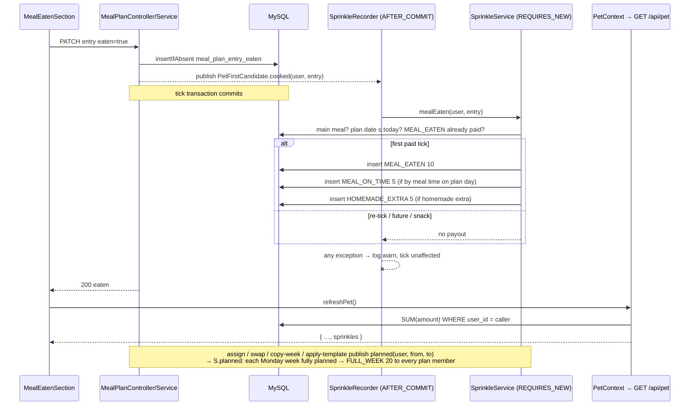

# Plan: Sprinkles — a consistency-only currency (MPP-25)

Plan folder: `.claude/contract/MPP-25-sprinkles-currency/`
Execution status: see `tasks.md` in this folder.

---

## Part 1 — Alignment

### Task reference

Jira **MPP-25** (Story, Low, parent epic MPP-15; blocked by MPP-16, blocks MPP-26). Breakdown origin: `.claude/contract/MPP-15-epic-breakdown/tasks.md` → T10. The Jira text is the current one; it supersedes T10 where they differ (T10 says "owner", Jira says "user").

> **Problem Statement:** Upgrades need a currency earned only from consistency. It must be tamper-proof against un-ticking and re-ticking a meal.
>
> **User Story:** As a user, I want to earn sprinkles for logging meals, planning my week and cooking homemade, so that I can upgrade Pip's room.
>
> **Acceptance Criteria**
> 1. Migration adds a ledger with entries `(user, source_type, source_id, amount, created_at)` and a unique `(user, source_type, source_id)`, so each source pays each person once ever.
> 2. Earning rules, as named constants: Meal logged eaten by the person: 10. Logged by its meal time: +5. Full week planned: 20. Homemade extra cooked: +5.
> 3. Un-ticking an eaten meal does not refund or re-earn.
> 4. `GET /api/pet` includes `sprinkles` (the caller's balance). The room shows a small sprinkles counter.
> 5. Tests cover each rule, the re-tick case, and two linked users ticking the same entry each earning their own sprinkles. No rule rewards variety.
>
> **In scope:** ledger, earning hooks, balance in the pet payload, counter UI.
> **Out of scope:** spending (MPP-26); awards paying sprinkles (not decided, so not built).
>
> **Dependencies & Risks:** The amounts are illustrative and are retunable constants. Target is about 300/week from about 21 logged meals. Per person: each person has their own balance (per-person Pip, MPP-33). Migration applied to Railway before deploy. Skills: java-backend, react-frontend.
>
> **Design Assets:** N/A beyond the counter. Use the room's existing bubble/hint styling.

Standing decision (memory `pip-per-person`, 2026-10-14): rewards for **shared work** (a full week planned) go to **both** linked people; rewards for what one person does (ticking meals) go to that person only.

### Restated goal

Give every person their own sprinkles balance, held in an append-only ledger where each earning source can pay each person at most once. Sprinkles are earned when that person ticks a meal as eaten (10), with +5 if the tick lands on the plan day by that meal's time and +5 if the meal had a homemade extra. When the shared plan gains a fully planned Monday–Sunday week, everyone on that plan earns 20. Un-ticking never takes sprinkles back and re-ticking never pays again. The balance is returned as `sprinkles` on `GET /api/pet` (and on the rename response, which shares the DTO) and shown as a small counter in Pip's room. Nothing spends sprinkles yet.

### In scope

- Migration `2026-10-14-mpp25-pet-sprinkles.sql`: `pet_sprinkles` ledger table + backfill of existing ticks; row 7 in `railway-migrations.md`.
- `PetSprinkle` entity, `SprinkleSource` enum, `PetSprinkleRepository`.
- `SprinklePolicy`: the four amounts as named constants plus the pure on-time / week rules.
- `SprinkleService` (earning + balance) and `SprinkleRecorder` (after-commit listener on the existing MPP-24 `PetFirstCandidate` events).
- `MealTimesPolicy.byTime(User, mealKey)` helper; `UserRepository.findPlanMemberIds(ownerId)`.
- `PetDTO.sprinkles` filled by `PetService` / `PetPolicy.toDTO`.
- Tests: policy, service (each rule, re-tick, two linked users, full week paid to both), recorder failure isolation, PetService balance.
- Frontend: `sprinkles` + `refreshPet()` in `PetContext`, refetch after a successful tick in `MealEatenSection`, counter pill in `PetRoom`.
- Version bump (Story → MINOR) + CHANGELOG.

### Explicitly out of scope

- Spending, prices, debits, the shop (MPP-26), decor (MPP-27).
- Awards, firsts, habit streaks or wardrobe unlocks paying sprinkles.
- A sprinkles history / statement screen or "+15" earn animation (MPP-29 polish can add one).
- Changing which person MPP-24 firsts credit (memory flags it as "probably" also both-people; not this ticket).
- Collapsing `/api/pet` + awards + habits into one request (MPP-28).
- Applying the migration to Railway — batched for the MPP-15 merge (`railway-migrations.md`).

### Pattern Reference

None supplied beyond "use the room's existing bubble/hint styling". Chosen references:
- **Event-driven, after-commit reward recording:** `PetFirstCandidate` → `PetFirstRecorder` (`@TransactionalEventListener(AFTER_COMMIT)`, catch-and-log) → `PetFirstService.evaluate` (`REQUIRES_NEW`). Sprinkles mirror this exactly and listen to the same events.
- **Idempotent ledger insert:** `PetFirstRepository.insertIfAbsent` (`INSERT … ON DUPLICATE KEY UPDATE id = id`).
- **Homemade-extra probe:** `PetFirstRepository.countHomemadeExtras` (reused, not duplicated).
- **Full-day probe:** `MealPlanEntryRepository.findFullyPlannedDates` with `PlanStreakPolicy.MAIN_MEAL_KEYS`.
- **Migration style:** `2026-10-13-mpp24-pet-firsts.sql` (header, CHECK on key column, FK cascade, idempotent backfill).
- **Pet payload extension:** MPP-31 `growth` / MPP-32 `wardrobe` on `PetDTO` via `PetPolicy.toDTO`.
- **Counter styling:** `.pip-room-hint` in `PetRoom.css`.
- **Tests:** `PetFirstServiceTest` (Mockito, `@InjectMocks`).

### Constraints flagged on the brief

- Unique `(user, source_type, source_id)`: each source pays each person once, ever.
- Amounts are named, retunable constants. Target ≈ 300/week from ≈ 21 logged meals.
- Un-tick: no refund, no re-earn.
- Per person (MPP-33): one balance per user, never resolved via the meal-plan owner.
- No rule rewards variety (MPP-11, memory `pet-no-variety-rewards`).
- Migration applied before deploy. MPP-15 is local-first (memory `mpp15-epic-local-first`): apply to local `foodbytes-db` now, Railway at merge time.
- Mobile/touch: the counter is display-only, so no 44px target is needed. It must fit at phone width with no horizontal scroll.

### Assumptions made

1. **"Meal" means breakfast, lunch or dinner** (`PlanStreakPolicy.MAIN_MEAL_KEYS`). Snack and extras entries earn nothing. *Rationale:* the ≈21 meals/week target is 7 × 3. Meal times exist only for those three. Paying for logged snacks would work against MPP-20's no-snacks habit.
2. **A future-dated entry pays nothing when ticked** (plan date after today, Europe/Dublin), and no ledger row is written for it, so ticking it on the day still pays in full. *Rationale:* without this, ticking next week's meals today and un-ticking them would farm sprinkles. That is the tamper case the brief names.
3. **"Logged by its meal time"** = the tick's first `eaten_at`, converted from UTC to `Europe/Dublin` (`HabitStreakPolicy.ZONE`), falls on the entry's plan date at or before the person's own effective by-time for that meal (`MealTimesPolicy`; defaults 11:00 / 15:00 / 21:00). A tick on a later day earns the base 10 only. *Rationale:* MPP-13 defines meal times as "by" times. The app's single zone is Dublin until a per-user zone exists (`ClockConfig`).
4. **The bonuses (+5 on time, +5 homemade) are decided only on the first paid tick of an entry.** If `MEAL_EATEN` already exists for (person, entry), the event pays nothing more. *Rationale:* closes the "un-tick, switch the extra to homemade, re-tick" path to a late +5. The unique key alone would not block it.
5. **"Full week planned" = a Monday–Sunday calendar week whose 7 days each have breakfast, lunch and dinner planned** on the shared plan. `source_id` = that Monday's `toEpochDay()`. *Rationale:* the meal-plan UI and `ExtraChoiceService` work in Monday weeks. MPP-24's *rolling* 7-day window would pay overlapping windows repeatedly and has no stable id.
6. **A full week pays 20 to every member of the plan** (the owner plus every user whose `meal_plan_owner_id` is the owner), whoever did the planning. *Rationale:* memory `pip-per-person`, rewards split decided 2026-10-14.
7. **Earning listens to the existing MPP-24 `PetFirstCandidate` events** (`cooked` on every tick; `planned` on assign / swap / copy-week / apply-template). `MealPlanService` and `MealPlanTemplateService` stay untouched. *Rationale:* those events already carry exactly the actor, entry and date range needed, after commit. A second event type would duplicate every publish call.
8. **Sprinkle failures never fail the tick or the plan write.** They are caught and logged after commit, the same contract as MPP-24 AC 2. *Rationale:* a currency hiccup must not lose a user's meal log.
9. **Backfill:** existing ticks get their `MEAL_EATEN` (10) and `HOMEMADE_EXTRA` (5) rows, applying assumptions 1–2 (main meals, plan date not after the tick date). No `MEAL_ON_TIME` or `FULL_WEEK` backfill. *Rationale:* the `MEAL_EATEN` row seals the re-tick path for pre-ledger ticks, which assumption 4 relies on. On-time needs per-user zone/time maths that is not worth it in SQL for 2 local ticks. On Railway the per-person tick table is created empty by MPP-33, so the backfill is a no-op there.
10. **Balance type is `long`, computed as `SUM(amount)`** per user on every pet read. There is no cached balance column. *Rationale:* the ledger stays the single source of truth for MPP-26 debits. `uk_pet_sprinkles` starts with `user_id`, so the sum is an index range scan.
11. **`source_type` CHECK lists only the four earning sources.** MPP-26 will widen it for debits. *Rationale:* matches `chk_pet_firsts_key`. Widening a CHECK is a cheap, lossless migration.
12. **Counter = a read-only pill "✨ N"** pinned top-right of the room, styled like `.pip-room-hint`, with `aria-label="N sprinkles"`. It is hidden until the pet loads. *Rationale:* the brief says small and in the existing hint style. The bottom-left corner is taken by the hint.
13. **Freshness:** after a successful *tick* (not an un-tick), `MealEatenSection` calls a new `refreshPet()` that refetches only `/api/pet`. *Rationale:* the listener runs before the tick response returns, so one refetch shows the new balance on the Pet page. Calling `retry()` instead would also refetch two week plans.
14. **Endpoint surface unchanged.** No new endpoint; `sprinkles` rides on `GET /api/pet` and `PUT /api/pet/name`, both authenticated by the existing controller checks.

### Cross-code alignment audit (FE ↔ BE ↔ DB)

Run against the **local** `foodbytes-db` (MPP-15 is local-first; the MPP-15 pet tables do not exist on Railway yet). Read-only.

- `meals` keys: `breakfast, lunch, dinner, snacks, extras` (ids 1–5). `MAIN_MEAL_KEYS` = the first three, which supports assumption 1.
- `SHOW COLUMNS FROM meal_plan_entry_eaten`: `id bigint PK auto_increment`, `meal_plan_entry_id bigint NOT NULL`, `user_id bigint NOT NULL`, `eaten_at timestamp NOT NULL`. That is the per-person first-tick time the on-time rule reads.
- `SHOW COLUMNS FROM pet_firsts`: `earned_at timestamp NOT NULL DEFAULT CURRENT_TIMESTAMP DEFAULT_GENERATED`. `pet_sprinkles.created_at` copies this shape, mapped `insertable = false, updatable = false` like `PetFirst.earnedAt`.
- `SHOW TABLES LIKE 'pet_sprinkle%'`: empty. The table name is free.
- Row counts: 2 ticks by 1 person in `meal_plan_entry_eaten`; 13 users, 2 of them linked (`meal_plan_owner_id` set). The backfill touches at most 2 rows, and the full-week payout must handle a two-member plan (covered by a test).
- Outstanding migrations: `railway-migrations.md` rows 1–6 (MPP-33, 20, 22, 24, 31, 32) are applied locally and not on Railway, which is expected for the local-first epic. The new file becomes row 7. Nothing is unapplied locally.
- Name chain: DB `pet_sprinkles.amount` → `PetSprinkle.amount` → `SUM` → `PetDTO.sprinkles` (Java `long`) → JSON `sprinkles` (number) → `pet.sprinkles` in `PetContext` → `PetRoom` prop `sprinkles`. One name end to end.
- Dates: `MealPlanEntry.planDate` is a `LocalDate`; `MealPlanEntryEaten.eatenAt` is a UTC-wall `LocalDateTime` (JDBC pins `serverTimezone=UTC`). The on-time rule converts UTC to Dublin explicitly.

---

## Part 2 — Technical design

### Approach

**A ledger fed by after-commit events.** `pet_sprinkles` is append-only. Each row is one payout for one `(user, source_type, source_id)`, and the unique key makes every payout idempotent. Writes go through `insertIfAbsent` (`ON DUPLICATE KEY UPDATE id = id`), so two devices racing converge instead of failing. The balance is `SUM(amount)`. Nothing is ever deleted or updated, which makes "un-tick does not refund" true by construction: the untick path never touches the ledger.

**Where earning happens.** MPP-24 already publishes `PetFirstCandidate.cooked(userId, entryId)` on every successful tick, and `PetFirstCandidate.planned(userId, from, to)` on every plan write that can complete a week (assign, swap days, copy week, apply template). A new `SprinkleRecorder` listens to the same event with `@TransactionalEventListener(phase = AFTER_COMMIT, fallbackExecution = true)`, catches any `RuntimeException` and logs it. It dispatches `COOK_HOMEMADE_EXTRA` → `SprinkleService.mealEaten(userId, entryId)` and `PLAN_FULL_WEEK` → `SprinkleService.planned(userId, from, to)`; it ignores the other keys. Both service methods run in `REQUIRES_NEW`, as `PetFirstService.evaluate` does. *Road not taken:* calling the service inline in `MealPlanService.setEntryEaten`. That would let a ledger exception roll back the user's tick, and it would add a fourth publisher-style dependency to an already-wide service. A second, sprinkles-specific event was also rejected because it would need a publish line beside every existing one. The cost of reuse is a slightly misnamed event, which is documented in the recorder's Javadoc.

**The rules.** `mealEaten` loads the entry and stops (no payout) if the entry is gone, is not a main meal, or has a plan date after today (Dublin). It also stops if the person already has a `MEAL_EATEN` row for that entry: that is the re-tick case. Otherwise it reads the person's eaten row, and stops if it was un-ticked in the meantime. It then inserts `MEAL_EATEN` (10), inserts `MEAL_ON_TIME` (5) if `SprinklePolicy.isOnTime(eatenAtUtc, planDate, byTime)`, and inserts `HOMEMADE_EXTRA` (5) if `countHomemadeExtras(entryId) > 0`. `planned` resolves the plan owner, lists the Monday of each calendar week overlapping `[from, to]` (`SprinklePolicy.mondaysCovering`), and for each week asks `findFullyPlannedDates(owner, MAIN_MEAL_KEYS, monday, monday+6, 3)`. If all 7 days come back, it inserts `FULL_WEEK` (20, `source_id = monday.toEpochDay()`) for every id from `UserRepository.findPlanMemberIds(owner)`. Pure decisions live in `SprinklePolicy` (unit-tested without mocks); I/O lives in the service (Mockito-tested). This split mirrors `PetFirstPolicy` / `PetFirstService`.

**Read side and UI.** `SprinkleService.balance(userId)` feeds `PetPolicy.toDTO`, which gains a `long sprinkles` argument. Both `getPet` and `renamePet` therefore carry it, which keeps the client's "replace the whole pet" rule safe. On the client, `PetContext` exposes `sprinkles` and a `refreshPet()` that bumps a pet-only reload key, separate from `retry()`, which also refetches the two week plans. `MealEatenSection` calls `refreshPet()` after a confirmed tick. `PetView` passes `sprinkles` to `PetRoom`, which renders a `SprinklesCounter` pill top-right once the value is a number.

### Skills to invoke during execution

- `java-backend` — owns the migration file, entity/enum/repository, `SprinklePolicy`/`SprinkleService`/`SprinkleRecorder`, `PetDTO`/`PetPolicy`/`PetService` changes and every JUnit test. Layering: controller untouched, logic in `service/`, entity never crosses the wire.
- `react-frontend` — owns `PetContext` (`sprinkles`, `refreshPet`), `MealEatenSection` refetch, `PetRoom` counter + CSS + constant, `PetView` prop wiring. Four-async-state and file-size rules apply.

Rules to Read: none of `.claude/rules/*` apply. They govern recipe/ingredient/macro data, and this ticket writes none. The executor should still honour memory `pet-no-variety-rewards` and `pip-per-person`.

### Diagram



### Data shapes

#### DDL — `foodbytes-app/database/migrations/2026-10-14-mpp25-pet-sprinkles.sql`

```sql
CREATE TABLE IF NOT EXISTS pet_sprinkles (
  id           BIGINT      NOT NULL AUTO_INCREMENT,
  user_id      BIGINT      NOT NULL,
  source_type  VARCHAR(16) NOT NULL,
  source_id    BIGINT      NOT NULL,
  amount       INT         NOT NULL,
  created_at   TIMESTAMP   NOT NULL DEFAULT CURRENT_TIMESTAMP,
  PRIMARY KEY (id),
  UNIQUE KEY uk_pet_sprinkles (user_id, source_type, source_id),
  CONSTRAINT chk_pet_sprinkles_source CHECK (source_type IN
    ('MEAL_EATEN','MEAL_ON_TIME','FULL_WEEK','HOMEMADE_EXTRA')),
  CONSTRAINT fk_pet_sprinkles_user FOREIGN KEY (user_id)
    REFERENCES users (id) ON DELETE CASCADE
) ENGINE=InnoDB;
```

`source_id` meaning per type: `MEAL_EATEN` / `MEAL_ON_TIME` / `HOMEMADE_EXTRA` → `meal_plan_entries.id` (no FK: a deleted entry keeps its payout). `FULL_WEEK` → the Monday's `LocalDate.toEpochDay()`. Backfill: `INSERT … SELECT` from `meal_plan_entry_eaten` ⨝ `meal_plan_entries` ⨝ `meals` for main meals with `plan_date <= DATE(CONVERT_TZ(eaten_at,'+00:00','Europe/Dublin'))`. That uses tz tables if they are loaded; the file falls back to `DATE(eaten_at)`, because the named-zone `CONVERT_TZ` returns NULL without tz tables. Full SQL is in tasks.md.

#### Entity — `model/PetSprinkle.java`

| Field | Type | Column | Notes |
|---|---|---|---|
| `id` | `Long` | `id` | `@GeneratedValue(IDENTITY)` |
| `userId` | `Long` | `user_id` | not null; the earner, never the plan owner |
| `sourceType` | `SprinkleSource` | `source_type` | `@Enumerated(STRING)`, `@JdbcTypeCode(VARCHAR)`, length 16 |
| `sourceId` | `Long` | `source_id` | not null |
| `amount` | `int` | `amount` | not null |
| `createdAt` | `LocalDateTime` | `created_at` | `insertable = false, updatable = false` |

`@Table(uniqueConstraints = @UniqueConstraint(name = "uk_pet_sprinkles", columnNames = {"user_id","source_type","source_id"}))`, plus the id-based `equals`/`hashCode` used by `PetFirst`.

#### Enum — `model/SprinkleSource.java`

`MEAL_EATEN, MEAL_ON_TIME, FULL_WEEK, HOMEMADE_EXTRA`

#### Repository — `repository/PetSprinkleRepository.java`

```java
boolean existsByUserIdAndSourceTypeAndSourceId(Long userId, SprinkleSource sourceType, Long sourceId);

@Query("SELECT COALESCE(SUM(s.amount), 0) FROM PetSprinkle s WHERE s.userId = :userId")
long sumAmountByUserId(@Param("userId") Long userId);

@Modifying
@Query(value = "INSERT INTO pet_sprinkles (user_id, source_type, source_id, amount) " +
               "VALUES (:userId, :sourceType, :sourceId, :amount) ON DUPLICATE KEY UPDATE id = id",
       nativeQuery = true)
void insertIfAbsent(@Param("userId") Long userId, @Param("sourceType") String sourceType,
                    @Param("sourceId") Long sourceId, @Param("amount") int amount);
```

#### `UserRepository` addition

```java
/** MPP-25: everyone on this meal plan — the owner and every user linked to them. */
@Query("SELECT u.id FROM User u WHERE u.id = :ownerId OR u.mealPlanOwnerId = :ownerId")
List<Long> findPlanMemberIds(@Param("ownerId") Long ownerId);
```

#### `service/SprinklePolicy.java` (pure, final, private ctor)

```java
public static final int MEAL_EATEN = 10;
public static final int ON_TIME_BONUS = 5;
public static final int FULL_WEEK = 20;
public static final int HOMEMADE_BONUS = 5;
public static final int WEEK_DAYS = 7;

static boolean isMainMeal(String mealKey);                       // PlanStreakPolicy.MAIN_MEAL_KEYS.contains
static boolean isPayable(LocalDate planDate, LocalDate today);   // !planDate.isAfter(today)
static boolean isOnTime(LocalDateTime eatenAtUtc, LocalDate planDate, LocalTime byTime); // via HabitStreakPolicy.ZONE
static List<LocalDate> mondaysCovering(LocalDate from, LocalDate to); // each Monday whose week overlaps [from, to]
```

#### `MealTimesPolicy` addition

```java
/** MPP-25: the person's effective "by" time for a main meal key; empty for snacks/extras. */
public static Optional<LocalTime> byTime(User user, String mealKey);
```

#### `service/SprinkleService.java`

```java
@Transactional(propagation = Propagation.REQUIRES_NEW) public void mealEaten(Long userId, Long entryId);
@Transactional(propagation = Propagation.REQUIRES_NEW) public void planned(Long actorId, LocalDate from, LocalDate to);
@Transactional(readOnly = true) public long balance(Long userId);
```

Dependencies: `PetSprinkleRepository`, `MealPlanEntryRepository`, `MealPlanEntryEatenRepository`, `PetFirstRepository` (homemade probe), `UserRepository`, `ExtraChoiceService` (`resolveOwnerId`), `Clock`.

#### `service/SprinkleRecorder.java`

`@Component`, `@TransactionalEventListener(phase = AFTER_COMMIT, fallbackExecution = true) public void onCandidate(PetFirstCandidate c)`. `COOK_HOMEMADE_EXTRA` → `mealEaten(c.userId(), c.entryId())`; `PLAN_FULL_WEEK` → `planned(c.userId(), c.from(), c.to())`; other keys → no-op. `catch (RuntimeException e)` → `log.warn("MPP-25: …")`.

#### DTO — `PetDTO`

Append `private long sprinkles; // MPP-25: the caller's own balance, 0 before any earning`. `PetPolicy.toDTO(User, PetGrowthDTO, WardrobeDTO, long sprinkles)`.

#### HTTP contract

`GET /api/pet` and `PUT /api/pet/name` → existing body plus `"sprinkles": 135`.

#### Frontend

- `constants/petRoom.js`: `export const SPRINKLES_ICON = '✨'`.
- `PetContext` value: `sprinkles: pet?.sprinkles ?? null`, `refreshPet: () => void`.
- `PetRoom` prop `sprinkles` (`number | null`, default `null`) → `<p className="pip-room-sprinkles" aria-label={`${sprinkles} sprinkles`}>{SPRINKLES_ICON} {sprinkles}</p>`.
- CSS `.pip-room-sprinkles`: absolute `top: 10px; right: 10px`, same padding/radius/background/colour/font-size as `.pip-room-hint`, `font-variant-numeric: tabular-nums`, `pointer-events: none`.

### Runtime quality notes

- **Resource cleanup:** Backend: all DB work is inside Spring-managed `REQUIRES_NEW` transactions, with no streams or manual connections. Frontend: `refreshPet` reuses the existing `/pet` effect, so its `AbortController` (aborted in cleanup and by `renamePet`/`setWardrobe`) covers the new trigger. No new listeners or timers.
- **Concurrency / ordering:** Two devices ticking the same entry, or two linked users planning at once, are both settled by `uk_pet_sprinkles` + `ON DUPLICATE KEY UPDATE id = id`, so a payout can't be doubled. The `existsBy…MEAL_EATEN` gate has a benign race: two simultaneous first ticks by one person could both pass it, but every insert is still unique, so the result is identical. The listener runs after commit, so `planned` sees the entry that completed the week (the same reason MPP-24 chose it). Linked partners each get their own `MEAL_EATEN` row because the key includes `user_id`.
- **Allocation / cost behaviour:** A tick adds 1 entry read, 1 exists probe, 1 eaten read, 1 user read (meal time), 1 homemade `COUNT`, and ≤ 3 inserts. A plan write adds one `findFullyPlannedDates` per Monday covered (1–2 for assign/swap/copy) and one member query. The balance is one indexed `SUM` per pet read. There is no N+1 and no unbounded list. Frontend: one extra `/api/pet` GET per tick, plus one small text node in the room.
- **Error paths:** Any runtime exception in earning is caught in `SprinkleRecorder` and logged at WARN with user and key, and the user's tick/plan write still returns 200. That is a deliberate swallow of a *side effect*, never of the request's own result, matching MPP-24 AC 2. A missing entry or eaten row (deleted or un-ticked before the listener ran) is a quiet no-op, not an error. `balance` errors bubble from `getPet` like any pet read failure, and `PetContext` shows its existing `LOAD_ERROR`. A failed `refreshPet` after a tick surfaces through the same pet error state. The counter only renders for a numeric value, so it is never a fake `0`.

### Risks and judgement calls

- **Reusing `PetFirstCandidate` for sprinkles.** It is cheap and complete, but the event's name says "first". If MPP-26+ wants more triggers, rename it to something like `PetActivity` then. Red-line this if you would rather introduce a separate event now.
- **Main meals only (assumption 1)** — snack/extras logging earns nothing. Easy to flip in `SprinklePolicy.isMainMeal`.
- **No payout for future-dated ticks (assumption 2)** — someone who pre-ticks tomorrow's lunch and never re-ticks it gets nothing for that meal. That is the price of making un-tick/re-tick farming impossible.
- **On-time uses Europe/Dublin** for everyone. A travelling user ticking in another zone is judged on Dublin time. This is consistent with every other MPP-15 day boundary.
- **Weekly payout ≈ 21 × 15 + 20 + homemade ≈ 335–400** for a perfect week, slightly above the 300 target. Amounts are constants; MPP-26 prices (300/600/1200) assume this scale.
- **Full week pays both partners** even if only one planned. This follows the 2026-10-14 decision, and MPP-24 firsts still credit only the actor. That inconsistency is pre-existing and out of scope.
- **Manual step (developer):** apply the migration to local `foodbytes-db` before running the backend locally; Railway apply is batched as row 7 of `railway-migrations.md` at MPP-15 merge. If the backend that maps `PetSprinkle` deploys to Railway first, Hibernate `validate` fails startup.
- **Backfill uses `CONVERT_TZ(...,'Europe/Dublin')`**, which returns NULL if MySQL tz tables are not loaded (the Docker image often lacks them). The SQL falls back to `DATE(eaten_at)` (UTC), which is at most one hour off for a rule that only compares calendar dates.
