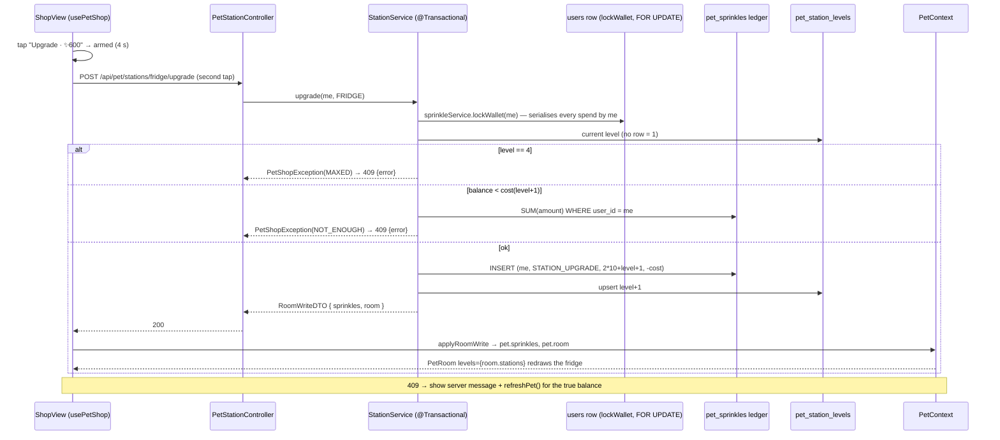

# Plan: Shop — upgrade Pip's bed, fridge, cooker and trophy cabinet (MPP-26)

Plan folder: `.claude/contract/MPP-26-pip-shop-station-upgrades/`
Execution status: see `tasks.md` in this folder.

---

## Part 1 — Alignment

### Task reference

Jira **MPP-26** (Story, Low, parent epic MPP-15; blocked by MPP-25, blocks MPP-27). Breakdown origin: `.claude/contract/MPP-15-epic-breakdown/tasks.md` → T11. The Jira text is the current one and supersedes T11 where they differ: T11 said "per owner" and "linked accounts see the same levels", while Jira says per user and "a linked partner's upgrades never change yours".

> **Problem Statement:** The upgrade path (levels 1–4 per station) already exists as art from the room scaffold (MPP-16). Users need a way to spend sprinkles to unlock it, and the result must persist.
>
> **User Story:** As a user, I want to spend sprinkles to upgrade Pip's furniture, so that his room gets nicer as I stay consistent.
>
> **Acceptance Criteria**
> 1. Migration adds station levels **per user** (bed, fridge, cooker, cabinet), all starting at 1.
> 2. `POST /api/pet/stations/{station}/upgrade` debits the cost and raises the level by one, transactionally. It rejects at level 4 or with too few sprinkles. Costs are constants: 300 → L2, 600 → L3, 1200 → L4.
> 3. A shop sheet opened from the room lists each station's current level, the next level's preview and its cost.
> 4. The room renders the owned levels through MPP-16's `levels` prop. Upgrades are never lost.
> 5. Each person has their own room. A linked partner's upgrades never change yours.
>
> **In scope:** station levels · the upgrade endpoint · the shop sheet · the room reading levels.
> **Out of scope:** decor and styles (MPP-27) · paid purchases.
>
> **Dependencies & Risks:** Costs are illustrative and retunable. **Per person** (per-person Pip, MPP-33). **Pause condition:** the shop sheet needs a quick mockup review (mockup before UI code). Flag it in the contract. Migration applied to Railway before deploy. Skills: java-backend, react-frontend.
>
> **Design Assets:** Upgrade art: `.claude/contract/MPP-15-epic-breakdown/mockups/pip-room-mockup-v5.html` → levels 1–4. The shop sheet still needs a mockup.

**plan.md + mockup approved by developer 2026-10-14.**

**Mockup for this contract (2026-10-14):** `.claude/contract/MPP-15-epic-breakdown/mockups/mpp-26-shop-sheet-mockup.html` (copy in `Downloads`). It shows the strip button, the sheet, four station cards with a next-level thumbnail, the two-tap confirm, the short, maxed, 409 and network-error states, and the 320/375/414 widths.

Standing decisions: memory `pip-per-person` (each person has their own Pip, room and sprinkles), `pet-no-variety-rewards`, `mpp15-epic-local-first`, `mockup-before-ui-code`.

### Restated goal

Let each person spend their own MPP-25 sprinkles to raise any of their four room stations (bed, fridge, cooker, trophy cabinet) one level at a time, from 1 up to 4, at 300 / 600 / 1200 sprinkles. The spend and the level change happen in one transaction, so no sprinkles are lost and no level is gained for free, even with two taps or two devices. The spend is a negative row in the existing sprinkles ledger, so the balance stays `SUM(amount)`. Levels are stored per user, with level 1 as the default, and returned on `GET /api/pet`. The room's existing `levels` prop draws them. A new Shop sheet, opened from a 🛍 Shop pill beside 👕 Wardrobe under the room, lists each station's current level, a thumbnail of the next level, its cost, and an Upgrade button that needs a second tap to confirm. A linked partner's room is never touched.

### In scope

- Migration `2026-10-14-mpp26-pet-station-levels.sql`: table `pet_station_levels`; widen `chk_pet_sprinkles_source` with `STATION_UPGRADE`; register as the next row in `railway-migrations.md`; regenerate the go-live file.
- `RoomStation` enum, `PetStationLevel` entity, `PetStationLevelRepository`; `SprinkleSource.STATION_UPGRADE`; `PetSprinkleRepository.insertDebit`; `UserRepository.lockById`.
- `SprinkleService.lockWallet` + `spend` (the shared, locked debit path MPP-27 reuses), `StationPolicy` (pure: costs, max, ledger source id), `PetRoomService` (room snapshot + write response), `StationService` (upgrade), `PetShopException`.
- `PetRoomDTO` on `PetDTO.room`; `RoomWriteDTO` response; `PetStationController` `POST /api/pet/stations/{station}/upgrade`.
- Tests: `StationPolicyTest`, `StationServiceTest`, `SprinkleServiceTest` additions (`spend`), `PetRoomServiceTest`, `PetStationControllerTest`, `PetServiceTest` update.
- Frontend: `constants/petShop.js`, `petService.upgradeStation`, `PetContext` (`room`, `applyRoomWrite`), `usePetShop` hook, `ShopButton`, `ShopView` + `ShopStationCard` + CSS, a shared `pip-room-actions` strip in `PetRoom`, thumbnail boxes in `roomLayout.js` (+ `room.check.mjs` pins), `PetView` wiring (levels + shop + bubble line).
- Version bump (Story → MINOR) + CHANGELOG.

### Explicitly out of scope

- Decor, wall/floor styles, edit mode (MPP-27). The sheet is built so MPP-27 can add tabs, but no tab bar ships here.
- Downgrades, refunds, selling or resetting levels.
- Any change to how sprinkles are earned (MPP-25).
- Paid purchases or a sprinkles top-up.
- An upgrade animation in the room beyond the art swapping (MPP-29 polish).
- Collapsing the pet requests (MPP-28) and the final bubble priority order (MPP-28 AC 2).
- Applying the migration to Railway. That is batched in the MPP-15 go-live file.

### Pattern Reference

None supplied beyond "MPP-16's `levels` prop". Chosen references:
- **Per-person write endpoint returning the changed slice:** `PetWardrobeController` + `WardrobeService` + `usePipWardrobe` (`setWardrobe` swaps the slice and aborts an in-flight pet GET).
- **Serialising concurrent writes for one person:** `PetHabitStreakRepository.findForUpdate` (`@Lock(PESSIMISTIC_WRITE)`).
- **Ledger + balance:** MPP-25 `pet_sprinkles`, `PetSprinkleRepository`, `SprinkleService.balance` (`.claude/contract/MPP-25-sprinkles-currency/plan.md` → Data shapes).
- **Migration style:** `2026-10-14-mpp32-pet-wardrobe.sql` (header, CHECK on the enum column, FK cascade, uk on `(user_id, …)`).
- **Full-screen sheet from the room:** `WardrobeView` (+ `.pip-wardrobe*` CSS, `useRoomOverlay`, `useBodyScrollLock`), strip pill `WardrobeButton` (its Javadoc already reserves the slot beside it for this Shop button).
- **Station art and hit boxes:** `furniture.jsx` `stationArt`, `roomLayout.js` `FRIDGE_FOOTPRINT` / `CABINET_FOOTPRINT` / `boundsOf`, pinned in `room.check.mjs`.
- **Tests:** `WardrobeServiceTest`, `PetWardrobeControllerTest` (Mockito + standalone MockMvc).

### Constraints flagged on the brief

- Per user (MPP-33): levels and debits key on the caller's id, never `meal_plan_owner_id`.
- Transactional: debit and level change commit together or not at all.
- Reject at level 4 and with too few sprinkles. Costs are named constants (300 / 600 / 1200).
- Upgrades are never lost: no code path lowers a level or deletes a level row.
- Pause condition: the shop sheet mockup must be approved before UI code. `tasks.md` is written only after that approval.
- Migration applied before deploy. MPP-15 is local-first: apply to local `foodbytes-db`, Railway at merge through the go-live file.
- Mobile/touch: 44 px targets, `@media (hover: hover)`, `:focus-visible`, no horizontal scroll at 320–414 px, reduced motion respected.

### Assumptions made

1. **The mockup gates `tasks.md`.** The developer reviews `mpp-26-shop-sheet-mockup.html` at the plan-approval gate. Red-lines on the mockup are folded into this plan before `tasks.md` is written. *Rationale:* Jira's pause condition and memory `mockup-before-ui-code`.
2. **MPP-25 lands first.** `SprinkleService`, `PetSprinkleRepository`, `SprinkleSource` and `PetDTO.sprinkles` exist when `/fb-apply` runs. Today only the MPP-25 migration file exists; no Java class and no local `pet_sprinkles` table yet (see the audit). *Rationale:* Jira says blocked by MPP-25. `/fb-apply` must stop if those types are missing.
3. **A missing level row means level 1.** `pet_station_levels` holds only levels 2–4 (CHECK `level BETWEEN 2 AND 4`). No backfill. *Rationale:* AC 1 "all starting at 1" holds by default without writing 52 rows for 13 users, and a new user needs no seeding.
4. **A spend is one negative ledger row**, `source_type = 'STATION_UPGRADE'`, `source_id = station.code * 10 + newLevel` (bed 1, fridge 2, cooker 3, cabinet 4, giving 12…44), `amount = -cost`. *Rationale:* `uk_pet_sprinkles (user_id, source_type, source_id)` then also makes each (station, level) purchasable at most once per person ever, a second guard behind the lock.
5. **Concurrency: every spend locks the caller's `users` row** (`SELECT … FOR UPDATE` via `UserRepository.lockById`) before it reads the level and balance. *Rationale:* two devices buying different things at once would otherwise both pass the balance check and overdraw. Locking one row per person is the simplest serialiser, and MPP-27's purchases will take the same lock. Earnings never take it, because they only add.
6. **The balance never goes negative.** The check runs after the lock, inside the transaction. Earnings committed in parallel can only raise it. *Rationale:* AC 2.
7. **Errors:** unknown station → 400 `{error}`; level 4 or too few sprinkles → **409** `{error}` with a readable message ("Not enough sprinkles: you have 240, this costs 300."); unauthenticated → 401. *Rationale:* 409 marks "your view of the state is stale". The client then refetches the pet to show the true balance. `PetWardrobeController` uses the same `{error}` shape.
8. **Response = `RoomWriteDTO { sprinkles, room }`**, not the whole `PetDTO`. *Rationale:* rebuilding the whole pet runs the growth score and the wardrobe sync on every tap. The two changed slices are enough for the client to patch `pet.sprinkles` and `pet.room`, as `setWardrobe` does.
9. **Levels and costs travel on the pet payload** as `PetDTO.room = { stations: { bed, fridge, cooker, cabinet }, upgradeCosts: { "2": 300, "3": 600, "4": 1200 } }`. *Rationale:* the server owns the price list (the PetPolicy/MealTimesPolicy "no client copy" rule). The lower-case station keys match the client's existing `levels` shape (`DEFAULT_ROOM_LEVELS`).
10. **Path variable is case-insensitive** (`bed`, `BED`). *Rationale:* the client's `ROOM_STATIONS` values are lower-case.
11. **Two-tap confirm.** The first tap arms the card ("Confirm ✨ 600", amber) for 4 s, and the second tap buys. *Rationale:* a single mis-tap could spend a week of sprinkles. Undo would need a refund path, and refunds are out of scope. Shown in the mockup for review.
12. **Shop opens only from a 🛍 Shop pill in the strip under the room**, beside 👕 Wardrobe. Tapping furniture keeps opening the fridge and the cabinet. *Rationale:* the stations already have tap meanings (MPP-19/23).
13. **Next-level thumbnail = the real station art** (`stationArt(station, level)`) in a small SVG whose viewBox is that station-level's bounding box. The box comes from new hand-copied `COOKER_FOOTPRINT` / `BED_FOOTPRINT` tables plus the existing fridge/cabinet ones, pinned in `room.check.mjs`. *Rationale:* no new art. React can't measure with `getBBox` before paint, so the boxes are data.
14. **Level names are client display constants** (`STATION_LEVEL_NAMES`, taken from the `furniture.jsx` comments: Blanket on the floor / Camp cot / Wooden bed / Canopy bed, and so on). *Rationale:* they are labels only, so the server does not need them.
15. **After a successful upgrade Pip says one line** (`SHOP_UPGRADE_LINES`, e.g. "A comfier bed! 😴✨") for `AWARD_BUBBLE_MS`. It sits in the award slot: cook > growth > check-in > award > outfit > **upgrade** > fridge-low > mood. *Rationale:* reuses the MPP-23/32 announcement slot. MPP-28 owns the final priority order.
16. **The balance shown in the sheet comes from `pet.sprinkles`** (MPP-25's PetContext value), never from a client-side sum. *Rationale:* one source of truth.

### Cross-code alignment audit (FE ↔ BE ↔ DB)

Run read-only against the **local** `foodbytes-db` (MySQL `8.0.46`). The MPP-15 tables do not exist on Railway yet, so the mysql MCP (Railway) is not the reference.

- `SHOW TABLES LIKE 'pet%'` → `pet_awards, pet_firsts, pet_habit_days, pet_habit_streaks, pet_outfit_slots, pet_wardrobe_unlocks`. **`pet_sprinkles` is not applied locally yet** (`ERROR 1146 … 'foodbytes.pet_sprinkles' doesn't exist`). MPP-25 is in Coding: its migration file `2026-10-14-mpp25-pet-sprinkles.sql` exists, but none of its Java (`PetSprinkle`, `SprinkleService`, `SprinkleSource`) is in the tree. Both are hard prerequisites (assumption 2). This migration ALTERs `pet_sprinkles`, so it must run after MPP-25's (go-live order 7 → 8).
- `SHOW TABLES LIKE '%station%'` → empty. The table name `pet_station_levels` is free.
- `information_schema.CHECK_CONSTRAINTS` → existing `chk_pet_*` names follow `chk_<table>_<column>`. The MPP-25 file declares `chk_pet_sprinkles_source` listing `MEAL_EATEN, MEAL_ON_TIME, FULL_WEEK, HOMEMADE_EXTRA`. MySQL 8.0.19+ (local 8.0.46, live 9.x) supports `ALTER TABLE … DROP CHECK`.
- `SHOW COLUMNS FROM pet_outfit_slots` → `id bigint PK auto_increment, user_id bigint NOT NULL, slot varchar(16) NOT NULL, item_key varchar(32) NOT NULL`. `pet_station_levels` copies this per-person shape.
- Users: 13, of which 2 are linked (`meal_plan_owner_id` set). The per-person test covers a linked pair; there is no backfill.
- Name chain: DB `pet_station_levels.station` (`'BED'…`) ↔ `RoomStation` enum (`@Enumerated(STRING)`) ↔ `PetRoomDTO.stations` keys via `RoomStation.key()` (`"bed"`) ↔ JSON `room.stations.bed` ↔ `DEFAULT_ROOM_LEVELS.bed` / `ROOM_STATIONS.BED = 'bed'` ↔ `PetRoom` `levels` prop. Ledger: `SprinkleSource.STATION_UPGRADE` ↔ CHECK literal `'STATION_UPGRADE'` (16 chars fits `VARCHAR(16)`) ↔ `source_type` column.
- Client: `PetRoom` already accepts `levels` (default `DEFAULT_ROOM_LEVELS`) and clamps it with `resolveRoomLevels`. `PetView` never passes it today, so every user sees level 1. That one prop is AC 4's wiring.
- Outstanding migrations: `railway-migrations.md` rows 1–6 are applied locally. Row 7 (MPP-25) is not yet applied locally. It belongs to MPP-25's own contract, and this plan's local apply step comes after it.

---

## Part 2 — Technical design

### Approach

**Spending is a ledger write under a per-person lock.** MPP-25 made the balance `SUM(pet_sprinkles.amount)` with no cached column, so spending just appends a negative row and nothing needs reconciling. The generic part lives in MPP-25's `SprinkleService`, so MPP-27 reuses it unchanged: `lockWallet(userId)` takes `PESSIMISTIC_WRITE` on the caller's `users` row, and `spend(userId, source, sourceId, cost)` (`Propagation.MANDATORY`) re-checks `balance(userId) >= cost`, throwing `PetShopException(NOT_ENOUGH_SPRINKLES)` if not, then inserts the debit with a **plain** `INSERT`. `StationService.upgrade(userId, station)` runs in one `@Transactional`. It (1) calls `lockWallet`; (2) reads the current level (missing row = 1) and rejects at `StationPolicy.MAX_LEVEL`; (3) calls `spend(userId, STATION_UPGRADE, StationPolicy.sourceId(station, level + 1), StationPolicy.costFor(level + 1))`; (4) upserts `pet_station_levels` to `level + 1`; (5) returns `petRoomService.write(userId)` (`RoomWriteDTO`). `PetRoomService` assembles the room snapshot from repositories only, so the services depend on it and never on each other. MPP-27 adds decor to that snapshot. Any exception rolls back both writes. The lock serialises *every* spend by one person, including MPP-27's decor purchases, which take the same lock. Two taps on two devices therefore run one after the other: the second sees the raised level or the lower balance and gets a 409. The unique ledger key is a second, independent guard. A duplicate `(station, level)` debit raises `DataIntegrityViolationException`, which `spend` maps to `PetShopException(ALREADY_OWNED)`, the same 409. *Roads not taken:* (a) a cached `users.sprinkles` column with `UPDATE … SET sprinkles = sprinkles - :cost WHERE sprinkles >= :cost`. It is atomic without a lock, but creates a second source of truth beside the MPP-25 ledger. (b) Optimistic `@Version` on `User`. It would make every unrelated user write (rename, meal times) collide with a purchase. (c) Locking only the level row. That would not stop a parallel MPP-27 decor buy from overdrawing.

**Levels live in their own small table, with level 1 implicit.** `pet_station_levels (user_id, station, level)` with `uk (user_id, station)` mirrors `pet_outfit_slots`. Deriving levels from the ledger (count `STATION_UPGRADE` rows) was considered. It needs no table, but AC 1 explicitly asks for a migration that stores levels, and the read would aggregate the ledger on every pet load. The upsert is `INSERT … ON DUPLICATE KEY UPDATE level = VALUES(level)`, and it only runs after the lock-protected check, so a level never goes down. The CHECK widening for `STATION_UPGRADE` is in the same migration, written with an `information_schema` guard and prepared statements so the file can be re-run. That matters because it will be concatenated into the single MPP-15 go-live script.

**Read side.** `PetService.toDTO` gains `petRoomService.room(userId)` → `PetRoomDTO { stations, upgradeCosts }`, and `PetPolicy.toDTO` gains the argument. That is the same extension pattern MPP-31/32/25 used. `PetStationController` is thin: it resolves `RoomStation.fromPath`, calls the service and maps `PetShopException` → 409, `IllegalArgumentException` → 400, and a null principal → 401.

**Client.** `PetContext` exposes `room` (`pet.room`) and `applyRoomWrite({ sprinkles, room })`. That function patches both slices and aborts an in-flight pet GET, exactly like `setWardrobe`. The `usePetShop` hook owns the sheet's state: `armed` station (cleared by a 4 s timer that is torn down on unmount), `busy` station, `status` / `error`, and `announcement`. It calls `petService.upgradeStation`. On 2xx it calls `applyRoomWrite` and queues the bubble line. On 409 it shows the server's message and calls `refreshPet()` from MPP-25, so the sheet re-renders with the true balance. Any other failure shows `SHOP_UPGRADE_ERROR`, and nothing is rolled back because nothing was optimistic. **Purchases are not optimistic.** Spending is not undoable, so the UI waits for the server: the button shows "Upgrading…", `aria-busy`, disabled. `PetRoom` stops rendering `WardrobeButton`'s own wrapper and renders one `.pip-room-actions` strip with `ShopButton` and `WardrobeButton`, plus a `ShopView` overlay on a fourth `useRoomOverlay`. `ShopView` reuses the Dress Pip sheet shell (fixed, full-screen on a phone, a 480 px column on wider screens, slide-up animation off under reduced motion) and renders one `ShopStationCard` per station. Each card has a `StationThumb` (the real `stationArt` in a cropped SVG), level dots, now / next names, and the button states shown in the mockup. `PetView` passes `levels={pet.room?.stations}` and the shop object.

### Skills to invoke during execution

- `java-backend` — owns the migration file, `RoomStation` / `PetStationLevel` / repositories / `SprinkleService.lockWallet`/`spend` / `StationPolicy` / `PetRoomService` / `StationService` / `PetShopException` / DTOs / `PetStationController`, the `PetService` + `PetPolicy` extension, and every JUnit test. Layering: controller thin, logic and the lock in `service/`, entities never cross the wire.
- `react-frontend` — owns `constants/petShop.js`, `petService.upgradeStation`, `PetContext` (`room`, `applyRoomWrite`), `usePetShop`, `ShopButton` / `ShopView` / `ShopStationCard` / `StationThumb` + CSS, the strip refactor in `PetRoom` / `WardrobeButton`, the `roomLayout.js` thumbnail boxes + `room.check.mjs`, and `PetView` wiring. Four async states, the 400-line budget, 44 px targets and `:focus-visible` apply.

Rules to Read: none of `.claude/rules/*` apply (they cover recipe, ingredient and macro data, and this ticket writes none). The executor honours memories `pip-per-person`, `pet-no-variety-rewards`, `mpp15-epic-local-first` and `mockup-before-ui-code`.

### Diagram



### Data shapes

#### DDL — `foodbytes-app/database/migrations/2026-10-14-mpp26-pet-station-levels.sql`

```sql
CREATE TABLE IF NOT EXISTS pet_station_levels (
  id          BIGINT      NOT NULL AUTO_INCREMENT,
  user_id     BIGINT      NOT NULL,
  station     VARCHAR(16) NOT NULL,
  level       INT         NOT NULL,
  upgraded_at TIMESTAMP   NOT NULL DEFAULT CURRENT_TIMESTAMP ON UPDATE CURRENT_TIMESTAMP,
  PRIMARY KEY (id),
  UNIQUE KEY uk_pet_station_levels (user_id, station),
  CONSTRAINT chk_pet_station_levels_station CHECK (station IN ('BED','FRIDGE','COOKER','CABINET')),
  CONSTRAINT chk_pet_station_levels_level CHECK (level BETWEEN 2 AND 4),
  CONSTRAINT fk_pet_station_levels_user FOREIGN KEY (user_id) REFERENCES users (id) ON DELETE CASCADE
) ENGINE=InnoDB;

-- Widen the MPP-25 ledger CHECK for debits. Guarded so the file is re-runnable (go-live script).
SET @has := (SELECT COUNT(*) FROM information_schema.CHECK_CONSTRAINTS
             WHERE CONSTRAINT_SCHEMA = DATABASE() AND CONSTRAINT_NAME = 'chk_pet_sprinkles_source');
SET @sql := IF(@has > 0, 'ALTER TABLE pet_sprinkles DROP CHECK chk_pet_sprinkles_source', 'SELECT 1');
PREPARE s FROM @sql; EXECUTE s; DEALLOCATE PREPARE s;
ALTER TABLE pet_sprinkles ADD CONSTRAINT chk_pet_sprinkles_source CHECK (source_type IN
  ('MEAL_EATEN','MEAL_ON_TIME','FULL_WEEK','HOMEMADE_EXTRA','STATION_UPGRADE'));
```

The header comment states: per person; level 1 = no row; lossless (one new empty table, and a CHECK widened to a superset); must run after MPP-25 (go-live row 7) and before the backend that maps `PetStationLevel`; registered as row 8.

#### Enum — `model/RoomStation.java`

`BED(1, "bed"), FRIDGE(2, "fridge"), COOKER(3, "cooker"), CABINET(4, "cabinet")` with `int code()`, `String key()`, `static RoomStation fromPath(String)`. `fromPath` is case-insensitive and throws `IllegalArgumentException("Unknown station: x")`.

#### Entity — `model/PetStationLevel.java`

| Field | Type | Column | Notes |
|---|---|---|---|
| `id` | `Long` | `id` | IDENTITY |
| `userId` | `Long` | `user_id` | not null, the caller |
| `station` | `RoomStation` | `station` | `@Enumerated(STRING)`, `@JdbcTypeCode(VARCHAR)`, length 16 |
| `level` | `int` | `level` | 2–4 (`INT`, matches Hibernate's `int` mapping under `validate`) |
| `upgradedAt` | `LocalDateTime` | `upgraded_at` | `insertable = false, updatable = false` |

#### Repositories

```java
// PetStationLevelRepository
List<PetStationLevel> findByUserId(Long userId);
@Modifying
@Query(value = "INSERT INTO pet_station_levels (user_id, station, level) VALUES (:userId, :station, :level) " +
               "ON DUPLICATE KEY UPDATE level = VALUES(level)", nativeQuery = true)
void upsert(@Param("userId") Long userId, @Param("station") String station, @Param("level") int level);

// UserRepository (new)
/** MPP-26: SELECT … FOR UPDATE on the caller's row — serialises every sprinkles spend by one person. */
@Lock(LockModeType.PESSIMISTIC_WRITE)
@Query("SELECT u FROM User u WHERE u.id = :id")
Optional<User> lockById(@Param("id") Long id);

// PetSprinkleRepository (MPP-25) — new
/** MPP-26: a spend. Plain INSERT: a duplicate (user, type, source) throws instead of being skipped. */
@Modifying
@Query(value = "INSERT INTO pet_sprinkles (user_id, source_type, source_id, amount) VALUES (:userId, :sourceType, :sourceId, :amount)",
       nativeQuery = true)
void insertDebit(@Param("userId") Long userId, @Param("sourceType") String sourceType,
                 @Param("sourceId") Long sourceId, @Param("amount") int amount);
```

`SprinkleSource` gains `STATION_UPGRADE`.

#### `service/StationPolicy.java` (pure, final)

```java
public static final int MIN_LEVEL = 1;
public static final int MAX_LEVEL = 4;
public static final Map<Integer, Integer> UPGRADE_COSTS = Map.of(2, 300, 3, 600, 4, 1200); // retunable
static int costFor(int nextLevel);                     // IllegalArgumentException outside 2..4
static long sourceId(RoomStation station, int level);  // station.code() * 10 + level
static boolean isMaxed(int level);
```

#### `service/PetShopException.java`

`RuntimeException` with `enum Reason { MAXED, NOT_ENOUGH_SPRINKLES, ALREADY_OWNED, NOT_OWNED }` (MPP-27 uses the last two) and a user-readable message.

#### `SprinkleService` additions (MPP-25 class)

```java
/** MPP-26: SELECT … FOR UPDATE on the caller's users row. Every spend by one person runs behind it. */
@Transactional(propagation = Propagation.MANDATORY) public void lockWallet(Long userId);
/** MPP-26: balance check + one negative ledger row. Caller holds the wallet lock. */
@Transactional(propagation = Propagation.MANDATORY)
public void spend(Long userId, SprinkleSource source, long sourceId, int cost); // PetShopException(NOT_ENOUGH_SPRINKLES); duplicate key → PetShopException(ALREADY_OWNED)
```

#### `service/PetRoomService.java`

```java
@Transactional(readOnly = true) public PetRoomDTO room(Long userId);   // stations (missing → 1) + upgradeCosts
@Transactional(readOnly = true) public RoomWriteDTO write(Long userId); // { sprinkleService.balance, room }
```

Dependencies: `PetStationLevelRepository`, `SprinkleService`. (MPP-27 adds its decor repositories here.)

#### `service/StationService.java`

```java
@Transactional public RoomWriteDTO upgrade(Long userId, RoomStation station); // lockWallet → level check → spend → upsert → write
```

Dependencies: `PetStationLevelRepository`, `SprinkleService`, `PetRoomService`.

#### DTOs

```java
// PetRoomDTO — PetDTO.room (never null)
private Map<String, Integer> stations;     // {"bed":1,"fridge":2,"cooker":1,"cabinet":1}, all four keys
private Map<Integer, Integer> upgradeCosts; // {2:300,3:600,4:1200}
// RoomWriteDTO — every room write response
private long sprinkles;   // the caller's balance after the write
private PetRoomDTO room;
```

`PetDTO` gains `private PetRoomDTO room; // MPP-26`. `PetPolicy.toDTO(User, PetGrowthDTO, WardrobeDTO, long sprinkles, PetRoomDTO room)`.

#### HTTP contract

`POST /api/pet/stations/{station}/upgrade` (no body). The caller must be authenticated.
- `200` → `{ "sprinkles": 435, "room": { "stations": { "bed": 1, "fridge": 3, "cooker": 1, "cabinet": 1 }, "upgradeCosts": { "2": 300, "3": 600, "4": 1200 } } }`
- `400` → `{ "error": "Unknown station: sofa" }`
- `409` → `{ "error": "Not enough sprinkles: you have 240, this costs 600." }` or `{ "error": "Your fridge is already at the top level." }`
- `401` → `{ "error": "Not authenticated" }`

`GET /api/pet` and `PUT /api/pet/name` → existing body plus `"room": {…}`.

#### Frontend

- `constants/petShop.js`: `SHOP_TITLE = 'Shop'`, `SHOP_BUTTON_LABEL = 'Shop'`, `SHOP_INTRO`, `SHOP_FOOTNOTE`, `SHOP_CLOSE_LABEL`, `SHOP_CONFIRM_MS = 4000`, `SHOP_UPGRADE_ERROR = "Couldn't upgrade. Check your connection and try again. No sprinkles were spent."`, `SHOP_STATIONS = [{ key: 'bed', label: 'Bed', icon: '🛏' }, { key: 'fridge', … '🧊' }, { key: 'cooker', … '🍳' }, { key: 'cabinet', label: 'Trophy cabinet', icon: '🏆' }]`, `STATION_LEVEL_NAMES` (4 × 4 names), `SHOP_UPGRADE_LINES` (one per station).
- `petService.upgradeStation(station)` → `POST /pet/stations/${station}/upgrade` → `RoomWriteDTO`.
- `PetContext` value adds `room: pet?.room ?? null` and `applyRoomWrite({ sprinkles, room })`. `refreshPet` comes from MPP-25.
- `hooks/usePetShop.js` → `{ armed, busy, status, error, announcement, arm(station), upgrade(station), reset() }`.
- `roomLayout.js`: `COOKER_FOOTPRINT`, `BED_FOOTPRINT` (per level `[u, v, du, dv, h0, h1]`, hand-copied from `furniture.jsx`) and `stationThumbBox(station, level)` → `{ x, y, width, height }` (square, 6 px pad).
- Components (all under `components/pet/room/`): `ShopButton.jsx`, `ShopView.jsx` + `ShopView.css`, `ShopStationCard.jsx`, `StationThumb.jsx`. `WardrobeButton` loses its wrapper `div`, and `PetRoom` owns the `.pip-room-actions` strip.

### Runtime quality notes

- **Resource cleanup:** Backend: the lock is held only for the one `@Transactional` method and released at commit or rollback; there are no streams. Frontend: `usePetShop`'s arm timer is cleared on re-arm, on confirm and in effect cleanup. The announcement timer works like `usePipWardrobe`'s. The purchase POST is a write and is never aborted. `applyRoomWrite` aborts only the in-flight pet GET (via `petControllerRef`).
- **Concurrency / ordering:** Per-person spends are serialised by `lockById`. Earnings (MPP-25, `REQUIRES_NEW` after commit) do not lock and only add, so they can't push a checked balance below cost. A double-tap on one device is also blocked client-side (`busy` disables every Upgrade button until the reply). Two devices: the second request waits on the row lock, then sees the new level or balance and gets a 409; the UI shows the message and refetches. Linked partners lock different `users` rows and write different `user_id`s, so they never contend or interfere (AC 5).
- **Allocation / cost behaviour:** An upgrade costs 1 locked user read, 1 level-list read (≤ 4 rows), 1 indexed `SUM`, 1 insert and 1 upsert. A pet read adds one ≤ 4-row query. The client renders 4 cards and 4 small SVGs only while the sheet is open, and `stationArt` is cached per (station, level).
- **Error paths:** `PetShopException` → 409 with the service's message, `IllegalArgumentException` → 400, and a duplicate-key `DataIntegrityViolationException` on the debit → `PetShopException(ALREADY_OWNED)` → 409. The transaction rolls back, so the user is never charged without the level. The client shows server messages verbatim in a `role="alert"` line. A network failure shows `SHOP_UPGRADE_ERROR` and keeps the sheet usable. A pet load error keeps `PetContext`'s existing error state. The Shop pill is only rendered once `pet.room` exists, so there is never a sheet with fake level-1 data.

### Risks and judgement calls

- **Hard dependency on MPP-25's Java**, which does not exist in the tree today. If MPP-25's final names differ from its plan (`SprinkleService.balance`, `PetSprinkleRepository`, `SprinkleSource`, `PetDTO.sprinkles`, `refreshPet`), the executor must adapt to the real names and say so. It must not plan around a missing class.
- **Row lock on `users`.** It is a short `FOR UPDATE` on one row per purchase. It briefly blocks that same person's rename or meal-time save while a purchase commits. That is acceptable. Red-line it if you'd rather add a dedicated `pet_wallets` lock row.
- **Two-tap confirm and a strip-only entry point** are UX calls shown in the mockup. Both are cheap to flip.
- **Re-runnable CHECK widening** uses prepared statements in the migration. It is unusual for this repo, but it keeps the single go-live script safe to re-run. The plain `ALTER … ADD CONSTRAINT` would fail if run twice.
- **Footprint tables for thumbnails duplicate furniture geometry.** This is the same documented "keep in step" debt as `FRIDGE_FOOTPRINT`. `room.check.mjs` pins every box inside the viewBox and non-empty.
- **Costs are retunable** (`StationPolicy.UPGRADE_COSTS`). Maxing everything costs ✨8,400, about 21–25 perfect weeks at MPP-25's ~335–400/week.
- **Manual steps (developer):** (1) approve the mockup before `tasks.md`; (2) apply MPP-25's migration, then this one, to the local `foodbytes-db` before running the backend; (3) at the MPP-15 merge, run `foodbytes-app/database/mpp15-railway-golive.sql` on Railway **before** the merged backend deploys. The migration task adds row 8 to `railway-migrations.md` and runs `node foodbytes-app/database/build-golive.mjs` to regenerate that file. If the backend that maps `PetStationLevel` deploys first, Hibernate `validate` fails startup.
