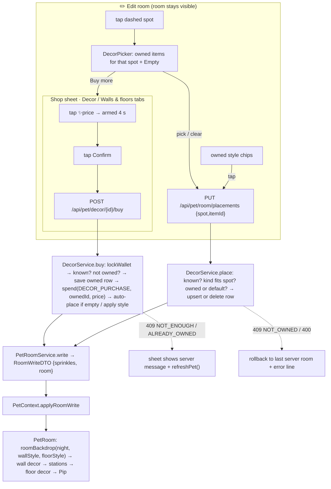

# Plan: Decor spots, wall and floor styles, and edit mode for Pip's room (MPP-27)

Plan folder: `.claude/contract/MPP-27-pip-decor-edit-mode/`
Execution status: see `tasks.md` in this folder.

---

## Part 1 — Alignment

### Task reference

Jira **MPP-27** (Story, Low, parent epic MPP-15; blocked by MPP-26, blocks MPP-28). Breakdown origin: `.claude/contract/MPP-15-epic-breakdown/tasks.md` → T12. The Jira text is the current one and supersedes T12 where they differ: T12 says "per owner / linked accounts see the same room", while Jira says per user, each person decorating their own room.

> **Problem Statement:** Focus Friend's long-term pull is decorating. The room has three fixed empty spots (left wall, right wall, floor) plus wall and floor finishes for users to personalise.
>
> **User Story:** As a user, I want to buy decorations and change Pip's wall and floor colours, so that the room feels like mine.
>
> **Acceptance Criteria**
> 1. A catalogue of decor items, each tied to one spot type (left wall, right wall, floor), and of wall and floor styles, each with a price constant.
> 2. Migration adds owned items and the placement per spot **per user**. Buying debits sprinkles. Owned items are kept forever.
> 3. Edit mode (from the room) shows the dashed empty spots and lets the user place, swap or clear an owned item in each spot.
> 4. The room renders placed decor and the chosen styles. Each person decorates their own room.
>
> **In scope:** decor catalogue, purchase, placement · styles · edit mode.
> **Out of scope:** free placement anywhere · more spots, more rooms.
>
> **Dependencies & Risks:** **Per person** (per-person Pip, MPP-33). **Pause condition, visual judgement:** the decor catalogue (which items, how many, art) needs a mockup the developer approves before code. Raise it at `/fb-plan` time. Migration applied to Railway before deploy. Skills: java-backend, react-frontend.
>
> **Design Assets:** Spot positions: `.claude/contract/MPP-15-epic-breakdown/mockups/pip-room-mockup-v5.html` → "Show empty decor spots". The item catalogue still needs a mockup.

**plan.md + mockup approved by developer 2026-10-14.**

**Mockup for this contract (2026-10-14, the pause condition, approved):** `.claude/contract/MPP-15-epic-breakdown/mockups/mpp-27-decor-catalogue-mockup.html` (copy in `Downloads`). It shows the proposed 12 items (4 per spot) with iso art and prices, 4 wall styles and 3 floor styles on top of the free defaults, the shop's Decor and Walls & floors tabs, edit mode with the dashed spots, the per-spot picker (place, swap, clear), and the owned-style chips.

Builds on the **MPP-26 contract** (`.claude/contract/MPP-26-pip-shop-station-upgrades/plan.md`): its `SprinkleService.lockWallet`/`spend`, `PetShopException`, `PetRoomService`, `PetRoomDTO`/`RoomWriteDTO`, `applyRoomWrite`, the Shop sheet and the `.pip-room-actions` strip. Standing decisions: memories `pip-per-person`, `pet-no-variety-rewards`, `mpp15-epic-local-first`, `mockup-before-ui-code`.

### Restated goal

Give each person a decor catalogue to spend their own sprinkles on. It has 12 items, each tied to one of the room's three fixed spots (left wall, right wall, floor), plus paid wall and floor styles on top of free defaults. Buying goes through the same locked debit path as MPP-26 station upgrades and records ownership forever. A bought item goes straight onto its spot if the spot is empty, and a bought style is applied at once. A new ✏️ Edit room mode shows the three dashed spots. Tapping one opens a picker of the owned items for that spot (or empty), and owned-style chips switch walls and floor; placing and switching are free. The room draws the placed items and the chosen styles for that person only. The Shop sheet gains tabs: Upgrades (MPP-26), Decor, and Walls & floors.

### In scope

- Migration `2026-10-14-mpp27-pet-room-decor.sql`: tables `pet_decor_owned` and `pet_room_placements`; widen `chk_pet_sprinkles_source` with `DECOR_PURCHASE` (guarded, re-runnable); next row in `railway-migrations.md`; regenerate the go-live file.
- Backend: `RoomSpot` enum, `DecorCatalogue` (ids, spot or style kind, price), `PetDecorOwned` + `PetRoomPlacement` entities and repositories, `SprinkleSource.DECOR_PURCHASE`, `DecorService` (buy, place), `PetRoomService` extended with decor, `PetRoomDTO` decor fields, `PetDecorController` (`POST /api/pet/decor/{itemId}/buy`, `PUT /api/pet/room/placements`).
- Tests: `DecorCatalogueTest`, `DecorServiceTest`, `PetRoomServiceTest` additions, `PetDecorControllerTest`.
- Frontend: `constants/petDecor.js` (labels, spot geometry, style colours), `decorArt.jsx` (the 12 items' iso art), the room backdrop driven by styles, placed decor drawn in the room, `useRoomEdit` hook, `EditRoomButton`, `DecorSpotButtons`, `DecorPicker`, `RoomStyleChips`, Shop tabs (`ShopTabs`, `ShopDecorTab`, `ShopStylesTab`, `ShopItemCard`), `usePetShop` buy support, `petService.buyDecor` / `placeDecor`, `room.check.mjs` pins for the spot boxes.
- Version bump (Story → MINOR) + CHANGELOG.

### Explicitly out of scope

- Free placement, extra spots, multiple rooms, rotating or scaling items.
- Selling, refunding or deleting owned items.
- Decor unlocked by achievements (the wardrobe owns achievement rewards), and anything tied to food variety.
- Night-time variants of decor art (lights glowing at night etc.). Items render the same day and night under the existing `NightDim` (MPP-29 polish can add more).
- The final bubble-priority order (MPP-28) and visual polish (MPP-29).
- Applying the migration to Railway. That is batched in the MPP-15 go-live file.

### Pattern Reference

None supplied beyond the v5 mockup's "Show empty decor spots". Chosen references:
- **Catalogue as data, server owns ids + rules, client owns labels + art:** MPP-32 `WardrobeCatalogue` (Java) ↔ `constants/pipWardrobe.js` `WARDROBE_ITEMS` (client), with unknown ids skipped client-side (`knownItems`).
- **Per-slot placement table:** `pet_outfit_slots` (`uk (user_id, slot)`, CHECK on slot, missing row = empty) and `WardrobeService.equip` (rejects unowned and wrong-slot).
- **Ownership table kept forever:** `pet_wardrobe_unlocks` (`uk (user_id, item_key)`, never deleted).
- **Spending, room snapshot, write response, sheet:** the MPP-26 contract (see Task reference).
- **Spot geometry:** v5 mockup `isoSlot()` (left wall `rectV(0, 150..186, 132..170)`, right wall `rectU(0, 34..80, 142..174)`, floor `rectH(0, 150..186, 110..150)`).
- **Station buttons over SVG art:** `PetRoom` `StationButton` + `roomLayout.js` `boundsOf`.
- **Tests:** `WardrobeServiceTest`, `PetWardrobeControllerTest`.

### Constraints flagged on the brief

- Per user: owned items, placements and styles key on the caller's id, never `meal_plan_owner_id`.
- Every catalogue entry has a price constant. Buying debits sprinkles. Owned is forever.
- Edit mode: dashed spots; place, swap or clear an **owned** item per spot.
- Pause condition: the catalogue mockup must be approved before code. `tasks.md` is written only after approval, with the approved items and prices.
- No variety rewards (MPP-11).
- Migration before deploy (local now, Railway through the go-live file).
- Phone width 320–414 px with no horizontal scroll, 44 px targets, `:focus-visible`, reduced motion.

### Assumptions made

1. **Catalogue = the mockup's proposal**, pending approval. *Rationale:* the pause condition asks the planner to propose concrete items. Prices are sized against MPP-25's ~300–400/week and MPP-26's ✨8,400 of upgrades: the whole catalogue adds ✨4,900.
   - **Left wall:** `basil-print` 120, `recipe-board` 180, `herb-shelf` 250, `fairy-lights` 300.
   - **Right wall:** `wall-clock` 120, `bunting` 180, `pan-rail` 200, `mirror` 250.
   - **Floor:** `watering-can` 120, `cookbook-stack` 180, `bean-bag` 250, `lemon-tree` 300.
   - **Wall styles:** `wall-lavender` 0 (default), `wall-mint` 250, `wall-peach` 250, `wall-sky` 250, `wall-sprig` 500.
   - **Floor styles:** `floor-lilac` 0 (default), `floor-oak` 300, `floor-terracotta` 400, `floor-checker` 500.
2. **The defaults are owned implicitly** and never stored. A missing style placement means the default. *Rationale:* every user, including new ones, has a valid room with no backfill. The defaults are exactly today's colours (`#ece5fb` / `#e3daf8` / `#d6c9f0` in `roomDecor.jsx`), so nothing changes visually until someone buys.
3. **Two tables:** `pet_decor_owned (user_id, item_key)` (forever) and `pet_room_placements (user_id, spot, item_key)`, with `spot ∈ {LEFT_WALL, RIGHT_WALL, FLOOR, WALL_STYLE, FLOOR_STYLE}`. Styles ride on the same placement table as two extra "spots". *Rationale:* one shape for "what's on each slot", mirroring `pet_outfit_slots`. A separate style table would duplicate it.
4. **Ledger row per purchase:** `source_type = 'DECOR_PURCHASE'`, `source_id = pet_decor_owned.id` of the row inserted in the same transaction, `amount = -price`. *Rationale:* item keys are strings and `source_id` is `BIGINT`. The owned row's id is unique per purchase and ties the debit to what it bought. Double-buying is blocked by `uk (user_id, item_key)` *and* by the MPP-26 wallet lock.
5. **Buying auto-places** a decor item when its spot is empty, and **auto-applies** a style. Otherwise the item waits in edit mode. *Rationale:* a purchase should show up at once (shown in the mockup). Swapping out something the user placed would be presumptuous.
6. **Placing and clearing are free and unlimited.** Placing an unowned item → 409 `NOT_OWNED`. An item on the wrong spot → 400. An unknown id → 400. Clearing a style spot resets to the default. *Rationale:* matches `WardrobeService.equip`; 409 marks stale client state, as in MPP-26.
7. **Endpoints:** `POST /api/pet/decor/{itemId}/buy` and `PUT /api/pet/room/placements { spot, itemId|null }`. Both return MPP-26's `RoomWriteDTO { sprinkles, room }`. *Rationale:* one response shape for every room write keeps `applyRoomWrite` the only client patch path.
8. **`PetRoomDTO` grows:** `decor: [{ id, kind, price, owned }]` (every catalogue entry, defaults included as owned) and `placements: { leftWall, rightWall, floor, wallStyle, floorStyle }` (effective values: `null` for an empty spot, the default id for an unset style). *Rationale:* the server owns prices and ownership. The client keeps only labels, art and colours, like the wardrobe.
9. **Placement edits are optimistic; purchases are not.** Placement uses `usePipWardrobe`'s newest-write-wins pattern with rollback to the last server copy. A purchase waits for the server, with the MPP-26 two-tap confirm. *Rationale:* placing is free and undoable, while spending is not.
10. **Edit mode is a room state, not a sheet.** ✏️ Edit room in the strip toggles it. While editing, the room shows the dashed spots (v5 `.slot` style) and three real `<button>`s laid over them. A bar under the room says "Editing: tap a dashed spot · Done", and style chips show under the strip. Tapping a spot opens `DecorPicker`, a bottom sheet over the room card that is focus-trapped by `useRoomOverlay`. *Rationale:* the user must see the room while editing. The mockup moved the bar out of the room so it doesn't cover the floor spot.
11. **The picker links to the shop.** When the user doesn't own everything for that spot, "🛍 Buy more for this spot" opens the Shop sheet on the Decor tab. *Rationale:* closes the loop from an empty spot to a purchase.
12. **Draw order:** wall decor and the dashed wall spots are drawn right after the backdrop (behind all furniture). The floor item and floor spot are drawn after the stations (`ROOM_DRAW_ORDER`) and before Pip. *Rationale:* the floor spot (u 150–186, v 110–150) is the nearest object to the viewer at that corner, and the walls are the farthest. That preserves MPP-15 DoD 1 ("nothing drawn over an object nearer the viewer").
13. **Styles change the backdrop by parameter.** `ROOM_BACKDROP` becomes `roomBackdrop(night, wallStyle, floorStyle)`, memoised in a module `Map` keyed `night|wall|floor` (at most 2 × 5 × 4 = 40 builds), keeping MPP-16's "render once" property. Floor patterns (boards, tile grid, checker) and the sprig wallpaper are drawn under the window, rug and furniture.
14. **Shop tabs:** `Upgrades | Decor | Walls & floors`. The Shop pill opens on Upgrades, and "Buy more" opens Decor. *Rationale:* MPP-26 left the sheet tab-ready, and one shop is simpler than two.
15. **Pip's line after a purchase:** "Ooh, I love it! 🌿✨" (`DECOR_BOUGHT_LINE`), in the same slot as MPP-26's upgrade line.

### Cross-code alignment audit (FE ↔ BE ↔ DB)

Run read-only against the **local** `foodbytes-db` (MySQL `8.0.46`).

- `SHOW TABLES LIKE '%decor%'` → empty; `SHOW TABLES LIKE '%room%'` → empty. The names `pet_decor_owned` and `pet_room_placements` are free.
- `pet_sprinkles` **does not exist locally yet** (MPP-25 is in Coding), and `pet_station_levels` does not exist (MPP-26 is not built). This migration ALTERs `pet_sprinkles`'s CHECK, so it must run after MPP-25 (go-live row 7) and MPP-26 (row 8): it is row 9. `/fb-apply` stops if MPP-26's Java (`SprinkleService.lockWallet`/`spend`, `PetRoomService`, `RoomWriteDTO`, `applyRoomWrite`, `ShopView`) is not in the tree.
- `CHECK_CONSTRAINTS` naming `chk_<table>_<column>` confirmed (`chk_pet_outfit_slots_slot`, …). The new names are `chk_pet_room_placements_spot` and `chk_pet_sprinkles_source` (re-declared as a superset: the four earning sources + `STATION_UPGRADE` + `DECOR_PURCHASE`; `DECOR_PURCHASE` = 14 chars, fits `VARCHAR(16)`).
- `SHOW COLUMNS FROM pet_outfit_slots` → `id bigint PK, user_id bigint NOT NULL, slot varchar(16) NOT NULL, item_key varchar(32) NOT NULL`. `pet_room_placements` copies it, with `spot` replacing `slot`. The longest key is `floor-terracotta` (16), well under 32.
- Users: 13 (2 linked). There is no backfill: everyone starts with the default styles and empty spots.
- Name chain: DB `pet_room_placements.spot` `'LEFT_WALL'` ↔ `RoomSpot.LEFT_WALL` (`key() = "leftWall"`) ↔ JSON `room.placements.leftWall` ↔ client `ROOM_SPOTS.LEFT_WALL = 'leftWall'`. DB `item_key` `'herb-shelf'` ↔ `DecorCatalogue` id ↔ JSON `room.decor[].id` ↔ `DECOR_ITEMS['herb-shelf']` (label + art). `SprinkleSource.DECOR_PURCHASE` ↔ CHECK literal.
- Client backdrop today: `roomDecor.jsx` builds `ROOM_BACKDROP.day/night` once with hard-coded wall and floor fills. Those become the default style ids' colours.

---

## Part 2 — Technical design

### Approach

**Purchase = MPP-26's spend path + an ownership row.** `DecorService.buy(userId, itemId)` runs in one `@Transactional`. It (1) calls `sprinkleService.lockWallet(userId)`; (2) resolves `DecorCatalogue.find(itemId)` (unknown → 400) and rejects defaults and items already in `pet_decor_owned` with `PetShopException(ALREADY_OWNED)` → 409; (3) saves a `PetDecorOwned` row to get its id; (4) calls `sprinkleService.spend(userId, DECOR_PURCHASE, owned.getId(), item.price())`; (5) auto-places: a style always upserts its style spot, while a decor item upserts its spot only if that spot has no row; (6) returns `petRoomService.write(userId)`. A failed `spend` (not enough sprinkles) throws, and the transaction rolls back the owned row too, so nothing is kept unpaid. *Road not taken:* debiting first with a synthetic `source_id` (a catalogue ordinal). That breaks if the catalogue is reordered, and it detaches the debit from what it bought.

**Placement is the wardrobe's equip, generalised.** `DecorService.place(userId, spot, itemId)` (`@Transactional`, no wallet lock because no sprinkles move): null or blank → delete that spot's row (an empty decor spot, or the default style); otherwise the item must exist (400), its kind must match the spot (400: a wall item on the floor, or a floor style on the walls), and it must be owned or a default (409 `NOT_OWNED`). It then upserts `(user, spot, item)`. A default style is "placed" by deleting the row, so `pet_room_placements` never stores a default.

**Snapshot.** `PetRoomService.room(userId)` (from MPP-26) adds two reads: owned keys and placements. From those it builds `decor` (every catalogue entry with `owned`, defaults always true) and the effective `placements` map. `PetDTO.room` and every `RoomWriteDTO` carry it unchanged. `PetDecorController` is thin: path/body → service; `PetShopException` → 409, `IllegalArgumentException` → 400, no principal → 401; same `{error}` shape and `MethodArgumentNotValidException` handler as `PetWardrobeController`.

**Client rendering.** `constants/petDecor.js` holds `ROOM_SPOTS`, the spot geometry (`DECOR_SPOT_SHAPES`, the v5 corners in floor coords), `DECOR_ITEMS` (label + spot, keyed by id), and `ROOM_STYLES` (label + colours + pattern flag). `decorArt.jsx` builds each item's iso JSX once per id from the existing `isoShapes.jsx` primitives (`Box`, `RectU`, `RectV`, `EllH`, `Bill`, plus a `Cyl` for pots, added beside them if it doesn't exist). `roomDecor.jsx` becomes `roomBackdrop(night, wallStyleId, floorStyleId)` with a module-level cache. `PetRoom` gains a `decor` prop (`{ placements, editing, selectedSpot, onSpot }`). It draws the backdrop with the styles, then the wall items, then the dashed wall spots while editing, then the stations, then the floor item and floor spot, then Pip. `DecorSpotButtons` lays three real buttons over the spot boxes (`decorSpotHitBox(spot)` in `roomLayout.js` via `boundsOf`, padded to at least 44 px). Unknown ids from the server are skipped, as `knownItems` does for clothes.

**Client state.** `useRoomEdit` owns `editing`, `selectedSpot`, the optimistic `place(spot, itemId)` (newest-write-wins, rollback to the last server `room`, error line) and `setStyle(kind, id)`. Exiting edit mode (Done or Escape) closes the picker. `usePetShop` (MPP-26) gains `buy(itemId)` with the same arm/confirm/busy/409 handling as `upgrade`, and the sheet gains `ShopTabs` (`role="tablist"`). `PetView` passes `levels`, `decor` and `shop`, with `room` from `PetContext`.

### Skills to invoke during execution

- `java-backend` — owns the migration, `RoomSpot` / `DecorCatalogue` / entities / repositories / `DecorService` / the `PetRoomService` extension / DTO fields / `PetDecorController`, and every JUnit test. Thin controller, logic in `service/`, entities never cross the wire, catalogue as data.
- `react-frontend` — owns `constants/petDecor.js`, `decorArt.jsx`, the parameterised backdrop, `PetRoom` decor layers, `useRoomEdit`, `EditRoomButton` / `DecorSpotButtons` / `DecorPicker` / `RoomStyleChips`, the Shop tabs and item cards, `usePetShop.buy`, `petService.buyDecor`/`placeDecor`, `room.check.mjs` pins, `PetView` wiring. Four async states, the 400-line budget (`PetRoom.jsx` is 208 lines today plus MPP-26's strip, so decor layers go in a `RoomDecorLayers.jsx` sibling), 44 px targets, `:focus-visible`, reduced motion.

Rules to Read: none of `.claude/rules/*` apply (they cover recipe, ingredient and macro data). The executor honours memories `pip-per-person`, `pet-no-variety-rewards`, `mpp15-epic-local-first` and `mockup-before-ui-code`.

### Diagram



### Data shapes

#### DDL — `foodbytes-app/database/migrations/2026-10-14-mpp27-pet-room-decor.sql`

```sql
CREATE TABLE IF NOT EXISTS pet_decor_owned (
  id           BIGINT      NOT NULL AUTO_INCREMENT,
  user_id      BIGINT      NOT NULL,
  item_key     VARCHAR(32) NOT NULL,
  purchased_at TIMESTAMP   NOT NULL DEFAULT CURRENT_TIMESTAMP,
  PRIMARY KEY (id),
  UNIQUE KEY uk_pet_decor_owned (user_id, item_key),
  CONSTRAINT fk_pet_decor_owned_user FOREIGN KEY (user_id) REFERENCES users (id) ON DELETE CASCADE
) ENGINE=InnoDB;

CREATE TABLE IF NOT EXISTS pet_room_placements (
  id        BIGINT      NOT NULL AUTO_INCREMENT,
  user_id   BIGINT      NOT NULL,
  spot      VARCHAR(16) NOT NULL,
  item_key  VARCHAR(32) NOT NULL,
  PRIMARY KEY (id),
  UNIQUE KEY uk_pet_room_placements (user_id, spot),
  CONSTRAINT chk_pet_room_placements_spot CHECK (spot IN ('LEFT_WALL','RIGHT_WALL','FLOOR','WALL_STYLE','FLOOR_STYLE')),
  CONSTRAINT fk_pet_room_placements_user FOREIGN KEY (user_id) REFERENCES users (id) ON DELETE CASCADE
) ENGINE=InnoDB;

-- Widen the ledger CHECK for decor debits (same guarded, re-runnable form as MPP-26).
SET @has := (SELECT COUNT(*) FROM information_schema.CHECK_CONSTRAINTS
             WHERE CONSTRAINT_SCHEMA = DATABASE() AND CONSTRAINT_NAME = 'chk_pet_sprinkles_source');
SET @sql := IF(@has > 0, 'ALTER TABLE pet_sprinkles DROP CHECK chk_pet_sprinkles_source', 'SELECT 1');
PREPARE s FROM @sql; EXECUTE s; DEALLOCATE PREPARE s;
ALTER TABLE pet_sprinkles ADD CONSTRAINT chk_pet_sprinkles_source CHECK (source_type IN
  ('MEAL_EATEN','MEAL_ON_TIME','FULL_WEEK','HOMEMADE_EXTRA','STATION_UPGRADE','DECOR_PURCHASE'));
```

`item_key` is not CHECK-constrained: the catalogue is data in `DecorCatalogue`, and the service rejects unknown ids (the `pet_wardrobe_unlocks` precedent). Header: per person; lossless (two new empty tables and a CHECK widened to a superset); runs after go-live rows 7–8; registered as row 9.

#### Enum — `model/RoomSpot.java`

`LEFT_WALL("leftWall"), RIGHT_WALL("rightWall"), FLOOR("floor"), WALL_STYLE("wallStyle"), FLOOR_STYLE("floorStyle")` with `key()`, `static RoomSpot fromKey(String)` (accepts the key or the enum name, else `IllegalArgumentException`), `boolean isStyle()`.

#### `service/DecorCatalogue.java`

```java
public record Item(String id, RoomSpot spot, int price, boolean isDefault) {}
public static final List<Item> ITEMS = List.of( /* the 12 decor items + 9 styles from assumption 1 */ );
public static Optional<Item> find(String id);
public static String defaultFor(RoomSpot styleSpot);   // "wall-lavender" / "floor-lilac"
```

Style items use `spot = WALL_STYLE` / `FLOOR_STYLE`, so "kind fits spot" is `item.spot() == spot`.

#### Entities and repositories

`PetDecorOwned { Long id; Long userId; String itemKey; LocalDateTime purchasedAt (insertable=false, updatable=false) }` — `PetDecorOwnedRepository`: `List<PetDecorOwned> findByUserId(Long)`, `boolean existsByUserIdAndItemKey(Long, String)`, inherited `save`.

`PetRoomPlacement { Long id; Long userId; RoomSpot spot (@Enumerated STRING, @JdbcTypeCode VARCHAR, len 16); String itemKey }` — `PetRoomPlacementRepository`: `findByUserId`, `boolean existsByUserIdAndSpot(Long, RoomSpot)`, `void deleteByUserIdAndSpot(Long, RoomSpot)`, native `upsert(userId, spot, itemKey)` (`ON DUPLICATE KEY UPDATE item_key = VALUES(item_key)`).

`SprinkleSource` gains `DECOR_PURCHASE`.

#### `service/DecorService.java`

```java
@Transactional public RoomWriteDTO buy(Long userId, String itemId);                 // lockWallet → checks → save owned → spend → auto-place
@Transactional public RoomWriteDTO place(Long userId, RoomSpot spot, String itemId); // null/blank clears
```

Dependencies: `SprinkleService`, `PetDecorOwnedRepository`, `PetRoomPlacementRepository`, `PetRoomService`.

#### DTO changes

```java
// PetRoomDTO (MPP-26) gains
private List<DecorItemDTO> decor;          // every catalogue entry
private Map<String, String> placements;    // leftWall/rightWall/floor → id|null; wallStyle/floorStyle → id (default when unset)
// DecorItemDTO
private String id; private String kind;    // "leftWall" | "rightWall" | "floor" | "wallStyle" | "floorStyle"
private int price; private boolean owned;
// RoomPlacementRequest (PUT body)
@NotBlank private String spot; private String itemId; // null clears
```

#### HTTP contract

- `POST /api/pet/decor/{itemId}/buy` → `200 RoomWriteDTO` · `400 {error:"Unknown item: x"}` · `409 {error:"You already own the Bunting."}` / `{error:"Not enough sprinkles: you have 90, this costs 180."}` · `401`.
- `PUT /api/pet/room/placements` body `{ "spot": "leftWall", "itemId": "herb-shelf" }` → `200 RoomWriteDTO` · `400 {error:"herb-shelf doesn't go on the floor"}` · `409 {error:"You don't own the Mirror yet."}` · `401`.
- `GET /api/pet` → `room` now also carries `decor` and `placements`.

#### Frontend

- `constants/petDecor.js`: `ROOM_SPOTS = { LEFT_WALL: 'leftWall', RIGHT_WALL: 'rightWall', FLOOR: 'floor', WALL_STYLE: 'wallStyle', FLOOR_STYLE: 'floorStyle' }`; `DECOR_SPOT_LABELS`; `DECOR_SPOT_SHAPES` (v5 corners in floor coords + `plus` anchor); `DECOR_ITEMS` (`{ [id]: { label, spot } }`); `ROOM_STYLES` (`{ [id]: { label, kind, left?, right?, base?, pattern? } }`); `DEFAULT_WALL_STYLE = 'wall-lavender'`, `DEFAULT_FLOOR_STYLE = 'floor-lilac'`; copy strings (`EDIT_ROOM_LABEL`, `EDIT_ROOM_HINT`, `DECOR_BUY_MORE`, `DECOR_EMPTY_LABEL`, `DECOR_BOUGHT_LINE`, `DECOR_SAVE_ERROR`); `SHOP_TABS`.
- `components/pet/room/decorArt.jsx`: `decorArt(id)` → cached JSX (12 entries).
- `roomDecor.jsx`: `roomBackdrop(night, wallStyleId, floorStyleId)` replaces `ROOM_BACKDROP`; unknown ids fall back to the defaults.
- `roomLayout.js`: `decorSpotHitBox(spot)` → `{ x, y, width, height }`, at least 44 px once rendered (`room.check.mjs` pins each box inside the viewBox, and the three boxes don't overlap).
- `services/petService.js`: `buyDecor(itemId)` → POST; `placeDecor(spot, itemId)` → PUT.
- `hooks/useRoomEdit.js` → `{ editing, toggle(), done(), selectedSpot, openSpot(spot), closeSpot(), place(spot, itemId), setStyle(spotKey, id), error }`.
- Components: `EditRoomButton.jsx`, `RoomDecorLayers.jsx` (wall layer, floor layer, dashed spots), `DecorSpotButtons.jsx`, `DecorPicker.jsx` + `DecorPicker.css`, `RoomStyleChips.jsx`, `ShopTabs.jsx`, `ShopDecorTab.jsx`, `ShopStylesTab.jsx`, `ShopItemCard.jsx`.

### Runtime quality notes

- **Resource cleanup:** Backend: one transaction per request; the wallet lock is held only during `buy`. Frontend: `useRoomEdit` has no timers. The buy arm timer and the announcement timer live in `usePetShop` and are cleared on unmount and re-arm. Placement writes are never aborted (they are writes). `applyRoomWrite` aborts an in-flight pet GET so a stale room can't land after a write.
- **Concurrency / ordering:** Purchases are serialised per person by `lockWallet`, so two devices buying different items can't overdraw (the MPP-26 guarantee). The same item bought twice hits `uk_pet_decor_owned` → 409. Placements: the last write wins per `(user, spot)` (upsert). On the client, the newest-write-wins sequence counter means a slow earlier `PUT` can't overwrite a later tap, and a failure rolls back to the last *server* room. A buy that auto-places and a parallel placement on the same spot are both valid end states, settled by the database order. Linked partners write different `user_id` rows (AC 4).
- **Allocation / cost behaviour:** A pet read adds two small indexed queries (≤ 21 owned rows, ≤ 5 placements). The catalogue is a static list. The backdrop is built at most once per (night, wall, floor) combination, and decor art once per id, so the minute-clock re-render diffs cached elements. Edit mode adds three buttons and three dashed polygons only while active.
- **Error paths:** `PetShopException` → 409 with a readable message, bad id/spot/kind → 400, both as `{error}`. A buy failure shows the message in the sheet's `role="alert"` line and refetches the pet on 409. A placement failure rolls the room back and shows `DECOR_SAVE_ERROR` (or the server message) under the picker. Unknown ids from a newer server are skipped, never drawn as blanks. If `pet.room` hasn't loaded, the Edit and Shop pills aren't rendered.

### Risks and judgement calls

- **The catalogue, art direction and prices are the pause condition.** They are the mockup's proposal only. `tasks.md` waits for approval and copies the approved list into `DecorCatalogue`, `constants/petDecor.js` and `decorArt.jsx`. A red-line on an item changes three files, not the design.
- **Hard dependency on MPP-26's Java and UI** (the wallet `spend`, `PetRoomService`, `RoomWriteDTO`, `applyRoomWrite`, the Shop sheet). None exists yet, and MPP-25 isn't built either. If MPP-26 is red-lined (for example, no shared wallet lock), this plan's purchase path must follow that change.
- **Auto-place / auto-apply on purchase** (assumption 5) is a UX call shown in the mockup. It is easy to drop.
- **Styles stored as placement "spots"** keeps one table. The cost is that `RoomSpot` mixes physical spots and finishes. `isStyle()` keeps the two apart in code.
- **Wall art sits behind every station.** The left-wall spot (u 150–186, h 132–170) is above the level-4 fridge (top h 120) and the level-4 cooker hood (u 70–124), so nothing clips at any level. The executor confirms at L1 and L4 in the browser.
- **`PetRoom.jsx` size.** At 208 lines plus MPP-26's strip and overlay, decor goes in `RoomDecorLayers.jsx`, and the edit state in `useRoomEdit`, to stay under 400.
- **Manual steps (developer):** (1) approve the catalogue mockup before `tasks.md`; (2) apply MPP-25 → MPP-26 → this migration to the local `foodbytes-db` in order; (3) at the MPP-15 merge run `foodbytes-app/database/mpp15-railway-golive.sql` on Railway before the merged backend deploys. The migration task adds row 9 to `railway-migrations.md` and runs `node foodbytes-app/database/build-golive.mjs`. A backend mapping `PetDecorOwned` / `PetRoomPlacement` deployed before the migration fails Hibernate `validate`; (4) a phone check of edit mode at 320 / 375 / 414 px.
