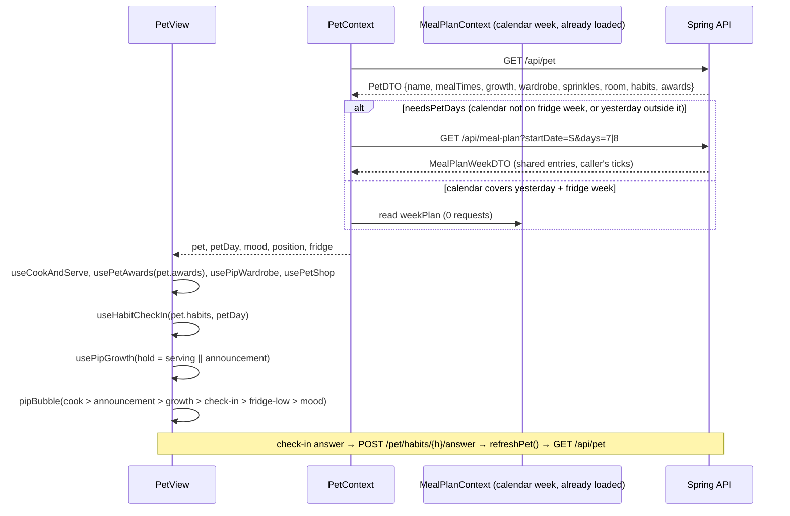

# Plan: Integrate Pip's room — one pet payload and cross-feature consistency

Plan folder: `.claude/contract/MPP-28-pip-room-integration/`
Execution status: see `tasks.md` in this folder.

---

## Part 1 — Alignment

### Task reference

Jira **MPP-28** (Task, Low, parent epic MPP-15): *Integrate Pip's room: one pet payload and cross-feature consistency.* Moved `To Do → Planning` on 2026-10-14. Breakdown reference: `.claude/contract/MPP-15-epic-breakdown/tasks.md` (T13).

Problem statement (verbatim): "By the end of the build tickets, the room reads from `/pet`, `/pet/habits`, `/pet/awards`, sprinkles, stations, fitness and wardrobe, and each piece was built separately. This ticket wires them into one coherent page load and reconciles mismatches."

Acceptance criteria (verbatim):

1. The Pet page loads the room's data in at most two requests: `GET /api/pet` is extended or one room endpoint is added. No waterfall of 5+ calls.
2. Bubble priority is defined and implemented: cook sequence > new award/outfit > stage change > check-in question > fridge-low > time-of-day greeting.
3. Linked accounts (per-person Pip, MPP-33):
   - **Shared:** the meal plan, shopping list, templates and extra choices.
   - **Personal:** eaten ticks, Pip (name, mood, meal times), habits, streaks, awards, firsts, sprinkles, room levels, decor, wardrobe and fitness.
   - A two-account test proves no personal data leaks between partners.
4. The footer tab, `PetReaction` and mood still behave as in MPP-14, now with body stage and outfit.

Scope (verbatim): in — payload consolidation, bubble priority, sharing audit, regression pass. Out — new features. Risks: "Mismatches found here become fixes in this ticket, unless they are large. Large ones are logged as Bugs under MPP-15." Skills named: java-backend, react-frontend.

### Restated goal

Today, opening `/pet` fires up to five requests: `/api/pet` (which already carries growth, wardrobe, sprinkles and the room), `/api/pet/habits`, `/api/pet/awards`, a meal-plan week starting yesterday (for mood), and a second meal-plan week for the fridge when the calendar is showing a different week. After this ticket, `/api/pet` also carries the caller's habit statuses and trophy cabinet, and the pet context makes at most one meal-plan read, and none when the calendar already shows the fridge week and yesterday. Worst case is two requests. Pip's speech bubble follows one priority order in one pure, checked function: cook > new award/outfit > stage change > check-in > fridge-low > mood line. The evolve/de-evolve sequence pauses while a higher line speaks, so it is no longer lost under the cook scene. The per-person split from MPP-33 gets one backend test that proves every personal part of `/api/pet` comes from the caller and never from the plan owner. A regression pass then confirms the footer tab, mood and the MPP-34 eaten hand-off (which replaced `PetReaction`) still work with Pip's form and outfit.

### In scope

- `PetDTO` gains `habits` (the `GET /pet/habits` list) and `awards` (the `GET /pet/awards` cabinet), built in `PetService` in an order that keeps award recording, wardrobe unlocks and the sprinkle balance consistent within one transaction.
- `WardrobeService.sync` takes the award statuses already computed for the payload, so one `/pet` read derives the award ledger once instead of twice.
- `GET /api/meal-plan` takes an optional `days` (default 7, 1–14), so the pet context can read yesterday through the end of the fridge week in **one** request.
- `PetContext`: one "pet days" meal-plan read replaces the recent-days and fridge reads. It is skipped when the calendar week already covers yesterday and the fridge week. Context also exposes `petDay`, the date the current payload was fetched for.
- `useHabitCheckIn` and `usePetAwards` read from the pet payload instead of fetching. A check-in answer refreshes `/pet` (cabinet, growth, wardrobe and sprinkles together).
- `utils/pipBubble.js`: the AC 2 priority as one pure function, pinned by a new `npm run check:bubble`.
- `usePipGrowth` gets a `hold` input that pauses the evolve sequence while the cook scene or an announcement speaks.
- Sharing audit: a two-account `PetServiceTest` (AC 3), a grep audit that only plan-slot reads resolve the plan owner, and the audit table in this plan.
- Regression pass: all `check:*` scripts, the backend suite, the build, and a manual checklist for the footer tab, mood and the MPP-34 hand-off.
- Version bump (Task → MINOR) and a CHANGELOG line.

### Explicitly out of scope

- New features of any kind (ticket). That includes new bubble lines and any change to a feature's own rules (streak, growth, sprinkle and unlock rules stay as built).
- Removing `GET /api/pet/habits` and `GET /api/pet/awards`. They stay as-is for direct reads; only the client stops calling them (see Assumptions).
- Making the calendar's `MealPlanContext` refetch on tab visibility.
- Visual or motion polish (MPP-29) and sign-off (MPP-30).
- Restoring `PetReaction`: MPP-34 deleted it on purpose.
- Any schema change. No migration and no go-live row.

### Pattern Reference

None supplied beyond the skills. References chosen:
- `PetService#toDTO` + `PetPolicy#toDTO`: how MPP-25/26/31/32 each added a part to the one pet payload. `habits` and `awards` follow the same route.
- `PetServiceTest`: the linked-partner pattern (`LINKED_ID` with `mealPlanOwnerId = OWNER_ID`, `verify(..., never()).x(OWNER_ID)`). The AC 3 test extends it.
- `MealPlanServiceTest#getWeekPlan_linkedPartner_readsTheSharedEntriesButOnlyTheirOwnTicks` + `stubWeekMacros()`: the shared-plan/personal-ticks proof, reused for the `days` test.
- `utils/cookServe.js` + `cookServe.check.mjs`: a pure rule module with a node `assert` check and an `npm run check:*` script. `pipBubble` copies this.
- `PetContext`'s existing abortable-fetch effects: the shape for the single pet-days read.

### Constraints flagged on the brief

- At most two requests for the room's data, with no waterfall.
- Bubble order exactly: cook sequence > new award/outfit > stage change > check-in question > fridge-low > time-of-day greeting.
- Personal versus shared split exactly as listed in AC 3, proven by a two-account test.
- Footer tab and mood behave as in MPP-14, now with body stage (herb form) and outfit.
- Large mismatches become Bugs under MPP-15, not fixes here.
- MPP-15 epic is local-first: no Railway writes. Final verification runs `build-golive.mjs --check`.

### Assumptions made

- **"Two requests" counts the Pet page's own reads, not `MealPlanContext`'s calendar week.** That week is loaded app-wide before `/pet` opens, and the Pet page reuses it. Budget: `/api/pet` + at most one meal-plan read.
- **Extend `GET /api/pet`; don't add a room endpoint.** `/pet` already carries growth, wardrobe, sprinkles and the room, and the client swaps the whole pet on every response. Adding `habits` and `awards` keeps one payload and one cache.
- **Optional `days` on `GET /api/meal-plan`, rather than a pet-specific plan endpoint.** The mood needs yesterday and the fridge needs a 7-day window that can start today, which is 8 days on the window's first day. One generic optional parameter (default 7, so every current caller is unchanged) is less code than a second endpoint that would duplicate `getWeekPlan`.
- **Keep `GET /api/pet/habits` and `GET /api/pet/awards`.** They are tested, cheap, and the habit write endpoints sit beside them. The client stops calling them, and `petService.getAwards` and `habitService.getHabits` are deleted. Red-line this if you'd rather remove the endpoints.
- **"Time-of-day greeting" = the existing mood line (`petBubble(moodInfo)`).** No separate greeting exists. The mood line is already driven by the time against your meal times ("Nothing due yet", "Did lunch happen?", "Nap time"). Adding a new greeting would be a new feature.
- **The shop/decor purchase line sits in the award/outfit tier, after outfit.** The AC doesn't list it. It is an announcement of something just earned or bought, same as today (award > outfit > upgrade).
- **An announcement and an open check-in question share the bubble: announcement first, then the question with its buttons.** This keeps today's behaviour, where an answer that earns an award doesn't hide the next question. The announcement still leads, so the order holds.
- **A stage change pauses instead of competing.** While a higher line is speaking, the growth sequence is held at its current step (`hold`), so the evolve line is never skipped. Today the cook scene can play through a whole growth sequence and hide its line, which is a mismatch fixed here.
- **A check-in answer refreshes `/pet`, not only the cabinet.** An answer changes the growth score, award counts, wardrobe unlocks and possibly sprinkles. Refreshing only the cabinet (today) leaves the rest stale until the next visit, which is a mismatch fixed here.
- **`PetReaction` in AC 4 is read as "the MPP-34 eaten hand-off".** MPP-34 deleted `PetReaction` deliberately and flagged that AC 4 still names it. The regression pass checks its replacement instead.
- **No large mismatch was found during planning,** so no Bug ticket is opened. If execution finds one, `/fb-apply` logs it under MPP-15 instead of fixing it.

### Cross-code alignment audit (FE ↔ BE ↔ DB)

Run against the local `foodbytes-db`. MPP-15 is local-first, and the pet tables do not exist on Railway yet.

- **Per-person tables all key on `user_id`** (`information_schema.COLUMNS`):
  ```
  meal_plan_entry_eaten  id,meal_plan_entry_id,user_id,eaten_at
  pet_awards             id,user_id,streak_type,milestone,streak_start,cycle_index,awarded_at
  pet_decor_owned        id,user_id,item_key,purchased_at
  pet_firsts             id,user_id,first_key,earned_at
  pet_habit_days         id,user_id,habit,day,clean
  pet_habit_streaks      id,user_id,habit,streak_start,best,last_answered_date
  pet_outfit_slots       id,user_id,slot,item_key
  pet_room_placements    id,user_id,spot,item_key
  pet_sprinkles          id,user_id,source_type,source_id,amount,created_at
  pet_station_levels     id,user_id,station,level,upgraded_at
  pet_wardrobe_unlocks   id,user_id,item_key,unlocked_at,seen_at
  ```
  Pip's name, meal times and fully-grown marker live on the caller's own `users` row (`PetService`, `MealTimesPolicy`). Linked users locally: `SELECT COUNT(*) FROM users WHERE meal_plan_owner_id IS NOT NULL` → **2**, so the two-account case exists in real data.
- **Owner resolution (sharing audit).** `getEffectiveMealPlanOwnerId` / `resolveOwnerId` appear only in `MealPlanService`, `MealPlanTemplateService`, `ShoppingListService`, `PersistedShoppingListService`, `ExtraChoiceService` and `ManageExtrasService` (the shared side). The pet services call `resolveOwnerId` only to read **planned slots**: `PlanStreakService`, `PetGrowthService`, `SprinkleService.planned` and `PetFirstService`. Ticks, credits and balances are always written and read under the caller's own id. No leaks were found.
- **Frontend per-user state:** every Pip localStorage store (`awardSeenStore`, `checkInSnoozeStore`, `pipGrowthSeenStore`, `pipSeenStore`, `wardrobeAnnouncedStore`) is keyed `<KEY>.<userId>`, so no leaks across accounts on a shared browser.
- **New JSON names line up:** `PetDTO.habits` (`List<HabitStatusDTO>`) ↔ `pet.habits` (the same `HabitStatus[]` `useHabitCheckIn` reads today). `PetDTO.awards` (`PetAwardsDTO {streaks, firsts}`) ↔ `pet.awards` (the same shape `usePetAwards` reads today). Query param `days` ↔ `mealPlanService.getWeekPlan(start, { days })`.
- **Request count today**, from reading `PetContext`, `useHabitCheckIn` and `usePetAwards`: `/pet`, `/pet/habits`, `/pet/awards`, `/meal-plan?startDate=<yesterday>`, plus `/meal-plan?startDate=<fridge start>` when the calendar is on another week. That is 4–5 requests, and the AC 1 limit is 2.
- **Unapplied migrations:** none needed. This ticket changes no schema. The MPP-15 go-live file is untouched.

---

## Part 2 — Technical design

### Approach

**Backend: one payload.** `PetService#toDTO` already assembles growth, wardrobe, sprinkles and room for the caller. It gains two more parts, in a deliberate order: growth → `AwardService#getCabinet` (records any newly earned award) → `WardrobeService#sync(userId, growth, cabinet.streaks)` (unlocks from those same counts, instead of calling `getAwards` again) → sprinkle balance → room → `HabitStreakService#getHabits`. Everything runs in `getPet`'s one `@Transactional`, so a single read is internally consistent: the cabinet, the wardrobe unlocks it causes and the balance all reflect the same ledger. `PetPolicy#toDTO` takes the two new parts, and `PetDTO` gains two fields. `GET /api/meal-plan` gains `@RequestParam(defaultValue = "7") int days`. `MealPlanService#getWeekPlan(userId, start)` becomes a 7-day delegate of a new `getPlan(userId, start, days)` that bounds-checks 1–14. The plan stays shared and ticks stay the caller's, unchanged. The road not taken was a `GET /api/pet/room` bundle that embeds meal-plan days. It would duplicate `getWeekPlan`'s day building and lose the calendar's optimistic ticks, which mood relies on (MPP-12 AC 7).

**Frontend: one pet read, at most one plan read.** `PetContext` keeps its `/pet` effect and replaces the recent-days and fridge effects with one "pet days" effect. A new pure helper `petPlanRange(fridgeRange, yesterdayISO)` returns `{ start, days }`: the fridge week (7 days) when yesterday is inside it, else from yesterday (8 days). `needsPetDays(calendarIsFridgeWeek, fridgeRange, yesterdayISO)` is false when the calendar already shows a fridge week that contains yesterday, so the common case adds **zero** plan reads. Mood still prefers `weekPlan` per day (optimistic ticks), and the fridge reads `weekPlan` or the pet-days plan exactly as before. The context also stores `petDay`, the `todayISO` each `/pet` response was requested for. `useHabitCheckIn` uses it to seed only from a payload fetched for today, never from yesterday's payload still on screen after midnight. The hook seeds once per user and day, so a later `/pet` refetch (tab visible, sprinkle refresh) can't restart a question the user is answering. `usePetAwards` becomes a derivation over `pet.awards`: same seen-store comparison, same queue, no fetch. After a check-in answer, `refreshPet()` refetches `/pet`, which brings the cabinet, growth, wardrobe and sprinkles back together.

**Bubble: one rule.** `utils/pipBubble.js#pipBubble({ cookLine, announcement, growthLine, checkIn, fridgeLine, moodLine })` returns `{ text, actions }` in AC 2 order. `PetView` computes the inputs and renders the result. `usePipGrowth({ …, hold })` neither starts nor advances a run while `hold` is true: the step timer is cleared and resumes with that step's full duration when the hold lifts. `PetView` passes `hold = Boolean(serving) || Boolean(announcement)`, so a stage change always gets to speak after the cook scene and announcements. That is "priority" for a timed sequence: wait your turn rather than be skipped. The alternative was to let the stage change preempt and pause the award queue. That inverts the AC's order, so it was rejected.

**Regression pass.** No new runner exists. The pass is every `check:*` script, `mvn test`, `npm run build`, `build-golive.mjs --check`, and a manual checklist (Phase 5) covering the footer tab (form, mood, hat), mood transitions, the MPP-34 eaten → `/pet` hand-off with the cook scene, the check-in → award → growth chain, and two linked accounts side by side.

### Skills to invoke during execution

- `java-backend`: `PetDTO`/`PetPolicy`/`PetService` payload extension, the `WardrobeService.sync` signature, and the `days` param on `MealPlanController`/`MealPlanService`. Owns layering (thin controller, logic in service), `@Transactional` boundaries and the Mockito tests.
- `react-frontend`: `PetContext`, the hooks (`useHabitCheckIn`, `usePetAwards`, `usePipGrowth`), services, `pipBubble` and `PetView`. Owns the four async states, `AbortController` cleanup, no fetching in components, and the 400-line budget.

No `.claude/rules/` file applies: no recipe, ingredient, macro or migration content is touched.

### Diagram



### Data shapes

#### `PetDTO` (Java), two new fields at the end

```java
private List<HabitStatusDTO> habits;  // MPP-28: the caller's own SNACK + ALCOHOL statuses (= GET /pet/habits), never null
private PetAwardsDTO awards;          // MPP-28: the caller's own cabinet (= GET /pet/awards), never null
```

#### `PetPolicy.toDTO`

```java
public static PetDTO toDTO(User user, PetGrowthDTO growth, WardrobeDTO wardrobe, long sprinkles,
                           PetRoomDTO room, List<HabitStatusDTO> habits, PetAwardsDTO awards)
```

#### `WardrobeService.sync` (replaces the 2-arg form)

```java
@Transactional
public WardrobeDTO sync(Long userId, PetGrowthDTO growth, List<AwardStatusDTO> awards)
// progress(userId, growth, awards): counts from the passed statuses; no awardService.getAwards call
```
`AwardService` stays a dependency only if another method uses it. After this change `progress` no longer needs it, so it is removed from `WardrobeService`'s constructor (and from `WardrobeServiceTest`'s manual `new WardrobeService(...)`).

#### `GET /api/meal-plan`

| Param | Type | Required | Default | Rule |
|---|---|---|---|---|
| `startDate` | ISO date | yes | — | unchanged |
| `days` | int | no | 7 | 1–14, else `400 {"error": "days must be between 1 and 14"}` |

Response: `MealPlanWeekDTO`. `days` has `days` entries, and `endDate = startDate + days − 1`. The weekly totals and averages cover the returned days.

```java
// MealPlanService
public static final int MAX_PLAN_DAYS = 14;
public MealPlanWeekDTO getWeekPlan(Long userId, LocalDate startDate) { return getPlan(userId, startDate, 7); }
@Transactional(readOnly = true)
public MealPlanWeekDTO getPlan(Long userId, LocalDate startDate, int days) // IllegalArgumentException outside 1..MAX_PLAN_DAYS
```

#### Frontend JSON (`pet` in `PetContext`)

```js
pet.habits  // [{ habit: 'SNACK'|'ALCOHOL', current, best, lastAnsweredDate, askToday, coversFrom }]
pet.awards  // { streaks: AwardStatus[], firsts: FirstStatus[] }
```

#### New / changed frontend modules

```js
// services/mealPlanService.js
getWeekPlan(startDate, { signal, days } = {})   // appends &days=N only when days is given

// utils/fridgeFill.js (pure, pinned in fridgeFill.check.mjs)
export function petPlanRange(fridgeRange, yesterdayISO)          // → { start, days: 7|8 }
export function needsPetDays(calendarIsFridgeWeek, fridgeRange, yesterdayISO) // → boolean

// contexts/PetContext.jsx: value additions / changes
petDay      // string|null: the todayISO the current pet payload was requested for
habits      // pet?.habits ?? null
awards      // pet?.awards ?? null
// removed internals: recentPlan, fridgePlan → one petDays { start, days, plan }

// hooks/useHabitCheckIn.js
useHabitCheckIn({ userId, todayISO, habits, petDay, onAnswered })  // no fetch

// hooks/usePetAwards.js
usePetAwards({ userId, awards, loading, error, retry })
// → { cabinet: { data, loading, error, retry }, announcement }   (refresh removed)

// hooks/usePipGrowth.js
usePipGrowth({ userId, growth, petName, hold })

// utils/pipBubble.js (pure, pinned by src/utils/pipBubble.check.mjs → npm run check:bubble)
export function pipBubble({ cookLine, announcement, growthLine, checkIn, fridgeLine, moodLine })
// checkIn = { text, prompt, actions } | null  (useHabitCheckIn's return)
// → { text: string, actions: Object|null }
```

Removed client methods: `petService.getAwards`, `habitService.getHabits`.

### Runtime quality notes

Frontend dimensions are mapped onto the browser runtime.

- **Resource cleanup:** the pet-days effect owns an `AbortController`, aborted on cleanup and on any dependency change, as today's two effects did. `useHabitCheckIn` and `usePetAwards` lose their fetches, and with them two controllers and the awards hook's own `visibilitychange` listener (`PetContext`'s listener already refetches `/pet`). `usePipGrowth`'s step timer is cleared when `hold` flips true, and a new one is set when it flips back.
- **Concurrency / ordering:** `refreshPet()` after an answer can race a `/pet` GET that is already in flight. The existing effect aborts the older controller when `petReloadKey` changes, so the last request wins. The check-in seeds once per `userId|todayISO`, so a refetched payload never resets a half-answered question. Awards comparison is idempotent (baseline written before queueing), so repeated payloads never re-announce. Backend: the whole payload is one transaction. Award ledger inserts are `insertIfAbsent`, which tolerates two devices reading at once, as today. Linked partners never touch each other's rows (audit above).
- **Allocation / cost behaviour:** one `/pet` read now derives the award ledger **once** (today the payload's wardrobe sync does it once and the separate `/pet/awards` call does it again). Habit statuses are read twice inside one `/pet` (once in `getAwards`, once for `habits`). That is two small indexed queries per habit, accepted over threading statuses through `AwardService`. Page load drops from 4–5 HTTP requests to 1–2. The 8-day plan read costs one extra day of macro calculation, only on the fridge window's first day. `PetView` re-renders exactly as before. `pipBubble` is a constant-time pure call.
- **Error paths:** a failed `/pet` shows today's full-page error with "Try again". With a pet already loaded, the last good pet stays. A failed pet-days read sets the context error (as `planError` did) and `fridge.error = FRIDGE_LOAD_ERROR` when it was the fridge's source. Mood degrades to the days it has. The cabinet's `error` and `loading` now come from the pet load: `retry` = `PetContext.retry`. The check-in shows nothing until a payload for today arrives. A failed answer still says `CHECKIN_SAVE_FAILED`, and `refreshPet` runs only after a saved answer. Backend: an out-of-range `days` gives a 400 with `{error}`, and nothing is swallowed.

### Risks and judgement calls

- **Changing a shared endpoint (`/api/meal-plan`) for the Pet page.** The default of 7 keeps every existing caller byte-identical. The test pins both the default and the 8-day path. Red-line this if you'd rather accept a worst case of 3 requests and keep the endpoint frozen.
- **Keeping `/pet/habits` and `/pet/awards` on the server** with no client caller. Cheap to keep and well tested, but it is unused surface. Say so if you want them deleted in this ticket.
- **Check-in seeding keyed on `petDay`.** If `/pet` fails on a new day, the check-in stays silent until it succeeds. That matches today's "a failed load shows no check-in".
- **`hold` changes MPP-31 timing.** An evolution line can now arrive several seconds later than before (after cook ≈ 6 s and/or an award line). This is what AC 2 asks for, but it is visible in play-test.
- **Mood source in the common case is now only `weekPlan`.** Before, a recent-days copy was fetched as well. For days inside `weekPlan`, `pickDay` already preferred `weekPlan`, so behaviour is unchanged. Only the redundant fetch goes.
- **AC 4 names `PetReaction`, which MPP-34 removed.** The regression checks its replacement. Consider editing the ticket text (flagged in MPP-34 too).
- **No manual DB step.** No migration, and nothing to apply to Railway or local. The MPP-15 go-live file is unchanged, which Final verification checks.
