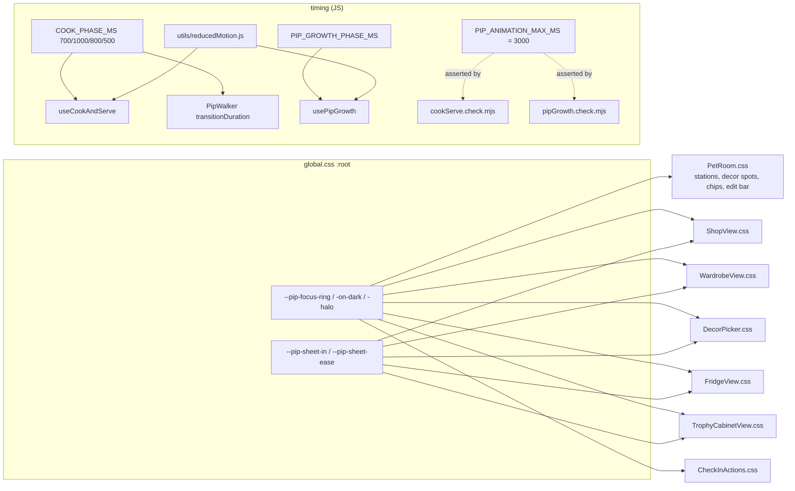

# Plan: Visual and motion polish pass for Pip's room

Plan folder: `.claude/contract/MPP-29-pip-room-polish-pass/`
Execution status: see `tasks.md` in this folder.

---

## Part 1 — Alignment

### Task reference
Jira **MPP-29** (Task, Low, parent epic MPP-15; blocked by MPP-28, blocks MPP-30). Breakdown: `.claude/contract/MPP-15-epic-breakdown/tasks.md` → T14.

Problem statement (verbatim): *Each surface shipped with a functional default (the "state a default, don't stall" principle). The room as a whole needs one pass for spacing, colour, interactive states and motion, so it reads as finished.*

Acceptance criteria (verbatim):
1. Hover/focus/pressed states exist for the fridge, cabinet, shop, wardrobe and edit controls, with visible focus rings.
2. Animation timings (hop, steam, cook, serve, stage change) feel consistent and none exceeds 3 s end to end. Reduced-motion is respected everywhere.
3. Dark mode: the room, the overlays, the bubble and Pip's outfits are legible in both themes.
4. The phone check at 320 / 375 / 414 px has no clipping and no horizontal scroll. The developer signs off on screenshots.
5. Decide (and record the decision) whether to add the mini cook animation next to `PetReaction` (open question from MPP-18).

Scope: in: visual and motion refinement, dark mode, accessibility states, final review of clothing art. Out: new art for new items.
Dependencies & risks: **pause condition, visual judgement**: the developer reviews before/after screenshots. Skill: react-frontend.
Design assets: `.claude/contract/MPP-15-epic-breakdown/mockups/pip-room-mockup-v5.html`, `.claude/contract/MPP-15-epic-breakdown/mockups/pip-progression-mockup.html`.

**Decision confirmed by the developer, 2026-10-14:** AC 3 (dark mode) is **skipped**. FoodBytes has no dark theme (no `prefers-color-scheme`, no `data-theme`, `global.css` is light-only), so there is no second theme to be legible in.

### Restated goal
Make Pip's room feel finished without adding features or art. Every control in the room and its overlays (station buttons, fridge, cabinet, shop, wardrobe, edit bar, decor picker, style chips) gets the full set of states: hover on hover-capable devices, pressed, and a focus ring that is actually visible on the surface it sits on. Today's yellow ring disappears on the white sheets. Motion is brought under one rule: no one-shot sequence runs longer than 3 s, overlays enter with the same timing, and reduced motion is honoured everywhere, with that rule pinned in the existing `node` check scripts. The AC 5 decision is recorded: no mini cook animation, because `PetReaction` no longer exists. The developer closes the ticket with the phone-width screenshot check and the clothing-art review.

### In scope
- One shared set of focus-ring tokens, and every pet-room control using them (AC 1).
- The missing hover/pressed states on shop close and tabs, wardrobe close/text/lineup buttons, decor picker close and options, style chips and the edit-bar buttons (AC 1).
- Retuning the cook-and-serve scene to ≤ 3 s end to end, with the walk transition driven by the same constant (AC 2).
- A shared `PIP_ANIMATION_MAX_MS` limit, pinned in `cookServe.check.mjs` and `pipGrowth.check.mjs` (AC 2).
- One overlay entrance timing for shop, wardrobe and decor picker, plus a reduced-motion-safe fade-in for the fridge and cabinet overlays (AC 2).
- One `prefersReducedMotion()` helper in place of the two copies in `useCookAndServe` / `usePipGrowth` (AC 2).
- Recording the AC 5 decision (AC 5).
- A developer-owned visual review: 320 / 375 / 414 px phone check, before/after screenshots and the clothing-art review, recorded in `visual-review.md` (AC 4 + "final review of clothing art").
- Version bump (Task → MINOR) and CHANGELOG.

### Explicitly out of scope
- **Dark mode (AC 3)**: skipped by developer decision, 2026-10-14.
- New art, new clothing items, new decor or new stations.
- Changing the infinite idle loops (mood bob/droop/bounce, steam, z's, badge pulse). They are ambient loops, not one-shot sequences, so the 3 s rule does not apply. Reduced motion already stops them.
- Restoring `PetReaction` or adding any animation to `MealEatenSection`.
- Changing app-wide components outside `components/pet/` (footer tab, `MealEatenSection`) beyond a read-only regression look.
- Any backend, schema or migration change.
- Fixing layout bugs the phone check finds beyond small CSS tweaks in pet-room files. Anything larger goes to a follow-up ticket via `/fb-issue`.

### Pattern Reference
None supplied beyond the mockups. Chosen references:
- Interaction-state pattern: `.pip-station-btn` / `.pip-fridge-btn-text` in `PetRoom.css` / `FridgeView.css` (`:active`, `@media (hover: hover)`, `:focus-visible`). This is the react-frontend skill's touch rule.
- Design tokens: `:root` in `client/src/styles/global.css` (FR-104 macro tokens are the precedent for a named token family).
- Timing constants: `COOK_PHASE_MS` / `PIP_GROWTH_PHASE_MS` in `constants/pet.js` / `constants/pipGrowth.js`. Retune in one place.
- Pure-rule checks: `src/utils/cookServe.check.mjs`, `src/utils/pipGrowth.check.mjs` (`npm run check:*`).

### Constraints flagged on the brief
- Pause condition: visual judgement belongs to the developer, who reviews before/after screenshots.
- Reduced motion must be respected everywhere.
- ≥ 44 px touch targets, hover only inside `@media (hover: hover)`, `:focus-visible` for rings (react-frontend skill).
- No new art.
- MPP-15 epic is local-first on `feature/MPP-15-pip-room`. This ticket has no migration, so the go-live SQL is untouched.

### Assumptions made
- **AC 3 skipped (confirmed by the developer, 2026-10-14).** There is no dark theme to be legible in.
- **"None exceeds 3 s end to end" applies to each one-shot sequence as a whole.** The cook-and-serve scene is walk → cook → serve → walk back, today 1.3 + 2.2 + 1.6 + 1.3 = **6.4 s**, so it fails. It is retuned to 0.7 + 1.0 + 0.8 + 0.5 = **3.0 s**. The stage-change sequences already pass (evolve 0.9 + 1.6 = 2.5 s, de-evolve 0.9 + 1.2 = 2.1 s). Rationale: reading it per phase would make the AC a no-op, since every single phase is already < 3 s.
- **Idle loops are exempt** (see Out of scope). They have no end.
- **The reduced-motion served hold (2.5 s) is a static hold, not an animation,** but it is still ≤ 3 s, so it passes either way.
- **Bubble hold times (`CHECKIN_REACTION_MS` 8 s, `AWARD_BUBBLE_MS` 6 s, `PIP_GROWTH_BUBBLE_MS` 8 s) are reading time, not animation.** They are untouched.
- **Focus ring = two tokens in `global.css :root`:** `--pip-focus-ring: #7c5cd6` (room accent, ≥ 3:1 against white and the room's lavender `#ece5fb`) for light surfaces, and `--pip-focus-ring-on-dark: #ffd34d` for the cabinet's wood and the edit bar. In-room buttons over art (stations, decor spots) add a `#fff` halo, so the ring reads over any furniture colour. Rationale: today's `#ffd34d` on `#fff` is ~1.4:1, below WCAG 1.4.11's 3:1 for non-text, which fails "visible focus rings".
- **Overlay entrance = one duration token,** `--pip-sheet-in: 0.28s` (the decor picker's existing value), used by shop, wardrobe and decor picker. The fridge and cabinet gain a fade-in on the same token. Rationale: the three sheets were 0.28 / 0.32 / 0.32 s, and the two room overlays appeared with no transition.
- **AC 5 decision: do not add a mini cook animation.** MPP-34 deleted `PetReaction` deliberately. A confirmed eaten tick now hands off to `/pet` after a 600 ms "✓ Eaten" beat, where the full cook scene plays. A second, smaller cook animation would duplicate the scene the user is about to watch. Recorded in `visual-review.md` and the PR description.
- **Phone-width and clothing-art review are developer-owned manual checks.** The executor has no browser. Fixes the developer asks for go in through a `/fb-issue` correction, not invented by the executor.

### Cross-code alignment audit (FE ↔ BE ↔ DB)
Skipped: CSS, frontend timing constants and node checks only. No persistence, endpoint or DTO is touched.

---

## Part 2 — Technical design

### Approach
The pass is mostly CSS, organised around two token families added to `global.css :root`, the house home for named tokens (the FR-104 macro family is the precedent). **Focus tokens** (`--pip-focus-ring`, `--pip-focus-ring-on-dark`, `--pip-focus-halo`) replace the eleven hard-coded ring colours across the seven pet-room stylesheets. **Motion tokens** (`--pip-sheet-in`, `--pip-sheet-ease`) give the three bottom sheets one entrance and let the fridge and cabinet overlays fade in on the same beat. Then the missing `:active` / `@media (hover: hover)` rules go in next to each control's existing rule, following the `.pip-fridge-btn-text` pattern. Keeping each control's states in its own stylesheet beats a shared "pip-button" base class: a base class would mean touching JSX `className`s across ten components for what is a visual change, and each surface (wood cabinet, white sheet, room art) needs a different pressed tint anyway.

Motion timing stays in JS constants, because the cook scene is driven by `setTimeout` per phase in `useCookAndServe`. `COOK_PHASE_MS` is retuned to 700/1000/800/500 ms, and a new `PIP_ANIMATION_MAX_MS = 3000` in `constants/pet.js` is asserted against both the cook schedule and the growth sequences in the existing `node` check scripts. That keeps a future retune from silently breaking AC 2. The walk's CSS duration (`.pip-walker { transition: transform 1.25s }`) is today a second copy of the walking phase length that has already drifted (1.25 s vs 1.3 s). `PipWalker` will set `transitionDuration` inline from `COOK_PHASE_MS.walking`, and the CSS keeps only the property and easing. The reduced-motion rule (`transition: none !important`) still wins over an inline non-important style. The road not taken was a CSS custom property set from JS (`--pip-walk-ms`). It works, but the inline style reads more plainly next to the inline `transform` already there.

The two hooks that each define `REDUCED_MOTION_QUERY` and `prefersReducedMotion()` import one helper from a new `utils/reducedMotion.js`. It is small, and it stops the next animated feature from adding a third copy. AC 5 is a decision, not code. AC 4 and the clothing-art review are a developer checkpoint at the end, recorded in `visual-review.md` in this folder.

### Skills to invoke during execution
- `react-frontend`: owns every change here (CSS interaction states and touch rules, `:focus-visible`, reduced motion, constants in `src/constants/`, the hook/util split, file order, no `console.log`, line budgets).

No `.claude/rules/` file applies: no recipe, ingredient, macro, meal-plan data or migration is touched.

### Diagram


### Data shapes
No schema or contract changes. New and changed frontend shapes:

#### CSS tokens (`client/src/styles/global.css`, `:root`)
```css
/* MPP-29: Pip's room — one focus ring and one overlay entrance for every room control. */
--pip-focus-ring: #7c5cd6;          /* light surfaces: sheets, bubble, fridge, room art */
--pip-focus-ring-on-dark: #ffd34d;  /* the cabinet's wood and the edit bar */
--pip-focus-halo: #fff;             /* gap ring under buttons drawn over furniture art */
--pip-sheet-in: 0.28s;
--pip-sheet-ease: cubic-bezier(0.2, 0.8, 0.2, 1);
```

#### Constants (`client/src/constants/pet.js`)
```js
// MPP-29 AC 2: no one-shot room sequence (cook scene, stage change) runs longer than this.
export const PIP_ANIMATION_MAX_MS = 3000

// Walk 0.7 s, cook 1.0 s, plate 0.8 s, walk back 0.5 s = 3.0 s (MPP-29 AC 2). Retune here.
export const COOK_PHASE_MS = { walking: 700, cooking: 1000, served: 800, returning: 500 }
```

#### New module `client/src/utils/reducedMotion.js`
```js
export const REDUCED_MOTION_QUERY = '(prefers-reduced-motion: reduce)'
export const prefersReducedMotion = () => window.matchMedia?.(REDUCED_MOTION_QUERY).matches === true
```

#### New file `.claude/contract/MPP-29-pip-room-polish-pass/visual-review.md`
Sections: `AC 5 decision`, `Phone check (320 / 375 / 414)`, `Clothing art review`, `Before/after screenshots`, `Sign-off`. The developer fills the checks; the AC 5 section is written by the executor.

### Runtime quality notes
Frontend only. Dimensions mapped onto the browser runtime.

- **Resource cleanup:** No new timers or listeners. `useCookAndServe` keeps its single per-phase `setTimeout`, cleared on unmount. Shorter phases do not change that.
- **Concurrency / ordering:** The cook scene's phase timers and the walker's CSS transition now share one constant, which removes the existing 1.25 s vs 1.3 s drift where the walk could still be moving as the cooking bubble appeared. The bubble priority order (MPP-28 `pipBubble`) is unchanged.
- **Allocation / cost behaviour:** CSS-only state rules; no extra re-renders. The fridge/cabinet fade is an opacity animation on one layer (compositor-only). No new dependency, and no bundle change beyond a few bytes.
- **Error paths:** None introduced. `prefersReducedMotion()` keeps the optional-chained `matchMedia`, so environments without it (node checks, old browsers) read as "motion allowed", same as today.

### Risks and judgement calls
- **3 s cook scene readability.** At 0.7 s the bubble line "Yay, lunch time! Let me cook 🍳" is on screen briefly. If the developer finds it too fast, the fix is a retune in `COOK_PHASE_MS` within the 3 s budget, or reading AC 2 per phase instead, which would leave the scene at 6.4 s. Decide at the visual review.
- **Purple ring on the purple primary buttons.** `--pip-focus-ring` (#7c5cd6) on `.pip-checkin-btn--primary` / `.pip-shop-btn` (also #7c5cd6 fill). The 2 px `outline-offset` leaves a white gap, so the ring still reads as a separate outline. Worth a look at the review.
- **Token placement in `global.css`.** These are Pip-only tokens in the app-wide `:root`. The alternative was scoping them on `.pet-view`, but the shop and wardrobe sheets are `position: fixed` and I have not confirmed they render inside `.pet-view` in every state. `:root` is the safe choice.
- **Visual pause condition.** AC 4 and the clothing review need the developer at a browser. `/fb-apply` cannot finish them, so the ticket reaches Ready for Test with them pending in `visual-review.md`.
- **Scope creep from the phone check.** Only small CSS tweaks inside pet-room stylesheets are in scope. Anything structural is a follow-up ticket.
