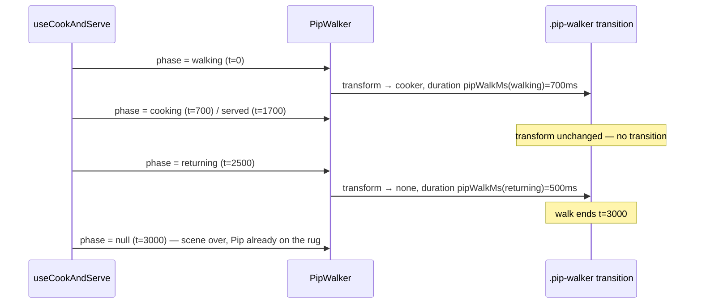

# Plan: Fix the cook-scene walk-back duration (MPP-29 regression)

Plan folder: `.claude/contract/MPP-29-walker-return-duration/`
Execution status: see `tasks.md` in this folder.

---

## Part 1 — Alignment

### Task reference
Developer brief (2026-10-14), verbatim:

> Fix MPP-29 regression: PipWalker uses COOK_PHASE_MS.walking (700ms) for both directions, but the returning phase is only 500ms, so Pip slides back to the rug ~200ms after the cook scene ends. Set the walker transition duration per phase (walking vs returning) in PetRoom.jsx, keep the cook scene ≤ PIP_ANIMATION_MAX_MS, and add a check in cookServe.check.mjs that pins the walker duration to the phase it animates.

Jira: **MPP-29** "Visual and motion polish pass for Pip's room" (Task, parent epic MPP-15). It was in `Ready for Test`; the regression was found there. Relevant acceptance criterion:

> 2. Animation timings (hop, steam, cook, serve, stage change) feel consistent and none exceeds 3 s end to end. Reduced-motion is respected everywhere.

The original MPP-29 contract is `.claude/contract/MPP-29-pip-room-polish-pass/`. It retuned `COOK_PHASE_MS` to 700 / 1000 / 800 / 500 ms (3.0 s).

### Restated goal
When a meal is logged, Pip walks to the cooker in 700 ms, cooks, serves, then walks back to the rug. The walk back uses the 700 ms walk-there duration, but the `returning` phase lasts only 500 ms. So the scene ends (bubble gone, phase `null`) while Pip is still sliding for about another 200 ms. The animation then really runs about 3.2 s, over the 3 s limit in AC 2. The fix makes each walk last exactly as long as the phase it animates: 700 ms out, 500 ms back. The rule moves into a pure helper so `cookServe.check.mjs` can pin it under Node.

### In scope
- A pure helper `pipWalkMs(phase)` in `utils/cookServe.js` that returns the walk-transition duration for a phase: `COOK_PHASE_MS.returning` for `returning`, otherwise `COOK_PHASE_MS.walking`.
- `PipWalker` in `PetRoom.jsx` sets `transitionDuration` from `pipWalkMs(phase)` instead of the constant `WALK_DURATION`.
- `cookServe.check.mjs` assertions:
  - each walking phase in the schedule gets a walk equal to its own `ms`;
  - the walk back finishes no later than the scene ends;
  - the whole scene, walk included, stays ≤ `PIP_ANIMATION_MAX_MS`.
- Correct the two stale comments that say the walk reads only `walking`: `constants/pet.js:77` and `PetRoom.css:42`.
- Version PATCH bump and a CHANGELOG line.

### Explicitly out of scope
- Retuning any `COOK_PHASE_MS` value. The 700 / 1000 / 800 / 500 split and the 3.0 s total stay.
- The hop animation, the reduced-motion path (it already skips both walks and sets `transition: none`), the bubble copy and `useCookAndServe`.
- Any other MPP-29 polish item: focus rings, dark mode, the phone checks.

### Pattern Reference
- The brief names `PetRoom.jsx` (PipWalker) and `utils/cookServe.check.mjs`.
- Chosen pattern: keep timing rules as pure functions in `utils/cookServe.js` (as `cookServeSchedule` already is) and pin them in the `.check.mjs` script run by `npm run check:cook`. Follow `react-frontend/SKILL.md`: constants stay in `src/constants/`, and logic stays out of the render body.

### Constraints flagged on the brief
- The cook scene must stay ≤ `PIP_ANIMATION_MAX_MS` (3000 ms).
- The walker duration must be pinned to the phase it animates, by a check in `cookServe.check.mjs`.
- There is no frontend test runner. Verification is `npm run check:cook`, `npm run build` and a manual look at `/pet`.

### Assumptions made
- **The helper lives in `utils/cookServe.js`, not in `PetRoom.jsx`.** The check runs under plain Node and cannot import a `.jsx` file. A check on an inline expression in PetRoom could not pin anything.
- **Only `walking` and `returning` start a walk.** `cooking` and `served` keep the at-cooker transform, so no transition fires. `null` (idle) falls back to `walking`. The next transform change from idle is always the walk out, and the browser takes the duration from the style that applies after the change. `pipWalkMs` therefore maps `returning → returning` and everything else to `walking`.
- **This is a regression fix → PATCH bump.** MPP-29 is a Task that already took its MINOR bump (1.24.0). A fix found in test is a bug fix, which per `CLAUDE.md` bumps PATCH.
- **No new CSS.** The inline `transitionDuration` is still the single source of the duration. `PetRoom.css` only gets its comment corrected.

### Cross-code alignment audit (FE ↔ BE ↔ DB)
Skipped: frontend timing only, no persistence touched.

---

## Part 2 — Technical design

### Approach
`PipWalker` animates Pip by changing an inline `transform` between `none` (rug) and the cooker offset. The CSS `transition` on `.pip-walker` is the walk. Its `transitionDuration` is a module constant built from `COOK_PHASE_MS.walking`, so both directions take 700 ms. The phase that triggers the walk back, `returning`, is scheduled for only 500 ms.

The fix makes the duration depend on the phase. When the phase changes `served → returning`, React applies the new transform and the new `transitionDuration` in one style update. The browser starts the transition with the durations from the style that applies after the change, so the walk back runs for 500 ms. When `returning → null`, the transform stays `none`, so no new transition starts. Changing the duration also does not affect a transition already running.

The mapping is a pure function, `pipWalkMs(phase)`, exported from `utils/cookServe.js` next to `cookServeSchedule`. `PetRoom.jsx` imports it, and `cookServe.check.mjs` asserts against it. That makes the "walker duration equals the phase it animates" rule a hard check, not a comment. The roads not taken:
- **Raise `returning` to 700 ms.** The scene would grow to 3.2 s, which breaks the 3 s limit.
- **Use `animationend` / `transitionend` to end the scene.** That couples the hook to the DOM and is overkill for a timing mismatch.
- **Use a single shared walk duration of 500 ms.** That would also speed up the walk out, which the developer did not ask for.

### Skills to invoke during execution
- `react-frontend`: owns the `PetRoom.jsx` edit, the constants/utils placement, and the file-order and size budget (PetRoom.jsx is 282 lines, and this edit shrinks it slightly).

Rules: none apply (no recipe, ingredient, macro or migration work).

### Diagram


### Data shapes
No schema or contract changes. New pure helper:

```js
// utils/cookServe.js
/** MPP-29: the walk lasts exactly the phase that starts it — out in `walking`, back in `returning`. */
export function pipWalkMs(phase) // → number (ms)
//   pipWalkMs('returning') === COOK_PHASE_MS.returning   // 500
//   pipWalkMs('walking')   === COOK_PHASE_MS.walking     // 700
//   pipWalkMs(other|null)  === COOK_PHASE_MS.walking
```

Removed: the `WALK_DURATION` module constant in `PetRoom.jsx`, and the `COOK_PHASE_MS` import there if nothing else uses it (only line 210 does).

### Runtime quality notes
These dimensions are mapped onto the browser runtime.
- **Resource cleanup:** trivial, no concerns. No timers or listeners are added; the existing hook owns the scene timers.
- **Concurrency / ordering:** the walk-back duration and transform change in the same React commit, so the browser sees one style change. No race exists between them.
- **Allocation / cost behaviour:** trivial, no concerns. One function call per render of `PipWalker`, which re-renders only on a phase change.
- **Error paths:** trivial, no concerns. An unknown or `null` phase falls back to the walk-out duration, which only matters on the next walk out.

### Risks and judgement calls
- Non-walking phases fall back to `walking`, not `0`. Either works for the walk out, because that transition uses the style that applies after the change. But `walking` keeps today's behaviour on every path except the walk back, and avoids an instant snap if some future phase change moves the transform outside `walking` / `returning`.
- The brief says "in PetRoom.jsx". The rule itself moves to `utils/cookServe.js` so the check can import it, and PetRoom.jsx only calls it. Red-line this if you want the map inline.
- A visual check on `/pet` is the only proof that the slide is gone. The node check proves only the arithmetic.
