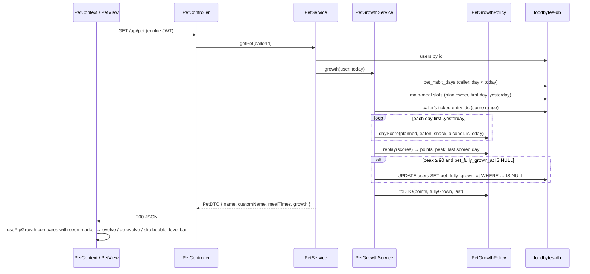

# Plan: Pip evolves — five herb forms, a +3/−3 daily score and a level bar

Plan folder: `.claude/contract/MPP-31-pip-herb-evolution/`
Execution status: see `tasks.md` in this folder.

---

## Part 1 — Alignment

### Task reference
Jira **MPP-31** (Story, parent epic MPP-15, local-first epic branch `feature/MPP-15-pip-room`). Blocked by MPP-16, MPP-20, MPP-22 and MPP-33, all in Ready for Test. Blocks MPP-32 (wardrobe) and MPP-28 (integration).

Acceptance criteria (verbatim summary of the ticket, reworked 2026-10-14):

1. **Daily score (per person, the caller).** A completed day scores **+3** when every planned breakfast, lunch and dinner is ticked by the caller (MPP-22 definition, MPP-33 ticks) **and** the day is snack-free and alcohol-free (MPP-20 per-day log); **−3** for any snack, any alcohol or any planned meal left unticked (one slip costs the whole day; slips don't stack); **0 (unscored)** for today until it is over, days whose check-in is not answered yet, and days with nothing planned and no snack or alcohol. A day with nothing planned that has a snack or alcohol is −3. Backdated check-in answers re-score those days.
2. **Running total.** `points` = sum of daily scores since the plant started, applied day by day in order and **floored at 0**, recomputed from the logs. Thresholds as named constants: Basil seed 0–14 (bar 15), Seedling 15–35 (bar 21), Sprig 36–59 (bar 24), Bushling 60–89 (bar 30), Basilisk 90+ (no bar).
3. **Strict de-evolve.** Form follows the total both ways, no grace buffer. **Basilisk is permanent:** once the total first reaches 90 the backend records `fullyGrownAt` (migration) and the form stays Basilisk.
4. `GET /api/pet` returns `growth { points, form, barCurrent, barSize, fullyGrown, lastDayScore }`, `barCurrent = points − form threshold`. Tests cover each threshold both ways, the floor at 0, a slip right after evolving de-evolving, Basilisk never de-evolving, a backdated answer re-scoring a day, unscored days, and two linked users getting different forms.
5. **Level bar** under Pip in the room, label like `Seedling · 6 / 21 → Sprig`; animates up/down when the total changed since the last visit; full → evolve plays and the next bar starts empty; below empty → de-evolve plays and the previous bar shows nearly full; Basilisk reads `Fully grown 🌸`. Not on the footer tab.
6. `MochiPet` replaced by one herb component taking `form` (1–5), `mood`, `wilted`, drawing the mockup's five forms (seed, seedling, sprig, bushling, Basilisk with its own content/happy face). Every form exposes the same anchors (hat y + width, eyes y + gap, neck, waist, foot tips) for MPP-32. Used in the room, the footer tab and `PetReaction`.
7. **Wilted look** (leaves droop, colours desaturate, vines hang, bloom closes to a bud) on the day after a −3 day, cleared by the next +3 day. Moods apply on top.
8. **Evolve / de-evolve animations.** Evolve plays once per rise in form since the last visit: white silhouette pulse then reveal; bubbles "What? Pip is evolving!" then "Pip evolved into Sprig! 🌱". De-evolve is a gentle shrink. Reduced motion skips animations, shows only the bubbles.
9. **Bubbles never shame:** slip day "Ouch, I lost a few leaves 🍂 A good day and I'll grow them back!"; de-evolving "I shrank back to Seedling 🌱 A few good days and I'll grow again!"; first reaching Basilisk "I'm fully grown! 🌸 Thank you for looking after me."
10. Mood faces (MPP-14) apply on every form. The `mini` variant crops correctly at every form; the footer tab may show the head only.

Out of scope per ticket: greenhouse collection / next plant species / outfits on graduates, clothing (MPP-32), tomato/pumpkin lines, any food-variety reward.

Design assets: `.claude/contract/MPP-15-epic-breakdown/mockups/pip-herb-wardrobe.html` (visual contract: forms, anchors, moods, evolve animation) and `pip-sprout-evolutions.html` (Basilisk mood sheet, wilt look). The ticket also lists "**To do before /fb-plan:** a mockup of the level bar, de-evolve and fully-grown states" — **that mockup does not exist yet** (checked the mockups folder and Downloads on 2026-10-14). See Assumptions and Risks.

### Restated goal
Give each person's Pip a growth state computed from their own history: every finished day scores +3 (all planned main meals ticked and the snack/alcohol check-in answered clean), −3 (any lapse or unticked planned meal) or 0 (not yet scoreable), and the running total — floored at zero, replayed from the logs each time so late answers correct history — picks one of five herb forms, with Basilisk locked in permanently by a new `users.pet_fully_grown_at` timestamp. `GET /api/pet` carries that growth block, and the frontend swaps the lavender Mochi for a five-form herb component (built from the approved mockup's geometry and anchors) everywhere Pip appears, adds a green level bar under the room, a wilted look after a slip, and once-per-visit evolve/de-evolve animations with kind bubbles.

### In scope
- `PetGrowthPolicy` (pure rules: day score, floored replay, thresholds, bar fields) and `PetGrowthService` (reads the caller's habit log, the shared plan's main-meal slots and the caller's ticks; records `fullyGrownAt`).
- Migration `users.pet_fully_grown_at`, `User` field, conditional "mark fully grown" repository update.
- `PetGrowthDTO` nested in `PetDTO.growth`; returned by both `GET /api/pet` and `PUT /api/pet/name`.
- Backend tests for every AC 4 case.
- `PipHerb` component (forms, faces, leaves/vines/bloom, wilt, mini crops, anchors export) replacing `MochiPet` / `mochiParts` in the room (`RoomPip`), the footer tab and `PetReaction`; Mochi files deleted; the room's outline colour moved to a room constant.
- `PipLevelBar` under the room on `/pet`.
- `usePipGrowth` hook + `pipGrowthSeenStore` for since-last-visit detection, the evolve / de-evolve sequence and the growth bubbles; bubble priority wired into `PetView`.
- Wilted look derived from `lastDayScore === -3`.
- Version bump (Story → MINOR), CHANGELOG, epic `railway-migrations.md` row.

### Explicitly out of scope
- Greenhouse, graduating Basilisk, the next herb species, per-plant start dates (later ticket).
- Clothing and drawing anything on the anchors (MPP-32) — this ticket only exposes them.
- Changing MPP-20 check-in semantics or MPP-22 plan-streak rules.
- Applying the migration to Railway (batched at epic merge per `railway-migrations.md`).
- Showing growth on the footer tab (AC 5 says not there) beyond the herb form itself.
- Any per-user timezone (the existing Europe/Dublin "today" from `HabitStreakPolicy` is reused).

### Pattern Reference
Supplied by the ticket: the two mockups above (geometry is ported verbatim from `pip-herb-wardrobe.html`'s `FORMS`, `face`, `basiliskFace`, `leaf`, `vein`, `vine`, `bloom`, `back`, `growth`, `props` and its `evolve` keyframes; wilt filter `saturate(.45) brightness(.97)` from `pip-sprout-evolutions.html`).
Chosen in-repo references:
- Pure policy + service split: `PlanStreakPolicy` / `PlanStreakService`, `HabitStreakPolicy` / `HabitStreakService`.
- Mockito service tests: `PlanStreakServiceTest` (anonymous `PlannedMealSlot`, linked-user stubbing via `ExtraChoiceService.resolveOwnerId`).
- Since-last-visit marker: `client/src/utils/pipSeenStore.js` (localStorage + in-memory max, per user id).
- Timed bubble sequence: `useCookAndServe` / `useHabitCheckIn` and the bubble priority chain in `PetView.jsx`.
- SVG component conventions: `MochiPet.jsx` (useId gradient ids, `full` / `mini` variants, a11y attributes).

### Constraints flagged on the brief
- Per person: growth keyed by the caller; slots from the shared plan owner (MPP-33).
- A day with nothing planned scores 0, not +3 (flagged on the ticket as "default to confirm at /fb-plan").
- Strict de-evolve, except Basilisk is permanent via a recorded `fullyGrownAt`.
- Every form has feet — the cooker walk and bed (MPP-17/18) must keep working.
- Reduced motion: animations skipped, bubbles still shown.
- Bubbles never shame (exact copy in AC 9).
- Migration applied before deploy (Railway at epic merge; local `foodbytes-db` now).
- Skills: java-backend, react-frontend.
- Mockup before UI code (ticket + developer memory).

### Assumptions made
- **Nothing-planned day scores 0** (ticket default) — applied as written; red-line here if you want otherwise.
- **Day-score precedence**, in this order: (1) today or later → 0; (2) any habit logged as a lapse that day → −3; (3) either habit not yet answered for that day → 0; (4) nothing planned → 0; (5) a planned main meal unticked → −3; (6) otherwise +3. *Rationale:* a known lapse is final, but unticked meals aren't judged until the check-in has covered the day, so a day isn't marked a slip while the user simply hasn't opened the app yet.
- **"Since this plant started" = the caller's first `pet_habit_days` row.** There is no pet entity or creation date; every day before the first check-in answer is unscored by rule (3), and leading zeros can't change a floored sum, so starting the scan there is equivalent and needs no extra column. The greenhouse ticket will add a real per-plant start when there is more than one plant.
- **`fullyGrownAt` is set on read.** `GET /api/pet` replays the history; if the running total reached 90 at any point in the replay and the column is null, it is set with a conditional `UPDATE … WHERE pet_fully_grown_at IS NULL`. Peak-in-replay (not just current points) so a user who touched 90 between visits and then slipped still locks in Basilisk.
- **Column lives on `users`** as `pet_fully_grown_at TIMESTAMP NULL`, matching `pet_name` (MPP-14/33 put per-person pet fields on `users`).
- **`lastDayScore`** = the most recent non-zero daily score (0 if none). That makes "wilted" exactly `lastDayScore === -3` (a −3 day stays the latest scored day until a +3 day replaces it), so the wilt rule lives in one place.
- **One extra field, `lastScoredDate`** (ISO date or null), added beyond AC 4's list, so the frontend can show the slip bubble once per new slip day rather than on every visit. Cheap and additive.
- **At Basilisk, `barCurrent` and `barSize` are `null`**; `fullyGrown` is true and `form` is 5 regardless of points.
- **Evolve plays once per visit**, revealing the final form even if the form rose by two (e.g. 2 → 4), with the bubble naming the final form. Reading "once per rise in form since the last visit" as "once, if it rose".
- **First visit ever (no seen marker) plays nothing** and silently stores the current growth, so existing users don't get a spurious evolve on deploy.
- **Bubble priority:** cook scene > growth event (evolve / de-evolve / fully grown / slip) > check-in > new award > fridge-low > mood. Growth lines hold for `CHECKIN_REACTION_MS` (8 s) like check-in reactions, then fall through.
- **Bubbles use the pet's name** ("What? Basil is evolving!") rather than a literal "Pip", matching the existing `petReactionText` / check-in copy.
- **Room outline colour** `#3b2f5c` (used by furniture, award art, iso shapes, effects) moves from `mochiParts.MOCHI_OUTLINE` to `ROOM_INK` in `constants/petRoom.js`; the herb uses the mockup's own ink `#2f4a22`.
- **Level bar is HTML, not SVG**, placed directly under the room scene in `PetRoom` (inside `.pip-room`, below `.pip-room-scene`), with `role="progressbar"`. Styling: green fill `#5fae3e` on `#e3f1d8` track, 10px tall, rounded, label above — pending the missing mockup.
- **Mini variant** shows each form's whole figure cropped tight (per-form `miniViewBox`), not head-only; the ticket allows head-only but whole-figure keeps the form legible at 30px.

### Cross-code alignment audit (FE ↔ BE ↔ DB)
MPP-15 is local-first: checks ran against the local `foodbytes-db` container (not Railway), per the epic's `railway-migrations.md`.
- `SHOW COLUMNS FROM users` → `… pet_name varchar(12) YES NULL`, `created_at timestamp YES CURRENT_TIMESTAMP`, `meal_plan_owner_id bigint YES MUL` — **no `pet_fully_grown_at`**; the migration adds it as nullable, so no backfill is needed and it is lossless.
- `SHOW COLUMNS FROM pet_habit_days` → `id bigint NO PRI`, `user_id bigint NO MUL`, `habit varchar(16) NO`, `day date NO`, `clean tinyint(1) NO`; entity `PetHabitDay` maps all five, unique key `(user_id, habit, day)` → at most one row per habit per day, so "answered" = row exists and "lapse" = `clean = 0`.
- `SHOW COLUMNS FROM meal_plan_entry_eaten` → `meal_plan_entry_id bigint NO MUL`, `user_id bigint NO MUL`, `eaten_at timestamp NO` — the per-person ticks MPP-33 introduced; read through the existing `findEatenEntryIdsInRange`.
- Data state: `pet_habit_days` has 2 rows, 1 user, both 2026-10-14; `meal_plan_entry_eaten` has 2 rows, 1 user. No user can be anywhere near 90 points, so nothing needs `pet_fully_grown_at` backfilled.
- Prior epic migrations are applied locally: `pet_awards`, `pet_firsts`, `pet_habit_days`, `pet_habit_streaks` all exist. Nothing is outstanding before this ticket's migration.
- Name chain for the new field: DB `pet_fully_grown_at` ↔ `User.petFullyGrownAt` (`@Column(name = "pet_fully_grown_at")`, `LocalDateTime`) ↔ not exposed directly; DTO exposes the boolean `growth.fullyGrown` ↔ JSON `growth.fullyGrown` ↔ frontend `pet.growth.fullyGrown`. All other growth keys are identical camelCase from `PetGrowthDTO` to the frontend.

---

## Part 2 — Technical design

### Approach
**Backend — pure rules, thin orchestration.** `PetGrowthPolicy` is a static final class like `PlanStreakPolicy`, holding the form thresholds, `dayScore(...)`, the floored replay and the DTO mapping, so every AC 4 boundary is unit-tested without mocks. `PetGrowthService.growth(user, today)` loads three bounded inputs: the caller's habit days before today (`findByUserIdAndDayBeforeOrderByDayAsc`), the shared owner's breakfast/lunch/dinner slots from the first habit day to yesterday (`findMainMealSlots`, as MPP-22 does), and the caller's ticked entry ids in the same range (`findEatenEntryIdsInRange`). It walks each date from the first habit day to yesterday, scores it, and replays with the floor, tracking the peak. If the peak reached 90 and `user.petFullyGrownAt` is null, it calls `UserRepository.markPetFullyGrown(id, now)`, a conditional JPQL update, and treats the user as fully grown for this response. `PetService` builds `PetDTO` from the user plus `PetGrowthService`, for both `getPet` and `renamePet` (the frontend replaces the whole pet object on rename, so growth must be on both). `getPet` loses `readOnly` because it can now write once.

**Why replay, not a stored running total.** A stored `points` column plus a daily job would need a scheduler (none exists), would drift whenever a backdated MPP-20 answer or a late tick changed history, and AC 2 explicitly says the total is "recomputed from the logs". The replay costs one pass over the days since the first check-in, about 365 iterations a year per GET, with three indexed queries, which is negligible. The road not taken: deriving Basilisk from the replay peak alone without a column. That fails AC 3, because a later backdated lapse could pull the historic peak under 90 and silently un-grow a Basilisk, hence the recorded `fullyGrownAt`.

**Frontend — one herb, many hosts.** The mockup is string-template JS, so it is ported to JSX in a `components/pet/herb/` folder: `herbForms.js` (the five `FORMS` with body path, fill, scale, anchors and mini crop; exports `PIP_FORM_ANCHORS` for MPP-32), `herbFaces.jsx` (shared face plus Basilisk face), `herbParts.jsx` (leaf, vein, vine, bloom, back, growth, mood props), and `PipHerbFigure` (an `<g>` drawing one form at a mood and wilt level in the mockup's 200-unit space, feet at y = 186). `PipHerb` wraps the figure in an `<svg>` with `full` / `mini` variants (the `MochiPet` replacement for the footer and `PetReaction`); `RoomPip` places `PipHerbFigure` at a room pose. The Mochi files are deleted, and the four room-art files that only borrowed `MOCHI_OUTLINE` import `ROOM_INK` instead.

**Since-last-visit animation.** `PetContext` exposes `growth` from the pet payload. `usePipGrowth({ userId, growth, petName })` compares it with the stored marker (`pipGrowthSeenStore`, a clone of `pipSeenStore` storing `{points, form, lastScoredDate}`) and returns `{ displayForm, bar, phase, bubble }`. On a form rise it runs `filling` (the old bar animates to full) → `evolving` (1.6 s white pulse, "What? {name} is evolving!") → `revealed` (new form, bar from 0 to current, "{name} evolved into {Form}! 🌱", or the fully-grown line at Basilisk). On a fall it runs `draining` → `shrinking` (gentle scale-down, de-evolve line) → `revealed` (bar from full to current). Same form with a new slip day shows the slip line. Reduced motion skips straight to `revealed` with the bubble. The marker is written when the sequence finishes, so leaving mid-sequence replays it next time. `PetView` slots the growth bubble into the existing priority chain, and `PetRoom` renders `PipLevelBar` under the scene and passes `displayForm` / `wilted` / `phase` to `RoomPip`.

### Skills to invoke during execution
- `java-backend` — owns `PetGrowthPolicy`, `PetGrowthService`, `PetGrowthDTO`, the `PetDTO` / `PetService` / `PetPolicy` changes, the `User` field, the repository methods, the migration file and the Mockito tests (layering, DTO-not-entity, `@Transactional` boundaries).
- `react-frontend` — owns the herb component folder, `RoomPip`, `PipLevelBar`, `usePipGrowth`, `pipGrowthSeenStore`, `PetContext` / `PetView` / `PetRoom` / `Footer` / `PetReaction` edits and CSS (400-line budget, four async states, reduced motion, 44px targets, no `console.log`).

Rules: no `.claude/rules/` file applies — no recipe, ingredient, macro or variant data is touched.

### Diagram


### Data shapes

#### Migration — `foodbytes-app/database/migrations/2026-10-14-mpp31-user-pet-fully-grown-at.sql`
```sql
ALTER TABLE users
  ADD COLUMN pet_fully_grown_at TIMESTAMP NULL DEFAULT NULL AFTER pet_name;
```

#### Entity — `User`
```java
/** MPP-31: when this user's Pip first reached Basilisk (90 points). NULL = not yet. Set once, never cleared. */
@Column(name = "pet_fully_grown_at")
private LocalDateTime petFullyGrownAt;
```

#### Repositories
```java
// UserRepository
@Modifying
@Query("UPDATE User u SET u.petFullyGrownAt = :at WHERE u.id = :userId AND u.petFullyGrownAt IS NULL")
int markPetFullyGrown(@Param("userId") Long userId, @Param("at") LocalDateTime at);

// PetHabitDayRepository
List<PetHabitDay> findByUserIdAndDayBeforeOrderByDayAsc(Long userId, LocalDate day);
```

#### Policy — `PetGrowthPolicy` (pure, static)
```java
public static final int POINTS_PERFECT_DAY = 3;
public static final int POINTS_SLIP_DAY = -3;
public static final int FORM_BASIL_SEED = 1, FORM_SEEDLING = 2, FORM_SPRIG = 3, FORM_BUSHLING = 4, FORM_BASILISK = 5;
/** Index = form - 1: points at which each form starts. Bar size = next threshold - this one. */
public static final List<Integer> FORM_THRESHOLDS = List.of(0, 15, 36, 60, 90);

/** snackClean / alcoholClean: null = not answered for that day, TRUE = clean, FALSE = lapse. */
public static int dayScore(int planned, int eatenByCaller, Boolean snackClean, Boolean alcoholClean, boolean isTodayOrLater);

/** Applies scores in date order with the floor at 0. */
public static Replay replay(SortedMap<LocalDate, Integer> scores);
public record Replay(int points, int peak, int lastDayScore, LocalDate lastScoredDate) {
    public static final Replay EMPTY = new Replay(0, 0, 0, null);
}

public static int formFor(int points);           // 1..5 from FORM_THRESHOLDS
public static PetGrowthDTO toDTO(Replay replay, boolean fullyGrown);
```

#### DTOs
```java
// new — dto/PetGrowthDTO.java
@Data @NoArgsConstructor @AllArgsConstructor
public class PetGrowthDTO {
    private int points;               // floored running total, ≥ 0
    private int form;                 // 1..5; 5 whenever fullyGrown
    private Integer barCurrent;       // points - threshold(form); null at Basilisk
    private Integer barSize;          // threshold(form+1) - threshold(form); null at Basilisk
    private boolean fullyGrown;       // pet_fully_grown_at is set (or reached this request)
    private int lastDayScore;         // most recent non-zero day score: 3, -3, or 0 if none
    private LocalDate lastScoredDate; // date of that day, null if none (serialised "YYYY-MM-DD")
}

// PetDTO gains:
private PetGrowthDTO growth;          // never null for a signed-in user
```

#### HTTP contract — `GET /api/pet` and `PUT /api/pet/name` (200)
```json
{
  "name": "Pip",
  "customName": false,
  "mealTimes": { "breakfastBy": "10:00", "lunchBy": "15:00", "dinnerBy": "21:00" },
  "growth": { "points": 21, "form": 2, "barCurrent": 6, "barSize": 21,
              "fullyGrown": false, "lastDayScore": 3, "lastScoredDate": "2026-10-13" }
}
```

#### Frontend modules
- `client/src/constants/pipGrowth.js`:
  `PIP_FORMS = { BASIL_SEED: 1, SEEDLING: 2, SPRIG: 3, BUSHLING: 4, BASILISK: 5 }`, `PIP_FORM_NAMES = { 1: 'Basil seed', 2: 'Seedling', 3: 'Sprig', 4: 'Bushling', 5: 'Basilisk' }`, `PIP_DEFAULT_FORM = 1`, `PIP_SLIP_SCORE = -3`, `PIP_GROWTH_PHASES = { IDLE: 'idle', FILLING: 'filling', EVOLVING: 'evolving', DRAINING: 'draining', SHRINKING: 'shrinking', REVEALED: 'revealed' }`, `PIP_GROWTH_PHASE_MS = { filling: 900, evolving: 1600, draining: 900, shrinking: 1200 }`, `PIP_GROWTH_BUBBLE_MS = CHECKIN_REACTION_MS` (re-exported value, 8000), `PIP_GROWTH_SEEN_STORAGE_KEY = 'foodbytes.pip.lastSeenGrowth'`, `PIP_FULLY_GROWN_LABEL = 'Fully grown 🌸'`, and bubble builders' copy: `PIP_SLIP_LINE = "Ouch, I lost a few leaves 🍂 A good day and I'll grow them back!"`, `PIP_FULLY_GROWN_LINE = "I'm fully grown! 🌸 Thank you for looking after me."`.
- `client/src/utils/pipGrowth.js` (pure, node-checkable): `isWilted(growth)` → `growth?.lastDayScore === PIP_SLIP_SCORE`; `levelBarLabel(growth)` → `'Seedling · 6 / 21 → Sprig'` or `PIP_FULLY_GROWN_LABEL`; `growthChange(seen, growth)` → `'evolve' | 'devolve' | 'slip' | null`; `evolvingLine(name)`, `evolvedLine(name, form)`, `devolvedLine(form)`.
- `client/src/utils/pipGrowthSeenStore.js`: `readSeenGrowth(userId)` → `{ points, form, lastScoredDate } | null`; `writeSeenGrowth(userId, growth)`.
- `client/src/hooks/usePipGrowth.js`: `usePipGrowth({ userId, growth, petName })` → `{ displayForm, barPct, barLabel, phase, bubble }`.
- `client/src/components/pet/herb/herbForms.js`: `HERB_INK = '#2f4a22'`, `HERB_FORMS` (index form−1: `{ name, scale, fill: [top, bottom], body, hat: {y, w}, eyes: {y, gap, s}, neck, waist, side, feet: [[root, tip], [root, tip]], growTop, miniViewBox }`), `PIP_FORM_ANCHORS` (form → `{ hat, eyes, neck, waist, feetTips }`, derived from `HERB_FORMS`), `HERB_FOOT_Y = 186`, `HERB_FULL_VIEWBOX = '0 -40 200 240'`.
- `client/src/components/pet/herb/herbFaces.jsx`: `HerbFace({ form, mood })`.
- `client/src/components/pet/herb/herbParts.jsx`: `Leaf`, `Vein`, `Vine`, `Bloom`, `HerbBack({ form, droop })`, `HerbGrowth({ form, droop, base })`, `HerbProps({ mood })`.
- `client/src/components/pet/herb/PipHerbFigure.jsx`: `<PipHerbFigure form mood wilted showProps phase />` → `<g>`.
- `client/src/components/pet/herb/PipHerb.jsx`: `<PipHerb form mood wilted variant="full|mini" className />` → `<svg>`; CSS `PipHerb.css` (`pip-herb`, `pip-herb--mini`, `pip-anim`, `pip-mood-*`, `is-wilted`, `is-evolving`, `is-shrinking`).
- `client/src/components/pet/room/PipLevelBar.jsx` + `PipLevelBar.css`: `<PipLevelBar label pct phase />`.
- `client/src/constants/petRoom.js` gains `ROOM_INK = '#3b2f5c'`.

### Runtime quality notes
- **Resource cleanup:** Backend — no new resources; the conditional update joins `getPet`'s transaction. Frontend (mapped to the browser runtime): `usePipGrowth` owns its phase timers and clears them in effect cleanup, and on `userId` / growth change, as `useCookAndServe` does. The pet fetch's existing `AbortController` is unchanged.
- **Concurrency / ordering:** Two tabs or devices can call `GET /api/pet` at the same moment the total first hits 90. `markPetFullyGrown` is `WHERE … IS NULL`, so the second update affects 0 rows and the first timestamp survives, with no lock needed. Linked users never share growth: habits and ticks are keyed by the caller, and only slots come from the owner. A rename racing a GET is already handled by `PetContext.renamePet` aborting the in-flight GET, and the rename response now carries growth too. The seen marker is per user id, so two people on one browser keep separate markers.
- **Allocation / cost behaviour:** Three indexed queries per pet read, plus one update at most once per user, ever. The replay is O(days since first check-in): ~730 habit rows and ~1,100 slot rows a year, with no N+1 (everything is bulk-read, then grouped in memory). The plan ticks query is bounded by the date range (existing MPP-22 method). Frontend: the herb renders ~30–60 SVG nodes per form; the footer re-renders only on mood/form change. No memoisation is added.
- **Error paths:** Backend — an unknown user still throws `IllegalArgumentException` as today; growth adds no new caught exceptions (a DB failure fails the whole GET → the existing `PetContext` error state "Couldn't load your pet." with Try again). Frontend — growth is part of the pet payload, so there is no separate loading or error state. While `pet` is null the footer and `PetReaction` draw `PIP_DEFAULT_FORM` and no bar; `PetView` already shows its spinner or error. Storage failures in the seen store fall back to memory (the `pipSeenStore` pattern), and the worst case is an animation replaying once per page load.

### Risks and judgement calls
- **The ticket's pre-plan mockup (level bar, de-evolve, fully-grown states) does not exist.** Your rule is mockup before UI code. This plan specifies the bar's look in Assumptions; if you want the mockup first, choose "Request changes" and it will be built (standalone HTML in Downloads) and reviewed before `tasks.md` is written.
- **Day-score precedence (Assumption 2)** is the most consequential call: unticked meals are not penalised until that day's check-in is answered. The alternative (penalise unticked meals regardless) would show −3 days for anyone who skips opening the app.
- **MPP-20 quirk carried over:** a clean check-in answered *during* a day logs that day clean, and a later snack that evening can only be logged via the next day's "Yes, when?" flow (a backdated lapse), which then re-scores correctly. No change made here; noting that the score is only as fresh as the check-in.
- **`GET /api/pet` now writes** (once per user lifetime). It is idempotent and conditional, but it is a GET with a side effect, the same trade-off MPP-23's award ledger already made on `GET /api/pet/awards`.
- **`lastScoredDate` is beyond AC 4's field list** — additive, so harmless to clients; drop it if you want the contract verbatim (the slip bubble would then key on points dropping, missing slips at 0 points).
- **Evolve once per visit, not once per form step**, on a multi-form jump. Cheap to change in `usePipGrowth` if you prefer a chain.
- **Mini crop is whole-figure, not head-only.** The Basilisk at 30px may read busy; the footer check in the final task is visual.
- **Supersedes MPP-11 DoD 6 / MPP-14 AC 9** (body shape now changes) and the epic's "evolutions are permanent / wilt-only" text in MPP-15's description. The epic description's Phase F and DoD 9 still say "rolling 30-day score / never loses a form"; updating the epic text is not in this ticket — flagging so you can edit it.
- **Migration:** apply `2026-10-14-mpp31-user-pet-fully-grown-at.sql` to the local `foodbytes-db` before the backend runs (`ddl-auto: validate`), and to Railway at epic merge (row 5 in `railway-migrations.md`).
