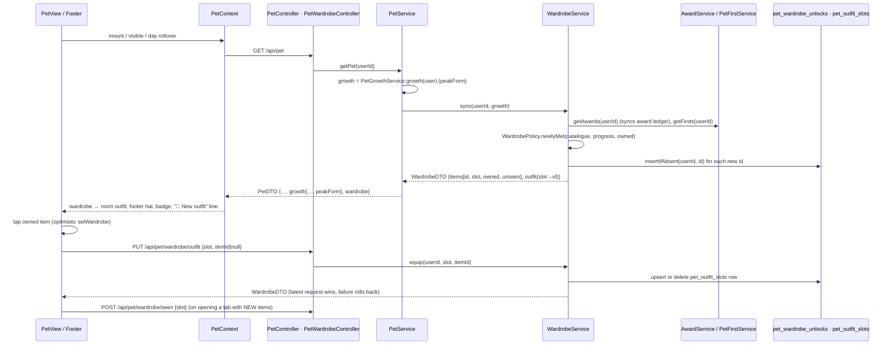

# Plan: Wardrobe — unlock clothes and dress Pip across every evolution

Plan folder: `.claude/contract/MPP-32-pip-wardrobe/`
Execution status: see `tasks.md` in this folder.

---

## Part 1 — Alignment

### Task reference

Jira **MPP-32** (Story, parent epic MPP-15, blocked by MPP-31 / MPP-23 / MPP-24, all Ready for Test). Branch `feature/MPP-15-pip-room` (MPP-15 is local-first: migrations go to the local `foodbytes-db` and are batched in `.claude/contract/MPP-15-epic-breakdown/railway-migrations.md` for Railway at merge).

Acceptance criteria (verbatim from the ticket, 2026-10-14):

1. A catalogue with **seven slots**: hat, glasses, scarf, jacket, belt, pants, shoes. There is at most one item per slot, and every slot can be empty. Each item has an unlock condition, and conditions are data, not code branches. Proposed catalogue (2026-10-13, to be confirmed):
   - **Owned from the start:** beanie, jeans.
   - **Plan ladder:** 3 days followed the plan → chef whites (jacket), 1 week → dungarees, 2 weeks → denim jacket, 3 weeks → puffer.
   - **Snack-free ladder:** 1 week → sneakers, 2 weeks → joggers, 3 weeks → striped scarf.
   - **Alcohol-free ladder:** 5 days → cap, 1 week → red scarf, 2 weeks → heart glasses, 3 weeks → leather belt.
   - **Firsts (MPP-24):** first homemade extra → chef hat, first full week planned → round specs.
   - **Evolutions (MPP-31, first time reaching the form):** Sprig → straw hat, Bushling → wellies, Basilisk → sunglasses.
   - **Big wins:** any 1-month streak → top hat, perfect month → champion belt.
2. Unlocks are granted when the matching award, first or evolution is earned (MPP-22, MPP-24, MPP-31). They are **kept forever**, including while Pip is wilted.
3. **One drawing per item fits all five forms.** Items are drawn only from the anchor points each form exposes (MPP-31 AC 4), never per form:
   - **Hats** sit on the head anchor, scaled to the hat width and tilted slightly; the chef hat stays straight. Head growth (sprout, leaves, bloom) is drawn last and **pokes out through the top of the hat**.
   - **Jacket, pants, belt and scarf** are curved bands between the neck and waist lines, **clipped to the body outline**. The scarf tail and the belt buckle sit outside the clip. There are no sleeves: the jacket is cut like a vest.
   - **Glasses** sit on the two eye points and scale with the face. They are hidden while asleep.
   - **Shoes** sit on the two foot tips.
   - Layer order, back to front: arms and crown → feet → shoes → body → pants → jacket → belt → scarf → outline → face → glasses → hat → head growth.
4. **Opening the wardrobe and the "Dress Pip" screen** (phone flow, decided 2026-10-14):
   - **Entry point:** a **👕 Wardrobe** button in the strip under the room, above the tab bar, where the room hint text sits today. The room art does not change; there is no wardrobe furniture. The button uses the existing `.pip-checkin-btn` pill style (white, `#ddd6ee` hairline, 0.78rem / 600, yellow focus ring), sized to its label and at least 44 px tall. The strip is laid out to also hold the **Shop** button from MPP-26.
   - **New-unlock badge:** while any unlocked item is unseen, the Wardrobe button shows a small red **!** badge, and its accessible name says a new outfit is waiting. The badge clears once the slot holding the new item has been opened.
   - **The screen:** tapping Wardrobe slides "Dress Pip" up over the room. It covers the room completely on a phone, like the fridge (MPP-19) and cabinet (MPP-23) panels: a modal dialog, with the room inert behind it. ✕ or Escape closes it and returns focus to the Wardrobe button. If there is a new item, it opens on that item's slot.
   - **Layout, top to bottom:** a header (✕, title, **Undress**); a live preview of Pip in his current form and mood; the seven **slot tabs**, scrolling sideways, with a green dot when the slot is worn and a red dot when it has something new; a **3-column item grid** for the selected slot, starting with "None".
   - **Item cards** show the item on Pip's **current** form, cropped to the part of him it changes (head for hats, eyes for glasses, torso for scarf/jacket/belt/pants, feet for shoes), not a generic icon. Owned items show a ✓ when worn and a NEW tag until seen.
   - **Equipping:** tapping an owned item puts it on and saves straight away; there is no Save button. Tapping the worn item again, or "None", empties the slot.
   - **Locked items** are greyed out with a 🔒. Phones have no hover, so **tapping** one shows its unlock condition in a note below the grid.
   - **"Same outfit, every evolution"** is a collapsible section at the bottom, **collapsed by default**. Opened, it shows the outfit on all five forms. Forms never reached are drawn as silhouettes; a form reached earlier and then lost still shows normally.
   - The chosen outfit persists per person.
5. Pip wears his outfit in the room, the footer tab and `PetReaction`. The footer tab may show the hat only, because a full outfit is too busy at that size. Moods and wilting apply on top of any outfit.
6. A new unlock is announced in Pip's bubble ("🎉 New outfit: Wellies!").
7. Tests cover each slot rendering on each of the five forms without per-form branches, and an outfit surviving an evolution and a wilt unchanged.

Scope boundaries (ticket): **in** — catalogue, unlock grants + migration, equip API, Wardrobe button + badge, dressing screen, rendering on all five forms through anchors. **Out** — Shop button and shop screen (MPP-26), buying clothes with sprinkles, clothes tied to food variety, sleeves or per-form variants, furniture/room-layout changes.

Visual contracts: `.claude/contract/MPP-15-epic-breakdown/mockups/pip-herb-wardrobe.html` (the 20 items, anchors, fitting rules) and `.claude/contract/MPP-15-epic-breakdown/mockups/mpp-32-wardrobe-phone-mockup.html` (the phone flow). Skills named on the ticket: java-backend, react-frontend.

### Restated goal

Give each person's Pip a wardrobe of 20 clothes in seven slots. The server owns a data-only catalogue of which achievement unlocks which item, grants unlocks into a per-person ledger the moment the matching award, first or evolution exists, never takes them back, and stores the chosen outfit and which unlocks are still unseen. On the client, every item is drawn once from the anchor points MPP-31 put on the five herb forms, so the same outfit fits from Basil seed to Basilisk and survives evolving and wilting. A **👕 Wardrobe** pill under the room (with a red **!** while something is new) opens a full-screen "Dress Pip" sheet where a tap equips and saves, locked items explain themselves on tap, and a collapsed row shows the outfit on all five forms. Pip wears the outfit in the room, wears just the hat on the footer tab, and announces new unlocks in his bubble.

### In scope

- `pet_wardrobe_unlocks` (ledger + seen) and `pet_outfit_slots` (one row per worn slot), in one migration applied to the local `foodbytes-db` and queued as row 6 for Railway.
- Backend catalogue (20 items, 7 slots, unlock rules as data), a pure policy to evaluate rules, a service that syncs unlocks, equips, undresses and marks a slot seen, and `/api/pet/wardrobe` write endpoints.
- `PetGrowthDTO.peakForm` (the highest form reached in the replayed history, 5 once fully grown), which the evolution unlocks and the silhouettes both need.
- `PetDTO.wardrobe` on `GET /api/pet` and `PUT /api/pet/name`, so the footer, the room and the badge share one load.
- Pure JS outfit geometry (items + layering + crops) with a node check covering every item on every form, glasses hidden asleep, and the outfit unchanged across forms and wilt.
- Outfit rendering inside `PipHerbFigure` (room + Dress Pip preview/cards/lineup) and hat-only in the footer's `PipHerb` mini.
- The Wardrobe button + badge strip, the Dress Pip sheet (header, preview, slot tabs, grid, lock note, evolution lineup), optimistic tap-to-save, and the "🎉 New outfit" bubble line.

### Explicitly out of scope

- The Shop button (MPP-26). The strip only leaves room for it; nothing is rendered.
- Buying or earning clothes with sprinkles (MPP-25/26/27), and any reward tied to food variety (MPP-11).
- Per-form clothing variants, sleeves, new furniture or room-layout changes.
- Final art polish (MPP-29) and folding the separate awards/pet reads into one payload (MPP-28).
- Railway: the migration is applied there at the MPP-15 epic merge, not by this ticket.

### Pattern Reference

None supplied beyond the two mockups. References chosen:
- Ledger + idempotent native insert: `PetAwardRepository.insertIfAbsent`, `PetFirst` entity, `2026-10-13-mpp24-pet-firsts.sql`.
- Pure rule class + Mockito service tests: `PetGrowthPolicy` / `PetGrowthPolicyTest`, `PetFirstService` / `PetFirstServiceTest`.
- Controller shape (401 without principal, `{error}` 400s, local `@ExceptionHandler`): `PetHabitController`; `@WebMvcTest` style: `PetAwardControllerTest`.
- Full-card dialog with focus trap and inert room: `useRoomOverlay` + `TrophyCabinetView`.
- Per-user "already announced" store: `utils/awardSeenStore.js`; bubble queue: `usePetAwards`.
- Node checks for pure client logic: `components/pet/room/room.check.mjs`, `utils/pipGrowth.check.mjs` (with a `check:*` script).
- Drawing: the mockup's `HATS / GLASSES / SCARVES / JACKETS / BELTS / PANTS / SHOES`, `curveOf / arcY / arc / band`, `drawPants / drawJacket / drawBelt / drawScarf / drawShoe`, `pip()` layer order, `slotCrop()` and `pipCrop()`, ported as numbers, not re-designed.

### Constraints flagged on the brief

- **Per person (MPP-33):** wardrobe, unlocks, seen state and outfit are keyed by the caller's own `user_id`, never `meal_plan_owner_id`.
- **Kept forever:** the app never deletes an unlock row; a de-evolve, a wilt or a shortened streak cannot remove one.
- **Conditions are data:** the catalogue is a list of `(id, slot, rule)` values; adding an item never needs a new code branch.
- **No per-form drawing:** item geometry reads only anchors (`hat`, `eyes`, `neck`, `waist`, `side`, `feet`, `growTop`, `body` for the clip).
- **Seen state persists per person** in the migration (`seen_at`), so the badge and NEW tags survive a reload.
- **Phone:** ≥44 px targets, `:focus-visible` yellow ring, hover only under `@media (hover: hover)`, reduced motion stops the slide-up and badge pulse, no horizontal page scroll at 320 px.
- **Migration** applied before the backend that maps it starts (`ddl-auto: validate`); Railway at epic merge.

### Assumptions made

- **(c) Catalogue as proposed in AC 1, unchanged.** Item ids are lowercase kebab, unique across slots: `beanie, cap, chef-hat, straw-hat, top-hat, round-specs, heart-glasses, sunglasses, red-scarf, striped-scarf, chef-whites, denim-jacket, puffer, leather-belt, champion-belt, jeans, joggers, dungarees, sneakers, wellies`. "N days / weeks" maps to the MPP-22 ladder milestones (3, 5, 7, 14, 21).
- **"Any 1-month streak" = a 30-day award earned on any of PLAN / SNACK / ALCOHOL; "perfect month" = a 30-day award earned on all three** (not necessarily at the same time). Reaching Basilisk (90 points) is already the "perfect month" of the growth line, and it already unlocks the sunglasses, so the champion belt needs a separate rule. Red-line this if "perfect month" should mean something else.
- **(a) No Shop button until MPP-26.** The ticket puts the Shop button out of scope; the strip is a centred flex row that takes a second pill later with no restyle.
- **(b) Tap-to-save with no Save button.** AC 4 already decides this (2026-10-14); treated as confirmed.
- **(d) Undress has no confirmation.** Unlocks are kept and redressing is quick (mockup).
- **Starter items are granted by the first sync, not backfilled, and start unseen.** A user's first load after deploy shows "🎉 New outfit: Beanie! (+1 more)" and the badge, which is the wardrobe's introduction. The outfit starts empty; nothing is auto-equipped.
- **Unlocks sync on `GET /api/pet` (and the rename response).** That read already runs the growth replay; the sync adds the award-ledger sync (`AwardService.getAwards`) and the firsts read so streak unlocks appear without the cabinet being opened. MPP-28 owns merging the pet and cabinet reads.
- **The evolution rule uses `peakForm`**, the highest form in the replayed history (5 once `pet_fully_grown_at` is set). Once granted, the ledger row keeps the item even if a backdated answer later lowers the peak.
- **"Seen" is per slot:** `POST /api/pet/wardrobe/seen {slot}` marks every unseen unlock in that slot seen. Opening the sheet on a new item's slot marks it at once; switching tabs marks the new tab.
- **The bubble announcement is per browser.** A small localStorage store (like `awardSeenStore`) remembers which unseen ids this browser has already announced; unseen-ness itself is server-side. The outfit line ranks just after an award line (cook > growth > check-in > award > outfit > fridge-low > mood).
- **`PetReaction` no longer exists.** It was deleted with Mochi in MPP-31/MPP-34 (working tree), and the only Pip renderers are `PipHerbFigure` (room) and `PipHerb` mini (footer). AC 5 is met by those two; the footer shows the hat only.
- **The Dress Pip sheet is `position: fixed`, full viewport on phones** (a centred 480 px column from 768 px). The room card is only ~350 px tall at phone width, too short for preview + tabs + grid, so it can't be a card-sized overlay like the cabinet; it reuses `useRoomOverlay` for focus, Escape and the Tab trap, and the room scene goes inert behind it.
- **The hint stays where it is.** The Wardrobe strip goes at the bottom of the room card, under the level bar; the MPP-19 "tap the fridge" hint inside the scene is untouched.
- **Display text (labels, unlock hints) lives on the client** in `constants/pipWardrobe.js`, keyed by item id. The server owns ids, slots and rules. A node check asserts every client id has art and a hint.
- **Equip is optimistic:** the sheet updates at once, the PUT's response replaces the wardrobe, and a failure rolls back to the last server copy with a `role="alert"` note in the sheet. Only the latest write's response is applied.

### Cross-code alignment audit (FE ↔ BE ↔ DB)

Run against the **local** `foodbytes-db` (MPP-15 is local-first, per memory `mpp15-epic-local-first`; the Railway MCP was deliberately not used).

- **No wardrobe tables yet:** `SHOW TABLES LIKE '%wardrobe%'` and `'%outfit%'` return nothing. `SHOW TABLES LIKE 'pet%'` → `pet_awards, pet_firsts, pet_habit_days, pet_habit_streaks`.
- **Every earlier MPP-15 migration is applied locally:** `users` has `pet_name varchar(12) YES NULL` and `pet_fully_grown_at timestamp YES NULL`. `railway-migrations.md` lists rows 1–5 applied locally, none on Railway, so the new file is row 6 and nothing is outstanding before it.
- **Inputs the rules read exist with the expected shape:** `pet_awards(id bigint, user_id bigint, streak_type varchar(16), milestone int, streak_start date, cycle_index int, awarded_at timestamp)`; `pet_firsts(id bigint, user_id bigint, first_key varchar(32), earned_at timestamp)`. They are read through `AwardService.getAwards` (counts per type and milestone) and `PetFirstService.getFirsts` (`FirstStatusDTO{key, earnedAt}`), with no new queries on those tables.
- **Row counts:** 13 users, 2 awards, 13 firsts. The new tables start empty and fill on each user's next `GET /api/pet`, so no backfill is needed.
- **FK target:** `users.id bigint NOT NULL auto_increment`, so both new tables use `user_id BIGINT NOT NULL` + `ON DELETE CASCADE`, as `pet_awards` / `pet_firsts` do.
- **Name chain:** DB `pet_wardrobe_unlocks.item_key` ↔ `PetWardrobeUnlock.itemKey` ↔ `WardrobeItemDTO.id` ↔ JSON `id` ↔ client `WARDROBE_ITEMS[id]`. DB `pet_outfit_slots.slot` ↔ `WardrobeSlot` enum name (`HAT … SHOES`) ↔ JSON keys of `outfit` and `slot` ↔ client `WARDROBE_SLOTS[].key`. `PetGrowthDTO.peakForm` ↔ JSON `growth.peakForm` ↔ `pet.growth.peakForm`. All are new names, introduced together.
- **Constructor sites that change:** `new PetGrowthDTO(` appears in `PetGrowthPolicy` (×2) and `PetServiceTest`; `new PetDTO(` only in `PetPolicy.toDTO`. All are updated in the same task as the field.

---

## Part 2 — Technical design

### Approach

**Server: catalogue → policy → ledger.** `WardrobeCatalogue` is a static, ordered `List<Item(id, slot, UnlockRule)>`. Each `UnlockRule` is a small record (`kind` plus the one parameter that kind needs: a streak type and milestone, a milestone alone, a `FirstKey`, or a form). Six kinds cover all 20 items: `STARTER`, `AWARD(type, milestone)`, `ANY_AWARD(milestone)`, `ALL_AWARDS(milestone)`, `FIRST(key)` and `FORM(form)`. `WardrobePolicy` is pure and static (the `PetGrowthPolicy` pattern). Given a `Progress(awardCounts, firsts, peakForm)` and the ids already owned, it returns the ids newly met, and it builds the DTO. `WardrobeService.sync(userId, growth)` builds `Progress` from `AwardService.getAwards(userId)` (which also syncs the award ledger), `PetFirstService.getFirsts(userId)` and `growth.peakForm`. It inserts the missing ids with an idempotent `INSERT … ON DUPLICATE KEY UPDATE id = id` and returns the wardrobe. Nothing ever deletes an unlock row, which is what makes "kept forever" hold structurally. The alternative was to compute ownership live from the awards on every read, with no ledger. It was rejected because a shortened run or a lowered peak would revoke clothes, and seen state would have nowhere to live.

**Outfit storage** is `pet_outfit_slots(user_id, slot, item_key)` with `UNIQUE(user_id, slot)`, so "at most one item per slot" is a database guarantee. An empty slot is simply a missing row, and adding an eighth slot later is data. Seven nullable columns on `users` were considered and rejected: the slot list would be baked into the schema and the entity. Equip is an upsert, unequip and Undress are deletes. The service rejects an unknown id, an id from a different slot, and an item not owned, as `IllegalArgumentException` → 400. `PetService` puts the synced wardrobe on `PetDTO`, so `GET /api/pet` stays the one load the footer, the room and the badge all read. The three writes (`PUT /outfit`, `DELETE /outfit`, `POST /seen`) live on a new thin `PetWardrobeController` and return the whole `WardrobeDTO`, which the client swaps in.

**Client geometry is pure JS, the drawing is JSX.** `herb/wardrobeArt.js` ports the mockup's item drawings as functions of a form's anchors that return plain shape descriptors (`{ tag: 'path', d, fill, … }`). `herb/wardrobeLayers.js` composes an outfit for one form into the layer slots AC 3 names: shoes, the clipped torso bands (pants → jacket → belt → scarf), the extras outside the clip, glasses (none when asleep), and the hat (rotated −7°, the chef hat straight), plus the lifted `growTop` that lets head growth poke through. It also holds the slot crops for item cards and the footer's hat-only view box. Because none of this is JSX, `wardrobe.check.mjs` can run it in node: every item on every form, layer order, glasses-asleep, crops, and the same layers for an outfit across all forms and with `wilted` on or off. A source scan also asserts the art never branches on a form. `PipHerbFigure` only maps descriptors to elements in the right z-slots (`HerbOutfit.jsx`), so the room, preview, cards and lineup all share one renderer. Another option was to keep the mockup's string builders and inject the markup with `dangerouslySetInnerHTML`. It was rejected because the skill forbids that, and descriptors are also checkable.

**Client state and flow.** `PetContext` exposes `wardrobe` (straight from the pet payload) and `setWardrobe`. `usePipWardrobe` (in `PetView`) owns the optimistic writes with a latest-request guard, the error note, and the per-browser announcement queue. `PetRoom` gains a third `useRoomOverlay` and a strip under the level bar holding the Wardrobe pill + badge. The overlay renders `WardrobeView`, a fixed full-screen sheet split into `WardrobeView` (header, preview, error, lock note), `WardrobeSlotTabs`, `WardrobeItemGrid` and `WardrobeLineup` to stay under the 200-line budget. The footer passes `{ HAT }` only to `PipHerb` mini, which widens its crop upward when a hat is worn.

### Skills to invoke during execution

- `java-backend` — migration mechanics, entities, repositories with native idempotent inserts, the pure policy + service + thin controller layering, DTOs, Mockito/WebMvc tests.
- `react-frontend` — context extension, the optimistic write hook, the fixed modal sheet (focus, inert, Escape), mobile-first CSS with 44 px targets, constants in `src/constants/`, node checks instead of a test runner, the 400-line budget.

Rules: none of `.claude/rules/*.md` apply (no recipe, ingredient, macro, variant or meal-plan data is touched). `CLAUDE.md` → Versioning & deploy verification governs Task M.1.

### Diagram



### Data shapes

#### DDL — `foodbytes-app/database/migrations/2026-10-14-mpp32-pet-wardrobe.sql`

```sql
CREATE TABLE IF NOT EXISTS pet_wardrobe_unlocks (
  id          BIGINT      NOT NULL AUTO_INCREMENT,
  user_id     BIGINT      NOT NULL,
  item_key    VARCHAR(32) NOT NULL,
  unlocked_at TIMESTAMP   NOT NULL DEFAULT CURRENT_TIMESTAMP,
  seen_at     TIMESTAMP   NULL DEFAULT NULL,
  PRIMARY KEY (id),
  UNIQUE KEY uk_pet_wardrobe_unlocks (user_id, item_key),
  CONSTRAINT fk_pet_wardrobe_unlocks_user FOREIGN KEY (user_id) REFERENCES users (id) ON DELETE CASCADE
) ENGINE=InnoDB;

CREATE TABLE IF NOT EXISTS pet_outfit_slots (
  id        BIGINT      NOT NULL AUTO_INCREMENT,
  user_id   BIGINT      NOT NULL,
  slot      VARCHAR(16) NOT NULL,
  item_key  VARCHAR(32) NOT NULL,
  PRIMARY KEY (id),
  UNIQUE KEY uk_pet_outfit_slots (user_id, slot),
  CONSTRAINT chk_pet_outfit_slots_slot CHECK (slot IN ('HAT','GLASSES','SCARF','JACKET','BELT','PANTS','SHOES')),
  CONSTRAINT fk_pet_outfit_slots_user FOREIGN KEY (user_id) REFERENCES users (id) ON DELETE CASCADE
) ENGINE=InnoDB;
```

`item_key` has no CHECK: the catalogue is data in `WardrobeCatalogue` and grows without a migration, and the service validates ids before any write.

#### Entities and enum

- `model/WardrobeSlot` — `enum { HAT, GLASSES, SCARF, JACKET, BELT, PANTS, SHOES }` (declaration order = tab order).
- `model/PetWardrobeUnlock` — `@Table(name = "pet_wardrobe_unlocks", uniqueConstraints = uk_pet_wardrobe_unlocks)`: `Long id`, `Long userId` (`user_id`), `String itemKey` (`item_key`, length 32), `LocalDateTime unlockedAt` (insertable/updatable false), `LocalDateTime seenAt` (`seen_at`, nullable). Identity equals/hashCode as `PetFirst`.
- `model/PetOutfitSlot` — `@Table(name = "pet_outfit_slots", uniqueConstraints = uk_pet_outfit_slots)`: `Long id`, `Long userId`, `WardrobeSlot slot` (`@Enumerated(STRING)`, `@JdbcTypeCode(VARCHAR)`, length 16), `String itemKey` (length 32).

#### Repositories

- `PetWardrobeUnlockRepository extends JpaRepository<PetWardrobeUnlock, Long>`:
  - `List<PetWardrobeUnlock> findByUserId(Long userId)`
  - `@Modifying @Query(native) void insertIfAbsent(Long userId, String itemKey)` — `INSERT INTO pet_wardrobe_unlocks (user_id, item_key) VALUES (:userId, :itemKey) ON DUPLICATE KEY UPDATE id = id`
  - `@Modifying @Query int markSeen(Long userId, Collection<String> itemKeys, LocalDateTime seenAt)` — JPQL `UPDATE PetWardrobeUnlock u SET u.seenAt = :seenAt WHERE u.userId = :userId AND u.itemKey IN :itemKeys AND u.seenAt IS NULL`
- `PetOutfitSlotRepository extends JpaRepository<PetOutfitSlot, Long>`:
  - `List<PetOutfitSlot> findByUserId(Long userId)`
  - `@Modifying @Query(native) void upsert(Long userId, String slot, String itemKey)` — `INSERT INTO pet_outfit_slots (user_id, slot, item_key) VALUES (:userId, :slot, :itemKey) ON DUPLICATE KEY UPDATE item_key = VALUES(item_key)`
  - `@Modifying void deleteByUserIdAndSlot(Long userId, WardrobeSlot slot)`
  - `@Modifying void deleteByUserId(Long userId)`

#### Rules and catalogue (`service/`)

```java
public record UnlockRule(Kind kind, StreakType streak, Integer milestone, FirstKey first, Integer form) {
    public enum Kind { STARTER, AWARD, ANY_AWARD, ALL_AWARDS, FIRST, FORM }
    static UnlockRule starter()                         // owned from the start
    static UnlockRule award(StreakType t, int milestone) // that streak's ladder milestone earned at least once
    static UnlockRule anyAward(int milestone)            // any streak type
    static UnlockRule allAwards(int milestone)           // every streak type
    static UnlockRule first(FirstKey key)
    static UnlockRule form(int form)                     // peakForm >= form
}
public final class WardrobeCatalogue {
    public record Item(String id, WardrobeSlot slot, UnlockRule rule) {}
    public static final List<Item> ITEMS;               // the 20 below, slot order then AC 1 order
    public static Optional<Item> find(String id);
}
```

| id | slot | rule |
|---|---|---|
| beanie | HAT | starter |
| cap | HAT | award(ALCOHOL, 5) |
| chef-hat | HAT | first(COOK_HOMEMADE_EXTRA) |
| straw-hat | HAT | form(3) |
| top-hat | HAT | anyAward(30) |
| round-specs | GLASSES | first(PLAN_FULL_WEEK) |
| heart-glasses | GLASSES | award(ALCOHOL, 14) |
| sunglasses | GLASSES | form(5) |
| red-scarf | SCARF | award(ALCOHOL, 7) |
| striped-scarf | SCARF | award(SNACK, 21) |
| chef-whites | JACKET | award(PLAN, 3) |
| denim-jacket | JACKET | award(PLAN, 14) |
| puffer | JACKET | award(PLAN, 21) |
| leather-belt | BELT | award(ALCOHOL, 21) |
| champion-belt | BELT | allAwards(30) |
| jeans | PANTS | starter |
| joggers | PANTS | award(SNACK, 14) |
| dungarees | PANTS | award(PLAN, 7) |
| sneakers | SHOES | award(SNACK, 7) |
| wellies | SHOES | form(4) |

```java
public final class WardrobePolicy {
    public record Progress(Map<StreakType, Map<Integer, Integer>> awardCounts, Set<FirstKey> firsts, int peakForm) {}
    public static boolean isMet(UnlockRule rule, Progress progress);
    public static List<String> newlyMet(Progress progress, Set<String> owned); // catalogue order
    public static WardrobeDTO toDTO(Set<String> owned, Set<String> unseen, Map<WardrobeSlot, String> outfit);
}
```

#### Service (`service/WardrobeService`)

- `@Transactional WardrobeDTO sync(Long userId, PetGrowthDTO growth)`
- `@Transactional(readOnly = true) WardrobeDTO getWardrobe(Long userId)`
- `@Transactional WardrobeDTO equip(Long userId, WardrobeSlot slot, String itemId)` — `itemId` null = empty the slot; IAE on an unknown id ("Unknown item: x"), a slot mismatch ("x is not a HAT"), or not owned ("x is still locked").
- `@Transactional WardrobeDTO undress(Long userId)`
- `@Transactional WardrobeDTO markSeen(Long userId, WardrobeSlot slot)`

#### DTOs

```java
// dto/WardrobeItemDTO
private String id; private WardrobeSlot slot; private boolean owned; private boolean unseen;
// dto/WardrobeDTO
private List<WardrobeItemDTO> items;          // all 20, catalogue order, locked ones included
private Map<WardrobeSlot, String> outfit;     // worn slots only (EnumMap); absent key = empty
// dto/WardrobeEquipRequest
@NotNull(message = "slot is required") private WardrobeSlot slot; private String itemId; // null = take off
// dto/WardrobeSeenRequest
@NotNull(message = "slot is required") private WardrobeSlot slot;
// dto/PetGrowthDTO — new last field
private int peakForm;                         // highest form in the replayed history; 5 when fullyGrown
// dto/PetDTO — new last field
private WardrobeDTO wardrobe;                 // MPP-32: never null
```

`PetGrowthPolicy.toDTO(replay, fullyGrown)` sets `peakForm = fullyGrown ? 5 : max(formFor(replay.peak()), form)`.

#### HTTP contract (`PetWardrobeController`, `/api/pet/wardrobe`)

| Verb + path | Body | 200 | 400 | 401 |
|---|---|---|---|---|
| `PUT /outfit` | `{ "slot": "HAT", "itemId": "beanie" \| null }` | `WardrobeDTO` | `{error}` (validation, unknown/locked/wrong-slot item, unknown slot) | `{error:"Not authenticated"}` |
| `DELETE /outfit` | — | `WardrobeDTO` (outfit `{}`) | — | same |
| `POST /seen` | `{ "slot": "SHOES" }` | `WardrobeDTO` | `{error}` | same |

Example `WardrobeDTO` JSON: `{ "items": [{ "id": "beanie", "slot": "HAT", "owned": true, "unseen": false }, …], "outfit": { "HAT": "beanie", "PANTS": "jeans" } }`.

#### Client modules

- `constants/pipWardrobe.js` — `WARDROBE_SLOTS = [{ key: 'HAT', label: 'Hat' }, … ]` (7), `WARDROBE_ITEMS = { beanie: { slot: 'HAT', label: 'Beanie', unlockHint: 'Owned from the start' }, … }` (20, hints from the phone mockup's `UNLOCKS`), `WARDROBE_ANNOUNCED_STORAGE_KEY = 'foodbytes.pip.wardrobeAnnounced'`, `WARDROBE_SAVE_ERROR`, `WARDROBE_BUTTON_LABEL = 'Wardrobe'`, `WARDROBE_BUTTON_NEW_LABEL = 'Wardrobe, new outfit waiting'`, `WARDROBE_TITLE = 'Dress Pip'`, `WARDROBE_LINEUP_TITLE = 'Same outfit, every evolution'`, `wardrobeAnnouncement(labels)` → `"🎉 New outfit: Wellies!"` / `"🎉 New outfit: Beanie! (+1 more)"`.
- `components/pet/herb/wardrobeArt.js` — `ITEM_ART` (colours/styles per id), `hatArt(id, f) → { top, shapes }`, `glassesArt(id, f) → shapes`, `torsoArt(id, f) → { clip, extra }`, `shoeArt(id, f) → shapes`. Shape = `{ tag: 'path'|'circle'|'rect'|'ellipse', ...svgAttrs }` (camelCase React attribute names).
- `components/pet/herb/wardrobeLayers.js` — `dressLayers(outfit, form, { asleep }) → { shoes, clip, extra, glasses, hat: { shapes, straight } | null, growTop, itemIds }`, `slotCropViewBox(slot, form) → string`, `hatMiniViewBox(form, hatId) → string`, `hatOnly(outfit) → { HAT } | {}`.
- `components/pet/herb/wardrobe.check.mjs` — the node check, run by `npm run check:wardrobe`.
- `components/pet/herb/HerbOutfit.jsx` — `OutfitShapes({ shapes })`, renders descriptors.
- `utils/wardrobeAnnouncedStore.js` — `readAnnounced(userId) → Set<string>`, `writeAnnounced(userId, ids)`.
- `services/petService.js` — `equipItem(slot, itemId)`, `undress()`, `markWardrobeSeen(slot)`, each resolving `WardrobeDTO`.
- `hooks/usePipWardrobe.js` — `usePipWardrobe({ userId, wardrobe, setWardrobe }) → { wardrobe, announcement, hasNew, firstNewSlot, equip(slot, itemId), undress(), markSeen(slot), error }`.
- `components/pet/room/WardrobeView.jsx` / `WardrobeSlotTabs.jsx` / `WardrobeItemGrid.jsx` / `WardrobeLineup.jsx` / `WardrobeView.css`, plus `PetRoom.jsx` (strip + overlay) and `PetRoom.css` (strip + badge).

### Runtime quality notes

Frontend dimensions are mapped onto the browser runtime (single event loop, effect cleanup, re-render cost).

- **Resource cleanup:** Backend: every service method is `@Transactional`, and native inserts and upserts run in the caller's transaction, so there are no streams or manual connections. Frontend: the announcement timer is cleared in effect cleanup (as in `usePetAwards`). Writes are never aborted (skill rule), but a write's response is dropped if a newer write started or the user changed. `useBodyScrollLock` releases on sheet close/unmount. The overlay's keydown listener is removed by `useRoomOverlay`.
- **Concurrency / ordering:** two tabs or devices syncing at once converge on `uk_pet_wardrobe_unlocks` (`ON DUPLICATE KEY UPDATE id = id`). Concurrent equips on one slot converge on `uk_pet_outfit_slots` (last write wins, which is the user's intent). Rapid taps send sequential PUTs, and a request counter applies only the newest response, so an older one can't undo a later tap. A `GET /api/pet` refetch landing mid-write could restore a stale outfit, so `setWardrobe` aborts the in-flight pet GET the way `renamePet` already does. A linked partner never shares rows, because everything is keyed by the caller's id.
- **Allocation / cost behaviour:** `GET /api/pet` gains one `AwardService.getAwards` (plan streak + two habit-day reads + the award ledger) plus `getFirsts`, two `findByUserId`s, and ≤20 inserts on the very first sync (usually 0). That is bounded per user and runs on load, visibility and date change only. The cabinet hook still reads `/api/pet/awards` separately, and MPP-28 owns merging the two. On the client, the grid draws ≤6 cropped figures per tab and the lineup 5 (rendered only when expanded). Each `PipHerbFigure` is a small SVG, and no memoisation is added without profiling (skill rule).
- **Error paths:** IAE from the service → 400 `{error}` via the controller's try/catch. Bean validation → 400 via the local `@ExceptionHandler`. An unknown enum in JSON → Spring's 400. No principal → 401. A failed equip/undress/seen rolls back to the last server wardrobe and shows `WARDROBE_SAVE_ERROR` (`role="alert"`) in the sheet; a failed seen keeps the badge, which is honest. A failed sync makes `GET /api/pet` fail as a whole, and the existing "Couldn't load your pet." state + retry shows. Unknown ids from the server (a newer catalogue than the client) are skipped in the grid and not drawn, never crashing.

### Risks and judgement calls

- **"Perfect month" definition** (all three 30-day awards) is my reading. If it should mean "a perfect 30 days in a row on all three at once", the rule kind changes, and that needs a new pure check over runs. Red-line before approval.
- **Sync on `GET /api/pet`** makes the pet read do award work. Rejected alternatives: syncing only when the sheet opens (badge and bubble would lag until then) or a separate wardrobe GET (a second app-wide fetch the footer would need). Revisit in MPP-28.
- **Starter items arrive as "new"**, so every existing user sees the badge and one bubble line on their first load after deploy. If that is unwanted, the migration can pre-insert `beanie` + `jeans` as seen for existing users; that is one extra INSERT…SELECT, flag it now.
- **The sheet is full-viewport, not card-sized** like the cabinet. It covers the footer on phones, matching the mockup, and the Tab trap keeps focus inside it.
- **Visual fit is checked by eye, not by the node check.** The check proves geometry comes from anchors, is finite, sits in the right regions and is identical in structure across forms. Whether the straw hat brim clears Basilisk's vines is a manual check at `/pet` (the manual-check task), and final art is MPP-29.
- **Footer hat crop:** `hatMiniViewBox` widens the mini crop upward when a hat is worn, which shrinks Pip slightly in the 32 px tab. It is accepted per AC 5, and the size is checked manually.
- **Client/server catalogue drift:** ids live on both sides. The node check pins the client set to the 20 ids listed here, and `WardrobePolicyTest` pins the same 20 on the server. A future item needs both edits.
- **Manual steps the developer owns:** applying the migration to the local `foodbytes-db` (the developer-applies task in Phase 1) and the manual browser check (last task before Final verification). Railway apply happens at the MPP-15 merge, via row 6 of `railway-migrations.md`.
