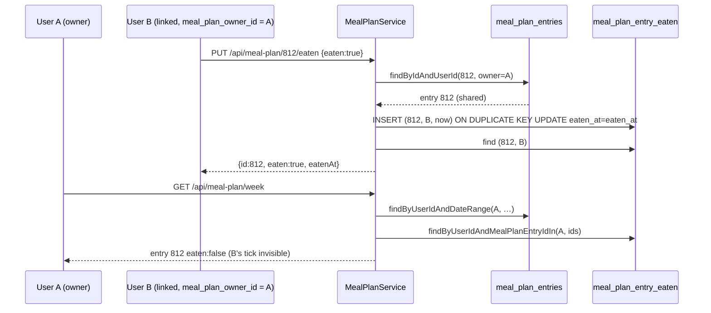

# Plan: Per-person Pip — each person ticks their own meals and has their own pet

Plan folder: `.claude/contract/MPP-33-per-person-pip/`
Execution status: see `tasks.md` in this folder.

---

## Part 1 — Alignment

### Task reference
Jira **MPP-33** (Story, High, parent epic MPP-15). Relates to MPP-12; blocks MPP-17, MPP-18, MPP-19, MPP-22, MPP-24 and MPP-31.

Acceptance criteria (verbatim):
1. Migration adds `meal_plan_entry_eaten (id, meal_plan_entry_id → meal_plan_entries ON DELETE CASCADE, user_id → users, eaten_at TIMESTAMP UTC)`, unique on `(meal_plan_entry_id, user_id)`. **Existing shared ticks are not carried over:** each person ticks for themselves from now on.
2. `PUT /api/meal-plan/{id}/eaten` writes the **caller's** own row (the entry must still be in the caller's shared plan, as today). Unticking deletes only the caller's row, and re-ticking keeps the first `eaten_at`.
3. Week-plan reads return `eaten`/`eatenAt` for the caller only. A linked partner's ticks never appear on your plan.
4. Pip is per user. `GET /api/pet` and `PUT /api/pet/name` use the caller's own `pet_name` and MPP-13 meal times, not the owner's. Linked users start with the defaults ("Pip" and default meal times).
5. Still shared, unchanged: meal plan entries, shopping list, templates, extra choices.
6. Tests: two linked users tick the same entry independently, one unticking leaves the other's tick, and `PetService` returns each user's own name and times. `mvn test` is green.

Ticket risks carried into this plan: supersedes MPP-12's shared-tick design and MPP-11 DoD item 1. Deploy order is migration first, then backend. The old `eaten`/`eaten_at` columns are unmapped now and dropped in a later cleanup migration. Mood resets on deploy, which is acceptable.

Decided 2026-10-13 during planning: the developer asked that `/fb-plan` stop asking to confirm the skill list (`.claude/commands/fb-plan.md` Step 1.5 updated in this session).

### Restated goal
Ticking a meal as eaten becomes personal while the meal plan stays shared. A new `meal_plan_entry_eaten` table holds one row per (entry, person). The eaten endpoint writes and deletes only the caller's row, and every meal-plan read decorates entries with the caller's own tick. `meal_plan_entries.eaten`/`eaten_at` stop being read or written. Pip stops resolving to the plan owner: name, rename and meal times all come from the caller's own `users` row, so a linked partner gets a default "Pip" with default meal times. Pip's mood needs no frontend logic change, because it is already derived from the week plan's `eaten` flags, which will now be the caller's own.

### In scope
- Migration creating `meal_plan_entry_eaten` (no data carried over).
- `MealPlanEntryEaten` entity and `MealPlanEntryEatenRepository`.
- `MealPlanService`: `setEntryEaten` writes the caller's row; `getWeekPlan` and `getRecipeAssignments` return the caller's ticks; `MealPlanEntry` drops its `eaten`/`eatenAt` mapping.
- `PetService`: drop `resolveOwner`, so reads and renames use the caller's row.
- Updated tests: `MealPlanServiceTest` (eaten block rewritten, including two-linked-users independence) and `PetServiceTest` (per-user name and times).
- Doc comments that describe the old shared behaviour, on both backend and frontend. The frontend DTO shapes do not change.

### Explicitly out of scope
- Dropping `meal_plan_entries.eaten` / `eaten_at`. That is the follow-up cleanup migration after this deploy is verified (ticket risk 2).
- Making the meal plan, shopping list, templates or extra choices personal.
- New Pip features (MPP-17/18/19/22/24/31).
- Moving existing owner `pet_name` values to the partner, or carrying over the 5 existing shared ticks.
- Consolidating the private "effective owner" helpers across services. `PetService` simply stops needing one.

### Pattern Reference
Ticket names `2026-10-12-mpp12-meal-plan-entry-eaten.sql`, `MealPlanService.setEntryEaten` and `PetService.resolveOwner` as background. Chosen references:
- **Child table keyed by entry id:** `MealPlanEntryExtraChoice` + `MealPlanEntryExtraChoiceRepository` + `2026-10-10-mpp10-extra-choices-schema.sql`. That pattern uses plain id columns with no JPA associations, bulk reads by `...IdIn(entryIds)`, and MySQL `ON DELETE CASCADE`, which the JPQL bulk `deleteByUserIdAndDateRange` relies on.
- **Service and test style:** existing `MealPlanService` / `MealPlanServiceTest` (Mockito, `@InjectMocks`, no JPA boot).
- Conventions: `java-backend` SKILL.md.

### Constraints flagged on the brief
- **Local first (developer decision 2026-10-13):** MPP-15 work happens on branch `feature/MPP-15-pip-room` against the local `foodbytes-db` and is tested locally before anything merges to master. The migration is applied locally only. Railway gets it at the epic's merge, **before** the merged backend deploys (`ddl-auto: validate` fails on a missing table), tracked in `.claude/contract/MPP-15-epic-breakdown/railway-migrations.md`.
- Hibernate `validate` ignores unmapped columns, so old `eaten`/`eaten_at` columns can stay until cleanup. `eaten` is `NOT NULL DEFAULT 0`, so inserts that omit it still succeed.
- The entry must still be in the caller's **effective** (shared) plan to be ticked. Anything else is a 404, as today.
- Re-ticking keeps the first `eaten_at`.
- `mvn test` green.

### Assumptions made
- **Tick logic stays in `MealPlanService`**, using a new repository injected there, not a new service. Rationale: it is a few lines, the existing `setEntryEaten` signature and controller stay unchanged, and `MealPlanControllerTest` needs no edits.
- **Idempotent tick via native upsert** `INSERT ... ON DUPLICATE KEY UPDATE eaten_at = eaten_at`, then a read-back. Rationale: two quick taps or two devices for the same user cannot fail on the unique key, and the first `eaten_at` survives (AC 2). This was chosen over `INSERT IGNORE`, which would also silently swallow FK errors.
- **Untick via `@Modifying` JPQL delete** scoped to `(entryId, userId)`. It is idempotent and never touches the partner's row.
- **`user_id` FK is `ON DELETE CASCADE`**, so ticks go with their user, matching the entry cascade. The ticket only says "→ users".
- **`eaten_at TIMESTAMP NOT NULL`.** A row exists only while the meal is eaten, so null has no meaning. It is stored as UTC wall time, as in MPP-12 (the JDBC URL pins `serverTimezone=UTC`).
- **`getRecipeAssignments` also carries the caller's ticks** (one extra query), so every `MealPlanEntryDTO` the API returns uses one rule. `assignRecipe` returns a fresh entry with `eaten=false` and does no lookup.
- **`copyWeek` does not copy ticks.** Copies are new entries, as in MPP-12. `swapDays` keeps entry ids, so ticks move with their meals, also as in MPP-12.
- **No pet-name data move.** No user on live has a custom pet name (`named_pets = 0`, see the audit), so nothing is lost. A linked user simply starts at "Pip".
- **No frontend logic change.** `MealPlanEntryDTO.eaten/eatenAt`, `MealPlanEntryEatenDTO` and `PetDTO` keep their shapes. Only stale comments change.
- **Version bump: MINOR** (Story).

### Cross-code alignment audit (FE ↔ BE ↔ DB)
Read-only against the live Railway DB (`DATABASE()` = `railway`), 2026-10-13.
- **`meal_plan_entries` (MPP-12 applied):** `SHOW COLUMNS` → `id bigint NO PRI auto_increment`, `user_id bigint NO MUL`, …, `servings decimal(4,2) NO 1.00`, `eaten tinyint(1) NO default 0`, `eaten_at timestamp YES null`, `created_at`, `updated_at`. The FK target `id` is `bigint`, so the new `meal_plan_entry_id BIGINT` matches. `eaten` has a default, so the unmapped entity can still insert.
- **`users`:** `id bigint NO`, `pet_name varchar(12) YES`, `breakfast_by/lunch_by/dinner_by time YES`, `meal_plan_owner_id bigint YES`. MPP-13/14 are applied, and `user_id BIGINT` matches.
- **No outstanding migration:** `meal_plan_entry_eaten` does not exist (`eaten_table_exists = 0`). The latest files (`2026-10-12-mpp12/13/14`) are all reflected in the live columns above.
- **Data state:** 800 entries, of which 5 have `eaten = 1`; these are dropped by design (AC 1). There are 2 linked users, and 0 of them have their own `pet_name`/meal times, so both will see "Pip" and default times. `named_pets = 0` overall, so no custom name exists anywhere to lose or move.
- **Name chain:** `meal_plan_entry_eaten.meal_plan_entry_id / user_id / eaten_at` ↔ `@Column` `mealPlanEntryId / userId / eatenAt` ↔ `MealPlanEntryDTO.eaten / eatenAt` (unchanged) ↔ JSON `eaten` / `eatenAt` ↔ `entry.eaten` / `entry.eatenAt` in `useEntryEaten.js`, `MealEatenSection.jsx` and `petMood.js`. No mismatch.
- **Local `foodbytes-db` (the test target for this epic), checked 2026-10-13:** `meal_plan_entries.eaten/eaten_at` and `users.pet_name/breakfast_by/lunch_by/dinner_by` are present, so MPP-12/13/14 are applied. `meal_plan_entry_eaten` does not exist yet. There are 2 linked users, enough for the two-person play-test.
- **Backend consumers of eaten:** only `MealPlanService`, `MealPlanController` and the eaten DTOs (grep of `src/main` for `eaten`). No other service reads `MealPlanEntry.getEaten()`, so the unmapping is contained.

---

## Part 2 — Technical design

### Approach
**Storage.** A new table `meal_plan_entry_eaten` makes "eaten" a fact about a (meal, person) pair instead of about the shared meal. Following the MPP-10 extra-choices pattern, the entity holds plain `Long` id columns and no `@ManyToOne`. Rows are always read in bulk by entry id plus the caller's user id, and MySQL cascades them away when an entry is deleted. This matters because `MealPlanEntryRepository.deleteByUserIdAndDateRange` is a JPQL bulk delete that skips JPA cascades. `MealPlanEntry` loses its `eaten`/`eatenAt` fields. The columns stay in MySQL, unmapped and ignored by `validate`, until the follow-up cleanup.

**Writes.** `MealPlanService.setEntryEaten(userId, entryId, eaten)` keeps its signature and its access rule: the entry must be found by `findByIdAndUserId(entryId, effectiveOwnerId)`, or the result is empty (404). After that, the write targets `userId`, the caller, and not the owner. Ticking runs a native `INSERT … ON DUPLICATE KEY UPDATE eaten_at = eaten_at`, then reads the row back to return the stored (first) `eaten_at`. Unticking runs a scoped JPQL delete. Both are idempotent, and neither can touch another user's row. We rejected a load-then-save approach, because two parallel ticks from one user would race into a unique-key violation and roll back one transaction.

**Reads.** `getWeekPlan` already loads the week's entries for the effective owner, then batch-loads their extra choices in one query. Next to that it batch-loads the **caller's** ticks: `findByUserIdAndMealPlanEntryIdIn(userId, entryIds)` → `Map<Long, LocalDateTime>`. `convertToDTO` gains an `eatenAt` parameter and sets `eaten = eatenAt != null`. `getRecipeAssignments` does the same. `assignRecipe` passes `null`, because a new entry is never eaten. This is one extra indexed query per read, with no N+1.

**Pet.** `PetService.resolveOwner` is deleted, and `getPet` / `renamePet` operate on `findUser(userId)`. `PetPolicy.toDTO` is unchanged in behaviour, with only its parameter renamed `owner` → `user`. Meal times were already per user on the write side (`UserService.updatePreferences` writes the caller's row), so after this change Pip reads the same times the caller edits. The frontend needs no logic change: `PetContext` derives mood from the week plan, which now carries the caller's ticks. Its stale "shared / owner's / partner's" comments are corrected.

### Skills to invoke during execution
- `java-backend` — owns the migration mechanics, the new entity and repository, the `MealPlanService` / `PetService` changes and the Mockito tests.
- `react-frontend` — owns the comment-only edits in `client/src` (no logic or shape change). It applies only so the build check and house style are honoured.

Rules: none of `.claude/rules/*` apply (no recipe, ingredient, macro or variant data is touched).
Skills were chosen by the planner without a confirmation prompt, per the developer's 2026-10-13 instruction.

### Diagram


### Data shapes

#### DDL — `foodbytes-app/database/migrations/2026-10-13-mpp33-meal-plan-entry-eaten-per-user.sql`
```sql
CREATE TABLE IF NOT EXISTS meal_plan_entry_eaten (
  id                 BIGINT    NOT NULL AUTO_INCREMENT,
  meal_plan_entry_id BIGINT    NOT NULL,
  user_id            BIGINT    NOT NULL,
  eaten_at           TIMESTAMP NOT NULL,
  PRIMARY KEY (id),
  UNIQUE KEY uk_mpe_eaten_entry_user (meal_plan_entry_id, user_id),
  KEY idx_mpe_eaten_user (user_id),
  CONSTRAINT fk_mpe_eaten_entry FOREIGN KEY (meal_plan_entry_id)
    REFERENCES meal_plan_entries (id) ON DELETE CASCADE,
  CONSTRAINT fk_mpe_eaten_user FOREIGN KEY (user_id)
    REFERENCES users (id) ON DELETE CASCADE
) ENGINE=InnoDB;
```
No backfill. The old columns stay in place.

#### Entity — `model/MealPlanEntryEaten.java`
`@Entity @Table(name = "meal_plan_entry_eaten", uniqueConstraints = @UniqueConstraint(name = "uk_mpe_eaten_entry_user", columnNames = {"meal_plan_entry_id","user_id"}))`, Lombok `@Data @NoArgsConstructor @AllArgsConstructor`, id-based `equals`/`hashCode` (as in `MealPlanEntryExtraChoice`).

| Field | Type | Column |
|---|---|---|
| `id` | `Long` | `id`, `@GeneratedValue(IDENTITY)` |
| `mealPlanEntryId` | `Long` | `meal_plan_entry_id`, not null |
| `userId` | `Long` | `user_id`, not null |
| `eatenAt` | `LocalDateTime` | `eaten_at`, not null (UTC wall time) |

#### Repository — `repository/MealPlanEntryEatenRepository.java`
```java
List<MealPlanEntryEaten> findByUserIdAndMealPlanEntryIdIn(Long userId, Collection<Long> mealPlanEntryIds);
Optional<MealPlanEntryEaten> findByMealPlanEntryIdAndUserId(Long mealPlanEntryId, Long userId);

@Modifying
@Query(value = "INSERT INTO meal_plan_entry_eaten (meal_plan_entry_id, user_id, eaten_at) " +
               "VALUES (:entryId, :userId, :eatenAt) ON DUPLICATE KEY UPDATE eaten_at = eaten_at",
       nativeQuery = true)
void insertIfAbsent(@Param("entryId") Long entryId, @Param("userId") Long userId, @Param("eatenAt") LocalDateTime eatenAt);

@Modifying
@Query("DELETE FROM MealPlanEntryEaten e WHERE e.mealPlanEntryId = :entryId AND e.userId = :userId")
int deleteByEntryAndUser(@Param("entryId") Long entryId, @Param("userId") Long userId);
```

#### Entity change — `model/MealPlanEntry.java`
Remove the `eaten` (`Boolean`) and `eatenAt` (`LocalDateTime`) fields and their MPP-12 comments.

#### Service — `MealPlanService`
- New dependency: `private final MealPlanEntryEatenRepository mealPlanEntryEatenRepository; // MPP-33: per-person eaten ticks`
- New private helper: `Map<Long, LocalDateTime> getEatenAtByEntry(Long userId, Collection<Long> entryIds)`, which returns an empty map for an empty id list.
- `convertToDTO(MealPlanEntry, Map<Long,Boolean> extraChoices, LocalDateTime eatenAt)` replaces the two-argument overload. The one-argument overload is deleted. Callers: `buildDayDTO` (receives `Map<Long, LocalDateTime> eatenByEntry`), `getRecipeAssignments`, `assignRecipe` (passes `null`).
- `setEntryEaten` has the same signature and the same `Optional<MealPlanEntryEatenDTO>` contract.

#### Unchanged contracts
`MealPlanEntryDTO.eaten: Boolean`, `eatenAt: Instant`; `MealPlanEntryEatenDTO(Long id, boolean eaten, Instant eatenAt)`; `PetDTO(name, customName, mealTimes)`; `PUT /api/meal-plan/{id}/eaten`, `GET /api/pet`, `PUT /api/pet/name`.

### Runtime quality notes
- **Resource cleanup:** Trivial. Spring-managed transactions only, with no streams or new connections. The frontend is untouched apart from comments.
- **Concurrency / ordering:** Partners tick distinct rows, so they never contend. One user's parallel ticks converge through `ON DUPLICATE KEY UPDATE` (first `eaten_at` wins, no constraint exception). Tick and untick racing from one user's two devices is last-write-wins, as in MPP-12 today. `setEntryEaten` stays `@Transactional`. The native insert and the read-back run in one transaction, and the read-back is a fresh query because no `MealPlanEntryEaten` entity was loaded first, so there is no stale persistence-context hit. Deleting an entry (swap, toggle-off, `copyWeek`'s bulk delete) cascades ticks in MySQL.
- **Allocation / cost behaviour:** One extra query per `getWeekPlan` / `getRecipeAssignments`, bounded by the week's entries, using the `uk_mpe_eaten_entry_user` index. There is no per-entry query.
- **Error paths:** An entry not in the effective plan returns `Optional.empty()`, which the unchanged controller maps to 404. An FK violation on insert can only happen if the entry was deleted between the lookup and the insert inside the same transaction. That raises `DataIntegrityViolationException`, which bubbles up as a 500 and is not swallowed, and the frontend's existing rollback and error message handle it. A missing caller row in `PetService` still throws `IllegalArgumentException("User not found: …")`, the existing behaviour, and the dangling-owner fallback disappears with `resolveOwner`.

### Risks and judgement calls
- **Railway apply is deferred to the epic merge.** During this contract the migration goes to the local DB only. When `feature/MPP-15-pip-room` merges to master, apply every file in `railway-migrations.md` (this one included) to Railway **before** the merged backend deploys. Without it, `validate` fails on the missing `meal_plan_entry_eaten` table and the API won't start. Applying early is harmless, because the old backend ignores the new table.
- **Native SQL in a repository:** `ON DUPLICATE KEY UPDATE` is MySQL-specific. This is acceptable because MySQL is the only database, and no test boots JPA, so the query is exercised only on deploy. Check it manually against the local `foodbytes-db` container (the Phase 1 apply-locally task, then a play-test).
- **Follow-up cleanup ticket needed:** a later migration drops `meal_plan_entries.eaten`/`eaten_at` after this deploy is verified. It is not created here; the PR description flags it.
- **5 live ticks and the shared mood are lost**, which the ticket accepts.
- **Linked users lose the owner's Pip name and times.** Live data has none set (`named_pets = 0`), so in practice nothing visible changes except per-person mood.
- **`getRecipeAssignments` now carries ticks.** This is a small scope addition for consistency, and dropping it would leave that endpoint always reporting `eaten=false`.
