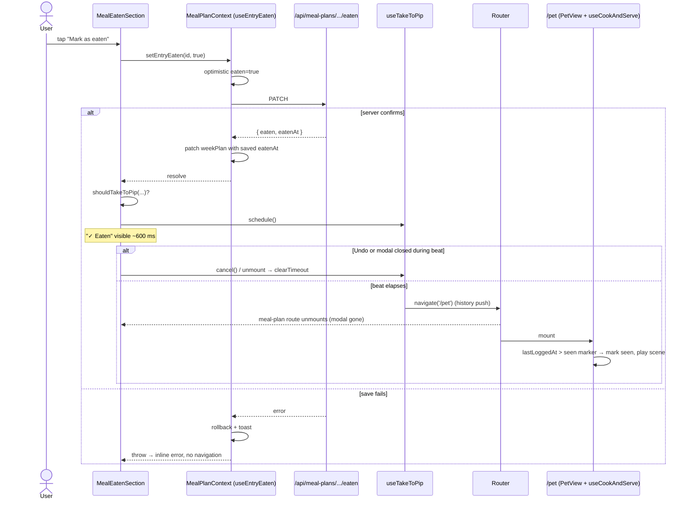

# Plan: Marking a meal as eaten takes you straight to Pip

Plan folder: `.claude/contract/MPP-34-eaten-meal-straight-to-pip/`
Execution status: see `tasks.md` in this folder.

---

## Part 1 — Alignment

### Task reference

Jira **MPP-34** (Story, Medium, parent epic MPP-15): *Marking a meal as eaten takes you straight to Pip.* Moved `To Do → Planning` on 2026-10-14.

Acceptance criteria (verbatim):

1. In the meal plan's recipe view (`RecipeViewModal` → `MealEatenSection`), when the server **confirms** "Mark as eaten", the recipe modal closes and the app navigates to `/pet`. There, MPP-18's cook-and-serve sequence plays for that meal.
2. **Short beat first:** the button shows its "✓ Eaten" state for about 600 ms before navigating, so the tap visibly registered. Under `prefers-reduced-motion`, navigate after the same beat with no transition.
3. **Only for meals that count:** breakfast, lunch and dinner (`PET_COUNTED_MEAL_TYPES`, the same set MPP-18 plays for). Any other meal type stays on the recipe as it does today.
4. **No navigation when:** the save fails (the optimistic tick rolls back and the inline error shows, as today), the user taps **Undo**, or the user is a guest (no Pip).
5. Browser **Back** from `/pet` returns to the meal plan with the modal closed (a normal history push; the modal state is not restored). Undo is still available by reopening the recipe from the plan.
6. The inline `PetReaction` in `MealEatenSection` is removed, because the user leaves the modal at the moment it would appear. Check whether `PetReaction` has any other callers before deleting the component; MPP-28 AC 4 refers to it.
7. MPP-18's "seen" marker is unchanged: arriving this way plays the sequence once, and reloading `/pet` doesn't replay it.

Out of scope per the ticket: any change to the cook sequence itself (MPP-18), and marking a meal eaten from anywhere other than the meal plan's recipe view. Risk noted on the ticket: rapid catch-up ticking may feel abrupt; a "Don't take me to Pip" setting is a possible follow-up, not part of this ticket. Skill named on the ticket: react-frontend.

### Restated goal

Today, ticking "Mark as eaten" on a planned breakfast, lunch or dinner leaves the user in the recipe modal with a small "Pip is happy!" line, and Pip's cook-and-serve scene only plays the next time they happen to open `/pet`. After this change, once the server confirms the tick, the button holds its "✓ Eaten" state for about 600 ms and then the app pushes `/pet`. The recipe modal goes away because the meal-plan route unmounts, and MPP-18's existing scene plays for that meal. No navigation happens on failure, on Undo, for guests, or for meal types Pip doesn't count. The inline `PetReaction` is deleted because nobody would see it.

### In scope

- A pure decision helper `shouldTakeToPip` saying whether a confirmed tick should hand off to Pip, pinned by `npm run check:cook`.
- A `useTakeToPip` hook that owns the 600 ms beat timer, cancellation, and `navigate('/pet')`.
- Wiring both into `MealEatenSection`: schedule on a confirmed tick, cancel on Undo, and on unmount through the effect cleanup.
- Exposing `yesterdayISO` from `PetContext`, which already computes it, so the helper can use the same day window MPP-18 does.
- Removing `PetReaction.jsx`, `PetReaction.css`, `shouldShowPetReaction`, `petReactionText` and their asserts in `petMood.check.mjs`. The only caller is `MealEatenSection`, which I checked.
- A reduced-motion guard on the eaten button's colour transition.
- Version bump (Story → MINOR) and a CHANGELOG line.

### Explicitly out of scope

- Any change to `useCookAndServe`, `cookServe.js` scene logic, `pipSeenStore.js`, or the room (MPP-18).
- A "Don't take me to Pip" preference (follow-up, only if play-test asks for it).
- Restoring the modal on Back (AC 5 says explicitly that it isn't restored).
- Any backend change. The eaten endpoint and DTOs are untouched.
- Editing MPP-28's ticket text. Its AC 4 mentions `PetReaction`; that is flagged under Risks for the developer to update.

### Pattern Reference

The ticket supplied only "Skill: react-frontend". The references I chose:
- `hooks/useCookAndServe.js`: a timer in `useEffect` with `clearTimeout` cleanup, and the reduced-motion handling.
- `utils/cookServe.js` + `utils/cookServe.check.mjs`: the pure MPP-18 rules with node `assert` checks run via `npm run check:cook`.
- `components/layout/Footer.jsx`: `useNavigate()` + `navigate('/pet')`.
- `hooks/useEntryEaten.js`: `setEntryEaten` resolves only after the server responds and throws after rolling back. This is the "server confirms" signal for AC 1.

### Constraints flagged on the brief

- Navigate only on **server confirmation**, never on the optimistic flip.
- Beat ≈ 600 ms, and the same beat under reduced motion with no transition.
- Meal types limited to `PET_COUNTED_MEAL_TYPES`. Don't introduce a parallel list.
- A guest never navigates.
- MPP-18's seen marker semantics stay unchanged.
- Check for other `PetReaction` callers before deleting it. Done: it has none.
- Linked accounts: only the viewer navigates. That holds automatically, because navigation is driven by the viewer's own click.

### Assumptions made

- **Hand off only when the meal is dated today or yesterday.** MPP-18 only plays for the latest eaten meal in the *yesterday + today* window (`derivePetMood` builds slots from `pickDay(yesterdayISO)` and `pickDay(todayISO)`). Ticking a meal from three days ago, or a future day, would land the user on `/pet` with no scene, which breaks AC 1's "the sequence plays for that meal". Such ticks stay on the recipe, as AC 3 does for uncounted types. *Red-line this if you'd rather always navigate.*
- **Also require Pip to be loaded (`usePet().pet` non-null).** If the pet hasn't loaded or failed to load, `/pet` can't play the scene. This mirrors the old `PetReaction`, which rendered nothing until the pet loaded. The guest rule is `isAuthenticated === true`. Guests never see `MealEatenSection` anyway, since they have no week plan, but the check makes AC 4 explicit.
- **The modal closes by unmounting, not by calling `onClose`.** `navigate('/pet')` unmounts `MealPlanCalendar` → `MealPlanEntry` → `RecipeViewModal`, whose own cleanups release the body scroll lock and wake lock. On Back, `MealPlanEntry` remounts with `showRecipeView = false`, which satisfies AC 5. No callback has to be threaded through `RecipeViewModal`, which is at 374 lines and near the 400 budget.
- **Closing the modal during the beat, or before the server replies, cancels the hand-off.** The timer lives in an effect inside `MealEatenSection`'s subtree, so unmounting clears it. A save that resolves after unmount calls `schedule()` on an unmounted hook, which is a no-op in React 18. A user who backs out of the modal hasn't asked to go anywhere.
- **Undo during the beat cancels the pending navigation before its request is sent.** AC 4.
- **Placement:** `shouldTakeToPip` goes in `utils/cookServe.js`, because it is an MPP-18 "would Pip cook this?" rule, with asserts added to `cookServe.check.mjs`. `useTakeToPip` goes in `hooks/useTakeToPip.js`. The new constants `PIP_HANDOFF_DELAY_MS = 600` and `PET_ROUTE = '/pet'` go in `constants/pet.js`. `Footer.jsx`'s existing `'/pet'` literals are not touched, to keep scope tight.
- **Reduced motion "no transition":** the app has no route transition, so the only motion in the hand-off is `.eaten-btn`'s 0.2 s colour transition. It is disabled under `prefers-reduced-motion: reduce`, and the 600 ms beat is unchanged.
- **Version bump:** Story → MINOR, computed at apply time.

### Cross-code alignment audit (FE ↔ BE ↔ DB)

Skipped: no persistence is touched. The eaten write (`PATCH` via `mealPlanService.setEntryEaten`) and `MealPlanEntryDTO` (`planDate: LocalDate` → `"YYYY-MM-DD"` on the wire, `eaten`, `eatenAt`) are reused unchanged. On the frontend, `entry.planDate` is the same ISO string that `PetContext` compares through `formatDateISO`, so string equality with `todayISO` / `yesterdayISO` is valid.

---

## Part 2 — Technical design

### Approach

The change is frontend-only and splits into one pure rule, one small hook, and the wiring. `shouldTakeToPip({ isAuthenticated, petReady, mealType, planDate, todayISO, yesterdayISO })` in `utils/cookServe.js` returns true only for an authenticated viewer with a loaded Pip, a counted meal type, and a plan date of today or yesterday. It is pure, so `cookServe.check.mjs` pins it. The cook-scene file is its natural home because the rule answers "will MPP-18 play for this tick?"

`useTakeToPip()` in `hooks/` holds a `pending` boolean. `schedule()` sets it and `cancel()` clears it. An effect keyed on `pending` starts a `setTimeout(PIP_HANDOFF_DELAY_MS)` that calls `navigate(PET_ROUTE)`, and its cleanup calls `clearTimeout`. Cancel, unmount, and a re-render all leave the timer correct for free, which is the same shape as the phase timer in `useCookAndServe`. The hook takes no render-time arguments and returns only event-handler functions, so it doesn't fall into the "imperative setter called during render" trap.

In `MealEatenSection.save(next)`, Undo (`next === false`) calls `cancel()` before anything else. After `await setEntryEaten(entryId, true)` resolves, which means the server confirmed it, the section calls `schedule()` if `shouldTakeToPip(...)`. A rejected save throws into the existing `catch`, so `schedule()` is never reached. The inline `<PetReaction>` and its import are removed. `PetReaction.jsx`, `PetReaction.css` and the two `petMood.js` helpers become dead code and are deleted with their asserts.

Roads not taken:
- **Navigating from `useEntryEaten` / `MealPlanContext`.** Rejected: the context would gain routing knowledge and would navigate for every caller of `setEntryEaten`, including future non-modal ones.
- **Threading an `onEaten` callback up through `RecipeViewModal` → `MealPlanEntry`.** Rejected: it adds a prop to a 374-line file for no behaviour, since unmounting already closes the modal.
- **`navigate('/pet', { state: { justAte } })` to force the scene.** Rejected: MPP-18 already detects the new `eatenAt` from `MealPlanContext`'s shared `weekPlan`, which the confirmed save has just patched, and AC 7 requires the marker logic to stay unchanged.

### Skills to invoke during execution

- `react-frontend` owns every edit here: component, hook, constants, context value, CSS, file-size budget, and the four-state and no-`console.log` rules.

Rules: none apply. No recipe, ingredient, macro or migration data is touched.

### Diagram



### Data shapes

No schema or API contract changes. New and changed frontend shapes:

#### `constants/pet.js` (additions)
```js
export const PET_ROUTE = '/pet'
export const PIP_HANDOFF_DELAY_MS = 600 // MPP-34 AC 2: "✓ Eaten" beat before the hand-off to Pip
```

#### `utils/cookServe.js` (addition)
```js
/**
 * MPP-34: after a confirmed tick, hand off to Pip only when MPP-18 will play for it —
 * a signed-in viewer with a loaded Pip, a counted meal type, planned for today or yesterday.
 * @param {{ isAuthenticated: boolean, petReady: boolean, mealType: string,
 *           planDate: string, todayISO: string, yesterdayISO: string }} input
 * @returns {boolean}
 */
export function shouldTakeToPip({ isAuthenticated, petReady, mealType, planDate, todayISO, yesterdayISO })
```

#### `hooks/useTakeToPip.js` (new)
```js
/** @returns {{ schedule: () => void, cancel: () => void }} */
export function useTakeToPip()
```

#### `contexts/PetContext.jsx` value (addition)
`yesterdayISO: string`, which is already computed on line 50 and is now exposed next to `todayISO`.

#### Removed
- `components/pet/PetReaction.jsx`, `components/pet/PetReaction.css`
- `utils/petMood.js` → `shouldShowPetReaction`, `petReactionText` (plus their asserts in `petMood.check.mjs`)

### Runtime quality notes

These dimensions map onto the browser runtime.

- **Resource cleanup:** a single `setTimeout` per hand-off, cleared in the effect cleanup on cancel, unmount, or a `pending` change. No listeners are added. The modal's scroll lock and wake lock are released by its own unmount cleanups, which already run when the modal closes today.
- **Concurrency / ordering:** the save is awaited, so `schedule()` runs only after the server's `eatenAt` has been patched into `weekPlan`. `/pet` therefore reads the confirmed `eatenAt`, not the provisional one, and the seen marker compares against the real value. The existing `saving` guard prevents double submits. Undo cancels the pending navigation synchronously before its own request. A tick confirmed after the modal was closed schedules on an unmounted hook, which is a no-op.
- **Allocation / cost behaviour:** this adds one boolean state and one effect. There is no new fetch: `/pet` reuses `MealPlanContext.weekPlan` and `PetContext`. No memoisation is added.
- **Error paths:** a failed save keeps today's behaviour (context rollback + toast + inline `SAVE_ERROR`), and `schedule()` is unreachable on that path. If `navigate` somehow fails, there is nothing to catch, because it's synchronous router state. If `/pet` itself errors, `PetView` shows its existing error and retry state, but `petReady` makes that unlikely.

### Risks and judgement calls

- **The today/yesterday window** is my reading of AC 1 + MPP-18, and it isn't stated in the ticket. Catching up on a meal from two or more days back will *not* navigate. This is the main assumption to confirm.
- **`petReady` gate:** if `/api/pet` failed, the user stays on the recipe silently instead of being taken to a broken Pip. That is a deliberate quiet degrade.
- **MPP-28 AC 4 references `PetReaction`.** After this ticket it no longer exists. The developer should update MPP-28's text, or confirm the integration ticket now means "the hand-off to `/pet`". No Jira edit is planned here.
- **Rapid catch-up ticking feels abrupt** (ticket risk). There is no mitigation here by design, because MPP-18 already collapses several new meals into one scene.
- **The `'/pet'` literal in `Footer.jsx` is left as is.** `PET_ROUTE` is introduced for the new call site only. Converting Footer is an easy follow-up but is outside this ticket.
- **Manual verification only.** There is no frontend test runner. The pure rule is pinned by `npm run check:cook`, and the beat, navigation, Undo, failure and Back behaviour need a manual check on `/mealplan` at phone width.
