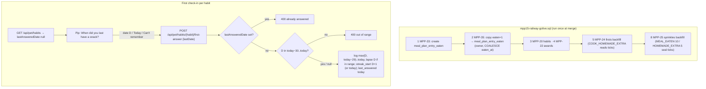

# Plan: Get up to speed at go-live: carry over ticked meals, and ask once when you last snacked and drank

Plan folder: `.claude/contract/MPP-35-get-up-to-speed-at-go-live/`
Execution status: see `tasks.md` in this folder.

---

## Part 1 — Alignment

### Task reference
Jira **MPP-35** (Story, High, parent epic MPP-15). Blocks MPP-28; relates to MPP-33 and MPP-21. Acceptance criteria, verbatim in substance:

1. **Ticks carried over.** The go-live SQL copies every `meal_plan_entries` row with `eaten = 1` into `meal_plan_entry_eaten`. Each row is credited to the entry's own `user_id` (the plan owner), never copied to linked partners. `eaten_at` is the old `eaten_at`, or `created_at` / the plan date when it is NULL. The copy reads the column at go-live time, so ticks made before the merge are included.
2. **Copy is idempotent and runs early.** Idempotent (`ON DUPLICATE KEY UPDATE id = id`). It runs straight after MPP-33's table is created (go-live row 2) and before MPP-24 and MPP-25, whose existing backfills then seal the copied ticks (homemade-extra first, plus MEAL_EATEN 10 and HOMEMADE_EXTRA 5 sprinkles). On today's live data this gives user 1 a balance of 70 sprinkles.
3. **Copied ticks count everywhere.** Plan streak, award ledger and 30-day evolution score treat copied ticks exactly like app ticks. For user 1, 12 and 13 Oct count as followed-the-plan days.
4. **One-time question per habit.** The first time a person is asked about a habit (no `pet_habit_streaks` row, or `last_answered_date` NULL), Pip asks "When did you last have a snack?" / "When did you last have a drink?" in place of the normal daily question. Answers: a date picker, "Today" and "Can't remember". "Today" and "Can't remember" both start the streak today. Never asked again once that habit is answered.
5. **30-day cap.** A chosen date is limited to today − 30 … today; the picker allows nothing older and the API rejects it. An older real date counts as "30 days ago": treated as a lapse 31 days ago, so the logged clean run is at most 30 days.
6. **What the answer saves.** The lapse day (if it falls in the window) is logged `clean = 0`, every day after it up to today `clean = 1`, in `pet_habit_days`. `streak_start` = day after the lapse, `best` = the resulting run length, `last_answered_date` = today. The next normal check-in covers tomorrow onwards.
7. **Kind tone and per person.** No shaming, no "only N days". Answers are per person.
8. **Tests.** Backend tests cover the 30-day cap, rejection of future and older dates, "Can't remember" starting today, a repeat first-answer refused once answered, and that awards earn at most one ladder cycle from the one-time answer. Go-live `--check` passes with the new row.

Scope from the ticket — in: the idempotent backfill migration (owner only) added to `railway-migrations.md` and the regenerated `mpp15-railway-golive.sql`; the first-answer variant in Pip's bubble plus the backend rule widening the first answer to a 30-day window; updating MPP-33 AC 1's note to point at this ticket. Out: copying ticks to partners; MEAL_ON_TIME / FULL_WEEK backfill; habit history older than 30 days; dropping the old `eaten` / `eaten_at` columns.

Design asset: `.claude/contract/MPP-15-epic-breakdown/mockups/pip-room-mockup-v5.html` (check-in section) — the one-time question reuses the "Yes → when?" date step.

### Restated goal
When the MPP-15 epic goes live nobody's Pip should start from zero. Two pieces: (a) one idempotent SQL step, slotted into the go-live file directly after MPP-33's table, copies the seven old shared ticks (all user 1, 12–14 Oct) into the per-person tick table under the plan owner, so the later MPP-24/MPP-25 backfills seal them and every derived score (plan streak, awards, growth) sees them; (b) the first time each person meets the snack or alcohol check-in, Pip asks "when did you last…" instead of "did you have any today", and one answer backfills up to 30 clean days into the habit log through a new, one-shot endpoint that refuses a second use.

### In scope
- Migration `2026-10-14-mpp35-carry-over-shared-ticks.sql` (idempotent `INSERT … SELECT`), inserted as row 2 of `railway-migrations.md`, rows 2–9 renumbered to 3–10, go-live file regenerated.
- Comment-only refresh of the migration headers that now say something false: MPP-33 (ticks not carried over), MPP-22/24/25/32 ("listed as order N"), MPP-25 ("backfill inserts nothing on Railway").
- Applying the migration to local `foodbytes-db` against seeded `eaten = 1` rows, then re-running the MPP-24 and MPP-25 files to reproduce go-live order.
- Backend: `HabitStreakPolicy` first-answer window rules, `HabitFirstAnswerRequest` DTO, `HabitStreakService.firstAnswer`, `POST /api/pet/habits/{habit}/first-answer`, with tests per AC 8.
- Frontend: `habitService.firstAnswerHabit`, first-answer helpers + wording in `habitCheckIn.js` / `constants/pet.js`, a `FIRST` step in `useHabitCheckIn`, the first-answer controls in `CheckInActions.jsx`, and `habitCheckIn.check.mjs` asserts.
- Jira: MPP-33 description, AC 1 note now points at MPP-35.
- Version bump (Story → MINOR) + CHANGELOG.

### Explicitly out of scope
- Copying old ticks to linked partners (`meal_plan_owner_id` users).
- MEAL_ON_TIME / FULL_WEEK sprinkle backfill.
- Any habit history older than 30 days, including a larger "best" figure.
- Dropping `meal_plan_entries.eaten` / `eaten_at`.
- Applying anything to Railway — that happens once at epic merge via the go-live file.
- Changing the normal daily `/answer` flow, `HabitStatusDTO`'s shape, or the snooze rules.
- Adding the missing MPP-34 / MPP-35 rows to the MPP-15 epic's `## Build order and status` table (noticed during planning; separate housekeeping).

### Pattern Reference
None supplied beyond the mockup. Chosen references:
- Migration shape and idempotency: `foodbytes-app/database/migrations/2026-10-14-mpp25-pet-sprinkles.sql` (qualified `ON DUPLICATE KEY UPDATE <table>.id = <table>.id`).
- Backend: `HabitStreakService#answer` / `HabitStreakPolicy#requireLapseInWindow` (lock-then-write, pure static policy, `IllegalArgumentException` → 400 in `PetHabitController`).
- Tests: `HabitStreakServiceTest` (Mockito + fixed `Clock`), `HabitStreakPolicyTest`, `PetHabitControllerTest` (`@WebMvcTest`).
- Frontend: the existing `WHEN` step in `CheckInActions.jsx` and the `submit` path in `useHabitCheckIn.js`; pure helpers pinned in `habitCheckIn.check.mjs`.

### Constraints flagged on the brief
- Go-live order is load-bearing: the copy must be row 2, before MPP-24 (row 5 after renumber) and MPP-25 (row 8), or copied ticks are never sealed and an untick/re-tick would pay sprinkles.
- Idempotent SQL (MPP-15 local-first rule); `node foodbytes-app/database/build-golive.mjs --check` must print `Go-live OK`.
- Owner-only credit; never partners.
- 30-day cap enforced by both the picker and the API; at most one award ladder cycle (30 days) from the one-time answer.
- Per person: habits keyed by the caller's id, never `meal_plan_owner_id`.
- Kind wording — no shaming, no "only N days".
- Accepted risk (ticket): two 30-day answers give 60 of 90 growth points at once; evolutions are permanent.

### Assumptions made
- **"Today" = a lapse today; "Can't remember" = a clean today.** AC 6 says `streak_start` is the day after the lapse, so "Today" logs today `clean = 0`, `streak_start` = tomorrow, current 0. "Can't remember" claims no history: it logs today `clean = 1`, `streak_start` = today, current 1 — exactly what a first "No" does now. I read AC 4's "both start the streak today" as "neither credits any past day". This is the assumption most worth red-lining.
- **The 30-day floor stands for "30 days or longer".** The API accepts `lastDate` in today − 30 … today. Days are logged only inside the 30-day window today − 29 … today, so a floor answer logs 30 clean days and no lapse row. That matches AC 5's "lapse 31 days ago… clean run at most 30" and AC 6's "lapse day, if it falls in the window". Any other date in range logs its lapse day plus the clean days after it. Picker hint: "Longer ago? Pick the earliest day."
- **A separate one-shot endpoint** `POST /api/pet/habits/{habit}/first-answer`, body `{ "lastDate": "YYYY-MM-DD" | null }` (null = "Can't remember"), returns the updated `HabitStatusDTO`. It is refused with 400 `{error}` once `last_answered_date` is set (AC 8). This is better than overloading `/answer`, which keeps its semantics.
- **No `HabitStatusDTO` change.** The frontend detects a first answer from `lastAnsweredDate === null`, which the DTO already exposes for both "no row" and "row with NULL". The 30 is declared once per side: `HabitStreakPolicy.FIRST_ANSWER_DAYS` and `FIRST_ANSWER_DAYS_BACK` in `constants/pet.js`. The API is the enforcer.
- **"Not now" stays on the first question**, with the same snooze until tomorrow. The ticket doesn't remove it, and forcing an answer would be unkind.
- **The reaction after a first answer reuses `praiseText`.** It gives "N days snack-free! So proud of you 💜", or "Thanks for telling me 💜" at 0. Both are already approved wording with no "only N".
- **Question wording** comes from the ticket verbatim: "When did you last have a snack?" / "When did you last have a drink?"
- **No new HTML mockup.** The ticket names the v5 mockup and says the step reuses the existing date step. That is why this plan skips the usual mockup-first gate (red-line if you want one).
- **Migration date prefix 2026-10-14** (today), so `build-golive.mjs`'s untracked-migration check, which starts at 2026-10-13, picks it up.
- **MPP-33 AC 1 note** is updated by editing the MPP-33 Jira description: one appended sentence, rest byte-for-byte.

### Cross-code alignment audit (FE ↔ BE ↔ DB)
- **Live `meal_plan_entries`** (`SHOW COLUMNS`, Railway, read-only): `id bigint NO PRI`, `user_id bigint NO`, `plan_date date NO`, `meal_id bigint NO`, `eaten tinyint(1) NO DEFAULT 0`, `eaten_at timestamp YES NULL`, `created_at timestamp YES DEFAULT CURRENT_TIMESTAMP`. The copy's source columns exist with the expected types; `COALESCE(eaten_at, created_at, TIMESTAMP(plan_date))` is always non-null, which matches `meal_plan_entry_eaten.eaten_at TIMESTAMP NOT NULL`.
- **Live old ticks:** 7 rows with `eaten = 1`, all `user_id = 1`: breakfast/lunch/dinner on 12 and 13 Oct, breakfast on 14 Oct. None has a NULL `eaten_at` or NULL `created_at`. Every tick's local date ≥ `plan_date`, so all 7 pass MPP-25's `plan_date <= DATE(eaten_at local)` filter → 7 × 10 = 70 sprinkles, matching AC 2 with no HOMEMADE_EXTRA on those entries.
- **Live new tables:** `information_schema` has none of `meal_plan_entry_eaten`, `pet_habit_*`, `pet_awards`, `pet_firsts`, `pet_sprinkles` on Railway. Nothing from the epic is applied yet, and the go-live file stays the single apply.
- **Target table** (`2026-10-13-mpp33-…sql`): `meal_plan_entry_eaten(id, meal_plan_entry_id, user_id, eaten_at NOT NULL)`, `UNIQUE uk_mpe_eaten_entry_user (meal_plan_entry_id, user_id)`. The unique key makes the copy idempotent.
- **Local `foodbytes-db`:** `meal_plan_entries.eaten = 1` → **0 rows**; `meal_plan_entry_eaten` → 2 ticks by 1 user; `pet_habit_streaks` → 2 rows; `pet_sprinkles` → 2 rows. Locally the copy has nothing to copy unless rows are seeded, so the test task seeds them (as the ticket says).
- **Unapplied migrations:** all 9 tracker rows are applied locally and none on Railway, by design (local-first epic). No outstanding local migration blocks the backend.
- **Habit chain:** DB `pet_habit_streaks.last_answered_date DATE NULL` ↔ `PetHabitStreak.lastAnsweredDate` ↔ `HabitStatusDTO.lastAnsweredDate` ↔ JSON `lastAnsweredDate` ↔ `habitService` `status.lastAnsweredDate`. Names line up, and the first-answer detection reads this field. `pet_habit_days(user_id, habit, day, clean)` `UNIQUE (user_id, habit, day)` matches `PetHabitDay`. No schema change needed for the habit side.
- **Award ladder:** `AwardLadder.CYCLE = 30`, `MILESTONES = 1,3,5,7,14,21,30`. A run of length ≤ 30 has every streak day in `cycle_index = 0`, so capping the clean run at 30 is exactly the "one ladder cycle" invariant.

---

## Part 2 — Technical design

### Approach
**Tick carry-over is pure SQL in the go-live chain.** All three consumers already derive from `meal_plan_entry_eaten`: `PlanStreakService` (plan streak), `AwardService` (re-derives runs and fills the ledger on every read) and `PetGrowthService` (30-day score). So once the rows exist, AC 3 holds with no Java change. The sprinkles ledger and the `COOK_HOMEMADE_EXTRA` first are the only *materialised* consumers, and those are exactly the MPP-24/MPP-25 backfills. The migration is therefore one `INSERT … SELECT` placed at row 2 so those backfills run after it. The road not taken: a one-off Java backfill on first pet load. It would need its own "already ran" flag, would race between partners, and still couldn't seal sprinkles before MPP-25's ledger existed. Because existing headers make claims this ticket falsifies, they get comment-only fixes; the go-live file is regenerated from them anyway.

**The one-time habit question is a new, narrow write path beside the daily one.** `HabitStreakPolicy` gains the pure window rules: `FIRST_ANSWER_DAYS = 30`, `requireFirstAnswerInWindow`, `firstAnswerLogFrom`. `HabitStreakService.firstAnswer` reuses the existing lock (`ensureRow` + `findForUpdate`), refuses when `lastAnsweredDate` is set, and reuses the private `logDays` and `raiseBest`. The log range is `max(lastDate, today − 29) … today` with the lapse marked only when it falls in that range. `streak_start = lastDate + 1`, or today for "Can't remember". The controller gets one thin `@PostMapping`. The road not taken: widening `coversFrom` for never-answered habits in `/answer`. That would silently turn a first "No 🙌" into 30 credited days, and it couldn't express "refuse a repeat".

**Frontend: a third step kind in the existing check-in state machine.** `useHabitCheckIn` already queues habits and swaps steps. A habit whose status has `lastAnsweredDate === null` starts at `CHECKIN_STEPS.FIRST` instead of `ASK`. The prompt comes from `firstQuestionText(habit)`. `CheckInActions` renders a small form: a date input bounded by `firstAnswerEarliestISO(todayISO)` … today, defaulting to today, with Save, "Today", "Can't remember" and "Not now". The form posts through `habitService.firstAnswerHabit`, and the reaction reuses `praiseText`. Pure helpers live in `utils/habitCheckIn.js` and are pinned in `habitCheckIn.check.mjs`, since there is no frontend test runner.

### Skills to invoke during execution
- `java-backend` — policy/service/controller/DTO layering, the `{error}` 400 convention, Mockito and `@WebMvcTest` tests.
- `react-frontend` — the hook/component split, constants in `constants/pet.js`, touch targets ≥ 44 px, the four async states, file-size budget, no `console.log`.
- `management-jira` — the MPP-33 description edit (re-read, change one note, timeout rule).

Rules read: none of `.claude/rules/*` apply. This ticket touches no recipe, ingredient, macro or variant data.

### Diagram


### Data shapes

#### Migration — `foodbytes-app/database/migrations/2026-10-14-mpp35-carry-over-shared-ticks.sql`
```sql
INSERT INTO meal_plan_entry_eaten (meal_plan_entry_id, user_id, eaten_at)
SELECT e.id, e.user_id, COALESCE(e.eaten_at, e.created_at, TIMESTAMP(e.plan_date))
FROM meal_plan_entries e
WHERE e.eaten = 1
ON DUPLICATE KEY UPDATE meal_plan_entry_eaten.id = meal_plan_entry_eaten.id;
```
No DDL; no entity change.

#### Tracker — `railway-migrations.md` (new row 2; old rows 2–9 become 3–10)
`| 2 | MPP-35 | foodbytes-app/database/migrations/2026-10-14-mpp35-carry-over-shared-ticks.sql | 2026-10-14 | — |`

#### DTO — `com.foodbytes.dto.HabitFirstAnswerRequest` (new)
```java
@Data @NoArgsConstructor @AllArgsConstructor
public class HabitFirstAnswerRequest {
    private LocalDate lastDate; // null = "Can't remember"; today = "Today"; else today-30..today
}
```

#### Policy additions — `HabitStreakPolicy`
```java
public static final int FIRST_ANSWER_DAYS = 30;
public static LocalDate firstAnswerEarliest(LocalDate today);                      // today - 30
public static void requireFirstAnswerInWindow(LocalDate lastDate, LocalDate today); // IAE if future or before earliest
public static LocalDate firstAnswerLogFrom(LocalDate lastDate, LocalDate today);   // max(lastDate, today - 29)
```

#### Service — `HabitStreakService`
```java
@Transactional
public HabitStatusDTO firstAnswer(Long userId, Habit habit, HabitFirstAnswerRequest request);
// IAE "<Habit> has already been answered" when lastAnsweredDate != null
```

#### HTTP contract
`POST /api/pet/habits/{habit}/first-answer` (auth required; 401 `{error}` when no principal)
- Request: `{ "lastDate": "2026-10-01" }` or `{ "lastDate": null }` / `{}`
- 200: `HabitStatusDTO` (unchanged shape: `habit, current, best, lastAnsweredDate, askToday, coversFrom`)
- 400 `{ "error": "lastDate cannot be in the future" | "lastDate must be on or after <today-30>" | "SNACK has already been answered" | "Unknown habit: X" }`

Worked outcomes (today = T):

| lastDate | days logged | streak_start | current / best |
|---|---|---|---|
| null | T clean | T | 1 / 1 |
| T | T not clean | T+1 | 0 / 0 |
| T−5 | T−5 not clean, T−4..T clean | T−4 | 5 / 5 |
| T−30 | T−29..T clean (no lapse row) | T−29 | 30 / 30 |
| T−31 / T+1 | — 400 | — | — |

#### Frontend
- `constants/pet.js`: `CHECKIN_STEPS.FIRST = 'first'`; `FIRST_ANSWER_DAYS_BACK = 30`; `HABIT_FIRST_QUESTION = { SNACK: 'When did you last have a snack?', ALCOHOL: 'When did you last have a drink?' }`; `CHECKIN_FIRST_HINT = 'Longer ago? Pick the earliest day.'`
- `utils/habitCheckIn.js`: `isFirstAnswer(status) → boolean` (`status.lastAnsweredDate == null`); `firstAnswerEarliestISO(todayISO) → 'YYYY-MM-DD'` (todayISO − 30, UTC arithmetic); `firstQuestionText(habit) → string`; `stepFor(habit, status) → { kind, habit }`.
- `services/habitService.js`: `firstAnswerHabit(habit, { lastDate }) → Promise<HabitStatus>` → `POST /pet/habits/${habit}/first-answer`.
- `useHabitCheckIn` `actions` adds: `earliest` (ISO), `onFirstSave(lastDateISO|null)`; `step` may be `'first'`.
- `CheckInActions` props add `earliest`, `onFirstSave`.

### Runtime quality notes
- **Resource cleanup:** Backend — single `@Transactional` method, no streams. Frontend — the first-answer POST goes through the existing `submit` path: writes are never aborted, the `mountedRef` guard drops results for an unmounted view, and the `forDay` guard drops results that land after midnight. The load effect keeps its existing `AbortController`.
- **Concurrency / ordering:** Two first answers in parallel (two tabs) serialise on `findForUpdate` (`PESSIMISTIC_WRITE`). The second sees `lastAnsweredDate` set and gets a 400, so no duplicate `pet_habit_days` rows (the unique key is the backstop). Partners never contend: rows are keyed by the caller. In SQL, re-running the go-live file hits `uk_mpe_eaten_entry_user` and no-ops. The copy-before-backfill order is the one ordering hazard, and the tracker row position fixes it.
- **Allocation / cost behaviour:** At most 30 `PetHabitDay` entities per first answer, in one `saveAll`, once per habit per person ever. The copy is a scan of `meal_plan_entries` (800 rows live). The awards read path already re-derives runs on every read, so 30 extra rows are negligible.
- **Error paths:** `IllegalArgumentException` → 400 `{error}` in `PetHabitController`, the existing convention. Unknown habit → existing type-mismatch handler. Frontend: a failed POST uses the existing `CHECKIN_SAVE_FAILED` reaction, which ends the check-in without marking anything answered, so the first question comes back next visit. A failed load shows no check-in, as today.

### Risks and judgement calls
- **"Today" vs "Can't remember" semantics** (first assumption above) — the ticket's "both start the streak today" can be read as both giving current = 1. If you want "Today" to give current 1 as well, it would have to log today as clean, which records a snack day as snack-free. I chose honesty; red-line if you disagree.
- **Floor date logs no lapse.** Someone whose real lapse was exactly 30 days ago also gets no lapse row. Harmless: that day is outside the 30-day growth window.
- **Renumbering tracker rows 2–9.** `build-golive.mjs` requires 1..n order, so every later row shifts. The headers of MPP-22/24/25/32 that quote their order number get comment-only updates so they don't lie. Editing headers of already-applied migrations changes only comments, and the go-live file is regenerated from them.
- **Local verification needs seeded rows.** Local has 0 `eaten = 1` rows. The apply task flips `eaten = 1` on three entries of one local user's plan, then re-runs the MPP-24 and MPP-25 files (idempotent) to reproduce go-live order and confirm the seal. This writes test data into the local DB only.
- **Growth jump** — two floor answers give up to 60/90 growth points at once and may trigger permanent evolutions. Accepted on the ticket; noted again here so it isn't a surprise in play-testing.
- **No mockup** — skipping the usual mockup-first step on the strength of the ticket's design-asset line.
- **Manual step you own:** nothing goes to Railway in this ticket. The new migration reaches Railway only through `mpp15-railway-golive.sql` at epic merge. The local apply (Task 3) is executed by `/fb-apply` against `foodbytes-db`.
