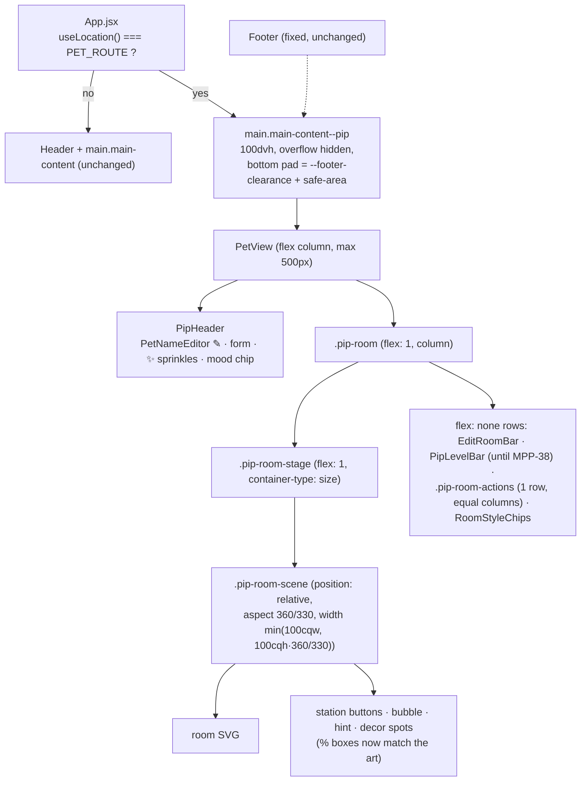

# Plan: Pip's tab full screen — room fills the screen, buttons above the tab bar, no top bar

Plan folder: `.claude/contract/MPP-37-pip-fullscreen-room/`
Execution status: see `tasks.md` in this folder.

---

## Part 1 — Alignment

### Task reference

Jira **MPP-37** (Bug, High, parent epic MPP-15), as edited on 2026-10-14.

**Expected behaviour (acceptance):** matches the approved phone mockup `.claude/contract/MPP-15-epic-breakdown/mockups/mpp-32-wardrobe-phone-mockup.html`, updated in `Downloads/mpp-37-38-pip-fullscreen-mockup.html` (https://claude.ai/artifact/3BTBJMPbpGFMNwGVozZqh2):
- **Pip mode hides the app's top bar.** On the Pip tab the calendar/date-range picker and the top menu (account avatar) are not shown. Every other tab keeps the top bar as it is today.
- **Pip's own slim header** sits above the room: name (with the existing rename pencil), form, sprinkles and mood pill. These replace the name row and mood pill that sat below the room.
- **Today's meals is removed from the Pip tab** (decided 2026-10-14). The card was read-only with a link to Meal Plan, where meals are logged, so nothing is lost.
- Pip's room fills the space between Pip's header and the bottom tab bar (`flex: 1`, no card margin or rounded frame, no page scroll).
- Shop, Edit room and Wardrobe sit in one row directly above the tab bar. Each is a 44px-tall pill, and they never wrap or overlap.
- The "Tap the fridge" hint is never covered by a button.

**Actual (v1.24.1, Android Chrome, portrait):** top bar shows on `/pet`; the room is a fixed card in a scrolling page; buttons wrap onto two rows and Wardrobe overlaps the hint; the Pip heading, mood pill and Today's meals sit below the room.

**Ticket risks carried over:** hiding the top bar removes the account menu (and its version row) from `/pet` — acceptable, every other tab keeps it; remove `PetMealsCard` if nothing else uses it; three buttons must fit at 360px; MPP-38 is changing the level bar, so do not reserve room for the labelled strip; may be connected to MPP-36 (fridge/cabinet taps do nothing).

**Decisions confirmed by the developer, 2026-10-14:** Today's meals comes off the Pip tab; the top bar (calendar + account menu) is hidden in Pip mode; the rename pencil moves into Pip's slim header.

### Restated goal

Make the Pip tab a full-screen "Pip mode". On `/pet` the app's purple top bar disappears. A slim Pip header (name + rename pencil, current herb form, sprinkles, mood pill) sits at the top, Pip's room fills all the remaining height down to the fixed bottom tab bar without the page scrolling, and the Shop / Edit room / Wardrobe pills sit in one non-wrapping row directly above the tab bar. Today's meals is deleted from the page. The room's tap targets (fridge, cabinet), bubble and hint are positioned against the room picture itself, so they line up with the art at any screen size.

### In scope

- Route-aware hiding of `Header` on `/pet` (all widths), and a full-height `main` for that route.
- A new slim `PipHeader` (name + rename pencil, form name, sprinkles, mood chip) replacing the `.pet-meta` row under the room.
- Moving the sprinkles counter out of the room's top-left into `PipHeader`.
- Removing `PetMealsCard` (component file + its CSS) from the Pip tab.
- Full-height room layout: a flex `stage` that sizes the room picture to the space available (keeping its 360×330 aspect), with no card frame.
- Making `.pip-room-scene` the positioning container for the station buttons, bubble, hint and decor spot buttons, so their percentage boxes match the art.
- The Shop / Edit room / Wardrobe strip as a single equal-width row above the tab bar, fitting at 360px.
- A shared footer-clearance token so the Pip layout and `.main-content` reserve the same space for the fixed tab bar.
- Manual phone checks, including that the fridge and cabinet open on tap (MPP-36 check).
- Version bump (Bug → PATCH) + CHANGELOG.

### Explicitly out of scope

- The level bar (`PipLevelBar`) — owned by MPP-38. MPP-37 leaves it rendering where it is and reserves no space for it; it simply takes its natural height until MPP-38 removes it.
- MPP-36's own investigation and fix beyond the manual tap check (see Risks — this plan's positioning change is the likely fix, but MPP-36 is closed only after it is verified).
- The Footer / bottom tab bar's look or behaviour.
- Any change to the Header on other routes, or moving the account menu elsewhere.
- The fridge / cabinet / wardrobe / shop / decor-picker sheets themselves.
- PWA bootstrap (not installed; untouched).
- Backend, API, DB.

### Pattern Reference

Supplied by the brief: the approved phone mockup `mpp-32-wardrobe-phone-mockup.html` and `Downloads/mpp-37-38-pip-fullscreen-mockup.html` (`.app` flex column, `.room { flex: 1; min-height: 0 }`, `.room-actions` 3-column grid above `.tabs`). In code: `react-frontend` SKILL.md; the existing `PetView.jsx` / `PetRoom.jsx` / `PetRoom.css` / `PetView.css`; `PET_ROUTE` in `constants/pet.js`; the pill style `.pip-checkin-btn` already used by `ShopButton` / `EditRoomButton` / `WardrobeButton`.

### Constraints flagged on the brief

- Mobile-first; every interactive element ≥44×44px; `:focus-visible`; hover only under `@media (hover: hover)` with an `:active` pair (react-frontend touch rules).
- Three buttons in one row at 360px wide, never wrapping or overlapping.
- No page scroll on `/pet`; respect safe-area insets (the footer already pads `env(safe-area-inset-bottom)`).
- Other tabs unchanged.
- No frontend test runner — verification is `npm run build` plus manual phone checks.

### Assumptions made

- **Pip mode applies at every width, not just phones.** The ticket says "on the Pip tab" with no breakpoint; one rule is simpler to reason about. On wide screens the column stays capped at 500px and centred, as `.pet-view` is today.
- **Route detection lives in `App.jsx`** via `useLocation()` compared to the existing `PET_ROUTE` constant, rather than inside `Header` returning `null`. App already owns the shell; this also lets it add the `main-content--pip` modifier in the same place.
- **The room picture keeps its 360×330 aspect and is letterboxed** inside a flex stage that has the room's lilac background, sized with CSS container query units (`min(100cqw, 100cqh × 360/330)`). The alternative — stretching the SVG with `preserveAspectRatio="xMidYMid slice"` — would crop the walls and break the percentage hit boxes for the fridge and cabinet.
- **Sprinkles move into `PipHeader`**, matching the mockup header; the room's top-left `SprinklesCounter` is removed, and `PetRoom` loses its `sprinkles` prop.
- **Form name in the header comes from `PIP_FORM_NAMES[growth.displayForm]`**, so it follows the evolve/de-evolve animation the same way the room does.
- **Footer clearance becomes a token** `--footer-clearance: 80px` in `global.css` (today the literal `80px` on `.main-content`). Pip mode adds `env(safe-area-inset-bottom)` to it because the fixed footer grows by that inset.
- **`PetMealsCard.jsx` is deleted**, along with its `.pet-meals*` CSS. A grep shows `PetView.jsx` is its only user. `moodInfo.todaySlots` stays in `PetContext` (mood logic still uses it).
- **Hiding the top bar on `/pet` does not break the Pip page.** `PetContext` reads `startDate` from `MealPlanContext` only to compare it with its own fridge window. The value persists in context when the picker is not mounted.

### Cross-code alignment audit (FE ↔ BE ↔ DB)

Skipped — no persistence touched. This is a layout-only change to existing client components. No API field, DTO or column is read or written differently.

---

## Part 2 — Technical design

### Approach

**Shell.** `App.jsx` reads the path with `useLocation()`. When it equals `PET_ROUTE` it skips `<Header />` and gives `<main>` an extra `main-content--pip` class. In `global.css` that modifier turns `main` into a fixed-height flex column: `height: 100dvh` (with a `100vh` fallback), no side padding or `max-width`, top padding `env(safe-area-inset-top)`, bottom padding `calc(var(--footer-clearance) + env(safe-area-inset-bottom))`, and `overflow: hidden`. So the page can't scroll and nothing sits under the fixed tab bar. The literal `80px` on `.main-content` becomes `var(--footer-clearance)` so the two can't drift apart.

**Pip page.** `PetView` becomes a flex column (`flex: 1; min-height: 0`, max-width 500px, centred) holding a new `PipHeader` and then `PetRoom`. `PipHeader` is a small presentational component (`components/pet/PipHeader.jsx`): `PetNameEditor` on the left with the form name beside it, then the sprinkles chip and the mood chip on the right. Its styles reuse the existing `.pet-meta` / `.pet-chip` rules in `PetView.css`, slimmed down (smaller name font, tight vertical margins). `PetMealsCard` and the `.pet-meta` block below the room are removed.

**Room.** `.pip-room` loses its card styling (radius, shadow) and becomes `flex: 1; min-height: 0; display: flex; flex-direction: column`. The scene goes into a new wrapper `.pip-room-stage` (`flex: 1; min-height: 0; container-type: size; display: grid; place-items: center; background: #ece5fb`). `.pip-room-scene` gets `position: relative`, `aspect-ratio: 360 / 330` and `width: min(100cqw, calc(100cqh * 360 / 330))`, with `width: 100%` declared first as a fallback for browsers without container units. This is the key structural fix. Today `.pip-room-scene` has no positioning, so the station buttons, hint, bubble, sprinkles and decor spot buttons are positioned against the whole `.pip-room` card, which also contains the level bar and the button strip. That is why the hint lands among the buttons in the screenshot, and why the fridge/cabinet percentage hit boxes don't sit on the art. Once the scene is the containing block and exactly the SVG's aspect, `hitBoxStyle`'s percentages line up again with no change to `roomLayout.js`. Everything under the stage (the edit bar, `PipLevelBar` until MPP-38 removes it, the action strip, the style chips in edit mode) is `flex: none`, so the stage, and with it the room picture, shrinks to fit.

**Buttons.** `.pip-room-actions` becomes `display: grid; grid-auto-flow: column; grid-auto-columns: 1fr; gap: 6px; padding: 8px 10px`, with a white background and top hairline, so however many buttons have loaded (1–3) they share one row equally. `.pip-room-action` gets `justify-content: center; white-space: nowrap; min-width: 0; padding-inline: 6px`, so "✏️ Edit room" and "👕 Wardrobe" fit in about 105px each at 360px wide. Overlays (`FridgeView` etc., `position: absolute; inset: 0` inside `.pip-room`) still cover the room and the strip, as before.

Rejected alternatives: hiding the Header from inside `Header.jsx` (spreads route knowledge into a shared layout piece, and App still needs the `main` modifier); a JS `ResizeObserver` to size the SVG (more code, re-render cost, when CSS container units already do it); keeping Today's meals below the fold (the developer chose removal).

### Skills to invoke during execution

- `react-frontend` — owns every file touched: component structure (`PipHeader` as a small presentational component), mobile-first CSS, 44px targets, `:focus-visible`, hover/active pairing, no new dependencies, component size budget, and the "state what you verified" rule.

Rules: none of `.claude/rules/*` apply. They govern recipes, ingredients, variants and migrations, and this is a layout-only change.

### Diagram



### Data shapes

No schema or contract changes. Frontend module shapes:

#### New component — `components/pet/PipHeader.jsx`

```jsx
// props
PipHeader({
  name,        // string — pet.name
  onRename,    // (next: string|null) => Promise — renamePet from PetContext
  formName,    // string — PIP_FORM_NAMES[growth.displayForm]
  sprinkles,   // number|null — null until the balance loads (chip hidden)
  mood,        // PET_MOODS key — drives .pet-chip--<mood>
  moodLabel    // string — petChipLabel(moodInfo)
})
// markup
<header className="pip-header">
  <div className="pip-header-name"><PetNameEditor … /><span className="pip-header-form">{formName}</span></div>
  <div className="pip-header-right">
    {typeof sprinkles === 'number' && <span className="pip-header-sprinkles" aria-label={`${sprinkles} sprinkles`}>…</span>}
    <span className={`pet-chip pet-chip--${mood}`}>{moodLabel}</span>
  </div>
</header>
```

#### Changed props

- `PetRoom`: `sprinkles` prop **removed** (the counter moves to `PipHeader`). All other props unchanged.

#### New / changed CSS classes and tokens

| Where | Name | Purpose |
|---|---|---|
| `styles/global.css` `:root` | `--footer-clearance: 80px` | space reserved for the fixed footer (replaces the literal) |
| `styles/global.css` | `.main-content--pip` | full-height, non-scrolling `main` for `/pet` |
| `PetView.css` | `.pip-header`, `.pip-header-name`, `.pip-header-form`, `.pip-header-right`, `.pip-header-sprinkles` | slim Pip header |
| `PetRoom.css` | `.pip-room-stage` | flex stage that sizes the room picture |
| `PetRoom.css` | `.pip-room-scene` (new rule) | positioning container + aspect box |
| removed | `.pet-meta`, `.pet-meals*`, `.pip-room-sprinkles` | no longer rendered |

#### Deleted

- `components/pet/PetMealsCard.jsx`

### Runtime quality notes

Frontend-only. The dimensions below are mapped onto the browser runtime.

- **Resource cleanup:** no new effects, listeners, timers or requests. `useLocation` is a router hook with no cleanup. Removing `PetMealsCard` drops one `useNavigate` consumer.
- **Concurrency / ordering:** no shared mutable state added. The header's sprinkles read the same `sprinkles` value `PetRoom` used, so there's no second source of truth. Rename keeps `PetNameEditor`'s existing optimistic/error flow.
- **Allocation / cost behaviour:** layout is pure CSS (container queries, flex, grid). There's no resize listener and no extra render. Bundle shrinks slightly (one component removed, one small one added).
- **Error paths:** unchanged. `PetView`'s guest / error / loading states still render before the layout. Those states sit inside `main-content--pip` too, so they must still be readable: they're short centred blocks, and the overflow-hidden full-height main still shows them. A rename failure still shows `PetNameEditor`'s `role="alert"` line inside the header. The header has to let that line wrap without pushing the room off-screen, so the room stage shrinks.

### Risks and judgement calls

- **Order with MPP-38: apply MPP-37 first, then MPP-38.** Both edit `PetRoom.jsx` and `PetRoom.css`. MPP-37 leaves `PipLevelBar` untouched and only sits it as a `flex: none` row, so MPP-38 can remove it cleanly afterwards. If MPP-38 lands first, MPP-37's edits to the region under the stage need a small rebase.
- **MPP-36 (fridge/cabinet taps do nothing) is very likely caused by the bug this plan fixes.** `.pip-room-scene` is not `position: relative`, so `hitBoxStyle`'s percentage boxes are computed against the whole card (scene + level bar + button strip). The screenshot shows the same mis-anchoring on the hint, which is pinned inside the scene in code but appears among the buttons. This plan makes the scene the containing block, which should put the fridge and cabinet buttons back on their art. The final manual check taps both on a phone. MPP-36 itself is closed only after that check, as its own ticket.
- **Container query units** (`cqw` / `cqh`) need Chrome 105+, Safari 16+ and Firefox 110+. Older browsers fall back to `width: 100%` with the aspect ratio. The room then fills the width and the stage clips any overflow, which degrades without breaking.
- **The account menu (sign out, portions, meal times, version row) can't be reached from `/pet`.** The developer accepted this. Worth knowing when checking "is my fix live" from the Pip tab: switch tabs first.
- **Footer clearance is a measured constant (80px), not a measured height.** If the footer's height changes later, the token must change with it. A guest's footer message banner is taller, but guests only see the short sign-in prompt on `/pet`, so nothing is clipped.
- **Pip mode at desktop widths** is an assumption (see Part 1). If you'd rather keep the top bar on desktop, it's a one-line media-query change, so red-line it now.
- **Header crowding at 360px:** name + pencil (44px), form name, sprinkles chip and mood chip in one row. The form name gets `min-width: 0` with ellipsis so long pet names can't push the chips off-screen. The manual check covers a 12-character name.
