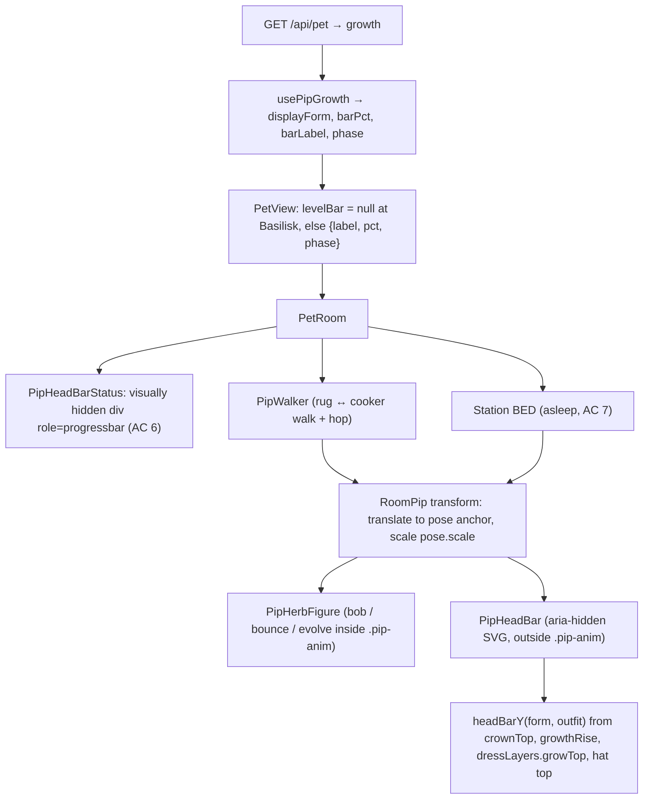

# Plan: MPP-38 — small level bar over Pip's head that follows him

Plan folder: `.claude/contract/MPP-38-pip-overhead-level-bar/`
Execution status: see `tasks.md` in this folder.

---

## Part 1 — Alignment

### Task reference
Jira **MPP-38** (Story, Medium, parent epic MPP-15): "Level bar: small green bar over Pip's head that follows him, with no label". The acceptance criteria are copied verbatim from the ticket as it stood on 2026-10-14:

1. The labelled level bar under the room is removed, along with the "Basil seed · 6 / 15 → Seedling" text.
2. A small green bar (same fill/track colours as today) sits just above Pip's head, centred on him. It is roughly his head's width and only a few pixels tall.
3. The bar moves with Pip as he walks between the rug, cooker and bed, using the same movement and timing, so it never lags behind or detaches.
4. The fill still shows progress toward the next form, and the evolve and de-evolve behaviour from MPP-31 still plays on the bar (it flashes when full, then Pip evolves and the next bar starts empty).
5. The bar does not clash with what he wears or says: it sits above any hat from the wardrobe (MPP-32) and below the speech bubble, at every herb form from Basil seed to Bushling.
6. Screen readers still get the progress: the bar keeps `role="progressbar"` with an accessible value text (e.g. "Basil seed, 6 of 15 to Seedling"), even though nothing is shown as text.
7. **The bar stays visible while Pip is asleep** in bed (decided 2026-10-14).
8. **No bar once Pip is fully grown** (Basilisk): the bar is hidden, since there is nothing left to fill (decided 2026-10-14).

Design reference (named by the brief): `C:\Users\jossd\Downloads\mpp-37-38-pip-fullscreen-mockup.html`, published at https://claude.ai/artifact/3BTBJMPbpGFMNwGVozZqh2. Its `roomSvg` keeps Pip and the bar in one wrapper `<g id="mover">`, its `placeBar` puts the bar 12 units above Pip's measured outline, and its `scoreDay` flashes the full bar yellow before the form changes.

Decisions confirmed by the developer on 2026-10-14: visible while asleep (AC 7), hidden at Basilisk (AC 8), and the mockup approved as the visual reference.

### Restated goal
Replace MPP-31's full-width labelled level strip under Pip's room with a small, text-free green bar drawn inside the room SVG just above Pip's head. The bar sits in the same transform group as Pip, so it rides along with every pose and walk: the rug, the cooker, the cook-and-serve walk and hop, and asleep in bed. It always clears his head growth and any hat, at every form. It keeps MPP-31's fill animation and evolve/de-evolve phases, adds a short yellow flash when it fills before an evolve, disappears once Pip is a Basilisk, and stays readable to screen readers through a visually hidden progressbar.

### In scope
- Deleting `PipLevelBar.jsx` / `PipLevelBar.css` and their render under the room scene.
- A new SVG over-head bar rendered inside `RoomPip`, sized in room units so it looks the same at the rug/cooker scale (0.46) and the bed scale (0.36).
- A pure geometry helper giving the bar's height above the feet for a form + outfit (head growth, back leaves, hat top, happy-bounce clearance), pinned by a node check.
- A visually hidden HTML progressbar in `PetRoom` carrying the label as `aria-valuetext` (AC 6).
- Hiding the bar (visual and hidden progressbar) at Basilisk (AC 8). It stays visible in bed (AC 7).
- A yellow "full" flash during MPP-31's `FILLING` phase, and no transition during `EVOLVING` / `SHRINKING`. Reduced motion disables both the fill transition and the flash.

### Explicitly out of scope
- The full-screen layout, hiding the app top bar, Pip's slim header, removing Today's meals, and the one-row room buttons. These all belong to **MPP-37**.
- Growth scoring, `usePipGrowth` phase timing and the `growthView` maths (MPP-31). They are reused unchanged.
- The footer tab's mini Pip (no bar there, as before).
- The Dress Pip preview and lineup, the item cards, and `PipHerb` outside the room (no bar there).
- MPP-36 (fridge/cabinet taps).

### Pattern Reference
- The brief supplied the mockup only. Reference code chosen from the repo:
  - `client/src/components/pet/room/RoomPip.jsx`: the single place Pip is placed in the room (used by both `PipWalker` and the bed `Station`), so the bar is added here.
  - `client/src/components/pet/herb/wardrobeLayers.js`: pure geometry from form anchors (`dressLayers().growTop`, `hatArt().top`), which is the pattern for the new head-top helper.
  - `client/src/components/pet/herb/wardrobe.check.mjs` and `room/room.check.mjs`: the node check-script pattern (`npm run check:*`) used in place of a test runner.
  - `client/src/components/pet/room/PipLevelBar.jsx`: the existing progressbar ARIA and phase handling being replaced.
- Follow `react-frontend/SKILL.md`.

### Constraints flagged on the brief
- The bar keeps the same colours as today: fill `#5fae3e`, track `#e3f1d8` (from `PipLevelBar.css`).
- No numbers or text are visible. The label survives only as screen-reader text (AC 6).
- It clears every hat (MPP-32) at forms 1–4, and sits below the speech bubble (AC 5).
- It is visible asleep (AC 7) and absent at Basilisk (AC 8).
- MPP-37 owns the room layout. MPP-38 must not touch the header, the action strip, the top bar or `PetMealsCard`.
- Mobile/PWA: the bar is not interactive, so it needs no touch target. It must respect `prefers-reduced-motion`.

### Assumptions made
- **The bar lives inside `RoomPip`, not in a sibling layer.** `RoomPip` is the only place Pip is positioned (the rug and cooker via `PipWalker`, the bed via the bed `Station`), so a child there inherits every translate, scale, walk transition and hop for free (AC 3). Rationale: a sibling layer would have to re-derive four positions and the walker's timing.
- **The bar is outside `.pip-anim`.** It doesn't bob, bounce, wilt-filter or evolve-pulse with the body, matching the mockup (the bar is outside `.bob`). Rationale: a steady bar is readable, and the walker hop still moves it because the hop wraps `RoomPip`.
- **Height comes from static geometry, not runtime `getBBox`.** The mockup measures at runtime; the app has every anchor as data (`herbForm().growTop`, `hatArt().top`, `dressLayers().growTop`). Rationale: deterministic, no layout pass, no measurement jitter from the CSS bob, and pinnable in a node check.
- **Two per-form constants are measured once and pinned:** `crownTop` (the highest point of the body plus back leaves, which no hat changes) and `growthRise` (how far `HerbGrowth` rises above its `base`, 0 when the form has none). Both are in unscaled 200-unit herb space, using the upright (non-drooped) shapes, which reach higher. Rationale: leaf and bloom extents are rotated quadratic paths. Measuring them once in the browser with `getBBox` and pinning the numbers is simpler and more honest than deriving them analytically.
- **The gap above the head is 22 herb units** (`HEAD_BAR_GAP`). Rationale: the happy bounce (`pip-bounce`) lifts the body 16px plus a 5% stretch, and the bar must not be hit at the peak.
- **The bar is 30 × 5 room-viewBox units** (`HEAD_BAR_WIDTH` / `HEAD_BAR_HEIGHT`), converted to herb units by dividing by `pose.scale` and the form scale, so it is the same on-screen size at every form and at the bed scale. Rationale: about a Sprig head's width (AC 2). Without the conversion the bar would shrink by 0.36/0.46 in bed.
- **AC 6 uses a visually hidden HTML `<div role="progressbar">` in `PetRoom`, outside the SVG.** Rationale: the room `<svg>` is `role="img"`, which makes its children presentational, so a progressbar inside it would be invisible to screen readers.
- **The accessible value text** reuses MPP-31's `levelBarLabel` wording, rewritten without symbols, e.g. "Sprig, 14 of 24 to Bushling" (AC 6's example). Rationale: "·" and "→" read badly aloud.
- **"Fully grown" means `displayForm === PIP_FORMS.BASILISK`.** During an evolve into Basilisk, the `FILLING` phase still shows Bushling's bar filling and flashing, then `EVOLVING` hides it. Rationale: AC 4 says the flash plays before the evolve, and AC 8 says there is no bar once he's a Basilisk.
- **The flash is a CSS keyframe on the fill during `FILLING`,** delayed by `PIP_GROWTH_PHASE_MS.filling` minus the flash length so it ends as the phase ends. Rationale: matches the mockup's "flashes yellow then evolves" without a new timer.
- **The new pure helper lives in `herb/headBar.js`** next to `wardrobeLayers.js`, with its check appended to `wardrobe.check.mjs`. Rationale: it is herb geometry (forms + hats), and an existing check script keeps `package.json` unchanged.

### Cross-code alignment audit (FE ↔ BE ↔ DB)
Skipped: no persistence touched. The bar reads `growth` already delivered by `GET /api/pet` (`PetGrowthDTO`: `form`, `barCurrent`, `barSize`, `fullyGrown`) through the existing `usePipGrowth`, with no new field, endpoint or column.

---

## Part 2 — Technical design

### Approach
The bar moves from HTML under the scene into the SVG, as a child of `RoomPip`'s `<g transform=…>`. `RoomPip` already anchors Pip by translating his feet to the pose's room point and scaling by `pose.scale`. `PipWalker` (rug ↔ cooker, CSS transform transition plus the `pip-hop` animation) wraps it for the day and cook scenes, and the bed `Station` renders it between the bed's back and front art at night. Adding `<PipHeadBar>` after `<PipHerbFigure>` inside that group makes AC 3 structural: the bar can't lag or detach because it is in Pip's coordinate system. The bar sits outside the figure's `.pip-anim`, so the idle bob, happy bounce, wilt filter and evolve pulse don't move or recolour it. That's why the gap has to clear the bounce peak. The road not taken was a separate overlay `<g>` positioned from `pose.anchor` with its own copy of the walker transition. It is rejected because it duplicates four placements and the MPP-29 walk timing, and it is exactly how a bar ends up detached.

Height is pure geometry. A new `herb/headBar.js` exports `headBarTop(form, outfit)`, the y (in the figure's unscaled 200-unit space, the same space as `HERB_FOOT_Y`) of the highest point of Pip's head for that form and outfit. It is the minimum of three candidates:
- `crownTop` for the form: the body top or Bushling's back leaves, which a hat never moves.
- `growthTop`: `dressLayers(outfit, form).growTop − growthRise[form]`. This uses the lifted base when a hat is worn, exactly as `PipHerbFigure` draws the growth.
- The worn hat's `top` from `hatArt`.

`headBarY(form, outfit)` then maps that point through the form's scale about the feet (`HERB_FOOT_Y + (top − HERB_FOOT_Y) · k`) and subtracts `HEAD_BAR_GAP`. `crownTop` and `growthRise` are pinned constants in `herbForms.js`. The executor measures them once from the live figure (the console snippet is in the task), and the node check asserts that for every form 1–4 × every hat × no hat, the bar's bottom edge is at least `HEAD_BAR_GAP` above the hat top and the growth top. Runtime `getBBox` (the mockup's approach) was rejected because it needs a ref, a layout effect and a second render on every form/outfit/mood change, and it reads the CSS-animated bob, so the bar would jitter.

`PipHeadBar` is presentational SVG (`aria-hidden="true"`): a rounded track rect plus a fill rect scaled on X (`transform: scaleX(pct/100)`, `transform-box: fill-box`, `transform-origin: left`), plus an ink outline, as in the mockup. Its width and height are given in room units and divided by `pose.scale × k` so the on-screen size is constant at every form and in bed. Phase handling mirrors `PipLevelBar`. In `EVOLVING` and `SHRINKING` the fill jumps with no transition, because the new form's bar starts at its edge. In `FILLING` it transitions to 100% and then plays a yellow flash keyframe (`pip-head-bar-flash`). `prefers-reduced-motion` removes both the transition and the flash, and `usePipGrowth` already shortens the schedule. Screen-reader progress moves to a visually hidden `<div role="progressbar">` rendered by `PetRoom` beside the SVG. The SVG's `role="img"` would hide an inner progressbar, so the visual and accessible bars are separate elements fed by the same `levelBar` prop.

Data flow stays as it is up to `PetRoom`. `PetView` builds `levelBar = { label, pct, phase }` from `usePipGrowth`, and now returns `null` when `growth.displayForm === PIP_FORMS.BASILISK` (AC 8), so both the SVG bar and the hidden progressbar disappear together. `PetRoom` drops `<PipLevelBar>`, renders `<PipHeadBarStatus levelBar={levelBar} />` (the hidden progressbar), and passes `levelBar` through to `RoomPip` in both call sites (`PipWalker` children and the bed `Station`). `RoomPip` draws `<PipHeadBar>` when `levelBar` is set, and the bed pose keeps it (AC 7). The speech bubble is an HTML layer over the SVG, so it always paints above the bar (AC 5).

### Skills to invoke during execution
- `react-frontend`: component placement under `components/pet/room` and `pet/herb`, the plain per-component CSS pattern, the file-order and size budget (`PetRoom.jsx` is 281 lines, so the change must keep it under 400), constants in `src/constants/`, reduced motion, a11y, and no frontend test runner (verification is `npm run build`, node check scripts and manual checks).

No `.claude/rules/` file applies (no recipe, ingredient, macro, variant or migration work).

### Diagram


### Data shapes
#### New constants — `client/src/constants/pipGrowth.js`
```js
export const HEAD_BAR_WIDTH = 30   // room-viewBox units (constant on-screen size at every form and pose)
export const HEAD_BAR_HEIGHT = 5   // room-viewBox units
export const HEAD_BAR_GAP = 22     // herb units between the head top and the bar's bottom edge; clears pip-bounce (−16px, 1.05 stretch)
export const HEAD_BAR_FLASH_MS = 450 // the yellow full-bar flash, ending as the FILLING phase ends
```

#### `client/src/components/pet/herb/herbForms.js` — two pinned fields per form
Each `HERB_FORMS[i]` gains:
- `crownTop: number`: the min y (unscaled 200-unit space) of the body plus `HerbBack` art, measured with the leaves upright.
- `growthRise: number`: `growTop − (min y of HerbGrowth drawn at base = growTop)`, or `0` for forms with no growth (Basil seed, Bushling).

These are measured once in the browser (snippet in tasks) and written as literals.

#### New pure module — `client/src/components/pet/herb/headBar.js`
```js
/** Highest point of Pip's head (unscaled 200-unit space) for a form wearing `outfit`. */
export function headBarTop(form: number, outfit: Object|null): number
/** The bar's bottom edge, in the figure's scaled space (same space RoomPip places): HERB_FOOT_Y + (headBarTop − HERB_FOOT_Y)·k − HEAD_BAR_GAP. */
export function headBarY(form: number, outfit: Object|null): number
/** "Sprig · 14 / 24 → Bushling" → "Sprig, 14 of 24 to Bushling" — screen-reader text without symbols (AC 6). */
export function spokenLevelLabel(label: string): string
```
`usePipGrowth` gains no field. The hidden progressbar uses `levelBar.pct` for `aria-valuenow` and `spokenLevelLabel(levelBar.label)` for `aria-valuetext`.

#### New components
- `client/src/components/pet/room/PipHeadBar.jsx`: `PipHeadBar({ form, outfit, pct, phase, poseScale })` → `<g className="pip-head-bar [is-instant] [is-full]" aria-hidden="true" transform="translate(HERB_FOOT_X − w/2, headBarY − h)">` with track rect, fill rect (`style={{ transform: scaleX(pct/100) }}`) and outline rect, where `w = HEAD_BAR_WIDTH / poseScale` and `h = HEAD_BAR_HEIGHT / poseScale`.
- `client/src/components/pet/room/PipHeadBarStatus.jsx`: `PipHeadBarStatus({ levelBar })` → `<div className="pip-head-bar-status" role="progressbar" aria-label="Growth" aria-valuemin={0} aria-valuemax={100} aria-valuenow={pct} aria-valuetext={spokenLevelLabel(label)} />`, visually hidden.
- `client/src/components/pet/room/PipHeadBar.css`: track `#e3f1d8`, fill `#5fae3e`, ink outline `#2f4a22` 1.4; `.pip-head-bar-fill { transform-box: fill-box; transform-origin: 0 50%; transition: transform 0.9s ease-in-out }`; `.is-instant` no transition; `.is-full .pip-head-bar-fill` → `animation: pip-head-bar-flash 0.45s ease-in-out 0.45s 1`; `@keyframes pip-head-bar-flash { 50% { fill: #ffd34d } }`; `.pip-head-bar-status` visually hidden (clip pattern); reduced motion → no transition, no animation.

#### Modified props
- `RoomPip({ pose, herb, levelBar = null })`: renders `<PipHeadBar form={herb.form} outfit={herb.outfit} pct={levelBar.pct} phase={levelBar.phase} poseScale={pose.scale} />` when `levelBar` is set.
- `Station({ …, levelBar })` passes it to the bed `RoomPip`. `PetRoom` passes `levelBar` to both `RoomPip` sites and renders `<PipHeadBarStatus>`.
- `PetView`: `levelBar = growth.barLabel && growth.displayForm !== PIP_FORMS.BASILISK ? { label, pct, phase } : null`.

#### Deleted
- `client/src/components/pet/room/PipLevelBar.jsx`, `client/src/components/pet/room/PipLevelBar.css`.

No schema or API contract changes.

### Runtime quality notes
Frontend-only, so the dimensions are mapped onto the browser runtime.
- **Resource cleanup:** no new timers, listeners or effects. The flash is a CSS animation, and phase timing stays in `usePipGrowth` (which already clears its timers on unmount).
- **Concurrency / ordering:** none new. The bar renders from `usePipGrowth`'s current step, so the walk (MPP-18/29) and the growth phases can overlap safely, and the bar just follows both. Two-person sharing (MPP-33) is unaffected: growth is per person and already keyed by user.
- **Allocation / cost behaviour:** `headBarY` is a handful of arithmetic ops plus one `dressLayers` call per render of `RoomPip`. `PipHerbFigure` already calls `dressLayers` for the same inputs, so the cost is trivial and no memoisation is needed (skill: no `useMemo` without profiling). The fill animates `transform` (compositor-friendly) instead of `width`.
- **Error paths:** an unknown form falls back via `herbForm()` to the seed's geometry, so a bad payload never yields `NaN`. `levelBar` null (guest, no growth yet, Basilisk) renders neither bar. Nothing is fetched, so there's no new error state.

### Risks and judgement calls
- **Apply order: MPP-37 first, MPP-38 second.** Both edit `PetRoom.jsx`, and both may touch `PetRoom.css` and `PetView.jsx`. MPP-37 restructures the layout around the room (header, action strip, removing `PetMealsCard`). MPP-38 only removes the `<PipLevelBar>` line and threads `levelBar` into `RoomPip`. If MPP-37 lands first, MPP-38's edits are small and should apply with at most a one-line rebase. The executor must re-read `PetRoom.jsx` before editing rather than trust line numbers.
- **Pinned `crownTop` / `growthRise` are measured, not derived.** If herb art changes later, they go stale. The node check catches a hat clash, but not a new leaf poking higher. The `herbForms.js` comment says to re-measure on any growth/back-art change.
- **The bed `Station` draws `art.front` after Pip.** At bed level 1, `front` is null. At higher bed levels, a tall footboard could overlap a bar at 0.36 scale. Covered by the manual check in bed at every bed level the shop can reach. If it clashes, the fix is to render the bed bar after `art.front` (still inside the same pose transform).
- **`NightDim` paints over the bed scene,** so the bar is dimmed at night like everything else. AC 7 asks only that it stays visible. This was judged acceptable, not a defect.
- **The bar no longer shows the form name or the numbers on screen.** MPP-37's header shows the form name. If MPP-37 slips, the form name is temporarily visible nowhere on `/pet` (the progress is still visible and spoken).
- **The flash timing is tied to `PIP_GROWTH_PHASE_MS.filling` (900 ms):** a 450 ms fill then a 450 ms flash. If MPP-31's phase length changes, the flash delay must follow. Both are named constants, so it's grep-able.
- **Reduced motion:** `growthSchedule` already drops `FILLING` under reduced motion, so the flash never runs there. The CSS guard is belt-and-braces.
- **Version bump:** the issue type is Story → **MINOR**, computed at apply time.
