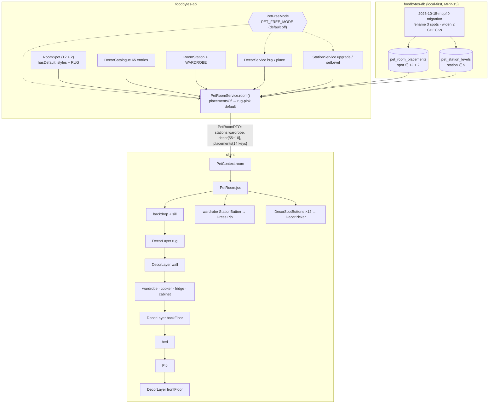

# Plan: Pip's room — 12 named decor spots, rug spot, wardrobe station and deeper windowsill

Plan folder: `.claude/contract/MPP-40-pip-room-decor-spots/`
Execution status: see `tasks.md` in this folder.

---

## Part 1 — Alignment

### Task reference

Jira **MPP-40** (Story, Medium, no parent epic): *Pip's room: 12 named decor spots, rug spot, wardrobe station and deeper windowsill*. Builds on MPP-27 (decor) and MPP-39 (bigger room + camera). Approved mockup: `C:\Users\jossd\Downloads\pip-room-decor-spots-mockup.html` (`?lv=1` / `?lv=4` sets every station's level).

Acceptance criteria (verbatim, condensed formatting):

1. The room has these 12 decor spots, with these names and in these places (world coords, matching the approved mockup):
   - **Over the wardrobe**: left wall, u 20–56, h 102–140 (the old "Left wall" spot, moved up 10)
   - **Bedside wall**: right wall, v 134–154, h 60–124 (new)
   - **Front right wall**: right wall, v 250–296, h 102–134 (the old "Right wall" spot)
   - **Window dressing**: around the window, v 156–244, h 60–146 (new)
   - **Windowsill**: on top of the sill, u 0–14, v 158–238, h 74 (new)
   - **Rug**: middle of the floor, u 82–198, v 106–194 (new)
   - **Back corner**: u 2–30, v 32–52 (new)
   - **Bedside nook**: u 2–32, v 140–182 (new)
   - **Foot of the bed**: u 96–126, v 196–240 (new)
   - **By the fridge**: u 220–256, v 130–170 (the old "Floor" spot)
   - **Corner by the door**: u 4–40, v 258–294 (new)
   - **Front of the room**: u 172–208, v 232–268 (new)
2. Every item belongs to exactly one spot and can only be placed there. The item list per spot matches the mockup:
   - Over the wardrobe: basil print, recipe chalkboard, herb shelf, fairy lights, Pip portrait
   - Bedside wall: growth chart, meal-plan calendar, wall lamp, photo frames
   - Front right wall: wall clock, bunting, copper pan rail, round mirror, coat hooks
   - Window dressing: gingham curtains, linen curtains, roller blind, window fairy lights, hanging plant
   - Windowsill: basil pots, succulents, cactus pair, retro radio, lucky cat
   - Rug: pink rug (free default), braided, basil-leaf, rainbow stripes, picnic blanket, sheepskin
   - Back corner: snake plant, tall cactus, umbrella stand, broom + dustpan
   - Bedside nook: side table + lamp, record player, plant stand, stool + books
   - Foot of the bed: toy chest, bed bench, laundry basket, mat + slippers
   - By the fridge: watering can, cookbook stack, bean bag, potted lemon tree, veg basket
   - Corner by the door: monstera, coat stand, arc floor lamp, guitar
   - Front of the room: pouffe, tea table, Pip's ball, picnic basket
3. The 12 existing items keep their ids, prices and ownership, and every existing placement still shows in the same place after the change. Left wall → Over the wardrobe, Right wall → Front right wall, Floor → By the fridge.
4. The rug is a spot. Every room starts with the pink rug placed and owned for free, and Pip still stands in the middle of whichever rug is placed.
5. A new **wardrobe** station sits in the back corner along the left wall (u 4–70, v 0–30, max height 96). It has levels 1–4 like the other stations (clothes rail, chest of drawers, wooden wardrobe, mirrored wardrobe), can be upgraded in the shop, and tapping it opens Dress Pip.
6. The windowsill is twice as deep (7 → 14), a bit thicker (h 68–74) and has two brackets under it.
7. No spot overlaps any station at any level 1–4.
8. Edit room shows every spot as a dashed outline with its name, and the decor picker and shop group items by spot name.
9. **Visual pass on the item art.** Some mockup items look primitive or overlap their neighbours. Each item is redrawn to the quality of the existing furniture before it ships, and none overlap a station or another spot's art. Known problems from the mockup: the snake plant in Back corner clips into the wardrobe and the glass cabinet, and the level-4 cooker's hood and pot read as crude, flat blocks.

**Follow-up decision (developer, 2026-10-15, after the first approval):** "part of the plan should be to run in localhost and have a 'free mode' where everything is unlocked and free for testing; this mode should not be thrown away, it should be usable in testing going forwards." → a permanent, off-by-default **pet free mode** switch (Assumptions 15–19), and the manual check runs on localhost with it on.

Scope boundaries from the ticket — **out:** one item in more than one spot; unlocking spots by room level or Pip's form; moving the level-4 canopy bed off the window. Open questions on the ticket (prices; wardrobe upgrade cost; canopy hiding the window) are answered as assumptions below.

### Restated goal

Grow Pip's room from 3 decor spots to 12 named spots so the room can be filled in and has more to spend sprinkles on. The three existing spots are renamed (and the left-wall one lifted 10 units) without losing anybody's purchases or placements; nine new spots arrive with 43 new items, including the rug, which stops being fixed backdrop art and becomes a spot whose free default is today's pink rug. A fifth upgradable station — the wardrobe — fills the empty back corner, levels 1–4 through the shop like the other four, and opens Dress Pip when tapped. The windowsill becomes a real, deeper shelf that items sit on. Before any art lands in the game it gets a visual pass: every item drawn to the furniture's standard and inside its own spot, plus a redraw of the crude level-4 cooker hood and pot. To test all of this — and every room feature after it — the plan also adds a permanent **free mode** for local runs: one environment switch that makes every decor item and style owned and lets any station be set to any level for free, off unless deliberately turned on, and the manual check runs on localhost with it on.

### In scope

- Backend spot model: `RoomSpot` widened to 12 decor spots + 2 finishes; RUG behaves as a spot with a free default (like the finishes).
- Backend catalogue: `DecorCatalogue` gains 43 items (incl. the free `rug-pink`), existing 12 unchanged in id/price.
- Backend station: `RoomStation.WARDROBE` (levels 1–4, same price ladder, ledger ids 52–54).
- One idempotent migration: rename the three existing placement spots, widen the two CHECK constraints; go-live row 11 + regenerated go-live file; applied to the local `foodbytes-db`.
- Frontend constants: 12 spots in world coords (outline, volume, name-tag anchor), 55 decor items, the rug default, the wardrobe in station constants, shop level names and lines.
- Frontend art: 43 new item builders (split across files by area), legacy 12 kept, wardrobe 4 levels, deeper windowsill + brackets, rug moved out of the backdrop, L4 cooker hood + pot redrawn.
- Frontend room: layered drawing (rug / wall / back floor / front floor), 12 spot buttons, spot name tags in edit mode, a wardrobe hit box opening Dress Pip, picker without "Empty" on the rug.
- Visual pass (AC 9) done in the mockup first and signed off by the developer before porting.
- `room.check.mjs` pins: spot shapes, AC 7 overlap check, rug centred under Pip, legacy key mapping, the helpers.
- Version bump (Story → MINOR) + CHANGELOG.
- **Pet free mode (testing, permanent):** backend switch `app.pet-free-mode` (env `PET_FREE_MODE`, default `false`); `PetRoomDTO.freeMode`; every decor item and style owned; station upgrades free; a free-mode-only "set level" endpoint so a station can go to any level 1–4 (down too); a visible 🧪 badge and level chips in the shop; documented in `CLAUDE.md` and `.env.example`.
- The manual check (Task 22) runs the full stack on localhost (Vite :5173 + backend :8080 + local `foodbytes-db`), first with free mode on and then with it off.

### Explicitly out of scope

- An item placeable in more than one spot (ticket out-of-scope).
- Spot unlocking by level/form — every spot is open from the start (ticket out-of-scope).
- Moving the level-4 canopy bed, which hides much of the window (ticket out-of-scope); the window spots are allowed to sit behind the bed (see Assumptions).
- Re-pricing the existing 12 items or the station ladder.
- Any change to Dress Pip itself (`WardrobeView`) or to the 👕 Wardrobe pill — the station is a second way in.
- Applying anything to Railway — MPP-15 is local-first; Railway gets the go-live file at the epic merge.
- Changes to `pet_sprinkles.chk_pet_sprinkles_source` — `STATION_UPGRADE` and `DECOR_PURCHASE` already exist.
- Free mode for anything outside the room shop — wardrobe outfit unlocks (MPP-32), Pip's growth form, awards and sprinkles balances are untouched. Free mode can grow to cover them later through the same `PetFreeMode` switch.
- A UI toggle for free mode. It is a server setting only, so no user can turn it on from the app.

### Pattern Reference

None named on the ticket beyond the mockup. References chosen:
- **Mockup** `pip-room-decor-spots-mockup.html` — authoritative for spot coords, name-tag anchors, item ids, labels, prices, draw order, wardrobe art, windowsill.
- **MPP-27 decor** — `DecorCatalogue.java`, `DecorService.java`, `PetRoomService.placementsOf`, `constants/petDecor.js`, `RoomDecorLayers.jsx`, `DecorSpotButtons.jsx`, `decorArt.jsx`: extend in place.
- **MPP-26 stations** — `RoomStation.java`, `StationPolicy.java`, `furniture.jsx`, `roomLayout.js` footprints + `cabinetHitBox`, `PetRoom.jsx` `StationButton`: the wardrobe follows the cabinet exactly.
- **MPP-27 / MPP-26 migrations** — guarded `DROP CHECK` + re-add, `information_schema` guard, header comment shape.
- `react-frontend` / `java-backend` SKILL.md conventions.

### Constraints flagged on the brief

- Hibernate `ddl-auto: validate` — the migration goes in before the backend that knows the new enum values starts.
- Every spot is sized for level-4 furniture; no spot overlaps a station at levels 1–4 (AC 7).
- Existing ids, prices, ownership and placements survive (AC 3).
- 12 spots + 5 stations at phone size: the art pass needs a phone-width check (ticket risk).
- Per-person room (MPP-33): placements and station levels are the caller's own, never the meal-plan owner's — unchanged.
- MPP-15 epic is local-first: idempotent migration, go-live row, `build-golive.mjs`, local apply only.

### Assumptions made

1. **Enum names and JSON keys.** Backend `RoomSpot`: `OVER_WARDROBE`, `BEDSIDE_WALL`, `FRONT_RIGHT_WALL`, `WINDOW_DRESSING`, `WINDOWSILL`, `RUG`, `BACK_CORNER`, `BEDSIDE_NOOK`, `FOOT_OF_BED`, `BY_FRIDGE`, `CORNER_BY_DOOR`, `FRONT_OF_ROOM` (+ `WALL_STYLE`, `FLOOR_STYLE`). JSON / client keys are the mockup ids (`overWardrobe` … `frontOfRoom`). All names fit `VARCHAR(16)` (longest, `FRONT_RIGHT_WALL`, is exactly 16). *Rationale:* the ticket asks for "new spot names" in the DB; the mockup already uses these keys.
2. **Rename, don't alias.** The migration UPDATEs `LEFT_WALL→OVER_WARDROBE`, `RIGHT_WALL→FRONT_RIGHT_WALL`, `FLOOR→BY_FRIDGE`; the old enum constants are removed. *Rationale:* ticket names the migration; keeping dead names in an enum invites misuse.
3. **Item ids and prices = the mockup's `ITEMS` table**, verbatim (e.g. `cactus`, `bench`, `broom`, `rug-pink`). New items 120–300, rugs 150–300, `rug-pink` 0 and default. *Rationale:* ticket's open question on prices is left at the mockup values; retunable in `DecorCatalogue` only.
4. **RUG is a "defaulted" spot, like the finishes.** A new `RoomSpot.hasDefault()` is true for `WALL_STYLE`, `FLOOR_STYLE`, `RUG`. For those: an unset spot reads as its default; buying applies at once; placing `null` or the default deletes the row. The rug picker has no "Empty" option. The rug lives in the **Decor** tab (not "Walls & floors"). *Rationale:* AC 4 "every room starts with the pink rug placed", without a backfill.
5. **Wardrobe upgrades cost the existing ladder** (300 / 600 / 1200); `RoomStation.WARDROBE` code 5 → ledger ids 52..54. *Rationale:* ticket open question; mockup suggests the same ladder.
6. **The 👕 Wardrobe pill stays**; the wardrobe station's hit box is a second trigger for the same Dress Pip overlay. When `wardrobe` is null (no data), the station is drawn but not tappable. *Rationale:* AC 5 adds a way in; nothing asks to remove the pill.
7. **All spot geometry in world coords.** `DECOR_SPOT_SHAPES` moves to world coords and `DECOR_SPOT_SHIFT` is deleted. The 12 legacy item builders keep their MPP-27 coords and are wrapped in a per-item legacy shift inside `decorArt` (overWardrobe `[-130, 0, -30]` — up 10 from today's −40, frontRightWall `[0, 216, -40]`, byFridge `[70, 20, 0]`), exactly as the mockup does; new items are drawn in world coords. *Rationale:* one coordinate system for spots and the AC 7 check, without rewriting 12 working builders.
8. **Draw order follows the mockup**, adapted to the app's Pip: backdrop (incl. window + new sill) → rug → wall layer (overWardrobe, bedsideWall, frontRightWall, windowDressing, windowsill) → wardrobe, cooker, fridge, cabinet → back floor (backCorner, bedsideNook) → bed → Pip on the rug → front floor (cornerByDoor, footOfBed, byFridge, frontOfRoom) → night dim / z's. *Rationale:* depth order; front floor items sit nearer the viewer than Pip's rug.
9. **AC 7 is checked as 3D box overlap** in `room.check.mjs`: every spot volume vs every station footprint (shifted) at levels 1–4, strict inequalities (touching faces are fine), the rug as its ellipse. **Exception:** Window dressing and Windowsill vs the **bed** — they sit behind the bed like the window itself (the ticket's out-of-scope canopy note); the L3/L4 headboard and L4 canopy would otherwise fail the box test. *Rationale:* the literal reading contradicts the ticket's own out-of-scope item.
10. **AC 9 visual pass happens in the mockup first** (Phase 1), and the developer signs it off before the art is ported to JSX. *Rationale:* the user asked for the pass "before they go into the real game", and the standing preference is mockup-before-UI-code. Known fixes on the list: snake plant clipping, L4 cooker hood + pot, the basil-leaf rug (±64 wide, wider than the rug spot), the arc floor lamp (shade at u 68, outside Corner by the door u 4–40).
11. **Edit mode name tags** are SVG labels at each spot's `tag` anchor from the mockup, drawn with the dashed outline. The "+" stays on empty spots. *Rationale:* AC 8; mockup `tagSvg`.
12. **Spot buttons stay rectangles over the world layer**, rendered largest-first (windowDressing, rug, then the rest) so smaller spots on top win the tap, as the mockup orders its overlay. *Rationale:* the SVG is `role="img"`; MPP-27 pattern.
13. **`ROOM_HINT`** becomes "Drag to look around · tap the fridge 🧊, cabinet 🏆 or wardrobe 👕". *Rationale:* the hint names every tappable station.
14. **Sprig wallpaper window gap** lowers its `h0` from 66 to 56 so sprigs don't draw behind the new brackets (58–68). *Rationale:* follow-on of AC 6.
15. **Free mode is a backend config switch**, `app.pet-free-mode: ${PET_FREE_MODE:false}` in `application.yml`, read once by a new `PetFreeMode` component in `service/`. Default off; Railway never sets it; the backend logs a `WARN` at startup when it is on. *Rationale (developer-confirmed 2026-10-15 that free mode is wanted and permanent):* the server enforces ownership and charges sprinkles, so a client-only flag couldn't unlock anything; a server env var can't be flipped by a user.
16. **What free mode does:** every catalogue item reads as `owned: true`, so the picker offers everything and buying isn't needed; `place` skips the ownership check; `upgradeCosts` are all 0 and `upgrade` charges nothing and writes no ledger row; a new `PUT /api/pet/stations/{station}/level` sets any level 1–4 (level 1 deletes the row). With free mode off, that endpoint returns **403** and nothing else changes. *Rationale:* "everything unlocked and free", and testing art at levels 1 and 4 needs going down as well as up.
17. **Nothing free mode does is written as a purchase.** No `pet_decor_owned` rows, no `pet_sprinkles` rows. Placements and station levels set in free mode are real rows in the (local) DB; turning free mode off leaves placed-but-unowned items on their spots (shown, since `placementsOf` doesn't check ownership) until they're changed. *Rationale:* free mode leaves no fake purchases behind; leftover placements are harmless on a local test DB.
18. **The client shows free mode** with a `🧪 Free mode` badge in the room's action strip and a note in the shop, and in the shop's Upgrades tab each station shows level chips 1–4 instead of the upgrade button. `PetRoomDTO.freeMode` drives it. *Rationale:* a tester must never mistake free mode for the real economy.
19. **Documented for reuse:** `CLAUDE.md` → "Running the backend locally with Google login" gains a "Pet free mode" note with the one-line `$env:PET_FREE_MODE = "true"`, and `.env.example` gains `PET_FREE_MODE=false` with a comment. *Rationale:* the developer wants it used in testing going forward, so it has to be findable.

### Cross-code alignment audit (FE ↔ BE ↔ DB)

MPP-15 is not merged to master (`git log master` has no MPP commits; `feature/MPP-15-pip-room` is an ancestor of `AI_Master`), so the pet tables exist only in the local `foodbytes-db`; Railway has none of them. Checks were run against local.

- **`pet_room_placements` columns** (local):
  ```
  id        bigint       NO  PRI  auto_increment
  user_id   bigint       NO  MUL
  spot      varchar(16)  NO
  item_key  varchar(32)  NO
  ```
  New spot names ≤ 16 chars; new item ids ≤ 32 chars (longest `curtains-gingham`, 16). `PetRoomPlacement.spot` is `@Enumerated(STRING)` length 16 — matches.
- **`pet_station_levels` columns** (local): `station varchar(16)`, `level int` — `WARDROBE` fits; `PetStationLevel.station` is `@Enumerated(STRING)` length 16.
- **CHECK constraints** (local `information_schema.CHECK_CONSTRAINTS`):
  ```
  chk_pet_room_placements_spot   (`spot` in ('LEFT_WALL','RIGHT_WALL','FLOOR','WALL_STYLE','FLOOR_STYLE'))
  chk_pet_station_levels_station (`station` in ('BED','FRIDGE','COOKER','CABINET'))
  ```
  Both must be re-declared, or inserts of the new names fail.
- **Row counts** (local): `pet_room_placements` 0 rows, `pet_station_levels` 0 rows, `pet_decor_owned` 0 rows. The rename UPDATEs are therefore no-ops locally today but are kept for Railway at go-live and any local testing before then. Lossless: renames only, and both CHECKs become supersets of what the data can hold after the rename.
- **Unapplied migrations:** `railway-migrations.md` rows 1–10 are all applied locally; MPP-27 (row 10) is the last. This migration becomes row 11 and must run after row 10 (it re-declares the CHECK row 10 creates).
- **Name chain:** DB `spot` value (`OVER_WARDROBE`) ↔ `RoomSpot.OVER_WARDROBE` ↔ JSON key `RoomSpot.key()` = `overWardrobe` ↔ `PetRoomDTO.placements` / `DecorItemDTO.kind` ↔ client `ROOM_SPOTS.OVER_WARDROBE = 'overWardrobe'` ↔ `RoomPlacementRequest.spot`. Station: `WARDROBE` ↔ `RoomStation.WARDROBE.key()` = `wardrobe` ↔ `PetRoomDTO.stations.wardrobe` ↔ `ROOM_STATIONS.WARDROBE`. Old keys `leftWall` / `rightWall` / `floor` are referenced in `room.check.mjs`, `petService.js` JSDoc, `roomPlacements.js` doc, `RoomDecorLayers.jsx`, `roomLayout.js` and four backend tests — all updated in tasks.

---

## Part 2 — Technical design

### Approach

**Backend — widen the enum, grow the catalogue, add a station.** `RoomSpot` is rewritten with the 12 decor spots + 2 finishes and a second flag, `hasDefault`, true for the two finishes and the rug. The two places that today branch on `isStyle()` for default behaviour — `PetRoomService.placementsOf` (unset → default) and `DecorService.buy` (apply at once) — switch to `hasDefault()`; `isStyle()` stays for code that genuinely means "a finish". `DecorCatalogue.ITEMS` gains 43 items and `defaultFor` accepts any defaulted spot. `RoomStation.WARDROBE(5, "wardrobe", "wardrobe")` slots in; `PetRoomService` and `StationService` already iterate `RoomStation.values()`, so stations, levels and upgrades pick it up with no service change. No DTO shape changes: `placements` gains keys, `stations` gains `wardrobe`, `decor` gains rows.

The alternative of **keeping the old enum names and only relabelling** (`LEFT_WALL` meaning "Over the wardrobe") would skip the data migration, but the ticket asks for new spot names in the DB, and a code base whose `FLOOR` means "by the fridge" is a trap. **A separate `pet_room_rug` column/table** for the rug was rejected: the placements table already models "a spot with a default that is never stored" for the finishes.

**Migration — one idempotent file, go-live row 11.** Guarded drop of `chk_pet_room_placements_spot` → three rename UPDATEs → re-add the CHECK with the 14 new names; guarded drop + re-add of `chk_pet_station_levels_station` with `WARDROBE`. It is applied to the local `foodbytes-db` (MPP-15 local-first) and appended to the go-live file.

**Frontend — one coordinate system, layered drawing, split art files.** `constants/petDecor.js` holds the 12 spots in world coords (`corners`, `plus`, `tag`, `volume`), a `DECOR_LAYERS` map (rug / wall / backFloor / frontFloor), the 55 decor items and a `DEFAULT_PLACEMENTS` map (wallStyle, floorStyle, rug). `DECOR_SPOT_SHIFT` goes; the legacy 12 builders get a per-item legacy shift inside `decorArt`. Item builders split by area into `decorArtWalls.jsx`, `decorArtWindow.jsx`, `decorArtFloor.jsx`, `decorArtRugs.jsx`, with `decorArt.jsx` kept as the cached entry point — one file of 55 builders would blow the 400-line budget. `RoomDecorLayers.jsx` exports one `DecorLayer` component that draws a named layer's spots; `PetRoom.jsx` places the four layers in the draw order (Assumption 8), splits the bed out of the station loop so the back-floor layer can sit between the cabinet and the bed, adds a wardrobe `StationButton` and passes the spot labels into the edit-mode tags. The fixed rug leaves `roomBackdrop`; the windowsill is redrawn in world coords there. The wardrobe gets `FURNITURE.wardrobe` (4 levels), `WARDROBE_FOOTPRINT`, `wardrobeHitBox` and a thumbnail entry, mirroring the cabinet.

**Free mode — one switch, read in three services.** `PetFreeMode` (a `@Component` holding `@Value("${app.pet-free-mode:false}")`) is injected into `PetRoomService` (owned flags, zero costs, `freeMode` on the DTO), `DecorService.place` (skip the ownership check) and `StationService` (skip the spend; new `setLevel`). `PetStationController` gains `PUT /{station}/level`. On the client, `usePetShop` gains `setLevel`, `ShopStationCard` swaps its upgrade action for level chips when `room.freeMode`, and a `FreeModeBadge` sits in the room's action strip. Alternatives rejected: a **client-only flag** (the server would still refuse unowned placements and charge for upgrades); **seeding owned rows and sprinkles into the local DB** (throwaway, leaves fake purchases, and doesn't let a station go back down); a **Spring profile** (works, but every other local setting in this repo is an env var read through `application.yml`, so one more env var matches the existing recipe).

**Art pass first.** The AC 9 redraw is done in the mockup HTML (Downloads), where the developer can see every level and every item with "Fill every spot" and `?lv=1`/`?lv=4`, and is signed off before the JSX port, so the port is a translation, not a design session.

### Skills to invoke during execution

- `java-backend` — `RoomSpot`, `RoomStation`, `DecorCatalogue`, `DecorService`, `PetRoomService`, DTO comments and tests; owns layering and the entity ⇒ migration ⇒ apply contract.
- `react-frontend` — constants, art modules, `RoomDecorLayers`, `DecorSpotButtons`, `DecorPicker`, `ShopDecorTab`, `PetRoom`, `roomLayout`, `room.check.mjs`; owns the 400-line budget, constants taxonomy, 44 px touch targets.

Rules files: none apply — no recipe, ingredient, macro or variant data is touched.

### Diagram



### Data shapes

#### DDL — `foodbytes-app/database/migrations/2026-10-15-mpp40-pet-room-decor-spots.sql`

```sql
-- guarded drop (information_schema) of chk_pet_room_placements_spot, then:
UPDATE pet_room_placements SET spot = 'OVER_WARDROBE'    WHERE spot = 'LEFT_WALL';
UPDATE pet_room_placements SET spot = 'FRONT_RIGHT_WALL' WHERE spot = 'RIGHT_WALL';
UPDATE pet_room_placements SET spot = 'BY_FRIDGE'        WHERE spot = 'FLOOR';
ALTER TABLE pet_room_placements ADD CONSTRAINT chk_pet_room_placements_spot CHECK (spot IN
  ('OVER_WARDROBE','BEDSIDE_WALL','FRONT_RIGHT_WALL','WINDOW_DRESSING','WINDOWSILL','RUG',
   'BACK_CORNER','BEDSIDE_NOOK','FOOT_OF_BED','BY_FRIDGE','CORNER_BY_DOOR','FRONT_OF_ROOM',
   'WALL_STYLE','FLOOR_STYLE'));
-- guarded drop of chk_pet_station_levels_station, then:
ALTER TABLE pet_station_levels ADD CONSTRAINT chk_pet_station_levels_station CHECK (station IN
  ('BED','FRIDGE','COOKER','CABINET','WARDROBE'));
```

No column changes, so no entity column annotations change.

#### `RoomSpot` (enum, `model/RoomSpot.java`)

| Constant | key | label | style | hasDefault |
|---|---|---|---|---|
| OVER_WARDROBE | overWardrobe | over the wardrobe | false | false |
| BEDSIDE_WALL | bedsideWall | bedside wall | false | false |
| FRONT_RIGHT_WALL | frontRightWall | front right wall | false | false |
| WINDOW_DRESSING | windowDressing | window | false | false |
| WINDOWSILL | windowsill | windowsill | false | false |
| RUG | rug | rug | false | **true** |
| BACK_CORNER | backCorner | back corner | false | false |
| BEDSIDE_NOOK | bedsideNook | bedside nook | false | false |
| FOOT_OF_BED | footOfBed | foot of the bed | false | false |
| BY_FRIDGE | byFridge | spot by the fridge | false | false |
| CORNER_BY_DOOR | cornerByDoor | corner by the door | false | false |
| FRONT_OF_ROOM | frontOfRoom | front of the room | false | false |
| WALL_STYLE | wallStyle | walls | true | true |
| FLOOR_STYLE | floorStyle | floor | true | true |

New accessor: `public boolean hasDefault()`. `fromKey` unchanged.

#### `RoomStation`

Add `WARDROBE(5, "wardrobe", "wardrobe")` after `CABINET`. `StationPolicy.sourceId(WARDROBE, 2..4)` = 52..54.

#### `DecorCatalogue.ITEMS` — new entries (existing 12 + 10 styles unchanged; existing 12 move to the renamed spots)

| Spot | id → price |
|---|---|
| OVER_WARDROBE | basil-print 120, recipe-board 180, herb-shelf 250, fairy-lights 300, **pip-portrait 250** |
| BEDSIDE_WALL | growth-chart 120, meal-calendar 180, wall-sconce 250, photo-strip 180 |
| FRONT_RIGHT_WALL | wall-clock 120, bunting 180, pan-rail 200, mirror 250, **coat-hooks 180** |
| WINDOW_DRESSING | curtains-gingham 180, curtains-linen 120, roller-blind 120, window-lights 250, plant-hanger 300 |
| WINDOWSILL | sill-basil 120, sill-succulents 180, sill-cactus 180, sill-radio 250, sill-cat 300 |
| RUG | rug-pink 0 **default**, rug-braided 180, rug-leaf 250, rug-stripe 250, rug-picnic 150, rug-sheepskin 300 |
| BACK_CORNER | snake-plant 180, cactus 120, umbrella-stand 120, broom 120 |
| BEDSIDE_NOOK | side-table-lamp 180, record-player 300, plant-stand 250, stool-books 120 |
| FOOT_OF_BED | toy-chest 180, bench 250, laundry-basket 120, slippers 120 |
| BY_FRIDGE | watering-can 120, cookbook-stack 180, bean-bag 250, lemon-tree 300, **veg-basket 180** |
| CORNER_BY_DOOR | monstera 250, coat-stand 180, arc-lamp 300, guitar 250 |
| FRONT_OF_ROOM | pouffe 120, tea-table 250, pip-ball 120, picnic-basket 180 |

Totals: 55 decor items + 10 styles = 65 entries. New-item prices sum to 8180, so the catalogue total moves 4900 → 13080. `defaultFor(spot)` works for `RUG` → `rug-pink`.

#### HTTP contract (unchanged endpoints, wider payloads)

- `GET /api/pet` → `room.stations` gains `"wardrobe": 1..4`; `room.decor[]` gains 43 rows (`kind` = new spot keys); `room.placements` has 14 keys: 12 decor spots (null when empty, `rug` → `"rug-pink"` when unset) + `wallStyle` + `floorStyle`.
- `PUT /api/pet/room/placements` `{ spot: "<one of the 14 keys>", itemId }` — `itemId` null/blank on `rug` resets to `rug-pink`.
- `POST /api/pet/stations/wardrobe/upgrade` — new valid path value.
- `POST /api/pet/decor/{itemId}/buy` — a bought rug is applied at once.

#### Free mode (backend)

```yaml
# application.yml, under app:
app:
  frontend-url: ${FRONTEND_URL:http://localhost:3000}
  pet-free-mode: ${PET_FREE_MODE:false}   # MPP-40: testing only - everything in Pip's room shop unlocked and free
```

```java
// service/PetFreeMode.java
@Component
@Slf4j
public class PetFreeMode {
    private final boolean on;
    public PetFreeMode(@Value("${app.pet-free-mode:false}") boolean on) { this.on = on; if (on) log.warn("..."); }
    public boolean isOn() { return on; }
}
```

- `PetRoomDTO` + `private boolean freeMode;` (last field; existing all-args constructor callers updated).
- `StationLevelRequest` (new DTO): `@NotNull @Min(1) @Max(4) private Integer level;`
- `PetStationLevelRepository` + `int deleteByUserIdAndStation(Long userId, RoomStation station)` (JPQL `@Modifying` delete, like `PetRoomPlacementRepository`).
- `PetShopException.Reason` + `FREE_MODE_ONLY` → controller maps it to **403** `{error: "Free mode is off."}`.
- `PUT /api/pet/stations/{station}/level` `{ "level": 1..4 }` → 200 `RoomWriteDTO` | 400 bad station/level | 401 | 403 free mode off.

#### Free mode (frontend)

- `petService.setStationLevel(station, level)` → `PUT /pet/stations/${station}/level`.
- `usePetShop` + `setLevel(station, level)` (swaps in the write via `applyRoomWrite`, like `upgrade`).
- `constants/petShop.js`: `FREE_MODE_BADGE = '🧪 Free mode'`, `FREE_MODE_BADGE_LABEL = 'Free mode is on: everything in the shop is unlocked and free (testing)'`, `FREE_MODE_SHOP_NOTE = 'Free mode (testing): everything is unlocked and free. Nothing here costs sprinkles.'`, `FREE_MODE_LEVEL_LABEL = level => \`Set to level ${level}\``, `SHOP_LEVEL_ERROR`.
- New `components/pet/room/FreeModeBadge.jsx` (non-interactive `<span role="status">`).

#### Frontend constants (`constants/petDecor.js`)

```js
export const ROOM_SPOTS = {
  OVER_WARDROBE: 'overWardrobe', BEDSIDE_WALL: 'bedsideWall', FRONT_RIGHT_WALL: 'frontRightWall',
  WINDOW_DRESSING: 'windowDressing', WINDOWSILL: 'windowsill', RUG: 'rug',
  BACK_CORNER: 'backCorner', BEDSIDE_NOOK: 'bedsideNook', FOOT_OF_BED: 'footOfBed',
  BY_FRIDGE: 'byFridge', CORNER_BY_DOOR: 'cornerByDoor', FRONT_OF_ROOM: 'frontOfRoom',
  WALL_STYLE: 'wallStyle', FLOOR_STYLE: 'floorStyle'
}
export const DECOR_SPOTS = [/* the 12, in the mockup's list order */]
export const DECOR_LAYERS = {
  rug: ['rug'],
  wall: ['overWardrobe', 'bedsideWall', 'frontRightWall', 'windowDressing', 'windowsill'],
  backFloor: ['backCorner', 'bedsideNook'],
  frontFloor: ['cornerByDoor', 'footOfBed', 'byFridge', 'frontOfRoom']
}
export const SPOT_BUTTON_ORDER = ['windowDressing', 'rug', /* the other 10 */]
export const DEFAULT_RUG = 'rug-pink'
export const DEFAULT_PLACEMENTS = { wallStyle: DEFAULT_WALL_STYLE, floorStyle: DEFAULT_FLOOR_STYLE, rug: DEFAULT_RUG }
export const DECOR_SPOT_LABELS = { overWardrobe: 'Over the wardrobe', /* … the 12 ticket names */, wallStyle: 'Walls', floorStyle: 'Floor' }
```

`DECOR_SPOT_SHAPES[spot] = { corners, plus, tag, volume }`, world coords. `corners` are the ticket's outline exactly; `tag` from the mockup's `SPOTS[].tag`; `volume` = `[u, v, du, dv, h0, h1]`:

| Spot | corners (outline) | volume | tag |
|---|---|---|---|
| overWardrobe | left wall v=0, u 20–56, h 102–140 | [20, 0, 36, 8, 98, 146] | [38, 0, 140] |
| bedsideWall | right wall u=0, v 134–154, h 60–124 | [0, 134, 6, 20, 60, 132] | [0, 144, 52] |
| frontRightWall | right wall u=0, v 250–296, h 102–134 | [0, 250, 4, 46, 98, 138] | [0, 273, 134] |
| windowDressing | right wall u=0, v 156–244, h 60–146 | [0, 156, 16, 88, 60, 150] | [0, 198, 146] |
| windowsill | h=74, u 0–14, v 158–238 | [0, 158, 14, 80, 74, 100] | [7, 198, 66] |
| rug | h=0, u 82–198, v 106–194 | [82, 106, 116, 88, 0, 2] | [198, 150, 0] |
| backCorner | h=0, u 2–30, v 32–52 | [2, 32, 28, 20, 0, 80] | [16, 42, -4] |
| bedsideNook | h=0, u 2–32, v 140–182 | [2, 140, 30, 42, 0, 70] | [17, 161, 0] |
| footOfBed | h=0, u 96–126, v 196–240 | [96, 196, 30, 44, 0, 30] | [111, 218, 0] |
| byFridge | h=0, u 220–256, v 130–170 | [220, 130, 36, 40, 0, 64] | [238, 150, 0] |
| cornerByDoor | h=0, u 4–40, v 258–294 | [4, 258, 36, 36, 0, 100] | [22, 276, 0] |
| frontOfRoom | h=0, u 172–208, v 232–268 | [172, 232, 36, 36, 0, 40] | [190, 250, 0] |

The art pass (Phase 1) may raise a volume's `h1`; it never moves u/v outside the outline. `DECOR_ITEMS` gains the 43 new `{ label, spot }` entries with the mockup labels.

#### Frontend constants (`constants/petRoom.js`, `constants/petShop.js`)

- `ROOM_STATIONS.WARDROBE = 'wardrobe'`; `DEFAULT_ROOM_LEVELS.wardrobe = 1`; `ROOM_HINT` per Assumption 13.
- `SHOP_STATIONS` + `{ key: 'wardrobe', label: 'Wardrobe', icon: '👕' }`; `STATION_LEVEL_NAMES.wardrobe = ['Clothes rail', 'Chest of drawers', 'Wooden wardrobe', 'Mirrored wardrobe']`; `SHOP_UPGRADE_LINES.wardrobe = 'A new wardrobe for my outfits! 👕✨'`.

#### `roomLayout.js`

- `ROOM_DRAW_ORDER = [WARDROBE, COOKER, FRIDGE, CABINET, BED]`; `STATION_SHIFT.wardrobe = [0, 0]`.
- `WARDROBE_FOOTPRINT = [[6, 4, 63, 22, 0, 82], [10, 0, 52, 26, 0, 78], [6, 0, 60, 30, 0, 92], [2, 0, 70, 32, 0, 96]]` (hand-copied from the art; re-check after the art pass) + `wardrobeHitBox(level)` mirroring `cabinetHitBox`; `THUMB_FOOTPRINTS.wardrobe`.
- `DECOR_SPOT_SHIFT` deleted; `decorSpotHitBox(spot)` and `decorThumbBox(spot)` read world volumes with no shift.
- New `DECOR_LEGACY_SHIFT = { overWardrobe: [-130, 0, -30], frontRightWall: [0, 216, -40], byFridge: [70, 20, 0] }`, used by `decorArt` for the 12 legacy ids only.

#### New frontend modules

- `components/pet/room/decorArtWalls.jsx` — `WALL_BUILDERS` (overWardrobe, bedsideWall, frontRightWall items).
- `components/pet/room/decorArtWindow.jsx` — `WINDOW_BUILDERS` (windowDressing, windowsill items).
- `components/pet/room/decorArtFloor.jsx` — `FLOOR_BUILDERS` (backCorner, bedsideNook, footOfBed, byFridge, cornerByDoor, frontOfRoom items).
- `components/pet/room/decorArtRugs.jsx` — `RUG_BUILDERS` (the 6 rugs, all centred on `RUG.cu/cv`).
- `decorArt.jsx` keeps `Leaf`, the cache and `decorArt(id)`, merging the four maps and wrapping legacy ids in `DECOR_LEGACY_SHIFT[spot]`.

### Runtime quality notes

Backend:
- **Resource cleanup:** no new I/O; repositories and transactions are the existing ones. Trivial — no concerns.
- **Concurrency / ordering:** buy stays under the per-person wallet lock; place stays lock-free (moves no sprinkles). The rug's "apply at once" is an upsert on `uk_pet_room_placements`, so two concurrent places are last-write-wins, as for styles today. Wardrobe upgrade reuses `StationService.upgrade`'s lock + unique ledger id (52..54), so a double-tap can't pay twice.
- **Allocation / cost:** `placementsOf` and `decorOf` grow from 22 to 65 catalogue entries per `GET /api/pet` — linear and in memory. Trivial.
- **Error paths (free mode):** `setLevel` with free mode off → `PetShopException(FREE_MODE_ONLY)` → 403, nothing written; a level outside 1–4 → 400 from bean validation; `setLevel` takes the wallet lock like `upgrade`, so it can't race an upgrade.
- **Error paths:** unknown spot key → `IllegalArgumentException` → 400 (unchanged); a stale client sending `leftWall` after deploy gets 400 "Unknown spot" and its optimistic edit rolls back with `DECOR_SAVE_ERROR`. A stored row with an unknown spot cannot exist (CHECK), and a catalogue id on the wrong spot is still ignored by `placementsOf`.

Frontend (browser runtime):
- **Resource cleanup:** no new effects, listeners or timers; the wardrobe button reuses `useRoomOverlay`'s focus return.
- **Concurrency / ordering:** optimistic `withPlacement` per spot, unchanged; the rug's cleared value is its default, like the finishes.
- **Allocation / cost:** 55 item builders are cached per id (existing `decorArt` cache), so the minute re-render diffs the same elements. Edit mode adds 12 buttons and 12 SVG tags — fine. Bundle grows by the art modules (a few KB of JSX).
- **Error paths:** unknown ids from the server are skipped (`catalogueFor`), never drawn blank; `decorArt` of an unknown id returns null. A server without the wardrobe key leaves `resolveRoomLevels` at level 1.

### Risks and judgement calls

- **Art pass as a gated phase.** Phase 1 ends in a developer sign-off on the mockup; `/fb-apply` must stop there until you've looked. If you'd rather review the art in the app at Ready for Test, Phase 1 collapses into the port tasks.
- **AC 7 exception for the window spots vs the bed** (Assumption 9). The literal box test fails at bed levels 3–4 because the headboard and canopy stand in front of the window. That's the ticket's known, out-of-scope canopy issue; the check allows it explicitly rather than quietly.
- **Rename vs alias** for the three existing spots — chosen rename. Old clients cached in a browser tab send `leftWall` and get a 400 until reload; acceptable for a pre-go-live epic.
- **Rug in the Decor tab, no "Empty" in its picker** (Assumption 4) — red-line if you want "no rug" to be possible.
- **Same price ladder for the wardrobe** and the mockup prices for all new items — your open questions, defaulted.
- **Legacy art shift kept per item** rather than rewriting 12 builders into world coords — less churn, but two coordinate styles live in the art code. The art pass could normalise them if it redraws those items anyway.
- **Spot button overlap** — 12 rectangular hit boxes over iso shapes overlap (sill inside window dressing; rug under several). Ordering decides the tap; there's no real fix without SVG hit regions, which the `role="img"` SVG rules out. Needs your phone-width check.
- **`PetRoom.jsx` growth** (297 lines now): pulling the bed out of the station loop and adding the wardrobe button adds roughly 25 lines. If it crosses 400, `Station`/`PipWalker`/`SpeechBubble` move to sibling files in the same change.
- **Free mode can't leak to production by itself:** it's off unless `PET_FREE_MODE=true` is in the environment, and Railway doesn't set it. If it were ever set there, every user's room shop would be free; the startup `WARN` and the 🧪 badge make that visible straight away. Nobody can turn it on from the app.
- **Free mode is scoped to the room shop** (decor, styles, stations). Wardrobe outfits, growth and awards stay real. Red-line this if you want outfits unlocked too.
- **Leftover state after turning free mode off:** placed items you don't own stay on their spots, and levels set in free mode stay. That's fine on the local DB. To reset, clear `pet_room_placements` / `pet_station_levels` for your user locally.
- **Manual step you own:** sign off the art pass in the mockup (Phase 1), and the phone-width visual check at the end. The migration is applied to the local `foodbytes-db` only; Railway gets it inside `mpp15-railway-golive.sql` at the epic merge.
