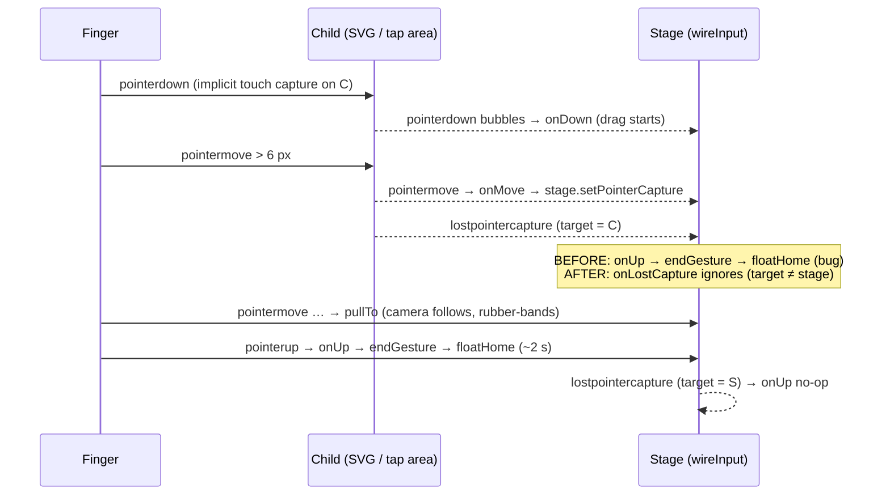

# Plan: Pip's room camera — touch drag cancels after a few px and floats back to Pip

Plan folder: `.claude/contract/MPP-41-pip-camera-touch-drag-capture/`
Execution status: see `tasks.md` in this folder.

---

## Part 1 — Alignment

### Task reference
Jira **MPP-41** (Bug, High, parent epic MPP-15, relates to MPP-39). Summary: *"Pip's room camera: touch drag cancels after a few px and floats back to Pip"*.

Ticket content (condensed, verbatim where it matters):

- **Problem:** Dragging to look around Pip's room does not work on a phone. The camera moves by a pixel or so and then immediately floats back to Pip, at any zoom level. Panning (MPP-39 AC 9–13) is effectively broken on touch devices.
- **Root cause (from the ticket, `client/src/hooks/usePipCamera.js`):**
  1. On touch, the browser implicitly captures the pointer to the element under the finger (the room SVG or a tap area inside the stage).
  2. Once the drag passes the 6 px tap threshold, the hook calls `stage.setPointerCapture(e.pointerId)` (line ~198), which moves capture from that child to the stage.
  3. The child then fires `lostpointercapture`, which bubbles up to the stage. The stage listens for `lostpointercapture` with `onUp` (line ~266).
  4. `onUp` treats it as a release: it clears the drag and calls `endGesture` → `floatHome`.
- **Suggested fix:** `const onLostCapture = e => { if (e.target === stage) onUp(e) }`, registered for `lostpointercapture` instead of `onUp`.
- **Expected behaviour:** the camera follows the finger with its trail and rubber-bands past the room edge; it only floats back to Pip ~2 s after the finger is lifted.
- **Dependencies & risks:** pinch-zoom shares the same pointer handlers — re-test pinch and the tap-to-open fridge/cabinet (click swallow after a drag). The wide-desktop "no pan range at 1×" issue is explicitly **not** part of this bug.

### Restated goal
Make one-finger drag-to-pan work on touch devices in Pip's room. Today, the moment a touch drag crosses the tap slop, the hook moves pointer capture onto the stage; the child that held the browser's implicit touch capture fires a bubbling `lostpointercapture`, which the stage mistakes for a finger lift and ends the gesture. The fix makes the stage end a gesture on `lostpointercapture` only when the stage itself lost capture, so a capture hand-off from a child is ignored and the drag continues until the real `pointerup` / `pointercancel`.

### In scope
- `usePipCamera.js` → `wireInput`: a dedicated `lostpointercapture` handler that only forwards to `onUp` when `e.target === stage`.
- Manual re-test on touch of drag, rubber-band, float-home-after-release, pinch-zoom, and tap-after-drag click swallowing (fridge / cabinet tap areas).
- PATCH version bump + CHANGELOG line.

### Explicitly out of scope
- Wide-desktop windows at 1× having no horizontal pan range (`centreRange`) — the ticket calls this a separate, lower-priority issue.
- Any change to camera feel (trail, rubber-band, settle timing), constants in `constants/petRoom.js`, or zoom persistence.
- Refactoring `wireInput` into smaller pieces or adding a frontend test harness.

### Pattern Reference
None supplied beyond the ticket's suggested fix. Reference chosen: the existing `wireInput` listener-table pattern in `foodbytes-app/client/src/hooks/usePipCamera.js:265-277` (one named arrow handler per event, registered and removed via the `listeners` array) — the new handler follows it exactly.

### Constraints flagged on the brief
- Pinch-zoom shares the pointer handlers — must keep working.
- Click swallowing after a drag (tap areas for fridge / cabinet must not open when a drag ends on them) — must keep working.
- Touch is the primary device for this screen.

### Assumptions made
- **Fix shape = the ticket's suggested `e.target === stage` guard**, not removing the `lostpointercapture` listener. Rationale: the stage still needs to end the gesture if the browser genuinely revokes *its* capture (e.g. the element is hidden or the pointer is captured elsewhere) without a `pointerup`.
- **No change to `onUp` itself.** When the stage loses capture after a real release, `pointerup` already ran and deleted the pointer, so the forwarded call is a harmless no-op (`drag` is null, `pinch` is null). Rationale: keeps the fix to one line of behaviour.
- **Version bump is PATCH** (issue type Bug).
- **Verification is manual on a phone (or Chrome DevTools touch emulation) plus `npm run build`.** Rationale: no frontend test runner exists, and `wireInput` is a closure over DOM listeners with no pure seam worth extracting for one guard.

### Cross-code alignment audit (FE ↔ BE ↔ DB)
Skipped — frontend-only event-handling fix; no persistence, endpoint, DTO or schema touched.

---

## Part 2 — Technical design

### Approach
Add one handler inside `wireInput`:

```js
// A child's implicit touch capture moving to the stage (setPointerCapture in onMove) fires a bubbling
// lostpointercapture on that child; only the stage's own loss of capture ends the gesture.
const onLostCapture = e => {
  if (e.target === stage) onUp(e)
}
```

and register `['lostpointercapture', onLostCapture]` in the `listeners` table in place of `['lostpointercapture', onUp]`. Because detach iterates the same table, removal is automatic. `pointerup` and `pointercancel` keep calling `onUp` directly — those are real ends of the gesture regardless of target.

**Roads not taken.** (1) *Drop the `lostpointercapture` listener entirely* — simplest, but loses the safety net for a capture revoked without `pointerup`, which would leave `is-dragging` set and the camera stuck off-Pip. (2) *Call `e.target.releasePointerCapture` on the child before capturing on the stage* — still fires `lostpointercapture` on the child, so it doesn't fix anything by itself. (3) *Never capture on the stage* — the stage has `touch-action: none` and touch pointers already stay with the original target, but mouse drags that leave the stage would then lose `pointermove`/`pointerup`, regressing desktop. (4) *Check `e.pointerId === drag.id && stage.hasPointerCapture(e.pointerId)`* — equivalent result, more code; the target check expresses the intent directly.

**Why the release path is still correct.** After the fix, a touch drag: `pointerdown` (child gets implicit capture) → `pointermove` past slop → `stage.setPointerCapture` → child `lostpointercapture` (ignored) → further `pointermove`s pan → `pointerup` → `onUp` → `endGesture` (sets `swallow`, floats home) → stage `lostpointercapture` → `onUp` no-op. Pinch: neither finger triggers `setPointerCapture` (drag is nulled when the 2nd pointer lands), so only release-time `lostpointercapture` events arrive, from children, and are now ignored — `pointerup` already handled them.

### Skills to invoke during execution
- `react-frontend` — owns `client/src/hooks/` conventions: comment density, no `console.log`, file-order, and the "state what you verified" rule (no frontend test runner).

No `.claude/rules/` file applies (no recipe, ingredient, macro, variant or migration work).

### Diagram


### Data shapes
No schema or contract changes. The only new identifier is the local handler `onLostCapture(e: PointerEvent): void` inside `wireInput` in `foodbytes-app/client/src/hooks/usePipCamera.js`.

### Runtime quality notes
Frontend-only; dimensions mapped to the browser runtime.

- **Resource cleanup:** the new handler is registered through the existing `listeners` array, so the detach returned by `wireInput` removes it with the others. No new timers or frames.
- **Concurrency / ordering:** single-threaded event loop; the relevant ordering is `lostpointercapture` (child) arriving between `setPointerCapture` and the next `pointermove`. The guard makes that event inert. On release, `pointerup` precedes the stage's `lostpointercapture`, and the second `onUp` call is idempotent (pointer already deleted, `drag`/`pinch` null).
- **Allocation / cost behaviour:** trivial — one comparison per `lostpointercapture`. No re-renders (the camera lives in refs).
- **Error paths:** unchanged. The existing `try/catch` around `setPointerCapture` still covers a pointer that has already gone. If the stage's own capture is revoked without `pointerup`, the guard passes it through to `onUp` as before.

### Risks and judgement calls
- **Browser variance in implicit capture.** iOS Safari historically did not implicitly capture touch pointers to the hit-test target the way Chrome Android does. The fix is correct either way (no child `lostpointercapture` → nothing to ignore), but the developer should re-test on the phone they actually use.
- **DevTools touch emulation may not reproduce the bug faithfully.** Treat a real phone as the acceptance test; DevTools is a smoke check only.
- **Click swallow after a drag ending on a tap area** depends on `endGesture` running on the real `pointerup` — which is exactly the path the fix restores. Must be re-tested per the ticket.
- **Desktop pan range at 1×** remains broken on wide windows; out of scope, and the developer may want a separate ticket if one doesn't exist.
- **Branch:** the repo is on `AI_Master`; the executor should branch per usual practice before committing (not prescribed here).
