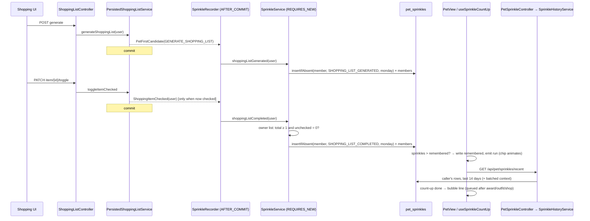

# Plan: Sprinkles — Earn tab, weekly shopping-list rewards, and a count-up on returning to Pip

Plan folder: `.claude/contract/MPP-42-sprinkles-earn-tab-shopping-rewards/`
Execution status: see `tasks.md` in this folder.

---

## Part 1 — Alignment

### Task reference

Jira **MPP-42** (Story, Low, parent epic MPP-15, relates to MPP-25): "Sprinkles: Earn tab in the Shop, weekly shopping-list rewards, and a count-up when you return to Pip". Acceptance criteria, verbatim in substance:

**Earn tab (Shop)**
1. The Shop has a fourth tab, **✨ Earn**, after Upgrades | Decor | Walls & floors. The Shop still opens on Upgrades, and the arrow keys cycle all four tabs (existing ShopTabs WAI-ARIA behaviour).
2. The Earn tab lists every way to earn, with its amount, in this order: Eat a planned meal +10 (B/L/D ticked eaten on its day or any day after, "Late still counts"); Eat it on time +5 bonus (ticked on its day, by its meal time); Make the extra homemade +5; Plan a full week +20 (Mon–Sun, every day with B/L/D; pays both people on a shared plan); Make a shopping list +10 (new; once a week, pays both people); Finish the shopping +15 (new; once a week, pays both people).
3. The amounts come from the server, not hard-coded client copy, so retuning `SprinklePolicy` updates the tab.
4. An "A good week" box shows a worked total (21 meals 210, all on time 105, full week 20, shopping made and finished 25 = about 360) computed from the same server amounts.
5. "Your recent sprinkles" lists the caller's own ledger rows from the last 14 days, newest first, earnings green +, spends red −. Each row has a plain description ("Breakfast eaten · on time · homemade", "Bought the Mini fridge", "Full week planned (13–19 Oct)", "Shopping finished") and a relative day (Today / Yesterday / weekday / date). One meal's MEAL_EATEN + MEAL_ON_TIME + HOMEMADE_EXTRA rows group into one line.
6. "Good to know": snacks and extras on their own don't pay; ticking before the meal's day doesn't pay; a late meal pays 10 but not the on-time bonus; each meal pays once and un-ticking doesn't take sprinkles back; your meals pay you, a full week and the shopping pay you both; shopping rewards pay once per Mon–Sun week, however many lists you make.
7. On the other three tabs the old footnote becomes "How do I earn sprinkles? See Earn →", which switches to the Earn tab.

**Meal rewards (unchanged)**
8. Meal payouts do not change; only the explanation is new.

**Shopping-list rewards (backend)**
9. New `SprinkleSource` values `SHOPPING_LIST_GENERATED` (+10) and `SHOPPING_LIST_COMPLETED` (+15), `source_id` = the Mon–Sun week's Monday as `LocalDate#toEpochDay`. `chk_pet_sprinkles_source` extended by a migration.
10. Generating pays SHOPPING_LIST_GENERATED once per Mon–Sun week (Europe/Dublin, `HabitStreakPolicy.ZONE`) to every member of the shared plan. Regenerating in the same week pays nothing. Hook = the existing GENERATE_SHOPPING_LIST event in `SprinkleRecorder` (a no-op today).
11. Finishing = the list has ≥1 item and every item is checked. Pays SHOPPING_LIST_COMPLETED once per Mon–Sun week to every plan member. Un-check/re-check, or a second list finished the same week, pays nothing (`uk_pet_sprinkles`).
12. A sprinkles failure never fails or rolls back the shopping-list request (AFTER_COMMIT listener + catch).

**Recent read (backend)**
13. `GET /api/pet/sprinkles/recent` returns the caller's own ledger rows from the last 14 days (source type, amount, created time, plus context: meal type + date for meals, station or decor item for spends, week Monday for weekly rewards), plus the server's earn amounts for AC 2–4. Never another person's rows.

**Count-up on returning to Pip**
14. The client remembers the last balance seen on the Pip tab, per user id, per device (localStorage in try/catch; blocked storage just skips the animation).
15. If the Pip tab opens with a higher balance: the header chip (`PipHeader` `.pip-header-sprinkles`) shows the old number; after 0.4 s it turns gold, bumps (scale 1.14) and counts up over ~0.7–1.6 s (ease-out cubic, longer for bigger gains); a gold "+N ✨" pill pops out under the chip and floats away over ~1.9 s with a small sparkle burst; the remembered value is updated.
16. When the count-up finishes, Pip's bubble says what was earned, from the recent read ("+35: 2 meals, both on time ✨", "+120! Full week + shopping 🛒✨"), in the existing bubble slot, queued after any award line rather than replacing it.
17. No animation when equal or lower, or on a first visit on a device; the number just updates and the remembered value is set. Spending never counts down.
18. `prefers-reduced-motion`: the number jumps, "+N" shows 2 s without moving, no bump, no sparkles.
19. One polite live announcement: "You earned N sprinkles. Total T sprinkles." The chip's aria-label always holds the final balance.

**Housekeeping**
20. Story → MINOR bump in `client/package.json`, `pom.xml`, `CHANGELOG.md`. `npm run check:version` and `mvn test` pass, with new tests for the two shopping sources (pay once per week, pay both plan members, no pay on regenerate or re-check) and for the recent endpoint (own rows only, 14-day window).

Design asset: approved mockup `C:\Users\jossd\Downloads\pip-sprinkles-earn-mockup.html`, Version B (with recent sprinkles).

### Restated goal

Make sprinkles legible and rewarding. On the backend, the shopping list starts paying (once per Mon–Sun week, to everyone on the shared plan, for generating a list and for checking every item off), and a new read endpoint returns the caller's last 14 days of ledger rows with enough context to describe them, plus the server's payout amounts. On the frontend, the Shop gains a fourth **✨ Earn** tab that explains every earning rule using those server amounts, works out a "good week" total, and shows the recent history. Back on the Pip tab, the header's sprinkles chip counts up from the last balance this device saw, with a gold "+N ✨" pill, a sparkle burst and a Pip bubble line summarising what was earned. The chip respects reduced motion and makes one polite screen-reader announcement. Meal payouts are untouched.

### In scope

- Migration: widen `pet_sprinkles.source_type` to `VARCHAR(32)` and re-declare `chk_pet_sprinkles_source` with the two new values (idempotent, MPP-15 go-live row).
- `SprinkleSource` + `PetSprinkle` length, `SprinklePolicy` amounts and the week helper.
- `SprinkleService.shoppingListGenerated` / `shoppingListCompleted`, paying every plan member under the week key.
- `SprinkleRecorder` routes GENERATE_SHOPPING_LIST, plus a new `ShoppingItemChecked` event published by `PersistedShoppingListService.toggleItemChecked`.
- `GET /api/pet/sprinkles/recent` → `RecentSprinklesDTO` (entries + rates) via a new `SprinkleHistoryService` and `PetSprinkleController`.
- Backend tests: shopping sources (once per week, both members, regenerate / re-check pay nothing, not-finished pays nothing), recorder routing + swallowed failure, history (own rows only, 14-day window, context lookup), controller (401, 200).
- Frontend: Earn tab (rates, good week, recent list with all four async states, good to know), footnote link to Earn on the other tabs, `SHOP_TABS` gains Earn.
- Frontend: `useRecentSprinkles`, `sprinklesSeenStore`, `useSprinkleCountUp`, `SprinklesChip` (count-up, gold bump, gain pill, sparkles, live region), the Pip bubble line queued after award / outfit / shop lines.
- Pure helpers in `utils/sprinkleHistory.js` pinned by `sprinkleHistory.check.mjs` (`npm run check:sprinkles`).
- Version bump (MINOR) + CHANGELOG.

### Explicitly out of scope

- Any change to existing payout amounts or the late-meal rule.
- Snack-free / alcohol-free day sprinkles or any variety reward (MPP-11).
- Cross-device sync of the last-seen balance.
- Back-paying shopping rewards for lists generated or finished before release (no backfill in the migration).
- Paging or a "show more" on the recent list beyond 14 days.
- Moving the shop's tab state to reset on close (the Shop already opens on Upgrades per page load; unchanged).
- Fixing the MPP-15 tracker's "Applied to Railway" column (see Risks).

### Pattern Reference

None supplied as file paths beyond the ticket's names; chosen references:
- Backend payouts: `SprinkleService.planned` (pay every `findPlanMemberIds` member, `REQUIRES_NEW`), `SprinkleRecorder` (AFTER_COMMIT + catch), `PetFirstCandidate` (event record).
- Backend controller: `PetStationController` (thin, `{error}` 401 shape, `@AuthenticationPrincipal`), `PetStationControllerTest` (`@WebMvcTest` + direct call).
- Migration: `2026-10-14-mpp26-pet-station-levels.sql` (information_schema-guarded DROP CHECK, re-ADD superset).
- Frontend tabs/sheet: `ShopView.jsx`, `ShopTabs.jsx`, `ShopDecorTab.jsx`, `constants/petDecor.js` (`SHOP_TABS`).
- Per-user localStorage: `utils/awardSeenStore.js` (memory map + try/catch).
- Bubble queue: `usePetAwards` (queue + `AWARD_BUBBLE_MS`), `PetView` announcement chain, `pipBubble`.
- Reduced motion: `utils/reducedMotion.js`.
- Node smoke checks: `utils/pipBubble.check.mjs` + `check:*` npm scripts.
- Visuals: the approved mockup (Version B), `ShopView.css` tokens (`#e3dcf3`, `#fff7d6`, `#7c5cd6`), `PetView.css` `.pip-header-sprinkles`.

### Constraints flagged on the brief

- Amounts are server-sourced (AC 3); the client keeps no copy of any number.
- Shopping rewards pay **every plan member** (MPP-33 split), keyed by the week's Monday epoch day; `uk_pet_sprinkles` is the once-per-week guarantee.
- Week = Mon–Sun in Europe/Dublin (`HabitStreakPolicy.ZONE`).
- Sprinkle failure must never fail or roll back the shopping request (AFTER_COMMIT + catch).
- "Completed" must be re-evaluated server-side after commit, never trusted from the client's optimistic toggle.
- Recent endpoint returns only the caller's rows.
- localStorage in try/catch; reduced motion; one polite live announcement; aria-label = final balance.
- MPP-15 local-first: idempotent migration, go-live tracker row, `build-golive.mjs`, apply to local `foodbytes-db` only.
- MPP-11: consistency rewards only (shopping is consistency work, not variety).

### Assumptions made

- **Week of a shopping reward = the Dublin week of *today* (when the action happens), not the list's `startDate`.** The AC pins the zone, which only matters for "now"; using the list's dates would let someone farm by generating lists for future weeks.
- **The shopping list's owner is the effective meal-plan owner** (`ExtraChoiceService.resolveOwnerId`, identical to `PersistedShoppingListService.getEffectiveMealPlanOwnerId`), and members = `UserRepository.findPlanMemberIds(owner)`, same as FULL_WEEK.
- **Completion uses a new event `ShoppingItemChecked(Long userId)`**, published by `toggleItemChecked` only when the toggle leaves the item checked, not a new `FirstKey`. A `FirstKey` would leak into MPP-24's firsts and its exhaustive switches. The listener re-reads the list after commit.
- **`source_type` is widened to `VARCHAR(32)`.** The ticket's names are 23 characters long and the column is `VARCHAR(16)` locally and on Railway, so inserts would fail without this. `PetSprinkle.sourceType` `length` goes 16 → 32 to match.
- **New controller `PetSprinkleController` at `/api/pet/sprinkles`** (one controller per pet sub-resource, like `PetStationController`), backed by a new `SprinkleHistoryService` so `SprinkleService` stays the write/balance service.
- **Response shape:** `RecentSprinklesDTO { List<SprinkleEntryDTO> entries; SprinkleRatesDTO rates; }`. Each entry: `sourceType, amount, createdAt (Instant, UTC), mealKey, planDate, station, level, decorItem, weekStart`, where the context fields are nullable. `rates` also carries `mealsPerWeek` (7 × 3 = 21), so the good-week sum is server-driven too.
- **Context lookups are batched**: one `findAllById` for meal entries, one for decor rows. Station and level are decoded from `source_id` (`code*10+level`). A deleted entry or decor row gives null context, and the client falls back to a generic description.
- **14-day window = `created_at >= now(UTC) − 14 days`**, ordered `created_at DESC, id DESC`, via a derived repository method.
- **The Earn tab fetches on open** (`useRecentSprinkles({ enabled: tab === EARN })`, AbortController). No caching in `PetContext`, because the data belongs to that one feature.
- **The bubble summary walks positive rows newest first until their sum reaches the gain N**, rather than comparing timestamps with the client clock. Format rules are pinned in `sprinkleHistory.check.mjs`, with "+N sprinkles! ✨" as the fallback when nothing matches.
- **The remembered balance is written as soon as the decision is made** (start of the animation, or immediately for equal / lower / first visit), not at the end. A refetch or unmount mid-animation then can't replay it. The animation itself still runs to the end.
- **The count-up compares on every change of `sprinkles` while on the Pip tab**, so the first value after mount is "the tab opened". An in-tab increase (e.g. from `refreshPet`) also animates, which is harmless and consistent.
- **The sprinkle line holds while a cook scene or any higher announcement (award / outfit / shop) is showing**, and its `AWARD_BUBBLE_MS` timer starts only once it is actually shown. That is how "queues after any award line" is honoured.
- **Earn-tab rows show "New" tags on the two shopping rows**, as in the ticket's "(new)". Copy lives in a new `constants/petSprinkles.js`.

### Cross-code alignment audit (FE ↔ BE ↔ DB)

- **The MCP points at Railway, not local**: `SELECT DATABASE(), @@version` → `railway`, `9.7.2`.
- **Railway already has the MPP-25..27 ledger**: `pet_sprinkles.source_type` = `varchar(16)`; `chk_pet_sprinkles_source` = `source_type in ('MEAL_EATEN','MEAL_ON_TIME','FULL_WEEK','HOMEMADE_EXTRA','STATION_UPGRADE','DECOR_PURCHASE')`; 27 ledger rows. The MPP-15 tracker still says "—" for Railway on rows 8–10, so the tracker is stale. The new migration is idempotent and works either way.
- **Local `foodbytes-db` `SHOW COLUMNS FROM pet_sprinkles`**: `id bigint PK`, `user_id bigint NOT NULL`, `source_type varchar(16) NOT NULL`, `source_id bigint NOT NULL`, `amount int NOT NULL`, `created_at timestamp NOT NULL DEFAULT CURRENT_TIMESTAMP`. Index `uk_pet_sprinkles (user_id, source_type, source_id)` leads with `user_id`, so the per-user 14-day read is a range scan on that prefix plus a filter on `created_at`. Locally there are 4 rows, all `MEAL_EATEN`, with max length 10.
- **Widening is lossless**: the longest existing value is `STATION_UPGRADE` (15 chars), which fits in 32. The new CHECK is a strict superset of the current one, so every existing row passes.
- **Name chain**: DB `source_type` ↔ `PetSprinkle.sourceType @Column(name="source_type", length=32)` ↔ `SprinkleEntryDTO.sourceType` (enum name string) ↔ JSON `sourceType` ↔ client `entry.sourceType`. `created_at` ↔ `PetSprinkle.createdAt` (LocalDateTime, UTC) ↔ `SprinkleEntryDTO.createdAt` (Instant, matching `FirstStatusDTO.earnedAt`) ↔ JSON ISO-8601 `Z` string.
- **Shopping schema** (local): `shopping_lists (id, user_id UNI, start_date, end_date, generated_at)` and `shopping_list_items (…, shopping_list_id, is_checked tinyint(1) DEFAULT 0)`. There is one list per owner (`user_id` unique), which suits "the owner's list is complete". 5 lists and 2 linked users locally.
- **Unapplied migrations**: none outstanding locally. The latest local migration is MPP-40's 2026-10-15 file, which is in the tracker at row 11.
- **No conflicting switch**: `SprinkleSource` has no exhaustive `switch` in main code (grep), so adding two values breaks nothing. `SprinkleRecorder`'s `switch` is on `FirstKey`.

---

## Part 2 — Technical design

### Approach

**Backend payouts.** `SprinkleService` gains two `REQUIRES_NEW` methods. `shoppingListGenerated(actorId)` resolves the plan owner and pays `SHOPPING_LIST_GENERATED` to every member under `source_id = SprinklePolicy.weekOf(today).toEpochDay()`. `shoppingListCompleted(actorId)` does the same for `SHOPPING_LIST_COMPLETED`, but only after re-reading the owner's list from the DB: two count queries, total items ≥ 1 and unchecked = 0. Both reuse the existing `pay` → `insertIfAbsent` (ON DUPLICATE KEY no-op), so regenerating, re-checking or finishing a second list in the same week is a silent no-op enforced by `uk_pet_sprinkles`, not by application logic. The shared "pay each member" loop already in `planned` is extracted into a private `payPlan(ownerId, source, sourceId, amount)` helper used by all three.

**Hooks.** Generation already publishes `PetFirstCandidate.of(userId, GENERATE_SHOPPING_LIST)`, and `SprinkleRecorder` turns that no-op branch into `shoppingListGenerated`. Completion has no event today. `toggleItemChecked` publishes a new record `ShoppingItemChecked(userId)` whenever the toggle lands on checked, and `SprinkleRecorder` gets a second `@TransactionalEventListener(AFTER_COMMIT)` method with the same catch-and-warn. We considered and rejected computing completeness inside the toggle transaction and publishing only on completion. That trusts the pre-commit state the ticket warns about, and two people checking the last two items on two devices could each see "one left". Re-reading after commit in a fresh transaction sees both commits.

**Recent read.** The new `SprinkleHistoryService.recent(userId)` (`@Transactional(readOnly = true)`) loads the caller's rows since `now − 14 days`. It enriches them with two batched lookups (meal entries → meal key + plan date; decor owned → item key) and pure decoding (station/level from `source_id`; week Monday from epoch day for FULL_WEEK and both shopping sources). It returns the rows alongside `SprinkleRatesDTO` built from `SprinklePolicy` constants. `PetSprinkleController` is a thin `GET /api/pet/sprinkles/recent` using the principal's id only, so no request parameter can ever name another user. Grouping and wording stay on the client, which owns copy (labels like "Mini fridge" and decor names already live in client constants). The server sends structured context, not sentences.

**Frontend.** The Earn tab is `ShopEarnTab` (rates list + good-week box + "Good to know") with a child `EarnRecentList` (loading / error+retry / empty / list), both fed by `useRecentSprinkles`. All grouping, description, relative-day and summary logic lives in pure `utils/sprinkleHistory.js`, pinned by a node check script because there is no test runner. The header count-up is split in two so animation frames stay local. `useSprinkleCountUp({ userId, sprinkles, hold })` in `PetView` reads and writes `sprinklesSeenStore`, decides animate or jump, fetches the recent read only when there is a gain, and emits a `run`, the live text and (later) the bubble `line`. `useCountUpNumber({ run, reduced })` inside `SprinklesChip` drives the `requestAnimationFrame` ease-out-cubic count, which is cancelled in cleanup. `SprinklesChip` renders the gold/bump class, the gain pill, the sparkles and a visually hidden live region, and `PipHeader` swaps its inline chip for it. In `PetView`, the hook's `line` joins the announcement chain after the shop line, with `hold` set while a cook scene or a higher announcement is showing. That queues it instead of replacing anything. CSS for the new pieces lives in new per-component files (`ShopEarnTab.css`, `SprinklesChip.css`), because `ShopView.css` is already 346 lines.

### Skills to invoke during execution

- `java-backend`: the layering for `SprinkleService` / `SprinkleHistoryService` / `PetSprinkleController`, DTOs (no entities on the wire), `@AuthenticationPrincipal`, `@Transactional` boundaries, the migration contract, and Mockito / `@WebMvcTest` tests.
- `react-frontend`: the Earn tab, hooks, `SprinklesChip`, the service call through `services/api.js`, the four async states, AbortController, localStorage try/catch, reduced motion, 44 px targets, the 400-line budget, constants in `src/constants/`, and node checks instead of a test runner.

Rules: no `.claude/rules/` file applies (no recipe, ingredient, macro or variant data is touched). The MPP-15 local-first migration rule in `/fb-plan` → "Schema changes" applies.

### Diagram



### Data shapes

#### Migration `foodbytes-app/database/migrations/2026-10-15-mpp42-sprinkles-shopping-sources.sql`

```sql
ALTER TABLE pet_sprinkles MODIFY source_type VARCHAR(32) NOT NULL;   -- idempotent by nature
-- information_schema-guarded DROP CHECK chk_pet_sprinkles_source (as MPP-26), then:
ALTER TABLE pet_sprinkles ADD CONSTRAINT chk_pet_sprinkles_source CHECK (source_type IN
  ('MEAL_EATEN','MEAL_ON_TIME','FULL_WEEK','HOMEMADE_EXTRA','STATION_UPGRADE','DECOR_PURCHASE',
   'SHOPPING_LIST_GENERATED','SHOPPING_LIST_COMPLETED'));
```
No backfill. Go-live tracker row 12.

#### Entity / enum / policy

- `SprinkleSource`: `+ SHOPPING_LIST_GENERATED, SHOPPING_LIST_COMPLETED` (source_id = week Monday epoch day).
- `PetSprinkle.sourceType`: `@Column(name = "source_type", nullable = false, length = 32)`.
- `SprinklePolicy`: `public static final int SHOPPING_LIST_GENERATED = 10; SHOPPING_LIST_COMPLETED = 15; RECENT_DAYS = 14;` `public static int mealsPerWeek()` = `WEEK_DAYS * PlanStreakPolicy.MAIN_MEAL_KEYS.size()`; `static LocalDate weekOf(LocalDate day)` = previousOrSame Monday.
- `RoomStation.fromCode(int code)`; `StationPolicy.stationOf(long sourceId)` → `RoomStation`, `StationPolicy.levelOf(long sourceId)` → `int`.

#### Event

- `com.foodbytes.service.ShoppingItemChecked`: `public record ShoppingItemChecked(Long userId) {}`.

#### Repositories

- `PetSprinkleRepository`: `List<PetSprinkle> findByUserIdAndCreatedAtGreaterThanEqualOrderByCreatedAtDescIdDesc(Long userId, LocalDateTime since);`
- `ShoppingListItemRepository`: `long countByShoppingListId(Long shoppingListId);` `long countByShoppingListIdAndIsCheckedFalse(Long shoppingListId);` (derived via the `shoppingList.id` path; `deleteByShoppingListId` already proves the path resolves).

#### Services

- `SprinkleService` (constructor gains `ShoppingListRepository`, `ShoppingListItemRepository`):
  - `@Transactional(propagation = REQUIRES_NEW) void shoppingListGenerated(Long actorId)`
  - `@Transactional(propagation = REQUIRES_NEW) void shoppingListCompleted(Long actorId)`
  - `private void payPlan(Long ownerId, SprinkleSource source, long sourceId, int amount)`
- `SprinkleHistoryService` (new): `@Transactional(readOnly = true) RecentSprinklesDTO recent(Long userId)`; deps `PetSprinkleRepository`, `MealPlanEntryRepository`, `PetDecorOwnedRepository`, `Clock`.

#### DTOs (new, Lombok `@Data @NoArgsConstructor @AllArgsConstructor`)

```java
public class RecentSprinklesDTO { private List<SprinkleEntryDTO> entries; private SprinkleRatesDTO rates; }
public class SprinkleEntryDTO {
    private String sourceType;   // SprinkleSource name
    private int amount;          // + earning, − spend
    private Instant createdAt;   // UTC
    private String mealKey;      // MEAL_EATEN / MEAL_ON_TIME / HOMEMADE_EXTRA, null if the entry is gone
    private LocalDate planDate;  // same
    private Long entryId;        // meal_plan_entries.id for the three meal sources (client groups on it)
    private String station;      // STATION_UPGRADE: RoomStation.key()
    private Integer level;       // STATION_UPGRADE: new level
    private String decorItem;    // DECOR_PURCHASE: item_key, null if the row is gone
    private LocalDate weekStart;  // FULL_WEEK / SHOPPING_LIST_*: Monday
}
public class SprinkleRatesDTO {
    private int mealEaten; private int onTimeBonus; private int homemadeBonus; private int fullWeek;
    private int shoppingListGenerated; private int shoppingListCompleted; private int mealsPerWeek;
}
```

#### HTTP contract

`GET /api/pet/sprinkles/recent` → 200 `RecentSprinklesDTO`; 401 `{ "error": "Not authenticated" }` without a principal. JSON example:
```json
{ "entries": [ { "sourceType": "MEAL_EATEN", "amount": 10, "createdAt": "2026-10-15T08:02:11Z", "mealKey": "breakfast", "planDate": "2026-10-15", "entryId": 812, "station": null, "level": null, "decorItem": null, "weekStart": null } ],
  "rates": { "mealEaten": 10, "onTimeBonus": 5, "homemadeBonus": 5, "fullWeek": 20, "shoppingListGenerated": 10, "shoppingListCompleted": 15, "mealsPerWeek": 21 } }
```

#### Frontend modules

- `constants/petSprinkles.js`: `SPRINKLES_SEEN_STORAGE_KEY = 'foodbytes.pip.sprinklesSeen'`, `EARN_TAB_LABEL = '✨ Earn'`, `EARN_WAYS` (ordered `{ key, icon, title, detail, rateKey, bonus?, isNew? }`, six rows per AC 2), `GOOD_TO_KNOW` (six strings, AC 6), `EARN_FOOT_LINK = 'How do I earn sprinkles? See Earn →'`, recent-list copy (`RECENT_TITLE`, `RECENT_EMPTY`, `RECENT_ERROR`), timings `COUNT_UP_DELAY_MS = 400`, `COUNT_UP_MIN_MS = 700`, `COUNT_UP_MAX_MS = 1600`, `GAIN_PILL_MS = 1900`, `GAIN_PILL_REDUCED_MS = 2000`, `SPRINKLES_LIVE_TEXT = (n, total) => …`.
- `constants/petDecor.js`: `SHOP_TAB_KEYS.EARN = 'earn'`; `SHOP_TABS` gains `{ key: EARN, label: EARN_TAB_LABEL }` last. `SHOP_FOOTNOTE` in `petShop.js` is removed (replaced by `EARN_FOOT_LINK`).
- `services/petService.js`: `getRecentSprinkles({ signal })` → `GET /pet/sprinkles/recent`.
- `utils/sprinkleHistory.js` (pure, node-checkable): `groupRecent(entries) → [{ key, amount, text, createdAt }]`, `describeLine(group)`, `relativeDay(isoInstant, todayISO)`, `goodWeek(rates) → { meals, onTime, fullWeek, shopping, total }`, `countUpDuration(gain)`, `earnedLine(entries, gain)`.
- `utils/sprinklesSeenStore.js`: `readSeenSprinkles(userId) → number|null`, `writeSeenSprinkles(userId, n)` (memory map + try/catch, as `awardSeenStore`).
- `hooks/useRecentSprinkles.js`: `({ enabled }) → { data, loading, error, retry }`.
- `hooks/useSprinkleCountUp.js` (called in `PetView`, decides): `({ userId, sprinkles, hold }) → { run: { id: number, from: number, to: number, gain: number } | null, reduced: boolean, liveText: string|null, line: string|null }`. A new `run` (incremented `id`) means "animate now". `line` appears `COUNT_UP_DELAY_MS + countUpDuration(gain)` after the run starts (when not `hold`), and clears after `AWARD_BUBBLE_MS`.
- `hooks/useCountUpNumber.js` (called inside `SprinklesChip`, animates): `({ run, reduced }) → { value: number|null, phase: 'idle'|'waiting'|'counting'|'done' }`. `value` is null when idle, and the chip then shows `sprinkles`.
- `components/pet/SprinklesChip.jsx` + `SprinklesChip.css`; `components/pet/room/ShopEarnTab.jsx`, `EarnRecentList.jsx`, `ShopEarnTab.css`.
- `package.json` script `"check:sprinkles": "node src/utils/sprinkleHistory.check.mjs"`.

### Runtime quality notes

- **Resource cleanup:** Backend: the new reads are `readOnly` transactions, and the payout methods are `REQUIRES_NEW`, closed by Spring. Frontend (browser runtime: single-threaded event loop, effect cleanup): `useRecentSprinkles` aborts its `AbortController` on unmount or when it is disabled. `useSprinkleCountUp` cancels its `requestAnimationFrame` and both `setTimeout`s (start delay, pill) in effect cleanup. The bubble-line timer is cleared when `hold` flips or the component unmounts.
- **Concurrency / ordering:** Two people finishing the shared list at once both fire `shoppingListCompleted`. Each re-reads after its own commit, and `insertIfAbsent` on `uk_pet_sprinkles` makes the second insert a no-op, so nobody is paid twice. Earnings never take `lockWallet`, matching MPP-26's rule that only spends lock. An un-check landing between the check's commit and the listener's read simply means the list isn't complete, so nothing is paid, which is correct. On the client, the remembered balance is written before animating, so a `refreshPet` mid-animation that returns the same balance does not replay it.
- **Allocation / cost behaviour:** The recent read is bounded by user plus 14 days (~21 meals × 3 rows + a few weekly / spend rows per week, so about 150 rows at worst), with two batched `findAllById` lookups and no N+1. The completion check is two `COUNT` queries per item checked, which is trivial. Per-frame state lives only in `useCountUpNumber` inside `SprinklesChip`, so each animation frame (~60 over ≤1.6 s) re-renders the chip alone, never `PetView` or `PetRoom`. `useSprinkleCountUp` in `PetView` changes state a handful of times per run (run start, line shown, line cleared).
- **Error paths:** Payout exceptions are caught in `SprinkleRecorder` and logged at WARN with user and source. The shopping request has already committed, and the user sees nothing. `GET /recent` failure: rates and history come from the same read, so the Earn tab shows the static "Good to know" list plus an error with a Retry button (`role="alert"`) in place of the amounts and history. It never shows an empty list or made-up amounts. In the count-up, a failed recent read means the line falls back to "+N sprinkles! ✨", while the animation itself never depends on the read. A blocked localStorage falls back to memory, so the first visit in a page load does not animate (AC 14). An abort is swallowed, never rendered.

### Risks and judgement calls

- **Column widening is not in the ticket.** The ticket's enum names don't fit `VARCHAR(16)`. The alternative is shorter names (`SHOP_LIST_MADE`, `SHOP_LIST_DONE`), which would contradict AC 9's names. We chose to widen, which is lossless.
- **Week anchor = today's Dublin week, not the list's `startDate`.** If you'd rather reward "the week the list is for", say so: it changes one line, but it opens farming via future weeks.
- **Railway already has `pet_sprinkles`**, with the MPP-26/27 CHECK and 27 rows, while `railway-migrations.md` marks rows 8–10 as not applied. Either someone applied part of the go-live early, or the tracker is stale. The MPP-42 migration is idempotent and goes in the go-live file as row 12. Please reconcile the tracker yourself; this plan does not touch Railway.
- **New event vs a new `FirstKey`.** The ticket names GENERATE_SHOPPING_LIST as the generate hook, and that is used as-is. For completion, the plan adds a separate `ShoppingItemChecked` record rather than a `FirstKey`, so MPP-24's firsts ladder is untouched.
- **Count-up split across a hook and the chip** to keep `PetRoom` from re-rendering every animation frame. This is a deliberate structure choice, not memoisation.
- **Bubble summary heuristic** (newest positive rows until the sum reaches N) can describe slightly different rows if spends and earnings interleaved on another device. That is acceptable for a celebratory line, and it falls back to the generic line.
- **`PersistedShoppingListServiceTest`** uses `@InjectMocks`, so adding the event publish to `toggleItemChecked` needs no constructor change. **`SprinkleServiceTest.setUp`** calls the constructor directly and must gain the two shopping repositories.
- **Manual step (developer):** apply the migration to the local `foodbytes-db`. Railway receives it via `mpp15-railway-golive.sql` at the epic merge, and it must be applied before the merged backend deploys (inserts with the new source names would fail the CHECK and the column length).
