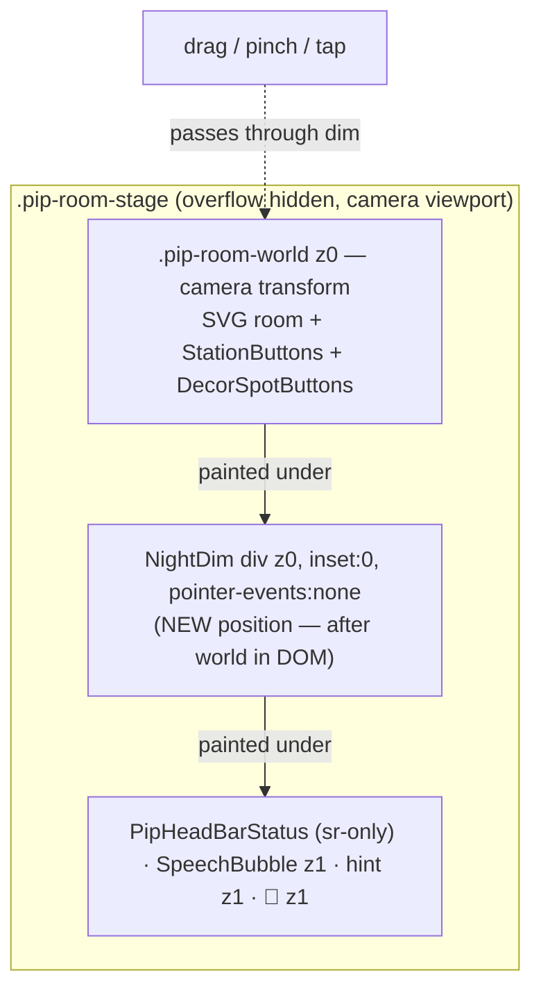

# Plan: Pip room night dim covers the whole stage; curtains line up with the window sill

Plan folder: `.claude/contract/MPP-44-night-dim-and-curtain-alignment/`
Execution status: see `tasks.md` in this folder.

---

## Part 1 — Alignment

### Task reference
Jira **MPP-44** (Bug, priority Low, parent epic MPP-15; relates to MPP-40, and the ticket also cites MPP-39 and MPP-17). Summary: *"Pip room: night dim only covers part of the screen, and curtains don't line up with the window sill."*

Expected behaviour, quoted from the ticket:
- The whole room stage dims at night, wherever the camera is.
- The curtains are centred on the window and stop at the sill.

The ticket's root-cause analysis and suggested fixes:
- **Night dim.** `NightDim` (`roomEffects.jsx:51`) is a `<rect x=0 y=0 width=100% height=100%>` inside an SVG whose viewBox starts at `x -84` (`ROOM_WORLD`, `constants/petRoom.js:33`). It leaves world x −84 to 0 undimmed and overshoots on the right and bottom. Since MPP-39 it also can't extend past the camera-moved `.pip-room-world`. Suggested fix: remove the SVG rect and draw the dim as a stage-level overlay (`position:absolute; inset:0; pointer-events:none`, `NIGHT_DIM_FILL`) placed right after the world layer in `PetRoom.jsx`, so the speech bubble, hint and 🎯 stay above it and dragging still works.
- **Curtains.** The window frame (v 164–232) and the sill (v 158–238, top at h 74) are centred on **v 198**, but both curtains are mirrored about **v 200** (`LINEN_RIGHT = 400 − v`, `GINGHAM_PANELS [[157,172],[228,243]]`, rod v 157–243, `CURTAIN_END_CAPS [156, 242.5]`). Both also hang below the sill top (linen to h 62, gingham to h 66) and paint over the sill's front edge. Suggested fix: centre on v 198 (mirror about 396, rod and end caps roughly v 155–241) and end the panels at h 74. Then check every curtain at each window-related placement.
- **Risks named on the ticket.** The overlay must not catch pointer events, and it must stay out of the shop and picker thumbnails. Version bump: PATCH.

**Confirmed 2026-10-16:** the developer approved a before/after preview rendered from the real room code with the planned edits applied (https://claude.ai/artifact/DT4aLB5avPtEziAih99zp1, copy at `Downloads\mpp44-before-after.html`). That approval covers the curtain geometry in Assumptions and accepts the dimmed "z z" under the stage overlay.

### Restated goal
At night, the dim should tint every pixel of Pip's room stage, wherever the camera has been dragged or zoomed, and it must never block a drag or a tap. The two curtain items (gingham and linen) should be drawn symmetrically about the window's real centre line (v 198), with panels that stop on the sill top rather than covering its front edge. This is a frontend-only fix in `components/pet/room/`. The data, the API and every other decor item stay as they are.

### In scope
- Replace the SVG `<rect>` night dim with an HTML overlay that fills `.pip-room-stage`, sits above the world layer, sits below the bubble, hint and 🎯, and has `pointer-events: none`.
- Re-centre `curtains-gingham` and `curtains-linen` on v 198: the rod, the end caps, the panels or linen outline, the fold lines and the tie-backs.
- End both curtains' panels at the sill top, h 74.
- Manual check of both curtains alongside every sill item and the other window-dressing art, by day and at night, on a phone-width viewport.
- PATCH version bump and a CHANGELOG line.

### Explicitly out of scope
- The roller blind, the window lights and the plant hanger. The ticket confirms they are already centred on 198.
- Any change to `NIGHT_DIM_FILL`'s colour or strength, or to the night window and sky art.
- The camera (`usePipCamera`), its clamping, or the world/stage sizing.
- Thumbnails in the shop and the decor picker. They render decor art outside the stage and never drew `NightDim`, so they need no change.
- Any backend, DB or migration work.

### Pattern Reference
None supplied beyond the ticket's file pointers. I chose these references:
- **Screen-fixed layers inside the stage:** `.pip-room-hint` and `.pip-room-recentre` in `PetRoom.css` (absolute, `z-index: 1`, the hint has `pointer-events: none`). The new overlay copies that shape at `z-index: 0`.
- **Window-centred art:** `roller-blind` (v 162–234, a mirror pair about 198) and `plant-hanger` (v 198) in `decorArtWindow.jsx` show how the corrected curtains should be laid out.
- `react-frontend/SKILL.md` for file order, the 400-line budget, and touch rules.

### Constraints flagged on the brief
- The overlay must not intercept pointer events: drag, pinch, station taps and edit-mode spot taps must still work.
- The overlay must not appear in the shop or picker thumbnails.
- The bubble, the hint and the 🎯 must stay above the dim.
- PATCH bump (the ticket is a Bug).
- The issue appears on phones, so verify at phone width.

### Assumptions made
- **Curtain geometry: the rod spans v 155–241 and the panels sit inside the sill.** The rod moves −2 (v 155–241, dv 86 unchanged), as the ticket suggests. The panels' outer edges sit flush with the sill ends (v 158 and v 238), so nothing hangs past the sill. Gingham panels become `[[158,173],[223,238]]`. The linen outline moves +1 on the left (`[[158,141],[176,141],[171,104],[169,100],[171,96],[178,74],[158,74]]`), and its right side is mirrored as `396 − v`. Rationale: "stop at the sill" reads as no overhang past either sill end, while a rod 3 units wider than the sill on each side still reads as a curtain rod.
- **End caps are mirrored about 198 too.** A cap is `dv 1.5` wide, so its mirror start is `396 − v − 1.5`. The caps become `[154, 240.5]`, which brackets the rod ends at 155 and 241. Rationale: the current caps were asymmetric (one inside the rod end, one outside it).
- **Fold lines and tie-backs keep their offsets from the panel edge.** Linen fold lines go from `[160.5, 164.5, 239.5, 235.5]` to `[161.5, 165.5, 234.5, 230.5]`, with their bottom moved from h 63 to h 75. The linen tie-backs become `158→169` and `238→227`. The gingham stripes and tie-backs are computed from `a` and `b`, so they follow the panel move automatically. The gingham's vertical stripes start at h 74, not 66.
- **The overlay's colour stays a single source.** `NIGHT_DIM_FILL` remains in `roomLayout.js` and reaches the overlay as an inline `background` style. CSS holds only layout. Rationale: CSS can't import the JS constant, and copying the rgba value would create a second source.
- **`NightDim` stays in `roomEffects.jsx` and keeps its name.** It now returns a `<div>`, not an SVG `<rect>`, and moves from inside the `<svg>` to directly after `.pip-room-world` in the stage. Rationale: `roomEffects.jsx` is already the home of the night scene, and the change touches the fewest imports.
- **The overlay is `aria-hidden="true"`.** It is purely decorative. The room's `aria-label` already says Pip is asleep.

### Cross-code alignment audit (FE ↔ BE ↔ DB)
Skipped: no persistence is touched. Decor placements are read, never changed, and the fix is pure render geometry and CSS.

---

## Part 2 — Technical design

### Approach
**Night dim.** The current dim is a child of the room SVG, so the world layer bounds it, and the world layer is exactly `ROOM_WORLD × ROOM_PX_PER_UNIT` px, moved by the camera's transform. An SVG-side fix would not solve the bug. Setting the rect to `x=ROOM_WORLD.x …` fixes only the left strip, and stage area outside the world still stays bright. The dim therefore becomes a sibling of `.pip-room-world` inside `.pip-room-stage`: `position:absolute; inset:0; z-index:0; pointer-events:none`. It sits after the world in the DOM, so it paints over the world at the same `z-index: 0`. It sits below `SpeechBubble` (`.pet-bubble`, z 1), `.pip-room-hint` (z 1) and `.pip-room-recentre` (z 1). `PipHeadBarStatus` is visually hidden, so its order doesn't matter. Pointer events pass through to the stage, so camera drag and pinch keep working, and taps reach the `StationButton`s and `DecorSpotButtons` inside the world. The shop and picker thumbnails render `DECOR_ART` directly and never mount `NightDim`, so they are unaffected.

I considered and rejected an alternative: keep the SVG rect sized to `ROOM_WORLD`, and paint the stage background with the same tint at night. It keeps the "z z" above the dim, but transparent parts of the SVG would then be dimmed twice (by the stage background under them and the rect over them), which leaves a visible seam at the world's edge. Making the world opaque to avoid that adds a background rect and a matching colour to keep in sync. The overlay is the ticket's suggestion and the simpler shape. Its one visible side effect, the white "z z" now being dimmed too, is listed under Risks.

**Curtains.** This is a pure data change in `decorArtWindow.jsx`. Every constant and literal v-coordinate for the two curtain builders moves onto the 198 axis (mirror sum 396), and the panel bottoms rise to the sill top (h 74). The mirror is made explicit with a named constant, `WINDOW_MIRROR = 396` (twice the window centre line), so `LINEN_RIGHT` and the fold-line pairs derive from it rather than repeating a magic number. Both curtains are drawn at u 0.4–2.45, and the sill's front face sits at h 68–74. With the panel bottoms at h 74 they no longer overlap the sill face, so the draw order needs no change.

### Skills to invoke during execution
- `react-frontend`: owns every change here, including the component file order, the 400-line budget (`PetRoom.jsx` is 316 lines today, `decorArtWindow.jsx` 195), the CSS conventions in `PetRoom.css`, the rule that touch interactions must not regress, and the rule to say what was and wasn't verified (there is no frontend test runner).

No `.claude/rules/` file applies: no recipe, ingredient, macro, variant or migration data is touched.

### Diagram


### Data shapes
No schema or contract changes. Code-level shapes:

#### `roomEffects.jsx` → `NightDim`
```jsx
/** AC 4 / MPP-44: the whole stage dims while Pip sleeps — a screen-fixed layer over the camera-moved world. */
export function NightDim() {
  return <div className="pip-room-night-dim" style={{ background: NIGHT_DIM_FILL }} aria-hidden="true" />
}
```

#### `PetRoom.css` → new rule
```css
/* MPP-44: the night dim covers the whole stage wherever the camera is; never takes a drag or tap. */
.pip-room-night-dim {
  position: absolute;
  inset: 0;
  z-index: 0;
  pointer-events: none;
}
```

#### `decorArtWindow.jsx` → curtain constants
```js
const WINDOW_MIRROR = 396 // twice the window/sill centre line, v 198
const GINGHAM_PANELS = [[158, 173], [223, 238]]
const LINEN_LEFT = [[158, 141], [176, 141], [171, 104], [169, 100], [171, 96], [178, 74], [158, 74]]
const LINEN_RIGHT = LINEN_LEFT.map(([v, h]) => [WINDOW_MIRROR - v, h])
const LINEN_FOLDS = [161.5, 165.5].flatMap(v => [v, WINDOW_MIRROR - v])
const CURTAIN_END_CAPS = [154, 240.5]
const CURTAIN_ROD = { v: 155, dv: 86 }
const SILL_TOP_H = 74
```
The sill top and its v-range are also documented in the file's header comment. `SILL_TOP_H` replaces the curtain-bottom literals only; the sill items' existing `h0={74}` literals are left alone (out of scope).

### Runtime quality notes
This is frontend-only work, so the dimensions below are mapped onto the browser runtime.
- **Resource cleanup:** trivial, no concerns. The overlay is a stateless element with no listeners, timers or effects.
- **Concurrency / ordering:** trivial, no concerns. No state or async. The only ordering that matters is DOM paint order (the overlay after the world, before the z-1 siblings), and that ordering is fixed in the JSX.
- **Allocation / cost behaviour:** one extra absolutely positioned div, mounted only while asleep. It is outside the transformed world, so it doesn't re-rasterise on camera moves. The curtain constants are module-level, so there is no per-render allocation change.
- **Error paths:** none. There is no I/O. A wrong coordinate shows up as a visual defect, caught in the manual check in Phase 2.

### Risks and judgement calls
- **The "z z" over the sleeping Pip will now be dimmed.** Before, they were drawn after the SVG rect and stayed pure white. Under a stage overlay they become a light lavender (about `#a9a6bd`). They stay visible against the dimmed room, but they lose some contrast. If that reads badly on the phone, a follow-up could render the Zs in their own screen-fixed layer. That is out of scope here; flag it at the manual check.
- **Overhang choice.** The rod overhangs the sill by 3 units on each side, and the panels are flush with the sill ends. If you would rather have the panels wider than the sill (symmetric overhang), only `GINGHAM_PANELS` and `LINEN_LEFT`'s v-values change.
- **Edit mode.** At night in edit mode, the dashed spot buttons sit inside the world, under the dim, so they will look dimmed too. They still take taps (the overlay has pointer-events none). This matches what the SVG rect did to the art.
- **Free mode for the check.** The manual check uses `PET_FREE_MODE=true` locally, so both curtains and every sill item can be placed without spending sprinkles (per project memory). Placements are real rows in the local `foodbytes-db`. There is no Railway step.
