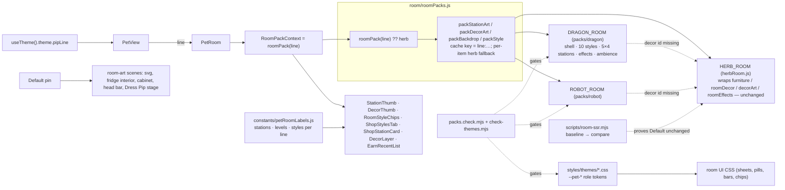

# Plan: Themed Pip rooms — room engine per creature, lair and workshop shell, stations and styles, themed room UI

Plan folder: `.claude/contract/MPP-45-themed-pip-rooms-engine/`
Execution status: see `tasks.md` in this folder.

---

## Part 1 — Alignment

### Task reference
Jira **MPP-45** (Story): "Themed Pip rooms: room engine per creature, lair and workshop shell, stations and styles, themed room UI". It blocks MPP-46 (dragon lair decor) and MPP-47 (robot workshop decor). Upstream spec: `.claude/contract/2026-11-16-themed-pip-rooms-mockups/spec.md` ("Contract 2"). Review follow-ups: that folder's `pr-description.md`. Once that contract is archived, both files move to `.claude/contract/archive/2026-11-16-themed-pip-rooms-mockups/`.

Acceptance criteria, verbatim from the ticket:
1. **Theme switching.** On `/pet`, Parchment shows the lair shell, stations and styles, and Cyberpunk shows the workshop's. Switching theme swaps the room art and names instantly, with no new `/api/pet` request. The code branches on `theme.pipLine` only, never on a theme id.
2. **Default unchanged.** The Default theme's room renders byte-identical markup to before (SSR comparison of the herb room).
3. **Lair and workshop content.** Each one has all 5 stations at levels 1–4, the 10 styles, the window for day and night (rain on the workshop window kept), the fridge gauge, steam, zzz and served plate, and the ambience. All of it is ported from the approved mockups and fits the existing footprints. `roomLayout.js`, the hit boxes, Pip's poses and the camera are unchanged.
4. **Names per creature.** Station, level and style names show per creature in the Shop, the picker and the style chips (`labels.stations`, `labels.levels`, `labels.styles` from the mockups).
5. **Decor fallback.** Decor items fall back to today's herb drawings in the lair and workshop until the two decor stories land.
6. **Themed room UI.** The room UI (Shop, decor picker, Fridge, Trophy cabinet, Dress Pip, edit bar, head bar, check-in, pills) follows the app theme through the `--pet-*` role tokens from the token table in `pip-room-chrome.html`. Default values stay exactly as today. `npm run check:themes` passes with the new pairs and no new `KNOWN_EXCEPTIONS`.
7. **Motion.** Ambience stops under Low FX, under `prefers-reduced-motion`, and in every thumbnail.
8. **Checks.** `npm run check:room` asserts each pack covers its stations, levels, styles, names and effects, and that its output is finite. `npm run build` passes. `mvn test` is unaffected, because there is no server change.

Scope, verbatim from the ticket. In: the engine (`roomPack(line)` keyed by `theme.pipLine` with a herb fallback per item, the herb pack wrapping today's art unchanged, per-line labels, per-line `ROOM_INK`, a decor cache keyed by line and id); the lair and workshop (shell, 10 styles, 5 × 4 stations, effects, ambience); the themed room UI (move the Default pin off `.pet-view` onto the room art only, add the `--pet-*` tokens to the three theme files, add the new pairs to `check-themes.mjs`); and these follow-ups to settle here: normalise the `--pet-*` names to `--pet-<area>-<role>`, decide whether the Fridge, Trophy cabinet and head bar stay room art, audit `SprinklesChip.css`, and theme `--pip-focus-ring`. Out: the 55 decor items per creature, any server/DB/migration change, room geometry or camera changes, bespoke theme looks beyond tokens, and Pip's art and wardrobe.

Dependencies and risks, from the ticket: first re-run `mockup-smoke.mjs` to catch geometry drift; the `SleepZs` offset in `PetRoom.jsx` is a possible live bug, to be confirmed while porting the effects.

### Restated goal
Pip's room becomes a pack chosen by the creature. A small registry, `roomPack(line)`, returns the art for the active `theme.pipLine`: walls, floor, window, sill, the 5 stations at 4 levels, the 10 wall/floor styles, the effects (fridge gauge, steam, zzz, served plate), the ambience, the ink and the names. The herb pack wraps today's drawings untouched, so the Default room renders the same markup as before, proven by an SSR snapshot taken before any change. The dragon lair and the robot workshop are ported to JSX from the approved mockups (`DRAGON_ROOM`, `ROBOT_ROOM`). They keep every footprint and anchor, and any decor item falls back to the herb drawing until MPP-46/47. Separately, the room's UI chrome (sheets, pills, bars, chips) stops being pinned to Default and reads normalised `--pet-*` role tokens. Default values equal today's literals; Parchment and Cyberpunk values come from the approved chrome mockup. All of it is checked by `check:room` (pack coverage, finite output) and `check:themes` (36 new pairs per theme, AA).

### In scope
- **Baseline and drift guard:** re-run `mockup-smoke.mjs` on both room mockups, capture an SSR markup baseline of the herb room before any change, and confirm or refute the `SleepZs` offset.
- **Engine:** the `roomPacks.js` registry with per-item herb fallback, a decor/station/backdrop cache keyed by line, a room-pack context, and the herb pack (`herbRoom.js`) wrapping `furniture.jsx`, `roomDecor.jsx`, `decorArt.jsx` and `roomEffects.jsx` unchanged.
- **Per-line labels:** `constants/petRoomLabels.js` with station, level and style names per line, used by the Shop (Upgrades and Walls & floors tabs, the status line, Earn history), the decor picker and the style chips.
- **Per-line ink:** `pack.ink`, with herb `ROOM_INK` unchanged.
- **Ambience CSS** (`roomFx.css`): the `room-fx--*` loops from both mockups, stopped by `body.lowfx`, `prefers-reduced-motion` and every thumbnail.
- **Dragon lair pack:** a shared `packShapes.jsx` port of the mockups' iso helpers, then the shell, 10 styles, 5 stations × 4 levels, effects, ambience and labels.
- **Robot workshop pack:** the same, with the night-window rain.
- **Themed room UI:**
  - normalised `--pet-*` tokens in `default.css` (today's literals), `parchment.css` and `cyberpunk.css`
  - every chrome literal from the chrome mockup's token table replaced by its token
  - the Default pin moved from `.pet-view` to the room-art scenes
  - `SprinklesChip.css` audited and tokenised
  - `--pip-focus-ring` themed
  - 36 pairs × 3 themes in `check-themes.mjs`, with an alpha-flatten step for translucent backgrounds
- **Settle follow-up (e):** the Fridge interior, the Trophy cabinet scene and the head bar stay room art in this ticket (see Assumptions).
- **Mockup sync:** rename the tokens in `pip-room-chrome.html` to the normalised names, add the SprinklesChip and focus-ring rows, confirm the shop status-line copy against the live lines (follow-up j), and update the README.
- **Docs:** update `CLAUDE.md` → Themes (the pin rule, the `check:themes` expected output, the room-pack registry), plus the version bump and CHANGELOG.

### Explicitly out of scope
- The 55 decor drawings and the 55 decor names per creature (MPP-46, MPP-47). The decor picker keeps the herb names, and `labels.decor` from the mockups is not ported.
- Creature-specific Fridge interior, Trophy cabinet interior and head bar colours. They stay room art with today's herb palette (see Assumptions).
- Any server, DB, migration or `PET_FREE_MODE` change.
- `roomLayout.js`, `iso.js`, the hit boxes, Pip's poses, the camera and `ROOM_SIZE`.
- Pip's figure art and wardrobe.
- Bespoke non-token chrome (parchment-scroll sheets, CRT panels).
- Mockup tooling follow-ups (a) escape the hash decor id, (b) stricter smoke defaults, (c) engine-block hash compare, and (k) unify how the smokes locate live code. They touch only the mockup contract's scripts and HTML; they are left for that contract's archive or a tooling ticket.
- Follow-up (h): the two pre-existing Default contrast misses (badge 3.56:1, worn dot 2.76:1). Fixing them would retune Default. They stay unpaired, exactly as the chrome mockup's notes say.

### Pattern Reference
None was named on the ticket beyond the mockups and spec. Chosen references:
- **Per-line registry with herb fallback:** `components/pet/pip/wardrobeArt.js` (`LINE_WARDROBE`, `wardrobeOf(line) ?? herb`) and `pip/lineArt.jsx` (`LINE_ART`, `lineArt(line)`). `roomPacks.js` copies this shape.
- **Per-line names:** `constants/pipWardrobe.js` (`WARDROBE_ITEM_LABELS[line][id]`) for `petRoomLabels.js`.
- **The art being wrapped:** `room/furniture.jsx` (`FURNITURE`, `stationArt` with `artCache`), `room/roomDecor.jsx` (`roomBackdrop` with its `backdrops` cache), `room/decorArt.jsx` (`decorArt` with `cache` and `LEGACY_IDS`), `room/roomEffects.jsx`.
- **The art being ported:** `foodbytes-app/mockup/pip-room-dragon.html` (`DRAGON_ROOM` at line 1140, helper blocks at 341–520 and 680–1139) and `pip-room-robot.html` (`ROBOT_ROOM` at line 1028, helpers before it). Drawings are SVG-string functions, converted one-to-one to JSX as contract `2026-11-15-themed-pip-lines` did for the creatures.
- **Animated parts:** `pip/Pip.css` `pip-fx` rules (CSS only, transform and opacity, `body.lowfx`, reduced motion).
- **Token table:** `pip-room-chrome.html` lines 2414–2575 (`tokens[]` with `sources[]` per literal, `roomArt[]`, `pairs[]`, `notes[]`).
- **Contrast check:** `client/scripts/check-themes.mjs` (`PAIRS`, `KNOWN_EXCEPTIONS`).

### Constraints flagged on the brief
- Code branches on `theme.pipLine` only, never on a theme id.
- **Default must be byte-identical (SSR).** The one deliberate exception, if confirmed, is the `SleepZs` fix (see Assumptions).
- Geometry is frozen: `roomLayout.js`, hit boxes, poses and camera.
- No server change. Ids, spots, prices, ownership and placements are shared across creatures.
- Colours: room art keeps literal palettes inside `components/pet/` (the documented exception). Chrome colours live only in `styles/themes/*.css`. A new token's Default value is exactly the literal it replaces. No new `KNOWN_EXCEPTIONS`.
- Ambience is CSS-only, transform and opacity, with no positioning `transform` on an animated group. It stops under Low FX, reduced motion and in thumbnails, and glow filters are removed under Low FX.
- No franchise names. Every name is copied from the approved mockups.
- 320–1280 px, popups usable on mobile.
- Component files under 400 lines. No `dangerouslySetInnerHTML`. No new dependency.
- Version: Story → MINOR bump.

### Assumptions made
- **Slug `MPP-45-themed-pip-rooms-engine`.** *Rationale: the Jira key plus a short title, per the slug grammar.*
- **The line reaches the room through a room-scoped React context, `RoomPackContext`.** `PetView` already reads `theme.pipLine`. It passes `line` to `PetRoom`, which provides `roomPack(line)`. Leaves (thumbnails, chips, shop tabs, picker, decor layers, Earn list) call `useRoomPack()`. The context's default value is the herb pack. *Rationale: drilling `line` through `PetRoom → ShopView → tab → card → thumb` is four levels. A feature-scoped provider is sanctioned React state, not a global store. The herb default lets the SSR snapshot and any stray thumbnail render with no provider.*
- **The mockups' SVG-string helpers are ported once into a shared `room/packs/packShapes.jsx`** as element-returning functions bound to an ink: `packShapes(ink)` → `{ poly, isoLine, isoLines, box, rectV, rectU, rectH, ellH, cylE, cyl, bill, fxg }`, plus `rnd(seed)`, `fmt` and `tint`. Both room mockups share these engine blocks. *Rationale: a one-to-one port keeps fidelity with the approved art and avoids two copies. The live `isoShapes.jsx` stays untouched for herb, so its markup cannot drift.*
- **The mockups' fit-tracking (`track`, `measure`) is dropped in the port.** *Rationale: it is review tooling, and the geometry proof is the smoke plus the unchanged footprints.*
- **Decor fallback reuses the herb `decorArt(id)` element** (its own cache, including the `LEGACY_IDS` shift). `packDecorArt(pack, id)` caches under `${line}:${id}`. *Rationale: AC 5 plus the ticket's "decor cache keyed by line and id". Herb decor drawn with herb ink inside the lair is the accepted interim look.*
- **The SleepZs offset is confirmed by numbers, then fixed for every line.** `SleepZs` is drawn outside the bed's shifted group while the bed is shifted by `STATION_SHIFT.bed = [0, 70]`, so the Zs land about 70 v-units off. Both mockups draw `zzz` inside the bed's shifted group. The engine draws `pack.effects.SleepZs` inside the bed's `ShiftedStation` for every line, which fixes herb too. The SSR compare for the asleep fixture then expects exactly one diff: the zzz group moving into the bed group. If Task 3 finds no offset, Task 10 is skipped and every pack draws its Zs where herb's are drawn today. *Rationale: the engine has to place the pack effect somewhere, and putting it in two places by line would be a branch on line. **Red-line this if you want herb left as-is and a separate Bug ticket instead.***
- **Follow-up (e) decision: the Fridge interior, the Trophy cabinet scene and the head bar stay room art in this ticket.** They keep today's literals in every theme, with the Default pin on them. *Rationale: no approved mockup draws a lair or workshop version of them, and inventing palettes breaks mockup-first. The herb-green head bar over the dragon/robot is recorded as a follow-up for MPP-46/47 (or a new ticket). The chrome mockup already classifies all three as room art.*
- **Pin moves to the room-art scenes only.** The `.pet-view` pin block (PetView.css:2–13) moves to the selectors that own the `roomArt[]` literals in the chrome table: the Fridge interior, the Trophy cabinet scene, the head bar, the Dress Pip stage, and `.pip-room-svg`. The `color-scheme: light` and the `:root[data-theme] .pet-view :where(input…)` input reset stay on `.pet-view` until the inputs are verified themed. *Rationale: the ticket says "onto the room art only". Anything that is chrome then follows the theme through tokens.*
- **Token-name normalisation (follow-up d) uses `--pet-<area>[-<tone>]-<role>`, with role ∈ `bg | text | border | fill | stroke | shadow | color`.** `-fill`/`-stroke` are for SVG paint only; `-bg` is for CSS backgrounds. Duplicates whose Default literals differ (`--pet-error-text` #a4281d vs `--pet-wardrobe-error-text` #8a1c12; disabled vs disabled-neutral) are **not merged**, because merging would change Default. The full rename map is in Data shapes. *Rationale: one predictable grammar, and Default does not drift.*
- **SprinklesChip audit (follow-up f):** four of its five literals equal existing table tokens (`#fff7d6` balance-bg, `#e0b52c` gold-border, `#ffd34d` gold-bg, `#3f2716` gold-text). The fifth, the `rgba(255, 211, 77, 0.35)` ring, becomes the new `--pet-gold-ring-shadow`. Its Parchment and Cyberpunk values are those themes' `--pet-gold-bg` at alpha 0.35 (`rgba(216, 178, 90, 0.35)` and `rgba(249, 240, 2, 0.35)`). *Rationale: derived from approved values, not invented. Red-line if you want a different ring.*
- **`--pip-focus-ring` (follow-up g):** Default stays `#7c5cd6`. Parchment → `var(--focus-ink)` and Cyberpunk → `var(--yellow)`, the values the chrome mockup's note proposes. Both pairs (`focus-ring` on `bg-primary` and on `--pet-card-bg`, min 3.0) must pass. *Rationale: the mockup note names exactly these.*
- **Pack surround:** the herb pack has no `surround` field, so the stage keeps the CSS literal `#f3f1f8` and its markup is unchanged. The dragon and robot packs set `surround` to their ink (`#2b2630`, `#141b24`), applied as an inline `background` on `.pip-room-stage` only when present. *Rationale: the chrome table says "each creature pack supplies its own surround in contract 2", but the mockups don't draw one. A dark surround reads as cave or night beyond the walls. Red-line if you prefer to keep `#f3f1f8`.*
- **Earn history and the Pip status line use per-line names too.** `usePetShop` takes `line`, and `groupRecent` takes `line` (default herb). *Rationale: they are inside the Shop and Pip's bubble; a "Wooden bed" line under a nest would contradict AC 4.*
- **SSR tooling uses Vite's own `createServer({ appType: 'custom' }).ssrLoadModule`** plus `react-dom/server`, both already installed. *Rationale: no new dependency, and JSX and CSS imports resolve exactly as in the app.*
- **`check:room` grows a second script**, `room/packs/packs.check.mjs`, run through the same SSR loader. The existing `room.check.mjs` stays pure `.js`. *Rationale: coverage needs the JSX packs rendered, which plain `node` cannot import.*
- **Station level names per line include the herb pack's** (from `STATION_LEVEL_NAMES`), and the dragon/robot names come from `labels.levels` in the mockups (added at the contract-1 review).

### Cross-code alignment audit (FE ↔ BE ↔ DB)
Skipped: no persistence touched. Ids (`ROOM_STATIONS`, `DECOR_ITEMS`, `ROOM_STYLES`), placements and levels come from `/api/pet` unchanged. Packs key on the same ids, and `check:room` asserts each pack's stations, levels and styles cover exactly those ids.

---

## Part 2 — Technical design

### Approach
**A pack per creature behind one registry.** `room/roomPacks.js` exports `ROOM_PACKS = { herb: HERB_ROOM, dragon: DRAGON_ROOM, robot: ROBOT_ROOM }` and `roomPack(line)` (herb fallback). It also exports cached accessors that every consumer uses instead of the herb functions directly:
- `packStationArt(pack, station, level)`
- `packDecorArt(pack, id)`
- `packBackdrop(pack, night, wallId, floorId)`
- `packStyle(pack, id)`

Each accessor tries the pack's entry and falls back to the herb entry per item. The cache is keyed by `pack.line`, so the minute-clock re-render still diffs identical element references (the MPP-16 "render once" rule).

`HERB_ROOM` lives in `room/herbRoom.js` and only wraps today's functions: `stationArt`, `roomBackdrop`, `decorArt`, `ROOM_STYLES`, the four `roomEffects` components, and `ROOM_INK`. Not one drawing changes, so the Default SSR markup stays identical.

The line flows `useTheme().theme.pipLine` → `PetView` → `PetRoom line` → `RoomPackContext.Provider`. Leaves read it with `useRoomPack()`. Switching theme re-renders with a different pack and no request, because `usePet` never depends on the theme.

**The lair and workshop are ported, not redrawn.** The mockups were written in the pack shape on purpose. Each `DRAGON_ROOM.stations.bed[n]` string function becomes a function returning JSX built from `packShapes(DRAGON_INK)`. String concatenation becomes fragments, `class` becomes `className`, `stroke-width` becomes `strokeWidth`, and `style="animation-delay:-1.2s"` becomes a style object. Helper blocks (stone courses, nests, crystals, bricks, CRT panels, LEDs) port to `<line>Parts.jsx`, and each station to its own file to stay under 400 lines.

The ambience is the same `room-fx room-fx--<effect>` classes, moved into `roomFx.css` with the mockups' keyframes. The workshop window rain uses a `clipPath` with a fixed id, `robot-glass-clip`. It is drawn only in the backdrop, never in a thumbnail, so the id is unique on the page.

**Rejected alternatives:**
- **Wrapping the mockup strings in `<g dangerouslySetInnerHTML>`.** It is the fastest port, but the skill bans it without a reviewed justification. React could not diff inside it, and the SSR compare and the finite-output check would read opaque strings.
- **A `roomTheme` field on `THEMES`.** Rejected by the spec.
- **Prop-drilling `line` everywhere.** Rejected in Assumptions.
- **Parametrising the live `isoShapes.jsx` with an ink prop.** That would touch every herb drawing's props and risk the byte-identical markup.

**The themed UI is a mechanical, table-driven swap.** The chrome mockup's `tokens[]` lists every chrome literal with its `file:line`.
1. Add the normalised `--pet-*` tokens to `default.css` (Default = the recorded literal), `parchment.css` and `cyberpunk.css`.
2. Replace each listed literal with `var(--pet-…)` or the listed existing token.
3. Move the `.pet-view` pin onto the room-art selectors.
4. Theme `--pip-focus-ring`.
5. Add the 36 pairs to every theme in `check-themes.mjs`. Pairs with an `over` field first flatten their translucent background onto that token (sRGB alpha composite), because the script only reads `#hex` today.

The Default look cannot drift, since every Default token value is the exact literal it replaced, and the SSR compare does not see CSS at all.

**Proof.** Phase 1 writes the herb SSR baseline before a single line changes. Phase 2 must reproduce it exactly with only the herb pack registered. Phases 3–4 add the creature packs, gated by `packs.check.mjs`, which renders every station level, style backdrop (day and night) and effect per pack and asserts:
- non-empty markup
- no `NaN` or `Infinity` in it
- a name for every station, level and style

### Skills to invoke during execution
- `react-frontend`: owns every change under `client/src/` and `client/scripts/`:
  - the context and hook shape, and the 400-line budget (measured)
  - CSS conventions (tokens only in theme files; `components/pet/` art exception)
  - `:focus-visible`, the Low FX and reduced-motion rules, and no `console.log`
  - "state what you verified" (no frontend test runner exists)

Rules: no `.claude/rules/` file applies (no recipe, ingredient, macro, variant or migration work).

### Diagram


### Data shapes

#### Room pack (`room/roomPacks.js` consumers)
```js
// One per line. Herb wraps today's code; dragon/robot are ported from the mockups.
{
  line: 'herb' | 'dragon' | 'robot',
  ink: string,                       // outline colour; herb = ROOM_INK '#3b2f5c', dragon '#2b2630', robot '#141b24'
  surround?: string,                 // stage background beyond the walls; herb omits it (CSS #f3f1f8 stays)
  styles: { [styleId]: WallStyle | FloorStyle },   // all 10 ROOM_STYLES ids
  //   WallStyle  = { left, right, skirting, pattern? }        (herb also keeps label/spot/sprigs as today)
  //   FloorStyle = { base, checker?, pattern? }               (herb also keeps boards/grid/checker/label/spot)
  backdrop: (night: boolean, wall: WallStyle, floor: FloorStyle) => JSX,  // walls, patterns, skirting, window frame/glass/sky, sill
  stations: {                        // index = level - 1; bed returns { back, front }
    bed: [() => ({ back: JSX, front: JSX }) × 4],
    fridge | cooker | cabinet | wardrobe: [() => JSX × 4]
  },
  decor: { [decorId]: () => JSX },   // {} for dragon/robot in this ticket → herb fallback
  effects: {                         // React components, props as roomEffects.jsx today
    FridgeGauge({ level, pct }), PotSteam({ level }), ServedPlate({ level }), SleepZs({ level })
  },
  ambience: [{ target: 'shell' | 'window' | stationId | decorId, effect: 'flicker' | 'embers' | 'glint' | 'sway' | 'steam' | 'zzz' | 'scan' | 'blink' | 'fan' | 'buzz' | 'rain' }],
  labels: { stations: { [stationId]: string }, levels: { [stationId]: [string × 4] }, styles: { [styleId]: string } }
}
```
`HERB_ROOM.backdrop` is a thin adapter: `roomBackdrop(night, wallId, floorId)` already resolves ids and caches. The herb pack therefore exposes `backdropById(night, wallId, floorId)`, and `packBackdrop` calls it when present. The dragon/robot backdrops take resolved style objects and are cached by `packBackdrop` under `${line}|${night}|${wallId}|${floorId}`.

#### Registry API (`room/roomPacks.js`)
```js
export const ROOM_PACKS                                   // { herb, dragon, robot }
export const roomPack = (line) => ROOM_PACKS[line] ?? ROOM_PACKS[PIP_DEFAULT_LINE]
export function packStationArt(pack, station, level)      // cache `${line}:${station}:${level}`; pack.stations[station]?.[level-1] ?? herb
export function packDecorArt(pack, id)                    // cache `${line}:${id}`; pack.decor[id] ?? decorArt(id); null for unknown id
export function packBackdrop(pack, night, wallId, floorId)// unknown ids → DEFAULT_WALL_STYLE / DEFAULT_FLOOR_STYLE (as roomBackdrop)
export const packStyle = (pack, id) => pack.styles?.[id] ?? ROOM_STYLES[id] ?? null
export const packEffects = (pack) => ({ ...HERB_ROOM.effects, ...pack.effects })
```

#### Context (`room/roomPackContext.js`)
```js
export const RoomPackContext = createContext(HERB_ROOM)
export const useRoomPack = () => useContext(RoomPackContext)
```

#### Labels (`constants/petRoomLabels.js`)
```js
export const ROOM_LABELS = {
  herb:   { stations: from SHOP_STATIONS[].label, levels: STATION_LEVEL_NAMES, styles: from ROOM_STYLES[id].label },
  dragon: { stations, levels, styles },   // verbatim from DRAGON_ROOM.labels (pip-room-dragon.html:1871-1915), decor omitted
  robot:  { stations, levels, styles }    // verbatim from ROBOT_ROOM.labels (pip-room-robot.html:1679-…), decor omitted
}
export const stationLabel = (line, station) => …            // herb fallback per key
export const stationLevelName = (line, station, level) => …  // herb fallback; undefined for an invalid level (as today)
export const styleLabel = (line, styleId) => …
```
Packs reference `ROOM_LABELS[line]` as `labels`, so names live once.

#### Ambience CSS (`room/roomFx.css`), no colours
```css
.room-fx { transform-box: fill-box; transform-origin: center; }
.room-fx--flicker / --embers / --glint / --sway / --steam / --zzz / --scan / --blink / --fan / --buzz / --rain { animation: … }  /* verbatim from mockups lines 79–106 */
body.lowfx .room-fx,
.pip-shop-thumb-svg .room-fx, .pip-decor-thumb .room-fx, .pip-style-swatch .room-fx { animation: none !important; }
body.lowfx .pip-room-svg [data-glow] { filter: none !important; }
@media (prefers-reduced-motion: reduce) { .room-fx { animation: none !important; } }
```
The thumbnail stop is selector-based, so herb thumbnail markup does not change.

#### Token rename map (normalisation, follow-up d)
Every other `--pet-*` name in the chrome table already fits the grammar and is kept as-is.

| Table name | Normalised |
|---|---|
| `--pet-accent` | `--pet-accent-color` |
| `--pet-line` / `-faint` / `-mid` / `-strong` | `--pet-divider-border` / `--pet-divider-faint-border` / `--pet-divider-mid-border` / `--pet-divider-strong-border` |
| `--pet-border-hover` | `--pet-divider-hover-border` |
| `--pet-wardrobe-line` | `--pet-wardrobe-border` |
| `--pet-text-muted` / `-soft` / `-label` | `--pet-muted-text` / `--pet-soft-text` / `--pet-label-text` |
| `--pet-text-disabled` / `-disabled-neutral` | `--pet-disabled-text` / `--pet-disabled-neutral-text` |
| `--pet-btn-disabled-bg` | `--pet-disabled-bg` |
| `--pet-float-bg-active` | `--pet-float-active-bg` |
| `--pet-hit-active` / `--pet-hit-hover` | `--pet-hit-active-bg` / `--pet-hit-hover-bg` |
| `--pet-wardrobe-ink` | `--pet-wardrobe-text` |
| `--pet-wardrobe-worn-dot` / `-worn-dot-on-brand` | `--pet-wardrobe-worn-fill` / `--pet-wardrobe-worn-on-brand-fill` |
| `--pet-wardrobe-worn-ring` | `--pet-wardrobe-worn-shadow` (if the property it feeds is `box-shadow`; else `-border`) |
| *(new, SprinklesChip)* | `--pet-gold-ring-shadow`: Default `rgba(255, 211, 77, 0.35)`, Parchment `rgba(216, 178, 90, 0.35)`, Cyberpunk `rgba(249, 240, 2, 0.35)` |

All other table values (Default / Parchment / Cyberpunk) are copied verbatim from `pip-room-chrome.html` `tokens[]`. Existing global tokens (`--bg-primary`, `--brand-primary`, …) are referenced, not redefined.

#### `check-themes.mjs` additions
```js
// [fg, bg, min, over?] — `over` flattens a translucent bg onto that token before the contrast maths
const PET_PAIRS = [ /* the 36 pairs from pip-room-chrome.html pairs[], names normalised */ ]
PAIRS.default.push(...PET_PAIRS); PAIRS.cyberpunk.push(...PET_PAIRS); PAIRS.parchment.push(...PET_PAIRS)
parseColour(value)   // '#rgb' | '#rrggbb' | 'rgb(a)(r, g, b[, a])' → { rgb: [r,g,b] 0–1, a }
flatten(fg, under)   // alpha-composite onto an opaque colour, returns '#rrggbb'
```
A `var(--x)` reference is resolved before parsing (the existing `resolve`). A gradient or a missing token is a `MISSING` failure, as today.

#### SSR snapshot (`client/scripts/room-ssr.mjs`)
```text
node scripts/room-ssr.mjs --write <dir>     # writes one .html per fixture
node scripts/room-ssr.mjs --compare <dir>   # exit 1 on any byte difference, prints the first differing offset + 120 chars
Fixtures (line = herb): day-rug-l1-defaults, all-l4-every-spot-filled (first item per spot), asleep-l2, cooking-served-fridge-50,
editing-picker-closed, station-thumbs (5×4), decor-thumbs (55), style-swatches (ShopStylesTab + RoomStyleChips with all 10 owned)
```

### Runtime quality notes
These are mapped to the browser runtime: a single-threaded event loop, render cost, no effects added.
- **Resource cleanup:** no new effects, timers or listeners. The context is static per render. The SSR scripts close the Vite server in `finally`.
- **Concurrency / ordering:** no new async. A theme switch mid-cook re-renders the same `serving` phase with another pack. The phase lives in hooks, not in the pack, so the scene continues.
- **Allocation / cost behaviour:**
  - Every station level, backdrop combination and decor item is built once per line per page load, the same discipline as today's caches. The worst case is about 3 lines × (20 stations + 2 × 6 × 4 backdrops + 55 decor), all small.
  - The lair and workshop drawings are denser than herb's (stone courses, straw scatter). They are built once, then reused.
  - Ambience is CSS on a few dozen small groups, and glow filters are dropped under Low FX.
  - Bundle: about 2,000 lines of new art JSX per two packs, so a modest JS increase. It is not code-split, because `/pet` is one route and the art is needed on first paint of the room.
- **Error paths:**
  - An unknown line falls back to herb.
  - A pack missing an item falls back to the herb item, so nothing ever renders blank.
  - An unknown decor id still draws nothing, as today.
  - `packs.check.mjs` fails the build gate on any gap, `NaN` or `Infinity`.
  - Nothing is swallowed: the registry has no try/catch. A throwing drawing surfaces in dev and in the check.

### Risks and judgement calls
- **SleepZs fix changes Default markup when asleep.** That is the single intended diff, and the asleep fixture's compare is the one place it may differ. Red-line it in Assumptions if you want it split out.
- **Port fidelity.** About 900 lines of string art per creature are translated by hand. A missed attribute (`stroke-linejoin`, `opacity`, `animation-delay`) silently changes a look. Mitigations:
  - one file per station
  - the mockup line range cited in each task
  - a manual side-by-side against the mockup per level (Phase 6), using `PET_FREE_MODE` level chips
- **Thumbnail crops.** `stationThumbBox` and `decorThumbBox` are computed from footprints, not art bounds, and the mockups verified that the art fits. If any lair or workshop art pokes outside, it shows clipped in the shop. Check it in the Phase 6 walk.
- **The pin move can expose a missed literal.** A chrome literal not in the table would render the Default colour in a dark theme. Task 26's grep audit lists every literal left in the room CSS against the `roomArt[]` whitelist.
- **`--pip-focus-ring` is also used by `common/MacroChips.css`.** Theming it changes the focus ring on the macro chips in Parchment and Cyberpunk too. That is intended (consistent focus) but visible outside the room.
- **`check:themes` count changes** from 81 pairs to about 189. `CLAUDE.md`'s "expected output" line is updated with the real number from the run.
- **Robot `clipPath` id.** One fixed id is fine while the window renders once. If a future thumbnail ever draws the backdrop, the ids collide. Use `useId` if that day comes. Noted in a code comment.
- **Bundle growth** is accepted (see Runtime notes). Code-splitting the packs per line is a possible follow-up if `/pet` first paint regresses.
- **Manual developer steps:** the Phase 6 walk of `/pet` in all three themes at 375 and 1280 px, with `PET_FREE_MODE=true` to set every station to every level. Use DevTools Network to confirm no `/api/pet` request on theme switch.
