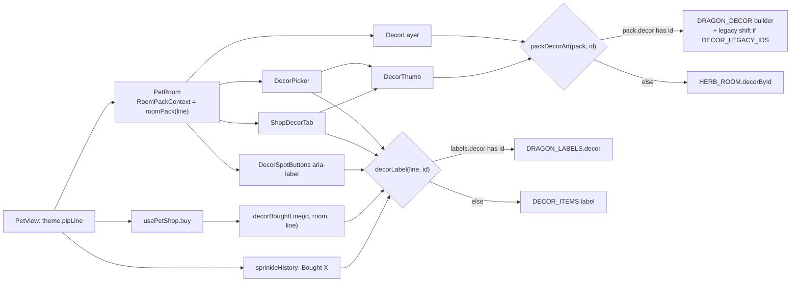

# Plan: Themed Pip rooms — dragon lair decor (55 items and names)

Plan folder: `.claude/contract/MPP-46-dragon-lair-decor/`
Execution status: see `tasks.md` in this folder.

---

## Part 1 — Alignment

### Task reference

Jira **MPP-46** (Story, Medium), "Themed Pip rooms: dragon lair decor (55 items and names)". Blocked by MPP-45, which is now `Ready for Test` (v1.35.0): the room-pack engine and the per-item herb fallback exist.

Acceptance criteria (verbatim):

1. **All 55 drawn in Parchment.** All 55 decor ids in `DECOR_ITEMS` draw their lair version in Parchment, ported from the approved `pip-room-dragon.html` (`DRAGON_ROOM.decor`). Each sits inside its spot shape, and the 12 legacy ids keep the `DECOR_LEGACY_SHIFT` behaviour.
2. **Lair names everywhere.** Each item shows its lair name (`DRAGON_ROOM.labels.decor`) in the decor picker, the Shop Decor tab and the "bought" bubble.
3. **Shared ownership.** Ids, spots, prices and ownership are unchanged. An item bought in any theme shows in the lair, and nothing is re-bought.
4. **Animation.** Animated items (torch and candle flicker, crystal glint, banner sway, brazier embers) stop under Low FX and `prefers-reduced-motion`, and in shop and picker thumbnails.
5. **Fallback removed.** `npm run check:room` asserts the dragon pack draws and names all 55 decor ids with finite output. The herb fallback is no longer used for the dragon line.
6. **Other themes untouched.** Default and Cyberpunk rendering are unchanged, and `npm run build` passes.

Scope from the ticket. In: the 55 lair decor drawings and names, their ambience entries, their thumbnails, the coverage check. Out: the engine, shell, stations, styles and themed UI (MPP-45); robot decor (separate story); any server or database change; new decor ids or spots.

Risks from the ticket: port, don't redesign. `rug-sheepskin` (cave-bear pelt), `sill-cat` (golden dragon idol) and `watering-can` (copper ewer) are the weakest drawings; polishing them is allowed, but only inside their spot.

Design source: `foodbytes-app/mockup/pip-room-dragon.html` (approved 2026-11-16) — `DRAGON_ROOM.decor` (lines 1456–1815), the decor helpers (lines 1099–1139), `DRAGON_ROOM.ambience` (1853–1869), `DRAGON_ROOM.labels.decor` (1881–1905), and its fit table. Spec: `.claude/contract/2026-11-16-themed-pip-rooms-mockups/spec.md`.

### Restated goal

On Parchment, Pip's room is the dragon lair, but every decor item still borrows the herb drawing (pink rug, retro radio). This story ports the 55 lair decor drawings from the approved mockup into the dragon room pack, so every owned item draws as its lair counterpart in the room, the picker and the shop, sitting in the same spot. It also gives decor items per-line names, so the picker, Shop Decor tab, edit-mode spot buttons, the shop's "bought" status line and the recent-sprinkles list say "Cave-bear pelt" rather than "Sheepskin" on Parchment. Ownership, ids and prices stay shared across themes. The coverage check is tightened so the dragon pack must draw and name all 55, and the herb and robot rooms render exactly as before.

### In scope

- Port the mockup's decor-only helpers (`ellU`, `slabU`, `candle`, `bandAt`, `flask`, `runeRowV`, `orb`, `limb`, `ellBand`, `ringLine`) and decor palette (`HI`, `COPPER`, `BONE`, `TEAL`, `TEAL_HI`, `GLOW`, `HIDE`) to JSX.
- Port all 55 `DRAGON_ROOM.decor` drawings to JSX, split by area, and register them in `DRAGON_ROOM.decor`.
- Apply `DECOR_LEGACY_SHIFT` to the 12 legacy ids for any non-herb pack, in `packDecorArt`.
- Add the 19 decor ambience entries to `DRAGON_ROOM.ambience`.
- Add per-line decor names: `DRAGON_LABELS.decor` (55 names), a `decorLabel(line, id)` accessor with herb fallback, and use it in the decor picker, Shop Decor tab, edit-mode spot buttons, the shop's bought line and the recent-sprinkles list.
- Tighten `packs.check.mjs`: the dragon line draws and names all 55 ids with finite markup; extend `room.check.mjs` for the per-line bought line.
- Herb drift guard: SSR baseline before, byte-for-byte compare after.
- Mockup sync: `foodbytes-app/mockup/README.md` rows for the dragon room.
- Version bump (Story → MINOR) and CHANGELOG.

### Explicitly out of scope

- Robot workshop decor and names (MPP-47) — robot keeps the herb fallback for decor and names.
- Any change to the room engine beyond the legacy shift in `packDecorArt`, or to shell, stations, styles or themed chrome.
- Redrawing any item. The three weak drawings are ported verbatim (see Assumptions).
- Server, DTO, database, prices, ids, spots.
- `DECOR_SPOT_LABELS` (spot names such as "Over the wardrobe") stay unthemed — the brief names item names only.
- Changing the robot pack's names or any existing style/station name.

### Pattern Reference

None named file-by-file in the brief beyond the mockup. Chosen references:

- **Drawing port:** MPP-45's dragon station ports — `client/src/components/pet/room/packs/dragon/dragonBed.jsx`, `dragonParts.jsx`, `dragonTreasure.jsx` (mockup string helpers → JSX via `packShapes(DRAGON_INK)`, `cat(...)` instead of `.join('')`, `glowG` instead of `glowAttr`, `bill` without the mockup's bounds argument).
- **Area split:** the herb decor split — `decorArtWalls.jsx`, `decorArtWindow.jsx`, `decorArtRugs.jsx`, `decorArtFloorBack.jsx`, `decorArtFloorFront.jsx`, merged by `decorArt.jsx`.
- **Per-line names:** `styleLabel` / `stationLabel` in `client/src/constants/petRoomLabels.js` and their callers `ShopStylesTab.jsx`, `RoomStyleChips.jsx`, `utils/sprinkleHistory.js`.
- **Coverage check:** `client/src/components/pet/room/packs/packs.check.mjs` (MPP-45).
- **Herb drift guard:** `client/scripts/room-ssr.mjs` (MPP-45).

### Constraints flagged on the brief

- Port verbatim from the approved mockup; polish of the three weak items only inside their spot.
- Ids, spots, prices and ownership unchanged (no server change).
- Animations stop under Low FX, reduced motion and in thumbnails.
- Default (herb) and Cyberpunk (robot) rendering unchanged; `npm run build` passes.
- CLAUDE.md theme rules: Pip's room art keeps its own literal palette (the colour-token rule does not apply inside `components/pet/`); theme-specific markup branches on the registry (`theme.pipLine` → pack), never on a theme id string.
- react-frontend: no file over 400 lines; no `dangerouslySetInnerHTML` (so the mockup's SVG strings are rewritten as JSX, not injected).

### Assumptions made

- **No polish of the three weak drawings.** Port `rug-sheepskin`, `sill-cat` and `watering-can` verbatim; polishing is "allowed", not required, and a redraw would need its own review. Red-line this if you want them redrawn in this story.
- **Legacy shift lives in `packDecorArt`, not in each drawing.** The mockup's `decorArtWorld` slides the 12 legacy ids by `DECOR_LEGACY_SHIFT` at draw time, and the port keeps the art in MPP-27 coords. Doing the same in `packDecorArt` (for pack-drawn items only) keeps the drawings verbatim and serves MPP-47 too. The set of legacy ids moves from a local const in `decorArt.jsx` to an exported `DECOR_LEGACY_IDS` in `roomLayout.js`, next to `DECOR_LEGACY_SHIFT`.
- **Names reach more surfaces than the AC lists.** Besides the picker, Shop Decor tab and bought line, the edit-mode spot buttons' `aria-label` and the recent-sprinkles "Bought X" row also use `decorLabel`. Leaving them herb would show "Sheepskin" next to a pelt.
- **"Bought bubble" = the shop's status line** (`decorBoughtLine` in `utils/roomPlacements.js`, set by `usePetShop.buy`). It gains a `line` argument (default herb, so existing calls and checks stay valid). Since it already handles styles, the style branch also switches to `styleLabel(line, id)`, fixing the same herb-name leak MPP-45 left for bought styles ("Mint bought" on a slate wall).
- **Coverage rule names the complete lines explicitly.** `packs.check.mjs` gets a `FULL_DECOR_LINES` set holding only `dragon`; MPP-47 adds `robot`. A generic "non-empty means complete" rule would let an emptied dragon pack pass.
- **Herb drift guard writes its own baseline.** Phase 1 writes a fresh SSR baseline into this plan folder before any edit, rather than relying on MPP-45's folder (which moves when that contract is archived).
- **Fit is checked against the mockup, not re-measured.** The live code has no bounds measurer for JSX; a verbatim port inherits the mockup fit table's results. The executor confirms the table is all-OK in the browser and checks each spot visually on localhost with `PET_FREE_MODE`.
- **File split by area, five drawing files plus one helper file**, each under 400 lines.

### Cross-code alignment audit (FE ↔ BE ↔ DB)

Skipped — no persistence touched. Decor ids, spots, prices and ownership come from the existing `PetRoomDTO` unchanged; this story only changes how the client draws and names known ids. (Names checked client-side instead: the 55 keys in the mockup's `labels.decor` match the 55 keys of `DECOR_ITEMS` in `client/src/constants/petDecor.js:108-174`; `packs.check.mjs` asserts this at run time.)

---

## Part 2 — Technical design

### Approach

The engine already does the routing: `PetRoom` provides the active pack via `RoomPackContext`, and every decor draw goes through `packDecorArt(pack, id)`, which uses `pack.decor[id]()` when present and falls back to `HERB_ROOM.decorById(id)` otherwise. So the art half of this story is data: fill `DRAGON_ROOM.decor` with 55 builders. The builders are the mockup's string drawings rewritten as JSX against the same helpers MPP-45 ported (`S = packShapes(DRAGON_INK)`, `gem`, `sparkle`, `flame`, `embers`, `crystal`, `coinScatter`, `stoneBox`, `seamsU`, `pelt`, `helm`...), plus the decor-only helpers MPP-45 deferred, which go in a new `dragonDecorParts.jsx`. The drawings split by area the way the herb decor does — walls, window, rugs, back floor, front floor — and `dragonDecor.js` merges them into one id → builder map. The one engine change: `packDecorArt` wraps a pack-drawn legacy id in `shiftTransform(DECOR_LEGACY_SHIFT[spot])`, as the mockup's `decorArtWorld` does. Herb never takes that branch (its `decor` is `{}`), and the cache key (`line:id`) is unchanged.

The names half follows MPP-45's `styleLabel`. `petRoomLabels.js` gains `decor` on each line's labels (herb built from `DECOR_ITEMS`, dragon copied from the mockup, robot none yet) and a `decorLabel(line, id)` accessor that falls back to the herb label. Components read the line from `useRoomPack().line`, as `ShopStylesTab` does; `DecorPicker`, `ShopDecorTab` and `DecorSpotButtons` all render inside `PetRoom`'s provider. The two pure utilities take the line as an argument: `sprinkleHistory` already has it, and `decorBoughtLine(itemId, room, line = PIP_DEFAULT_LINE)` gets it from `usePetShop`, which already receives `line` from `PetView`.

Animation needs no new CSS. The ported drawings keep the mockup's `fxg('flicker' | 'glint' | 'sway' | 'embers', ...)` wrappers, so they emit `room-fx room-fx--*` classes that `roomFx.css` already stops under `body.lowfx`, `prefers-reduced-motion` and inside `.pip-decor-thumb` / `.pip-shop-thumb-svg`. Glows use `glowG`'s `data-glow`, which Low FX already strips in the room. `DRAGON_ROOM.ambience` gains the mockup's 19 decor entries; it is declarative and `packs.check.mjs` validates each target and effect.

Roads not taken: **injecting the mockup's SVG strings** via `dangerouslySetInnerHTML` would be a faster port, but breaks the skill rule and the JSX caching and diffing the room relies on. **Baking the legacy shift into each drawing's coordinates** would remove the engine branch but make the port non-verbatim and harder to diff against the mockup. **A `decorLabel` that reads `DECOR_ITEMS` directly in each component** would scatter the fallback; one accessor matches `styleLabel`.

### Skills to invoke during execution

- `react-frontend` — owns every file touched (`client/src/`): file order, 400-line budget, no `dangerouslySetInnerHTML`, constants in `src/constants/`, honest verification (no frontend test runner; `check:room` and `build` are the gates).

No `.claude/rules/` file applies (no recipe, ingredient, macro, meal-plan or migration work).

### Diagram



### Data shapes

#### Dragon pack decor (new modules under `client/src/components/pet/room/packs/dragon/`)

| File | Exports | Ids |
|---|---|---|
| `dragonDecorParts.jsx` | `HI`, `COPPER`, `BONE`, `TEAL`, `TEAL_HI`, `GLOW`, `HIDE`; `ellU(up, vc, hc, rv, rh, fill, o, n = 16)`, `slabU(up, th, vh, fill, o)`, `candle(u, v, h, hh = 5, s = 0.5, delay = 0)`, `bandAt(cu, cv, r, h, color = IRON, w = 1.4)`, `flask(u, v, h, c)`, `runeRowV(vp, u0, h, n)`, `orb(u, v, h, c, delay)`, `limb(d, w, color)`, `ellBand(cu, cv, ru, rv, a, b, h, fill)`, `ringLine(cu, cv, h, ru, rv, w, color, dash)` | — |
| `dragonDecorWalls.jsx` | `DRAGON_WALL_DECOR` | overWardrobe (5), bedsideWall (4), frontRightWall (5) = 14 |
| `dragonDecorWindow.jsx` | `DRAGON_WINDOW_DECOR` | windowDressing (5), windowsill (5) = 10 |
| `dragonDecorRugs.jsx` | `DRAGON_RUG_DECOR` | rug (6) |
| `dragonDecorFloorBack.jsx` | `DRAGON_FLOOR_BACK_DECOR` | backCorner (4), bedsideNook (4), footOfBed (4) = 12 |
| `dragonDecorFloorFront.jsx` | `DRAGON_FLOOR_FRONT_DECOR` | byFridge (5), cornerByDoor (4), frontOfRoom (4) = 13 |
| `dragonDecor.js` | `DRAGON_DECOR = { ...walls, ...window, ...rugs, ...floorBack, ...floorFront }` | 55 |

Each map is `{ [decorId]: () => ReactNode }` — a zero-argument builder returning art in world coords (legacy ids in MPP-27 coords). `limb` returns JSX (two `<path>`s) instead of a string. Arrays built by `.map(...)` are spread into `cat(...)` (keyless Fragment children), as `dragonParts.jsx` does.

`dragonPalette.js` gains `ICE_DK = '#7ec8e3'` only if a ported drawing uses it (the decor block does not today; the executor adds it only on a real reference).

#### `DRAGON_ROOM` (modified, `dragonRoom.js`)

```js
decor: DRAGON_DECOR,
ambience: [ /* 8 existing shell/station entries, then: */
  { target: 'fairy-lights', effect: 'glint' }, { target: 'wall-sconce', effect: 'flicker' }, { target: 'photo-strip', effect: 'glint' },
  { target: 'bunting', effect: 'sway' }, { target: 'window-lights', effect: 'glint' },
  { target: 'plant-hanger', effect: 'flicker' }, { target: 'plant-hanger', effect: 'embers' },
  { target: 'sill-basil', effect: 'glint' }, { target: 'sill-radio', effect: 'flicker' }, { target: 'sill-cat', effect: 'flicker' },
  { target: 'side-table-lamp', effect: 'flicker' }, { target: 'plant-stand', effect: 'glint' }, { target: 'stool-books', effect: 'flicker' }, { target: 'laundry-basket', effect: 'glint' },
  { target: 'lemon-tree', effect: 'glint' }, { target: 'arc-lamp', effect: 'flicker' }, { target: 'arc-lamp', effect: 'embers' }, { target: 'tea-table', effect: 'flicker' }, { target: 'pip-ball', effect: 'glint' }
]
```

#### Engine (modified)

```js
// roomLayout.js — moved from decorArt.jsx, exported
export const DECOR_LEGACY_IDS = new Set(['basil-print', 'recipe-board', 'herb-shelf', 'fairy-lights', 'wall-clock', 'bunting', 'pan-rail', 'mirror', 'watering-can', 'cookbook-stack', 'bean-bag', 'lemon-tree'])

// roomPacks.js
export function packDecorArt(pack, id) {
  if (!id) return null
  const key = `${pack.line}:${id}`
  if (!decorCache.has(key)) decorCache.set(key, pack.decor?.[id] ? packDrawnDecor(pack, id) : HERB_ROOM.decorById(id))
  return decorCache.get(key)
}
function packDrawnDecor(pack, id) {
  const art = pack.decor[id]()
  const shift = DECOR_LEGACY_IDS.has(id) ? DECOR_LEGACY_SHIFT[DECOR_ITEMS[id]?.spot] : null
  return shift ? <g transform={shiftTransform(shift)}>{art}</g> : art
}
```

`roomPacks.js` contains JSX after this change, so it is renamed `roomPacks.jsx`. Its six component importers use the extensionless `'./roomPacks'` and need no edit; only `packs.check.mjs`, which loads `/src/components/pet/room/roomPacks.js` by full path, changes.

#### Names (modified, `client/src/constants/petRoomLabels.js`)

```js
HERB_LABELS.decor = Object.fromEntries(Object.entries(DECOR_ITEMS).map(([id, d]) => [id, d.label]))
DRAGON_LABELS.decor = { 'basil-print': 'Mounted dragon scale', /* … 55 entries verbatim from pip-room-dragon.html:1881-1905 … */ 'picnic-basket': 'Provision crate' }
// ROBOT_LABELS: no decor (MPP-47)

export const decorLabel = (line, id) => labelsOf(line).decor?.[id] ?? HERB_LABELS.decor[id]
```

#### Bought line (modified, `client/src/utils/roomPlacements.js`)

```js
export function decorBoughtLine(itemId, room, line = PIP_DEFAULT_LINE)
// label = DECOR_ITEMS[itemId] ? decorLabel(line, itemId) : styleLabel(line, itemId); the three sentences are unchanged
```

#### Coverage check (modified, `packs.check.mjs`)

```js
const FULL_DECOR_LINES = new Set([PIP_LINE.DRAGON]) // MPP-47 adds ROBOT
// for every line: decorLabel(line, id) is truthy for all 55, and packDecorArt(pack, id) renders finite markup
// for FULL_DECOR_LINES: pack.decor[id] is a function for all 55 ids, and ROOM_LABELS[line].decor[id] is set (no herb fallback)
```

No server, DTO, API or schema changes.

### Runtime quality notes

Frontend-only; the dimensions below are mapped onto the browser runtime.

- **Resource cleanup:** No effects, listeners or timers are added. Animations are CSS-only (`room-fx--*`), started and stopped by class and media query.
- **Concurrency / ordering:** None. Builders are pure and deterministic (seeded `rnd` where the mockup scatters), so the cached element per `line:id` is stable across renders and themes. Ownership is server state, untouched.
- **Allocation / cost behaviour:** Each decor id is built once per line and cached in `decorCache` (at most 55 × 3 entries); the minute re-render diffs the same elements. The 12 placed items plus thumbnails are the only live nodes. Bundle grows by the ported drawings (~25–35 KB unminified, mostly coordinates), in the same lazy chunk as the existing room art if the pet view is split. Glow `drop-shadow` filters on ~10 items cost paint on low-end phones; Low FX already strips `[data-glow]` in the room.
- **Error paths:** An unknown id still returns `null` (no art, no crash). A builder that throws would break the room render, which is why `packs.check.mjs` renders every dragon builder under SSR and asserts finite markup (no `NaN`, `Infinity` or `undefined`). A missing name falls back to the herb label, never to the raw id.

### Risks and judgement calls

- **Port fidelity is checked by eye, not by a measurer.** The SSR check proves every drawing renders and is finite, not that it sits inside its spot. The executor must confirm the mockup's fit table reads all-OK for decor and walk all 12 spots on localhost (Parchment, `PET_FREE_MODE`, edit mode with hit boxes visible). A transcription slip in one coordinate would show as an item poking out of its spot.
- **String → JSX translation is the main slip risk.** Attribute renames (`stroke-width` → `strokeWidth`, `stroke-linejoin`, `stroke-linecap`, `fill-opacity`, `stroke-opacity`), `style="animation-delay"` (handled by `fxg`), and template-literal colours. The mockup's 5th `bill` argument (bounds for its measurer) is dropped, as MPP-45 did.
- **`roomPacks.js` → `roomPacks.jsx` rename.** Component imports are extensionless, so only `packs.check.mjs`'s load path changes. Alternative: keep `.js` and build the wrapper with `createElement`. Renaming matches the other JSX art modules; flag it if you'd rather keep the name.
- **Names on more surfaces than the AC lists** (spot-button `aria-label`, recent-sprinkles row) and the bought-style fix — small scope growth for consistency.
- **Weak drawings shipped as-is.** `rug-sheepskin`, `sill-cat`, `watering-can` go live as approved. Polish can follow in its own ticket.
- **Robot keeps the herb fallback** for decor and names until MPP-47. The coverage set makes MPP-47's "done" explicit.
- **Herb byte-identity depends on the baseline being written first.** Phase 1 Task 1 must run before any source edit.
- No manual DB or Railway step. Deploy is the normal push; nothing needs ordering.
