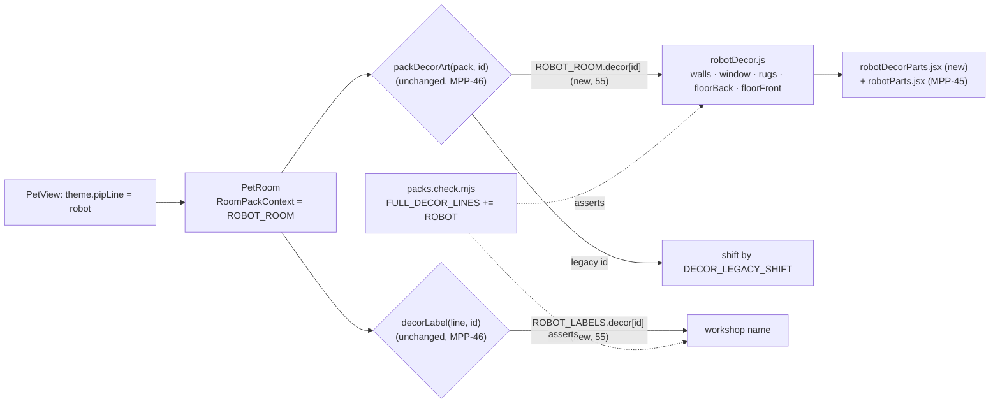

# Plan: Themed Pip rooms — robot workshop decor (55 items and names)

Plan folder: `.claude/contract/MPP-47-robot-workshop-decor/`
Execution status: see `tasks.md` in this folder.

---

## Part 1 — Alignment

### Task reference

Jira **MPP-47** (Story, Medium), "Themed Pip rooms: robot workshop decor (55 items and names)". Blocked by MPP-45, which is now `Ready for Test` (v1.35.0). The sister story MPP-46 (dragon lair decor, v1.36.0, `COMPLETE`) built the parts this story reuses: the legacy shift in `packDecorArt`, `decorLabel`, `FULL_DECOR_LINES` and the per-line bought line.

Acceptance criteria (verbatim):

1. **All 55 drawn in Cyberpunk.** All 55 decor ids in `DECOR_ITEMS` draw their workshop version in Cyberpunk. The art is ported from the approved `pip-room-robot.html` (`ROBOT_ROOM.decor`). Each item sits inside its spot shape, and the 12 legacy ids keep the `DECOR_LEGACY_SHIFT` behaviour.
2. **Workshop names everywhere.** Each item shows its workshop name (`ROBOT_ROOM.labels.decor`) in the decor picker, the Shop Decor tab and the "bought" bubble.
3. **Shared ownership.** Ids, spots, prices and ownership are unchanged. An item bought in any theme shows in the workshop, with nothing re-bought.
4. **Animation stops when it should.** Animated items (LED strips, monitor scan, digital clock, holo table and the rest) stop under Low FX and `prefers-reduced-motion`. They also stop in shop and picker thumbnails, and neon glow is removed under Low FX.
5. **Coverage check.** `npm run check:room` asserts the robot pack draws and names all 55 decor ids with finite output. The herb fallback is no longer used for the robot line.
6. **Nothing else changes.** Default and Parchment rendering are unchanged, and `npm run build` passes.

Scope from the ticket. In: the 55 workshop decor drawings and names, their ambience entries, their thumbnails, the coverage check. Out: the engine, shell (including the night-window rain), stations, styles and themed UI (MPP-45); dragon decor (MPP-46); any server or database change; new decor ids or spots.

Risks from the ticket: port, don't redesign. The small items (wall lamp, antenna pair, memory chips) read small at thumbnail size, so check them at the shop crop.

Design source: `foodbytes-app/mockup/pip-room-robot.html` (approved 2026-11-16). It holds `ROBOT_ROOM.decor` (lines 1291–1614), the decor helpers (lines 995–1026), `ROBOT_ROOM.ambience` (decor entries at lines 1669–1675), `ROBOT_ROOM.labels.decor` (lines 1689–1713) and its fit table. Spec: `.claude/contract/2026-11-16-themed-pip-rooms-mockups/spec.md`.

### Restated goal

On Cyberpunk, Pip's room is the robot workshop, but every decor item still borrows its herb drawing and herb name, so there is a basil print and gingham curtains in a workshop. This story ports the 55 workshop decor drawings from the approved mockup into the robot room pack and adds the 55 workshop names. Every owned item then draws and is named as its workshop version in the room, the decor picker, the Shop Decor tab, the edit-mode spot buttons, the bought line and the recent-sprinkles list. MPP-46 already built all of the plumbing (legacy shift, `decorLabel`, per-line bought line, coverage set), so this story adds data and tightens the check. Robot joins `FULL_DECOR_LINES`, and the herb and dragon rooms render exactly as before.

### In scope

- Port the mockup's robot decor-only helpers and palette (`HI`, `PLATE`, `INKBLUE`, `ellU`, `slabU`, `bandAt`, `ringLine`, `ellBand`, `limb`, `gear`, `hat`, `digit7`) to JSX in a new `robotDecorParts.jsx`.
- Port all 55 `ROBOT_ROOM.decor` drawings to JSX in five area files, merge them in `robotDecor.js` and register them as `ROBOT_ROOM.decor`.
- Add the 25 decor ambience entries to `ROBOT_ROOM.ambience`.
- Add `ROBOT_LABELS.decor` (55 names, verbatim from the mockup). Every surface already reads names through `decorLabel`.
- Add `PIP_LINE.ROBOT` to `FULL_DECOR_LINES` in `packs.check.mjs`. Change the robot bought-line assert in `room.check.mjs` to the workshop name, and add a robot assert to `sprinkleHistory.check.mjs`.
- Drift guards: the herb SSR baseline, plus a new dragon decor snapshot (55 drawings and names). Write both before any edit and compare byte for byte after.
- Mockup sync: `foodbytes-app/mockup/README.md` rows for the robot room.
- Version bump (Story → MINOR) and CHANGELOG.

### Explicitly out of scope

- Any engine change (`roomPacks.jsx`, `roomLayout.js`, `decorArt.jsx`), any component change, and any change to `roomFx.css`. MPP-46 made every surface line-aware.
- Shell, stations, styles, themed chrome, the night-window rain.
- Dragon pack files and `DRAGON_LABELS`.
- Redrawing or enlarging any item, including the three small ones the ticket names. They are ported verbatim and checked at the shop crop (see Assumptions).
- Lifting the shared helper shapes (`ellU`, `slabU`, `ringLine`, `ellBand`, `limb`) into `packShapes.jsx` (see Approach → roads not taken).
- Server, DTO, database, prices, ids, spots, `DECOR_SPOT_LABELS`.

### Pattern Reference

The brief names only the mockup. References chosen:

- **The whole contract:** `.claude/contract/MPP-46-dragon-lair-decor/` (`plan.md`, `tasks.md`). It is the same story for the dragon line, already shipped. This plan follows its port conventions, area split, task shape and verification commands.
- **Drawing port:** `client/src/components/pet/room/packs/dragon/dragonDecorParts.jsx` and `dragonDecorWalls.jsx` show the decor-helper and drawing form. `packs/robot/robotParts.jsx` holds the robot helpers MPP-45 already ported (`S`, `led`, `ledOn`, `neon`, `screenV/U`, `traceV/U`, `scanV/U`, `seamsU`, `slotsU`, `hazardU`, `dial`, `armSeg`, `joint`, `sensor`, `coil`).
- **Names:** `DRAGON_LABELS.decor` in `client/src/constants/petRoomLabels.js`.
- **Coverage check:** `FULL_DECOR_LINES` in `client/src/components/pet/room/packs/packs.check.mjs`.

### Constraints flagged on the brief

- Port verbatim from the approved mockup. No redesign.
- Ids, spots, prices and ownership unchanged (no server change).
- Animations stop under Low FX, reduced motion and in thumbnails, and glow is removed under Low FX.
- Default (herb) and Parchment (dragon) rendering unchanged; `npm run build` passes.
- CLAUDE.md theme rules: Pip's room art keeps its own literal palette (the colour-token rule does not apply inside `components/pet/`), and theme-specific markup branches on `theme.pipLine`, never on a theme id.
- react-frontend: no file over 400 lines, no `dangerouslySetInnerHTML`, no `console.log`.

### Assumptions made

- **No engine, component or CSS change is needed.** MPP-46's `packDecorArt` already shifts any pack-drawn legacy id, and every name surface already calls `decorLabel(line, id)`. The mockup uses only `blink`, `buzz` and `scan`, which `roomFx.css` already defines and stops. If the executor finds a gap, it is a stop-and-ask, not a silent engine edit.
- **"Neon glow is removed under Low FX" means in the room**, through the existing `body.lowfx .pip-room-svg [data-glow]` rule that MPP-45 added and the dragon pack uses. Thumbnails do not animate, but they keep their static glow under Low FX. Extending the rule to thumbnails would also change Parchment's thumbnails under Low FX, which AC 6 rules out. Red-line this if you want thumbnail glow stripped too.
- **Helpers go in a robot-only `robotDecorParts.jsx`, mirroring `dragonDecorParts.jsx`.** Five helpers have the same shape as the dragon ones but a different ink and defaults. `bandAt` defaults to `GUN_DK` here and to `IRON` for dragon. Sharing them would mean editing dragon files.
- **The three small items are ported verbatim.** The ticket says to check the wall lamp (`wall-sconce`), antenna pair (`sill-cactus`) and memory chips (`sill-succulents`) at the shop crop, not to redraw them. Task 12 checks them, and a too-small result is reported back rather than redrawn in this story.
- **A dragon snapshot backs up the "Parchment unchanged" claim.** The `packs/` folder is untracked, so `git diff` cannot show that dragon files are untouched. Phase 1 writes the 55 dragon drawings and names to `dragon-baseline.txt` in this folder, and Final verification compares against it.
- **The herb SSR baseline is written fresh into this folder**, as MPP-46 did, rather than reusing MPP-46's folder, which moves when that contract is archived.
- **Fit is checked against the mockup, not re-measured.** The live code has no bounds measurer for JSX, so a verbatim port inherits the mockup fit table's results. The executor confirms the table reads all-OK and walks each spot on localhost with `PET_FREE_MODE`.
- **The legacy ids are already drawn in MPP-27 coordinates in the mockup** ("legacy ids drawn at u 150-186 …"), so the art is ported as-is and `packDecorArt` shifts it.

### Cross-code alignment audit (FE ↔ BE ↔ DB)

Skipped: no persistence is touched. Decor ids, spots, prices and ownership come unchanged from the existing `PetRoomDTO`. This story only changes how the client draws and names known ids. Names were checked client-side instead. The mockup's `labels.decor` has 55 keys in the same 12 spot groups as `DRAGON_LABELS.decor`, which `packs.check.mjs` already proves match `DECOR_ITEMS`. The same check, applied to robot through `FULL_DECOR_LINES`, proves it at run time.

---

## Part 2 — Technical design

### Approach

This is the second half of a pattern MPP-46 already shipped. `PetRoom` provides the active pack through `RoomPackContext`. Every decor draw goes through `packDecorArt(pack, id)`, which uses `pack.decor[id]()` when present (shifting the 12 legacy ids by `DECOR_LEGACY_SHIFT`) and otherwise falls back to herb. Every decor name goes through `decorLabel(line, id)`, which reads `ROOM_LABELS[line].decor` with a herb fallback. So the robot workshop needs two pieces of data: a 55-entry `ROBOT_ROOM.decor` map and a 55-entry `ROBOT_LABELS.decor` map. No code paths change.

The drawings are the mockup's string builders rewritten as JSX. They use the helpers MPP-45 ported into `robotParts.jsx` (`S = packShapes(ROBOT_INK)` with `poly`, `box`, `rectV/U/H`, `cylE`, `cyl`, `ellH`, `bill`, `fxg`, `isoLine(s)`, plus `led`, `neon`, `screenV`, `scanV`, `hazardU`, `dial`, `armSeg`, `joint`, `sensor`). The decor-only helpers go in a new `robotDecorParts.jsx`: `ellU`, `slabU`, `bandAt`, `ringLine`, `ellBand`, `limb`, `gear`, `hat`, `digit7`, and the `HI` / `PLATE` / `INKBLUE` constants. The mockup's `glow(color, inner, r)` becomes `glowG(color, inner, r)`, and the mockup `bill`'s 5th (measurer) argument is dropped. The drawings split by area as the herb and dragon decor do: walls, window, rugs, back floor, front floor. `robotDecor.js` merges them into `ROBOT_DECOR`, and `robotRoom.js` sets `decor: ROBOT_DECOR`. Each area file is registered as it lands, so the build stays green between tasks and any id not yet ported keeps falling back to herb.

Animation needs no new CSS. The ported drawings keep the mockup's `fxg('blink' | 'buzz' | 'scan', …)` wrappers, which emit `room-fx room-fx--*` classes. `roomFx.css` already stops those under `body.lowfx`, under `prefers-reduced-motion`, and inside `.pip-decor-thumb`, `.pip-shop-thumb-svg` and `.pip-style-swatch`. Neon glows come from `glowG`, whose `data-glow` the Low FX rule already strips in the room. `ROBOT_ROOM.ambience` gains the mockup's 25 decor entries. They are declarative, and `packs.check.mjs` validates each target and effect against `roomFx.css`. The coverage check then puts robot in `FULL_DECOR_LINES`, so `check:room` fails if any of the 55 drawings or names is missing or renders non-finite markup.

Roads not taken:
- **Lift the five shared helpers into `packShapes.jsx`.** It would remove some duplication, but it means editing `dragonDecorParts.jsx` and every dragon file that imports from it, which risks AC 6 for no user gain. The two copies differ in ink and defaults anyway.
- **Inject the mockup's SVG strings with `dangerouslySetInnerHTML`.** The port would be faster, but it breaks the skill rule and the JSX caching the room relies on.
- **Strip glow in thumbnails under Low FX.** This would change the Parchment thumbnails (see Assumptions).

### Skills to invoke during execution

- `react-frontend` owns every file touched (`client/src/`): file order, the 400-line budget, no `dangerouslySetInnerHTML`, no `console.log`, constants in `src/constants/`, and honest verification. There is no frontend test runner, so `check:room`, `check:sprinkles`, the SSR compare and `build` are the gates.

No `.claude/rules/` file applies (no recipe, ingredient, macro, meal-plan or migration work).

### Diagram



### Data shapes

#### Robot pack decor (new modules under `client/src/components/pet/room/packs/robot/`)

| File | Exports | Ids (mockup lines) |
|---|---|---|
| `robotDecorParts.jsx` | `HI`, `PLATE`, `INKBLUE`; `ellU(up, vc, hc, rv, rh, fill, o, n = 16)`, `slabU(up, th, vh, fill, o)`, `bandAt(cu, cv, r, h, color = GUN_DK, w = 1.4)`, `ringLine(cu, cv, h, ru, rv, w, color, dash)`, `ellBand(cu, cv, ru, rv, a, b, h, fill)`, `limb(d, w, color)`, `gear(u, v, h, r, color)`, `hat(u, v, h, s = 1)`, `digit7(n, x, y)` | helpers, lines 995–1026 |
| `robotDecorWalls.jsx` | `ROBOT_WALL_DECOR` | overWardrobe (5), bedsideWall (4), frontRightWall (5) = 14 (1292–1372) |
| `robotDecorWindow.jsx` | `ROBOT_WINDOW_DECOR` | windowDressing (5), windowsill (5) = 10 (1373–1434) |
| `robotDecorRugs.jsx` | `ROBOT_RUG_DECOR` | rug (6) (1435–1489) |
| `robotDecorFloorBack.jsx` | `ROBOT_FLOOR_BACK_DECOR` | backCorner (4), bedsideNook (4), footOfBed (4) = 12 (1490–1546) |
| `robotDecorFloorFront.jsx` | `ROBOT_FLOOR_FRONT_DECOR` | byFridge (5), cornerByDoor (4), frontOfRoom (4) = 13 (1547–1613) |
| `robotDecor.js` | `ROBOT_DECOR = { ...walls, ...window, ...rugs, ...floorBack, ...floorFront }` | 55 |

Each map is `{ [decorId]: () => ReactNode }`, a zero-argument builder returning art in world coordinates (the legacy ids in MPP-27 coordinates). `limb` and `digit7` return JSX (`<path>` elements) instead of strings. `SEG7` / `SEG7_D` and `ringPts` stay file-private in `robotDecorParts.jsx`. Arrays built with `.map(...)` are spread into `cat(...)`.

#### `ROBOT_ROOM` (modified, `robotRoom.js`)

```js
decor: ROBOT_DECOR,
ambience: [ /* 13 existing shell/window/station entries, then: */
  // decor
  { target: 'fairy-lights', effect: 'blink' }, { target: 'recipe-board', effect: 'scan' }, { target: 'pip-portrait', effect: 'scan' }, { target: 'photo-strip', effect: 'scan' },
  { target: 'wall-sconce', effect: 'buzz' }, { target: 'wall-clock', effect: 'blink' }, { target: 'bunting', effect: 'blink' }, { target: 'mirror', effect: 'scan' },
  { target: 'window-lights', effect: 'blink' }, { target: 'plant-hanger', effect: 'buzz' }, { target: 'sill-basil', effect: 'buzz' }, { target: 'sill-cactus', effect: 'blink' },
  { target: 'sill-radio', effect: 'blink' }, { target: 'sill-cat', effect: 'blink' },
  { target: 'cactus', effect: 'buzz' }, { target: 'side-table-lamp', effect: 'buzz' }, { target: 'record-player', effect: 'blink' }, { target: 'plant-stand', effect: 'buzz' },
  { target: 'stool-books', effect: 'blink' }, { target: 'laundry-basket', effect: 'blink' },
  { target: 'lemon-tree', effect: 'blink' }, { target: 'monstera', effect: 'blink' }, { target: 'arc-lamp', effect: 'buzz' }, { target: 'tea-table', effect: 'buzz' }, { target: 'pip-ball', effect: 'buzz' }
]
```

(25 decor entries, copied verbatim from lines 1669–1675.)

#### Names (modified, `client/src/constants/petRoomLabels.js`)

```js
ROBOT_LABELS.decor = { 'basil-print': 'Circuit poster', /* … 55 entries verbatim from pip-room-robot.html:1689-1713 … */ 'picnic-basket': 'Cargo case' }
// decorLabel(line, id) unchanged
```

#### Coverage check (modified, `packs.check.mjs`)

```js
const FULL_DECOR_LINES = new Set([PIP_LINE.DRAGON, PIP_LINE.ROBOT])
```

#### Drift baselines (new files in this plan folder)

- `ssr-baseline/`: herb room SSR fixtures (`npm run snapshot:room -- --write`).
- `dragon-baseline.txt`: one line per decor id, `id|decorLabel('dragon', id)|<rendered dragon drawing markup>`, 55 lines.

No server, DTO, API or schema changes.

### Runtime quality notes

Frontend-only. The dimensions are mapped onto the browser runtime.

- **Resource cleanup:** No effects, listeners or timers are added. Animations are CSS-only (`room-fx--*`), started and stopped by class and media query.
- **Concurrency / ordering:** None. Builders are pure and deterministic, so the cached element per `robot:id` in `decorCache` is stable across renders. Ownership is server state and is untouched.
- **Allocation / cost behaviour:** Each id is built once per line and cached (55 more entries in `decorCache`). Only the 12 placed items plus visible thumbnails are live nodes. The bundle grows by the ported drawings, about 25–35 KB unminified, mostly coordinates. The workshop is glow-heavy (neon strips, LEDs, screens), so on the Shop Decor tab up to 55 thumbnails carry `drop-shadow` filters. That is static paint, but it costs more than the herb tab on low-end phones. Low FX strips glow only in the room (see Risks).
- **Error paths:** An unknown id still returns `null` (no art, no crash). A builder that throws would break the room render, which is why `packs.check.mjs` renders all 55 robot builders under SSR and asserts finite markup (no `NaN`, `Infinity` or `undefined`). A missing name would fall back to herb, and `FULL_DECOR_LINES` makes that a check failure for robot.

### Risks and judgement calls

- **Port fidelity is checked by eye, not by a measurer.** The SSR check proves every drawing renders and is finite, not that it sits inside its spot. The executor must confirm the mockup's fit table reads all-OK for decor and walk all 12 spots on localhost (Cyberpunk, `PET_FREE_MODE`, edit mode).
- **String → JSX translation is the main risk of slips.** The mockup's robot decor uses inline strings heavily: `digit7` paths, `gear` teeth paths, `hat`, `transform="rotate(...)"`, `stroke-width`, `fill-opacity`, `stroke-linecap`, `opacity`, `rx`. The MPP-46 translation table (copied into `tasks.md`) covers them, and Final verification greps for kebab-case attributes left in `packs/robot/`.
- **Thumbnail glow under Low FX is kept.** This is a defensible reading of AC 4, but it is a choice: the stricter reading would strip glow in thumbnails too, and that would change Parchment under Low FX.
- **Helper duplication with the dragon pack** (five small helpers). It is accepted for isolation, and a shared-helper refactor could follow in its own ticket.
- **Small items at the shop crop.** `wall-sconce`, `sill-cactus` and `sill-succulents` may read tiny in thumbnails. This plan only checks and reports; enlarging them would be a redesign.
- **Baselines must be written first.** Phase 1 Task 1 runs before any source edit, or neither drift guard means anything.
- No manual DB or Railway step. Deploy is the normal push, and nothing needs ordering.
