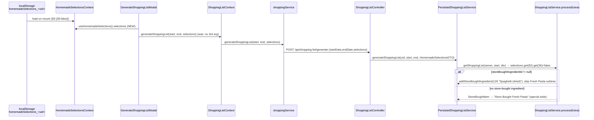

# Plan: Shopping list honours homemade / store-bought selections

Plan folder: `.claude/contract/MPP-8-shopping-list-store-bought-selections/`
Execution status: see `tasks.md` in this folder.

---

## Part 1 — Alignment

### Task reference
Jira **MPP-8** (Bug, High) — *"Shopping list ignores store-bought selections: Generate modal never sends homemade/store-bought choices (e.g. Spaghetti Bolognese lists Fresh Pasta flour/egg instead of dried spaghetti)"*. Related: MPP-1 (Done, same `processExtras` code path).

Root cause per the ticket: `GenerateShoppingListModal.jsx:33` calls `generateShoppingList(startDate, endDate)` without the third `selections` argument. Every layer below it (context → `shoppingService` → `ShoppingListController` → `PersistedShoppingListService` → `ShoppingListService.processExtras`) already supports selections. With `selections == null` the backend treats every extra as homemade.

Proposed fix (from the ticket): read `selections` from `useHomemadeSelections()` in the modal and pass it as the third argument. Confirm in a test that Jackson deserialises the string JSON keys into `Map<Long, Map<Long, Boolean>>`. No schema change.

Acceptance criteria (verbatim):
1. Generating a list with a parent recipe whose extra is set to Store-bought, and which has a `store_bought` ingredient, lists that ingredient and none of the linked recipe's ingredients, including nested child extras.
2. A store-bought extra **without** a store-bought ingredient falls back to the existing "store-bought item" row (`addStoreBoughtItems`, special aisle). No regression.
3. With no saved selection, or Homemade selected, the list is unchanged from current behaviour.
4. The live repro above (user 1, Oct 12–14, Spaghetti Bolognese set to store-bought) produces *Spaghetti (dried)* and no Plain flour/Egg/Salt from source chain `[36, 82]`.
5. A backend test pins that `POST /api/shopping-list/generate` with a `selections` body using string keys honours the store-bought branch.

Out-of-scope notes from the ticket: variant switching changes the recipe id, so a saved selection no longer matches ("decide whether in scope"). Selections are per-browser. Existing lists are not fixed retroactively. The `ingredient-breakdown` sibling divergence is a follow-up ticket.

### Restated goal
When a user marks a linked extra (e.g. Fresh Pasta on Spaghetti Bolognese) as Store-bought and then generates the persisted shopping list, the list must show the store-bought product (Spaghetti (dried)) instead of the homemade sub-recipe's raw ingredients. The fix is to have the Generate modal send the user's saved localStorage selections with the request. Backend tests then lock in the contract the frontend relies on: string-keyed JSON deserialises correctly, the controller forwards it, and the service takes the store-bought branch (with fallback and no-regression cases).

### In scope
- `GenerateShoppingListModal.jsx` passes `selections` from `useHomemadeSelections()` into `generateShoppingList(startDate, endDate, selections)`.
- A Jackson DTO test: `GenerateShoppingListRequest` deserialises `{"selections":{"82":{"36":false}}}` into `Map<Long, Map<Long, Boolean>>` with `Long` keys (AC5).
- A controller unit test: `ShoppingListController.generateShoppingList`, given that string-keyed body, forwards a `HomemadeSelectionsDTO` carrying `{82L: {36L: false}}` to `PersistedShoppingListService` (AC5).
- `ShoppingListService` tests for the store-bought branch:
  - with a store-bought ingredient, the ingredient is listed; the linked recipe and its nested child are neither listed nor loaded (AC1);
  - without one, the "Store Bought <name>" fallback row is listed (AC2);
  - with an explicit Homemade (`true`) selection, the result matches the null-selection behaviour (AC3).
- A manual production check after deploy covering the live repro (AC4).

### Explicitly out of scope
- **Variant-switch selection mismatch.** Saved selections are keyed by the recipe id at assignment time, so switching Light/Moderate/Balanced loses them. This needs a separate ticket.
- **Server-side persistence of selections** (cross-device). Separate story per the ticket.
- **Retroactive fix of existing `shopping_lists` rows.** Users regenerate after deploy.
- **`GET /api/meal-plan/shopping-list/ingredient-breakdown`** divergence for store-bought rows. A follow-up ticket per the ticket.
- **Store-bought quantity semantics.** `addStoreBoughtIngredient` adds quantity `1`, no unit, per occurrence. This is pre-existing and not touched.
- **`PersistedShoppingListService` ignoring `endDate`.** `ShoppingListService.getShoppingList` always uses `startDate + 7`. This is pre-existing and not touched; it is flagged under Risks.
- Any backend production code change. Any nutrition/macro change: nutrition stays on the homemade basis by design.

### Pattern Reference
None supplied beyond the files the ticket names. References chosen:
- Frontend: the existing `useShoppingList()` destructure in `GenerateShoppingListModal.jsx:10`, mirrored for `useHomemadeSelections()`. `ExtrasSelectionPopup.jsx` already consumes that hook.
- DTO test: `foodbytes-api/src/test/java/com/foodbytes/dto/MealPlanCreateRequestTest.java` (plain `ObjectMapper` + `JavaTimeModule`, no Spring context).
- Service tests: `ShoppingListServiceTest.extraWithPartialPortionUsed_ProratesRawIngredientsByGramsNotServings` (Mockito, `RecipeExtraNodeDTO.builder()`, `recipe(...)` / `linkedRecipeIngredient(...)` helpers).

### Constraints flagged on the brief
- Nutrition is unaffected. kcal and macros always come from the homemade linked recipe (CLAUDE.md, FR-103). Only the shopping list changes.
- No schema or migration change.
- Behaviour with no saved selection, or with Homemade selected, must not change (AC3).
- Ship through `/fb-plan` → `/fb-apply`. No fix is committed yet.

### Assumptions made
- **Send the whole `selections` map, not a range-filtered subset.** The backend looks up `selectionsMap.get(recipeId)` per entry, so extra keys are ignored. Filtering client-side would mean fetching meal-plan entries for an arbitrary range inside the modal. The map is small: one entry per recipe the user ever assigned with extras.
- **Send `null` when the map is empty.** The controller already maps empty to `null`. The modal passes the map as-is and lets the existing controller guard handle it, so no client special-casing is added.
- **No wait on `selectionsLoaded`.** `HomemadeSelectionsProvider` wraps `ShoppingListProvider` in `main.jsx` and loads synchronously from localStorage in a mount effect. By the time a user opens the modal, the selections are loaded.
- **AC5 is pinned by a DTO Jackson test plus a Mockito controller unit test, not `@WebMvcTest`/MockMvc.** No existing test boots a Spring context. `SecurityConfig` plus the JWT filter would need heavy mocking, and Spring Boot's `ObjectMapper` uses the same Jackson `Long` key deserialiser as a plain `ObjectMapper`. Together the two tests cover JSON → DTO → controller → service hand-off.
- **Variant-switch mismatch stays out of scope.** The ticket left it open. Fixing it means re-keying selections by family or extra, which is a design change, not a one-line fix.
- **Layer placement:** frontend change in the component (the one caller). No new hook or context, since the logic is one destructure plus one argument.

### Cross-code alignment audit (FE ↔ BE ↔ DB)
- **DB: the dual-path row exists as described.** `SELECT … FROM recipe_ingredients WHERE recipe_id=82 AND linked_recipe_id IS NOT NULL` → `{id: 869, recipe_id: 82, ingredient_id: 126, store_bought: "Spaghetti (dried)", linked_recipe_id: 36, linked: "Fresh Pasta", quantity_grams: "200.00"}`.
- **Blast radius:** `recipe_ingredients` with `linked_recipe_id IS NOT NULL` → `dual_path: 58, link_only: 45, total_links: 103` (58 dual-path rows across 45 parent recipes). The 58 dual-path rows hit the AC1 branch when set to store-bought. The 45 link-only rows hit the AC2 fallback.
- **No schema touched.** No `SHOW COLUMNS` needed, and no migration is required for this plan. The untracked migrations in the working tree are recipe-data inserts, unrelated to this change.
- **FE shape:** `HomemadeSelectionsContext` stores `{ [parentRecipeId]: { [extraRecipeId]: boolean } }`. `ExtrasSelectionPopup.handleConfirm` saves a flat per-parent map that includes nested child ids (cascade-unchecked descendants become `false`).
- **Wire:** `shoppingService.generateShoppingList` POSTs `{ startDate, endDate, selections }` to `/shopping-list/generate` (`/api` base).
- **BE:** `GenerateShoppingListRequest.selections : Map<Long, Map<Long, Boolean>>`, wrapped into `HomemadeSelectionsDTO.selections` (same type) by `ShoppingListController:91-95`. `ShoppingListService.getShoppingList` uses `selectionsMap.get(recipeId)`, then `processExtras` uses `selections.get(extraRecipeId)`, passing the same per-parent map to nested children.
- **Names align end to end** (`selections` at every hop; parent → extra → boolean). The one shape seam is string JSON keys → `Long` map keys, which the DTO test pins.

---

## Part 2 — Technical design

### Approach
The defect is a dropped argument at the only call site. Everything downstream already does the right thing. The fix is one destructure and one argument in `GenerateShoppingListModal.jsx`: `const { selections } = useHomemadeSelections()`, then `await generateShoppingList(startDate, endDate, selections)`. `ShoppingListContext` and `shoppingService` already forward the third argument into the POST body.

Alternatives considered and rejected:
- **Read selections inside `ShoppingListContext.generateShoppingList`.** This would make the context the single owner, but `HomemadeSelectionsContext.jsx` deliberately avoids depending on `ShoppingListContext` (see its "avoid circular dependency" comment). Coupling the reverse direction inside the provider would also change the context's public contract for a one-caller fix.
- **Persist selections server-side.** This is the right long-term fix for cross-device use, but it is a schema and endpoint story the ticket explicitly defers.
- **Filter selections to the date range on the client.** This needs entry data the modal doesn't hold. The backend already ignores irrelevant keys.

Backend work is test-only and pins the contract the frontend now relies on:
1. `GenerateShoppingListRequestTest` (new, `dto/`) checks that string keys deserialise to `Long`, and that a missing `selections` deserialises to `null`.
2. `ShoppingListControllerTest` (new, `controller/`, Mockito) feeds the deserialised request to the controller method and captures the `HomemadeSelectionsDTO` handed to `PersistedShoppingListService`.
3. Three new cases in `ShoppingListServiceTest` exercise `processExtras` store-bought, fallback and explicit-homemade branches. The store-bought case nests a child extra under the store-bought extra and asserts the child is never loaded (`verify(recipeRepository, never()).findById(...)`). That is the "including nested child extras" clause of AC1.

### Skills to invoke during execution
- `react-frontend` — owns the `GenerateShoppingListModal.jsx` edit: context-hook consumption, no direct axios, file order, no `console.log`, line budget.
- `java-backend` — owns the three backend test files: Mockito/JUnit 5 style matching `ShoppingListServiceTest`, DTO test matching `MealPlanCreateRequestTest`. No production Java change.

Rules to Read: `.claude/rules/linked-recipe-extras.md` (FR-103 dual-path semantics; nutrition stays homemade). Developer confirmed both skills with no override.

### Diagram


### Data shapes
No schema or contract changes. The existing contract is now exercised end to end.

#### HTTP request (unchanged, now populated)
```json
POST /api/shopping-list/generate
{ "startDate": "2026-10-12", "endDate": "2026-10-14",
  "selections": { "82": { "36": false } } }
```
`selections` may be `{}` or absent, and both mean all-homemade.

#### Java types (unchanged)
- `GenerateShoppingListRequest { LocalDate startDate; LocalDate endDate; Map<Long, Map<Long, Boolean>> selections; }`
- `HomemadeSelectionsDTO { Map<Long, Map<Long, Boolean>> selections; }`
- `RecipeExtraNodeDTO { Long recipeId; String recipeName; Integer displayOrder; Long storeBoughtIngredientId; List<RecipeExtraNodeDTO> children; }`

#### New test files
- `foodbytes-api/src/test/java/com/foodbytes/dto/GenerateShoppingListRequestTest.java`
- `foodbytes-api/src/test/java/com/foodbytes/controller/ShoppingListControllerTest.java`

### Runtime quality notes
Browser runtime for the frontend half, JVM for the test half.
- **Resource cleanup:** Trivial, no concerns. The modal adds no effects, listeners or timers. The generate POST is a write, so per `react-frontend` it is not auto-aborted.
- **Concurrency / ordering:** Selections are read at click time from context state, which is already loaded. `meal_plan_owner_id` sharing: selections come from the *generating* user's browser and apply to the owner's entries. That is acceptable, since today they are ignored entirely.
- **Allocation / cost behaviour:** The payload grows by the size of the selections map (a few hundred bytes). On the backend the store-bought branch does *less* work (one `ingredientRepository.findById` instead of walking the subtree). Passing `selections` as a new destructured value adds no re-render cost, because the modal already re-renders on context change.
- **Error paths:** Unchanged. `ShoppingListContext.generateShoppingList` catches and sets `error`, and the modal closes as today. A malformed selections body would be a 400 from Jackson, surfaced by the same error path. That cannot happen from this client because the map comes from `JSON.parse` of the app's own writes.

### Risks and judgement calls
- **AC5 without MockMvc.** A DTO Jackson test plus a controller unit test is used instead of a full `@WebMvcTest`. The developer should confirm this satisfies "a backend test pins `POST /api/shopping-list/generate`". The alternative needs security-filter mocking and would be the first context-booting test in the suite.
- **Pre-existing bug spotted: `endDate` is ignored.** `PersistedShoppingListService.generateShoppingList` passes only `startDate` to `ShoppingListService.getShoppingList`, which hard-codes `startDate + 7`. A 12–14 Oct range therefore pulls entries through 18 Oct. AC4 still passes (the only entry is 12 Oct), but this is worth its own ticket. Left untouched here.
- **Store-bought quantity is a count of `1` per occurrence, unit-less.** Two Bolognese meals produce "Spaghetti (dried) 2". This is pre-existing; noted so the developer isn't surprised during the AC4 check.
- **Breakdown popup will now visibly disagree** with the list for store-bought rows, as the ticket predicts. A follow-up ticket is recommended.
- **Variant switching drops selections.** It is out of scope; the user sees homemade ingredients after switching variant. A follow-up ticket is recommended.
- **Manual developer step:** after the frontend deploys on Railway, regenerate user 1's list for 2026-10-12 → 2026-10-14 with Fresh Pasta set to Store-bought and confirm AC4. Existing list `shopping_lists.id = 89` stays wrong until regenerated.
