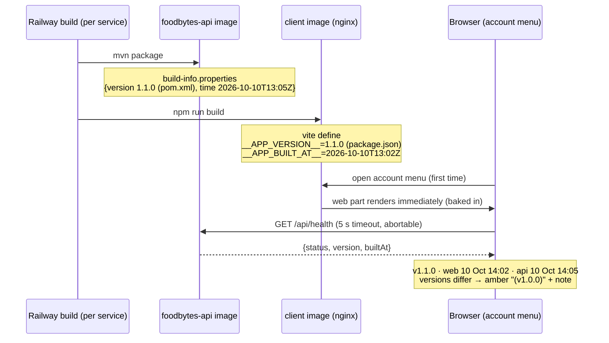

# Plan: Show deployed version + build time in the app (MPP-9)

Plan folder: `.claude/contract/MPP-9-deployed-version-commit-sha/`
Execution status: see `tasks.md` in this folder.

---

## Part 1 — Alignment

### Task reference
Jira **MPP-9** (Story, High): "Show deployed version + commit SHA in the app so you can tell whether a fix is live". https://amazerbeam.atlassian.net/browse/MPP-9

Acceptance criteria, verbatim from the ticket:

1. Both Dockerfiles declare `ARG RAILWAY_GIT_COMMIT_SHA`, and the short SHA is baked into the build. If the SHA is missing (local build, or Railway's manual "Deploy Latest"), the value falls back to "unknown" and the build does not fail.
2. `/api/health` returns `version`, `commit` and `builtAt`, generated at build time (Spring Boot build-info or equivalent) instead of a hard-coded string.
3. The frontend injects its version and SHA at build time through Vite `define`, and shows a small footer or settings line such as `v1.3.1 · web 7c9d3e1 · api 7c9d3e1`, with the api part read from `/api/health`.
4. There is one source of truth for the human version. package.json and pom.xml agree, and HealthController no longer hard-codes it.
5. The version follows SemVer per ticket: a Bug bumps the last number (1.3.0 → 1.3.1), and a Story or Task bumps the middle number and resets the last (1.3.1 → 1.4.0). `CHANGELOG.md` is added with one line per ticket, e.g. `1.3.1 — MPP-8: shopping list store-bought fix`.
6. `/fb-apply` (or the fb workflow docs) includes the version bump and changelog line as a required step, so it is not left to memory.
7. CLAUDE.md documents the convention: where the version lives, the bump rules, that commit messages carry the ticket key (`MPP-n: …`), and how to check whether a fix is live with `git merge-base --is-ancestor <ticket commit> <deployed SHA>`.

Ticket scope: in = Dockerfile build args, build-info on `/api/health`, Vite `define` + display, version consolidation, CHANGELOG.md, fb workflow step, CLAUDE.md. Out = release-please / semantic-release, git tags / GitHub Releases, CI pipelines, Actuator exposure.

**Developer decisions, 2026-10-10. These override the ticket where they conflict:**
- Skills confirmed: `java-backend`, `react-frontend`, `requirements` (the developer added `requirements`).
- Placement A (account menu) approved from the mockup.
- **Red-line after first approval:** "just the version number and the date and time are the only things I need."
  - **Drop the commit SHA everywhere.** No `RAILWAY_GIT_COMMIT_SHA` build args and no Dockerfile changes. `/api/health` carries no `commit`. AC1 is withdrawn, AC2 becomes `version` + `builtAt`, AC3 shows build times instead of SHAs, and AC7's `git merge-base` check is replaced by a CHANGELOG version comparison.
  - **Display both builds, compact:** `v1.1.0 · web 10 Oct 14:02 · api 10 Oct 14:05`. Amber when the versions differ.
- The mockup has been revised to match: `C:\Users\jossd\Downloads\mpp-9-version-line-mockup.html`.

### Restated goal
Each running build will report its version and the time it was built. `/api/health` will return the version from `pom.xml` and the build timestamp, both stamped at build time by Spring Boot build-info rather than typed into Java. The frontend bakes in its own version (from `package.json`) and build time through Vite `define`. The account menu will show one line, `v1.1.0 · web 10 Oct 14:02 · api 10 Oct 14:05`, which turns amber when the two services report different versions.

Because every ticket bumps the version (Bug → patch, Story/Task → minor) and adds a CHANGELOG line, the version alone answers "is my fix live?": live once the shown version is at least that ticket's CHANGELOG version. The build time tells two builds of the same version apart. Around the display, package.json and pom.xml are set to the same number and a script fails when they or the CHANGELOG disagree. Every fb contract bumps the version, and CLAUDE.md documents the convention. MPP-9 is the first ticket under it: 1.0.0 → **1.1.0**.

### In scope
- `pom.xml`: a `build-info` execution on `spring-boot-maven-plugin`; version → `1.1.0`.
- `HealthController` returning a `HealthDTO` (`status`, `version`, `builtAt`) built from `BuildProperties`, falling back to `unknown` when build-info is absent; unit test.
- `vite.config.js` `define` for `__APP_VERSION__` (from package.json) and `__APP_BUILT_AT__` (ISO timestamp at build); `package.json` version → `1.1.0`.
- `formatBuildTime(iso)` in `src/utils/dateUtils.js`, producing `10 Oct 14:02` in the viewer's local time zone.
- A `healthService.js` service, a `useBuildInfo` hook, and a `VersionInfo` component + CSS rendering the line with mismatch / unknown / loading / error states per the revised mockup, mounted in the account menu.
- `client/scripts/check-version.mjs` + `npm run check:version`: asserts package.json == pom.xml == top CHANGELOG entry.
- `CHANGELOG.md` at the repo root, seeded with the 1.0.0 baseline and the MPP-9 1.1.0 line.
- fb workflow: `fb-plan.md`'s Final-verification template gets a mandatory "Bump version + CHANGELOG" task; `fb-apply.md` has QA run `npm run check:version` and reports the version in the final summary.
- A "Versioning & deploy verification" section in CLAUDE.md, covering where the version lives, the bump rules, `MPP-n:` commit messages, and the CHANGELOG-based "is my fix live?" check.
- `.docs/requirement-mpp-9-version-build-time-display-2026-10-10.md`: requirement doc for the developer-added `requirements` skill.

### Explicitly out of scope
- **Commit SHAs in any form:** Dockerfile build args, `-Dbuild.commit`, `git-commit-id-plugin`, a `commit` JSON key (developer red-line).
- Any change to either Dockerfile.
- release-please, semantic-release, git tags, GitHub Releases, CI pipelines (ticket).
- Exposing Actuator `info`/`env`; `management.endpoints.web.exposure.include: health` stays as it is (ticket).
- Backfilling CHANGELOG lines for MPP-1 … MPP-8, which shipped as 1.0.0-mvp; retroactive numbers would be invented.
- A global Axios timeout in `services/api.js` (known debt; it would affect every call).
- Retrofitting the `MPP-n:` commit prefix onto existing history.
- Editing the MPP-9 Jira ticket's ACs to match the red-line. The developer decides that separately.

### Pattern Reference
The ticket supplied none beyond "Spring Boot build-info or equivalent" and "Vite `define`". Chosen references:
- Backend controller test shape: `foodbytes-app/foodbytes-api/src/test/java/com/foodbytes/controller/ShoppingListControllerTest.java`, plain JUnit/Mockito with no Spring context.
- DTO as a Java record: `foodbytes-app/foodbytes-api/src/main/java/com/foodbytes/dto/PasswordLoginRequest.java`.
- Node check script wired as an npm script: `client/package.json` → `"check:macros"`.
- Date formatting helpers: `client/src/utils/dateUtils.js` (`formatDateShort` uses `toLocaleDateString`).
- Constants module with a doc comment: `client/src/constants/servings.js`.
- Visual contract: `C:\Users\jossd\Downloads\mpp-9-version-line-mockup.html` (revised, placement A, five states).
- Workflow edits go in the owning files: `.claude/commands/fb-plan.md` (template) and `.claude/commands/fb-apply.md` (QA prompt, final report).

### Constraints flagged on the brief
- One source of truth for the version; HealthController must not hard-code it (AC4).
- A difference between the frontend and backend must be visible, not hidden (ticket risk). With SHAs gone, this is carried by the version + build time.
- No Actuator exposure changes.
- Mockup before component code (done, revised).
- Project facts: `/api/health` is already `permitAll` (`SecurityConfig.java:51`); the Docker `HEALTHCHECK` curls it, so it must keep returning 200; there is no frontend test runner and no lint script; use `mvn`, not `./mvnw`; runners are PowerShell.

### Assumptions made
- **Confirmed: SHA dropped everywhere; both build times shown, compact; placement A.**
- **Version for this ticket is 1.1.0, suffix dropped.** MPP-9 is a Story, so it's a minor bump. The `-mvp` tag would make every later bump ambiguous.
- **"One source of truth" means two manifests kept identical by a failing check, not one shared file.** Railway builds each service from its own directory, so a root `VERSION` file is outside both Docker build contexts. Vite reads package.json, build-info reads pom.xml, and `npm run check:version` fails on any disagreement with each other or the CHANGELOG head.
- **"Is it live?" works off the version, so it needs no git.** That holds because each ticket bumps the version, which is the fb-workflow requirement this plan adds. Two deploys of the *same* version (e.g. a hotfix pushed without a bump) are told apart only by build time. CLAUDE.md says so.
- **The web build time is `new Date().toISOString()` at `vite build`**; the API build time is build-info's `time`. Both are serialised as ISO-8601 UTC and shown in the viewer's local time.
- **Display format `D Mon HH:mm`, 24-hour** (e.g. `10 Oct 14:02`), with the year left out of the line. The full timestamp goes in a `title` tooltip.
- **The response stays backwards-compatible:** `status: "UP"` is kept for the Docker `HEALTHCHECK`. The `version` value changes format (`1.0.0-MVP` → `1.1.0`).
- **`HealthDTO` record with a static `from(BuildProperties)` factory; no service class.** Mapping two properties with a fallback isn't business logic.
- **`BuildProperties` is injected via `ObjectProvider`**, so an IDE run without `build-info.properties` returns `unknown` instead of failing at startup.
- **Mismatch rule:** API version ≠ web version → the api part shows `api <time> (v<api version>)` in amber with a note. `unknown` never counts as a mismatch. Build times are never compared: two services built minutes apart are normal.
- **Health fetch:** lazy, on the first menu open, cached for the page session. 5 s timeout via a named constant. `AbortController` aborts it on unmount. Errors render `api unavailable` and are never swallowed into a fake success.
- **CHANGELOG at the repo root, newest first, one line per ticket**, with a `1.0.0` baseline floor.
- **Workflow placement:** the planner writes the bump into every `tasks.md` as Final-verification Task M.1, so the Implementer does it (`/fb-apply`'s orchestrator may not edit files itself), and QA gates on `check:version`. The bump type comes from the Jira issue type. Contracts without a ticket: bug fix → patch, anything else → minor.
- **`MPP-n:` commit messages stay in the convention** (AC7). They cost nothing and make `git log --grep` work, even though the live-check no longer depends on them.
- **The `requirements` doc is derived from the ticket ACs plus today's red-line, with no interview.**

### Cross-code alignment audit (FE ↔ BE ↔ DB)
Skipped: no persistence touched. The only FE ↔ BE contract is the `/api/health` JSON. Its keys (`status`, `version`, `builtAt`) are defined once in Data shapes and used identically by `HealthDTO` and `useBuildInfo`. Current state: the endpoint is `permitAll` (`SecurityConfig.java:51`) and returns `{"status":"UP","version":"1.0.0-MVP"}` (`HealthController.java:15-18`).

---

## Part 2 — Technical design

### Approach
**Backend.** Add a `build-info` execution to the existing `spring-boot-maven-plugin` in `pom.xml`. Spring Boot then writes `META-INF/build-info.properties` (`version` from the pom, `time`, etc.) at `generate-resources` and auto-configures a `BuildProperties` bean. `HealthController` takes an `ObjectProvider<BuildProperties>` and returns `HealthDTO.from(provider.getIfAvailable())`. No Dockerfile change is needed: the existing `mvn package` runs `build-info` automatically. Actuator `/info` was rejected because the ticket excludes Actuator.

**Frontend.** `vite.config.js` reads `package.json` with `fs.readFileSync` and defines `__APP_VERSION__` and `__APP_BUILT_AT__` (an ISO string captured when the config loads). Only `src/constants/buildInfo.js` reads these globals. `formatBuildTime(iso)` in `dateUtils.js` turns ISO into `10 Oct 14:02` in local time, or returns `null` when the input is unparseable. Callers render `null` as `unknown`.

`healthService.getHealth({ signal })` goes through the shared Axios instance. The `useBuildInfo()` hook owns the fetch, the `AbortController`, the four async states, the per-field `unknown` normalisation and the `versionMismatch` flag. `VersionInfo.jsx` only renders. `Header.jsx` mounts `<VersionInfo />` as the last child of `.user-dropdown`. Because the dropdown is rendered only while open, mounting it is what triggers the request, so it's lazy, and a module-scoped cache stops re-opens from refetching.

**Process.** `client/scripts/check-version.mjs` reads `package.json`, extracts the project `<version>` from `../foodbytes-api/pom.xml` (the one directly after `<artifactId>foodbytes-api</artifactId>`) and the first entry of `../../CHANGELOG.md`, and exits 1 with a specific message on any disagreement. It's a dev-time check, not run inside Docker.

`fb-plan.md`'s template gains a mandatory Final-verification Task M.1, "Bump version + CHANGELOG", and `fb-apply.md` adds `npm run check:version` to QA's prompt plus a `### Version` line in the final report. CLAUDE.md owns the convention; the two command files point at it rather than restating the bump rules.

**Ordering.** Requirement doc, then backend (self-contained, testable with `mvn`), then frontend (depends on the JSON shape), then the version bump + check script, then docs/workflow, then final verification. Each phase leaves both builds green.

### Skills to invoke during execution
- `java-backend`: the `pom.xml` build-info execution, the `HealthDTO` record, `HealthController` via `ObjectProvider<BuildProperties>`, `HealthControllerTest`. It owns layering (DTO over the wire, thin controller).
- `react-frontend`: Vite `define`, `constants/buildInfo.js`, `formatBuildTime`, `healthService.js`, the `useBuildInfo` hook (four async states, `AbortController`, timeout constant, no swallowed errors), the `VersionInfo` component + CSS (mobile-first, file-size budget), the mount in `Header.jsx`, and the `check-version.mjs` node script.
- `requirements`: writes `.docs/requirement-mpp-9-version-build-time-display-2026-10-10.md`. *Developer override:* the developer added this skill at the confirmation step. It runs without its interview because the ticket plus today's red-line answers every interview question.

Rules: no `.claude/rules/` file applies. No recipe, ingredient, macro, variant or migration data is touched.

### Diagram


### Data shapes

#### `/api/health` response (JSON)
```json
{
  "status": "UP",
  "version": "1.1.0",
  "builtAt": "2026-10-10T13:05:11.204Z"
}
```
All three keys are always present and always strings. When `BuildProperties` is absent, `version` and `builtAt` are `"unknown"`.

#### `HealthDTO` (new: `com.foodbytes.dto.HealthDTO`)
```java
public record HealthDTO(String status, String version, String builtAt) {
    public static final String UP = "UP";
    public static final String UNKNOWN = "unknown";
    public static HealthDTO from(BuildProperties build) { /* null → UNKNOWN fields; else version (blank → UNKNOWN), time?.toString() ?: UNKNOWN */ }
}
```

#### `HealthController` (modified)
`public ResponseEntity<HealthDTO> health()`, with a constructor-injected `ObjectProvider<BuildProperties> buildProperties`. Body: `ResponseEntity.ok(HealthDTO.from(buildProperties.getIfAvailable()))`.

#### `pom.xml` (modified)
- `<version>1.1.0</version>`
- `spring-boot-maven-plugin` → `<executions><execution><goals><goal>build-info</goal></goals></execution></executions>`

#### `vite.config.js` (modified)
```js
define: {
  __APP_VERSION__: JSON.stringify(pkg.version),
  __APP_BUILT_AT__: JSON.stringify(new Date().toISOString()),
}
```

#### Frontend modules
- `src/constants/buildInfo.js` (new): `UNKNOWN_BUILD_VALUE = 'unknown'`, `WEB_VERSION` (`__APP_VERSION__`), `WEB_BUILT_AT` (`__APP_BUILT_AT__`), `HEALTH_TIMEOUT_MS = 5000`.
- `src/utils/dateUtils.js` (modified): `export const formatBuildTime = (iso) => string | null`, giving `'10 Oct 14:02'` (en-GB, local time zone, 24-hour) or `null` when unparseable.
- `src/services/healthService.js` (new): `getHealth({ signal })` → `api.get('/health', { signal, timeout: HEALTH_TIMEOUT_MS })` → `response.data`.
- `src/hooks/useBuildInfo.js` (new): `useBuildInfo()` returns `{ status: 'loading'|'success'|'error', web: { version, builtAt }, api: { version, builtAt } | null, versionMismatch: boolean }`. Raw ISO strings with per-field `unknown`; formatting happens in the component.
- `src/components/layout/VersionInfo.jsx` + `VersionInfo.css` (new): classes `.version-info`, `.version-info__sep`, `.version-info__part--mismatch`, `.version-info__part--muted`, `.version-info__note`. Text per the revised mockup.

#### Process files
- `CHANGELOG.md` (repo root, new): a `# Changelog` header, then newest-first lines in the form `<version> — <KEY>: <summary>`. Seed lines: `1.1.0 — MPP-9: show deployed version + build time in the app` and `1.0.0 — baseline before per-ticket versioning (shipped as 1.0.0-mvp)`.
- `foodbytes-app/client/scripts/check-version.mjs` (new), plus the `package.json` script `"check:version": "node scripts/check-version.mjs"`.
- `CLAUDE.md`: a new `## Versioning & deploy verification` section.
- `.claude/commands/fb-plan.md`: a new mandatory `Task M.1: Bump version + CHANGELOG` opening the Final-verification template (the existing M.1–M.4 become M.2–M.5), and a rule-line update.
- `.claude/commands/fb-apply.md`: `npm run check:version` in the 5.3 QA prompt; `### Version` in the Step 7 report.
- `.docs/requirement-mpp-9-version-build-time-display-2026-10-10.md` (new).

### Runtime quality notes
Frontend items are mapped onto the browser runtime (single-threaded event loop, effect cleanup, re-render cost).

- **Resource cleanup:** `useBuildInfo` creates one `AbortController` per fetch and aborts it in effect cleanup (menu closed mid-request). An aborted request is ignored: it isn't rendered as an error and isn't cached. The backend opens no resources; `BuildProperties` is an in-memory bean.
- **Concurrency / ordering:** the module-scoped cache holds only a *resolved* payload, and failures aren't cached, so the next menu open retries. Two rapid opens before the first resolves can send two idempotent GETs, which is acceptable. No `@Transactional` involvement.
- **Allocation / cost behaviour:** at most one `/api/health` request per page load, and none for users who never open the menu. `define` substitution happens at compile time, so there's no runtime cost. `formatBuildTime` runs on render only while the menu is open.
- **Error paths:**
  - Network error, timeout or non-2xx → `status: 'error'` → `api unavailable`. The web part still renders.
  - Body missing fields → per-field `unknown`, not an error.
  - Unparseable timestamp → `formatBuildTime` returns `null` → `unknown`.
  - Backend: missing `build-info.properties` → `unknown` fields with HTTP 200, so the Docker `HEALTHCHECK` keeps passing.
  - `check-version.mjs` → a message naming the file that disagrees, exit code 1.

### Risks and judgement calls
- **This departs from the written ticket.** AC1 is withdrawn, and AC2, AC3 and AC7 are changed by today's red-line. The Jira description still asks for SHAs, so whoever reviews against the ticket will see a gap. I'll offer to update the ticket's ACs, but won't do it automatically.
- **"Live" detection now depends on the bump discipline.** If a fix ships without a version bump, the only signal left is build time. This plan makes the bump a gated step (`check:version` in `/fb-apply` QA), but a hand-pushed commit outside the fb workflow can skip it.
- **Build times are never compared, only versions.** Two services built minutes apart is normal, so a time difference isn't flagged.
- **Two manifests and one check, rather than a literal single file.** This is justified by Railway's per-service build contexts. A hand-edit that skips the check can drift until the next `check:version`.
- **Dropping `-mvp` changes the `version` value** any external monitor might match on. None is known.
- **The web build time is when the config loaded**, which under `npm run dev` is when the dev server started. That's fine for local use.
- **The fb workflow edits change the planner and the executor themselves.** The new Task M.1 applies to every future contract. Worth a careful read of the template diff.
- **The `requirements` doc skips that skill's interview step.** Flagged because you added that skill.
- **No Railway action needed.** After merge, open `/api/health` on production once to confirm `"version":"1.1.0"` and a sensible `builtAt`.
