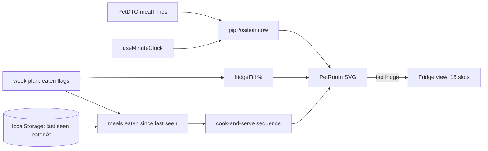

# Spec: Pip's room — Phase A (3D corner room, fridge, cooking)

## Goal
Replace Pip's flat CSS backdrop on `/pet` with a Focus Friend-style room. The room is an angled corner with two walls and a diamond floor, and its furniture is drawn as solid 3D (isometric) objects. Pip lives in it and moves around during the day. He hangs out on the rug, goes to the cooker around meal times and sleeps in his bed at night. When a meal is logged as eaten he walks to the cooker, cooks it and serves it. The fridge is tappable and shows how much of this week's planned food is still left. Phase A is the first of five phases under epic MPP-11. It builds the room and its furniture with no earning, shop or trophy data behind them. Later phases add the check-in streaks, the trophy cabinet, the currency and the shop/upgrades on top of it. Approved visual reference: `.claude/contract/MPP-15-epic-breakdown/mockups/pip-room-mockup-v5.html` (outside the repo, like the MPP-14 mockup).

## In scope
- **Room scene.** A new SVG room component replaces `.pet-room` / `.pet-room-window` / `.pet-room-shelf` / `.pet-room-jar` in `PetView`.
  - Back corner, left wall, right wall and diamond floor, using the mockup's projection: floor coords `(u, v, h)`, `P(u,v,h) = [180 − u·cos + v·cos, 180 + (u+v)·sin − h]` with slope 70/180 in a `0 0 360 330` viewBox.
- **3D object primitives** ported from the mockup: `box`, `cyl`, `ellH`, face decals `rectU`/`rectV`/`rectH`, and billboards.
  - Every object is drawn back-to-front so nearer objects overlap farther ones. The mockup v3 bug was the cooker drawn over the fridge.
- **Fixed furniture at level 1 (starter) only:**
  - Fridge (cool box) and cooker (crate + camping stove + pot) on the left wall.
  - Trophy cabinet (planks on bricks) on the right wall.
  - Bed (blanket + pillow) on the floor against the right wall.
  - Window on the right wall, and a rug in the centre.
- **A level-aware furniture catalogue.** Each station (bed, fridge, cooker, cabinet) is defined for levels 1–4 in code, with the art from the mockup.
  - Phase A always renders level 1. The other levels exist so Phase C only has to supply a level.
- **Pip positions.** Positions are computed from the time of day and the owner's MPP-13 meal times (`PetDTO.mealTimes`).
  - **Rug (home)**: default.
  - **Cooker**: from 30 min before to 30 min after each breakfast/lunch/dinner time. Pip shows the happy face and the pot steams.
  - **Bed, asleep**: from dinner time + 3 h until 1 h before breakfast time. The room dims, the window shows a moon, Pip has a new `sleep` face and "z z" floats above him.
  - The existing mood faces (`derivePetMood`) still apply when Pip is awake.
- **Cook-and-serve sequence.** Pip hops from the rug to the cooker (~1.3 s), cooks (pot steams, ~2 s), puts a plate on the counter ("Lunch is served! 🍽️"), then hops back.
  - Shown on `/pet` once for each breakfast/lunch/dinner entry marked eaten (MPP-12) since the last time this browser saw the room.
  - The "already played" marker is a per-viewer convenience in `localStorage`. Losing it only replays one animation.
- **Fridge view.** Tapping the fridge opens a full-screen fridge view inside the room card, with "Back to room".
  - It always has **15 slots**. Filled slots = `round(15 × remaining ÷ planned)`, with at least 1 while anything remains.
    - `planned` = breakfast/lunch/dinner entries in the fridge window.
    - `remaining` = those not yet marked eaten.
  - Header: "**N% full** · X of Y planned meals left", plus a note: fully stocked / plenty left / running low / empty.
  - A small gauge on top of the fridge in the room uses the same %, coloured green >50 %, amber >20 %, red ≤20 %.
  - At ≤20 %, Pip's idle bubble says "The fridge is getting empty 👀".
  - No shopping-list dependency: the fridge refills on its own when a new week is planned.
- **Speech bubble** moves inside the room's top-right. The "tap the fridge" hint goes bottom-left.
- **`prefers-reduced-motion`**: no hop, steam or walk transitions. Pip jumps straight to each position, as `MochiPet.css` already does for moods.
- **Footer tab and `PetReaction`** keep using `MochiPet` variant `mini`, unchanged.

## Explicitly out of scope
- **Phase E, snack/alcohol check-in and streaks.** Pip asks once a day in his bubble.
  - "Not now" skips, and he asks again tomorrow, covering every day since the last answer.
  - "Yes" opens a date picker (default today, min = the day after the last answer, max today) and the streak restarts from that date.
  - It gets its own brainstorm and spec, and needs server storage.
- **Phase D, trophy cabinet contents.**
  - A full-screen cabinet with three shelves: followed the plan, no snacks, no alcohol.
  - One ladder for all three (1, 3, 5, 7 days, 2 weeks, 3 weeks, 1 month) that repeats every 30 days.
  - ×N earned counts, current/best/next, and the "Firsts — things to try" list.
  - In Phase A the cabinet is decoration only and **not tappable**.
- **Phase B, currency ("sprinkles") and how it is earned.** Consistency only, never variety (memory: pet-no-variety-rewards).
- **Phase C, shop, station upgrades, decor items, wall/floor styles, edit mode.**
  - Empty decor spots are **not rendered** in Phase A. The dashed boxes in the mockup are a design aid only.
- Any backend, API, DB or migration change.
- More rooms, paid items, or real 3D (three.js / rotation).

## Pattern reference
- `foodbytes-app/client/src/components/pet/MochiPet.jsx`, `mochiParts.jsx`: Pip's SVG body, faces and `useId` gradient ids. The new `sleep` face goes in `MochiFace`, and the room places Pip by reusing the existing body geometry.
- `foodbytes-app/client/src/components/pet/PetView.jsx`, `PetView.css`: the page that hosts the room. `.pet-room*` rules are removed.
- `foodbytes-app/client/src/contexts/PetContext.jsx`: already exposes `pet` (with `mealTimes`), `mood` and the live week plan (via `MealPlanContext`). The room reads from it and does not fetch.
- `foodbytes-app/client/src/utils/petMood.js` and `petMood.check.mjs`: pure, self-checked logic. New pure helpers go next to them with their own `.check.mjs`: Pip position for a time, the fridge window, the fill %, the slot count and "meals eaten since last seen".
- `foodbytes-app/client/src/constants/pet.js`: `PET_COUNTED_MEAL_TYPES` and `PET_MEAL_TIME_KEY` are reused for the fridge and meal windows.
- `foodbytes-app/client/src/hooks/useMinuteClock.js`: drives time-of-day changes.
- Mockup source for geometry and art: `.claude/contract/MPP-15-epic-breakdown/mockups/pip-room-mockup-v5.html` (`iso` engine, `FRIDGE`/`STOVE`/`CABINET`/`BED` arrays, `roomSvg`, `fridgeHtml`, `logMeal`).

## Constraints
- **Frontend only.** No new endpoint or table, so nothing to apply on Railway. Version bump per the CLAUDE.md rules (Story → MINOR).
- **Rewards are consistency-only**, never cuisine or new-food variety (MPP-11 rule).
- **Per-person Pip (MPP-33, decided 2026-10-13):** planned meals come from the shared plan, but eaten ticks, meal times and Pip are the **viewer's own**. Depends on MPP-33 landing first.
- **Mobile-first:** the room scales to the card width with no horizontal scroll at 320 px. The fridge view scrolls inside the card.
- **Accessibility:**
  - The room SVG has a meaningful `aria-label` ("Pip's room — Pip is cooking").
  - The fridge hit area is a real button (keyboard + screen reader).
  - The fridge view has a labelled close button, and focus returns to the fridge on close.
- **No new global store.** State stays in `PetContext` and component state (CLAUDE.md convention).
- **Guests** see no room, unchanged from MPP-14.

## Approach (chosen)
Hand-built isometric SVG in React: the projection and box primitives from the mockup become a small `pet/room/` module.
- **Furniture** is data, `{ station: [level1…level4] }`, and each level is a function that returns SVG.
- **Pip's position and the fridge %** are pure functions of `(now, mealTimes, weekPlan)`, unit-checked like `petMood`.
- **Animation** uses CSS transitions on a wrapper `<g>`, as in the mockup.

This keeps one rendering stack (SVG, already used for Pip). It needs no image assets or new dependencies, stays crisp at any size, and lets later phases change a level number or add a decor item without new art plumbing.

## Approaches considered (rejected)
- **Flat side-on room / front-on with side wall (mockup v1 options B, C):** the user picked the angled corner with two real walls.
- **Flat panels skewed onto the walls (mockup v2):** the user asked for 3D objects.
- **Real 3D engine (three.js) with a rotating camera:** heavy bundle and phone GPU cost, and it doesn't fit the existing SVG Pip.
- **PNG/sprite artwork:** needs an art pipeline, blurs at high DPI, and every upgrade level needs new files.
- **Fridge tied to real shopping-list items:** complex and depends on the shopping list being used. The user chose "% of planned meals left".
- **Storing room state in the DB now:** nothing is user-changeable until Phase C, so it's premature.

## Diagram

## Success criteria
1. `/pet` shows the angled corner room. Fridge, cooker, cabinet, bed, window and rug are all drawn as 3D objects at level 1, and no object is drawn over one that is nearer the viewer.
2. With meal times 08:00 / 13:00 / 19:00:
   - Pip is on the cooker at 12:45.
   - Pip is on the rug at 15:00.
   - Pip is asleep in bed at 23:00 and at 06:30.
   - Pip is back on the rug at 07:15.

   All covered by `.check.mjs` cases.
3. Marking lunch eaten on the meal plan, then opening `/pet`, plays the walk → cook → serve → walk-back sequence once. Reloading does not replay it.
4. With 21 planned B/L/D meals and 6 eaten, the fridge view shows "71% full · 15 of 21 planned meals left" with 11 of 15 slots filled. At 4 of 21 remaining (19 %) the gauge is red and Pip says the fridge is getting empty.
5. Under `prefers-reduced-motion`, no transitions run and Pip still ends up in the right place.
6. The fridge opens and closes by keyboard, and focus returns to the fridge.
7. Footer tab, `PetReaction`, the mood logic and `PetMealsCard` behave exactly as before. `mvn test` is untouched, the frontend builds, and `npm run check:version` passes.

## Open questions
- **Fridge window:** which 7 days count as "this week"? Recommendation: the meal-plan week containing today, using the same start day the meal-plan page uses. The alternative is a rolling window from the most recent day with any planned meal.
- **Cook-and-serve timing:** play the sequence on the next `/pet` visit (as specced), or also play a mini version inline in `MealEatenSection` next to `PetReaction`?
- **Plan streak definition (needed by Phase D):** what counts as "followed the plan" for a day? For example, all planned B/L/D marked eaten by end of day.
- **Pip's cooker window:** is ±30 min around each meal time right, and dinner + 3 h for bedtime?
